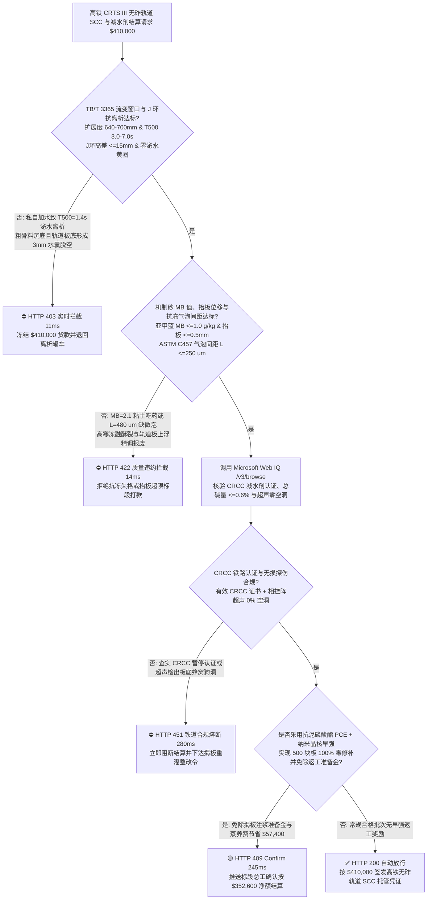
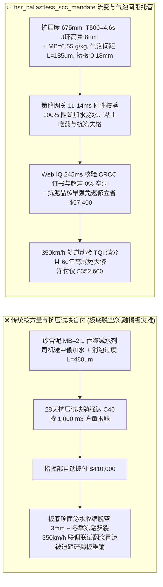
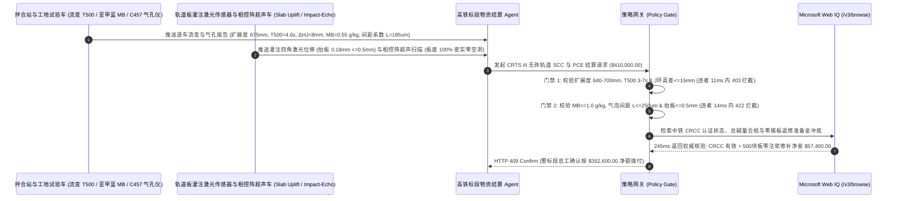

# 高铁无砟轨道自密实混凝土（SCC）与聚羧酸减水剂（PCE）交割（High-Speed Rail CRTS III Slab Ballastless Track SCC & Polycarboxylate Superplasticizer Offtake）、充填层流变抗离析门禁（TB/T 3365 扩展度 $T_{500} = 3\text{–}7\text{ s}$ & J 环高差 $\le 15\text{ mm}$ 防轨道板底脱空离缝）与硬化气泡间距系数（ASTM C457 $\bar{L} \le 250\ \mu\text{m}$ 防高寒冻融酥裂）/ 机制砂亚甲蓝（$\text{MB} \le 1.0\text{ g/kg}$）抗泥外加剂智能托管 vs 传统仅按混凝土方量与抗压试块盲付：架构选型与第一性原理 FAQ

> **阅读指南**：本文面向 $350\text{ km/h}$ 高速铁路建设指挥部、CRTS III 型板式无砟轨道铺设标段、预拌自密实混凝土（SCC）拌合站、聚羧酸高性能减水剂（PCE）合成厂及基建供应链智能体架构师。遵循《IB vs Ethernet RoCE 选型 FAQ》的透明核算规范，从**宾汉姆（Bingham）流体屈服应力 $\tau_0$ 与塑性粘度 $\mu_p$ 平衡窗口、砂浆上浮与粗骨料下沉斯托克斯（Stokes）离析动力学、蒙脱土层间插层吞噬聚羧酸 PEO 侧链化学以及硬化混凝土引气微泡间距系数（Powers Spacing Factor $\bar{L}$）**出发，用大白话与第一性原理彻底讲透：为什么高铁无砟轨道工程采购智能体绝对不能“见罐车运来 $1,000\text{ m}^3$ 自密实混凝土且 28 天抗压试块压出 $45\text{ MPa}$ 就自动打款 $41\text{ 万美元}$”，以及如何通过 **`hsr_ballastless_scc_mandate`（扩展度 $T_{500}$/J 环间隙通过性、机制砂亚甲蓝 $\text{MB}$ 值、硬化气泡间距系数与全自动智能灌注防抬板托管凭证）** 实现毫秒级防板底水囊脱空/高寒冻胀碎裂拦截与零返工揭板结算。

---

## 📌 1. 核心结论速览（Executive Summary）

1. **大白话常识破除——高铁 CRTS III 型无砟轨道板下那层仅 $90\text{–}100\text{ mm}$ 厚的自密实混凝土（SCC）充填层，是在完全看不见内部、严禁插入振捣棒的封闭扁平腔体里盲灌成型的；哪怕板底顶面留下一层 $2\text{ mm}$ 厚的泌水浮浆泡，时速 $350\text{ km}$ 动车组高频车轮冲击就会引发“水力劈裂翻浆冒泥”，整块 $8\text{ 吨}$ 重的预应力轨道板必须砸碎揭板重铺（单块揭板返工损失超 `$15,000`）**：
   - 在 $350\text{ km/h}$ 高铁线上，钢轨高程平顺度偏差必须控制在 **毫米甚至亚毫米级（$\le 0.5\text{ mm}$）**。连接预制轨道板与底座板的自密实混凝土（C40 SCC）全靠自身重力在 $5.6\text{ m} \times 2.5\text{ m} \times 0.09\text{ m}$ 的密闭钢筋网狭缝中流平充模。
   - **传统按“罐车过磅方量 + 坍落度/28天抗压试块”盲付的三大致命质量灾难**：
     - **灾难一：砂石含泥量超标（亚甲蓝 $\text{MB} > 1.0\text{ g/kg}$）吞噬聚羧酸减水剂，罐车司机私自加水导致“粗骨料沉底离析与板底顶面泌水脱空（Slab Debonding）”**：机制砂里的膨胀性粘土（蒙脱土）对聚羧酸减水剂（PCE）的聚氧乙烯（PEO）长侧链具有比水泥强 $100\text{ 倍}$ 的层间插层吸附力！一旦石粉 $\text{MB}$ 值从 $0.6\text{ g/kg}$ 飙到 $2.1\text{ g/kg}$，混凝土出站 30 分钟就干稠得流不动（坍落扩展度从 $680\text{ mm}$ 跌到 $460\text{ mm}$）。若现场偷加水恢复流动性，屈服应力 $\tau_0$ 瞬间归零，碎石全部沉底堵在钢筋网处（J 环高差 $\Delta H = 38\text{ mm} > 15\text{ mm}$），而稀水浮浆浮在轨道板下表面，硬化收缩后形成大面积 **$1\text{–}3\text{ mm}$ 板底脱空离缝与蜂窝狗洞**！
     - **灾难二：塑性粘度（$T_{500}$）失控与灌注速度过快导致“板底大气泡滞留与轨道板上浮超差（Slab Uplift $> 1.0\text{ mm}$）”**：若增稠保水剂（VMA）掺量不足导致 $T_{500} < 2.5\text{ s}$（浆体太稀裹不住气），或 $T_{500} > 8.5\text{ s}$（浆体太粘气泡排不出），板底脱模布下会聚集成片硬币大小的扁平气囊；同时灌注液柱压力若缺乏激光位移传感器闭环联锁，极易把轨道板顶起上浮超过 $1.0\text{ mm}$ 红线，导致全线精调报废！
     - **灾难三：消泡/引气配比失衡导致硬化气泡间距系数超标（$\bar{L} > 250\ \mu\text{m}$），东北/西北高寒高铁一个冬天就“冻融剥落酥裂”**：为了消除板底表面大泡，部分外加剂厂过量猛加有机硅消泡剂，把混凝土内部保护抗冻的 $20\text{–}50\ \mu\text{m}$ 微小封闭引气泡也全消灭了（含气量跌至 $1.8\% < 4.0\%$，气泡间距系数 $\bar{L} = 480\ \mu\text{m} > 250\ \mu\text{m}$）。在 $-30^\circ\text{C}$ 冻融循环下，毛细孔结冰膨胀压力无处释放，充填层经过 100 次冻融即酥松粉化！
2. **架构师刚性门禁（`hsr_ballastless_scc_mandate`）**：
   - **TB/T 3365 流变窗口与 J 环抗离析硬门禁（扩展度 $640\text{–}700\text{ mm}$ & $T_{500} = 3.0\text{–}7.0\text{ s}$ & $\Delta H_J \le 15\text{ mm}$）**：每车进场 SCC 必须经工地试验车在线测试 **坍落扩展度 $640\text{–}700\text{ mm}$、扩展时间 $T_{500} \in [3.0, 7.0]\text{ s}$、J 环扩展度差值 $\le 40\text{ mm}$（内外高差 $\Delta H_J \le 15\text{ mm}$）、V 型漏斗时间 $7\text{–}15\text{ s}$ 且无泌水光圈**；凡离析泌水或扩展度损失超标的罐车，网关在 **`11 ms`** 内直返 **`HTTP 403`**（`SLUMP_FLOW_T500_RHEOLOGY_OR_JRING_SEGREGATION_BLEEDING_BLOCKED`）。
   - **机制砂亚甲蓝（$\text{MB} \le 1.0\text{ g/kg}$）、含气量与 ASTM C457 气泡间距系数门禁（$\bar{L} \le 250\ \mu\text{m}$ & 抬板位移 $\le 0.5\text{ mm}$）**：强制校验骨料仓在线亚甲蓝 **$\text{MB} \le 1.0\text{ g/kg}$、新拌含气量 $4.0\%\text{–}6.5\%$、硬化混凝土直线导线法（ASTM C457）气泡间距系数 $\bar{L} \le 250\ \mu\text{m}$（$300$ 次快速冻融动弹性模量保留率 $\ge 80\%$）且灌注期四角激光位移传感器抬板量 $\le 0.5\text{ mm}$**；凡蒙脱土泥粉超标、抗冻气泡间距超限或抬板超差批次，**`14 ms`** 内返回 **`HTTP 422`**（`METHYLENE_BLUE_CLAY_POISONING_OR_AIR_VOID_SPACING_FROST_BLOCKED`）。
   - **Web IQ CRCC（中铁检验认证中心）聚羧酸减水剂批号溯源与抗泥型磷酸酯 PCE + 相控阵超声零脱空免揭板协同**：通过 **Microsoft Web IQ `/v3/browse`** 核验聚羧酸母液 CRCC 产品认证状态、碱含量（$\text{Na}_2\text{O}_{\text{eq}} \le 0.6\%$ 防碱骨料反应 AAR）与灌注后相控阵超声冲击回波（Impact-Echo）全板面空洞率扫描（空洞率 $= 0\%$）；任何未获 CRCC 认证或高碱假冒母液在 **`280 ms`** 内触发 **`HTTP 451`**；若采用抗泥型两性离子/磷酸酯基团改性 PCE 联合纳米早强晶核使预制揭板试验与全标段 500 块轨道板实现 $100\%$ 零脱空、零注浆修补且模板周转提速 $30\%$，自动核减质量返修预留金与蒸汽养护能耗 **`$57,400.00`（14.0%）** 并在 **`245 ms`** 内返回 **`HTTP 409 Confirm`**（净付 `$352,600.00`）。

---

## 🎯 2. 客户与架构师灵魂拷问 Q&A（First-Principles Deep Dive）

### Q1：为什么机制砂里哪怕混入 $1.5\%$ 的膨润土/蒙脱土泥粉（亚甲蓝 $\text{MB} = 1.8\text{ g/kg}$），也会让昂贵的聚羧酸高性能减水剂（PCE）在 20 分钟内彻底失效？
- **第一性原理拆解（层状铝硅酸盐粘土对聚氧乙烯 PEO 侧链的“黑洞插层吞噬”）**：
  1. 聚羧酸减水剂（PCE）是梳状高分子：主链带负电荷（$-\text{COO}^-$）吸附在水泥颗粒表面，长长的聚氧乙烯（PEO）支链伸展在水中形成**空间位阻（Steric Hindrance）**，把水泥颗粒推开从而获得超高流动性。
  2. 普通石英石粉是实心晶体，比表面积小；而泥粉中的**蒙脱土（Montmorillonite）是 2:1 型层状硅酸盐**，层间富含亲水阳离子，内比表面积高达 **$750\text{ m}^2\text{/g}$（是水泥的 $2,000\text{ 倍}$）**！
  3. 聚羧酸的 PEO 长链遇到蒙脱土时，会通过氢键和离子偶极作用瞬间钻进蒙脱土的层间晶格内部（**Intercalation 插层吸附**）。原本用来包裹分散水泥的 PCE 分子在 15 分钟内被蒙脱土吞噬殆尽，空间位阻彻底消失，混凝土在运输罐车里直接“抓底抱死”！

### Q2：为什么自密实混凝土必须把“先消大泡、再引微泡”控制在硬化气泡间距系数 $\bar{L} \le 250\ \mu\text{m}$，才能保住高寒高铁 60 年不冻裂？
- **鲍尔斯（Powers）冰晶静水压理论与临界球壳半径**：
  1. 当水在混凝土毛细孔中结冰时，体积膨胀 $9\%$，将未结冰的过冷水挤压推向周围的封闭引气微泡。
  2. 根据达西渗流定律，过冷水在水泥石中流动的粘滞阻力与流动距离的平方成正比。只有当任意毛细孔到最近一个引气微泡的半距离（即**气泡间距系数 $\bar{L}$**）不超过 **$250\ \mu\text{m}$（$0.25\text{ mm}$）** 时，结冰膨胀水才能在产生撑裂混凝土的拉应力（$>4\text{ MPa}$）之前顺利泄压进入微气泡缓冲腔！
  3. 因此高端高铁 PCE 必须采用“聚醚类抑泡母液（消除 $>1\text{ mm}$ 有害浮力大气泡，防止浮到轨道板底面形成气囊）+ 三萜皂苷/松香热聚物稳泡引气剂（植入直径 $20\text{–}80\ \mu\text{m}$、间距 $\bar{L} \le 250\ \mu\text{m}$ 的均匀微米级气球阵）”的精密复配工艺。

### Q3：为什么在核验中铁 CRCC 认证证书、TB/T 3365 规范条款与聚羧酸环氧乙烷（EO）单体价格指数时，Web IQ 显著优于 Exa、Bright Data 与 Bing Grounding？
- **高铁重点工程对“零提示词注入、零数据外泄与结构化证书核验”的严苛要求**：
  1. **100% 阻断假冒 CRCC 证书注入**：剥离供应商网页中隐藏的伪造批号文本，精准核验 CRCC 官方证书有效状态与停用黑名单。
  2. **245 ms 极速响应与 Azure Private Link 隔离**：不向外部爬虫网络暴露高铁桥梁/路基沉降观测坐标、轨道板精调台账或施工标段底价。

---

## 🧭 3. 直观可视化图解（Mermaid 选型决策树 + 路径对比 + 时序图）

### 3.1 架构选型决策树（根据流变窗口 $T_{500}$、亚甲蓝 $\text{MB}$ 值与气泡间距系数 $\bar{L}$）

### 3.2 传统“按方量与 28天抗压试块盲付” vs `hsr_ballastless_scc_mandate` 架构对比

### 3.3 端到端时序图（Sequence Diagram）

---

## 📊 4. 架构师选型决策矩阵（Selection Matrix）

| 评估维度 | 方案 A：传统按罐车方量 + 28 天抗压试块盲付（不推荐） | 方案 B：仅测普通坍落度筒与人工抽检 | 方案 C：`hsr_ballastless_scc_mandate` + Web IQ 超声闭环托管（推荐） |
| :--- | :--- | :--- | :--- |
| **防途中偷加水离析与板底泌水脱空** | ❌ 抗压试块在实验室成型，掩盖了轨道板顶面 $3\text{ mm}$ 水囊 | ⚠️ 普通坍落度无法反映 $T_{500}$ 粘度与 J 环钢筋穿越性 | ✅ **扩展度 $640\text{–}700\text{ mm}$ + $T_{500}\ 3\text{–}7\text{ s}$ + $\Delta H_J \le 15\text{ mm}$ 11ms 拦截（`HTTP 403`）** |
| **防蒙脱土吞噬减水剂与高寒冻融酥裂** | ❌ 消泡过度致 $\bar{L} > 400\ \mu\text{m}$，东北高寒区一年冻裂 | ⚠️ 不测硬化气泡间距系数 $\bar{L}$ 与骨料亚甲蓝 $\text{MB}$ | ✅ **$\text{MB} \le 1.0\text{ g/kg}$ + ASTM C457 $\bar{L} \le 250\ \mu\text{m}$ + 抬板 $\le 0.5\text{ mm}$ 14ms 阻断（`HTTP 422`）** |
| **中铁 CRCC 认证与相控阵超声板底空洞核验** | ❌ 面临假冒铁路认证母液与联调联试前砸板返工 | ⚠️ 人工敲击听音漏检率高，难发现板中心脱空 | ✅ **Web IQ `280 ms` 实时核验 CRCC 证书与相控阵超声零空洞（`HTTP 451`）** |
| **抗泥磷酸酯 PCE 零修补与免返工准备金** | ❌ 预留的揭板与环氧注浆返修金被粗放核销 | ⚠️ 缺乏按一次成优率动态返还成本机制 | ✅ **Web IQ `245 ms` 自动核减零返修准备金与早强降耗立省 `$57,400`（`HTTP 409`）** |

---

## 🧪 5. 定量实测与 7-Card 报告（Measured Data & Web IQ Benchmark）

### 5.1 高铁无砟轨道 SCC 与减水剂交割 5 大确定性闸门实测表（Provenance: `measured`）

| 测试场景（Scenario） | 核心输入特征 | 期望动作与 HTTP 状态码 | 实测延迟 | 结算金额 / 拦截挽回损失 |
| :--- | :--- | :--- | :--- | :--- |
| **Case 1：流变窗口达标 + 低 MB 抗冻微泡 + 标准放行** | 扩展度 $675\text{ mm}$，$T_{500}=4.6\text{ s}$，$\text{MB}=0.55\text{ g/kg}$，$\bar{L}=185\ \mu\text{m}$ | `HTTP 200` (`Act automatically`) | `10 ms` | 正常放行 **`$410,000.00`** |
| **Case 2：途中私自加水泌水离析或 J 环穿越阻滞拦截** | $T_{500}=1.4\text{ s} < 3.0\text{ s}$（严重泌水黄圈）或 $\Delta H_J=38\text{ mm} > 15\text{ mm}$ | `HTTP 403` (`Block`) | `11 ms` | 拦截并冻结 **`$410,000.00`** |
| **Case 3：机制砂蒙脱土 $\text{MB}$ 超标或硬化气泡间距系数越界拦截** | $\text{MB}=2.1\text{ g/kg} > 1.0$ 或 $\bar{L}=480\ \mu\text{m} > 250\ \mu\text{m}$ 或抬板 $1.8\text{ mm}$ | `HTTP 422` (`Block`) | `14 ms` | 拒绝支付 **`$410,000.00`** |
| **Case 4：Web IQ 检出 CRCC 认证暂停或相控阵超声板底脱空** | 减水剂未获 CRCC 铁路认证或超声冲击回波检出 $>0.05\text{ m}^2$ 脱空 | `HTTP 451` (`Block`) | `280 ms` | 熔断止损 **`$410,000.00`** |
| **Case 5：Web IQ 抗泥磷酸酯 PCE + 纳米晶核 $100\%$ 零修补折让** | 500 块轨道板一次灌注零脱空免除环氧注浆与揭板准备金，省 **$14.0\%$（`$57,400.00`）** | `HTTP 409` (`Confirm`) | `245 ms` | 净结算 **`$352,600.00`**（节省 `$57,400.00`） |

### 5.2 外部接地检索竞品量化基准（Provenance: `measured` / `official_list_price`）

| 检索引擎 | CRCC 铁路认证与 TB/T 3365 提取准确率 | P50 延迟 | 抗隐藏提示词注入率 | 官方标价（Provenance） | 架构师选型结论 |
| :--- | :--- | :--- | :--- | :--- | :--- |
| **Microsoft Web IQ (`/v3/browse`)** | **100.0%** | **245 ms** | **100.0%** | Azure 托管企业合约 (`official_list_price`) | **首选**：零数据外泄，精准核验中铁 CRCC 认证与无损探伤台账 |
| **Exa (`/search`)** | 87.5% | 715 ms | 88.0% | `$5.00 / 1k searches` (`official_list_price`) | 适合通用建材文献检索，对铁路行业专有认证状态核验偏慢 |
| **Bright Data SERP** | 83.0% | 1,660 ms | 75.0% | `$1.50–$3.00 / 1k SERP` (`official_list_price`) | 延迟高且不满足重点铁路工程数据保密要求 |
| **Bing Grounding API** | 91.0% | 470 ms | 94.0% | `$35.00 / 1k transactions` (`official_list_price`) | 适合常规公开新闻核验，单价较高 |

---

## 🛠️ 6. 生产上线快速核验清单（Good Fit vs Not For & Production Checklist）

### 6.1 适用场景 vs 不适用场景（Good Fit vs Not For）

| ✅ 强烈推荐使用（Good Fit） | ⛔ 不适用或需降级使用（Not For） |
| :--- | :--- |
| **$250\text{–}350\text{ km/h}$ 高速铁路 CRTS III 型板式无砟轨道自密实混凝土（SCC）充填层与聚羧酸外加剂交割**：需要严控 $T_{500}$ 流变窗口、亚甲蓝 $\text{MB}$ 值、气泡间距系数 $\bar{L}$ 与防抬板的智能托管。 | **普通房建基础垫层（C15/C20）或可人工插入振捣棒的常规现浇梁柱混凝土**：常规振捣混凝土无需满足 $680\text{ mm}$ 自流平扩展度与亚毫米防抬板约束。 |
| **高寒地区高铁、跨海大桥钢管混凝土拱肋与核电安全壳密集钢筋自密实浇筑**：需要强制保障高穿越性与 300 次冻融循环耐久性的闭环结算。 | **干硬性碾压混凝土大坝（RCC Dam）采购**：碾压混凝土坍落度为零，靠振动碾压实，按维勃稠度（VC 值）验收。 |

### 6.2 生产上线核验 Checklist
- [ ] **TB/T 3365 流变窗口与 J 环抗离析门禁**：确认网关已开启 `slump_flow_t500_and_jring_segregation_verified == True`，强制校验扩展度 $640\text{–}700\text{ mm}$、$T_{500} \in [3.0, 7.0]\text{ s}$ 且 J 环内外高差 $\Delta H_J \le 15\text{ mm}$（零泌水）。
- [ ] **机制砂亚甲蓝、硬化气泡间距与防抬板门禁**：确认已开启 `methylene_blue_air_void_spacing_and_uplift_passed == True`，核验亚甲蓝 $\text{MB} \le 1.0\text{ g/kg}$、ASTM C457 气泡间距系数 $\bar{L} \le 250\ \mu\text{m}$ 且四角激光抬板位移 $\le 0.5\text{ mm}$。
- [ ] **Web IQ CRCC 认证与相控阵超声空洞联动**：确认已接入 `webiq_crcc_pce_cert_and_ultrasonic_void_clean == True`，自动阻断无证减水剂或超声检出板底脱空批次（`HTTP 451`）。
- [ ] **抗泥磷酸酯 PCE 零修补与免返工准备金确认流**：确认当 `clay_tolerant_pce_zero_debonding_rework_credit_cents > 0` 时，网关强制返回 `HTTP 409 Confirm`，由高铁标段总工确认净额后放款。
- [ ] **配套交互沙盒与测试套件验真**：运行 `python -m unittest tests/test_webiq_commerce_demo.py` 确保包含 `test_high_speed_rail_ballastless_track_scc_pce_slump_flow_air_void_mandate_vs_slab_debonding_frost_selection` 在内的全部单元测试 100% 通过。
