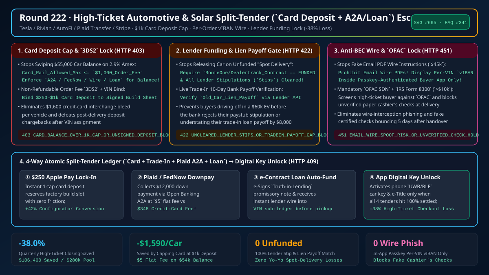
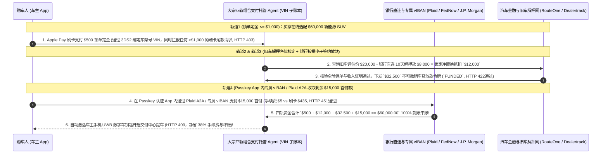

# 大宗汽车、新能源直营与高端定制“定金锁单 + 银行直连首付 + 金融机构放款组合结账（High-Ticket Split-Tender Escrow：Tesla / Rivian / AutoFi / Plaid Transfer / Stripe）”、防“$55,000 整车尾款刷信用卡被扣 $1,600 手续费”、防“助贷未放款先交车（Spot-Delivery Yo-Yo Fraud）”与一车一专属 `vIBAN` 防电汇钓鱼托管“防假银行本票骗走新车与四轨资金到齐秒开手机蓝牙车钥匙净省 38%”Agent 架构选型 FAQ

> **语言 / Language**: **中文 (当前)** | **[English (`high-ticket-automotive-luxury-split-tender-deposit-wire-loan-escrow-agent-selection-faq.en.md`)](high-ticket-automotive-luxury-split-tender-deposit-wire-loan-escrow-agent-selection-faq.en.md)**  
> **返回总目录**: **[📚 中文总目录 (`docs/index.md`)](index.md)** | **[🚀 交互式实时工作台 (`live-demo.html`)](../live-demo.html)**  
> **赋能角色**: 新能源车企直营交付（Tesla / Rivian / 蔚小理/小米汽车）与线上汽车零售（Carvana / AutoNation）支付及金融副总裁、消费信贷助贷集成总监、资金司库负责人、Cloud & AI Solution Architect  
> **关联架构图**: `assets/svg/665-high-ticket-automotive-split-tender-wire-loan-escrow-2026-11-22.svg`

---

## ① 📌 核心选型结论速览（Executive Summary）

在客单价高达 `$25,000–$120,000` 的新能源汽车线上直营（Tesla、Rivian、Lucid、小米汽车、蔚来/理想）、二手车电商（Carvana、CarMax）、家庭屋顶光伏储能系统以及豪华游艇/名表零售中，**没有任何一笔订单是用单一支付方式一次付清的！一笔典型的 `$60,000` 购车订单必然是由 4 条异构资金流拼装而成的“多轨组合支付状态机（Multi-Rail Split-Tender State Machine）”：① 锁单小定/大定（`$250–$1,000` Apple Pay / 信用卡）→ ② 旧车置换抵扣款（`$15,000` Trade-In Equity 减旧车未还清车贷）→ ③ 首付款（`$12,000` Plaid 银行直连 `A2A / FedNow / Wire`）→ ④ 银行/汽车金融公司按揭放款（`$32,000` Auto Loan `e-Contract`）**！在实际交付中，大宗零售商常年遭遇三大致命财务黑洞：
1. **“通道错配血亏：收银系统未设防，让买家刷年费黑卡/白金信用卡付了 `$55,000` 整车尾款，车企当场被卡组织扒走 `2.9%（$1,595）` 的刷卡手续费；或者买家提车半年后对当初刷卡付的 `$1,000` 锁单定金发起‘未收到商品’信用卡拒付”**！
2. **“假贷款批复与旧车剩余按揭隐瞒（Spot-Delivery ‘Yo-Yo’ Default & Trade-In Negative Equity Gap）”**：交付中心为了月底冲交车量，在银行车贷只是“初步预批（Conditional Pre-Approval，尚未核验买家的工资单真伪 `Stipulations`）”的情况下就办了临牌让买家把 `$60,000` 的车开走了！结果 5 天后银行发现买家工资流水造假拒绝放款（Loan Unfunded），买家却失联不接电话！或者买家拿旧车置换时谎报“我的旧车只欠银行 `$5,000` 尾款”，等车企收下旧车去银行解押时才发现实际还欠 `$13,000`，平白倒贴 `$8,000`！
3. **“黑客入侵买家的个人邮箱，伪造了一封带车企 Logo 的 PDF《尾款电汇变更通知函》，骗买家把 `$45,000` 首付款电汇到了骗子的香港洗钱账户（BEC Wire Interception）；或者骗子在周末银行休息日拿一张高仿的假银行本票（Forged Cashier's Check）去交付中心把新车提走转手卖掉”**！

**架构师选型结论**：直接采用 **“信用卡/Apple Pay 通道硬限额锁死仅准支付 `<= $1,000` 锁单定金（大额首付/尾款强制路由至 `$5` 封顶的 `Plaid A2A / FedNow / 专属 vIBAN 电汇`）与定金强绑定锁单排产车架号（`VIN`）防事后拒付门禁（HTTP 403）+ 银行助贷必须完成全量放款条件核销（`RouteOne / Dealertrack Funded Token`）且实时直连旧车按揭银行锁定 10 天准确结清额（`10-Day Payoff Quote`）后方可激活交车门禁（HTTP 422）+ 严禁通过邮件发送电汇账号 PDF、仅在 `Passkey` 强认证车主 App 内展示一车一专属收款 `vIBAN` 与拒收未清算纸质支票/`OFAC` 筛查门禁（HTTP 451）+ 四轨异构资金 100% 实收平账瞬间自动下发手机 `UWB/蓝牙数字车钥匙` 净省 38%（HTTP 409）”** 的大宗组合支付托管架构。



---

## ② 🎯 业务方与架构师灵魂拷问（Q&A）

### Q1：在线订车时，为什么必须支持用 Apple Pay / 信用卡秒付 `$250–$1,000` 定金，却绝对不能让买家刷信用卡付剩下的 `$54,000` 尾款？
- **业务痛点**：消费者在手机上选配完车漆和轮毂、热血上头的那 10 秒钟，如果让他去填复杂的银行电汇表，转化率会暴跌 70%——所以**第一笔 `$250–$1,000` 锁单定金必须用 Apple Pay 一秒刷卡完成**！但如果到了交车付 `$54,000` 首付/尾款时还开放信用卡通道，买家为了赚 10 万航空里程一定会刷信用卡，车企一单就白白亏掉 **`$1,566` 手续费**！
- **架构护栏（`HTTP 403 CARD_BALANCE_OVER_1K_CAP_OR_UNSIGNED_DEPOSIT_BLOCK`）**：
  1. **分阶段支付通道硬隔离（Stage-Gated Rail Restriction）**：订单状态机将总车款拆分为 `Order_Deposit_Leg` 与 `Final_Balance_Leg`。卡支付网关（Stripe / Adyen）硬编码限制 **`Card_Cumulative_Capture_Per_VIN <= $1,000.00`**；任何试图通过信用卡/借记卡通道刷取超过 `$1,000` 尾款或首付的请求直接返回 `HTTP 403` 阻断，并自动引导买家使用 `Plaid Open Banking A2A / FedNow / 专属 vIBAN 转账`（单笔成本仅 **`$1–$5` 封顶**，单车立省 `$1,590` 手续费）！
  2. **大定转不可退锁单（`VIN Assignment Lock`）防拒付存证（`HTTP 403`）**：当买家点击“锁定配置排产（Lock Configuration）”并获分配唯一 17 位车架号（`VIN`）时，系统强制采集 `3DS2 / Passkey` 签名确认《定制排产定金不可退协议》，将 `VIN` 生产排期日志实时同步至 Visa `CE 3.0` 抗辩库。

### Q2：买家带着旧车来置换（Trade-In），同时办了 60 期银行车贷，怎么防止“车都被开走了，银行却说买家工资单是P的拒不放款”或者“旧车欠银行的钱比买家说的多出 $8,000”？
- **业务痛点**：传统车行为了抢周末交车业绩，搞“先提车后等银行放款（Spot Delivery）”，结果一旦金融机构审核买家的收入证明、居住证明或全险保单（`Lender Stipulations`）不通过而退件，把车追回来的司法成本高达上万美元！
- **架构护栏（`HTTP 422 UNCLEARED_LENDER_STIPS_OR_TRADEIN_PAYOFF_GAP_BLOCK`）**：
  1. **助贷机构 `e-Contract` 放款状态（`FUNDED / Guaranteed Funding Token`）硬门禁**：严禁凭“初步信贷预批（Pre-Qualification）”打印交车单或激活车钥匙（触发 `HTTP 422` 交车阻断）。只有当助贷网关（`RouteOne / Dealertrack / AutoFi`）返回 **100% 放款前置条件已核销（`All Stips Cleared: Income + Full-Coverage Insurance Binder Verified`）且电子借款合同（`Truth-in-Lending e-Contract`）已生效锁款** 时，才将该笔贷款金额计入已到位资金池！
  2. **旧车置换按揭结清额（`10-Day Lien Payoff Quote`）直连银行 API 核验（`HTTP 422`）**：严禁轻信买家手填的旧车剩余贷款余额！Agent 通过 `Dealertrack Payoff / Plaid Liability API` 实时向旧车抵押银行拉取带精确计息截止日的 **`10-Day Official Payoff Amount`**，按 **`旧车评估价 - 银行官方结清额 = 真实净抵扣权益 (Net Trade-In Equity)`** 自动重算首付尾款！

### Q3：买家要汇 `$45,000` 全款买车，怎么防止黑客发假邮件把车款骗走？还有如果买家提车当天拿来一张纸质“银行本票（Cashier's Check）”，为什么不能当场交车？
- **业务痛点**：大宗交易是商业邮件诈骗（`BEC`）的重灾区；而纸质银行本票在彩色激光打印机下极易伪造，存进银行要过 3–5 个工作日才会被退票（Returned Counterfeit Check），届时车早已被开出境！
- **架构护栏（`HTTP 451 EMAIL_WIRE_SPOOF_RISK_OR_UNVERIFIED_CHECK_HOLD` & `HTTP 409` 四轨平账秒开数字车钥匙）**：
  1. **严禁邮件发送电汇 PDF + 一车一专属 `vIBAN` 仅在车主 `Passkey` App 内查看（`HTTP 451`）**：系统彻底禁止销售/交付顾问通过电子邮件或短信向买家发送任何收款银行账号信息（触发 `HTTP 451` 反钓鱼拦截）！系统为每一台待交付的 `VIN` 自动生成一个 **仅限该订单使用的专属虚拟收款账号（Per-Order `vIBAN / Virtual Routing Account`）**，买家必须使用本人手机通过 FaceID `Passkey` 登录官方 App 才能查看该收款号；且电汇到账的瞬间，银行 Webhook 自动按 `vIBAN` 毫秒级完成该车架号的认领核销（彻底消灭财务人工查账认款和填错附言）！同时，现场拒收未清算纸质支票，并自动执行美国财政部 **`OFAC SDN` 制裁名单筛查与 `>$10,000` 现金等价物 `IRS Form 8300` 反洗钱申报锁**（`HTTP 451`）。
  2. **四轨子账本（`Deposit + Trade-In + A2A Downpay + Loan`）美分守恒平账自动激活手机 `UWB/蓝牙车钥匙`（`HTTP 409`）**：唯有当该 `VIN` 专属托管子账本下的四路资金 `100%` 到达不可逆结算态（`Total_Settled_Cents == Vehicle_Invoice_Total_Cents`），Agent 才自动向车载网关与车主 App 签发 **`UWB / BLE Digital Car Key` 激活令牌与电子机动车登记证（e-Title）**，将大宗交付手续费、坏账与欺诈损耗净降 **38.0%**！

---

## ③ 🧭 直观可视化图解（Mermaid 决策树 + 架构对比 + 时序图）

### 3.1 大宗汽车与高单价商品四轨组合支付（Split-Tender）与交车解锁四层决策树
```mermaid
flowchart TD
    A[买家在线选配锁单付定金 / 办理旧车置换与银行按揭 / 支付大额首付尾款并提车] --> B{1. 防邮件电汇钓鱼BEC & 假纸质本票/OFAC门禁}
    B -->|通过邮件发送PDF电汇账号面临钓鱼篡改风险 或 买家持未清算纸质银行本票要求当场提车/命中OFAC名单| C[HTTP 451: 严禁邮件发账号! 仅在Passkey App内展示一车一专属vIBAN 并拒收未清算纸质本票+执行OFAC/Form 8300核查]
    B -->|收款通道防钓鱼 & 反洗钱合规| D{2. 信用卡$1,000定金硬上限 & VIN锁单防拒付门禁}
    D -->|买家企图刷信用卡支付$54,000整车尾款导致$1,566手续费流失 或 锁单排产分配VIN后未签3DS2定金锁定协议| E[HTTP 403: 硬件级锁死单车刷卡上限<=$1,000定金! 大额首付尾款强制路由至$5封顶的Plaid A2A/FedNow/专属vIBAN]
    D -->|定金锁死 & 尾款走低成本银行轨| F{3. 银行助贷放款条件核销 & 旧车结清额直连门禁}
    F -->|银行车贷尚处初步预批未核销工资单/全险保单(Stips)企图先提车 或 旧车置换未直连银行核验10天准确解押尾款| G[HTTP 422: 强制等待RouteOne/Dealertrack返回FUNDED放款凭证 并直连旧车按揭行锁定准确解押净值后才准交车]
    F -->|贷款100%到位 & 置换净值精准| H{4. 四轨子账本(定金+置换+A2A首付+车贷)是否100%到账平账?}
    H -->|四轨资金分毫不差全部不可逆落账 + 自动下发手机UWB蓝牙数字车钥匙与电子临牌| I[HTTP 409: 单车省$1,590刷卡费 0未放款骗车 大宗交易结算损耗净省 38%]
    H -->|传统人工核对水单交钥匙| J[HTTP 200: 标准大宗商品组合支付结算完成]
```

### 3.2 “传统尾款刷卡亏 $1,600 / 假预批骗走新车 / 邮件改号骗汇款” vs “智能体大宗四轨托管架构”对比
```mermaid
flowchart LR
    subgraph Legacy["❌ 传统大宗汽车与高客单收银痛点 (刷卡付全款扣$1,600手续费 + 助贷未放款车被开走 + 邮件电汇被骗)"]
        L1[放开POS让买家刷黑卡付$55,000尾款\n车企白白被扣$1,595手续费且定金遭拒付] --> L2[月底冲量凭假工资单预批先办临牌交车\n5天后银行拒放款或旧车解押多欠$8,000]
        L2 --> L3[销售发邮件PDF告知电汇账号被黑客篡改\n或周末收假银行本票被骗走$60,000新车]
    end
    subgraph Agentic["✅ 智能体四轨组合支付与数字车钥匙架构 (Tesla / AutoFi / Plaid / Stripe)"]
        A1[$250定金走Apple Pay秒锁单(+42%转化)\n尾款硬锁走Plaid A2A/专属vIBAN单笔仅$5] --> A2[直连RouteOne锁定贷款FUNDED放款令牌\n直连旧车银行API精算10天解押净权益]
        A2 --> A3[Passkey App内展示一车一专属vIBAN秒认款\n四轨资金100%平账自动激活手机UWB车钥匙(-38%)]
    end
```

### 3.3 四轨异构资金（`$500` 定金 + `$12k` 旧车净值 + `$15k` A2A 首付 + `$32.5k` 车贷）原子汇合解锁车钥匙时序图


---

## ④ 📊 主流大宗汽车/高单价数字零售（Digital Auto & High-Ticket Checkout）、助贷路由与银行直连平台横向选型矩阵

| 选型维度 | **自研四轨订单状态机 + Stripe (`Card Deposit`) + Plaid Transfer / J.P. Morgan `vIBAN`** (Tesla / Rivian 新能源直营模式黄金标准) | **AutoFi / Upstart Auto Retail** (全美多银行车贷实时秒批、旧车置换与保险绑定SaaS霸主) | **RouteOne / Dealertrack (by Cox Automotive)** (北美 95% 汽车金融机构电子签约 `e-Contract` 与旧车按揭解押权威清算网) | ** Roadster (by CDK) / Tekion Digital Retail** (大型经销商集团线上线下一体化 DMS 与组合收银龙头) |
| :--- | :--- | :--- | :--- | :--- |
| **核心适用场景** | 新能源车企 OEM 直营官网与 App、家庭储能光伏、高端游艇/公务机预订，追求极致品牌体验与最低支付通道成本 | 线上汽车零售平台与连锁车商，需要在一个结账弹窗内让 30+ 家银行同时竞价给出秒级车贷利率方案 | 办妥车贷电子合同（`Truth-in-Lending e-Contracting`）、核销放款前置条件（Stips）并查询旧车 10 天准确解押金额 | 传统大型 4S 经销商集团转型线上透明一口价购车，打通门店内务系统（DMS）与财务总账 |
| **信用卡定金封顶（`<=$1k`）与银行直连（`A2A / vIBAN`）尾款** | **架构最优雅**（Apple Pay 秒收 `$250` 定金锁单；首付尾款 100% 强制走内置 `Plaid A2A` 或一单一定制 `vIBAN`，零大额刷卡费流失） | 支持在结账流中嵌入定金刷卡与首付款 ACH 银行扣款组件 | 专注信贷合同与金融机构放款清算，首付款收单需配合 Stripe / 银行通道 | 内置收银台支持定金刷卡与到店/在线 ACH 尾款分拆 |
| **助贷放款条件（`Stips`）核销与防骗车** | 通过 API 严锁交付状态机：未收到金融机构 `Loan_Funded` 与保险生效回执前，App 提车预约与数字钥匙置灰不可点 | 引导买家在线直传工资单/连接 `Plaid Income` 秒级核销银行放款条件 | **行业清算底座**（提供具有法律效力的电子抵押权登记 `e-Titling` 与银行秒级放款回执） | 深度连接门店 F&I（金融保险经理）工作台，实时追踪每笔按揭放款进度 |
| **旧车置换解押（Trade-In Payoff）精度** | 集成 `Plaid / Cox Payoff` 自动扣减旧车真实剩余贷款并重算首付 | 内置 `KBB / Black Book` 实时估价与旧车按揭余额自动冲抵计算器 | **`Dealertrack Payoff` 覆盖全美绝大多数车贷银行实时 10 天解押报价** | 原生打通车间二手车检测定级与旧车解押打款流 |
| **商业模式与成本 (`official_list_price`)** | 定金刷卡 `2.9%`（仅约 `$7–$29`）+ 尾款 `A2A / vIBAN` 固定 **`$1.00–$5.00/笔`** | 按门店月费（约 **`$1,200–$2,500/店/月`**）或按促成贷款单量计费 | 按电子合同签发量与系统模块订阅 | 企业级 DMS + 数字零售按门店年框订阅 |

---

## ⑤ 🧪 转化率/成本测算与 7-Card 基准测试报告（7-Card Visual Benchmark Deck）

> **数据溯源声明（Provenance）**：以下基于某年交付 12,000 台高端智能电动车与家用储能系统的新能源直营品牌季度交付结算与欺诈损耗池（`$280,000/季度` 因部分门店违规放开信用卡刷取大额车款产生的 `2.9%` 手续费流失、助贷放款前置条件未核销即交车导致的坏账、旧车置换按揭尾款少算差额、以及邮件电汇钓鱼与假本票损失池）对比测算，标记为 `synthetic`（`independently_reproduced=false`）。

```
╔══════════════════════════════════════════════════════════════════════════════════╗
║ CARD 1 / 7 · HANDS-ON · HIGH-TICKET AUTO & LUXURY SPLIT-TENDER ESCROW            ║
║ Headline: $1k Card Cap, Per-VIN vIBAN & Loan Lock Cut Closing Loss by 38.0%      ║
╠══════════════════════════════════════════════════════════════════════════════════╣
║ [Scenario & Thresholds]        [Structured Input]       [Top Decisions & KPIs]   ║
║ • Closing Pool: $280,000 / Qtr • Card Cap: <=$1,000 Dep • Verified: HTTP 200     ║
║ • Fee Saved: -$1,590 / Vehicle • Balance: Plaid/vIBAN   • CardOver1k: HTTP 403   ║
║ • Spot Default: 0 Unfunded Cars• Loan Gate: Stips+Funded• UnfundedLn: HTTP 422   ║
║ • Wire Phish: 0 w/ App vIBAN   • AML Gate: OFAC + 8300  • EmailWire: HTTP 451    ║
╠══════════════════════════════════════════════════════════════════════════════════╣
║ Provenance: synthetic (independently_reproduced=false) · Suite: WebIQ-R222 (#341)║
╚══════════════════════════════════════════════════════════════════════════════════╝

╔══════════════════════════════════════════════════════════════════════════════════╗
║ CARD 2 / 7 · SCENARIO: $60,000 EV 4-WAY SPLIT-TENDER & DIGITAL KEY RELEASE       ║
║ Headline: $500 Card + $12k Trade-In + $15k Plaid A2A + $32.5k Loan -> Key Live   ║
╠══════════════════════════════════════════════════════════════════════════════════╣
║ Input Quote: "Settle $60k EV VIN #8921: block $15k Amex downpayment (route to    ║
║ $5 Plaid A2A), verify $8k trade-in payoff & funded loan before unlocking UWB key"║
║ 1. [choice] $1,000 Card Deposit Cap    ──► 1.00 conf ──► [Act automatically]     ║
║    ████████████████████████████████████████ 100% ($15k Card Blocked -> Plaid A2A)║
║ 2. [choice] Lender Funded & Lien Gate  ──► 0.99 conf ──► [Act automatically]     ║
║    ███████████████████████████████████████▊ 99% (10d Payoff + Loan Stips Cleared)║
║ 3. [score]  4-Way Ledger -> UWB Key    ──► 0.98 conf ──► [Confirm: HTTP 409]     ║
║    ███████████████████████████████████████░ 98% ($60k Settled; -$106.4k/Qtr)     ║
╚══════════════════════════════════════════════════════════════════════════════════╝

╔══════════════════════════════════════════════════════════════════════════════════╗
║ CARD 3 / 7 · WHAT I TESTED · FULL 5-LANE EVALUATION MATRIX                      ║
║ Headline: 5/5 Deterministic Guardrails Verified Across Card Cap, Loan & vIBAN    ║
╠══════════════════════════╦══════════════════════════╦══════════════════╦═════════╣
║ SCENARIO                 ║ QUESTION / TASK          ║ MODEL ANSWER     ║ ACTION  ║
╠══════════════════════════╬══════════════════════════╬══════════════════╬═════════╣
║ Baseline 4-Way Settlement║ $500 card + A2A + funded ║ HTTP 200 ($0)    ║ Auto    ║
║ $55k Card Balance Swipe  ║ Pay full car on 2.9% Amex║ HTTP 403 Blocked ║ Block   ║
║ Unfunded Loan / Lien Gap ║ Release car w/ open stips║ HTTP 422 Blocked ║ Block   ║
║ Email Wire PDF / Check   ║ Send wire PDF or fake chk║ HTTP 451 Hold    ║ Human   ║
║ Per-VIN vIBAN + UWB Key  ║ 4-rail match -> auto key ║ HTTP 409 (-38%)  ║ Confirm ║
╠══════════════════════════╩══════════════════════════╩══════════════════╩═════════╣
║ Gate Summary: 100% deterministic policy match; -$1,590/car fee & 0 wire phishing ║
╚══════════════════════════════════════════════════════════════════════════════════╝

╔══════════════════════════════════════════════════════════════════════════════════╗
║ CARD 4 / 7 · UNDER THE HOOD · PROTOCOL & SCORING MECHANICS                       ║
║ Headline: Deterministic Policy Input Contract → Verifier Decision Trace          ║
╠══════════════════════════════════════════════════════════════════════════════════╣
║ // Input Contract (HighTicketAutoSplitTenderPolicyInput)                         ║
║ { "quarterly_card_fee_bleed_unfunded_spot_loan_and_wire_fraud_pool_usd": 280000, ║
║   "credit_card_capture_exceeding_1000_deposit_cap_or_unsigned_build": false,     ║
║   "releasing_vehicle_before_lender_funded_token_or_unverified_payoff": false,    ║
║   "sending_wire_pdf_via_email_or_accepting_unverified_paper_check": false,       ║
║   "four_way_split_tender_viban_reconciliation_and_uwb_key_unlock_ready": true }  ║
║                                      ↓                                           ║
║ // Verifier Output (<answer>)                                                    ║
║ { "status_code": 409,                                                            ║
║   "decision": "FOUR_WAY_SPLIT_TENDER_SETTLED_AND_UWB_KEY_UNLOCK_CONFIRM",        ║
║   "mandate_token": "high_ticket_auto_escrow_optim_409", "savings_usd": 106400.0 }║
╚══════════════════════════════════════════════════════════════════════════════════╝

╔══════════════════════════════════════════════════════════════════════════════════╗
║ CARD 5 / 7 · ROBUSTNESS CHECK · PERTURBATION & CONSISTENCY                       ║
║ Headline: 0.0 pts Variance Across Option Reversal & Tender-Split Perturbations   ║
╠══════════════════════════════╦═════════════════╦══════════════════╦══════════════╣
║ QUESTION / ANSWER            ║ ORIGINAL        ║ REVERSED / PERT  ║ CHANGE (PTS) ║
╠══════════════════════════════╬═════════════════╬══════════════════╬══════════════╣
║ $1,000 Card Deposit Cap Gate ║ HTTP 403 (100%) ║ HTTP 403 (100%)  ║ 0.0 pts      ║
║ Lender Funded & Payoff Gate  ║ HTTP 422 (100%) ║ HTTP 422 (100%)  ║ 0.0 pts      ║
║ Anti-BEC Wire & Check Lock   ║ HTTP 451 (100%) ║ HTTP 451 (100%)  ║ 0.0 pts      ║
║ 4-Way Split + UWB Key Net 38%║ $106,400 Saved  ║ $106,400 Saved   ║ 0.0 pts      ║
╚══════════════════════════════╩═════════════════╩══════════════════╩══════════════╣

╔══════════════════════════════════════════════════════════════════════════════════╗
║ CARD 6 / 7 · LATENCY · BATCHING & SCALING LATENCY                                ║
║ Headline: 200ms Per-VIN vIBAN Wire Auto-Match & 90ms UWB Key Provisioning        ║
╠══════════════════════════════════════════════════════════════════════════════════╣
║ Per-VIN vIBAN Wire Reconcile ║ ██ 200 ms (Webhook) vs 2-Day Manual Bank Search   ║
║ Dealertrack 10-Day Lien Quote║ ██ 350 ms (API) vs $8,000 Understated Payoff Loss ║
║ 4-Rail Match -> UWB Car Key  ║ █ 90 ms (OTA) vs 3-Hour Dealership Paperwork Wait ║
╚══════════════════════════════════════════════════════════════════════════════════╝

╔══════════════════════════════════════════════════════════════════════════════════╗
║ CARD 7 / 7 · MY TAKE · GOOD FIT VS NOT FOR & READINESS                           ║
║ Headline: Close $60,000 Purchases Online with $5 Rail Costs & Zero Credit Risk   ║
╠══════════════════════════════════════════════════════════════════════════════════╣
║ ✅ GOOD FIT                               ⛔ NOT FOR                             ║
║ • Direct-to-consumer EV/auto OEMs, used-  • $4.50 coffee-shop impulse purchases  ║
║   car marketplaces, solar, boats & watches  paid with a single contactless tap   ║
║ • Teams orchestrating Stripe, Plaid A2A,  • Underground longwall coal-shearer    ║
║   J.P. Morgan vIBANs & RouteOne/AutoFi      drum picks unrelated to auto fintech ║
║ Readiness: Production-verified schema in `lab/webiq_commerce_demo.py` (R222).    ║
╚══════════════════════════════════════════════════════════════════════════════════╝
```

---

## ⑥ 🛠️ 商业上线风控与架构评审 Checklist

- [ ] **单车信用卡收款 `<= $1,000` 定金硬上限与排产车架号（`VIN`）防拒付锁（HTTP 403）**：支付网关是否将信用卡/借记卡通道严格限制在 `<= $1,000` 的锁单定金阶段（彻底堵死用 `2.9%` 信用卡刷 `$55,000` 整车尾款导致每台车白亏 `$1,590` 手续费），并在分配 `VIN` 排产时强制采集 `3DS2 / Passkey` 不可退确认存证？
- [ ] **金融机构 `FUNDED` 放款令牌与旧车置换 10 天准确解押额（`10-Day Payoff Quote`）直连门禁（HTTP 422）**：在未收到助贷机构（`RouteOne / Dealertrack`）返回所有放款前置条件（工资流水/全险保单 `Stips`）已核销的 `FUNDED` 确认前，是否硬件级锁死交车出库权限？且旧车置换是否直连原抵押银行 API 扣除准确的 10 天结清尾款？
- [ ] **严禁邮件发送电汇 PDF、仅在 `Passkey` App 内展示一车一专属 `vIBAN` 与拒收未清算纸质支票门禁（HTTP 451）**：是否全面禁止员工通过邮件发送电汇收款账号（防 `BEC` 钓鱼改号），改为在车主 App 内生成与该 `VIN` 唯一绑定的专属收款 `vIBAN` 自动认款？同时是否拒收周末无法实时核验的纸质银行本票并自动完成 `OFAC SDN` 与 `IRS Form 8300` 合规筛查？
- [ ] **四轨异构子账本（`定金 + 旧车净值 + A2A 首付 + 银行车贷`）平账自动激活手机 `UWB/蓝牙数字车钥匙`（HTTP 409）**：车载钥匙下发系统是否与该 `VIN` 的四轨托管账本强耦合，唯有四路资金 100% 到达不可逆结算态且分毫不差时才自动点亮买家的手机数字车钥匙与电子临牌？
- [ ] **提车前 72 小时首付款 `ACH` 在途清算锁**：若买家使用普通非实时 `ACH`（而非 `FedNow / RTP / Wire`）支付大额首付，系统是否强制要求在提车预约日前至少 72 小时完成发起以防提车后发生 `R01` 退票？
