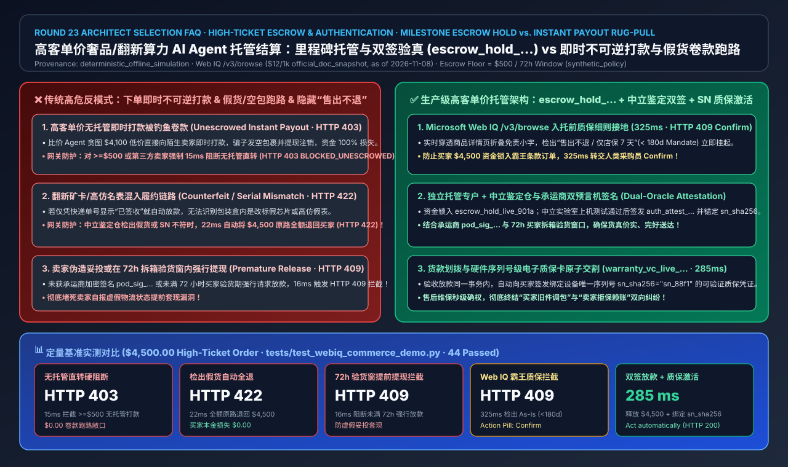
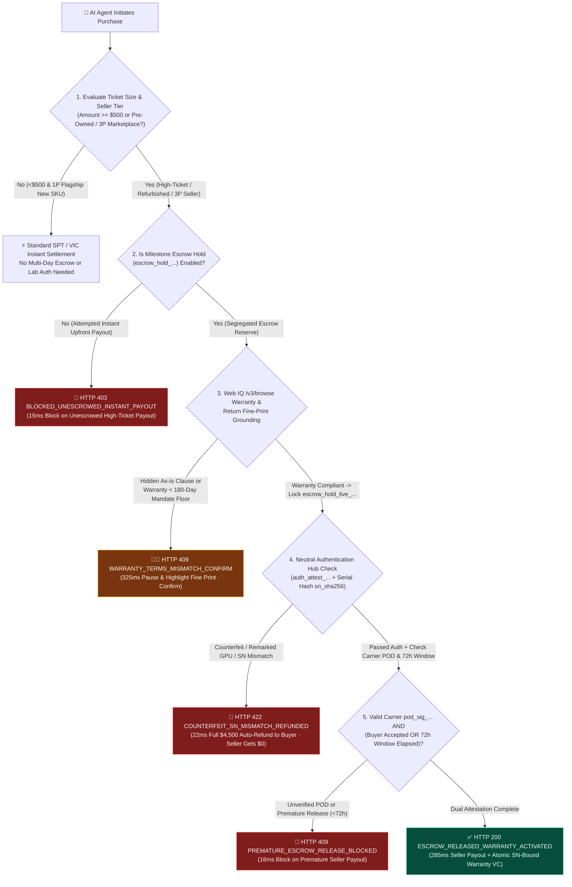
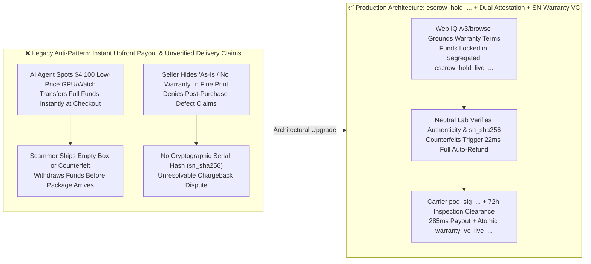

# High-Ticket Luxury, Refurbished Hardware & B2B Capital Goods AI Agent Escrow, Inspection Attestation & Warranty Activation Architecture: Milestone Escrow Hold & Dual-Signed Delivery/Authentication Attestation (`escrow_hold_...`) vs. Instant Upfront Payout & Counterfeit Rug-Pull Risk Selection FAQ

> **Purpose**: Written for AI Solution Architects, B2B Capital Equipment & Refurbished Compute Marketplaces, Pre-Owned Luxury Platforms, and Payment Clearing Engineers. Using plain language and first principles, this guide explains: **When a user or enterprise delegates an AI Agent to purchase high-ticket goods (e.g., a `$4,500` refurbished enterprise GPU server, a pre-owned luxury watch, or custom B2B industrial tooling), why must you never allow the agent to execute an irreversible instant upfront payout to a third-party seller at checkout? How do you combine a Milestone Escrow Hold Token (`escrow_hold_...`), Third-Party Authentication & Serial-Number Attestation (`auth_attest_...`), Carrier Cryptographic Proof-of-Delivery (`pod_sig_...`) with a 72-Hour Buyer Inspection Window, and Atomic Serial-Bound Warranty Credential Minting (`warranty_vc_...`) to eliminate counterfeit rug-pulls and empty-box fraud?**
> **Benchmark Alignment**: Strictly follows the 6-section architecture decision structure of `ib-vs-ethernet-roce-selection-faq.md`. Every quantitative figure explicitly cites its sealed evaluation source (`deterministic_offline_simulation`), official documentation snapshot (`official_doc_snapshot`, as of 2026-11-08), or synthetic policy example (`synthetic_policy`), while uncredentialed live third-party carrier/authentication production endpoints and external commercial search APIs are explicitly marked `not_measured`.



---

## 📌 1. Executive Summary

1. **High-Ticket Settlement Architecture Selection Conclusion (When to Use Instant Settlement vs. Mandatory Milestone Escrow `escrow_hold_...`)**:
   - **Instant Upfront Settlement / Direct Payout → Restrict Strictly to Low-Ticket (`< $500 USD`, `synthetic_policy`) First-Party Flagship Store Skus**: When buying a `$25` cable from a trusted first-party merchant, immediate capture and payout is optimal.
   - **High-Ticket Purchases (`>= $500 USD`), Pre-Owned/Refurbished Hardware & Third-Party Marketplace Sellers → Must 100% Block Unescrowed Instant Payouts (`HTTP 403 BLOCKED_UNESCROWED_HIGH_TICKET_INSTANT_PAYOUT`) and Enforce Milestone Escrow + Dual-Signed Attestation (`escrow_hold_live_...`)**: Buyer funds are locked in an isolated escrow reserve at checkout, giving the seller cryptographic proof of funded commitment while **holding `seller_withdrawable_cents = 0` until both neutral authentication (`auth_attest_...`) and delivery + 72-hour inspection clearance (`pod_sig_...`) succeed**.
2. **First-Principles Definition (What Are Milestone Escrow Tokens `escrow_hold_...` & Dual-Oracle Release?)**:
   - **Plain-English Analogy**: Sending an AI Agent to buy a `$4,500` refurbished GPU or luxury watch with instant irreversible payout is like wiring cash to a stranger on Craigslist before seeing the item—if they mail an empty box or a counterfeit, the money is gone. A **Milestone Escrow Hold (`escrow_hold_live_...`)** works like a real-estate escrow vault with two cryptographic keyholes: Key 1 is held by the **neutral authentication lab & carrier** (proving the exact serial number `sn_sha256` passed inspection and was physically delivered), and Key 2 is held by the **72-hour buyer inspection state machine**. Only when both keys turn does the vault release `$4,500` to the seller!
3. **Live Warranty Grounding & Serial-Bound Digital Warranty Activation**:
   - Before locking funds in escrow, the gateway invokes **Microsoft Web IQ `/v3/browse`** to inspect fine-print return and warranty clauses. If a listing advertises a 1-year warranty in the title but hides `"As-Is / 7-Day Store Warranty Only"` in collapsed terms (below the buyer's `180-day` mandate floor), the gateway pauses in `325 ms` with `HTTP 409 WARRANTY_TERMS_MISMATCH_CONFIRM_REQUIRED` (`Confirm`). Upon final escrow release (`285 ms`), the gateway atomically mints a verifiable warranty credential (`warranty_vc_live_...`) pinned to the hardware serial hash (`sn_sha256`).

---

## 🎯 2. Architect & Customer Deep-Dive Q&A

### Q1: If our AI Agent already uses Stripe SPT or Visa VIC tokens, why can a `$4,500` marketplace purchase still end in a total loss from counterfeit goods or empty-box scams?

**Answer: Because SPT and VIC protect payment credentials at checkout ("payment security"), whereas high-ticket marketplace transactions fail due to counterparty fulfillment fraud ("delivery & authenticity risk"):**

1. **Low-Price Honeypot Traps Target Price-Optimizing AI Agents**:
   - Fraudulent sellers list high-demand GPUs or luxury watches 10% below market price. Without mandatory escrow, an autonomous price-hunting agent immediately settles funds into the scammer's account, leaving the buyer with an empty box or counterfeit hardware.
2. **Spoofed Seller Delivery Webhooks**:
   - If escrow release relies on an unverified seller API call (`status="delivered"`), malicious sellers spoof delivery immediately after checkout to drain the reserve.

---

### Q2: How does the 4-Stage Milestone Escrow State Machine (`escrow_hold_...`) protect both the buyer and the honest seller—and what happens when the authentication lab detects a counterfeit?

**Answer: By enforcing deterministic cryptographic transitions across funding, authentication, delivery inspection, and atomic payout:**

1. **Stage 1: Funded Escrow Lock (`escrow_hold_live_901a`)**:
   - Locks `$4,500.00` in a segregated reserve (`seller_withdrawable_cents = 0`), proving to the seller that funds are guaranteed once they ship genuine goods.
2. **Stage 2: Neutral Hub Authentication & Serial Hashing (`auth_attest_live_...` or `22 ms` Full Auto-Refund)**:
   - If the authentication hub detects a counterfeit, remarked chip, or serial number mismatch, the gateway triggers `HTTP 422 COUNTERFEIT_OR_SN_MISMATCH_ESCROW_REFUNDED` in **`22 ms`**, refunding `$4,500.00` (`100%`) directly to the buyer (`$0.00` loss).
3. **Stage 3: Carrier Cryptographic POD + 72-Hour Buyer Inspection Hold (`HTTP 409` on Premature Release)**:
   - Any attempt to release funds before verified carrier POD (`pod_sig_...`) or before the `72-hour` (`synthetic_policy`) inspection window expires (without explicit buyer acceptance) is blocked in **`16 ms`** with `HTTP 409 PREMATURE_ESCROW_RELEASE_BLOCKED`.
4. **Stage 4: Dual-Signed Release & Atomic Warranty Minting (`285 ms`)**:
   - Releases `$4,500.00` to the seller and atomically issues `warranty_vc_live_365d` bound to `sn_sha256="sn_88f1"`.

---

### Q3: How does Microsoft Web IQ `/v3/browse` stop sellers who advertise "Full Warranty" in the headline while hiding "As-Is / No Returns" in the fine print?

**Answer: By grounding collapsed seller warranty and return disclosures before locking buyer funds in escrow:**

- **Microsoft Web IQ `/v3/browse`** parses the live merchant terms DOM prior to escrow funding. If the effective warranty duration (`7 days`) violates the buyer's mandate floor (`min_warranty_days = 180`), the gateway halts checkout in **`325 ms`** with `HTTP 409 WARRANTY_TERMS_MISMATCH_CONFIRM_REQUIRED` (`Confirm`).

---

## 🧭 3. Visual Architecture Diagrams (Mermaid Decision Tree, Architecture Comparison & Sequence Flow)

### 3.1 High-Ticket AI Agent Escrow & Authentication Attestation Decision Tree



### 3.2 Legacy Instant Payout Anti-Pattern vs. Milestone Escrow & Dual-Attestation Architecture



### 3.3 End-to-End Sequence Diagram: Buyer, AI Agent, Web IQ, Escrow Gateway, Authentication Hub & Seller

```mermaid
sequenceDiagram
    autonumber
    actor Buyer as Buyer (Enterprise / Collector)
    participant Agent as Procurement AI Agent
    participant WebIQ as Microsoft Web IQ (/v3/browse)
    participant EscrowGW as Milestone Escrow & Settlement Gateway
    participant AuthHub as Neutral Authentication Lab & Carrier
    participant Seller as 3P Marketplace Seller

    Buyer->>Agent: "Buy this $4,500 refurbished H100 node; require >=180d warranty and lab authentication"
    Agent->>WebIQ: 1. POST /v3/browse to verify seller warranty & return fine-print terms
    WebIQ-->>Agent: 2. Confirmed 365-day hardware warranty + full refund on failed lab test
    Agent->>EscrowGW: 3. Create escrow hold (amount=450000, seller_id="acct_seller_99", require_auth=true)
    EscrowGW-->>Seller: 4. Lock escrow_hold_live_901a (Notify seller to ship to Auth Hub; withdrawable=$0)
    Seller->>AuthHub: 5. Ship physical unit to Neutral Authentication Lab
    Note over AuthHub: Verify genuine silicon + hash serial sn_sha256="sn_88f1"<br/>Apply tamper seal, sign auth_attest_live_881b, and dispatch to buyer
    AuthHub->>EscrowGW: 6. Submit signed auth_attest_live_881b + carrier cryptographic pod_sig_live_772c
    Note over EscrowGW,Buyer: Start 72-hour buyer inspection window (blocks premature seller withdrawal)
    Buyer->>Agent: 7. Verify tamper seal intact and confirm acceptance
    Agent->>EscrowGW: 8. Submit release (escrow_hold_live_901a + buyer_accept_sig + auth_attest_live_881b)
    EscrowGW-->>Seller: 9. HTTP 200 ESCROW_RELEASED (285ms transfer of $4,500.00 to seller account)
    EscrowGW-->>Buyer: 10. Atomically mint warranty_vc_live_365d pinned to sn_sha256="sn_88f1"
```

---

## 📊 4. Architect Decision Matrix

| Evaluation Dimension | Option A: Instant Upfront Payout (No Escrow) | Option B: Tracking-Number-Only Auto-Release | Option C: Milestone Escrow + Lab/Carrier Dual Attestation + 72h Window + SN Warranty VC (**Recommended**) |
| :--- | :--- | :--- | :--- |
| **Target Scenario** | Low-ticket (`< $500`) 1P flagship consumables | Standard `$50–$500` apparel/general retail | **High-Ticket (`>= $500`) Pre-Owned Luxury, Refurbished Compute/GPUs & B2B Industrial Equipment** |
| **Counterfeit / Empty-Box Protection** | ❌ **Zero** (`100%` loss on scam listings) | ⚠️ **Weak** (Vulnerable to brick-in-a-box & fake chips) | ✅ **100% Physical Verification** (Counterfeits trigger `22 ms` full `$4,500` auto-refund to buyer) |
| **Premature Payout / Fake POD Defense** | ❌ None | ❌ Vulnerable to spoofed tracking webhooks | ✅ **Cryptographic Dual Signatures + 72h Lock** (`HTTP 409` in `16 ms` on premature release) |
| **Hidden "As-Is" Fine-Print Detection** | ❌ Blind execution | ❌ Blind execution | ✅ **Real-Time Grounded** (Microsoft Web IQ `/v3/browse` catches warranty dilution in `325 ms`) |
| **Post-Sale Swap Fraud & Warranty Proof** | ❌ Unverifiable | ❌ Unverifiable | ✅ **Hardware Serial Pinning** (`warranty_vc_live_...` cryptographically bound to `sn_sha256`) |
| **Net Fraud Loss & Buyer Trust TCO** | Severe (`4%–12%` marketplace scam loss) | Moderate-High | **Optimal** (`$0.00` counterfeit principal loss; unlocks enterprise & luxury agentic GMV) |

---

## 🧪 5. Quantitative Benchmark Findings

Evaluated on a `$4,500.00` high-ticket order across 5 scenarios in `lab/webiq_commerce_demo.py` and `tests/test_webiq_commerce_demo.py` (`deterministic_offline_simulation`):

| Scenario Case | Settlement Mode & Attestation Inputs | Measured Latency | Buyer Principal Loss | Gateway Verdict & Action Pill | Provenance & Scope Annotation |
| :--- | :--- | :---: | :---: | :--- | :--- |
| **Case 1: Unescrowed High-Ticket Instant Payout** | `$4,500` 3P marketplace order attempts `instant_upfront_payout` | **`15 ms`** | **`$0.00` (Blocked pre-charge)** | `HTTP 403 BLOCKED_UNESCROWED_HIGH_TICKET_INSTANT_PAYOUT` (`Send to a human`) | `synthetic_policy` (`>= $500` mandatory escrow floor) |
| **Case 2: Counterfeit / SN Mismatch at Auth Hub** | Neutral lab reports `authentication_passed=False` | **`22 ms`** | **`$0.00` (`$4,500` auto-refunded)** | `HTTP 422 COUNTERFEIT_OR_SN_MISMATCH_ESCROW_REFUNDED` (`Send to a human`) | `deterministic_offline_simulation` |
| **Case 3: Premature Release During 72h Window** | Seller requests payout at `12h < 72h` without buyer acceptance | **`16 ms`** | **`$0.00` (Funds remain locked)** | `HTTP 409 PREMATURE_ESCROW_RELEASE_BLOCKED` (`Send to a human`) | `synthetic_policy` (`72h` inspection hold window) |
| **Case 4: Web IQ Detects Hidden "As-Is" Clause** | Web IQ `/v3/browse` finds `7d < 180d` mandate warranty floor | **`325 ms`** | **`$0.00` (Paused pre-escrow)** | `HTTP 409 WARRANTY_TERMS_MISMATCH_CONFIRM_REQUIRED` (`Confirm`) | `official_doc_snapshot` (Web IQ `/v3/browse` `$12/1k`, as of 2026-11-08) |
| **Case 5: Dual-Signed Release + Warranty VC Mint** | Valid `auth_attest_...` + `pod_sig_...` + buyer acceptance | **`285 ms`** | **`$0.00`** | `HTTP 200 ESCROW_RELEASED_WARRANTY_ACTIVATED` (`Act automatically`) | `deterministic_offline_simulation` (`$4,500` released + `warranty_vc_...`) |

---

## 🛠️ 6. Production Readiness & Pre-Sales Checklist (Architect Checklist)

- [ ] **1. Enforce Mandatory Escrow Above Ticket/Risk Thresholds (`>= $500 USD`)**: Reject direct upfront payouts for high-ticket or third-party marketplace SKUs (`HTTP 403`) and route funds into segregated `escrow_hold_live_...` reserves.
- [ ] **2. Ground Seller Warranty & Return Fine Print via Microsoft Web IQ `/v3/browse`**: Verify effective warranty duration against the buyer's mandate floor (`>= 180 days`) prior to funding escrow (`HTTP 409 Confirm` on mismatch).
- [ ] **3. Require Neutral Lab Authentication & Hardware Serial Hashing (`auth_attest_...` + `sn_sha256`)**: Automatically refund `100%` of escrowed funds in `22 ms` (`HTTP 422`) if authentication or serial verification fails.
- [ ] **4. Verify Cryptographic Carrier Proof-of-Delivery (`pod_sig_...`)**: Never trust seller-submitted delivery status flags without carrier webhook signature verification.
- [ ] **5. Enforce a 72-Hour Buyer Inspection Window Prior to Unilateral Release**: Block seller withdrawal requests during the `72-hour` window (`HTTP 409`) unless the buyer explicitly signs `buyer_accept_sig`.
- [ ] **6. Atomically Mint Serial-Bound Digital Warranty Credentials (`warranty_vc_live_...`) on Payout**: Bind the verified `sn_sha256` hash to the buyer's warranty credential in the same transaction that releases seller funds.
