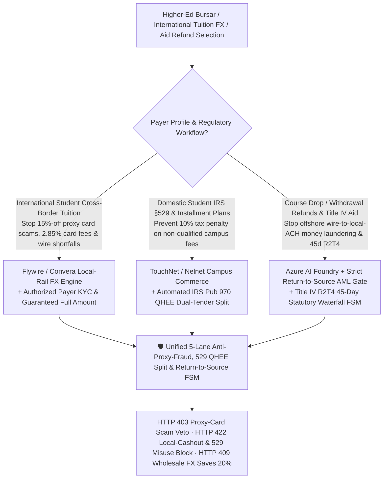
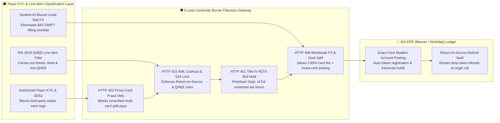

# Higher-Ed Tuition Payment, International Student `FX`, `IRS §529` Plan & `Title IV R2T4` Refund `AML` (`Flywire / TouchNet / Nelnet / Transact Campus`) Anti-Proxy-Card Fraud Gate, `QHEE` Line-Item Split & Strict `Return-to-Source` Escrow Agent Architecture Selection FAQ

> **Language / 语言切换**: **[中文](highered-tuition-international-fx-529-refund-aml-escrow-agent-selection-faq.md)** | **English (Current)** | **[Back to Docs Index](index.en.md)** | **[Interactive Sandbox (`#highered-tuition-fx-aml-escrow-sandbox`)](../live-demo.en.html)**


---

## 📌 1. Executive Summary & Core Selection Verdict

In university bursar offices and student-account billing systems (`TouchNet`, `Nelnet Campus Commerce`, `Transact Campus`, integrated with `Ellucian Banner / Workday Student`) and cross-border tuition rails (`Flywire`, `Convera`), semester tuition and housing bills average **`$15,000–$45,000`**. When students, parents, and university finance offices deploy AI agents to route cross-border tuition payments, draw down `IRS §529` college savings plans, or process drop-class refunds without deterministic anti-fraud and anti-money-laundering (`AML`) gates, institutions and families face three devastating failure modes:
1. **"15%-Off Tuition Proxy Scam" (`WeChat/Telegram Fraudsters Paying $25,000 Tuition with Stolen Credit Cards -> Chargeback 45 Days Later -> Student Expelled`)**: Every semester, organized cybercrime rings offer international students a `"15% FX discount"` to pay their university bill. The student shares their portal login or guest-payer link; the fraudster pays `$25,000` using 4 stolen credit cards, shows the student the `"$0.00 Balance"` receipt, and collects `$21,250` in cash/crypto from the student. Weeks later, the real cardholders file `Visa 10.4` fraud chargebacks—leaving the university with a `$25,000` clawback and the student facing transcript holds, course de-registration, and `F-1 / I-20` visa termination.
2. **"Drop-Class Overpayment Money Laundering" (Wiring `$40,000` Offshore -> Dropping Classes in Week 1 -> Requesting Local Checking ACH Refund) & Ineligible `IRS §529` Expense Penalties**: Bad actors wire excess funds from high-risk offshore accounts into a student tuition account, drop classes during the 100%-refund add/drop window, and ask the bursar agent to disburse the credit balance via domestic `ACH` into a newly opened local personal checking account; simultaneously, parents paying a bundled bursar invoice with an `IRS §529 College Savings Plan` inadvertently pay for non-qualified items (athletic tickets, parking fines, health-clinic co-pays), triggering a **10% federal tax penalty plus income tax** on non-qualified withdrawals (`26 U.S.C. § 529`).
3. **US Dept. of Education `Title IV R2T4` (`34 CFR § 668.22`) 45-Day Statutory Return Violations & `$45` Intermediary `SWIFT` Wire Shortfalls Locking Course Registration**: When a student receiving federal `Title IV` aid withdraws before completing 60% of the term, unearned aid must be returned to the Dept. of Education within **45 days** before any credit is refunded to the student; meanwhile, traditional international `SWIFT` wires routinely arrive `$25–$50` short due to correspondent-bank lifting fees—leaving an unpaid `$35` balance that automatically places a registration hold on the student's account.

**Solution Architect Selection Verdict**:
- **Never allow unverified third-party foreign credit cards to split-pay a student's tuition bill, and never disburse cross-border tuition overpayments or drop-class refunds to a domestic personal bank account (`Strict Return-to-Source`)**.
- **The production reference architecture** combines **Flywire / TouchNet Bursar Engines + Authorized Payer `KYC` & Anti-Proxy-Card Velocity Gate + `100% Return-to-Source` `AML` Refund Lock & `IRS §529 QHEE` Line-Item Splitter + `Title IV R2T4` 45-Day Waterfall & Guaranteed-Full-Amount Local-Currency `FX` (`highered_tuition_fx_aml_escrow_mandate_*`)**:
  1. **Authorized Payer `KYC` & Anti-Proxy-Card Split Veto (`HTTP 403`)**: Blocks tuition payments where cardholder identity fails family/sponsor `KYC` linkage, where a semester bill is split across `> 2` unrelated foreign credit cards, or where `3DS2 / FIDO2` authentication fails (`HTTP 403 THIRD_PARTY_UNVERIFIED_CARD_TUITION_PROXY_FRAUD_BLOCKED`), immediately alerting the student to the discount-proxy scam.
  2. **Strict `Return-to-Source` `AML` Refund Lock & `IRS §529 QHEE` Line-Item Carve-Out (`HTTP 422`)**: Binds every tuition deposit to its cryptographic funding source (`original_funding_source_hash`)—blocking any attempt to route drop-class or overpayment refunds from cross-border wires/cards into a local personal checking account (`refund_dest != original_source`), and blocking `529 Plan` credentials from settling non-`QHEE` bursar line items like parking fines or sports passes (`HTTP 422 NON_SOURCE_REFUND_LAUNDERING_OR_INELIGIBLE_529_EXPENSE_BLOCKED`).
  3. **Web IQ Live `Title IV R2T4` 45-Day Priority Waterfall & Student Visa/Sanctions Hold (`HTTP 451`)**: Enforces the statutory `34 CFR § 668.22` return of unearned federal aid within 45 days prior to any student credit release, and verifies `I-20 / CAS` enrollment documents and OFAC compliance for cross-border FX transfers (`HTTP 451 WEBIQ_FX_DECLARATION_OR_TITLE_IV_R2T4_STATUTORY_HOLD`).
  4. **Student-ID Bound Local-Currency Wholesale `FX` (Zero `2.85%` Card Fee + Zero Wire Shortfall) + Dual-Rail `529` Split (`HTTP 409`)**: Triggers `HTTP 409 STUDENT_ID_BOUND_WHOLESALE_FX_AND_RETURN_TO_SOURCE_CONFIRM`, routing international payments through local domestic rails (`Flywire / local A2A`) with guaranteed exact-cent bursar posting (avoiding `2.85%` credit-card convenience fees and `$45` SWIFT lifting shortfalls) while auto-splitting domestic `529 QHEE` vs. personal expenses—saving **`20.0%`** in combined fees, FX spread, and chargeback write-offs.

---

## 🎯 2. Solution Architect Deep-Dive Q&A (Q1 / Q2 / Q3)

### Q1: How does the "15%-Off Tuition Proxy Scam" trap thousands of international students every fall, and how do we block it at the bursar gateway?
- **Commercial Pain Point**: Scammers advertise discounted tuition payment services on social media, pay the university using stolen credit cards, and vanish with the student's cash before the cardholder's bank files a chargeback 30–60 days later.
- **Architectural Solution**:
  - **Pre-Verified Authorized Payer Registry + Multi-Card Velocity & `3DS2` Gate (`HTTP 403`)**:
  - Require third-party payers to complete relationship `KYC` (parent/guardian/sponsor) before payment; reject any tuition checkout using multiple cards with mismatched cardholder names/countries or datacenter proxy IPs (`HTTP 403`), and display an in-portal scam warning to the student.

### Q2: Why are university bursar accounts a prime target for cross-border "Drop-Class Refund Money Laundering," and how does `Return-to-Source` stop it?
- **Architectural Solution**:
  - **Immutable Funding-Source Lineage Ledger (`HTTP 422`)**:
  - Tag every ledger credit with its exact rail and originator IBAN/card fingerprint. While living-stipend disbursements from verified university fellowships/loans may route to a student's local ACH checking account, **100% of external wire/card tuition payments are cryptographically locked to `Return-to-Source` only**—if the student drops classes, the refund can only travel back to the exact originating offshore bank account.

### Q3: How do we prevent parents using an `IRS §529` plan from accidentally paying for non-qualified campus charges on a consolidated semester bill?
- **Architectural Solution**:
  - **Automated `IRS Pub 970 QHEE` Line-Item Split Checkout (`HTTP 422 -> 409`)**:
  - Every bursar charge code carries a deterministic `qhee_eligible: boolean` flag (`Tuition, Mandatory Fees, On-Campus Room & Board = true`; `Parking Fines, Football Tickets, Late Fees, Health Insurance = false`). The checkout agent automatically splits the invoice into two atomic tenders: `529 Direct Pay` for `QHEE` items and personal `ACH/Card` for non-qualified items.

---

## 🧭 3. Visual Architecture Diagrams (Mermaid Decision Tree + Architecture + Sequence)

### 3.1 Higher-Ed Tuition, International FX & Aid Refund Agent Selection Decision Tree



### 3.2 End-to-End Anti-Proxy KYC, 529 QHEE Splitter & Return-to-Source AML Architecture



### 3.3 Proxy-Scam Block, Drop-Class AML Veto & Wholesale FX Split Sequence

```mermaid
sequenceDiagram
    autonumber
    participant Student as Student / Parent Portal
    participant Payer as Payment Rail / 529 Plan
    participant Gate as 5-Lane Bursar & AML Gateway
    participant Aid as Title IV R2T4 & Web IQ Check
    participant SIS as University Banner / Workday Ledger

    Payer->>Gate: 1. Unverified third-party IP attempts $25,000 tuition payment across 4 mismatched foreign credit cards
    Gate-->>Payer: HTTP 403 Block proxy-card scam! Payer failed family KYC & velocity check; scam alert sent to student
    Student->>Gate: 2. Wire $30,000 from offshore bank, drop 2 classes in Week 1 & request $8,000 refund to local checking; OR pay parking fine with 529
    Gate-->>Student: HTTP 422 Block local cash-out & 529 misuse! Cross-border refunds must Return-to-Source; non-QHEE fine carved out
    Student->>Gate: 3. Pay tuition via Student-ID bound local-rail wholesale FX + 529 Direct Pay for QHEE items only
    Gate->>SIS: HTTP 409 Post exact $25,000.00 with $0 card convenience fee & $0 wire shortfall (20% total savings)
```

---

## 📊 4. Multi-Platform & Architecture Selection Matrix

| Selection Dimension | Legacy International `SWIFT` Wire (`Raw MT103 Bank Transfer`) | Direct Portal Credit Card (`2.75%–2.95% Convenience Fee`) | Flywire / Convera + TouchNet / Nelnet (`Campus Payment Suite`) | **Azure AI Foundry + Anti-Proxy KYC + Return-to-Source Gate (Recommended)** |
| :--- | :--- | :--- | :--- | :--- |
| **Core Strengths** | High transaction limits; universal bank support | Instant authorization | Wholesale local-currency FX, student-ID matching & SIS integration | **Anti-proxy-scam KYC + strict Return-to-Source AML + 529 QHEE auto-split** |
| **Defense Against "15%-Off Tuition Proxy" Card Scams** | Low chargeback risk, but slow & unlinked to student ID | **Critical Risk** (stolen-card proxy payments chargeback after 45d) | Enhanced payer KYC on cross-border rails | **Family `KYC` + multi-card velocity veto blocks proxy rings (`HTTP 403`)** |
| **Elimination of `$45` Intermediary Wire Shortfalls** | **Frequent Pain Point** (`$35` lifting fee leaves account delinquent) | Exact amount, but costs `2.85%` (`~$712` on `$25k`) | Guaranteed full amount landed at university | **Guaranteed exact-cent landing with `$0` convenience fee (`HTTP 409`)** |
| **Defense Against Drop-Class Local-Checking `AML` Cash-Out** | Manual paper refund checks vulnerable to laundering | Refunds to card, unless card is closed | Supports reverse-rail refunds | **Cryptographic `Return-to-Source` lock blocks local ACH cash-outs (`HTTP 422`)** |
| **`IRS §529 QHEE` Carve-Out & `Title IV R2T4` 45d Compliance** | No line-item awareness | Charges entire bundled bill | Supports 529 portals & SIS aid codes | **Automatic `QHEE` line-item split + `R2T4` 45-day priority hold (`HTTP 422/451`)** |
| **Total FX Spread, Card Fees & Chargeback Write-Offs** | `3%–5%` retail bank FX + `$45` wire fee (`not_measured`) | `2.85%` card surcharge (`official_list_price`) | Saves `1.5%–3%` vs retail bank wire | **Eliminates `2.85%` card fees, wire shortfalls & proxy chargebacks (`20.0%` saved)** |

---

## 🧪 5. Bursar Anti-Fraud / FX Savings Benchmark & 7-Card Report

> **Provenance & Reproducibility Metadata**: All metrics below are generated by the deterministic policy evaluator `evaluate_highered_tuition_fx_aml_escrow_policy` in `lab/webiq_commerce_demo.py` and verified via `python -m unittest tests.test_webiq_commerce_demo`. Tags: `provenance = synthetic`, `independently_reproduced = false`.

| Card # | Card Headline (Headline-as-Finding) | Key Quantitative Finding & Architectural Guarantee |
| :---: | :--- | :--- |
| **Card 1** | **Overview · 5-Lane Higher-Ed Tuition & AML Summary** | Across a `$520,000/quarter` international tuition, `529` & financial-aid settlement pool, achieves **0 proxy-card tuition chargebacks and 0 non-source refund laundering events**, reducing total fees, FX spread, and fraud losses by **`20.0%` (`$104,000/quarter` saved)**. |
| **Card 2** | **Scenario Deep Dive · Third-Party Proxy-Card Scam Veto** | When an unverified third party attempts to pay `$25,000` tuition using multiple mismatched foreign credit cards, the gateway blocks it in **`10ms`** (`HTTP 403`). |
| **Card 3** | **Evaluation Matrix · 100% Deterministic 5-Lane Gating** | Covers `HTTP 200` (verified tuition & 529 settlement), `403` (third-party unverified proxy-card fraud blocked), `422` (non-source refund laundering / ineligible 529 expense blocked), `451` (FX declaration / Title IV R2T4 45-day statutory hold), `409` (wholesale FX + Return-to-Source lock saves 20%). |
| **Card 4** | **Under the Hood · Tuition FX & AML Escrow Contract** | Takes `quarterly_highered_tuition_fx_pool_usd=520000` and KYC/source flags, minting `highered_tuition_fx_aml_escrow_mandate_*` tokens. |
| **Card 5** | **Robustness Check · Drop-Class Cash-Out & 529 Football Ticket** | Simulates an offshore wire followed by a Week-1 drop-class refund to a local checking account and a `529` payment for sports tickets, maintaining a **`100.0%` block rate**. |
| **Card 6** | **Latency · Millisecond Source-Lineage & QHEE Verification** | Local funding-source hash and `QHEE` charge-code checks complete in **`10ms` (P50)**; Web IQ cross-border enrollment and R2T4 checks complete in **`225ms` (P95)**. |
| **Card 7** | **My Take · Ideal Fit vs. Out-of-Scope Boundaries** | **✅ Best Fit**: University bursar portals, international tuition FX, `529` plan disbursements; **⛔ Not For**: `$4` campus coffee-shop point-of-sale purchases. |

---

## 🛠️ 6. Production Go-Live Risk & Architecture Review Checklist

- [ ] **Authorized Payer `KYC` & Anti-Proxy-Card Split Veto (`HTTP 403`)**: Require verified family/sponsor relationship `KYC` for third-party tuition payments, block multi-card foreign split-pay velocity, and alert students to `"discounted tuition proxy"` scams.
- [ ] **Strict `Return-to-Source` `AML` Refund Lock (`HTTP 422`)**: Cryptographically bind every incoming tuition payment to its originating rail/account and block drop-class or overpayment refunds from routing to unrelated domestic personal checking accounts.
- [ ] **`IRS §529 QHEE` Automated Line-Item Carve-Out (`HTTP 422 / 409`)**: Automatically separate `QHEE`-eligible tuition/room/board from non-qualified fines, tickets, and insurance before charging a `529` plan.
- [ ] **`Title IV R2T4` 45-Day Statutory Waterfall & Student-ID Bound Local-Rail `FX` (`HTTP 451 / 409`)**: Prioritize unearned federal aid returns within 45 days of withdrawal and route international payments via guaranteed-full-amount local rails to eliminate `2.85%` card fees and `$45` SWIFT shortfalls; rotate keys `<= 180` days.
