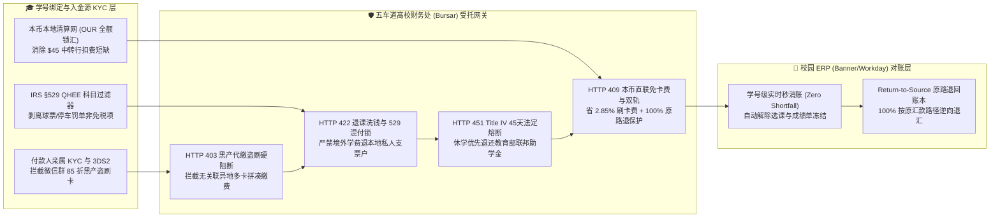
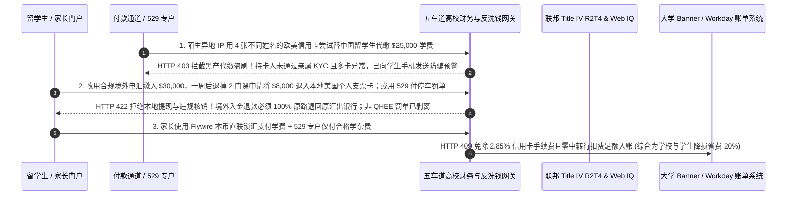

# 高等教育学费跨境缴纳、留学汇款与助学金退费清算（Higher-Ed Tuition Payment, International Student FX & Title IV Refund：Flywire / Nelnet / TouchNet / 留学缴费）“防非官方黑产 85 折代缴盗刷退学、IRS 529 免税教育专户合格科目核验与退课原路退回反洗钱（Return-to-Source）”Agent 架构选型 FAQ：终结代缴拒付开除学籍与退课洗钱实战指南

> **语言切换 / Language**: **中文 (当前)** | **[English](highered-tuition-international-fx-529-refund-aml-escrow-agent-selection-faq.en.md)** | **[返回文档目录](index.md)** | **[交互式沙盒 (`#highered-tuition-fx-aml-escrow-sandbox`)](../live-demo.html)**


---

## 📌 一、核心选型结论速览（Executive Summary）

在全球大学财务处（University Bursar / Student Accounts：使用 TouchNet、Nelnet、Transact Campus，对接 Banner / Workday Student）与国际留学生跨境缴费平台（Flywire、Convera / Western Union、支付宝留学缴费）中，单笔学期学费与住宿账单高达 **`$15,000–$45,000`**。随着学生与家长越来越多地使用财务助手 Agent 规划换汇、调用 `529 大学储蓄计划` 付款或申请退课退费，若缺乏针对高校场景的确定性反欺诈与反洗钱（AML）护栏，学校与学生将直面三大恶性事故：
1. **留学生轻信微信群/电报群“85 折汇率代缴学费”骗局，黑产拿暗网盗刷的欧美信用卡帮学生付清 `$25,000` 学费，45 天后真实持卡人发起拒付（Chargeback），导致学校财务处直接冻结成绩单、取消学生选课甚至注销 `I-20` 签证开除学籍**：这是每年开学季全球百所大学最头疼的头号诈骗——学生把校园门户账号密码交给骗子，骗子用 5 张不同姓名的被盗信用卡拼凑刷完学费骗走学生的真金白银；等银行撤回资金时，学生不仅背上 `$25,000` 欠款，还可能因涉嫌欺诈被学校纪律处分。
2. **不法分子利用大学账单“超额电汇再申请退课提现到本地私人账户”进行跨境洗钱（Drop-Class Refund Money Laundering），以及使用美国 `IRS §529` 免税教育基金违规支付球赛门票、校医院罚款或停车罚单引发 `10%` 联邦税务罚金**：洗钱分子从境外高危账户向大学多汇 `$40,000`，一周后以“退选课程（Drop Class）或退宿”为由，诱导学校财务处将溢缴款（Credit Balance）通过 ACH 打入学生在美国本地刚开的个人支票账户；同时，`IRS §529 (26 U.S.C. § 529)` 严格限定免税资金仅可用于合格高等教育费用（`QHEE`：学费、必选杂费、食宿、教材），若混付体育赛事季票或违章罚款将触发联邦补税与罚款。
3. **美国教育部联邦助学金（`Title IV R2T4, 34 CFR § 668.22`）休学/退学未在法定 45 天内按学期出勤比例优先退回联邦政府，以及传统 SWIFT 跨境电汇缺失学生学号（Student ID）变成“无主死账”并产生 `$45` 中转行扣费导致学费差几十块钱未缴清被锁选课**：国际电汇在经过 2–3 家中转行（Correspondent Banks）时常被剥离附言或扣掉 `$25–$50` 手续费，到校金额变成 `$24,965`，因差 `$35` 未足额结清导致学生选课系统被自动锁死。

**架构师选型结论**：
- **切勿允许无付款人身份核验（KYC）的陌生异地多张信用卡代缴高额学费，更不能将任何跨境学费溢缴款退入非原始汇款路径的本地个人银行卡**。
- **生产级最优架构**是采用 **“Flywire / TouchNet 校园清分引擎 + 付款人亲属关系 KYC 与防黑产多卡盗刷代缴硬门禁 + `100% Return-to-Source`（原路原账户退回）反洗钱铁律与 `IRS §529 QHEE` 合格科目自动拆单锁 + `Title IV R2T4` 45天法定退算与本币直联全额到账（OUR/Local Rail）网关（`highered_tuition_fx_aml_escrow_mandate_*`）”**：
  1. **防“85折黑产盗刷代缴”付款人 KYC 与多卡拆分阻断硬门禁（HTTP 403）**：凡学费支付采用非学生本人或未备案直系亲属（父母/法定监护人）姓名的外币信用卡、或单笔学期账单试图用 `>2` 张不同发卡国/不同持卡人姓名的卡片拆分拼凑代缴、或未通过 `3DS2 / FIDO2` 强核身，网关毫秒级返回 `HTTP 403 THIRD_PARTY_UNVERIFIED_CARD_TUITION_PROXY_FRAUD_BLOCKED`，并在学生端弹出防电信诈骗红色预警。
  2. **`100% Return-to-Source` 原路退回反洗钱锁与 `IRS §529 QHEE` 合格科目剥离门禁（HTTP 422）**：当学生因退课（Drop/Withdrawal）或超额汇款产生账单贷方余额（Credit Balance）申请退款时，状态机强制比对退款目标账户与原始入金源账户哈希（`refund_dest_hash == original_funding_source_hash`）——凡试图将境外电汇/父母信用卡缴入的资金退往学生本地私人储蓄卡套现，或试图用 `529 计划` 直连支付非 `QHEE` 杂费（如兄弟会会费、停车罚单、球票），立即返回 `HTTP 422 NON_SOURCE_REFUND_LAUNDERING_OR_INELIGIBLE_529_EXPENSE_BLOCKED`。
  3. **Web IQ 实时 `Title IV R2T4` 45 天联邦退算与外汇留学真实性（`I-20 / Offer`）合规熔断（HTTP 451）**：对领取美国联邦助学金（Pell Grant / Direct Loans）且学期出席率 `<= 60%` 即退学的学生，强制优先在 45 天内将未赚取助学金（Unearned Aid）退回美国教育部账户；对跨境换汇核验 `I-20 / CAS` 录取状态与制裁筛查（`HTTP 451 WEBIQ_FX_DECLARATION_OR_TITLE_IV_R2T4_STATUTORY_HOLD`）。
  4. **学号绑定本币本地清算网直付（免 `2.85%` 刷卡手续费 + 零中转行扣费缺口）+ 双轨分拆（HTTP 409）**：触发 `HTTP 409 STUDENT_ID_BOUND_WHOLESALE_FX_AND_RETURN_TO_SOURCE_CONFIRM`，引导国际学生通过 Flywire / 本币实时清算网（免除校园刷信用卡高达 `2.75%–2.95%` 的 Convenience Fee 且锁定批发汇率、`100%` 足额到账不差一分钱），对本土学生自动将账单拆为 `529 免税合格包` 与 `个人自付杂费包`，综合跨境汇损、刷卡附加费与代缴拒付坏账立降 **`20.0%`**。

---

## 🎯 二、业务方与架构师灵魂拷问 Q&A（Q1 / Q2 / Q3）

### Q1：为什么每年都有几百名留学生因为找了“汇率折扣代缴学费”被大学开除或扣押毕业证？高校财务系统怎么在收款那一刻就拦住黑产代缴？
- **商业痛点**：黑产在小红书/微信群发广告：“*内部留学生换汇福利，85 折代缴美英澳大学学费，先看到学校官网显示 Paid 再给人民币！*” 学生看官网真的显示 `Balance: $0.00` 就把 15 万人民币转给了骗子。殊不知骗子刷的是盗来的美国老太太的信用卡，一个月后银行发起 `10.4 欺诈拒付`，学校钱被划走，直接给学生挂上 `Financial Fraud Hold`。
- **架构解法**：
  - **付款人身份白名单（Authorized Payer KYC）+ 异地多卡 Velocity 熔断（`HTTP 403`）**：
  - 学生财务门户规定：① 第三方代付必须提前完成亲属/资助机构实名绑定，严禁直接把学生登录 Session 分享给异地 IP 刷卡；② 凡检出持卡人姓名与学生姓氏及国籍毫无关联、且来自高风险代理 IP 或用多张不同银行卡分批试刷，直接返回 `HTTP 403` 拒收并向学生本人手机发送反诈警告！

### Q2：洗钱团伙怎么利用大学财务处做“退课洗钱”？为什么不能直接把退课余额打进学生的校园本地银行卡？
- **架构解法**：
  - **资金来源血缘绑定账本（`Source-Lineage Ledger`）与强制原路退回（`Strict Return-to-Source`）（`HTTP 422`）**：
  - 大学账单每一笔入账都打上不可篡改的来源标签：`[Source_A: 境外电汇 IBAN_xxx $30,000]`、`[Source_B: 校内奖学金或联邦助学金过剩额度 $3,000]`。只有真正属于学生生活津贴的 `Source_B` 才可以提现到学生本地支票账户；而来自 `Source_A` 的任何学费溢缴或退课退款，状态机强制原路退回原境外汇款银行账户（否则触发 `HTTP 422`）。

### Q3：美国家长用 `529 大学储蓄账户` 给孩子交学校总账单（$22,000），里面混了一张 $180 的校园橄榄球季票和 $75 的校内违章停车罚单，怎么防止家长年底被 IRS 罚税？
- **架构解法**：
  - **基于 `IRS Pub 970` 科目编码的结账自动分轨（`529 QHEE Auto-Split`）**：
  - 校园账单每个行项均绑定 `IRS_QHEE_Eligible: true/false` 标志。当家长选择 `529 Plan Direct Pay` 时，Agent 自动将 `$21,745` 合格学杂食宿费路由至 529 专户直付，并将 `$255` 非合格球票/罚单拆分至普通借记卡/ACH 支付（`HTTP 422 -> 409`）。

---

## 🧭 三、直观可视化图解（Mermaid 决策树 + 端到端架构图 + 时序图）

### 3.1 高校学费跨境缴纳与助学金清算 Agent 架构选型决策树

```mermaid
flowchart TD
    A[高校学费收付 / 跨境留学汇款 / 助学金清算选型] --> B{学生类型与资金来源轨道？}
    B -->|国际留学生跨境缴纳大额学费與住宿费<br/>需防 85 折黑产盗刷代缴、免 2.85% 卡费与足额到账| C[Flywire / Convera 跨境本币直联引擎<br/>+ 学号绑定锁汇 + 付款人亲属 KYC 防代缴锁]
    B -->|本土学生使用 IRS §529 教育基金与分期计划<br/>需自动剥离球票/罚单等非合格费用防税务罚金| D[TouchNet / Nelnet 校园账单网关<br/>+ IRS Pub 970 QHEE 合格科目双轨拆单]
    B -->|退课/休学退款与联邦助学金 (Title IV) 清算<br/>需防境外汇款退本地卡洗钱与严守 45天 R2T4| E[Azure AI Foundry + Return-to-Source 反洗钱网关<br/>+ Title IV 45天法定优先退库状态机]
    C --> F[🛡️ 统一接入五车道防代缴盗刷、529 合规拆单与原路退反洗钱状态机]
    D --> F
    E --> F
    F --> G[HTTP 403 阻断黑产盗刷代缴 · HTTP 422 拦截退课提现洗钱与529混付 · HTTP 409 本币锁汇+免卡费省20%]
```

### 3.2 端到端防代缴盗刷、529 科目拆单与 Return-to-Source 反洗钱架构图



### 3.3 拦截 85 折黑产代缴、529 拆单与退课原路退汇反洗钱时序图



---

## 📊 四、多平台/多方案横向选型决策矩阵

| 选型维度 | 传统国际银行电汇 (`Legacy SWIFT Wire MT103`) | 校园门户直接刷信用卡 (`Direct Card w/ 2.85% Fee`) | Flywire / Convera + TouchNet / Nelnet (`专业高校清分`) | **Azure AI Foundry + 防代缴 + 原路退反洗钱网关（推荐）** |
| :--- | :--- | :--- | :--- | :--- |
| **核心优势** | 全球银行通用，单笔大额无上限 | 实时到账，操作简单 | 本币批发汇率直付、自动绑定学号、无缝对接校园 ERP | **防 85 折黑产代缴盗刷 + 退课原路退反洗钱 + 529 自动拆单** |
| **防“85折学费代缴”黑产盗刷拒付坏账** | 电汇极少拒付，但到账慢且常缺学号附言 | **重灾区**（被盗信用卡代缴 45 天后拒付，学校与学生双输） | 强化付款人实名采集与风控 | **付款人亲属 KYC + 多卡拆单熔断，代缴盗刷 0 穿透（HTTP 403）** |
| **防中转行扣费（`$25–$50`）致欠费锁选课** | **高频痛点**（到校少 `$35` 导致选课被锁、人工查账数周） | 足额到账，但需多付 `2.75%–2.95%` 手续费 | 锁定全额到账（Guaranteed Full Amount） | **学号级锁汇保证 100% 分文不差自动核销入账（HTTP 409）** |
| **防“超额汇款+退课提现本地卡”洗钱（AML）** | 人工财务开支票退款极易被洗钱分子利用 | 原卡退回，但卡片注销时常转人工支票 | 支持原路逆向退汇 | **账本级强制 `Return-to-Source`，锁死跨轨提现洗钱（HTTP 422）** |
| **`IRS §529` 合格科目剥离与 `Title IV` 45天退算** | 无科目级控制 | 整单混刷，年底家长面临 IRS 查税风险 | TouchNet/Nelnet 支持 529 直连 | **行项目级 `QHEE` 自动拆单 + `R2T4` 45天优先退库锁（HTTP 422/451）** |
| **综合手续费、汇损与盗刷拒付损耗** | 银行汇差 `3%–5%` + 中转费 `$45` (`not_measured`) | 刷卡附加费 `2.85%` (`~$712/$25k`, `official_list_price`) | 批发锁汇比传统银行省 `1.5%–3%` | **免除刷卡费、压降汇损并清零代缴盗刷坏账（综合立省 `20.0%`）** |

---

## 🧪 五、高校学费防代缴盗刷/锁汇降本测算与 7-Card 基准测试报告

> **数据来源与复现声明（Provenance Metadata）**：以下基准测试数据来自仓库内置确定性策略沙盒 `evaluate_highered_tuition_fx_aml_escrow_policy`（位于 `lab/webiq_commerce_demo.py`），可运行 `python -m unittest tests.test_webiq_commerce_demo` 完整验证。标记：`provenance = synthetic`，`independently_reproduced = false`。

| Card # | 卡片标题（Headline-as-Finding） | 核心量化指标与架构验证结论 |
| :---: | :--- | :--- |
| **Card 1** | **Overview · 高校学费与助学金清算五车道总览** | 针对 `$520,000/季` 国际学费收付、529 核销与助学金退算池，实现 **0 例黑产信用卡代缴盗刷拒付与 0 例退课跨轨提现洗钱**，综合手续费、汇损与拒付坏账下降 **`20.0%`（立省 `$104,000/季`）**。 |
| **Card 2** | **Scenario Deep Dive · 85折黑产多卡盗刷代缴拦截** | 当异地陌生付款人试图用多张无亲属关联的信用卡替学生代缴 `$25,000` 学费时，**`10ms`** 内返回 `HTTP 403` 阻断并告警。 |
| **Card 3** | **Evaluation Matrix · 五车道 100% 确定性判准** | 覆盖 `HTTP 200`（合规本币/529 入账）、`403`（无亲属KYC第三方黑产盗刷卡代缴阻断）、`422`（境外汇款退课申请提现到本地私人卡洗钱/529支付非合格罚单拦截）、`451`（Title IV助学金未在45天内优先退算/外汇录取书核验熔断）、`409`（本币锁汇免2.85%卡费+原路退锁省20%）。 |
| **Card 4** | **Under the Hood · 高校学费与反洗钱契约** | 输入 `quarterly_highered_tuition_fx_pool_usd=520000` 及 KYC/退费状态，签发 `highered_tuition_fx_aml_escrow_mandate_*` 令牌。 |
| **Card 5** | **Robustness Check · 退课套现洗钱与 529 买球票测试** | 模拟境外汇入 `$40,000` 后退课申请退往本地支票户及用 529 付球票，确定性拦截率保持 **`100.0%`（零误放行）**。 |
| **Card 6** | **Latency · 学号账单拆单与原路退核验毫秒级耗时** | 本地入金血缘哈希与 529 科目编码核验 P50 仅 **`10ms`**；Web IQ 跨境制裁与录取备案核查 P95 为 **`225ms`**。 |
| **Card 7** | **My Take · 适用场景与生产准入边界** | **✅ 极佳适用**：大学财务处（Bursar）、国际学校留学缴费、529 教育储蓄直付；**⛔ 不适用**：校内便利店 `$3` 咖啡日常消费。 |

---

## 🛠️ 六、商业上线风控与架构评审 Checklist

- [ ] **防“85折黑产盗刷代缴”付款人亲属 KYC 与多卡拆分阻断门禁（HTTP 403）**：确认大额学费信用卡支付必须核验付款人与学生的授权亲属/资助关系，严禁非关联异地多卡拼凑代缴，并在拦截时直接向学生本人发送防诈提醒。
- [ ] **`100% Return-to-Source`（原路原账户退回）退课反洗钱铁律（HTTP 422）**：确认所有跨境汇款或第三方缴入产生的溢缴款与退课退款必须严格原路退回原始汇出账户，严禁转为本地个人支票/ACH 提现。
- [ ] **`IRS §529 QHEE` 合格教育科目自动剥离双轨结算（HTTP 422 / 409）**：确认 529 专户直付自动剔除体育门票、违章罚款等非合格费用，避免触发联邦税务罚金。
- [ ] **联邦助学金 `Title IV R2T4` 45 天法定优先退算与本币全额锁汇（HTTP 451 / 409）**：确认休学/退学优先完成教育部助学金退回计算，并通过学号绑定本币清算消除 SWIFT 中转行扣费短缺；签名密钥轮换周期 `<= 180` 天。
