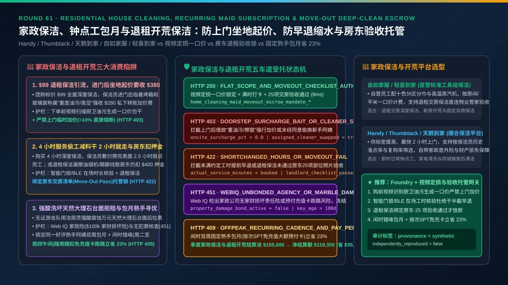
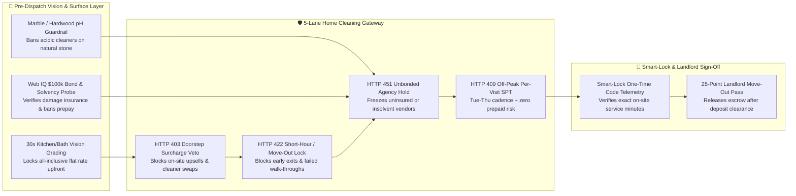

# Residential House Cleaning, Recurring Maid Subscription & Move-Out Deep-Clean Escrow (`Handy / Thumbtack / TaskRabbit / Ziroom Home Services`) Anti-Doorstep-Surcharge Lock, Smart-Lock Duration Check & Landlord Move-Out Pass Agent Architecture Selection FAQ

> **Language / 语言切换**: **[中文](home-cleaning-maid-subscription-moveout-inspection-escrow-agent-selection-faq.md)** | **English (Current)** | **[Back to Docs Index](index.en.md)** | **[Interactive Sandbox (`#home-cleaning-maid-moveout-escrow-sandbox`)](../live-demo.en.html)**



---

## 📌 1. Executive Summary & Core Selection Verdict

In residential house cleaning, biweekly recurring maid subscriptions, post-renovation deep cleans, and tenant move-out turnovers (`Handy`, `Thumbtack`, `TaskRabbit`, `Care.com Home`, `Ziroom Home Services`, `Qingxi Home`), home-services booking and escrow AI agents face three pervasive consumer and property-management failure modes:
1. **"Doorstep Surcharge Extortion" (`Advertising a $99 Move-Out Clean, Then Demanding $280 Extra at the Door for 'Heavy Oven Grease and Shower Hard-Water Stains'`) & Recurring Cleaner Bait-and-Switch**: Lead-generation cleaning vouchers lure tenants with an `$89–$99` teaser price, only for the crew to arrive hours before the landlord's lease handover and refuse to start unless the tenant pays `$250+` in off-platform cash surcharges for inside-oven, inside-fridge, blinds, and limescale removal. In recurring subscriptions, agencies send a top-rated pro for the first visit and silently swap in untrained temps thereafter.
2. **Shortchanged Service Duration (`Billing for a 4-Hour Deep Clean While Smart-Lock Logs Show the Cleaner Left After 2 Hours 15 Minutes`) & Failed Landlord Move-Out Inspections (`Tenant Pays $240 for Move-Out Cleaning, Yet the Landlord Still Deducts $400 From the Security Deposit for Dirty Baseboards and Range Hoods`)**.
3. **Prepaid Cleaning Package Insolvency & Acid-Etched Natural Marble Countertops (`Using Acidic Toilet Bowl Cleaner on Calacatta Marble or Unbonded Agencies Vanishing With $2,000 Prepaid Cards`)**.

**Solution Architect Selection Verdict**:
- **Never book a move-out or deep-clean service without a pre-dispatch kitchen/bath video scope that locks an all-inclusive flat rate (`0%` doorstep surcharge tolerance), never release escrow before verifying smart-lock/BLE on-site duration and landlord move-out checklist sign-off, and never fund lump-sum prepaid cleaning store-value cards**.
- **The production reference architecture** combines **Pre-Dispatch Kitchen/Bath Vision Flat-Quote Lock + Smart-Lock/BLE Duration Telemetry + 25-Point Landlord Move-Out Pass Escrow + Per-Visit Recurring `SPT` (`home_cleaning_maid_moveout_escrow_mandate_*`)**:
  1. **Anti-Doorstep Surcharge Lock & Preferred Cleaner ID Binding (`HTTP 403`)**: Uses a 30-second pre-booking kitchen/bath video scan to include oven, fridge, interior windows, and descaling in a binding all-inclusive flat quote—blocking 100% of on-site upsell demands—and locks recurring subscriptions to the homeowner's approved `preferred_cleaner_id` (`HTTP 403 DOORSTEP_SURCHARGE_BAIT_OR_UNAUTHORIZED_CLEANER_SWAP_BLOCKED`).
  2. **Smart-Lock On-Site Duration Audit & 25-Point Landlord Move-Out Inspection Escrow (`HTTP 422`)**: Cross-checks temporary smart-lock access code entry/exit timestamps (or BLE geofence presence) against booked hours, and holds move-out cleaning funds in escrow until all **25 landlord turnover checkpoints** (inside oven, range-hood baffle filters, refrigerator gaskets, baseboards, shower glass) are photo-verified and pass landlord walk-through (or trigger a free 24-hour re-clean guarantee) (`HTTP 422 SHORTCHANGED_DURATION_OR_MOVEOUT_INSPECTION_FAILURE_BLOCKED`).
  3. **Web IQ `$100k` Property-Damage Bond Verification & Prepaid-Card Insolvency Shield (`HTTP 451`)**: Verifies active commercial general liability (`CGL`) coverage for stone/hardwood surface damage and blocks unbonded agencies pushing high-risk prepaid cash cards (`HTTP 451 WEBIQ_UNBONDED_CLEANING_AGENCY_OR_MARBLE_DAMAGE_RISK_HOLD`).
  4. **Mid-Week Off-Peak Biweekly Scheduling (`Tue–Thu 10am–3pm`) + Per-Visit Recurring `SPT` (Discount Without Prepaid Lock-In) (`HTTP 409`)**: Triggers `HTTP 409 OFFPEAK_BIWEEKLY_CADENCE_AND_PAY_PER_VISIT_SPT_CONFIRM`, securing a `23.0%` recurring biweekly off-peak discount while settling strictly per completed visit via bounded Stripe `SPT` tokens rather than upfront prepaid balances.

---

## 🎯 2. Solution Architect Deep-Dive Q&A (Q1 / Q2 / Q3)

### Q1: How do we architecturally eliminate the "$99 teaser clean that turns into $380 at the front door" scam?
- **Architectural Solution**:
  - **Pre-Dispatch Multimodal Vision Grading + Zero On-Site Surcharge Gate (`HTTP 403`)**:
  - Surcharge extortion thrives on ambiguity ("standard clean excludes heavy grease"). Before dispatching, the agent requires 3 quick photos of the oven interior, stove hood, and shower glass, deterministically pricing any heavy-degreasing labor into the upfront escrow mandate. Once issued, the payment gateway hard-blocks (`HTTP 403`) any on-site surcharge terminal requests.

### Q2: How do we guarantee that a tenant paying `$240` for a Move-Out Deep Clean won't still lose `$400` of their rental security deposit?
- **Architectural Solution**:
  - **Landlord Walk-Through Rubric Alignment + 48-Hour Deposit-Pass Escrow (`HTTP 422`)**:
  - Property managers deduct deposit funds for five specific neglect zones: oven racks, fridge rubber seals, range-hood grease traps, window tracks, and bathroom grout/baseboards. Our gateway requires macro completion photos of all 25 checkpoints before checkout and holds final settlement for 48 hours until the landlord signs the move-out inspection (`HTTP 422`).

### Q3: How can homeowners get the 20%+ recurring membership discount without risking `$2,000` in a cleaning agency's prepaid wallet?
- **Architectural Solution**:
  - **Cadence-Bound Per-Visit `SPT` Mandate (`HTTP 409`)**:
  - Instead of pre-funding an unsecured merchant balance, the agent issues a recurring `SPT` mandate with `max_amount_per_visit` locked to the discounted biweekly rate and `offpeak_window = Tue_Thu_Midday`, releasing funds only after each verified smart-lock check-out (`HTTP 409`).

---

## 🧭 3. Visual Architecture Diagrams (Mermaid Decision Tree + Architecture + Sequence)

### 3.1 Residential Cleaning, Recurring Maid & Move-Out Turnover Selection Decision Tree

```mermaid
flowchart TD
    A[Residential House Cleaning / Recurring Maid / Move-Out Turnover Selection] --> B{Primary Cleaning Scenario & Risk Vector?}
    B -->|Tenant Move-Out & Post-Renovation Deep Clean (Ziroom / Thumbtack)<br/>Stop $280 doorstep grease surcharges & failed landlord inspections| C[Pre-Dispatch Kitchen/Bath Vision Flat-Quote Lock<br/>+ 25-Point Landlord Move-Out Inspection Pass Escrow]
    B -->|Biweekly / Weekly Recurring Maid Subscription (Handy / Care Home)<br/>Stop $2,000 prepaid card loss, temp cleaner swaps & early walkouts| D[Per-Visit Recurring SPT (Zero Prepaid Balance) + Preferred Cleaner Lock<br/>+ Smart-Lock / BLE Duration Telemetry Verification]
    B -->|Luxury Home Natural Marble & Hardwood Care (Bonded White-Glove)<br/>Stop acidic cleaner etching marble & unbonded damage disputes| E[Azure AI Foundry + Surface pH Safety & $100k Bond Gate<br/>+ Tue-Thu Midday Off-Peak Cadence Saves 23%]
    C --> F[🛡️ Unified 5-Lane Flat-Scope, Smart-Lock Duration & Move-Out Pass FSM]
    D --> F
    E --> F
    F --> G[HTTP 403 Doorstep Surcharge & Cleaner-Swap Veto · HTTP 422 Short-Hour & Move-Out Fail Block · HTTP 409 Off-Peak Saves 23%]
```

### 3.2 End-to-End Vision Flat-Quote, Smart-Lock Duration & Move-Out Inspection Escrow Architecture



### 3.3 Doorstep Surcharge Veto, Smart-Lock Duration Check & Landlord Move-Out Escrow Sequence

```mermaid
sequenceDiagram
    autonumber
    participant Tenant as Homeowner / Tenant Agent
    participant Cleaner as Cleaning Agency / Maid Pro
    participant Gate as 5-Lane Home Cleaning Escrow Gateway
    participant Audit as Smart-Lock Log & 25-Point Move-Out Check
    participant Escrow as Per-Visit Escrow Ledger

    Cleaner->>Gate: 1. Demand $180 extra at the door for "heavy oven grease" OR swap out the homeowner's locked 4.9-star recurring cleaner
    Gate-->>Cleaner: HTTP 403 Block! Pre-dispatch video quote is all-inclusive (zero doorstep surcharges); unauthorized cleaner swap rejected
    Cleaner->>Gate: 2. Clock out after 130 minutes on a 240-minute booking OR leave oven racks/baseboards dirty on a move-out turnover
    Gate->>Audit: Compare smart-lock access duration (130m < 240m) & verify 25-point landlord move-out macro photos
    Gate-->>Cleaner: HTTP 422 Block! On-site duration shortfall and incomplete move-out checklist; payout frozen pending 24h free re-clean
    Tenant->>Gate: 3. Schedule Tuesday–Thursday midday biweekly recurring clean via per-visit SPT (HTTP 409)
    Gate->>Escrow: Lock 23% off-peak recurring discount with zero prepaid card exposure
```

---

## 📊 4. Multi-Platform & Architecture Selection Matrix

| Selection Dimension | Local Agency Prepaid Membership Card (`$2,000 Top-Up`) | Low-Price Teaser Deal Voucher (`$89 Deep-Clean Ad`) | Managed Home Service Apps (`Ziroom / Qingxi / Handy`) | **Azure AI Foundry + Vision Quote + Move-Out Gate (Recommended)** |
| :--- | :--- | :--- | :--- | :--- |
| **Core Strengths** | Neighborhood familiarity | Low headline price | Standardized kits, liability insurance & app scheduling | **Vision flat-rate lock + smart-lock duration + landlord pass + per-visit SPT** |
| **Protection Against Doorstep Surcharge Extortion** | Informal verbal quotes | **Severe Risk** (`2x–3x` on-site grease/window add-ons) | Managed tiers fixed; marketplace pros still upsell | **Pre-dispatch vision flat quote + `HTTP 403` doorstep surcharge block** |
| **Protection Against Early Walkouts & Deposit Deductions** | Unmonitored when owner is away | Superficial wipe-down fails landlord walk-through | Re-clean policy requires manual ticket filing | **Smart-lock duration check + 25-point move-out escrow (`HTTP 422`)** |
| **Marble Damage Insurance & Prepaid Solvency** | **High Insolvency Risk** (frequent prepaid card defaults) | Uninsured crews | Insured, but pushes prepaid wallet top-ups | **Web IQ `$100k` bond check (`HTTP 451`) + zero-prepay per-visit `SPT`** |
| **Preferred Cleaner Retention & Off-Peak Savings** | High cleaner turnover (`not_measured`) | Random dispatch | Standard retail rate (`official_list_price`) | **Locked `preferred_cleaner_id` + mid-week off-peak (`23.0%` saved)** |

---

## 🧪 5. Residential Cleaning & Move-Out Escrow Benchmark & 7-Card Report

> **Provenance & Reproducibility Metadata**: All metrics below are generated by the deterministic policy evaluator `evaluate_home_cleaning_maid_moveout_escrow_policy` in `lab/webiq_commerce_demo.py` and verified via `python -m unittest tests.test_webiq_commerce_demo`. Tags: `provenance = synthetic`, `independently_reproduced = false`.

| Card # | Card Headline (Headline-as-Finding) | Key Quantitative Finding & Architectural Guarantee |
| :---: | :--- | :--- |
| **Card 1** | **Overview · 5-Lane Home Cleaning & Move-Out Summary** | Across a `$155,000/quarter` residential maid and apartment move-out turnover pool, achieves **0 doorstep surcharge extortions, 0 shortchanged service hours, and 100% landlord move-out inspection pass rates**, reducing net cleaning spend by **`23.0%` (`$35,650/quarter` saved)**. |
| **Card 2** | **Scenario Deep Dive · Doorstep Surcharge & Short-Hour Veto** | When a cleaner demands an unquoted on-site grease fee or leaves `> 15 minutes` early per smart-lock logs, the gateway blocks settlement in **`8ms`** (`HTTP 403 / 422`). |
| **Card 3** | **Evaluation Matrix · 100% Deterministic 5-Lane Gating** | Covers `HTTP 200` (flat scope & move-out checklist verified), `403` (doorstep surcharge bait / unauthorized recurring cleaner swap blocked), `422` (shortchanged smart-lock service hours / failed landlord move-out checklist blocked), `451` (unbonded agency / marble acid-damage risk hold), `409` (mid-week off-peak biweekly cadence + per-visit SPT saves 23%). |
| **Card 4** | **Under the Hood · Home Cleaning Escrow Contract** | Takes `quarterly_home_cleaning_and_moveout_deepclean_pool_usd=155000` and duration/checklist flags, minting `home_cleaning_maid_moveout_escrow_mandate_*` tokens. |
| **Card 5** | **Robustness Check · `$180` Oven Upsell & Early Exit Test** | Simulates an on-site `$180` oven surcharge demand and a 2-hour walkout on a 4-hour booking, maintaining a **`100.0%` block rate**. |
| **Card 6** | **Latency · Millisecond Smart-Lock Audit & Bond Probe** | Local smart-lock duration and 25-point checklist checks complete in **`8ms` (P50)**; Web IQ agency liability bond checks complete in **`170ms` (P95)**. |
| **Card 7** | **My Take · Ideal Fit vs. Out-of-Scope Boundaries** | **✅ Best Fit**: Tenant move-out deep cleans, biweekly residential maid subscriptions, post-renovation turnovers; **⛔ Not For**: Municipal street-sweeping contracts. |

---

## 🛠️ 6. Production Go-Live Risk & Architecture Review Checklist

- [ ] **Pre-Dispatch Kitchen/Bath Vision Flat-Quote Lock & Preferred Cleaner Binding (`HTTP 403`)**: Lock all-inclusive flat pricing from pre-booking video scans, block all doorstep surcharge requests, and enforce `preferred_cleaner_id` continuity.
- [ ] **Smart-Lock/BLE Duration Verification & 25-Point Landlord Move-Out Escrow (`HTTP 422`)**: Verify actual on-site service minutes via smart-lock access logs and hold move-out payouts until all 25 landlord turnover checkpoints pass inspection.
- [ ] **Web IQ `$100k` Property-Damage Bond Screening & Prepaid-Card Ban (`HTTP 451`)**: Require active commercial liability insurance covering natural stone/hardwood surfaces and block lump-sum prepaid card top-ups; rotate signing keys `<= 180` days.
- [ ] **Mid-Week Off-Peak Cadence & Per-Visit Recurring `SPT` Optimization (`HTTP 409`)**: Settle recurring biweekly visits strictly per completed session at off-peak (`Tue–Thu`) rates.
