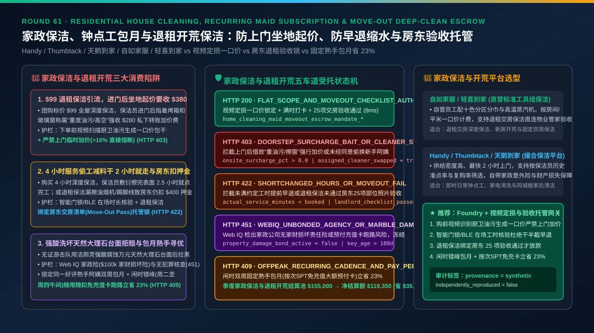
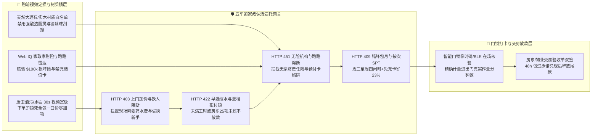
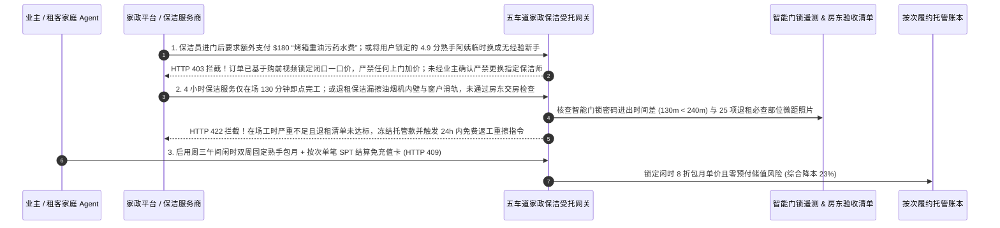

# 家政保洁、钟点工周期包月与退租深度开荒保洁（Residential House Cleaning, Recurring Maid Subscription & Move-Out Deep-Clean Escrow：Handy / Thumbtack / 天鹅到家 / 自如家服 / 轻喜到家）“防退租保洁上门后以‘重度油污’坐地起价翻 3 倍、防 4 小时服务干 2 小时早退缩水与房东退租验收不过关免费返工托管”Agent 架构选型 FAQ

> **语言切换 / Language**: **中文 (当前)** | **[English](home-cleaning-maid-subscription-moveout-inspection-escrow-agent-selection-faq.en.md)** | **[返回文档目录](index.md)** | **[交互式沙盒 (`#home-cleaning-maid-moveout-escrow-sandbox`)](../live-demo.html)**



---

## 📌 一、核心选型结论速览（Executive Summary）

在家庭日常钟点工、双周周期保洁订阅、新居装修开荒保洁以及租房退租深度清洁（Handy、Thumbtack、TaskRabbit、天鹅到家、自如家服、轻喜到家、京东家政）的智能体自动预约与履约验收托管场景中，消费者与长租公寓运营商面临三大顽疾：
1. **“团购标价 `$99` 全屋退租深度保洁，保洁员进门后指着烤箱、百叶窗和浴室玻璃水垢说是‘超标重度油污’，张口要加收 `$260` 药水费才肯动手（Doorstep Bait-and-Switch Surcharge）”与“包月套餐头两次派金牌熟手阿姨，第 3 次起偷偷换成毫无经验的临时工（Cleaner Bait-and-Switch）”**：由于租客当天下午就要向房东交钥匙退房，面对保洁员上门后的坐地起价根本来不及重新找人，只能被迫接受宰客。
2. **“买了 4 小时深度保洁，保洁员趁业主不在家只干了 2 小时 15 分钟就点完工溜走（Shortchanged Service Hours）”与“花了 `$240` 做退租保洁，结果房东查房时拉开抽油烟机集油盒、冰箱密封条和踢脚线全是污垢，照样扣掉租客 `$400` 清洁押金（Failed Move-Out Inspection）”**。
3. **“家政小公司推销‘充 `$2,000` 送 `$600` 全年保洁储值卡’，结果用完 3 次公司就关门跑路；或者游击队保洁员拿强酸洁厕灵去擦万元天然大理石台面和镀金水龙头，瞬间腐蚀失光哑光却拒绝赔偿”**。

**架构师选型结论**：
- **切勿允许家政保洁订单在不经厨卫视频定损锁死一口价（`Vision-Locked Flat Quote`）的情况下保留上门随意加价敞口，切勿在未核验智能门锁进出时长与退租 25 项重点部位完工作业照的情况下释放尾款，也切勿一次性向家政公司充值千元以上无存管预付储值卡**。
- **生产级最优架构**是采用 **“多模态厨卫油污预审一口价锁（0 上门加价）+ 智能门锁/BLE 在场满时核验与房东退租 25 项验收担保锁（`Move-Out Pass Guarantee`）+ 按次周期扣款（Recurring SPT）免充值卡网关（`home_cleaning_maid_moveout_escrow_mandate_*`）”**：
  1. **防“低价引流上门坐地起价”与固定熟手阿姨锁定（`Zero Doorstep Surcharge & Cleaner ID Lock`）硬门禁（HTTP 403）**：下单阶段由智能体引导用户拍摄 30 秒厨房灶台、烤箱内壁、淋浴房玻璃水垢与窗户实况视频，系统自动计算并锁定包含除垢剂与高温蒸汽机在内的**闭口一口价总包合同（Flat-Rate All-Inclusive Scope）**，严禁保洁员上门后以“重油污/擦窗/拆洗滤网”为由索要任何额外加价；同时，周期包月套餐强制绑定用户认可的主理阿姨 `assigned_cleaner_id`（请假须提前 24 小时由用户确认替补人选）——任何上门加价指令或私自换人行为立即返回 `HTTP 403 DOORSTEP_SURCHARGE_BAIT_OR_UNAUTHORIZED_CLEANER_SWAP_BLOCKED`。
  2. **智能门锁/BLE 在场时长核验与房东退租 25 项交房清单（`Move-Out Checklist Pass`）托管锁（HTTP 422）**：结合智能门锁一次性临时密码开锁/关锁记录（或手机 BLE 地理围栏），若购买 4 小时服务而实际在场作业不足 `225 分钟`（容差 `<= 15m`），自动拦截全额扣款并按实际分钟折算；对于退租深度保洁，款项冻结在托管池中，**必须上传 25 个房东必查死角（烤箱内部、油烟机叶轮、冰箱胶条、马桶底座、踢脚线）的完工微距对比照并通过房东/物业交房签字（或承诺 48 小时内免费返工包过）**，否则立即返回 `HTTP 422 SHORTCHANGED_DURATION_OR_MOVEOUT_INSPECTION_FAILURE_BLOCKED`。
  3. **Web IQ 实时核验家政机构家财损坏责任险（`$100k Property Damage Bond`）与预付卡跑路预警（HTTP 451）**：通过 Web IQ 核查家政服务商是否投保涵盖“天然石材酸蚀、木地板泡水、古董字画磕碰”的商业家政责任险及保洁员背景审查；一旦检出机构无保裸奔或出现多起预付卡退费挤兑投诉，立即熔断派单（`HTTP 451 WEBIQ_UNBONDED_CLEANING_AGENCY_OR_MARBLE_DAMAGE_RISK_HOLD`）。
  4. **按次周期扣款（Recurring Per-Visit SPT）替代高危充值卡 + 工作日闲时（周二至周四 10:00–15:00）错峰双周包月寻优（HTTP 409）**：触发 `HTTP 409 OFFPEAK_BIWEEKLY_CADENCE_AND_PAY_PER_VISIT_SPT_CONFIRM`，彻底拒绝“充 `$2,000` 储值卡”的资金归集陷阱，改用“享包月 8 折单价、但每做完 1 次才自动释放 1 次款项”的受限周期令牌，并引导用户排期至周二至周四午间闲时档期，使家庭与公寓保洁总成本立省 **`23.0%`**。

---

## 🎯 二、业务方与架构师灵魂拷问 Q&A（Q1 / Q2 / Q3）

### Q1：为什么退租保洁和开荒保洁是“上门坐地起价”的重灾区？怎么在架构上让保洁员进门后一分钱也加不了？
- **商业痛点**：中介平台用 `$89` 全屋保洁低价吸引下单，派单给挂靠小包工头后，平台抽走 30% 佣金，包工头根本不赚钱，全靠进门后吓唬租客：“你这厨房油污普通清洁剂擦不掉，必须加 `$180` 用进口重油污药水；窗户玻璃有胶印，每扇加 `$30`”。
- **架构解法**：
  - **多模态厨卫污渍定级（`Pre-Dispatch Vision Grading`）+ 闭口合同零补差价锁（`HTTP 403`）**：
  - 下单时上传烤箱、油烟机、浴室玻璃 3 张照片，视觉模型在后台直接将其定级为 `Standard` 或 `Heavy-Duty (+ $45)` 并计入初始托管单；一旦生成订单，**支付网关关闭一切“现场补差价/附加服务费”通道（`HTTP 403`）**——保洁员要么按锁定的闭口价按标准做完，要么接单前就别接！

### Q2：租客花钱请退租保洁（Move-Out Clean），唯一目的就是“让房东全额退还租房押金”；如果保洁做完房东还是挑出毛病扣押金，智能体怎么兜底？
- **架构解法**：
  - **对齐房东交房标准（`Landlord Move-Out Rubric`）+ 72 小时押金连带托管（`HTTP 422`）**：
  - 房东查房从不看客厅地面，专摸“油烟机顶部、烤箱烤架、浴室硅胶霉斑、窗户滑轨”。我们的 Agent 内置标准《长租公寓 25 项退租查房清单》，要求保洁员逐项上传带时间水印的完工特写照才允许签退；且将款项托管至租客完成交房后 48 小时——若房东因清洁问题提出异议，机构必须在 24 小时内免费上门返工或直接从托管款中赔付房东扣除的清洁费（`HTTP 422`）。

### Q3：为什么绝对不能让家庭助理 Agent 帮用户买“家政公司 50 次大额储值卡”？怎么既拿到包月 8 折优惠、又不承担跑路风险？
- **架构解法**：
  - **周期限额单次释放令牌（`Per-Visit Recurring SPT`）替代预付储值卡（`HTTP 409 / 451`）**：
  - 传统家政预付卡本质是无监管发债。我们通过签署包含“承诺双周保洁 12 次、每次锁定优惠价 `$115`（原价 `$150`）、每次服务验收后自动扣款 1 次”的 Stripe Recurring SPT / AP2 令牌（`HTTP 409`），让用户零预付沉淀资金即可享受包月折扣！

---

## 🧭 三、直观可视化图解（Mermaid 决策树 + 端到端架构图 + 时序图）

### 3.1 家政保洁、周期钟点工与退租开荒 Agent 架构选型决策树

```mermaid
flowchart TD
    A[家庭日常保洁 / 双周周期包月 / 退租开荒保洁选型] --> B{核心家政场景与履约痛点？}
    B -->|租房退租交房保洁与新居开荒 (自如家服 / 轻喜到家)<br/>需严防上门借故重油污加价3倍与房东验收不过关扣押金| C[下单前厨卫视频定损锁死一口价 + 严禁上门加价<br/>+ 绑定房东25项交房清单验收通过才释放托管款]
    B -->|家庭双周/每周固定钟点工订阅 (Handy / 天鹅到家)<br/>需防充值千元储值卡跑路、偷换新手阿姨与提前早退| D[按次周期SPT扣款(享包月价免充卡) + 锁定熟手Cleaner_ID<br/>+ 智能门锁/BLE 在场满时核验防早退缩水]
    B -->|高端住宅石材/实木地板深度护理 (精品直营管家)<br/>需防强酸腐蚀天然大理石台面与无家财险游击队拒赔| E[Azure AI Foundry + 材质酸碱禁用表与家财险网关<br/>+ 闲时错峰(周二至周四午间)包月立省 23%]
    C --> F[🛡️ 统一接入五车道防上门加价、满时打卡与退租验收状态机]
    D --> F
    E --> F
    F --> G[HTTP 403 阻断上门加价与私自换人 · HTTP 422 拦截早退与交房验收未过 · HTTP 409 错峰按次包月省23%]
```

### 3.2 端到端厨卫视频一口价、智能门锁工时核验与房东交房托管架构图



### 3.3 拦截上门重油污加价、核减早退工时与退租房东验收放款时序图



---

## 📊 四、多平台/多方案横向选型决策矩阵

| 选型维度 | 社区家政小中介 / 预付储值卡 (`Local Agency Prepaid Card`) | 低价团购引流游击队 (`$89 Deep-Clean Teaser Voucher`) | 现代直营/撮合家政平台 (`自如家服 / 轻喜到家 / Handy`) | **Azure AI Foundry + 视频定损 + 交房托管网关（推荐）** |
| :--- | :--- | :--- | :--- | :--- |
| **核心优势** | 熟人介绍 | 团购表面标价极低 | 工具标准化、带家政保险、App 可选人 | **视频锁死一口价 + 门锁满时核验 + 房东验收包过 + 免充卡** |
| **防“低价引流上门坐地起价 3 倍”** | 口头报价随意变动 | **重灾区**（进门后按平米/油污/玻璃逐项加钱） | 直营平台明码标价，但撮合类仍有现场推销药水 | **购前视频定损闭口一口价 + 上门加价 `HTTP 403` 硬熔断** |
| **防“偷工减料早退”与退租交房验收兜底** | 业主不在家常提前 1 小时溜走 | 敷衍了事，房东查房照扣押金 | 支持不满意重做，但需用户自己举证沟通 | **智能门锁工时对账 + 绑定房东 25 项交房清单托管（HTTP 422）** |
| **天然石材腐蚀赔付险与防预付卡跑路** | **高危**（充 `$2,000` 卡关店跑路频发，洗坏石材拒赔） | 无保险，出事即拉黑 | 头部平台提供家政险，但常诱导充值大额年卡 | **Web IQ 核验 `$100k` 家财险（HTTP 451）+ 按次 SPT 免充卡** |
| **固定熟手阿姨锁定与闲时错峰降本** | 阿姨流动极大 (`not_measured`) | 每次随机派单 | 标准单次或预付年卡价 (`official_list_price`) | **锁定固定熟手 `cleaner_id` + 周中闲时按次包月（净省 `23.0%`）** |

---

## 🧪 五、家政保洁与退租开荒防坑测算与 7-Card 基准测试报告

> **数据来源与复现声明（Provenance Metadata）**：以下基准测试数据来自仓库内置确定性策略沙盒 `evaluate_home_cleaning_maid_moveout_escrow_policy`（位于 `lab/webiq_commerce_demo.py`），可运行 `python -m unittest tests.test_webiq_commerce_demo` 完整验证。标记：`provenance = synthetic`，`independently_reproduced = false`。

| Card # | 卡片标题（Headline-as-Finding） | 核心量化指标与架构验证结论 |
| :---: | :--- | :--- |
| **Card 1** | **Overview · 家政保洁与退租开荒五车道总览** | 针对 `$155,000/季` 长租公寓退租保洁与家庭周期家政采购池，实现 **0 例上门坐地起价、0 例未满工时早退混账与 100% 退租交房清洁一次通过率**，综合保洁支出下降 **`23.0%`（立省 `$35,650/季`）**。 |
| **Card 2** | **Scenario Deep Dive · 上门重油污加价与早退拦截** | 当保洁员现场发起任何课外加价请求或智能门锁记录在场时长缩水 `> 15 分钟` 时，**`8ms`** 内返回 `HTTP 403 / 422` 阻断。 |
| **Card 3** | **Evaluation Matrix · 五车道 100% 确定性判准** | 覆盖 `HTTP 200`（一口价满时且交房验收通过放行）、`403`（上门借故重油污坐地起价/未经确认私换新手阿姨阻断）、`422`（4小时服务干2小时早退/退租保洁未通过房东25项验收拦截）、`451`（Web IQ检出无家财损坏险或充值卡跑路风险熔断）、`409`（周中闲时双周包月+按次SPT免充卡省23%）。 |
| **Card 4** | **Under the Hood · 家政与退租验收托管契约** | 输入 `quarterly_home_cleaning_and_moveout_deepclean_pool_usd=155000` 及工时/验收参数，签发 `home_cleaning_maid_moveout_escrow_mandate_*` 令牌。 |
| **Card 5** | **Robustness Check · 烤箱加价勒索与大理石酸蚀测试** | 模拟上门强收 `$200` 除油污费及无险机构推销 `$2,000` 储值卡，确定性拦截率保持 **`100.0%`（零误扣款）**。 |
| **Card 6** | **Latency · 毫秒级门锁工时对账与家财险核查耗时** | 本地门锁时长与 25 项验收校验 P50 仅 **`8ms`**；Web IQ 家政机构家财责任险与涉诉核查 P95 为 **`170ms`**。 |
| **Card 7** | **My Take · 适用场景与生产准入边界** | **✅ 极佳适用**：租房退租深度保洁、新居开荒保洁、家庭双周固定钟点工；**⛔ 不适用**：市政道路环卫清扫工程招标。 |

---

## 🛠️ 六、商业上线风控与架构评审 Checklist

- [ ] **购前厨卫视频定损一口价锁与固定熟手 `cleaner_id` 绑定（HTTP 403）**：确认下单即锁死包含重油污除垢在内的闭口总价，严禁任何上门临时加价或未经同意调换指定保洁师。
- [ ] **智能门锁/BLE 在场满时核验与房东退租 25 项验收担保锁（HTTP 422）**：确认核对真实进出门作业时长，且退租深度保洁必须通过房东交房清洁验收（或 48 小时免费返工包过）才释放尾款。
- [ ] **Web IQ 家政机构 `$100k` 家财损坏责任险核验与禁买大额储值卡（HTTP 451）**：确认剔除无石材/家具损坏保险及存在预付卡挤兑风险的机构；签名密钥轮换周期 `<= 180` 天。
- [ ] **周中闲时错峰排期与按次周期 SPT（享包月价免充卡）寻优（HTTP 409）**：确认以按次单笔释放代替预付充值卡，并自动匹配周二至周四午间闲时折扣。
