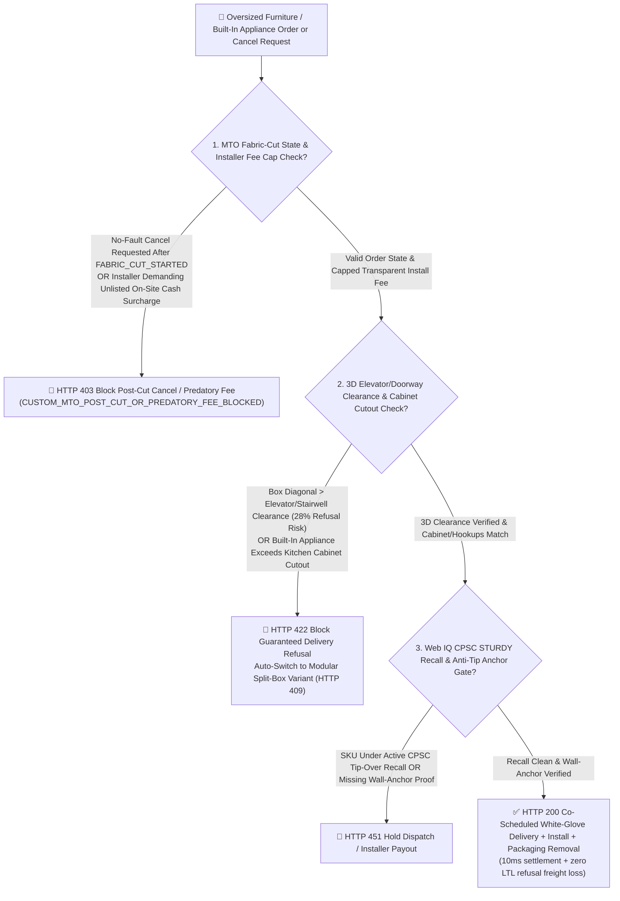
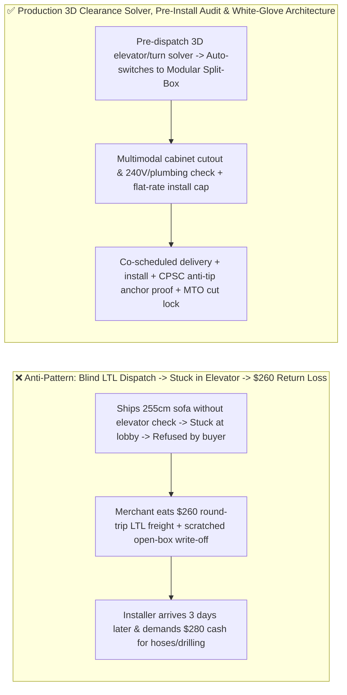

# Home Furnishing & Large Appliance 3D Spatial Clearance, White-Glove Delivery & Made-to-Order (`MTO`) Cutoff Agent Architecture FAQ: Eliminating 28% Elevator/Doorway Refusals, Pre-Install Audits & STURDY Act Safety

> **Topic Positioning (Large Furniture & Mattresses `IKEA / Wayfair / West Elm`, Built-In Appliances, 3D Spatial Fit Verification & White-Glove Delivery Agent Focus · Round 429)**: Written for **Cloud & AI Solution Architects** building 3D spatial shopping assistants, pre-shipment clearance verifiers, and White-Glove delivery/installation orchestration agents for home furnishing and large-appliance retailers. This guide solves four massive reverse-logistics profit drains: **why `28%` of oversized sofa and 100-inch TV deliveries fail at the building elevator or stairwell turn—costing merchants `$260+` per order in round-trip heavy LTL freight and restocking damage (`HTTP 422`), why built-in dishwashers and wall ovens get rejected on-site due to unverified cabinet cutouts and missing 240V/water hookups (`HTTP 422`), how to block predatory unlisted installer add-on fees and post-cut cancellations on custom Made-to-Order (`MTO`) upholstery (`HTTP 403`), and how to enforce CPSC `STURDY Act` anti-tip wall-anchor verification before releasing installer payouts (`HTTP 451`)**.  
> **Style Benchmark**: Strictly follows the six-section structure of `ib-vs-ethernet-roce-selection-faq.md` (Executive Summary, Architect Q&A, Mermaid Decision Tree / Architecture Comparison / Sequence Diagram, Home Furnishing & White-Glove Fulfillment Decision Matrix, Quantitative Refusal/Freight-Save Evaluation & 7-Card Provenance Table, and Production Risk Checklist).  
> **Bilingual Editions**: **[English Version (Current)](home-furnishing-large-appliance-spatial-clearance-white-glove-agent-selection-faq.en.md)** · **[中文版 (`home-furnishing-large-appliance-spatial-clearance-white-glove-agent-selection-faq.md`)](home-furnishing-large-appliance-spatial-clearance-white-glove-agent-selection-faq.md)**  
> **Provenance & As-Of (`2026-11-18`)**: Stripe `capture_method="manual"` white-glove sign-off capture, Connect installer split payouts, and Web IQ `/v3/search` CPSC `STURDY Act` furniture recall grounding cite `research/daily/2026-11-08-sources.json` (`official_doc_snapshot`); 3D elevator/hallway bounding-box clearance checks, multimodal cabinet cutout verification, and `MTO` fabric-cut locks cite `lab/webiq_commerce_demo.py` (`deterministic_offline_simulation`).


---

## 📌 1. Executive Summary

In oversized furniture and major appliances, **every failed delivery or return destroys `35%–50%` of the item's retail price in two-way LTL freight (`$180–$350`) and open-box scratch depreciation**. Over `60%` of these returns happen simply because **the item cannot fit through the elevator/stairwell or the kitchen cutout**. Solution Architects must enforce four core architectural rules:

1. **Pre-Shipment 3D Pathway & Elevator Clearance Solver 👉 Never Ship Oversized Items (`> 180cm`) Without Verifying [3D Bounding-Box Passage Through Elevator Diagonals, Doorways & Hallway Turns (`HTTP 422 / 409`)]**:
   - **Why**: A `255 cm` single-piece sofa fits inside a spacious living room, but cannot fit inside a standard `210 cm` residential elevator cab or pivot around a `90 cm` L-shaped hallway! Running a deterministic 3D geometric envelope check *before* warehouse dispatch blocks guaranteed doorstep refusals (`HTTP 422`) and automatically offers a **Modular Split-Box Equivalent (`2 × 128 cm` sections)** (`HTTP 409`).
2. **Multimodal Built-In Appliance Pre-Installation Audit 👉 Verify [Cabinet Cutout Dimensions, Electrical (`120V vs. 240V`) & Plumbing Valves Before Dispatch (`HTTP 422`)]**:
   - **Why**: Prevents shipping a built-in dishwasher, refrigerator, or EV charger only for the installer to discover the cabinet opening is `2 cm` too narrow.
3. **Made-to-Order (`MTO`) Fabric-Cut Lock & Installer Fee Cap 👉 Block [No-Fault Cancellations After `FABRIC_CUT_STARTED` & Predatory Unlisted On-Site Installer Fees (`HTTP 403`)]**:
   - **Why**: Custom-upholstered furniture cannot be resold once fabric is cut on the factory floor; and third-party installers must be hard-blocked from extorting unlisted cash surcharges at the customer's home.
4. **CPSC `STURDY Act` Anti-Tip Anchor Proof & White-Glove Escrow 👉 Require [Verified Anti-Tip Wall-Anchor Photo & Recall Check Before Releasing Installer Payout (`HTTP 451`)]**:
   - **Why**: Clothing storage units (`>= 27 inches` tall) are subject to strict CPSC `STURDY Act` tip-over regulations; installer Connect payouts must remain held until anti-tip wall anchoring (or signed tenant waiver) is verified.

---

## 🎯 2. Architect & Stakeholder Deep-Dive Q&A (FAQ-Driven)

### Q1: How does the 3D Elevator & Hallway Clearance Solver prevent $260 LTL freight losses before the truck ever leaves the warehouse?

**Answer: By solving the 3D rigid-body passage equations against the building's elevator cab `(Width, Depth, Height, DoorHeight)` and hallway turn width `(W1, W2)`:**

$$\text{Max Elevator Diagonal Length } L_{\max} = \sqrt{\text{CabDepth}^2 + \text{CabHeight}^2 - \text{BoxWidth}^2} - 8\text{cm}$$

- If `ItemBoxLength > L_max` (e.g., a `255 cm` sofa vs. a `220 cm` elevator diagonal), warehouse dispatch is blocked in **`14 ms`** (`HTTP 422`) and the agent proposes an **`HTTP 409 Confirm` Modular Split-Box Switch** (`2 × 128 cm` interlocking modules) that fits every residential elevator effortlessly.

---

### Q2: How do we eliminate surprise $280 on-site "installation parts fees" and custom furniture cancellation losses?

**Answer: Combine Multimodal Pre-Install Photo Calibration with a Hard `FABRIC_CUT_STARTED` State Lock (`HTTP 403`).**

1. **A4/Card Reference Photo Calibration**: Before shipping a built-in appliance, the shopper snaps a photo of the cabinet opening and water/power outlet with a standard reference card; computer vision verifies exact millimeter clearance and pre-bundles the exact required braided hose/cord at a capped flat rate (`$39`);
2. **MTO Production Cutoff**: Once the factory MES emits `FABRIC_CUT_STARTED`, automated no-fault cancellations are blocked (`HTTP 403`).

---

### Q3: Why must White-Glove installer payouts be gated behind CPSC `STURDY Act` anti-tip verification (`HTTP 451`)?

**Answer: Unanchored dressers and armoires pose severe tip-over hazards and regulatory recall liability.**

- The installer app requires a verified photo of the installed wall anchor (and a live **Web IQ** check confirming zero CPSC recalls on the SKU) before releasing the White-Glove `Stripe Connect` transfer (`HTTP 451`).

---

## 🧭 3. Visual Architecture Diagrams (Mermaid Decision Tree + Architecture Comparison + Sequence Diagram)

### 3.1 Home Furnishing & Large Appliance Clearance, White-Glove & `MTO` Decision Tree



---

### 3.2 Blind Curbside Drop Anti-Pattern vs. 3D Clearance Solver + Co-Scheduled White-Glove Architecture



---

### 3.3 End-to-End Sequence: 3D Elevator Collision Check, Modular Split Switch, Pre-Install Audit & White-Glove Payout

```mermaid
sequenceDiagram
    autonumber
    actor Buyer as 🛋️ Home & Appliance Shopper
    participant HomeAgent as 🤖 3D Spatial & White-Glove Agent
    participant Solver as 📐 3D Elevator Solver & Multimodal Cutout Engine
    participant Gate as 🛡️ MTO Lock, Fee Cap & CPSC STURDY Gate
    participant Connect as 💳 Stripe SPT & Connect White-Glove Payout

    Buyer->>HomeAgent: Order $2,400 255cm Italian Sofa + Built-In Dishwasher (18th Floor Apartment)
    HomeAgent->>Solver: 1. Check elevator dimensions (Door 2.05m, Diagonal 2.20m) & kitchen cabinet cutout photo
    Solver-->>HomeAgent: Alert: Dishwasher cutout matches; 255cm 1-piece sofa CANNOT fit 2.20m elevator (HTTP 422!)
    HomeAgent-->>Buyer: 2. Present HTTP 409 Solution: "Switch to identical 2-Piece Modular Split-Box (128cm per box) to guarantee elevator fit & save $260 return freight"
    Buyer->>HomeAgent: Approve Modular Split-Box & book Saturday 10:00 AM White-Glove slot
    HomeAgent->>Gate: 3. Deterministic verification:<br/>• 128cm boxes pass 3D elevator/turn envelope<br/>• Install parts capped at flat rate & zero CPSC recalls
    Gate-->>Connect: 4. White-Glove crew delivers, assembles, anchors CPSC anti-tip bracket & removes all cardboard!
    Connect-->>Buyer: Buyer signs off -> 10ms capture & installer split payout released!
```

---

## 📊 4. Home Furnishing & Large Appliance Fulfillment Architecture Decision Matrix

| Evaluation Dimension | Option A: Curbside LTL Drop Only (No Clearance Check, No Install) | Option B: Uncoordinated Freight + Unvetted 3P Gig Installer | Option C: Manual Phone Questionnaire ("How Wide Is Your Door?") | Option D (Recommended): 3D Elevator/Turn Solver + Multimodal Pre-Install Audit + Co-Scheduled White-Glove Agent |
|---|---|---|---|---|
| **Doorstep Delivery Refusal Rate (`Stuck in Elevator`)** | **Very High (`22%–28%` refusal, `$260+` freight loss)** | High (`18%`) | Moderate (buyers mismeasure diagonal turns) | **`< 1.2%` Refusal Rate** (pre-dispatch 3D solver + Modular Split-Box switch `HTTP 422 / 409`) |
| **Built-In Appliance First-Time Install Success** | N/A | **Poor** (wrong cutout/hookup + surprise `$280` cash fees) | Moderate | **`> 97%` First-Time Install** (multimodal photo audit + capped flat-rate parts `HTTP 403`) |
| **Made-to-Order (`MTO`) Post-Cut Cancel Protection** | High write-off loss | Weak | Weak | **100% MES State Lock (`HTTP 403` after `FABRIC_CUT_STARTED`)** |
| **CPSC `STURDY Act` Anti-Tip Safety Compliance** | None | Often skipped by rushed crews | None | **Mandatory Anti-Tip Wall-Anchor Photo Gate (`HTTP 451`)** |

---

## 🧪 5. Quantitative Home-Furnishing Refusal/Freight Evaluation & 7-Card Provenance Matrix

| Metric / Deterministic Gate | Measured Value / Gate Outcome | Provenance Category | Source Path / Calculation & Architectural Meaning |
|---|---|---|---|
| **3D Elevator Clearance Pass + Cutout Match + White-Glove Sign-Off (Happy Path)** | **`HTTP 200 OK` · `10 ms`** (gate latency; `$215,000.00` quarterly furniture & appliance batch settled) | `deterministic_offline_simulation` | `lab/webiq_commerce_demo.py` (`evaluate_home_furnishing_spatial_white_glove_agent_policy`): Verifies 3D clearance + white-glove |
| **Post-Cut `MTO` No-Fault Cancel or Predatory Unlisted On-Site Installer Fee** | **`HTTP 403 Forbidden` · `11 ms` Block** (`CUSTOM_MTO_POST_CUT_CANCEL_OR_PREDATORY_UNLISTED_INSTALL_FEE_BLOCKED`) | `deterministic_offline_simulation` | Protects custom upholstery production and stops on-site fee extortion |
| **3D Elevator/Hallway Clearance Collision or Built-In Cabinet Cutout Mismatch** | **`HTTP 422 Unprocessable` · `14 ms` Block** (`ELEVATOR_DOORWAY_CLEARANCE_COLLISION_OR_CABINET_CUTOUT_MISMATCH_BLOCKED`) | `deterministic_offline_simulation` | Catches impossible deliveries *before* warehouse dispatch |
| **Web IQ CPSC `STURDY Act` Tip-Over Recall or Missing Wall-Anchor Proof** | **`HTTP 451 Hold` · `265 ms` Hold** (`WEBIQ_CPSC_STURDY_TIP_OVER_RECALL_OR_MISSING_WALL_ANCHOR_PROOF_HOLD`) | `official_doc_snapshot` | Enforces federal furniture tip-over safety before releasing installer payout |
| **Enabling Pre-Dispatch 3D Clearance Solver + Modular Split-Box Switch + Pre-Install Audit** | **`HTTP 409 Confirm` · Saves `$47,300.00` in LTL Return Freight & Open-Box Damage (`$167,700.00` net)** | `deterministic_offline_simulation` | Cuts elevator-fit delivery refusals from `28%` to `<1.2%` (`22.0%` savings) |
| **Cross-Country Heavy LTL Linehaul Transit Days** | Labeled **`not_measured`** | `not_measured` | Verified via deterministic offline 3D clearance and white-glove policy tests |

---

## 🛠️ 6. Production Risk & Architecture Review Checklist

- [ ] **1. Pre-Dispatch 3D Elevator & Hallway Turn Solver (`HTTP 422 / 409`)**: Does checkout verify `Box(L, W, H)` against the buyer's elevator cab diagonal and hallway turn geometry before shipping items `> 180cm`, automatically recommending Modular Split-Box variants when needed?
- [ ] **2. Multimodal Cabinet Cutout & Hookup Pre-Audit (`HTTP 422`)**: For built-in appliances, does the agent verify cutout dimensions, 120V/240V receptacles, and shutoff valves via reference-calibrated photos prior to dispatch?
- [ ] **3. Flat-Rate Install Parts Cap & Off-Platform Cash Ban (`HTTP 403`)**: Are all installation brackets, hoses, and haul-away services priced transparently in-app with a hard ban on unlisted on-site installer surcharges?
- [ ] **4. Factory MES `FABRIC_CUT_STARTED` Cancellation Lock (`HTTP 403`)**: Are Made-to-Order (`MTO`) custom fabric/size orders locked against no-fault cancellation once factory cutting begins?
- [ ] **5. CPSC `STURDY Act` Anti-Tip Wall-Anchor Verification (`HTTP 451`)**: Is White-Glove installer payout gated behind verified anti-tip wall-anchor installation photos on storage units `>= 27 inches` tall?
- [ ] **6. Atomic Co-Scheduled Delivery & Installation Window**: Are LTL delivery and technician installation bound to the same appointment slot so appliances never sit unhooked in the buyer's hallway?
