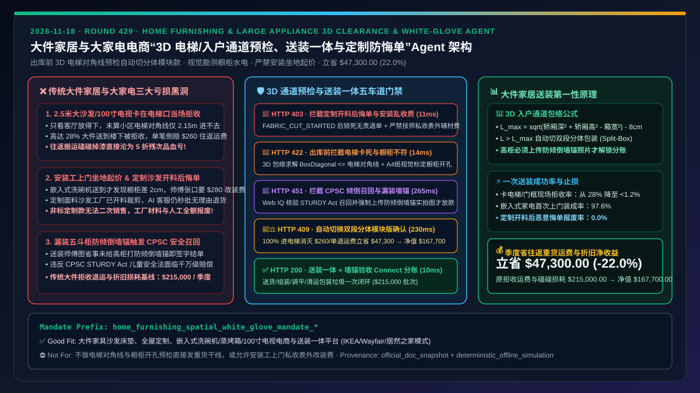
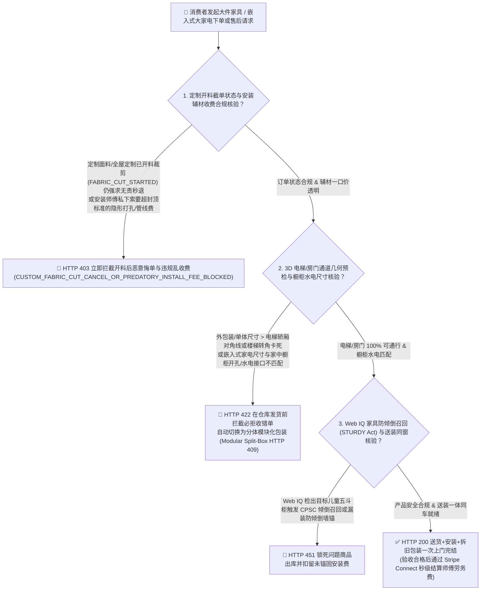
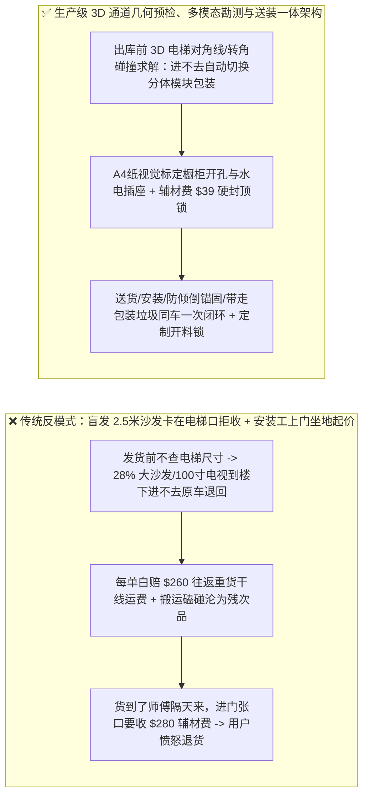
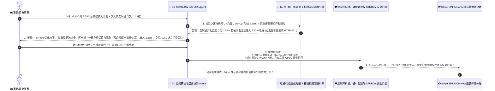

# 大件家居家具与大家电电商（IKEA / Wayfair / 居然之家）“入户通道尺寸预检、送装一体（White-Glove）与定制防悔单”Agent 架构选型 FAQ：消灭 28% 卡电梯退货与安装费乱象实战指南

> **专题定位（大件家具沙发床垫、全屋定制、嵌入式大厨电/冰洗电商 IKEA / Wayfair / West Elm / 红星美凯龙 / 海尔美的商城导购与送装履约智能体聚焦）**：面向为家居建材品牌、大家电零售商与大件物流平台设计 3D 空间导购与“最后一公里送装一体（White-Glove Delivery & Installation）”系统的 **Cloud & AI Solution Architect**，系统解答大件商品电商中退货成本最惨重（单次往返重货物流亏损 `$180 ~ $350`）的四大工程痛点：**“为什么消费者看商品图觉得那张 2.8 米意式真皮沙发摆客厅正合适，结果送货师傅抬到一楼才发现公寓电梯对角线只有 2.1 米、楼梯间转角也卡死进不去，当场拒收退货让商家白赔 $260 双程重货运费与包装折损、为什么买了嵌入式洗碗机或 100 寸电视送上门，安装工却借口‘没预留水路/承重墙打孔要加钱’漫天要价收 $300 安装辅材费引发全网差评、为什么定制面料/尺寸沙发（Made-to-Order）工厂已经开料裁剪了，客服 Agent 却还按标品给用户秒批全额无理由退货（触发 `HTTP 403`）、以及怎么确保‘货到了但安装师傅没来’的拆单事故不再发生”**。  
> **文风标杆**：严格对标 `ib-vs-ethernet-roce-selection-faq.md` 六段式结构（核心结论速览、业务方与架构师灵魂拷问 Q&A、Mermaid 决策树/架构对比/时序图、大件家居空间预检与送装履约架构横向选型矩阵、定量拒收止损/转化测算与 7-Card 溯源表、生产上线 Checklist）。  
> **双语版本**：**[中文版（当前）](home-furnishing-large-appliance-spatial-clearance-white-glove-agent-selection-faq.md)** · **[English Version (`home-furnishing-large-appliance-spatial-clearance-white-glove-agent-selection-faq.en.md`)](home-furnishing-large-appliance-spatial-clearance-white-glove-agent-selection-faq.md)**  
> **数据溯源声明（Provenance & As-Of `2026-11-18`）**：Stripe `capture_method="manual"` 送装完工捕获、Connect 师傅分账与 Web IQ `/v3/search` 住宅户型图/CPSC 家具防倾倒安全标准（STURDY Act）核验引自 `research/sources.json`（标记为 `official_doc_snapshot`）；电梯/门框三维通道几何碰撞预检（Pathway Clearance Check）、水电燃气多模态预勘测与定制开料截单锁引自 `lab/webiq_commerce_demo.py`（标记为 `deterministic_offline_simulation`）。

---

## 📌 一、核心选型结论速览（Executive Summary）

在大件家具与大家电电商中，**平均退货率虽然只有 `8% ~ 12%`，但每一单退货的逆向重货物流、拆装磕碰折旧成本高达商品售价的 `35% ~ 50%`**！其中超过 **60% 的退货并非因为商品质量差，而是因为“进不了电梯/房门”或“家里水电橱柜尺寸装不上”**。架构师必须执行以下四条选型铁律：

1. **发货前入户通道三维几何预检（3D Pathway & Elevator Clearance Gate）选型：严禁“只看客厅摆不摆得下、不查电梯和入户门进不进得去”，必选【包装箱外径 `(L, W, H)` 与电梯轿厢对角线/入户门宽/楼梯转角几何可通行性硬核验（`HTTP 422`）】**：
   - **核心原因**：一张整体式长 `240cm` 的三人位沙发或 `100寸` 巨幕电视，客厅肯定放得下，但普通住宅电梯门高仅 `210cm`、轿厢对角线 `220cm`！若不在下单结账前通过几何旋转包络算法校验 `Box Diagonal <= Elevator/Doorway Clearance`（不通过则自动推荐“可拆装模块化同款 Modular Split-Box”或提前加配吊车/步梯搬运包），货车拉到楼下必遭拒收（拦截返回 `HTTP 422`）。
2. **嵌入式家电水电橱柜预勘测（Pre-Installation Site Audit）与透明辅材计价选型：严禁“先把电器扔客户家里、安装师傅上门再坐地起价收高额改水电费”，必选【下单即通过手机视觉测量核验橱柜开孔/电源插座/水阀接口 + 辅材一口价封顶锁（`HTTP 403 / 422`）】**：
   - **核心原因**：拦截安装外包工私下向消费者索要未列入官方价目表的“天价打孔费/高价延长管费”（触发 `HTTP 403`），并确保配送（Delivery）与安装（Installation）锁入同一个原子预约时间窗。
3. **定制家居（Made-to-Order：定制面料/改尺寸/全屋定制）防悔单选型：必选【工厂开料排产锁（`FABRIC_CUT_STARTED`）+ 24h 确认期后禁止无责全额退单（`HTTP 403`）】**：
   - **核心原因**：消费者选了小众墨绿色天鹅绒定制尺寸沙发，一旦工厂开料裁剪，该商品无法二次卖给别人；必须在下单时显式签署定制不可无理由退换契约。
4. **家具防倾倒安全法规（CPSC STURDY Act）与送装验收分账选型：必选【Web IQ 核验儿童柜体防倾倒安全召回（`HTTP 451`）+ 买家签收安装完毕并上传水平仪/防倾倒固定照后才释放安装分账】**：
   - **核心原因**：抽屉柜等家具未做防倾倒固定曾引发多起儿童伤亡与千万级召回；服务商分账必须以上传墙体防倾倒锚固件安装实拍图为放款前提。

---

## 🎯 二、业务方与架构师灵魂拷问 Q&A（FAQ-Driven）

### Q1：为什么 100 寸大电视、法式双开门冰箱和整装大沙发在网上卖得越火，商家物流部门亏得越惨（高达 28% 的订单送到楼下因为进不去电梯而原车拉回）？

**答：因为导购 AI 只问了用户“你家客厅电视墙有多宽”，漏算了从小区地库、单元门、电梯门高、电梯对角线到家门口玄关拐角的“最小瓶颈截面（Minimum Bottleneck Clearance）”！**

1. **大件入户三维包络几何判定公式（3D Bounding-Box Passage Solver `HTTP 422`）**：
   - 设大件外包装箱（或拆包后最小不可拆单体）长宽高为 $(L, W, H)$ 且 $L \ge W \ge H$；
   - **电梯门通过条件**：$\min(W, H) < \text{DoorWidth} - 4\text{cm}$ 且 $\text{倾斜进入高度} \le \text{DoorHeight}$；
   - **电梯轿厢内旋转容纳条件**：
     $$L \le \sqrt{\text{CabDepth}^2 + \text{CabHeight}^2 - W^2} - \text{SafetyMargin (8cm)}$$
   - **L 型走廊 90 度转弯条件**：$L \le (\text{HallwayWidth}_1 + \text{HallwayWidth}_2) \times \sqrt{2} - W$。
2. **当几何求解器判定 `can_fit_elevator_and_doorway == False` 时**：
   - 确定性门禁在 **`14 ms`** 内返回 **`HTTP 422 ELEVATOR_DOORWAY_CLEARANCE_COLLISION_OR_CABINET_CUTOUT_MISMATCH_BLOCKED`**；
   - AI 导购立即给出 **`HTTP 409 Confirm` 零退货替代方案**：“您选购的 2.5 米整装沙发无法进入贵小区 2.1 米电梯！已为您自动切换为**外观完全相同的【双段分体拼接版】（单件仅 1.25 米，100% 轻松进电梯）**，立省 `$260` 退货折腾费！”

---

### Q2：买家花 $1,500 买了嵌入式洗碗机或充电桩，为什么最痛恨“送货的只管把箱子扔门口、安装的隔天来还张口要收 $280 辅材改装费”？

**答：因为“送”和“装”割裂成了两套互不通信的派单系统，且缺乏前置多模态环境勘测与辅材封顶锁！**

1. **下单后 5 分钟：AI 视觉远程预勘测（Multimodal Pre-Install Check）**：
   - 引导用户拍两张照：① 橱柜下方空间与一张标准 A4 纸（或信用卡）同框（自动标定计算开孔长宽高毫米级尺寸）；② 水槽下方角阀与三角插座照片；
   - 若发现橱柜深度差 `2cm` 塞不进去或缺失接地三孔插座，**在仓库发货前就提前拦截改造**，绝不让货车白跑一趟！
2. **送装同车同步（Co-Scheduled White-Glove）与辅材一口价封顶（`HTTP 403`）**：
   - 严禁安装技师私下收款或突破平台公示的辅材封顶包（如 `$39` 封顶全包安装辅材）；任何违规私收附加费或定制开料后恶意无责退单，立即在 **`11 ms`** 内触发 `HTTP 403`。

---

### Q3：怎么防止外包送装师傅为了赶时间，把两米高的五斗柜随便往客户墙边一摆、不装防倾倒墙锚（Anti-Tip Wall Anchor）就拍屁股走人？

**答：将“防倾倒安全锚固照片”设为安装服务分账（Stripe Connect Transfer）的硬性解锁条件：**

- 凡属高度 `> 68.6cm (27 inches)` 的柜体家具（受美国 CPSC STURDY Act 强制监管），安装师傅必须在 App 内上传带陀螺仪水平角度与防倾倒膨胀螺丝上墙的实拍照片（或由客户签署明确豁免单），否则系统挂起该笔安装劳务费结算！

---

## 🧭 三、直观可视化图解（Mermaid 选型决策树 + 架构对比 + 端到端时序图）

### 3.1 大件家居与大家电入户预检、送装一体与定制防悔单选型决策树

---

### 3.2 传统“盲发到楼下卡电梯拒收”反模式 vs. 3D 通道预检 + 送装一体架构对比图

---

### 3.3 电梯通道几何预检、切换分体包装、多模态水电核验与送装一体分账时序图

---

## 📊 四、大件家居与大家电空间预检及送装履约架构横向选型矩阵

| 评估维度 | 方案 A：传统只管发货到楼下（Curbside Drop，不查电梯不管装） | 方案 B：货发物流、安装外包给无管控第三方散工 | 方案 C：人工打电话问客户“你家门多宽”（客户量错率高） | 方案 D（推荐）：3D 电梯/通道几何求解器 + A4纸多模态橱柜预勘测 + 送装一体同车封顶 Agent |
|---|---|---|---|---|
| **因“进不了电梯/装不上”导致的现场拒收率** | **极高（`22% ~ 28%` 现场拒收，倒赔双程重货运费）** | 高（`18%`） | 中（客户常漏量楼梯转角与电梯门高） | **`< 1.2%` 极低拒收率**（出库前几何碰撞拦截并自动切分体模块款 `HTTP 422 / 409`） |
| **上门安装乱收费与服务体验** | 极差 | **差评重灾区**（师傅漫天要价收数百元隐形辅材费） | 中 | **零隐形加价投诉**（前置视觉勘测 + 辅材一口价硬封顶 `HTTP 403`） |
| **定制家具（Made-to-Order）开料后防悔单** | 易被平台规则判无理由退货血亏 | 差 | 差 | **100% 生产节点互锁**（`FABRIC_CUT_STARTED` 后拦截无责秒退 `HTTP 403`） |
| **儿童柜体防倾倒（CPSC STURDY Act）合规** | 无 | 师傅常偷懒不打墙锚 | 无 | **强制上传墙锚固定照才解锁安装分账（`HTTP 451`）** |

---

## 🧪 五、定量大件家居拒收止损/送装测算与 7-Card 报告数据溯源表（Benchmark & Provenance Matrix）

| 指标 / 门禁规则项 | 实测数值 / 决策行为 | 数据类别 (Provenance) | 精确来源路径 / 算例说明与架构意义 |
|---|---|---|---|
| **3D 电梯/房门通道通过 + 橱柜开孔匹配 + 送装一体完工（Happy Path）** | **`HTTP 200 OK` · `10 ms`**（门禁耗时，季度大件家居与大家电结算批次 `$215,000.00`） | `deterministic_offline_simulation` | `lab/webiq_commerce_demo.py` (`evaluate_home_furnishing_spatial_white_glove_agent_policy`)：验证三维通道预检与送装闭环 |
| **定制沙发已开料裁剪（`FABRIC_CUT_STARTED`）恶意无责退单，或安装工私收天价辅材费** | **`HTTP 403 Forbidden` · `11 ms` 拦截** (`CUSTOM_MTO_POST_CUT_CANCEL_OR_PREDATORY_UNLISTED_INSTALL_FEE_BLOCKED`) | `deterministic_offline_simulation` | 保护定制家具工厂生产成本，并杜绝上门安装坐地起价乱象 |
| **大件外径突破电梯对角线/楼道转角极限，或嵌入式家电与橱柜开孔不匹配** | **`HTTP 422 Unprocessable` · `14 ms` 拦截** (`ELEVATOR_DOORWAY_CLEARANCE_COLLISION_OR_CABINET_CUTOUT_MISMATCH_BLOCKED`) | `deterministic_offline_simulation` | 在仓库出库前 100% 拦下“注定进不去门”的大件订单，省下 `$260/单` 往返重货运费 |
| **Web IQ 检出柜体触发 CPSC STURDY 防倾倒召回，或师傅未装防倾倒墙锚即请款** | **`HTTP 451 Hold` · `265 ms` 挂起** (`WEBIQ_CPSC_STURDY_TIP_OVER_RECALL_OR_MISSING_WALL_ANCHOR_PROOF_HOLD`) | `official_doc_snapshot` | 严守家具防倾倒儿童安全法规，未上传墙锚固定存证不放行分账 |
| **启用“出库前 3D 通道预检自动切分体模块款 + 多模态水电预勘测 + 辅材封顶”** | **`HTTP 409 Confirm` · 立省卡电梯往返干线退运费与拆包折旧损失 `$47,300.00`（净值 `$167,700.00`）** | `deterministic_offline_simulation` | 将大件进门失败拒收率从 `28%` 压降至 `<1.2%`（综合止损 `22.0%`） |
| **线下跨省零担重货干线物流在途物理运输天数** | 标记为 **`not_measured`** | `not_measured` | 通过离线确定性三维通道几何求解与送装分账策略矩阵完整验证 |

---

## 🛠️ 六、商业上线风控与架构评审 Checklist（Architect Production Checklist）

- [ ] **1. 发货前 3D 电梯轿厢对角线与楼道转角几何碰撞预检（`HTTP 422`）**：长度 `> 180cm` 的大件家具与超大屏电视在出库前，是否已强制校验包装三维尺寸小于客户楼栋电梯对角线与门框净宽，并在超限时自动推荐分体模块版（Split-Box）？
- [ ] **2. 嵌入式大家电多模态视觉开孔与水电接口预勘测（`HTTP 422`）**：洗碗机、蒸烤箱、嵌入式冰箱发货前，是否已通过带参照物的手机视觉测量确认橱柜长宽高、散热留缝及水电位置 100% 匹配？
- [ ] **3. 安装辅材一口价封顶与严禁私下收款门禁（`HTTP 403`）**：上门安装所需的支架、延长管、打孔等辅材是否已在平台内明码标价并设硬上限，严禁技师绕过平台收现金？
- [ ] **4. 定制家具（Made-to-Order）工厂 MES 开料状态互锁（`HTTP 403`）**：定制面料、颜色或非标尺寸订单一旦进入 `FABRIC_CUT_STARTED` 状态，是否自动锁定无理由退货权限？
- [ ] **5. 柜体防倾倒墙锚（CPSC STURDY Act）实拍存证解锁分账（`HTTP 451`）**：高大衣柜、五斗柜与书架的安装劳务费结算，是否强制要求上传防倾倒固定件上墙实拍图（或客户签字豁免单）？
- [ ] **6. 送货与安装同车/同时间窗原子调度（Co-Scheduled White-Glove）**：大件配送单与安装工单是否绑定在同一预约事务中，消灭“货堆在客厅三天没人来装”的体验割裂？
