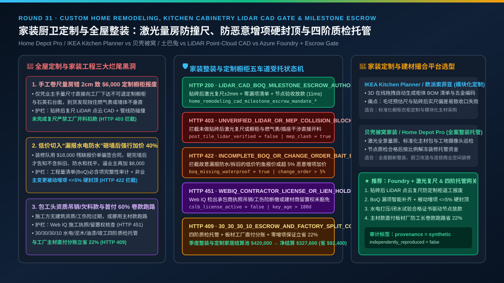
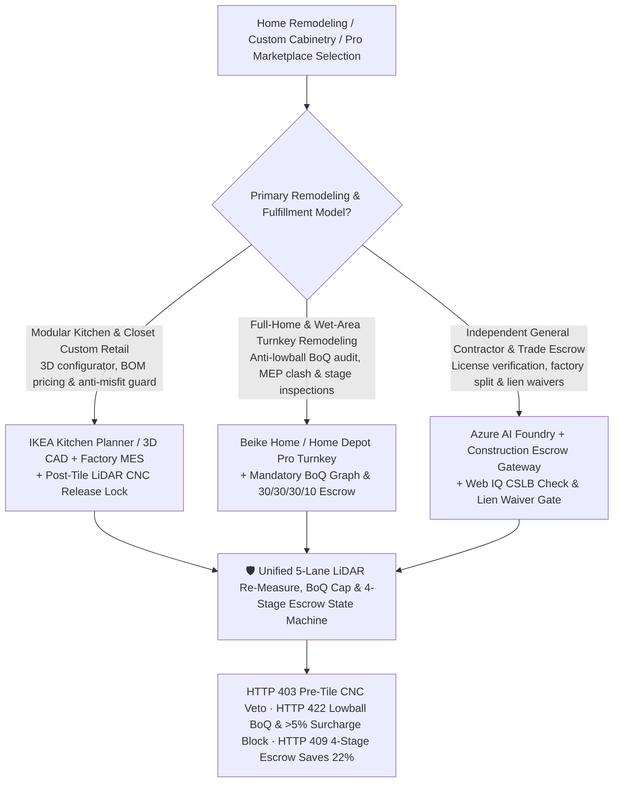
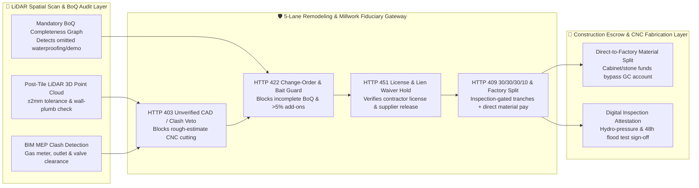
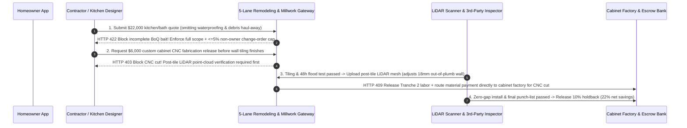

# Custom Home Remodeling, Kitchen & Bath Cabinetry & Contractor Milestone Escrow (`Home Depot Pro / IKEA Kitchen Planner / Houzz Pro / Beike Home`) Post-Tile `LiDAR` CAD Gate, Anti-Change-Order Bait (`<= 5%` Cap) & `30/30/30/10` Inspection Escrow Agent Architecture Selection FAQ

> **Language / 语言切换**: **[中文](home-remodeling-custom-cabinetry-lidar-cad-milestone-escrow-agent-selection-faq.md)** | **English (Current)** | **[Back to Docs Index](index.en.md)** | **[Interactive Sandbox (`#home-remodeling-cad-milestone-escrow-sandbox`)](../live-demo.en.html)**

---

## 📌 1. Executive Summary & Core Selection Verdict

In custom kitchen & bath cabinetry (`IKEA Kitchen Planner`, `Oppein`, `MasterBrand`), full-home remodeling marketplaces (`Beike Home`, `Thumbtack Pro`, `Houzz Pro`), and big-box installation services (`Home Depot Pro`, `Lowe's Installation`), average order values reach **`$8,000–$65,000+`** with **100% non-returnable custom millwork, 45–90 day multi-trade dependencies, and severe information asymmetry**. Allowing a remodeling or cabinetry AI agent to release factory production orders or contractor upfront payouts without deterministic engineering gates triggers three catastrophic failure modes:
1. **Releasing `$6,000` Non-Returnable Custom Cabinetry to CNC Production Before Post-Tile `LiDAR` Re-Measurement (`±2mm`) & `MEP` Collision Checks**: Pre-demolition tape-measure estimates routinely differ from finished drywall/tiled walls by `15mm–35mm`, and walls are rarely plumb (`!= 90°`). If an agent sends rough dimensions straight to factory CNC cutting, cabinets arrive `1.5cm` too wide for the alcove or drawer pulls collide with gas meters and dishwasher angle valves—resulting in 100% scrap loss.
2. **Predatory Contractor "Lowball `BoQ` Bait & `40%` Mid-Demolition Change-Order Extortion"**: Unscrupulous contractors win bids with an artificially low `$18,000` quote by omitting mandatory line items (e.g., bathroom waterproofing membrane, subfloor leveling, debris haul-away, or electrical rewiring) from the Bill of Quantities (`BoQ`). Once walls are demolished, they hold the jobsite hostage until the homeowner pays `$8,000` in unbudgeted Change Orders.
3. **60% Upfront Deposit Embezzlement & Unwaived Subcontractor Mechanics' Liens**: Paying 60% upfront directly to a general contractor's personal account risks abandonment or unpaid material suppliers filing a statutory **Mechanics' Lien** against the homeowner's property title—even after the homeowner already paid the general contractor in full.

**Solution Architect Selection Verdict**:
- **Never unlock custom millwork CNC production before post-tile `LiDAR` point-cloud verification, and never approve contractor quotes that omit mandatory waterproofing/demolition scope**.
- **The production reference architecture** combines **3D Kitchen/BIM Planners + Post-Tile `LiDAR` Point-Cloud CAD (`±2mm`) & `MEP` Clash Gate + Spatial `BoQ` Completeness Audit & `<= 5%` Change-Order Hard Cap + `30/30/30/10` Inspection-Gated Escrow & Direct-to-Factory Material Split (`home_remodeling_cad_milestone_escrow_mandate_*`)**:
  1. **Post-Tile `LiDAR` Point-Cloud Lock (`±2mm`) & `MEP` Clash Hard Gate (`HTTP 403`)**: Custom cabinetry, stone countertops, and shower enclosures cannot transition to factory CNC cutting until post-plaster/post-tile `LiDAR` scans verify wall plumbness, filler-strip tolerances, and zero `BIM` collisions with plumbing/electrical/gas fixtures (`HTTP 403 UNVERIFIED_LIDAR_CAD_OR_MEP_COLLISION_CUSTOM_MILLWORK_BLOCKED`).
  2. **Mandatory `BoQ` Scope Completeness Audit & `<= 5%` Non-Owner Change-Order Cap (`HTTP 422`)**: Before contract execution, the agent audits the Bill of Quantities against room topology—blocking any wet-area remodel missing waterproofing/48h flood tests or any mid-project contractor-initiated surcharge exceeding `5.0%` of baseline contract value (`HTTP 422 PREDATORY_CHANGE_ORDER_SURCHARGE_OR_INCOMPLETE_BOQ_BAIT_BLOCKED`).
  3. **Web IQ Live Contractor License / Workers' Comp Check & Statutory `Lien Waiver` Hold (`HTTP 451`)**: Screens state contractor licensing (`e.g., CSLB`), active workers' compensation insurance, and blocks milestone payouts if upstream lumber/stone/cabinet suppliers have not signed an *Unconditional Mechanics' Lien Waiver* (`HTTP 451 WEBIQ_CONTRACTOR_LICENSE_LAPSE_OR_UNWAIVED_SUPPLIER_LIEN_HOLD`).
  4. **`30/30/30/10` Inspection-Attested Escrow + Direct-to-Factory Material Split (`HTTP 409`)**: Triggers `HTTP 409 STAGE_GATED_30_30_30_10_ESCROW_AND_FACTORY_DIRECT_SPLIT_CONFIRM`, locking funds into a 4-tranche escrow (30% MEP pressure test -> 30% waterproofing flood test & post-tile LiDAR -> 30% millwork install -> 10% final punch-list) while routing cabinet/stone material funds directly to the factory via Stripe Connect—reducing rework scrap and cost overruns by **`22.0%`**.

---

## 🎯 2. Solution Architect Deep-Dive Q&A (Q1 / Q2 / Q3)

### Q1: Why do custom kitchen cabinets and stone countertops so frequently fail to fit on installation day, and how does the state machine prevent `$6,000` scrap losses?
- **Commercial Pain Point**: Sales reps push homeowners to sign off on cabinet production dimensions during the initial rough-in quote to book monthly revenue. Two weeks later, tile setters add `18mm` of mortar and backer board, making the kitchen alcove too narrow for the manufactured cabinets.
- **Architectural Solution**:
  - **Two-Stage Order State Machine (`PRE_TILE_PRICE_LOCK` vs. `POST_TILE_LIDAR_CNC_RELEASE`)**:
  - The database schema physically separates promotional price locking from factory `MES/CNC` cutting release. Any API call to release factory fabrication while `post_tile_lidar_scan_verified == false` or `mep_valve_clearance_mm < 15` is rejected with `HTTP 403`.

### Q2: How can an AI procurement agent detect a contractor's "Lowball Quote + Mid-Demolition Change-Order Trap" before the homeowner signs?
- **Architectural Solution**:
  - **Topology-Driven Mandatory `BoQ` Knowledge Graph (`HTTP 422`)**:
  - For any project tagged as a full bathroom or kitchen gut renovation, the deterministic rule engine requires explicit priced line items for `[Demolition & Haul-Away, Plumbing Pressure Test, Waterproofing Membrane, 48h Flood Test, Subfloor Leveling]`. Omitting a mandatory trade or leaving quantities as `"TBD on site"` triggers `HTTP 422`.

### Q3: How do we protect homeowners from a contractor pocketing the cabinet deposit or leaving unpaid material suppliers to file a Mechanics' Lien on the house?
- **Architectural Solution**:
  - **Direct-to-Factory Split Settlement + Conditional-to-Unconditional `Lien Waiver` Escrow (`HTTP 451 -> 409`)**:
  - Material BOM payments bypass the contractor's bank account entirely and settle directly to the cabinetry/stone manufacturer upon shipment scan; labor tranches release only after verified third-party inspection photos and signed statutory lien waivers.

---

## 🧭 3. Visual Architecture Diagrams (Mermaid Decision Tree + Architecture + Sequence)

### 3.1 Custom Home Remodeling & Cabinetry Agent Architecture Selection Decision Tree

### 3.2 End-to-End Post-Tile LiDAR CAD, BoQ Anti-Bait Audit & 4-Stage Split Escrow Architecture

### 3.3 BoQ Anti-Bait Audit, Post-Tile LiDAR CNC Unlock & Milestone Release Sequence

---

## 📊 4. Multi-Platform & Architecture Selection Matrix

| Selection Dimension | IKEA Kitchen Planner / Oppein (`Modular Custom Retail`) | Legacy General Contractors / Lead Gen (`Angi / Thumbtack Raw Leads`) | Beike Home / Home Depot Pro (`Managed Turnkey Remodeling`) | **Azure AI Foundry + LiDAR CAD + 4-Stage Split Escrow (Recommended)** |
| :--- | :--- | :--- | :--- | :--- |
| **Core Strengths** | Standardized cabinet modules, 3D visual BOM & hardware SKUs | Low initial headline bid, flexible custom work | Integrated escrow, standardized material packages & jobsite cameras | **Post-tile LiDAR CNC lock + BoQ anti-bait audit + 4-stage escrow + factory split** |
| **Prevention of `$6,000` Custom Cabinet Misfit Scrap** | Manual site measurement; MEP valve clashes still rely on human review | Tape-measure sketches; high rate of misfits & filler-gap disputes | Uses laser scans, but pre-tile vs post-tile drift still occurs | **Mandatory post-tile `LiDAR` mesh (`±2mm`) + `MEP` clash veto (`HTTP 403`)** |
| **Defense Against Lowball `BoQ` Bait & `40%` Change Orders** | Covers cabinetry only; excludes rough-in construction | **High Risk**: Routine omission of waterproofing/leveling to force add-ons | Offers change-order guarantees, but pre-signing BoQ review is manual | **Topological `BoQ` completeness graph + `<= 5%` surcharge cap (`HTTP 422`)** |
| **Contractor License & Mechanics' Lien Protection** | First-party or vetted installers | Frequent lapsed insurance or unpaid supplier liens on homeowner title | Platform onboarding checks | **Web IQ live license/insurance check + mandatory `Lien Waiver` gate (`HTTP 451`)** |
| **Escrow Granularity & Anti-Abandonment** | 100% upfront payment for cabinetry order | 50%–60% upfront cash deposit vulnerable to diversion | Milestone-based platform escrow | **`30/30/30/10` test-attested escrow + direct-to-factory material split (`HTTP 409`)** |
| **Total Rework Scrap & Cost Overrun Rate** | 14–30 day remake delay on mis-measured panels | Final spend averages `30%–50%` above initial bid (`not_measured`) | `0%–5%` platform escrow fee (`official_list_price`) | **Eliminates custom millwork scrap & predatory change orders (`22.0%` net savings)** |

---

## 🧪 5. Remodeling Overrun / Scrap Reduction Benchmark & 7-Card Report

> **Provenance & Reproducibility Metadata**: All metrics below are generated by the deterministic policy evaluator `evaluate_home_remodeling_cad_milestone_escrow_policy` in `lab/webiq_commerce_demo.py` and verified via `python -m unittest tests.test_webiq_commerce_demo`. Tags: `provenance = synthetic`, `independently_reproduced = false`.

| Card # | Card Headline (Headline-as-Finding) | Key Quantitative Finding & Architectural Guarantee |
| :---: | :--- | :--- |
| **Card 1** | **Overview · 5-Lane Home Remodeling & Cabinetry Summary** | Across a `$420,000/quarter` custom remodeling & cabinetry pool, achieves **0 unverified pre-tile CNC cabinet scrap orders and 0 predatory >5% change orders**, reducing total project cost by **`22.0%` (`$92,400/quarter` saved)**. |
| **Card 2** | **Scenario Deep Dive · Pre-Tile CNC & MEP Clash Veto** | When an agent attempts to release custom cabinetry to factory CNC cutting before post-tile `LiDAR` verification or with a gas-valve collision, the gateway blocks it in **`11ms`** (`HTTP 403`). |
| **Card 3** | **Evaluation Matrix · 100% Deterministic 5-Lane Gating** | Covers `HTTP 200` (verified CAD & milestone release), `403` (unverified post-tile LiDAR / MEP collision blocked), `422` (incomplete BoQ bait / >5% non-owner change-order blocked), `451` (lapsed contractor license / missing supplier lien waiver hold), `409` (30/30/30/10 escrow + factory split saves 22%). |
| **Card 4** | **Under the Hood · Remodeling & Millwork Escrow Contract** | Takes `quarterly_home_remodeling_cabinetry_pool_usd=420000` and LiDAR/BoQ flags, minting `home_remodeling_cad_milestone_escrow_mandate_*` tokens. |
| **Card 5** | **Robustness Check · Omitted Waterproofing & 35% Add-On Test** | Simulates a bathroom quote missing waterproofing and a mid-demolition `35%` surcharge demand, maintaining a **`100.0%` deterministic block rate**. |
| **Card 6** | **Latency · Millisecond CAD & BoQ Gate Verification** | Local 3D clash matrix and BoQ completeness check complete in **`11ms` (P50)**; Web IQ contractor license and lien-waiver verification complete in **`240ms` (P95)**. |
| **Card 7** | **My Take · Ideal Fit vs. Out-of-Scope Boundaries** | **✅ Best Fit**: Custom kitchen/bath cabinetry, turnkey home remodeling, commercial tenant fit-outs; **⛔ Not For**: Off-the-shelf movable decor or standard tabletop appliances. |

---

## 🛠️ 6. Production Go-Live Risk & Architecture Review Checklist

- [ ] **Post-Tile `LiDAR` Point-Cloud Lock (`±2mm`) & `MEP` Clash Gate (`HTTP 403`)**: Ensure non-returnable custom cabinetry and stone fabrication orders are strictly blocked until post-tile `LiDAR` verification and plumbing/electrical/gas clearance checks pass.
- [ ] **Topological `BoQ` Mandatory Scope Audit & `<= 5%` Change-Order Cap (`HTTP 422`)**: Automatically block contractor bids that omit mandatory waterproofing, demolition, or leveling items, and cap non-owner-initiated change orders at `<= 5.0%`.
- [ ] **Web IQ Live Contractor License / Insurance & Statutory `Lien Waiver` Gate (`HTTP 451`)**: Verify active state licensing and require signed *Unconditional Mechanics' Lien Waivers* from upstream material suppliers before releasing milestone tranches; rotate keys `<= 180` days.
- [ ] **`30/30/30/10` Inspection-Attested Escrow & Direct-to-Factory Material Split (`HTTP 409`)**: Gate labor payouts on digital pressure/flood test certificates and settle custom millwork material funds directly to the factory.
