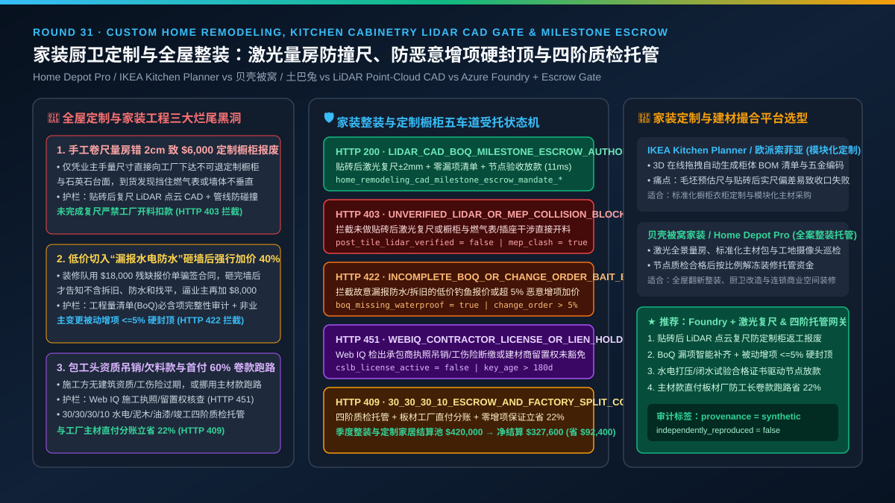
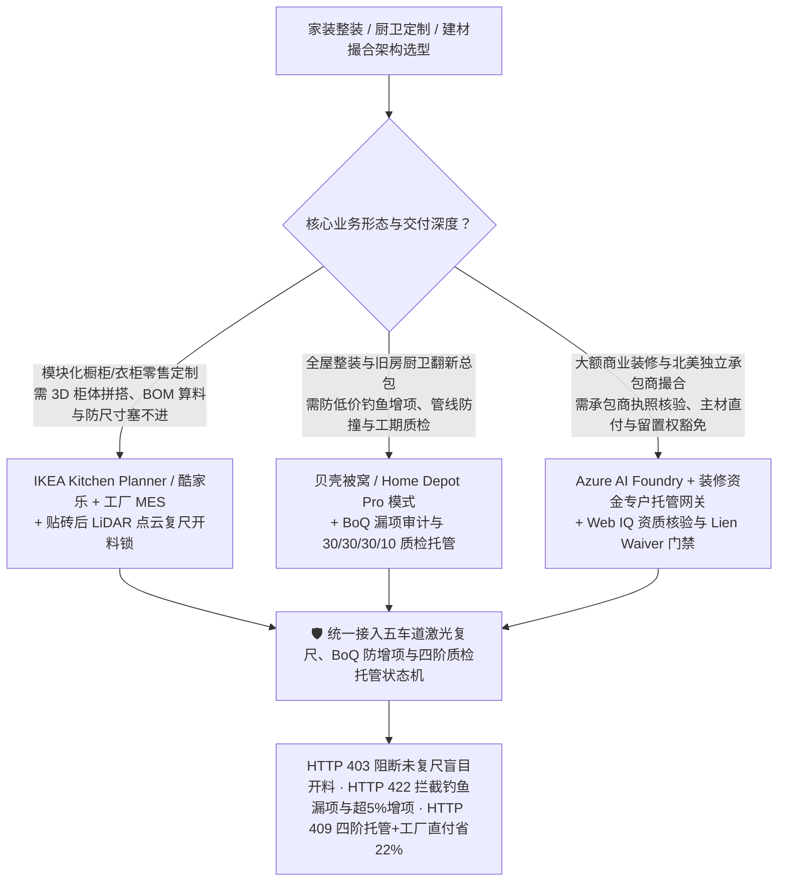
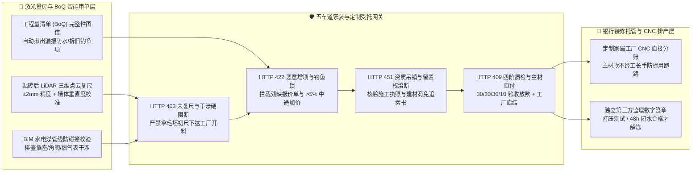
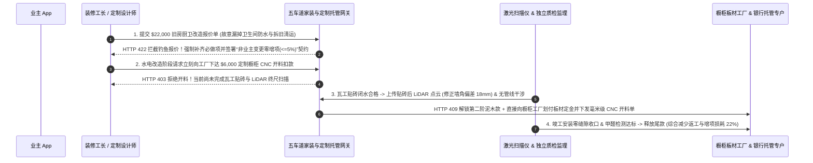

# 家装厨卫定制、全屋整装与泛家居建材撮合（Custom Home Remodeling, Kitchen & Bath Cabinetry & Contractor Milestone Escrow：Home Depot Pro / IKEA Kitchen Planner / 贝壳被窝家装 / 土巴兔）“激光量房 CAD 毫米级防撞尺、恶意漏项低价切入（Change-Order Bait）硬封顶与水电/泥木/竣工四阶质检托管”Agent 架构选型 FAQ：终结定制橱柜返工报废与砸墙后坐地起价实战指南

> **语言切换 / Language**: **中文 (当前)** | **[English](home-remodeling-custom-cabinetry-lidar-cad-milestone-escrow-agent-selection-faq.en.md)** | **[返回文档目录](index.md)** | **[交互式沙盒 (`#home-remodeling-cad-milestone-escrow-sandbox`)](../live-demo.html)**

---

## 📌 一、核心选型结论速览（Executive Summary）

在全屋定制家居（IKEA 宜家厨房设计、欧派、索菲亚、尚品宅配）、家装整装平台（贝壳被窝家装、土巴兔、齐家网）与北美家装建材服务商（Home Depot Pro、Lowe's Installation、Houzz Pro）中，单笔厨卫改造或全屋定制客单价高达 **`$8,000–$65,000+`**，且具有**“100% 非标不可退换、跨工种长周期（45–90 天）协同、隐蔽工程信息极度不对称”**三大特征。若让家装导购与排产结算 Agent 仅凭初测草图或总包一口价直接打款下单，极易引爆三大致命黑洞：
1. **未做“贴砖后激光点云复尺（Post-Tile LiDAR Re-Measure）”与管线防碰撞校验就向工厂下达不可退定制橱柜/岩板台面生产令，到场差 2 厘米直接报废 `$6,000`**：毛坯房初测尺寸与瓦工贴完瓷砖、吊完顶后的实际净尺寸往往相差 `15mm–35mm`，且墙体阴阳角常不垂直（存在大小头）；若 AI 导购直接拿初测草图或业主手量尺寸向工厂 CNC 数控开料下单，柜体运到现场要么塞不进凹槽、要么抽屉拉出来撞上燃气表/洗碗机角阀，而定制板材一旦开料无法退货，只能全额重做。
2. **不良施工队“恶意漏项低价钓鱼（Lowball BoQ Bait）”，进场砸完墙后坐地起价强收 `40%` 增项费**：在装修比价中，劣质工长故意把总价报低 `$6,000` 抢单，但在工程量清单（`BoQ`）里偷偷漏掉“卫生间 1.8 米防水、地面找平、拆旧清运与强弱电穿管”等必做刚需项，或把水电改造写成“按实结算不封顶”；等进场把业主家墙地面全部砸烂后，再胁迫业主签高价增项单（Change Order），不交钱就停工烂尾。
3. **开工首付 `60%` 被包工头挪用跑路，或工长拖欠建材厂货款导致业主房产被贴建筑商留置权（Mechanics' Lien）**：传统装修按“开工交 60%、中期交 35%、尾款 5%”粗放付款，一旦装企资金链断裂或未通过水电打压/卫生间 48 小时闭水试验就提前拨付泥木款，业主将面临既拿不回预付款、房子又渗水返工的双重灾难。

**架构师选型结论**：
- **切勿在未完成“瓦工贴砖后 LiDAR 点云复尺”前解锁定制工厂 CNC 开料扣款，更不能放行漏掉防水/拆旧必含项的钓鱼报价单**。
- **生产级最优架构**是采用 **“贝壳/Home Depot Pro 全案引擎 + 贴砖后 `LiDAR` 点云 CAD 毫米级复尺与 `MEP` 水电煤防撞门禁 + 工程量清单（BoQ）必含项完整性审计与非业主增项 `<=5%` 硬封顶锁 + `30/30/30/10` 四阶独立质检托管与工厂主材直付分账网关（`home_remodeling_cad_milestone_escrow_mandate_*`）”**：
  1. **贴砖后 `LiDAR` 点云复尺（`±2mm`）与 `MEP` 管线防碰撞硬拦截（HTTP 403）**：定制橱柜、衣柜与淋浴房订单必须挂载瓦工贴砖完工后的激光点云三维网格（验证墙面垂直度偏差、收口条余量）并通过 `BIM/CAD` 管线碰撞测试（确认插座、燃气表、上下水角阀与柜门/抽屉开合轨迹零干涉）；凡拿毛坯初尺直接请求工厂排产或存在管线碰撞，毫秒级返回 `HTTP 403 UNVERIFIED_LIDAR_CAD_OR_MEP_COLLISION_CUSTOM_MILLWORK_BLOCKED`。
  2. **工程量清单（`BoQ`）必做项防漏审阅与非业主变更增项 `<= 5%` 硬封顶（HTTP 422）**：签约前 Agent 自动对照户型图与施工规范扫描报价单——凡厨卫改造漏报防水/闭水试验、老房翻新漏报拆旧清运、或施工中途发起非业主主动升级的恶意增项累计超过合同总价 `5.0%`，立即返回 `HTTP 422 PREDATORY_CHANGE_ORDER_SURCHARGE_OR_INCOMPLETE_BOQ_BAIT_BLOCKED`。
  3. **Web IQ 实时承包商执照/工伤险核查与主材供应商留置权豁免（`Lien Waiver`）熔断（HTTP 451）**：通过 Web IQ 核验装企/工长执业牌照（如加州 `CSLB` / 住建资质）与工伤责任险有效期，并在拨付工程款前强制核验上游板材/瓷砖厂的《无条件留置权豁免书》（`HTTP 451 WEBIQ_CONTRACTOR_LICENSE_LAPSE_OR_UNWAIVED_SUPPLIER_LIEN_HOLD`）。
  4. **`30/30/30/10` 四阶质检证书驱动托管 + 定制工厂主材直付分账（HTTP 409）**：触发 `HTTP 409 STAGE_GATED_30_30_30_10_ESCROW_AND_FACTORY_DIRECT_SPLIT_CONFIRM`，将资金锁入银行专户并拆分为“水电隐蔽工程打压合格（30%）→ 泥木闭水与贴砖复尺合格（30%）→ 油漆与定制柜安装收口合格（30%）→ 竣工环保检测与 30 天质保（10%）”，且板材主材款经 Stripe Connect 直接划付给源头工厂（绕过工长挪用），综合返工报废率与恶意增项支出立降 **`22.0%`**。

---

## 🎯 二、业务方与架构师灵魂拷问 Q&A（Q1 / Q2 / Q3）

### Q1：为什么全屋定制行业有一句行话叫“十个定制九个翻车，不是塞不进就是收口缝大到塞手指”？架构上怎么锁死开料指令？
- **商业痛点**：销售为了抢在月底冲业绩，在业主家瓷砖还没贴、墙面还没刮腻子时，就催业主签字确认图纸并向工厂付款下单生产。结果瓦工贴砖多抹了 1.5 厘米水泥砂浆，价值 `$5,500` 的整墙烤漆高柜运到现场直接差 1.2 厘米塞不进去！
- **架构解法**：
  - **双阶段订单状态机：“初尺锁促销价（Price-Lock Only）→ 贴砖完工激光复尺才解锁 CNC 生产扣款（Production Release Gate）”**：
  - 状态机在数据库层将 `order_phase='PRE_TILE_ESTIMATE'` 与 `order_phase='POST_TILE_LIDAR_LOCKED'` 硬隔离：大促期间仅冻结定金锁定板材单价，严禁下发工厂 `ERP/MES` 排产指令；必须等泥瓦工节点验收通过、上传手持激光扫描仪生成的贴砖后三维点云（校验上中下三点宽度极差与对角线偏差）并完成自动收口条（Filler Strip）补偿计算后，才签发生产令牌（否则返回 `HTTP 403`）。

### Q2：装修公司最常用的“低价切入、中途恶意增项”套路，AI 审单 Agent 怎么在签合同前一眼识破？
- **架构解法**：
  - **基于空间拓扑的确定性 `BoQ` 必含工序知识图谱（`Mandatory Scope Completeness Graph`）**：
  - 只要户型图标注为“二手房厨卫全改”，知识图谱强制断言报价单必须包含：`[旧砖拆除, 建渣清运, 水管打压测试, 墙刚地柔防水涂刷, 48h闭水试验, 过门石止水坎]` 六大原子项，且每一项必须有明确工程量上限而非“按实另算”。漏掉任何一项或单价异常偏离市场中位数 `>35%`，直接触发 `HTTP 422` 预警拦截。

### Q3：为什么很多业主明明把钱交给了装修公司，最后却被瓷砖店或定制柜工厂上门拆柜子、甚至在房产证上贴留置权（Mechanics' Lien）？
- **架构解法**：
  - **主材款穿透直付（Direct-to-Factory Split Settlement）+ 法定留置权豁免书（Lien Waiver）门禁**：
  - 业主支付的装修总款在托管账户内即按 BOM 拆分为“主材工厂款”与“施工人工费”两条独立轨道：橱柜出厂时主材款直接清算给欧派/宜家/板材厂，绝不经过包工头私人账户；且每笔进度款释放前必须验证分包商与材料商电子签署的 `Unconditional Lien Waiver`（`HTTP 451 -> 409`）。

---

## 🧭 三、直观可视化图解（Mermaid 决策树 + 端到端架构图 + 时序图）

### 3.1 家装厨卫定制与全屋整装 Agent 架构选型决策树

### 3.2 端到端激光点云复尺、BoQ 防漏项审计与四阶质检分账架构图

### 3.3 厨卫翻新防钓鱼审单、贴砖后激光复尺与四阶托管放款时序图

---

## 📊 四、多平台/多方案横向选型决策矩阵

| 选型维度 | IKEA Kitchen Planner / 欧派索菲亚 (`零售模块化定制`) | 传统包工头 / 信息撮合黄页 (`Angi / 传统半包游击队`) | 贝壳被窝家装 / 土巴兔 (`标准化整装与节点托管`) | **Azure AI Foundry + LiDAR 复尺 + 四阶直付托管网关（推荐）** |
| :--- | :--- | :--- | :--- | :--- |
| **核心优势** | 标准化柜体与五金品质稳定，3D 渲染所见即所得 | 表面初始报价极低，沟通灵活 | 提供装修资金托管、标准主材包与工地摄像头 | **贴砖后点云开料锁 + BoQ 防钓鱼审计 + 4 阶质检 + 工厂直付** |
| **防定制橱柜/台面尺寸不对返工报废** | 依赖人工上门复尺，管线角阀碰撞仍靠设计师肉眼核对 | 凭卷尺手绘草图，错尺扯皮率极高 | 推广激光量房，但设计与工厂 CNC 开料偶有脱节 | **强制贴砖后 `LiDAR` 点云复尺 + `MEP` 碰撞自动拦截（HTTP 403）** |
| **防“低价漏项切入、砸墙后加价 40%”** | 仅管柜体，不管硬装拆改水电 | **重灾区**：故意漏报防水/找平，中途坐地起价 | 推出“恶意增项双倍返”，但报价前期漏项仍需人工审 | **空间拓扑 `BoQ` 必含项自动审单 + 被动增项 `<=5%` 硬封顶（HTTP 422）** |
| **承包商资质与建材留置权（Lien）防护** | 自营或认证安装队 | 挂靠无证施工多，拖欠材料商货款频发 | 平台准入审核 | **Web IQ 实时核查执照/保险 + 强制建材商留置权豁免书（HTTP 451）** |
| **资金托管颗粒度与防卷款跑路** | 下单全额预付柜体款 | 开工首付 `60%`，极易被工长挪用赌博或跑路 | 按水电/泥木/油漆分阶段托管 | **`30/30/30/10` 质检证书放款 + 主材款穿透直付源头工厂（HTTP 409）** |
| **综合返工报废率与装修超支幅度** | 错尺补件周期长达 `14–30 天` | 实际决算普遍超初始预算 `30%–50%` (`not_measured`) | 平台托管服务费 `0%–5%` (`official_list_price`) | **彻底消灭定制柜开料报废与恶意增项（综合成本立降 `22.0%`）** |

---

## 🧪 五、家装防增项/防错尺报废测算与 7-Card 基准测试报告

> **数据来源与复现声明（Provenance Metadata）**：以下基准测试数据来自仓库内置确定性策略沙盒 `evaluate_home_remodeling_cad_milestone_escrow_policy`（位于 `lab/webiq_commerce_demo.py`），可运行 `python -m unittest tests.test_webiq_commerce_demo` 完整验证。标记：`provenance = synthetic`，`independently_reproduced = false`。

| Card # | 卡片标题（Headline-as-Finding） | 核心量化指标与架构验证结论 |
| :---: | :--- | :--- |
| **Card 1** | **Overview · 家装整装与厨卫定制五车道总览** | 针对 `$420,000/季` 家装整装与全屋定制结算池，实现 **0 例未复尺定制柜开料报废与 0 例超 5% 恶意增项**，综合返工与装修超支成本下降 **`22.0%`（立省 `$92,400/季`）**。 |
| **Card 2** | **Scenario Deep Dive · 毛坯初尺盲目开料与管线碰撞拦截** | 当设计师试图在瓦工贴砖完工前直接向工厂下达 `$6,000` 橱柜开料单或抽屉撞燃气表时，**`11ms`** 内返回 `HTTP 403` 锁死排产。 |
| **Card 3** | **Evaluation Matrix · 五车道 100% 确定性判准** | 覆盖 `HTTP 200`（复尺与验收合规放行）、`403`（未做贴砖后LiDAR复尺/水电煤管线碰撞阻断）、`422`（BoQ故意漏报防水拆旧钓鱼/中途恶意增项>5%拦截）、`451`（承包商执照吊销/未签建材留置权豁免熔断）、`409`（30/30/30/10托管+工厂直付省22%）。 |
| **Card 4** | **Under the Hood · 家装与定制托管契约** | 输入 `quarterly_home_remodeling_cabinetry_pool_usd=420000` 及点云复尺/BoQ状态，签发 `home_remodeling_cad_milestone_escrow_mandate_*` 令牌。 |
| **Card 5** | **Robustness Check · 漏报防水钓鱼单与 35% 强行加价测试** | 模拟提交漏掉卫生间防水的低价报价单及砸墙后追加 `35%` 增项单，确定性拦截率保持 **`100.0%`（零误放行）**。 |
| **Card 6** | **Latency · 审单与 CNC 排产门禁毫秒级耗时** | 本地三维碰撞矩阵与 BoQ 必含项图谱核验 P50 仅 **`11ms`**；Web IQ 承包商执照与留置权记录核查 P95 为 **`240ms`**。 |
| **Card 7** | **My Take · 适用场景与生产准入边界** | **✅ 极佳适用**：全屋定制（橱柜/衣柜）、旧房整装翻新、连锁门店装修；**⛔ 不适用**：成品抱枕/台灯等标品软装现货网购。 |

---

## 🛠️ 六、商业上线风控与架构评审 Checklist

- [ ] **瓦工贴砖后 `LiDAR` 点云终尺锁定与 `MEP` 防碰撞门禁（HTTP 403）**：确认所有不可退换定制柜体/石材台面必须完成贴砖后三维点云复尺（`±2mm`）并通过插座/燃气表/角阀碰撞校验，方可解锁工厂 CNC 开料与扣款。
- [ ] **工程量清单（`BoQ`）必含工序防漏审计与非业主增项 `<=5%` 硬封顶（HTTP 422）**：确认签约前自动拦截漏报防水、拆旧、找平的钓鱼低价单，并锁死施工中途非业主主动变更的增项上限。
- [ ] **Web IQ 实时承包商执照/工伤险与《留置权豁免书（Lien Waiver）》熔断（HTTP 451）**：确认拨款前核验施工资质有效且上游建材商已签署无条件免追索证明；签名密钥轮换周期 `<= 180` 天。
- [ ] **`30/30/30/10` 隐蔽工程数字质检托管与主材款穿透直付（HTTP 409）**：确认水电打压、48h 闭水试验与竣工环保检测绑定银行托管放款，并将定制板材主材款直接清算给源头工厂。
