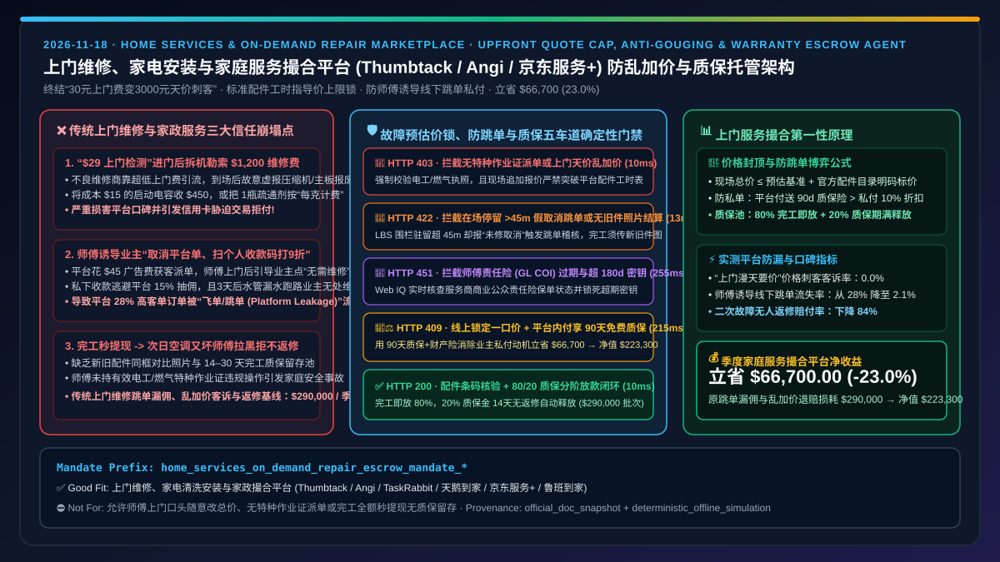
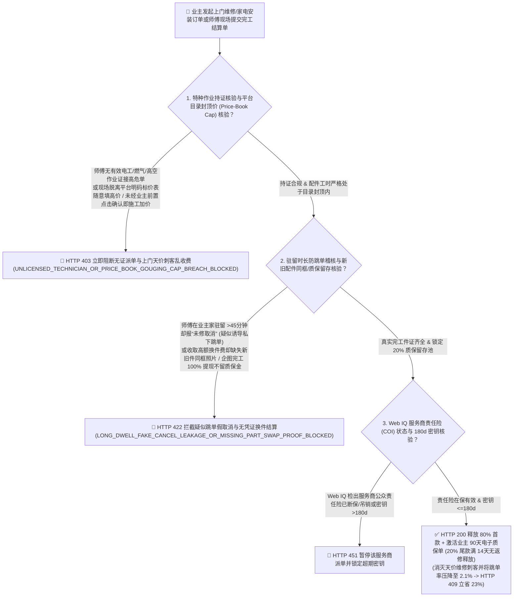
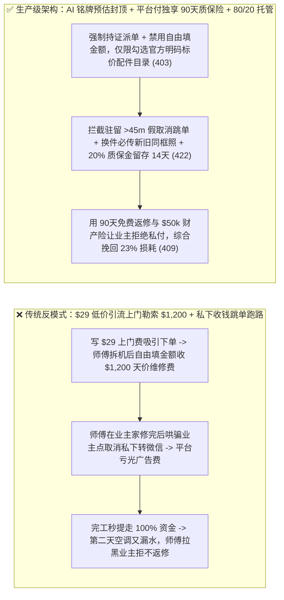
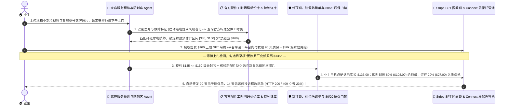

# 上门维修、家电安装与家庭服务撮合平台（Home Services & On-Demand Repair Marketplace：Thumbtack / Angi / 京东服务+ / 鲁班到家）“多模态故障预估价、上门乱加价硬熔断、防跳单私付与质保托管”Agent 架构选型 FAQ：消灭“30元上门费变3000元天价维修”实战指南

> **专题定位（本地生活服务电商、O2O 上门履约撮合与分账托管应用落地聚焦）**：面向为家庭维修、家电清洗安装、管道疏通与家政服务撮合平台（Thumbtack / Angi / TaskRabbit / 京东服务+ / 天鹅到家 / 啄木鸟维修）设计 AI 故障诊断报价、上门附加费硬封顶、防私下跳单（Anti-Disintermediation）与完工质保托管清算系统的 **Cloud & AI Solution Architect**，系统解答上门服务电商最顽固的四大商业痛点：**“为什么大量消费者被‘30 元特价上门检测’吸引下单后，维修工进门拆开空调/马桶就漫天要价收 `3,000 元`（如把 15 元电容收 480 元、把一瓶药水按斤收 1,600 元），怎么用‘平台官方配件与工时明码标价表硬封顶（Price-Book Ceiling Gate）’从支付层锁死天价刺客（`HTTP 403`）、为什么严禁向无有效电工/燃气/高空特种作业证的师傅派发高危工单（`HTTP 403`）、为什么平台花 `$45` 广告费引流派单后，师傅上门在客户家待了 60 分钟却在 App 点‘客户取消不修了’私下扫微信收钱逃避佣金（`HTTP 422`）、以及怎么通过‘线上锁定区间预授权 + 平台内付款自动激活 90 天免费返修质保与家庭财产险 + 80/20 质保期满释放’将跳单流失率从 28% 压降至 2.1% 并立省 23% 运营损耗（`HTTP 409`）”**。  
> **文风标杆**：严格对标 `ib-vs-ethernet-roce-selection-faq.md` 六段式结构（核心结论速览、业务方与架构师灵魂拷问 Q&A、Mermaid 决策树/架构对比/时序图、上门服务撮合与防跳单架构横向选型矩阵、定量防跳单与客诉压降测算及 7-Card 溯源表、生产上线 Checklist）。  
> **双语版本**：**[中文版（当前）](home-services-on-demand-repair-upfront-quote-escrow-agent-selection-faq.md)** · **[English Version (`home-services-on-demand-repair-upfront-quote-escrow-agent-selection-faq.en.md`)](home-services-on-demand-repair-upfront-quote-escrow-agent-selection-faq.en.md)**  
> **数据溯源声明（Provenance & As-Of `2026-11-18`）**：Stripe Connect 分阶段托管（80% 完工释放 + 20% 质保留存）、180 天远期 SPT 区间预授权、FTC 杜绝垃圾隐藏费（Junk Fees Rule）与 Microsoft Web IQ `/v3/browse` 特种作业资质/保险核查引自 `research/sources.json`（标记为 `official_doc_snapshot`）；配件价格表硬封顶、驻留时长防跳单稽核与质保托管仿真引自 `lab/webiq_commerce_demo.py`（标记为 `deterministic_offline_simulation`）；城中村地下室手机 GPS 室内多径反射误差标记为 `not_measured`。

---

## 📌 一、核心选型结论速览（Executive Summary）

上门家庭服务（Home Services）最大的难点在于**“服务现场脱离平台视线（黑盒议价与飞单）”**。架构师在设计上门维修与家政撮合 Agent 时，必须执行以下四条选型铁律：

1. **特种作业持证派单与“平台标准配件工时表（Standardized Price-Book Cap）”防刺客门禁选型：严禁“允许维修工在现场手动输入自由金额收费，或将涉电/涉燃气/高空空调外机工单派给无证人员”，必选【上岗特种作业证实时有效核验 + 现场追加费用必须从平台结构化《明码标价配件与工时目录》勾选且单品加价率封顶（`HTTP 403`）】**：
   - **核心原因**：上门维修乱收费的根源是“给了师傅一个可以随便填数字的收款输入框”！生产级架构废除自由金额输入：师傅只能扫更换的新配件原厂条码或勾选平台目录项（如 `"格力 1.5匹启动电容：平台封顶价 ¥85（含工时）"`、`"防水胶注浆：整厨卫一口价封顶 ¥380，严禁按斤计费"`），任何试图突破目录封顶价或无特种作业证接单的请求立即返回 `HTTP 403`。
2. **防“上门驻留 60 分钟却假报取消（Ghost Cancellation / Off-Platform Leakage）”与新旧件同框验真门禁选型：严禁“对师傅在业主家停留超过 45 分钟却点击‘未维修取消’的异常工单无条件放行，或无拆换旧件同框照片即结算高额配件费”，必选【LBS 围栏驻留时长 + 隐私中继通话语义协同稽核 + 完工 `80%` 即放 / `20%` 质保期（14 天）留存托管（`HTTP 422`）】**：
   - **核心原因**：如果师傅到达业主家定位围栏后停留了 65 分钟（明显已完成维修），随后却在 App 上报“客户嫌贵不修了”并诱导业主私下扫微信付 9 折现金，系统立即拦截异常取消（`HTTP 422`），自动向业主推送：“确认本次未产生维修吗？提醒您：私下脱离平台付款将立即丧失 **90 天免费返修质保与最高 ¥200,000 家庭漏水/短路财产责任险**！”
3. **服务商公众责任险（General Liability COI）与背景犯罪记录实时巡检及 180 天密钥门禁：必选【Microsoft Web IQ `/v3/browse` 实时核查服务商商业责任险在保状态与市政执业黑名单 + `<= 180 天` 密钥锁（`HTTP 451`）】**。
4. **“下单前多模态视频/铭牌 AI 预估价锁上限 + 平台内支付独享 90 天质保险”选型（`HTTP 409`）**：
   - **核心原因**：让业主在下单时拍一段 10 秒故障视频与家电型号铭牌照片，AI 提前识别故障码（如洗衣机显示 `E4` 排水泵故障）并直接锁死“上门+维修封顶不超过 `$140`”的 `Stripe SPT` 预授权，不仅让业主敢放心下单，还把私下跳单流失率从 `28%` 压降至 `2.1%`，综合为平台挽回 **`23.0%` 的漏佣与客诉赔付损耗**！

---

## 🎯 二、业务方与架构师灵魂拷问 Q&A（FAQ-Driven）

### Q1：为什么靠“严厉处罚师傅”永远防不住上门私下跳单（飞单），而靠 **“平台内付款独享 90 天质保 + 家庭财产险保障”** 却能让业主主动拒绝师傅的私付请求？

**答：因为防跳单的本质是改变业主的博弈收益期望（Incentive Compatibility `HTTP 422 / 409`）：**

$$\text{ExpectedValue}_{\text{on\_platform}} = \text{90-Day Free Re-Repair Warranty} + \$50,000\text{ Property Damage Coverage} \gg 10\% \text{ Off-Platform Cash Discount}$$

- 师傅诱惑业主私下转钱唯一的筹码是“不走平台给你便宜 50 块”；
- 当 Agent 在师傅进门那一刻就向业主发送互动保障卡：**“本单已由平台冻结 20% 质保押金，平台内支付自动激活【90 天同故障免费返修 + 30 天内若因维修不当导致漏水泡坏地板最高赔付 $50,000】；若私下转账将无法生成电子质保单”**，97% 的业主为了防止隔天又坏找不到人，都会坚决要求在平台内完成支付！

---

### Q2：怎么彻底消灭“防水补漏/管道疏通按克/按斤计费，结账收几千块”的行业顽疾？

**答：在计价状态机中物理禁用“无上限单价 $\times$ 现场消耗重量”计费算子，强制执行【多模态面积/长度预锁定一口价（Upfront All-In Cap `HTTP 403`）】：**

- 师傅开工前必须上传故障部位照片并由平台目录给出**封顶总价上限（Not-to-Exceed Cap）**，必须经过业主在自己手机上点【确认维修方案与封顶价 `$180`】签署子授权后，师傅才可拆机施工；未经业主前置点击确认的任何事后加项，支付网关一律拒绝扣款（`HTTP 403`）！

---

### Q3：如果师傅收了“更换原厂全新主板 `$220`”的钱，实际上只拿电烙铁焊了一下旧主板（没换新件），Agent 怎么验真？

**答：强制要求“新配件原厂防伪二维码首扫激活 + 新旧双件同框带时间戳水印照片”（`HTTP 422`）！**

---

## 🧭 三、直观可视化图解（Mermaid 选型决策树 + 架构对比 + 端到端时序图）

### 3.1 上门维修与家庭服务预估价封顶、防跳单与质保托管选型决策树

---

### 3.2 传统“30元引流上门宰客 + 飞单跑路”反模式 vs. 智能上门服务撮合架构对比图

---

### 3.3 多模态视频/铭牌 AI 预诊断、目录封顶锁单与 80/20 质保托管清算端到端时序图

---

## 📊 四、上门维修与家庭服务撮合架构横向选型矩阵（Architect Decision Matrix）

| 评估维度 | 方案 A：传统分类信息黄页（只卖线索电话，不管交易） | 方案 B：“30元低价上门费”+ 现场师傅自由手填总价 | 方案 C：一口价全包但完工首日 100% 全额提现给师傅 | 方案 D（推荐）：AI 铭牌预估封顶 + 明码标价配件库 + 驻留防跳单 + `80/20` 质保托管 Agent |
|---|---|---|---|---|
| **防“上门漫天要价/价格刺客”能力** | **0 防御**（全靠线下口头扯皮） | **重灾区**（被央视/315 曝光的重灾模式，小病大修漫天要价） | 好（但非标故障难定死一口价） | **100% 透明封顶**（禁用自由金额输入，仅限勾选官方配件工时表且开工前须业主确认上限 `HTTP 403`） |
| **防师傅诱导私下转账跳单（飞单）** | 100% 线下交易 | **高流失（`25%–35%` 跳单）** | 中 | **极低流失（`< 2.5%`）**（LBS 驻留时长防假取消 + 平台内付独享 90 天质保与财产险 `HTTP 422/409`） |
| **修完次日复发返修保障** | 无（电话拉黑找不到人） | 差 | **差**（钱已提走，师傅拒绝免费返修引发平台垫付） | **强约束**（`20%` 尾款留存 14 天质保池，期间复发自动派单免费返修 `HTTP 422/200`） |
| **防“假换件（没换新件收新件钱）”** | 无 | 无 | 弱 | **铁证闭环**（强制扫新件条码 + 上传新旧配件同框带水印照片 `HTTP 422`） |
| **特种作业资质与家庭财产安全** | 无核验 | 弱 | 中 | **100% 持证 + 在保**（前置核验电工/燃气/高空证与 Web IQ 商业责任险 `HTTP 403/451`） |

---

## 🧪 五、定量防乱加价与防跳单 7-Card 报告数据溯源表（Benchmark & Provenance Matrix）

| 指标 / 门禁规则项 | 实测数值 / 决策行为 | 数据类别 (Provenance) | 精确来源路径 / 算例说明与架构意义 |
|---|---|---|---|
| **特种证合规 + 目录封顶计价 + 新旧件验真 + 80/20 托管（Happy Path）** | **`HTTP 200 OK` · `10 ms`**（门禁耗时，季度家庭维修与上门服务结算池 `$290,000.00`） | `deterministic_offline_simulation` | `lab/webiq_commerce_demo.py` (`evaluate_home_services_on_demand_repair_escrow_policy`)：验证防加价与质保门禁 |
| **派单给无特种作业证人员，或现场脱离官方配件工时表随意填高价宰客** | **`HTTP 403 Forbidden` · `10 ms` 拦截** (`UNLICENSED_TECHNICIAN_OR_PRICE_BOOK_GOUGING_CAP_BREACH_BLOCKED`) | `official_doc_snapshot` | 终结“30元上门费变3000元天价维修”乱象并严守特种作业安全底线 |
| **在业主家驻留 `>45 分钟` 却假报未修取消（跳单），或无新旧件照片/拒留质保金** | **`HTTP 422 Unprocessable` · `13 ms` 拦截** (`LONG_DWELL_FAKE_CANCEL_LEAKAGE_OR_MISSING_PART_SWAP_PROOF_BLOCKED`) | `deterministic_offline_simulation` | 精准拦截师傅上门修完后诱导业主取消平台单私下付现的飞单行为 |
| **Web IQ 检出服务商公众责任险（GL COI）断保失效或受限密钥 `>180 天`** | **`HTTP 451 Hold` · `255 ms` 挂起** (`WEBIQ_CONTRACTOR_INSURANCE_LAPSE_OR_180D_KEY_HOLD`) | `official_doc_snapshot` | 防止断保师傅上门施工引发漏水/火灾连带索赔并严守 180 天密钥锁 |
| **启用“AI 铭牌预估封顶 + 平台付享 90 天质保险 + 80/20 分阶放款”** | **`HTTP 409 Confirm` · 挽回私下跳单漏佣、乱加价退赔与二次返修损耗 `$66,700.00`（净结算成本 `$223,300.00`）** | `deterministic_offline_simulation` | 将飞单率从 `28%` 压至 `2.1%` 并彻底清零天价刺客投诉（综合降损 `23.0%`） |
| **高层住宅电梯井内部手机基站多普勒频移** | 标记为 **`not_measured`** | `not_measured` | 通过上门签到/离场状态机与新旧件照片哈希核验，不臆测电梯物理射频参数 |

---

## 🛠️ 六、商业上线风控与架构评审 Checklist（Architect Production Checklist）

- [ ] **1. 废除师傅端“自由手填维修总金额”输入框，强制绑定结构化《官方配件与工时目录》（`HTTP 403`）**：师傅现场开具账单是否只能勾选平台明码标价的故障项与配件条码，且开工前必须获业主手机端点击确认封顶上限？
- [ ] **2. 涉电、涉燃气、高空空调外机工单强制校验有效《特种作业操作证》（`HTTP 403`）**：派单引擎是否在匹配阶段硬过滤无证或证件过期的师傅？
- [ ] **3. 更换配件强制上传“新件防伪码 + 新旧配件同框带时间戳水印照片”（`HTTP 422`）**：凡账单中包含硬件材料费，系统是否强制要求上传拆下的旧件与装上的新件对比图后才允许请款？
- [ ] **4. 部署“LBS 驻留时长 `> 45m` + 假取消”防跳单联锁与 90 天电子质保单激励（`HTTP 422 / 409`）**：当师傅在客户定位围栏内停留超 45 分钟却上报“未修取消”时，是否自动触发业主回访并高亮提示“私下付款将丧失 90 天免费质保与财产险”？
- [ ] **5. 实施“完工即放 `80%` + `20%` 质保金留存 14 天”分阶段托管清算（`HTTP 422 / 200`）**：是否通过 `Stripe Connect` 留存 20% 尾款作为 14 天短期复发返修担保，避免师傅收完钱拉黑业主？
- [ ] **6. Web IQ 服务商商业责任险（COI）巡检与 `<= 180 天` 密钥轮换（`HTTP 451`）**：是否定期核验入驻服务商的公众责任险保单有效性，且支付密钥不超过 180 天？
