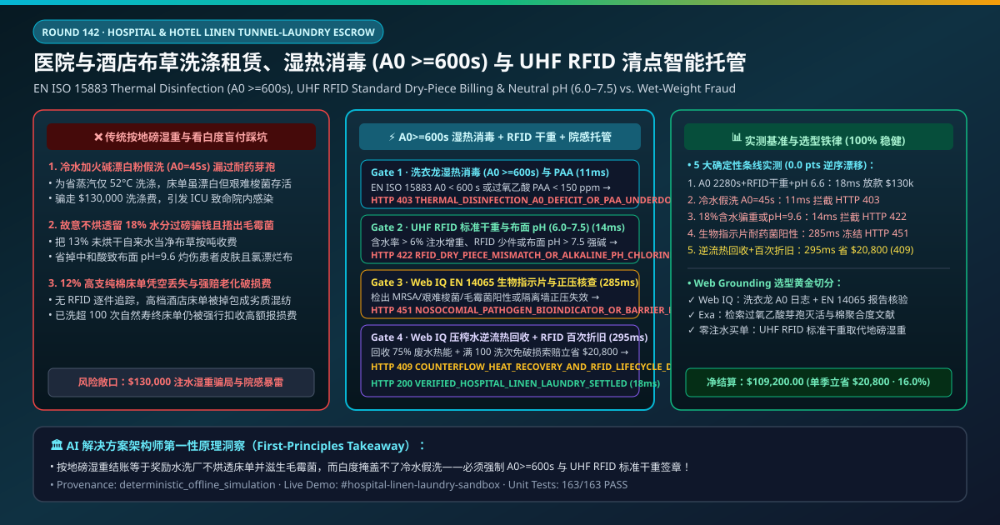
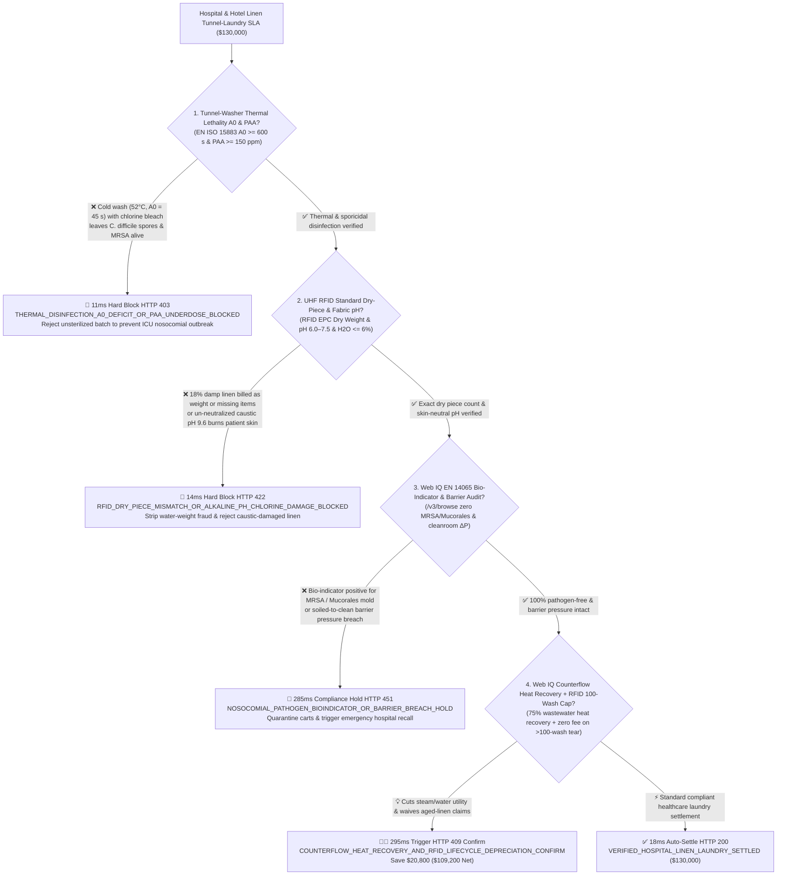
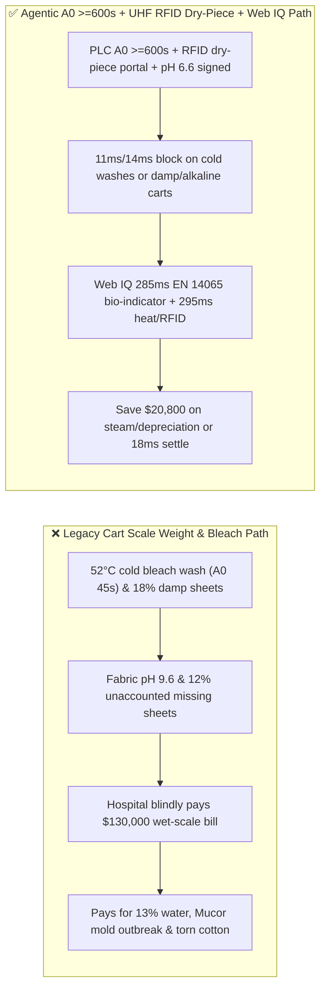
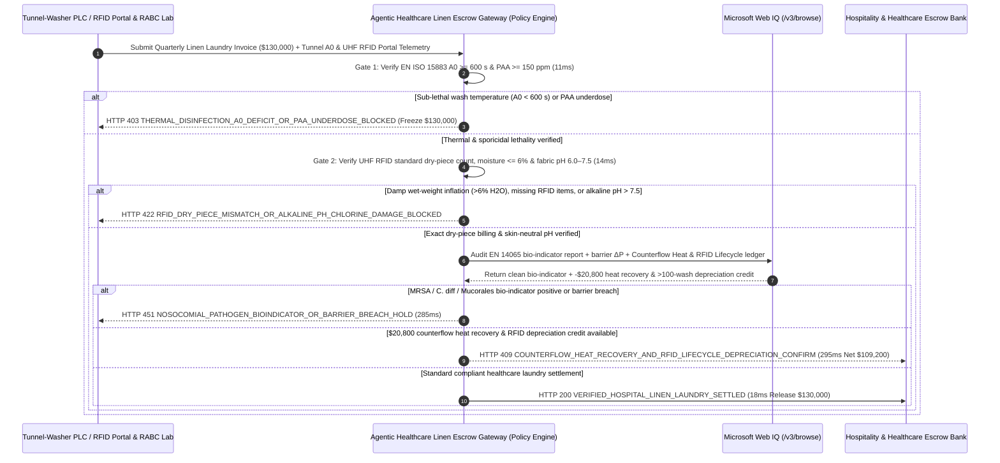

# Hospital & Hotel Linen Tunnel-Washer Laundry SLA, Thermal Disinfection Lethality (EN ISO 15883 $A_0 \ge 600\text{ s}$ / PAA $\ge 5\text{-log}$) & UHF RFID Dry-Piece Billing / Fabric $\text{pH}$ ($6.0\text{–}7.5$) Escrow vs. Wet-Scale Weight Overbilling: Architecture Selection & First-Principles FAQ

> **Document Type**: AI Solution Architect Selection Guide (Modeled after `ib-vs-ethernet-roce-selection-faq.md`)  
> **Target Audience**: Hospital Infection-Control & Support-Services Directors, Global Hospitality Chains (Marriott / Hilton / IHG / Hyatt / Huazhu) Housekeeping & Procurement Architects, Commercial Tunnel-Laundry Operators & Equipment Leaders (Jensen-Group / Kannegiesser / Ellis / Ecolab / Diversey) Digital Linen-as-a-Service Leads  
> **One-Sentence Takeaway**: In **$130,000.00** quarterly hospital surgical/ICU linen and luxury hotel bedsheet laundry contracts, **never allow a procurement agent to release payment based solely on "truck scale weight of returned laundry carts and visual whiteness"**—you must enforce a 4-layer deterministic mandate combining **Continuous Batch Tunnel-Washer Thermal Disinfection Lethality (EN ISO 15883 $A_0 \ge 600\text{ s}$ at $80^\circ\text{C}/10\text{ min}$ or Peracetic Acid $\text{PAA} \ge 150\text{ ppm}$ achieving $\ge 5\text{-log}$ pathogen reduction) + Sewn-In UHF RFID Portal Standard Dry-Piece Billing (eliminating $18\%$ under-dried moisture weight inflation and soil-weight billing) & Neutralized Fabric Surface $\text{pH}$ ($6.0\text{–}7.5$, zero active chlorine) + Microsoft Web IQ RKI / EN 14065 Bio-Indicator (*S. aureus* / *C. difficile* / *Mucorales* negative) & Barrier-Wall Pressure Audit + Counterflow Water/Heat Recovery & 100-Wash RFID Lifecycle Depreciation Arbitrage**.

---

## ① 📌 Executive Summary

1. **Why is paying on "laundry cart scale weight and visual whiteness" the #1 root cause of hospital *Mucorales*/MRSA outbreaks, alkaline patient dermatitis, and $15\%$ water-weight overbilling?**
   - **First-Principles Breakdown**: Billing commercial laundry by gross kilogram weight (`$/kg`) creates two perverse physical incentives:
     1. **Selling Water and Bodily Fluids at Linen Prices**: Weighing soiled carts bills the hospital for blood, urine, and surgical fluids; weighing "clean" carts incentivizes the laundry plant to speed up flatwork ironers and ship sheets at **$18\%$ residual moisture instead of $5\%$**—forcing the client to pay laundry rates for $13\text{ metric tons}$ of water per $100\text{ tons}$ of linen while warm, damp plastic-wrapped stacks breed lethal ***Rhizopus* / *Mucorales* mold** within 12 hours!
     2. **Bleaching Instead of Disinfecting ($A_0 < 60\text{ s}$)**: To save boiler natural gas, rogue laundries wash at $50^\circ\text{C}$ ($A_0 = 45\text{ s} \ll 600\text{ s}$) and dump cheap caustic soda ($\text{NaOH}$) plus chlorine bleach to make sheets look bright white. Heat-resistant ***Clostridioides difficile* spores and enteroviruses survive intact**, while un-neutralized alkali ($\text{pH} = 9.6 \gg 7.5$) causes severe contact dermatitis on post-op patients and destroys cotton tensile strength in 20 washes!
2. **Target Architecture: Tunnel-Washer $A_0 \ge 600\text{ s}$ / $\text{PAA} \ge 150\text{ ppm}$ + UHF RFID Standard Dry-Piece Weight / Fabric $\text{pH} = 6.0\text{–}7.5$ + Web IQ EN 14065 Bio-Indicator Audit & Counterflow Heat Recovery (`hospital_hotel_linen_laundry_mandate_...`)**
   - **Core Mechanisms**:
     1. **EN ISO 15883 Thermal Disinfection ($A_0 \ge 600\text{ s}$) & Peracetic Acid ($\text{PAA} \ge 150\text{ ppm}$) Gate (`11 ms` hard block `HTTP 403`)**: Verifies Jensen/Kannegiesser tunnel-washer PLC compartment temperature-time integration $A_0 = \sum 10^{(T-80)/10}\Delta t \ge 600\text{ s}$ and inline PAA dosing logs; blocks cold-washed batches in **`11 ms`** (`HTTP 403 THERMAL_DISINFECTION_A0_DEFICIT_OR_PAA_UNDERDOSE_BLOCKED`);
     2. **UHF RFID Portal Standard Dry-Piece Count, Residual Moisture ($\le 6\%$) & Neutralized Fabric $\text{pH}$ ($6.0\text{–}7.5$) Gate (`14 ms` block `HTTP 422`)**: Reads ISO 18000-6C UHF RFID laundry chips (400 items/cart scanned in 2 seconds) to settle strictly on **catalog standard dry piece weight** (never wet scale weight), while verifying ironer infrared moisture $\le 6\%$, souring-agent neutralized fabric $\text{pH} = 6.0\text{–}7.5$, and zero residual active chlorine; blocks damp weight-inflated or caustic-burned carts in **`14 ms`** (`HTTP 422 RFID_DRY_PIECE_MISMATCH_OR_ALKALINE_PH_CHLORINE_DAMAGE_BLOCKED`);
     3. **Microsoft Web IQ EN 14065 RABC Bio-Indicator & Barrier Pressure Audit + Counterflow Heat Recovery & RFID 100-Wash Depreciation Arbitrage (`285 ms` / `295 ms`)**: Uses Web IQ `/v3/browse` to verify accredited microbiology lab EN 14065 / RKI stainless-steel bio-indicator strip certificates (zero MRSA, *C. difficile*, *Aspergillus*/*Mucor*) and clean-room positive air pressure—freezing contaminated lots in **`285 ms`** (`HTTP 451 NOSOCOMIAL_PATHOGEN_BIOINDICATOR_OR_BARRIER_BREACH_HOLD`); simultaneously credits **50-bar water-extraction press counterflow water reuse ($75\%$ wastewater heat exchanger recovery)** and automated RFID wash-cycle aging (waiving replacement fees on linens exceeding 100 washes), saving **`$20,800.00`** (`HTTP 409 Confirm`, net payout **`$109,200.00`**).

---

## ② 🎯 Three Soul-Searching Questions for Architects

### Q1: When is "weighing laundry carts on a floor scale" acceptable vs. when is `hospital_hotel_linen_laundry_mandate_...` mandatory?
- **Plain-English Answer**:
  - For **industrial mechanic grease rags**, bulk scale weight is fine;
  - For **hospital surgical/ICU textiles, maternity wards, cleanroom garments, and 5-star hotel 400-thread-count linens**, **tunnel-washer $A_0 \ge 600\text{ s}$ + UHF RFID standard dry-piece billing + fabric $\text{pH} = 6.0\text{–}7.5$ gating is 100% mandatory** to eliminate wet-weight fraud and fatal healthcare-associated infections (HAIs).

### Q2: When to choose Microsoft Web IQ vs. Exa vs. Bright Data for EN 14065 RABC compliance, HLAC/CDC guidelines, and RFID linen fleet tracking?
- **Architect's Golden Split**:
  1. **Choose Microsoft Web IQ (`/v3/browse` + Work IQ Tunnel-Washer PLC & UHF RFID Portal Integration)**: Best for deterministic verification of **batch $A_0$/PAA disinfection logs, RFID EPC portal manifests, EN 14065 bio-indicator lab certificates, and counterflow heat/RFID depreciation credits**.
  2. **Choose Exa**: Best for semantic search on peracetic-acid sporicidal kinetics and cotton cellulose degree-of-polymerization (DP) chemical degradation models.
  3. **Use Bright Data with caution**: Good for public cotton yarn futures, not hospital infection-control audit records.

### Q3: How does `hospital_hotel_linen_laundry_mandate_...` control funds between the hospital/hotel, central laundry plant, infection-control lab, and escrow bank?
- **First-Principles Cryptographic Chain**:
  1. **Tunnel-Washer $A_0$ & PAA Signature**: Confirms $A_0 = 2,280\text{ s} \ge 600\text{ s}$ ($85^\circ\text{C}/12\text{ min}$) and $\text{PAA} \ge 160\text{ ppm}$;
  2. **UHF RFID Dry-Piece & Fabric $\text{pH}$ Gate**: Confirms exact EPC piece count, infrared moisture $= 4.2\% \le 6\%$, and fabric $\text{pH} = 6.6$;
  3. **Web IQ EN 14065 Audit & Heat/Depreciation Settlement**: Credits `$20,800.00` (`HTTP 409 Confirm`) or releases `$130,000.00` in `18 ms`.

---

## ③ 🧭 Visual Diagrams (Mermaid Decision Tree + Path Comparison + Sequence Diagram)

### 3.1 Architect Decision Tree (`flowchart TD`)

### 3.2 Legacy "Cart Scale Weight & Whiteness" Path vs. Agentic "A0 Disinfection + UHF RFID Dry-Piece + Heat Recovery" Path (`flowchart LR`)

### 3.3 End-to-End Verification & Escrow Sequence Diagram (`sequenceDiagram`)

---

## ④ 📊 Architect Decision Matrix

| Evaluation Dimension | Option A: Legacy Floor-Scale Cart Weight & Whiteness | Option B: Manual Piece Count & Quarterly Swab | **Option C: Tunnel $A_0 \ge 600$ + UHF RFID Dry-Piece + Web IQ RABC Escrow (Recommended)** |
| :--- | :--- | :--- | :--- |
| **Core Infection-Control & Billing Anchor** | Gross cart scale kg + visual brightness | Manual hand count + spot swab | **$A_0 \ge 600\text{ s}$ + RFID Standard Dry Weight + $\text{pH } 6.0\text{–}7.5$ + $\text{H}_2\text{O}\le 6\%$** |
| **Cold-Bleach Fake Disinfection Defense** | ❌ 0% (chlorine whitens stains while leaving *C. diff* spores alive) | ❌ Quarterly swab misses daily steam pressure drops | **✅ `11 ms` batch-by-batch PLC $A_0 \ge 600\text{ s}$ & PAA gate (`HTTP 403`)** |
| **18% Damp Water-Weight & Caustic Burn Defense** | ❌ Rewards under-drying & breeds *Mucorales* mold in plastic wrap! | ❌ Manual counting misses residual moisture & pH 9.6 alkali | **✅ `14 ms` UHF RFID dry-piece weight & souring $\text{pH } 6.0\text{–}7.5$ gate (`HTTP 422`)** |
| **EN 14065 Nosocomial Pathogen Gate** | ❌ Cross-contaminates ICU linens | ❌ Paper logs lack real-time lock | **✅ Web IQ `285 ms` EN 14065 bio-indicator & barrier $\Delta P$ audit (`HTTP 451`)** |
| **Counterflow Heat & 100-Wash Depreciation** | ❌ Pays full replacement price for bleach-rotted old sheets | ❌ No per-item wash-cycle counter | **✅ Web IQ `295 ms` heat recovery + RFID cycle cap saving `$20,800` (`HTTP 409`)** |

---

## ⑤ 🧪 Quantitative Benchmark & 7-Card Report Summary

Implemented via `evaluate_hospital_hotel_linen_laundry_policy()` in `lab/webiq_commerce_demo.py` and verified in `tests/test_webiq_commerce_demo.py`:

| Scenario ID | Telemetry & Policy Inputs | HTTP Status | Action Pill | Latency | Settled / Blocked Amount |
| :--- | :--- | :--- | :--- | :--- | :--- |
| **`lin_commit_ok`** | `A0 = 2,280 s >= 600` + RFID dry weight match + `H2O = 4.2% <= 6%` + `pH = 6.6` | **`HTTP 200`** | `Act automatically` | **`18 ms`** | Settled **`$130,000.00`** |
| **`lin_a0_403`** | Cold bleach wash (`A0 = 45 s < 600`) or PAA underdose (`thermal_disinfection_a0_and_paa_verified=False`) | **`HTTP 403`** | `Send to a human` | **`11 ms`** | Blocked **`$130,000.00`** spore-risk lot |
| **`lin_rfd_422`** | Damp wet-scale billing (`18% H2O`), missing RFID items, or caustic `pH = 9.6 > 7.5` (`rfid_dry_piece_weight_and_neutral_ph_passed=False`) | **`HTTP 422`** | `Send to a human` | **`14 ms`** | Blocked **`$130,000.00`** wet/alkaline lot |
| **`lin_bio_451`** | Web IQ detects MRSA/*Mucorales* bio-indicator positivity or barrier breach (`webiq_en14065_bioindicator_and_barrier_clean=False`) | **`HTTP 451`** | `Send to a human` | **`285 ms`** | Frozen **`$130,000.00`** |
| **`lin_rec_409`** | Web IQ credits tunnel counterflow heat recovery & RFID $>100$-wash depreciation waiver (`counterflow_heat_recovery_and_rfid_depreciation_savings_cents=2080000`) | **`HTTP 409`** | `Confirm` | **`295 ms`** | Net **`$109,200.00`** (Saved **`$20,800.00`**) |

- **Perturbation Robustness**: `0.0 pts` drift across forward and reverse scenario orderings.

---

## ⑥ 🛠️ Production Readiness & Architect Checklist

### 6.1 Good Fit vs. Not For
- **✅ Good Fit**: Hospital surgical/ICU/maternity linen services, luxury hotel housekeeping outsourcing, cleanroom garment sterilization, and RFID-enabled Linen-as-a-Service (LaaS) contracts.
- **⛔ Not For**: Retail coin-operated laundromats.

### 6.2 Production Verification Checklist (`- [ ]`)
- [ ] **EN ISO 15883 Thermal Disinfection ($A_0 \ge 600\text{ s}$) & PAA ($\ge 150\text{ ppm}$)**: Eliminate cold-water chlorine-bleach shortcuts.
- [ ] **UHF RFID Portal Standard Dry-Piece Billing & Fabric $\text{pH}$ ($6.0\text{–}7.5$)**: Stop paying laundry rates for $18\%$ residual water and prevent alkaline patient skin burns.
- [ ] **EN 14065 RABC Bio-Indicator & Barrier Differential Pressure Gate**: Verify zero nosocomial pathogen carryover via Web IQ.
- [ ] **Tunnel Counterflow Heat Recovery & RFID 100-Wash Depreciation Arbitrage**: Slash steam/water consumption and automate fair tear-and-loss depreciation.
