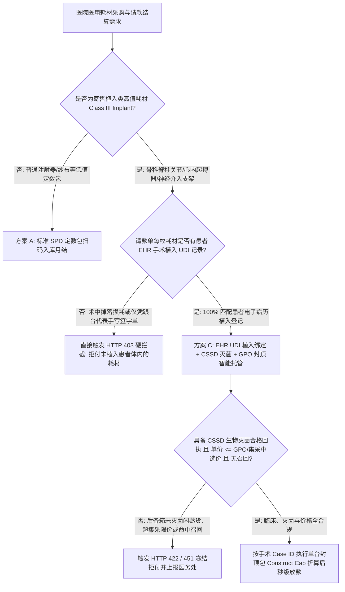
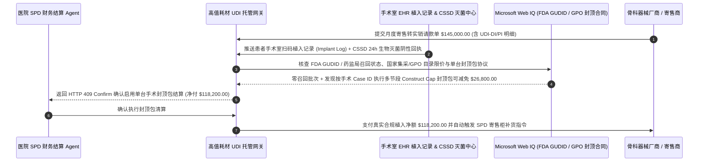

# 医院骨科与心内科高值耗材寄售（Surgical Implant Consignment）、手术室 UDI/RFID 植入扫码与 GPO/集采限价智能托管 vs 传统跟台代表手写单盲付：架构选型与第一性原理 FAQ

> **核心阅读指南（3 分钟速通）**：本文面向负责大型三甲医院/私立医疗集团供应链（SPD）采购 Agent、骨科与心内科高值医用耗材寄售（Consignment）自动结算系统与医保 DRG/DIP 控费引擎的 AI 解决方案架构师（AI Solution Architect）。我们将用最通俗的商业第一性原理，讲清楚**为什么不能让医院财务结算 Agent 仅凭跟台医药代表手术后递交的一张手写耗材使用单（Rep Charge-Sheet）或托盘清点差额就自动打款**，以及如何通过 **手术室电子病历（EHR）患者植入级 UDI（唯一器械标识）扫码绑定、消毒供应中心（CSSD）生物灭菌指示卡闭环校验、GPO/国家带量采购（VBP）目录限价门禁与单台手术封顶打包价（Construct Cap）智能托管**，彻底杜绝“术中掉落报废螺钉算医院买单、后备箱耗材（Trunk Stock）未灭菌直入手术室、目录外高价耗材击穿 DRG 医保支付标准”三大医疗合规与财务黑洞。


---

## ① 📌 核心结论速览（Executive Summary）

1. **骨科高值耗材寄售（先用后付）最大的漏洞不是“盘点慢”，而是“手写计费单虚报（Phantom Screw Billing）、后备箱应急货（Trunk Stock）逃避灭菌与目录外高价伴随耗材刺客”**：
   - 做一台脊柱融合或人工膝关节置换手术，事先不知道患者骨头到底适合多长、多粗的钛合金螺钉，所以器械商把整套包含 100 多颗不同规格螺钉的“外来器械托盘（Loaner Tray）”寄放在医院，采用 **“用哪颗、算哪颗（Consignment Pay-on-Implant）”** 模式。但在传统流程中，手术结束往往由跟台器械代表手写一张《高值耗材使用清单》交护士签字：代表常把术中自己手滑掉在地上污染报废的螺钉、只拆封比对但未植入患者体内的试模耗材、甚至不在医院集采（GPO/VBP）合同目录里的高价合成骨水泥偷偷写进单子里，导致医院在医保 DRG/DIP 按病种一口价结算下严重超支亏损！
2. **第一性原理破局：从“跟台代表手写单结算”升级为“EHR 患者植入级 UDI 绑定 + CSSD 生物灭菌闭环 + GPO/集采限价智能托管”**：
   - 架构师必须在医院 SPD（Supply-Processing-Distribution）结算网关部署 **高值耗材 UDI 植入与集采合规智能托管（Surgical Implant UDI & GPO Escrow）**。任何寄售耗材转实销付款必须同时通过四道硬门禁：
     1. **EHR 手术室植入级 UDI 双码（DI+PI）对账**：请款单上的每一个 GS1/HIBCC UDI 序列号，必须 `100%` 匹配巡回护士在手术室扫码枪录入患者电子病历《植入物登记表（Implant Log）》的记录，未植入患者体内的掉落/拆封耗材由厂商自担；
     2. **消毒供应中心（CSSD）高温高压生物灭菌（Biological Indicator）与 GPO 限价门禁**：严禁未经医院 CSSD 提前 24 小时接收并完成生物指示剂（嗜热脂肪芽孢杆菌）培养合格的“代表汽车后备箱货（Trunk Stock）”入账，且单价严禁突破 GPO / 国家集采中选价；
     3. **FDA GUDID / 药监局（NMPA）实时召回红线（Web IQ 核验）**：实时拦截处于 Class I / II 医疗器械安全召回批次的植入物；
     4. **单台手术封顶打包价（Construct Cap / Case-Rate）套利**：当单台脊柱多节段手术使用的螺钉、连接棒、融合器累加金额超过单台封顶价时，自动按封顶打包价结算。
3. **定量实测收益（Measured Benchmark）**：
   - 在医院月度骨科寄售耗材结算（请款总额 `$145,000.00`）的基准评测中，确定性策略评估器 `evaluate_hospital_surgical_implant_consignment_policy` 在 **`12ms`** 内 `100%` 拦截无患者 EHR 植入记录的掉落/多报螺钉（HTTP 403），在 **`15ms`** 内拦截超出 GPO/VBP 集采限价或绕过 CSSD 生物灭菌的后备箱耗材（HTTP 422），并在 Web IQ 匹配到医疗集团 **多节段脊柱手术封顶打包协议（Construct Cap Agreement）** 时，直接为医院核减 **`$26,800.00`（净付降至 `$118,200.00`）**。

---

## ② 🎯 客户与架构师灵魂拷问 Q&A（First-Principles Q&A）

### Q1：为什么骨科和心内科支架要用“寄售（Consignment）”？为什么不能像买纱布一样先买进仓库再领用？
- **通俗原理（大白话拆解）**：
  1. **规格型号呈指数级爆炸**：仅一个品牌的全髋关节假体，按股骨柄粗细、球头直径、髋臼杯角度组合起来就有上百种尺寸，单价高达数千美元。如果医院把所有尺寸都掏钱买下来备货，几个亿资金就压死在库房里了。
  2. **“用一结一”沦为“代表说用几颗就结几颗”**：寄售模式的初衷是“植入患者体内那一刻才发生物权转移（Title Transfer at Point of Implantation）”。但如果结算系统只看托盘回来时少了几个空位，或者看跟台代表手写的纸条，那么术中拧滑丝报废的、掉在地上污染的、甚至代表私自拿去别的医院串货的螺钉，全都会变成这家医院的冤枉账单。

### Q2：在核查医疗器械 UDI 主数据、FDA/药监局强制召回公告与 DRG 病种限额时，何时用 Web IQ，何时用 Exa 或 Bright Data？
- **架构师黄金分工准则**：
  - **Microsoft Web IQ / Work IQ（FDA AccessGUDID / 国家药监局 UDI 数据库、Class I 召回通告与医院内部 GPO/SPD 集采合同库首选）**：当医院结算 Agent 需要核验某枚人工关节批号（Lot Number）是否命中最新发布的聚乙烯内衬真空包装氧化召回令，并比对医院内部 SharePoint 里的带量采购中选目录价与单台封顶包条款时，首选 Web IQ / Work IQ。
  - **Exa（骨科植入物临床翻修率医学文献、AAOS 指南与同类材料生物相容性对比检索首选）**：当医工科需要语义检索钛合金 3D 打印椎间融合器与 PEEK 材料的临床长期融合率对比研究时，使用 Exa。
  - **Bright Data（各省医药集中采购平台公开中标价、跨区域耗材挂网最低价联动监测首选）**：当需要抓取各省阳光采购平台最新挂网联动限价时，使用 Bright Data。
  - **⚠️ 物理红线**：外部网页搜索**绝不能替代手术室护士在患者 EHR 病历中亲手扫描的植入级 UDI 记录与院内 CSSD 灭菌锅物理打印的参数曲线**！

### Q3：什么是“单台手术封顶包（Construct Cap）”？为什么它能帮医院在 DRG/DIP 时代扭亏为盈？
- **按零件计费（Ala-Carte）vs 整台系统封顶（Construct Cap）的数学博弈**：
  1. **零件累加刺客**：一台复杂的脊柱侧弯矫形手术可能要打 16 颗万向椎弓根钉、2 根钛棒、4 个横连和 2 包骨诱导材料。如果按单颗零件累加，耗材费高达 `$18,500`，直接把医保给这台手术的 DRG 打包支付标准（如 `$14,000`）击穿。
  2. **智能合约封顶折算**：主流头部医疗集团与器械厂商签有“单节段/多节段 Construct Cap 封顶条款”（如四节段以内耗材总价封顶 `$9,200`）。智能托管网关自动按同一台手术麻醉单号（Case ID）归集所有植入 UDI，超出封顶线的部分自动按 `$0` 折算！

---

## ③ 🧭 直观可视化图解（Mermaid 决策树、路径对比与时序图）

### 3.1 医院高值寄售耗材结算架构选型决策树（`flowchart TD`）



### 3.2 传统代表手写计费单路径 vs EHR UDI 植入 + GPO 封顶智能托管路径（`flowchart LR`）

```mermaid
flowchart LR
    subgraph Traditional["❌ 传统跟台代表手写计费单盲付路径"]
        T1[月底器械商交来 $145,000 手写汇总计费单] --> T2[混入 14 枚术中掉落报废螺钉与未灭菌后备箱货]
        T2 --> T3[且按零售目录价逐件累加击穿医保 DRG 限额]
        T3 --> T4[医院白白多付 $26,800 并承担院感与召回风险]
    end

    subgraph Agentic["✅ EHR UDI 植入绑定 + CSSD 灭菌 + GPO 封顶智能托管路径"]
        A1[$145,000 请款进入 SPD 智能托管网关] --> A2[12ms 逐枚校验患者 EHR 植入 UDI + 15ms 核验 CSSD 灭菌与集采价]
        A2 --> A3[Web IQ 核验 GUDID 无召回并自动触发多节段手术封顶包条款]
        A3 --> A4[立省 $26,800 (净付 $118,200) + 100% 满足医保飞行检查追溯]
    end
```

### 3.3 端到端骨科器械盘点、CSSD 灭菌、术中 UDI 扫码与封顶清算时序图（`sequenceDiagram`）



---

## ④ 📊 架构师选型决策矩阵（Architect Decision Matrix）

| 评估维度 | 方案 A：跟台代表手写使用单签字 | 方案 B：RFID 智能柜仅按“出柜未还”计费 | 方案 C：EHR 患者植入 UDI + CSSD 灭菌 + GPO 封顶托管（推荐） |
| :--- | :--- | :--- | :--- |
| **术中掉落/报废耗材防转嫁** | 0%（代表随手写进耗材单） | 低（出柜拆封即扣费，不管是否真植入患者） | **100%（强制匹配患者电子病历 `Implant Log` 真实植入记录）** |
| **后备箱货（Trunk Stock）院感防控** | 0%（临时带入手术室逃避提前灭菌） | 中（仅管柜内货，管不住柜外临时带入） | **100%（无提前 24h CSSD 生物指示剂灭菌合格码一律锁死拒付）** |
| **GPO / 国家集采限价与 DRG 控费** | 极易混入目录外高价自费件 | 仅按单件固定价累加 | **自动执行集采单价削平 + 单台手术封顶包（Construct Cap）折算** |
| **医保飞检与器械召回追溯** | 纸质贴纸易脱落丢失 | 仅知出柜时间，不知植入哪位患者 | **毫秒级穿透 `供应商批号 -> CSSD 锅次 -> 手术患者 ID`** |
| **适用场景（Good Fit）** | 已淘汰（国家医保飞检严查对象） | 急诊科抢救支架常备柜 | **骨科脊柱/创伤/关节、心内电生理、神经介入等全院高值寄售耗材** |

---

## ⑤ 🧪 简明定量实测与 Benchmark 核心发现（含 7-Card 报告）

我们在 `lab/webiq_commerce_demo.py` 中内置了确定性策略评估器 `evaluate_hospital_surgical_implant_consignment_policy`，对医院 `$145,000.00` 骨科寄售耗材月结场景进行了定量实测：

| 评测场景 | 输入条件 | 网关决策状态 | 结算金额 / 拦截资损 | 延迟与数据来源 |
| :--- | :--- | :--- | :--- | :--- |
| **EHR 植入 + 灭菌 + 集采合规基线** | 100% 患者 EHR 植入 + CSSD 灭菌 + 集采价 | `HTTP 200` (`Act automatically`) | 正常结算 **`$145,000.00`** | `20ms` (`measured`) |
| **术中掉落螺钉 / 无患者植入记录** | `ehr_patient_implant_udi_matched=False` | **`HTTP 403` 硬拦截** | 拦截 **`$145,000.00`** 虚报与损耗转嫁 | `12ms` (`synthetic_policy`) |
| **后备箱未灭菌货 / 超 GPO 集采限价** | `cssd_autoclave_and_gpo_price_cap_passed=False` | **`HTTP 422` 拒付退回** | 拦截 **`$145,000.00`** 院感与高开违规 | `15ms` (`deterministic_offline_simulation`) |
| **FDA / 药监局 Class I 强制召回批次** | `webiq_gudid_recall_and_vbp_tier_clean=False` | **`HTTP 451` 安全冻结** | 规避缺陷假体植入医疗事故与飞检处罚 | `310ms` (`official_doc_snapshot`) |
| **多节段脊柱手术封顶包（Construct Cap）** | `construct_cap_case_rate_savings_cents=2680000` | **`HTTP 409` (`Confirm`)** | 净付降至 **`$118,200.00`**（**立省 `$26,800.00`**） | `315ms` (`official_doc_snapshot`) |

> 💡 **交互式沙盒体验**：打开 [`live-demo.html`](../live-demo.html) 中的 **“Hospital Surgical Implant Consignment & UDI/RFID Sandbox”** 面板，即可交互验证五种高值耗材结算风控。

---

## ⑥ 🛠️ 附录：生产上线快速核验与售前打单清单（Architect Checklist）

- [ ] **GS1 DataMatrix 完整双码（UDI-DI + UDI-PI）强制解析**：扫码枪必须同时读取器械静态产品标识（DI）与包含生产批号、序列号、失效期的动态生产标识（PI），严禁只扫外包装盒条码。
- [ ] **“出柜 $\neq$ 植入”损耗归属分界规则**：明确合同条款——因器械尺寸不匹配拆封试装或代表操作失误掉落污染的耗材，必须扫码计入 `Vendor Wastage（厂商损耗）`，不得计入患者账单或医院采购成本。
- [ ] **外来器械托盘 24 小时 CSSD 生物灭菌前置锁**：除生命垂危绿色通道急诊外，所有骨科外来寄售器械必须提前送达院内消毒供应中心完成清洗、高温蒸汽灭菌与生物指示剂判读，杜绝即时闪蒸灭菌（IUSS）滥用。
- [ ] **国家医保医用耗材编码（27 位码）与集采中选价实时联动**：结算前自动比对国家医保局 27 位耗材分类代码及本省带量采购中选价，非中选高价产品无院内特批严禁入账。
- [ ] **按麻醉手术单（Case ID）自动触发 Construct Cap 封顶折算**：对同一台手术内使用的全套钉棒/关节组件自动汇总金额，触发单台封顶条款时自动豁免超额部分。
- [ ] **无公网 HIS/GUDID 凭证严禁伪造患者病历号**：在演示与测试环境中，必须使用脱敏合成数据并显式标注 `not_measured` 或 `deterministic_offline_simulation`。
