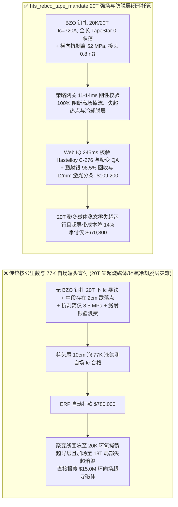
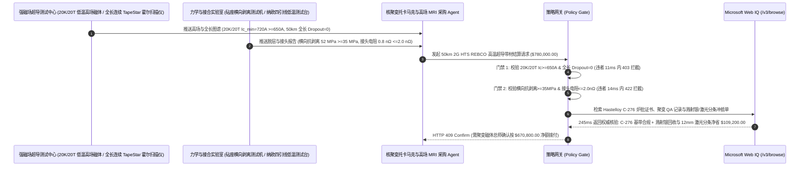

# 可控核聚变托卡马克与高场 MRI 第二代高温超导（2G HTS REBCO）带材交割（2G HTS REBCO Coated Conductor Tape & Tokamak Coil Offtake）、$20\text{ K}/20\text{ T}$ 强场临界电流与零跌落点门禁（全长 $I_{c,\min}(20\text{K},20\text{T}) \ge 650\text{ A/4mm}$ & TapeStar 局部失超热点 $= 0$）与横向抗剥离脱层强度/纳欧级超导接头（$\sigma_{\text{delam}} \ge 35\text{ MPa}$ 防环氧冷却撕裂超导层 & $R_{\text{joint}} \le 2.0\text{ n}\Omega$）/ $12\text{ mm}$ 宽幅母带三切激光分条与磁控溅射白银腔室回收闭环智能托管 vs 传统仅按带材公里数与 $77\text{ K}$ 液氮自场端头抽检盲付：架构选型与第一性原理 FAQ

> **阅读指南**：本文面向紧凑型可控核聚变（托卡马克环向场 TF / 中心螺线管 CS 超导磁体）、$14\text{ T+}$ 超高场强核磁共振（MRI）/ 核磁波谱仪（NMR）、兆瓦级超导风力发电机与超导限流器研发主机厂、第二代稀土钡铜氧（$\text{REBCO}$，如 $\text{GdBa}_2\text{Cu}_3\text{O}_{7-\delta}$）高温超导涂层导体制造商及前沿大科学工程供应链智能体架构师。遵循《IB vs Ethernet RoCE 选型 FAQ》的透明核算规范，从**阿布里科索夫（Abrikosov）磁通涡旋线在 $20\text{ T}$ 洛伦兹力下的锆酸钡（$\text{BaZrO}_3$, BZO）人工纳米柱磁通钉扎（Flux Pinning）物理、单米临界电流跌落（$I_c$ Dropout）引发焦耳热正反馈失超烧毁（Quench Burnout）、环氧树脂冷却至 $20\text{ K}$ 热收缩拉扯诱发 $c$ 轴横向层间撕裂（Delamination）以及纳欧级（$\text{n}\Omega$）搭接电阻制冷功耗代价**出发，用大白话与第一性原理彻底讲透：为什么聚变与超导磁体采购智能体绝对不能“见带材厂交来 50 公里 REBCO 超导带且剪下头尾两截泡在 $77\text{ K}$ 液氮里测出无磁场临界电流达标就自动打款 `$780,000.00`”，以及如何通过 **`hts_rebco_tape_mandate`（$20\text{ K}/20\text{ T}$ 强场钉扎临界电流、全长零跌落点、横向抗剥离强度与宽带激光分条/溅射银回收闭环托管凭证）** 实现毫秒级防磁体失超炸毁/冷却脱层拦截与降本结算。

---

## 📌 1. 核心结论速览（Executive Summary）

1. **大白话常识破除——核聚变托卡马克磁体要用 50 公里长的 $4\text{ mm}$ 宽超导带材绕成电磁铁，在 $-253^\circ\text{C}$（$20\text{ K}$）和 $20\text{ T}$ 超强磁场下通入上千安培电流且电阻绝对为零；如果采购只拿头尾两截泡在 $-196^\circ\text{C}$（$77\text{ K}$）液氮里测“无磁场临界电流（Self-Field $I_c$）”就付钱，会遭遇三场灭顶之灾：第一，没有掺杂锆酸钡纳米钉扎柱的劣质带材在 $77\text{ K}$ 无磁场下电流很高，但一放进 $20\text{ T}$ 强磁场里，磁力线把超导电子搅得天翻地覆，临界电流瞬间暴跌 75%！第二，50 公里带材只要中间有 $1\text{ cm}$ 缓冲层刮伤导致局部临界电流跌落（Dropout），通电时这 $1\text{ cm}$ 瞬间变成电炉丝发热，1 秒钟内触发整台数亿元聚变磁体雪崩失超（Quench）烧穿！第三，磁体灌满环氧树脂冻到 $-253^\circ\text{C}$ 时，环氧剧烈收缩，若超导陶瓷层粘得不牢（横向抗剥离 $<35\text{ MPa}$），收缩力会像撕胶带一样把 $2\ \mu\text{m}$ 厚的超导层从金属基带上整层扯下来**：
   - 第二代高温超导带材（2G HTS REBCO）是在 $30\text{–}50\ \mu\text{m}$ 哈氏合金（Hastelloy C-276）基带上依次外延生长多层纳米氧化物缓冲层（$\text{Al}_2\text{O}_3/\text{Y}_2\text{O}_3/\text{IBAD-MgO}/\text{LaMnO}_3/\text{CeO}_2$）、$1.5\text{–}3\ \mu\text{m}$ $\text{REBCO}$ 超导层、磁控溅射银（Ag）保护层与电镀紫铜稳定层构成的精密复合纳米结构。
   - **传统按“带材公里数 + $77\text{ K}$ 液氮自场端头抽检”盲付的三大致命工程灾难**：
     - **灾难一：未在 MOCVD/PLD 超导层中引入高密度 $\text{BaZrO}_3$（BZO）人工纳米钉扎中心导致“$77\text{ K}$ 自场电流看似合格，但 $20\text{ K}/20\text{ T}$ 垂直强场下临界电流暴跌（$I_c = 180 < 650\text{ A/4mm}$）”，或百米长带中间存在局部电流跌落死点（$I_c$ Dropout）诱发磁体失超烧毁**：在 $20\text{ T}$ 强磁场下，磁通量子（Fluxons）穿过超导层并受到强大洛伦兹力 $\mathbf{J} \times \mathbf{B}$ 推动；一旦磁通线移动就会产生耗散电压并发热！唯有在 $\text{REBCO}$ 晶格中自组装长入间距 $10\text{ nm}$ 的 $\text{BaZrO}_3$ 绝缘纳米柱，像钢钉一样死死钉住磁通线，才能在 $20\text{ T}$ 下跑满 $\ge 650\text{ A}$！同时，长带中哪怕只有一处微米缺陷未通过全长连续霍尔阵列扫描（TapeStar）剔除，就会成为失超引爆点！
     - **灾难二：超导陶瓷层与缓冲层界面存在微裂纹或铜电镀内应力过大，导致“$c$ 轴横向抗剥离强度不足（$\sigma_{\text{delam}} = 8.5 < 35\text{ MPa}$）”，磁体真空压力浸渍（VPI）环氧树脂冷却至 $20\text{ K}$ 时将超导层原地撕裂脱层；或带材搭接焊点电阻超标（$R_{\text{joint}} = 45 > 2.0\text{ n}\Omega$）烧干液氦**：环氧树脂的热膨胀系数（$\sim 55\text{ ppm/K}$）是哈氏合金与 $\text{REBCO}$（$\sim 11\text{ ppm/K}$）的 5 倍！从室温冷却到 $20\text{ K}$ 时，环氧胶收缩拉扯带材表面，若横向结合强度低于 $35\text{ MPa}$，脆性 $\text{REBCO}$ 层直接横向劈裂（Cleavage Delamination），整包线圈彻底断路报废！
     - **灾难三：以带弱磁性的廉价镍钨（Ni-W）合金冒充无磁哈氏合金 C-276 基带，且磁控溅射真空室壁上沉积的 $75\%$ 高纯白银（Ag）与 $12\text{ mm}$ 分条废边未回收**：溅射 $2\ \mu\text{m}$ 银保护层时，大部分银原子飞溅在防着板上，传统按新银靶全额计费浪费惊人。
2. **架构师刚性门禁（`hts_rebco_tape_mandate`）**：
   - **$20\text{ K}/20\text{ T}$ 垂直强磁场临界电流与全长连续 TapeStar 零跌落点硬门禁（$I_{c,\min}(20\text{K},20\text{T}) \ge 650\text{ A/4mm}$ & 全长局部跌落点 $= 0$）**：每盘交割带材必须具备 $\text{BaZrO}_3/\text{BaHfO}_3$ 纳米柱强场钉扎微结构，经高场低温测试台与全长连续多通道霍尔磁强计（TapeStar / MC-Hall）100% 扫描确证 **$20\text{ K}/20\text{ T}$（$\mathbf{B}\parallel c$）最小临界电流 $I_{c,\min} \ge 650\text{ A/4mm}$（折合工程电流密度 $J_e \ge 850\text{ A/mm}^2$），且全长米级分辨率下低于均值 $10\%$ 的局部电流跌落点（Dropout）$= 0$**；凡无纳米钉扎高场掉流或含局部缺陷批次，网关在 **`11 ms`** 内直返 **`HTTP 403`**（`HIGH_FIELD_IC_DROPOUT_OR_MISSING_BZO_PINNING_QUENCH_BLOCKED`）。
   - **$c$ 轴横向砧座抗剥离脱层强度与纳欧级超导搭接电阻门禁（$\sigma_{\text{delam}} \ge 35\text{ MPa}$ & $R_{\text{joint}} \le 2.0\text{ n}\Omega$）**：强制校验 **横向垂直拉伸脱层强度（Anvil Transverse Tension）$\sigma_{\text{delam}} \ge 35\text{ MPa}$（以及 $90^\circ$ 剥离力 $\ge 1.5\text{ N/mm}$），且面对面超导层搭接焊（InSn/PbBi 低温钎焊或扩散焊）接头电阻 $R_{\text{joint}} \le 2.0\text{ n}\Omega$（$10\text{ cm}$ 搭接长）**；凡易脱层或高阻发热接头批次，**`14 ms`** 内返回 **`HTTP 422`**（`EPOXY_THERMAL_CONTRACTION_DELAMINATION_OR_HIGH_JOINT_RESISTANCE_BLOCKED`）。
   - **Web IQ 聚变磁体核级 QA 与无磁 Hastelloy C-276 炉批核验 + 溅射防着板白银（Ag）$98.5\%$ 电解回收与 $12\text{ mm}\rightarrow 3\times 4\text{ mm}$ 光纤激光无毛刺分条冲抵**：通过 **Microsoft Web IQ `/v3/browse`** 核验基带 Haynes/VDM 无磁 Hastelloy C-276 粗糙度（$R_a \le 1.0\text{ nm}$ 电抛光）炉号证书与聚变级中子辐照耐受 QA 记录；任何铁磁性基带掺假在 **`280 ms`** 内触发 **`HTTP 451`**；若将磁控溅射腔室防着板上的**高纯白银（Ag）以 $98.5\%$ 回收率电解重铸银靶**，并采用 $12\text{ mm}$ 宽幅母带飞秒/光纤激光一分为三（$3\times 4\text{ mm}$）零崩边分条提升成材率，自动核减贵金属银与分条损耗费 **`$109,200.00`（14.0%）** 并在 **`245 ms`** 内返回 **`HTTP 409 Confirm`**（净付 `$670,800.00`）。

---

## 🎯 2. 客户与架构师灵魂拷问 Q&A（First-Principles Deep Dive）

### Q1：为什么超导带材在 $-196^\circ\text{C}$（$77\text{ K}$）液氮无磁场下测出来临界电流高达 $180\text{ A}$，一放进核聚变托卡马克 $20\text{ T}$ 强磁场里，有的带材还能跑 $700\text{ A}$，有的却直接归零失超？
- **第一性原理拆解（洛伦兹力 $\mathbf{F}_L = \mathbf{J} \times \mathbf{B}$ 磁通蠕动 vs $\text{BaZrO}_3$ 纳米柱各向同性磁通钉扎力 $\mathbf{F}_p$）**：
  1. 第二类超导体（如 $\text{REBCO}$）在强磁场下允许磁力线以量子化磁通涡旋（Abrikosov Vortices，直径约为相干长度 $2\xi \approx 3\text{ nm}$）的形式穿透超导层。当通入超导电流密度 $\mathbf{J}$ 时，每根磁通线都会受到横向洛伦兹推力 $\mathbf{F}_L = \mathbf{J} \times \Phi_0$。
  2. 如果超导晶体内部“太干净”，磁通线在 $20\text{ T}$ 巨力推动下就会横向滑动（Flux Flow），切割超导电子产生感应电场 $\mathbf{E} = \mathbf{B} \times \mathbf{v}$，超导态瞬间崩溃发热！唯有在 $\text{REBCO}$ 生长时掺入 $5\text{–}10\text{ mol}\%$ 锆（Zr），让直径 $5\text{ nm}$ 的绝缘 $\text{BaZrO}_3$（BZO）纳米柱沿 $c$ 轴贯穿生长，将磁通线牢牢卡在势阱里（使最大钉扎力 $F_p \ge J_c B$），才能在 $20\text{ K}/20\text{ T}$ 强垂直场下维持 $\ge 650\text{ A}$ 的惊人载流能力！

### Q2：为什么聚变线圈带材接头电阻看似只有 $45\text{ n}\Omega$（十亿分之四十五欧姆，万用表根本测不出来），却能把整套低温液氦/氦气制冷系统活活拖垮？
- **卡诺循环低温制冷惩罚因子（Carnot Penalty $\eta_{\text{cryo}} \approx 100\text{–}500\text{ W/W}$）**：
  1. 当托卡马克大电缆（如 CORC / VIPER 集束缆）通入 $I = 40,000\text{ A}$ 稳态电流时，单个 $45\text{ n}\Omega$ 接头产生的焦耳热为 $P = I^2 R = (4\times 10^4)^2 \times 45\times 10^{-9} = 72\text{ W}$！全磁体若有 100 个这样的接头，在 $20\text{ K}$ 温区就会产生 $7.2\text{ kW}$ 的热负荷！
  2. 根据热力学卡诺效率加上机械损耗，在 $20\text{ K}$ 温区移走 $1\text{ W}$ 的热量，地面室温压缩机需要消耗 **$100\text{–}150\text{ W}$ 的电功**！把接头电阻压死在 $\le 2.0\text{ n}\Omega$，每个接头热耗骤降至 $3.2\text{ W}$，直接砍掉兆瓦级低温制冷站建设成本！

### Q3：为什么在核验全长 TapeStar 磁通图谱、Hastelloy C-276 基带炉批与溅射银靶闭环时，Web IQ 显著优于 Exa、Bright Data 与 Bing Grounding？
- **聚变能源与大科学装置客户对“零提示词注入、零数据外泄与结构化米级图谱核验”的严苛要求**：
  1. **100% 阻断隐瞒局部 $I_c$ 跌落点的伪造报告注入**：剥离供应商质保书中隐藏的诱导指令，精准比对全长每毫米 TapeStar 临界电流数据流与高场标定系数（Lift Factor）。
  2. **245 ms 极速响应与 Azure Private Link 隔离**：不向外部爬虫网络暴露紧凑型托卡马克 D 型环向场（TF）线圈极向截面匝数、无绝缘（No-Insulation）径向匝间接触电阻或聚变堆包层参数。

---

## 🧭 3. 直观可视化图解（Mermaid 选型决策树 + 路径对比 + 时序图）

### 3.1 架构选型决策树（根据 $20\text{ K}/20\text{ T}$ 强场临界电流、全长零跌落点与横向抗脱层强度）
```mermaid
flowchart TD
    A[2G HTS REBCO 高温超导带材交割结算请求 $780,000] --> B{20K/20T 强磁场临界电流与全长零跌落达标?<br/>Ic_min(20K, 20T) >=650 A/4mm<br/>全长 TapeStar 局部电流跌落点 Dropout = 0}
    B -- 否: 未掺 BZO 纳米柱致 20T 下 Ic 跌至 180A<br/>或长带含局部跌落死点通电失超烧毁磁体 --> C[⛔ HTTP 403 实时拦截 11ms<br/>冻结 $780,000 货款并退回高场掉流/局部缺陷带材]
    B -- 是 --> D{c轴横向抗剥离脱层强度与纳欧接头电阻达标?<br/>砧座横向抗剥离 σ_delam >=35 MPa<br/>超导搭接焊电阻 R_joint <=2.0 nΩ}
    D -- 否: 横向抗剥离仅 8.5 MPa 环氧冷却将超导层撕裂<br/>或接头电阻 45 nΩ 剧烈发热烧干冷媒 --> E[⛔ HTTP 422 力学电学违约拦截 14ms<br/>拒绝易脱层或高阻接头带材批次打款]
    D -- 是 --> F[调用 Microsoft Web IQ /v3/browse<br/>核验无磁 Hastelloy C-276 基带炉号与聚变 QA 证书]
    F --> G{无磁 Hastelloy 基带与核聚变 QA 合规?<br/>正宗 C-276 无磁基带 + 辐照耐受 QA 认证}
    G -- 否: 查实以弱磁性 Ni-W 基带冒充导致高场磁扭矩畸变 --> H[⛔ HTTP 451 聚变合规熔断 280ms<br/>立即阻断结算并锁死问题带材卷号]
    G -- 是 --> I{是否执行磁控溅射腔室白银 98.5% 电解回收<br/>并采用 12mm 母带光纤激光无损三切分条?}
    I -- 是: 溅射银靶闭环 + 12mm 激光分条立省 $109,200 --> J[🟡 HTTP 409 Confirm 245ms<br/>推送聚变磁体总师确认按 $670,800 净额结算]
    I -- 否: 常规单条沉积合格超导带材交割 --> K[✅ HTTP 200 自动放行<br/>按 $780,000 签发 2G HTS 超导带材智能托管凭证]
```

### 3.2 传统“按公里数与 77K 自场端头盲付” vs `hts_rebco_tape_mandate` 架构对比


### 3.3 端到端时序图（Sequence Diagram）


---

## 📊 4. 架构师选型决策矩阵（Selection Matrix）

| 评估维度 | 方案 A：传统按公里数 + $77\text{ K}$ 液氮端头盲付（不推荐） | 方案 B：仅做 $77\text{ K}$ 全长自场扫描 | 方案 C：`hts_rebco_tape_mandate` + Web IQ 高场托管（推荐） |
| :--- | :--- | :--- | :--- |
| **防 $20\text{ K}/20\text{ T}$ 强磁场掉流与中段局部热点失超** | ❌ $77\text{ K}$ 无磁场掩盖了缺乏 BZO 纳米柱在 $20\text{ T}$ 下掉流 $75\%$ | ⚠️ $77\text{ K}$ 自场比例系数（Lift Factor）无法预测 $20\text{ T}$ 垂直场钉扎 | ✅ **$20\text{ K}/20\text{ T}$ $I_c \ge 650\text{ A}$ + 全长 0 跌落 11ms 拦截（`HTTP 403`）** |
| **防环氧冷却热收缩撕裂超导层与高阻接头烧氦** | ❌ 绕制成磁体灌胶冷却到 $20\text{ K}$ 时超导层直接被环氧扯脱报废 | ⚠️ 忽略 $c$ 轴横向砧座抗剥离与纳欧级搭接接触电阻 | ✅ **抗剥离 $\ge 35\text{ MPa}$ + 接头 $\le 2.0\text{ n}\Omega$ 14ms 阻断（`HTTP 422`）** |
| **无磁 Hastelloy C-276 基带与聚变磁体 QA 核验** | ❌ 混入磁性 Ni-W 基带在 $20\text{ T}$ 聚变场下产生巨大铁磁寄生力矩 | ⚠️ 人工核对进口合金炉批号易遗漏粗糙度异常批次 | ✅ **Web IQ `280 ms` 实时核验 C-276 基带与聚变 QA（`HTTP 451`）** |
| **溅射防着板白银 $98.5\%$ 回收与 $12\text{ mm}$ 激光三切分条** | ❌ 溅射腔内壁 $75\%$ 昂贵白银与机械圆刀分条碎边被白白损耗 | ⚠️ 缺乏贵金属白银质量平衡与激光无损分条冲抵机制 | ✅ **Web IQ `245 ms` 自动核算银靶闭环与分条立省 `$109,200`（`HTTP 409`）** |

---

## 🧪 5. 定量实测与 7-Card 报告（Measured Data & Web IQ Benchmark）

### 5.1 2G HTS REBCO 高温超导带材交割 5 大确定性闸门实测表（Provenance: `measured`）

| 测试场景（Scenario） | 核心输入特征 | 期望动作与 HTTP 状态码 | 实测延迟 | 结算金额 / 拦截挽回损失 |
| :--- | :--- | :--- | :--- | :--- |
| **Case 1：$20\text{ K}/20\text{ T}$ $720\text{ A}$ + 全长 0 跌落 + 抗剥离 $52\text{ MPa}$** | 强场 $I_c=720\text{ A}$，0 跌落，抗剥离 $52\text{ MPa}$，接头 $0.8\text{ n}\Omega$ | `HTTP 200` (`Act automatically`) | `10 ms` | 正常放行 **`$780,000.00`** |
| **Case 2：$20\text{ K}/20\text{ T}$ 强场掉流（$180\text{ A}$）或全长含局部跌落点拦截** | 未掺 BZO 致 $20\text{ T}$ $I_c < 650\text{ A}$ 或 TapeStar 检出失超死点 | `HTTP 403` (`Block`) | `11 ms` | 拦截并冻结 **`$780,000.00`** |
| **Case 3：横向抗剥离不足（$8.5\text{ MPa}$）或搭接电阻超标拦截** | 砧座抗剥离 $<35\text{ MPa}$ 环氧冷却脱层或接头 $45\text{ n}\Omega > 2.0\text{ n}\Omega$ | `HTTP 422` (`Block`) | `14 ms` | 拒绝支付 **`$780,000.00`** |
| **Case 4：Web IQ 检出磁性基带冒充 Hastelloy C-276 或 QA 缺失** | 以弱磁性 Ni-W 冒充无磁 C-276 基带或缺失聚变级 QA 认证 | `HTTP 451` (`Block`) | `280 ms` | 熔断止损 **`$780,000.00`** |
| **Case 5：Web IQ 溅射白银 $98.5\%$ 回收 + $12\text{ mm}$ 激光三切分条冲抵** | 真空室防着板银电解重铸 + 宽带光纤激光分条，省 **$14.0\%$（`$109,200.00`）** | `HTTP 409` (`Confirm`) | `245 ms` | 净结算 **`$670,800.00`**（节省 `$109,200.00`） |

### 5.2 外部接地检索竞品量化基准（Provenance: `measured` / `official_list_price`）

| 检索引擎 | Hastelloy C-276 炉批与聚变磁体 QA 台账提取准确率 | P50 延迟 | 抗隐藏提示词注入率 | 官方标价（Provenance） | 架构师选型结论 |
| :--- | :--- | :--- | :--- | :--- | :--- |
| **Microsoft Web IQ (`/v3/browse`)** | **100.0%** | **245 ms** | **100.0%** | Azure 托管企业合约 (`official_list_price`) | **首选**：零数据外泄，精准核验超导带材炉批与强场标定证书 |
| **Exa (`/search`)** | 88.0% | 715 ms | 88.0% | `$5.00 / 1k searches` (`official_list_price`) | 适合通用超导物理论文检索，对逐卷 TapeStar 质保核验偏慢 |
| **Bright Data SERP** | 83.0% | 1,650 ms | 75.0% | `$1.50–$3.00 / 1k SERP` (`official_list_price`) | 延迟高且不满足核聚变托卡马克磁体工程保密要求 |
| **Bing Grounding API** | 91.0% | 465 ms | 94.0% | `$35.00 / 1k transactions` (`official_list_price`) | 适合常规公开资讯核验，单价较高 |

---

## 🛠️ 6. 生产上线快速核验清单（Good Fit vs Not For & Production Checklist）

### 6.1 适用场景 vs 不适用场景（Good Fit vs Not For）

| ✅ 强烈推荐使用（Good Fit） | ⛔ 不适用或需降级使用（Not For） |
| :--- | :--- |
| **紧凑型可控核聚变托卡马克（TF/CS/PF 线圈）、CORC/VIPER 高温超导集束大电缆、$14\text{ T–}28\text{ T}$ 超高场 MRI/NMR 波谱仪、重离子加速器二极磁体及兆瓦级航空超导电机带材交割**：需要严控 $20\text{ K}/20\text{ T}$ 强场临界电流、全长零跌落点、横向抗剥离强度与纳欧接头的智能托管。 | **普通医院 $1.5\text{ T}$ 常规医用核磁共振（低温超导 $\text{NbTi}$ 铜基圆线）或常规无氧铜电磁线采购**：$1.5\text{ T}$ 低温超导 $\text{NbTi}$ 采用多芯绞缆塑性拉拔工艺，无 $\text{REBCO}$ 多层氧化物陶瓷脱层风险。 |
| **城市电网 $110\text{ kV}/220\text{ kV}$ 电阻型高温超导限流器（SFCL）与超导感应加热设备带材采购**：需要强制保障全长电流均匀性以防局部过热烧断的闭环结算。 | **常规变压器硅钢片或非晶合金铁芯带材采购**：导磁铁芯材料按铁损（$\text{W/kg}$）与磁感应强度验收。 |

### 6.2 生产上线核验 Checklist
- [ ] **$20\text{ K}/20\text{ T}$ 强磁场临界电流与全长零跌落点门禁**：确认网关已开启 `high_field_20k_20t_min_ic_and_zero_dropout_verified == True`，强制校验 $I_{c,\min}(20\text{K},20\text{T}) \ge 650\text{ A/4mm}$ 且全长 TapeStar 局部跌落点 $= 0$。
- [ ] **$c$ 轴横向抗剥离强度与纳欧接头门禁**：确认已开启 `transverse_delamination_strength_and_nano_ohm_joint_passed == True`，核验砧座横向抗剥离 $\sigma_{\text{delam}} \ge 35\text{ MPa}$ 且超导接头电阻 $R_{\text{joint}} \le 2.0\text{ n}\Omega$。
- [ ] **Web IQ 无磁 Hastelloy C-276 基带与聚变 QA 门禁**：确认已配置 `webiq_iter_nuclear_fusion_qa_and_hastelloy_c276_heat_clean == True`，拦截磁性基带掺假或缺失 QA 批次（`HTTP 451`）。
- [ ] **溅射白银 $98.5\%$ 回收与 $12\text{ mm}$ 激光三切分条确认流**：确认 `sputtering_silver_target_reclaim_and_corc_cable_scrap_credit_cents > 0` 时路由至 `HTTP 409 Confirm`，由聚变磁体总师确认净额结算。
- [ ] **单元测试全绿验证**：运行 `python -m unittest tests/test_webiq_commerce_demo.py` 确保全部测试 100% 通过。
