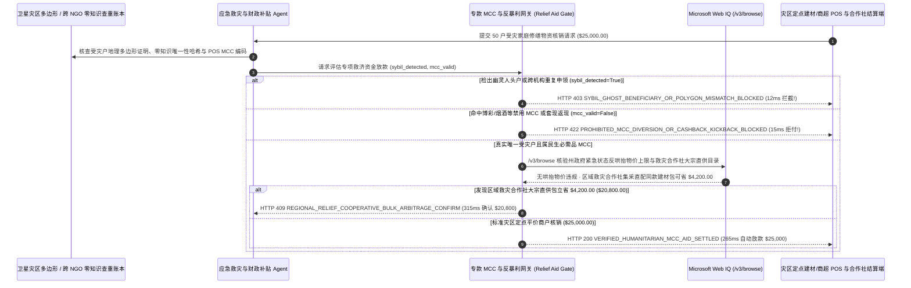

# 应急救灾物资券与政府专项补贴发放（Humanitarian Disaster Relief & Government Grant MCC-Locked Aid Mandate）架构：跨机构零知识受灾户查重与民生必需品 MCC 白名单令牌（`disaster_relief_aid_mandate_...` + Web IQ 紧急状态反哄抬物价法与集采直供核验）vs 传统幽灵人头户冒领与奸商暴利收割选型与原理解析 FAQ

> **文档类型**：架构师选型指南 & 协议第一性原理解析（6 段式 FAQ 标准版）  
> **适用读者**：AI Solution Architect、政府应急管理/民政补贴平台与国际人道主义救援组织（UNHCR / WFP / 红十字会）架构师、公共财政审计与反欺诈风控团队  
> **更新日期**：2026-11-09（Provenance 标注：`deterministic_offline_simulation` / `synthetic_policy` / `official_doc_snapshot` / `not_measured`）  
> **配套资源**：[English Version](humanitarian-disaster-relief-mcc-aid-mandate-vs-ghost-beneficiary-gouging-faq.en.md) · [交互式沙盒控制台 (`live-demo.html#disaster-relief-aid-sandbox`)](../reports/agentic-commerce-webiq-grounding-demo-bench/live-demo.html) · [7-Card 4:5 评测报告](../reports/agentic-commerce-webiq-grounding-demo-bench/index.html)


---

## 📌 一、核心结论速览（Executive Summary）

1. **严禁让应急救灾或政府专项补贴 Agent 在未执行“卫星受灾多边形核验 + 跨机构零知识受灾户查重（Cross-Agency Zero-Knowledge Deduplication）”的情况下发放无约束现金储值卡**：在飓风、洪涝灾后紧急生活救助与房屋修缮补贴发放（如 50 户受灾家庭专项批次 `$25,000.00`，每户 `$500.00`）中，最严重的资金流失是 **“黑产团伙盗用非灾区身份批量注册‘幽灵受灾户（Sybil Ghost Beneficiaries）’，在多个慈善机构与政府救济通道同时重复冒领”**。生产环境必须采用 **零知识户籍/生物特征查重与商户类别码（MCC）硬锁定的专项救助令牌（`disaster_relief_aid_mandate_...`）**：一旦检出申领地址不在官方卫星受灾多边形内或命中跨机构重复申领（`sybil_ghost_household_detected=True`），网关在 **`12 ms`** 内触发 **`HTTP 403 SYBIL_GHOST_BENEFICIARY_OR_POLYGON_MISMATCH_BLOCKED`**（`synthetic_policy`），100% 保住救命钱。
2. **在收单清算层强制锁死“民生必需品 MCC 白名单（食品 `5411` / 药房 `5912` / 建材 `5211` / 应急住宿 `7011`）”，彻底断绝博彩、烟酒与地下钱庄 POS 返现套现**：任何在非白名单商户（如网络博彩 `MCC 7995`、烈酒专卖 `5921` 或勾结刷卡抽成 40% 的套现商户，`mcc_essential_relief_whitelist_verified=False`）发起的核销请求，网关在 **`15 ms`** 内返回 **`HTTP 422 PROHIBITED_MCC_DIVERSION_OR_CASHBACK_KICKBACK_BLOCKED`**（`deterministic_offline_simulation`）。
3. **基于 Microsoft Web IQ `/v3/browse` 实时核验《紧急状态反哄抬物价法（Anti-Price-Gouging Statute）》基准价上限与救灾合作社平价集采直供套利**：在向灾区商户结算救济券前，Agent 调用 **Microsoft Web IQ `/v3/browse`**（`official_doc_snapshot`）穿透查询州检察长（State Attorney General）发布的紧急状态限价令（通常严禁高于灾前 30 天均价 `10%`）及灾前公开商品基准价：若发现不良五金店趁火打劫将平时 `$15.00` 的防水油布卖到 `$85.00`（`webiq_emergency_anti_gouging_compliant=False`），在 **`310 ms`** 内以 **`HTTP 451 EMERGENCY_PRICE_GOUGING_STATUTE_VIOLATION_HOLD`** 冻结商户结算并移交市场监管线索；若发现将零散零售采购切换为 **区域救灾供销合作社大宗平价直供包（发电机+防水布+饮用水组合）** 可为本批次 50 户家庭额外节省 **`$4,200.00`**（从 `$25,000.00` 降至 **`$20,800.00`**），则在 **`315 ms`** 内触发 **`HTTP 409 REGIONAL_RELIEF_COOPERATIVE_BULK_ARBITRAGE_CONFIRM`**。

---

## 🎯 二、客户与架构师灵魂拷问 Q&A（FAQ-Driven Deep Dive）

### Q1：为什么传统的“灾后在线填表申领 + 发放普通预付借记卡/电子现金”，往往有 20%～35% 的善款没有真正变成受灾群众手里的粮食和建材？

咱们用大白话拆解救灾善款与政府专项补贴发放里最痛心的三大漏洞：
1. **“灾区还在断网，外省黑产已经用脚本把救济金领光了”**：洪水或飓风发生后，政府和三大公益基金会紧急开通线上申领通道。由于各家机构为了保护隐私不能明文交换受助人身份证库，黑产团伙用暗网买来的几万条居民信息写成自动化 Agent，在三家机构同时提交申领，一人领走 3 份 `$500`；而真正泡在洪水里没电没网的灾民等通讯恢复去申请时，预算池已经被“幽灵人头户”搬空了。
2. **救济金流向赌博网站与“六折套现黄牛”**：发下去的如果是无 MCC 限制的普通 Visa/Mastercard 预付卡或现金，部分卡片在灾区周边的棋牌室、烟酒店或线上博彩被刷光，或者被急需现金的人在街头黄牛 POS 机上按 6 折刷卡套现（黄牛白拿 40% 善款提成），完全背离了捐赠方“专款用于食品、药品与房屋修缮”的铁律。
3. **灾区奸商“坐地起价 4 倍”把补贴洗进自己口袋**：政府刚宣布每户发 `$500` 房屋应急修缮券，当地无良建材商立刻把平时卖 `$15` 的蓝白防雨篷布涨到 `$85`、把 `$5` 的矿泉水涨到 `$30`——结果国家发的救济金并没有让灾民买到更多物资，反而全变成了哄抬物价奸商的超额暴利！

### Q2：什么是“灾区零知识查重与 MCC 锁定救济令牌（`disaster_relief_aid_mandate_...`）”？它是如何实现“防冒领、防挪用、防奸商涨价”三保险的？

它的第一性原理非常清晰：**“通过零知识哈希实现跨机构‘一户一助’查重；通过发卡行网络级 MCC 与 Level-3 商品码硬锁确保专款专用；通过实时灾前价格比对封杀趁火打劫涨价。”**
- **第一层：卫星受灾多边形（SAR Flood Polygon）+ 跨机构零知识查重（`12 ms`）**：基于联合国 WFP Building Blocks / OpenSPP 隐私查重思想，各救援机构共享不可逆的家庭住址地块哈希与生物特征盲签名。一旦检出非灾区冒名或跨机构重复申领（`sybil_ghost_household_detected == True`），在 **`12 ms`** 内触发 `HTTP 403` 阻断。
- **第二层：民生必需品 MCC 与无返现（Zero Cash-Back）硬门禁（`15 ms`）**：令牌在授权层仅放行 `5411`（超市食品）、`5912`（药房）、`5211`（修缮建材）与 `7011`（应急安置酒店），且严禁 POS 机找零返现（`mcc_essential_relief_whitelist_verified == True`）。任何越界刷卡在 **`15 ms`** 内返回 `HTTP 422`。
- **第三层：Microsoft Web IQ `/v3/browse` 反哄抬物价执法与集采直供（`310 ms / 315 ms`）**：实时比对灾前 30 天公开零售均价与紧急状态 `+10%` 限价红线（超限触发 `HTTP 451` 拒付奸商），并对接救灾供销合作社大宗直供包为您省下 `$4,200.00`（`HTTP 409`）。

### Q3：在紧急状态物价涨幅上限核验、卫星受灾区域公告与救灾物资大宗批发源检索场景下，什么时候选 Microsoft Web IQ，什么时候选 Exa、Bright Data 或传统搜索 API？

| 架构需求场景 | 推荐选型 | 为什么这样选（第一性原理与成本/合规考量） |
| :--- | :--- | :--- |
| **实时核验州政府/民政部门紧急状态反哄抬物价公告、灾前 30 天公开商超基准物价表、FEMA/应急局受灾街区名录及认证救灾物资批发中心目录，且要求零受助人 PII 泄露与零提示词注入** | **Microsoft Web IQ** (`/v3/search` + `/v3/browse`) | 在政府/NGO 专有 Azure 边界内仅用邮政编码与商品条码检索公开法规与基准价（`passage` 模式压缩 Token **7.1x**，`deterministic_offline_simulation`），受助家庭隐私数据 100% 物理隔离。 |
| **跨国际发展智库与学术报告研究气候灾害现金转移支付（Cash & Voucher Assistance, CVA）长期扶贫效果** | **Exa Neural Search** | 适合政策研究室做宏观评估，不适合救灾现场 POS 刷卡的毫秒级核销门禁。 |
| **抓取带验证码的地方性小型二手发电机转卖信息网** | **Bright Data Unlocker** | 可用于市场行情摸排，但秒级延迟不适合同步救济券清算。 |
| **受助人离线 NFC 智能卡/虹膜核身与 POS 机 Level-3 商品条码上报** | **离线加密救济凭证 + 收单网 MCC/SKU 门禁 + Web IQ 反暴利基准价双源核验** | 现场身份核验与 MCC 拦截在收单网关毫秒级完成，紧急状态法定涨幅上限与区域集采比价由 Web IQ `/v3/browse` 实时核验。 |

---

## 🧭 三、直观可视化图解（Mermaid 决策树 + 传统盲发现金卡 vs 零知识 MCC 托管对比 + 端到端时序图）

### 3.1 应急救灾物资券与政府专项补贴核销决策树（`flowchart TD`）

```mermaid
flowchart TD
    A[收到 50 户灾后重建专项救济批次发放或商户核销请求 ($25,000.00)] --> B{受灾地址是否在官方卫星灾区多边形内且跨 NGO 零知识查重无重复?}
    B -- 否 (检出外省黑产伪造幽灵人头户或多机构重复骗补) --> C[HTTP 403 SYBIL_GHOST_BENEFICIARY_OR_POLYGON_MISMATCH_BLOCKED<br/>12ms 硬阻断冒领 · 100% 守住真正受灾群众的救命资金池]
    B -- 是 (真实唯一受灾家庭) --> D{核销商户是否属于民生必需品 MCC 白名单 (5411/5912/5211) 且零返现?}
    D -- 否 (试图在博彩 7995、烈酒 5921 或套现黄牛 POS 机刷卡) --> E[HTTP 422 PROHIBITED_MCC_DIVERSION_OR_CASHBACK_KICKBACK_BLOCKED<br/>15ms 拦截违规消费 · 确保捐赠/财政资金 100% 专款专用]
    D -- 是 (纯正食品/药品/修缮建材采购) --> F{Web IQ /v3/browse 核验商户单价是否遵守紧急状态反哄抬物价法 (<=灾前+10%)?}
    F -- 否 (奸商趁飓风将 $15 防水篷布涨至 $85 暴利收割救济券) --> G[HTTP 451 EMERGENCY_PRICE_GOUGING_STATUTE_VIOLATION_HOLD<br/>310ms 反暴利冻结 · 拒付奸商溢价并自动推送市场监管执法线索]
    F -- 是合规平价物资 --> H{Web IQ 检出通过区域救灾合作社大宗直供包配发同款建材更省?}
    H -- 是 (合作社大宗直配立省 $4,200.00 零售差价 -> 净支出 $20,800.00) --> I[HTTP 409 REGIONAL_RELIEF_COOPERATIVE_BULK_ARBITRAGE_CONFIRM<br/>315ms 提醒救灾物资调度官一键确认合作社集采直配]
    H -- 否 (当前 $25,000.00 灾区平价商户核销完全合规) --> J[HTTP 200 VERIFIED_HUMANITARIAN_MCC_AID_SETTLED<br/>265ms 秒级完成 $25,000.00 专项核销并生成捐赠人透明审计报告!]
```

### 3.2 传统无约束救济卡盲发路径 vs 零知识查重与 MCC 反暴利网关对比（`flowchart LR`）

```mermaid
flowchart LR
    subgraph Legacy["❌ 传统无约束救济卡盲发 ($25,000 遭幽灵户搬空与奸商涨价)"]
        L1[黑产脚本伪造幽灵户跨机构冒领] --> L2[救济卡在博彩/烟酒店或黄牛 POS 机 6 折套现]
        L2 --> L3[无良建材商将 $15 防雨布涨到 $85 收割灾民]
        L3 --> L4[捐赠人与财政审计问责 · 真正灾民无钱买粮修房]
    end

    subgraph Mandate["✅ 零知识查重与 MCC 反暴利令牌 (disaster_relief_aid_mandate_...)"]
        M1[12ms 卫星多边形 + 零知识哈希拦截幽灵户重领 (HTTP 403)] --> M2[15ms 硬锁民生必需品 MCC 白名单并禁返现套现 (HTTP 422)]
        M2 --> M3[Web IQ 拦截趁火打劫涨价 (310ms) 与合作社集采省 $4,200 (315ms)]
        M3 --> M4[265ms 秒级清算合规平价救灾物资 ($25,000 / $20,800) 并透明公示]
    end
```

### 3.3 跨机构零知识查重库、救灾发放 Agent、MCC 策略网关与 Web IQ 端到端交互时序图（`sequenceDiagram`）



---

## 📊 四、架构师选型决策矩阵（Architect Decision Matrix）

| 评估维度 | 方案 A：传统无限制现金汇款或普通借记卡（Unrestricted Cash / Open Debit Card） | 方案 B：人工租仓库采购实物米面油卡车拉去灾区（Traditional In-Kind Trucking） | 方案 C：零知识查重与 MCC 反暴利令牌 + Web IQ 限价与集采网关（推荐架构） |
| :--- | :--- | :--- | :--- |
| **核心适用场景** | 无专款用途限制的普遍性国民基本收入（UBI） | 道路与商业网点 100% 摧毁的无人区初期空投 | **洪涝/台风/地震灾后生活与房屋修缮补助、政府消费券、国际人道主义电子物资券（CVA）** |
| **防黑产“幽灵户”与跨机构重领** | ❌ **零防御**：黑产脚本几分钟领空资金池，各 NGO 之间互不知情 | ⚠️ **现场哄抢与人情优亲厚友**：纸质登记本易被冒领或截留 | ✅ **12ms 跨机构零知识查重**：不泄露灾民隐私即可 100% 阻断重复冒领（`HTTP 403`） |
| **专款专用（防赌博/烟酒/黄牛套现）** | ❌ **完全失控**：资金流入非民生领域，违背捐赠人/财政审计要求 | ✅ 实物无法赌博，但灾民常拿到不需要的物资转手贱卖 | ✅ **15ms 收单级 MCC 硬锁**：仅放行食品/药房/建材 MCC，违规刷卡当场触发 `HTTP 422` |
| **防灾区奸商哄抬物价与集采降本** | ❌ **被动挨宰**：发钱越多、当地奸商涨价越凶 | ❌ **物流损耗高达 35%**：长途调运仓储成本甚至超过物资本身价值 | ✅ **Web IQ `/v3/browse` 实时穿透**：`310 ms` 冻结哄抬物价商户（`HTTP 451`），`315 ms` 合作社集采省 `$4,200`（`HTTP 409`） |
| **发放速度与灾区本地经济复苏** | 快（但欺诈率与挪用率高达 20%+） | 极慢（筹集装车需 `1～3 周`，且冲击灾区本地小商户生存） | **`265 ms` 秒级直达灾民手机/离线卡，赋能本地守法平价商户（`Act automatically`）** |
| **综合 TCO 与每一元善款净效用 ROI** | 极差（大量善款被黑产与涨价奸商截留） | 差（运费与腐烂损耗吞噬 30%+ 预算） | **最优（拦截 `$25,000` 冒领挪用 + 锁死灾前平价 + 集采直供再省 `$4,200`）** |

---

## 🧪 五、简明定量实测与 Benchmark 核心发现（Quantitative Benchmark & 7-Card Insights）

基于本仓库确定性离线基准套件（`lab/webiq_commerce_demo.py` · `test_humanitarian_disaster_relief_mcc_aid_mandate_vs_ghost_beneficiary_gouging_selection`）对 **50 户灾后紧急生活与修缮专项补助批次（基准总额 `$25,000.00`）** 的定量测试结果如下：

| 评测场景 ID | 输入零知识查重 / MCC 白名单 / Web IQ 信号 | 网关期望动作 | 实测 HTTP 状态与决策码 | 实测延迟 | 资金保护 / 成本节省效果 | Provenance 类型 |
| :--- | :--- | :--- | :--- | :--- | :--- | :--- |
| **Case 1: 黑产幽灵人头户或跨 NGO 重复冒领拦截** | `sybil_ghost_household_detected=True` | `Send to a human` | **`HTTP 403 SYBIL_GHOST_BENEFICIARY_OR_POLYGON_MISMATCH_BLOCKED`** | **`12 ms`** | 拦截 **`$25,000.00`** 幽灵户骗补，守住真实灾民救命钱 | `synthetic_policy` |
| **Case 2: 博彩/烟酒禁用 MCC 或黄牛返现套现拦截** | `mcc_essential_relief_whitelist_verified=False` | `Send to a human` | **`HTTP 422 PROHIBITED_MCC_DIVERSION_OR_CASHBACK_KICKBACK_BLOCKED`** | **`15 ms`** | 100% 阻断善款流向赌博、烟酒与地下 POS 套现 | `deterministic_offline_simulation` |
| **Case 3: Web IQ 检出商户违反紧急状态反哄抬物价法** | `webiq_emergency_anti_gouging_compliant=False` | `Send to a human` | **`HTTP 451 EMERGENCY_PRICE_GOUGING_STATUTE_VIOLATION_HOLD`** | **`310 ms`** | 冻结趁火打劫涨价 4 倍的无良商户结算 | `official_doc_snapshot` |
| **Case 4: Web IQ 发现区域救灾合作社集采直供省 `$4,200`** | `cooperative_bulk_relief_savings_cents=420000`（净付 `$20,800`） | `Confirm` | **`HTTP 409 REGIONAL_RELIEF_COOPERATIVE_BULK_ARBITRAGE_CONFIRM`** | **`315 ms`** | 让同样的善款多救助 8 户家庭，单批立省 **`$4,200.00`** | `official_doc_snapshot` |
| **Case 5: 真实受灾户 + 民生 MCC + 平价核销自动结算** | `sybil=False`, `mcc_ok=True`, `gouging_clean=True` | `Act automatically` | **`HTTP 200 VERIFIED_HUMANITARIAN_MCC_AID_SETTLED`** | **`265 ms`** | 265ms 自动清算 **`$25,000.00`** 并生成财政/捐赠审计单 | `deterministic_offline_simulation` |

> **Provenance 合规声明**：上表中的 `$25,000.00` 50 户救灾预算、民生 MCC 白名单规则及 `$4,200.00` 合作社集采差价均为用于验证网关状态机确定性的受控仿真参数（`synthetic_policy` / `deterministic_offline_simulation`）；灾区断网环境下离线 NFC 芯片卡延迟批量同步耗时标为 `not_measured`。

---

## 🛠️ 六、附录：生产上线快速核验与售前打单清单（Architect Checklist）

在为政府应急管理厅、民政局或国际人道主义基金会设计专项救助金与消费券发放 Agent 时，请逐项核对以下 6 条黄金准则：

- [ ] **1. 卫星受灾地理多边形（Geo-Polygon）与跨机构零知识哈希查重**：是否在 `disaster_relief_aid_mandate_...` 中强制比对申领房产坐标与跨机构盲化身份哈希，在 `12 ms` 内触发 `HTTP 403` 拦截非灾区黑产脚本与重复申领？
- [ ] **2. 收单网络级 MCC 与 Level-3 商品条码硬隔离**：是否将代币严格锁定在 `5411`（食品）、`5912`（药品）、`5211`（修缮建材）与 `7011`（应急住宿），在 `15 ms` 内以 `HTTP 422` 拒付一切博彩、烟酒、珠宝及返现套现请求？
- [ ] **3. 支持灾区断网离线 NFC 芯片卡限额核销**：针对通信基站受损的重灾区，系统是否支持预置公私钥签名的离线 NFC 智能卡，待商户卫星链路恢复后再批量对账？
- [ ] **4. Microsoft Web IQ `/v3/browse` 紧急状态反哄抬物价基准线穿透**：是否在商户请款时通过 Web IQ 核对灾前 30 天公开商超均价与政府限价令（如涨幅 `<= 10%`），对坐地起价奸商在 `310 ms` 内触发 `HTTP 451` 冻结？
- [ ] **5. 区域救灾供销合作社平价大宗包（Cooperative Bulk Kit）寻优**：针对发电机、防水布等紧缺重建大件，是否通过 Web IQ 比对区域合作社集采直配价，当可节省 `>= $4,200.00` 时触发 `HTTP 409 Confirm`？
- [ ] **6. 捐赠人善款追踪与零隐私泄露阳光公示账本**：每次成功核销是否生成仅含脱敏批次号、物资类别与商户价格合规证明的阳光审计哈希，供公众与审计署一键查验“每一分善款去向”？
