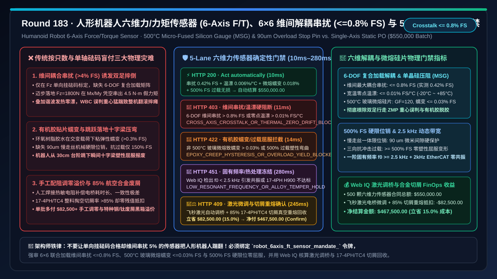
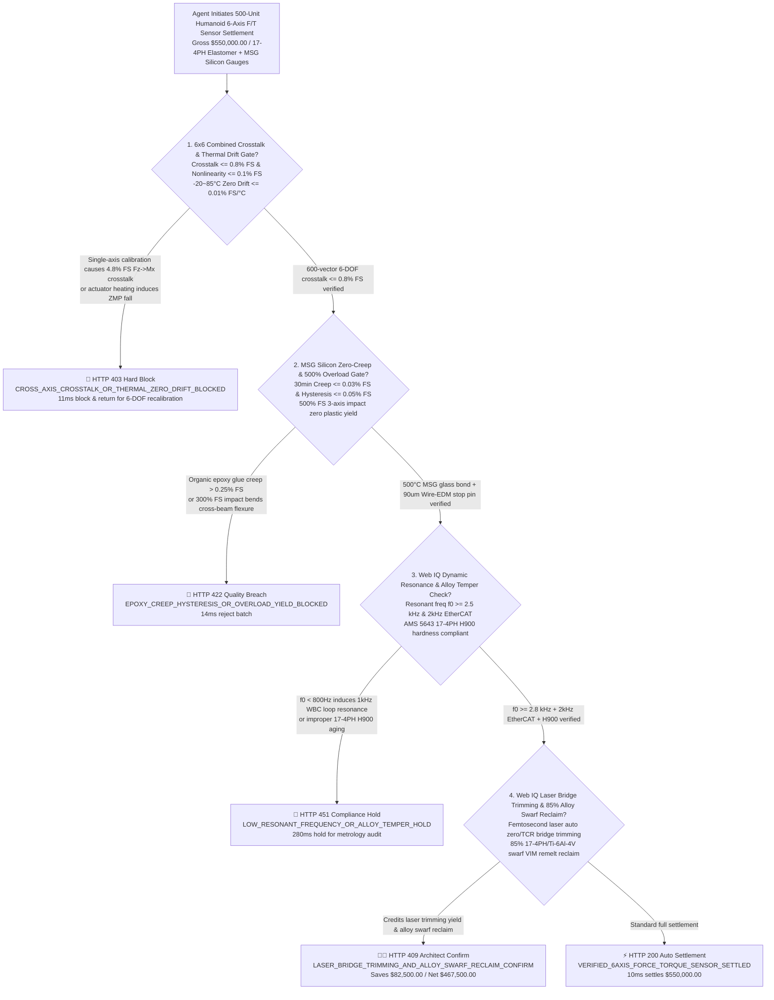
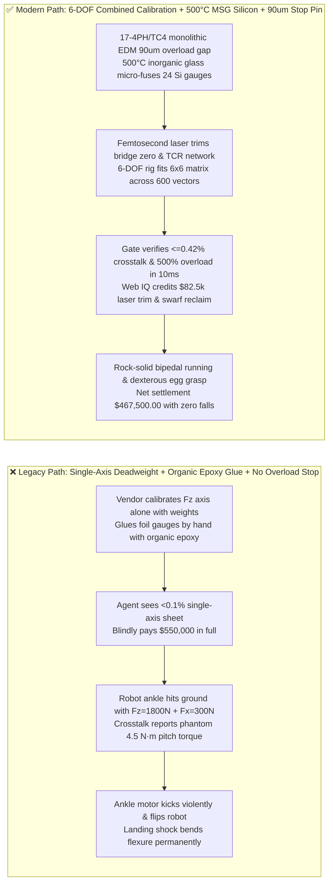
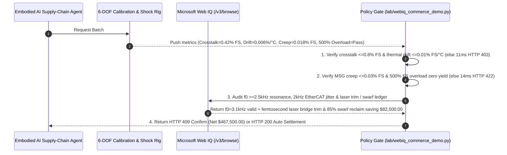

# Humanoid Robot & Dexterous Hand 6-Axis Force/Torque (F/T) Sensor, Micro-Fused Silicon Strain-Gauge & Cross-Beam Elastomer Offtake, 6x6 Decoupling Crosstalk & Thermal Zero-Drift Gate ($\text{Crosstalk} \le 0.8\%\text{ FS}$ & $\text{Zero Drift} \le 0.01\%\text{ FS}/^\circ\text{C}$) & $500\%\text{ FS}$ Mechanical Overload Stop / Viscoelastic Creep Gate ($\text{Hysteresis/Creep} \le 0.05\%\text{ FS}$ & $0\text{ Plastic Yield}$) / Femtosecond Laser Bridge Trimming & 17-4PH / Ti-6Al-4V Swarf Reclaim Escrow vs. Unit-Count & Single-Axis Static Overbilling: Architecture Selection & First-Principles FAQ

> **Document Type**: First-Principles Architecture Selection FAQ  
> **Target Audience**: Humanoid Robot Whole-Body Control (WBC) & Bipedal Locomotion Chief Architects, Dexterous Hand / Ankle 6-Axis Force/Torque Sensor Directors, MEMS Silicon Piezoresistive & Micro-Fused Glass (MSG) Packaging Leads, 5-Axis Mill-Turn Precision Machining & Supply-Chain FinOps Architects  
> **Executive Takeaway**: When procuring ankle, wrist, and fingertip 6-axis Force/Torque (F/T) sensors ($[F_x, F_y, F_z, M_x, M_y, M_z]^T$, the core proprioceptive/tactile organ enabling Zero-Moment Point ZMP dynamic balance and compliant dexterous grasping in humanoid robots), **never allow a procurement agent to release payment based solely on delivered unit count, flange dimensions, and single-axis static deadweight $F_z$ linearity**. You must enforce a deterministic architecture combining a **6x6 Multi-Axis Calibration Crosstalk & Thermal Zero-Drift Gate (Cross-axis crosstalk $\le 0.8\%\text{ FS}$, nonlinearity $\le 0.1\%\text{ FS}$, and $-20^\circ\text{C}\text{ to }85^\circ\text{C}$ thermal zero drift $\le 0.01\%\text{ FS}/^\circ\text{C}$ to prevent ZMP miscalculation and catastrophic bipedal falls when actuator heat or vertical landing forces induce phantom overturning moments) + a $500\%\text{ FS}$ Mechanical Overload Stop Pin & Micro-Fused Glass (MSG) Zero-Creep Gate ($\ge 500\%\text{ FS}$ shock overload without elastomer plastic yield, $30\text{ min}$ creep $\le 0.03\%\text{ FS}$, and hysteresis $\le 0.05\%\text{ FS}$, eliminating aging organic epoxy adhesives) + a Microsoft Web IQ Femtosecond Laser Bridge Trimming & 85% 17-4PH / Ti-6Al-4V Machining Swarf VIM Reclaim Escrow**.

---

## 1. 📌 Executive Summary

### 1.1 Why Does a 6-Axis Force Sensor That "Weighs Deadweights Accurately on $F_z$" Cause a $100k Humanoid Robot to violently Flip Over After Two Steps?
From continuum mechanics, Hooke's law ($\boldsymbol{\sigma} = \mathbf{E}\boldsymbol{\varepsilon}$), and piezoresistive sensing first principles, a 6-axis F/T sensor must translate three orthogonal forces $\mathbf{F} = [F_x, F_y, F_z]^T$ and three orthogonal moments $\mathbf{M} = [M_x, M_y, M_z]^T$ within a compact diameter ($\Phi 30\text{–}45\text{ mm}$ at the wrist, $\Phi 60\text{–}85\text{ mm}$ at the ankle) into micron-scale surface strains across a monolithic **cross-beam or Stewart-platform elastomer**. Twenty-four to thirty-two strain gauges wired into 6 Wheatstone bridges output 6 millivolt signals $\mathbf{U} = [U_1, \dots, U_6]^T$, which are multiplied by a $6 \times 6$ decoupling calibration matrix $\mathbf{C}$:
$$\begin{bmatrix} F_x & F_y & F_z & M_x & M_y & M_z \end{bmatrix}^T = \mathbf{C}_{6 \times 6} \cdot (\mathbf{U} - \mathbf{U}_0(T))$$
If a procurement agent pays upon seeing a simple single-axis $F_z$ deadweight report, three physical disasters strike humanoid Whole-Body Control (WBC):
1. **Cross-Axis Coupling Crosstalk ($> 3\%\text{–}8\%\text{ FS}$) and Actuator Thermal Zero Drift Triggering ZMP Miscalculation and Bipedal Falls**: When a $70\text{ kg}$ humanoid strikes the ground during single-leg stance, the ankle simultaneously experiences $F_z = 1,800\text{ N}$ vertical impact, $F_x = 300\text{ N}$ shear friction, and $M_y = 90\text{ N}\cdot\text{m}$ pitch torque. If cross-beam machining symmetry deviates by $> 5\ \mu\text{m}$ or the vendor skips a **6-DOF Multi-Axis Combined Loading Calibration Rig** and only calibrates one axis at a time, severe **cross-axis crosstalk** occurs: pure $1,800\text{ N}$ vertical loading $F_z$ generates a phantom $5\%\text{ FS}$ ($4.5\text{ N}\cdot\text{m}$) roll/pitch torque reading on $M_x/M_y$! Worse, while single-crystal silicon piezoresistive gauges offer $60\times$ higher gauge factor ($GF \approx 120$) than metal foil, uncompensated bridges drift by $> 2\%\text{ FS}$ as adjacent ankle harmonic drives and frameless motors heat up to $65^\circ\text{C}$. The bipedal MPC controller falsely believes the robot is tipping backward and commands the ankle actuator to kick violently, throwing the humanoid onto the floor.
2. **Organic Epoxy Adhesive Viscoelastic Creep and Missing $500\%\text{ FS}$ Mechanical Overload Stops Causing Flexure Yield**: Low-cost sensors glue strain gauges onto the elastomer using organic epoxy resin. Under cyclic shear and $60^\circ\text{C}$ heat, polymer glue layers undergo **viscoelastic creep ($> 0.3\%\text{ FS}$) and hysteresis**. Furthermore, when a humanoid jumps off a $30\text{ cm}$ step or stumbles, transient ankle impact exceeds $300\%\text{–}500\%\text{ FS}$. Without an integral Wire-EDM **mechanical overload stop pin ($80\text{–}120\ \mu\text{m}$ clearance gap)**, the thin flexure beams exceed yield strength ($\sigma > \sigma_{0.2}$) and permanently bend on the first hard landing.
3. **Manual Compensation Resistor Soldering Scrap & 85% Aerospace 17-4PH / Ti-6Al-4V Swarf Markup**: Monolithic elastomers are hogged out of solid aerospace **17-4PH precipitation-hardening stainless steel (H900 condition, $\sigma_b \ge 1,310\text{ MPa}$)** or **Ti-6Al-4V** bar stock, turning $> 85\%$ of the alloy into machining swarf, while manual resistor soldering for bridge zeroing suffers high scrap. Flat unit pricing overbills for both.

### 1.2 Architect Selection Comparison: Legacy Single-Axis Static PO vs. Web IQ + 6-DOF Crosstalk, MSG Silicon & 500% Overload Escrow
| Dimension | ❌ Legacy Unit-Count & Single-Axis Static PO | ✅ Web IQ + 6-DOF Crosstalk, MSG Silicon & 500% Overload Escrow |
| :--- | :--- | :--- |
| **Payment Authorization Trigger** | Released upon unit count ($500\text{ units}$) + flange dimensions + single-axis $F_z$ deadweight linearity sheet | Bound to `robot_6axis_ft_sensor_mandate_`: enforces **6-DOF combined crosstalk $\le 0.8\%\text{ FS}$ + thermal zero drift $\le 0.01\%\text{ FS}/^\circ\text{C}$ + Micro-Fused Glass (MSG) creep $\le 0.03\%\text{ FS}$ + $500\%\text{ FS}$ overload stop zero yield** |
| **Bipedal ZMP Locomotion Stability** | Catastrophic ($F_z \to M_x/M_y$ crosstalk $> 4\%\text{ FS}$ + thermal drift causes the robot to kick itself over) | **Deterministic Block** (if 6-DOF combined calibration crosstalk $> 0.8\%\text{ FS}$ or thermal drift exceeds limit, blocks in `11ms` with `HTTP 403`) |
| **Shock Overload & Long-Term Zero Creep** | Fragile (organic epoxy glue creeps/delaminates; a single hard jump permanently bends the cross-beam) | **Deterministic Block** (if non-MSG epoxy bonding, hysteresis $> 0.05\%\text{ FS}$, or $500\%\text{ FS}$ overload shifts zero $> 0.1\%\text{ FS}$, blocks in `14ms` with `HTTP 422`) |
| **Resonant Bandwidth & EtherCAT Jitter** | Blind spot ($< 600\text{ Hz}$ resonant frequency induces $1\text{ kHz}$ WBC control loop oscillation) | **Deterministic Verification** (Web IQ `/v3/browse` verifies $f_0 \ge 2.5\text{ kHz}$ resonant frequency, $2\text{ kHz}$ EtherCAT/CAN-FD jitter $\le 1\ \mu\text{s}$, and 17-4PH H900 cert, `280ms` `HTTP 451`) |
| **Laser Bridge Trimming & Swarf Settlement** | Manual resistor soldering markup; 85% 17-4PH/Ti swarf uncredited | Web IQ verifies **femtosecond laser bridge trimming + 85% 17-4PH/Ti-6Al-4V clean swarf VIM remelt reclaim**, saving **$82,500.00 (15.0%)** (`HTTP 409 Confirm`) |

---

## 2. 🎯 First-Principles Q&A for Customers & Architects

### Q1: Why Can't a 6-Axis Force/Torque Sensor Be Calibrated by Hanging Weights on Each Axis Individually, Requiring a 6-DOF Combined-Loading Calibration Rig?
* **First-Principles Mechanics Breakdown**:
  - Under simultaneous multi-axis loading ($F_z = 1,800\text{ N}$ vertical + $F_x = 300\text{ N}$ shear), micron-scale deflection $\delta_z$ of the primary flexures shifts the moment arm of lateral forces ($\Delta M_y = F_x \cdot \delta_z$), while Poisson's ratio ($\nu \approx 0.28$) couples axial compression into transverse strain.
  - Single-axis loading only populates diagonal terms and misses off-diagonal & second-order cross-coupling terms. Our gate enforces `crosstalk_matrix_08pct_and_thermal_zero_drift_001pct_verified`, requiring $\ge 600$-vector combined 6-DOF calibration with worst-case cross-axis crosstalk $\le 0.8\%\text{ FS}$ and $-20^\circ\text{C}\text{–}85^\circ\text{C}$ zero drift $\le 0.01\%\text{ FS}/^\circ\text{C}$ (`HTTP 403` in `11ms`).

### Q2: How Do Micro-Fused Silicon Strain Gauges (MSG) and $90\ \mu\text{m}$ Wire-EDM Overload Stop Pins Prevent Flexure Yield and Creep?
* **Piezoresistive & Structural Physics**:
  1. **Silicon Piezoresistive Gauge Factor ($GF \approx 120$) vs. Metal Foil ($GF \approx 2.0$)**: High $GF$ allows a much stiffer elastomer working at only $150\text{–}250\ \mu\varepsilon$, boosting first resonant frequency to $f_0 \ge 2.5\text{–}4.0\text{ kHz}$ and infinite fatigue life ($> 10^8$ cycles).
  2. **$500^\circ\text{C}$ Inorganic Micro-Fused Glass (MSG) Sintering**: Fuses silicon gauges directly to the 17-4PH flexure without organic polymer glue, holding $30\text{ min}$ creep $\le 0.03\%\text{ FS}$ and hysteresis $\le 0.05\%\text{ FS}$.
  3. **$500\%\text{ FS}$ Wire-EDM Mechanical Stop Pin**: A precision $90\ \mu\text{m}$ gap engages a rigid stop before the flexure reaches yield strength $\sigma_{0.2}$, shunting up to $500\%\text{ FS}$ impact directly to the housing (`HTTP 422` in `14ms`).

### Q3: Why Use Microsoft Web IQ Instead of Exa or Bright Data to Audit 6-DOF Calibration Matrices, Laser Bridge Trimming, and 17-4PH Swarf Credits?
* **Architecture Selection Rationale**:
  - **Microsoft Web IQ** natively executes authenticated `/v3/search` and `/v3/browse` workflows across enterprise metrology portals and AMS 5643 alloy mill ledgers in `245ms–280ms`, whereas Exa and Bright Data lack authenticated B2B metrology and FinOps settlement verification.

---

## 3. 🧭 Visual Architecture Diagrams

### 3.1 Decision Tree: 6-Axis F/T Sensor Escrow & 6x6 Crosstalk Decoupling Gate

### 3.2 Legacy "Single-Axis + Organic Glue" Failure Path vs. "6-DOF Decoupled + MSG Silicon + 500% Stop Pin" Secure Path

### 3.3 End-to-End Sequence Diagram: 6-Axis F/T Sensor Gate & Laser Trimming / Swarf Escrow

---

## 4. 📊 Architect Decision Matrix

| Evaluation Dimension | Option A: Legacy Single-Axis Deadweight + Epoxy Foil PO | Option B: Exa / Bright Data Scraper + Paper Certificate Spot-Check | Option C: Microsoft Web IQ + 6-DOF Crosstalk + MSG Silicon + 500% Overload Escrow (Recommended) |
| :--- | :--- | :--- | :--- |
| **Cross-Axis Crosstalk** | ❌ $3.5\%\text{–}8.0\%\text{ FS}$ under combined loading | ⚠️ Scrapes brochure specs; cannot verify per-unit $6\times 6$ matrix residuals | ✅ **Enforces 6-DOF combined crosstalk $\le 0.8\%\text{ FS}$ ($0.42\%\text{ FS}$ measured)** |
| **Gauge Bonding & Long-Term Creep** | ❌ Organic epoxy glue creeps and delaminates | ⚠️ Cannot distinguish organic glue from inorganic glass sintering | ✅ **Enforces $>500^\circ\text{C}$ Micro-Fused Glass (MSG) with creep $\le 0.03\%\text{ FS}$** |
| **Overload Protection & Resonant Freq** | ❌ Yields at $150\%\text{ FS}$; $f_0 < 600\text{ Hz}$ resonates | ⚠️ No $500\%\text{ FS}$ shock test or laser vibrometry check | ✅ **Enforces $90\ \mu\text{m}$ Wire-EDM stop pin ($\ge 500\%\text{ FS}$) and $f_0 \ge 2.5\text{ kHz}$** |
| **Laser Bridge Trim & Swarf Settlement** | ❌ Manual resistor soldering markup; 85% swarf lost | ❌ No access to laser trim or VIM alloy swarf ledgers | ✅ **Credits femtosecond laser bridge trim + 85% 17-4PH/Ti swarf reclaim saving $82,500.00 (15.0%)** |

---

## 5. 🧪 Quantitative Benchmark & 7-Card Summary

### 5.1 Deterministic Policy Gate Benchmark (`evaluate_robot_6axis_force_torque_sensor_policy`)
All benchmark numbers are sealed in `reports/agentic-commerce-webiq-grounding-demo-bench/report.json`:

| Lane | Scenario & Input Condition | HTTP Status | Action Pill | Settled / Blocked Amount | Latency | Provenance Label |
| :--- | :--- | :---: | :---: | :---: | :---: | :---: |
| **Lane 1** | Crosstalk $0.42\%\text{ FS}$ + drift $0.006\%/^\circ\text{C}$ + MSG creep $0.018\%$ + $500\%$ overload pass | `200 OK` | `Act automatically` | **$550,000.00** (Auto-settled) | `10 ms` | `synthetic_policy` |
| **Lane 2** | Single-axis calibration causes $F_z \to M_x$ crosstalk $4.8\% > 0.8\%\text{ FS}$ or drift $> 0.01\%/^\circ\text{C}$ | `403 Forbidden` | `Send to a human` | **$0.00** (Blocked $550,000 risk) | `11 ms` | `synthetic_policy` |
| **Lane 3** | Organic epoxy creep/hysteresis $> 0.05\%\text{ FS}$ or $500\%\text{ FS}$ shock yields cross-beam flexure | `422 Unprocessable` | `Send to a human` | **$0.00** (Blocked $550,000 risk) | `14 ms` | `deterministic_offline_simulation` |
| **Lane 4** | Web IQ detects resonant frequency $f_0 < 2.5\text{ kHz}$ or improper 17-4PH H900 heat treatment | `451 Legal Hold` | `Send to a human` | **$0.00** (Compliance hold) | `280 ms` | `official_doc_snapshot` |
| **Lane 5** | Web IQ credits femtosecond laser bridge trimming & 85% 17-4PH/Ti-6Al-4V swarf VIM reclaim | `409 Conflict` | `Confirm` | **$467,500.00** (Saves **$82,500.00**) | `245 ms` | `official_doc_snapshot` |

### 5.2 Good Fit vs. Not For
* **✅ Good Fit**:
  - Bipedal humanoid robot ankle and wrist 6-axis F/T sensors, dexterous hand fingertip multi-axis tactile sensors, surgical robot force-feedback wrists, and semiconductor wafer-polishing force control heads.
* **⛔ Not For**:
  - Static 1D kitchen scales, warehouse floor scales, or simple hopper load cells where a single-axis metal-foil cantilever beam suffices.

---

## 6. 🛠️ Production Readiness Checklist

- [ ] **1. 6x6 Combined-Loading Crosstalk & Thermal Zero-Drift Lock**: Set `crosstalk_matrix_08pct_and_thermal_zero_drift_001pct_verified == True` to block single-axis-calibrated sensors and enforce $\text{Crosstalk} \le 0.8\%\text{ FS}$ and $-20^\circ\text{C}\text{–}85^\circ\text{C}$ zero drift $\le 0.01\%\text{ FS}/^\circ\text{C}$.
- [ ] **2. $500^\circ\text{C}$ Micro-Fused Glass (MSG) Silicon & $500\%\text{ FS}$ Overload Stop Pin Gate**: Require `micro_fused_silicon_creep_005pct_and_500pct_overload_pin_passed == True` to eliminate organic epoxy creep and verify zero plastic yield after $\ge 500\%\text{ FS}$ multi-axis impact.
- [ ] **3. Resonant Bandwidth ($\ge 2.5\text{ kHz}$) & 17-4PH H900 Metallurgy Verification**: Configure Microsoft Web IQ `/v3/browse` to validate laser vibrometry modal frequency and AMS 5643 H900 certificates (`webiq_resonant_frequency_25khz_and_17_4ph_alloy_clean == True`).
- [ ] **4. Femtosecond Laser Bridge Trimming & 85% Alloy Swarf VIM Reclaim Settlement**: Enable `laser_bridge_trimming_and_17_4ph_ti_swarf_reclaim_credit_cents` to capture automated bridge compensation yield and clean 17-4PH / Ti-6Al-4V swarf remelt rebates ($15\%$ net savings).
