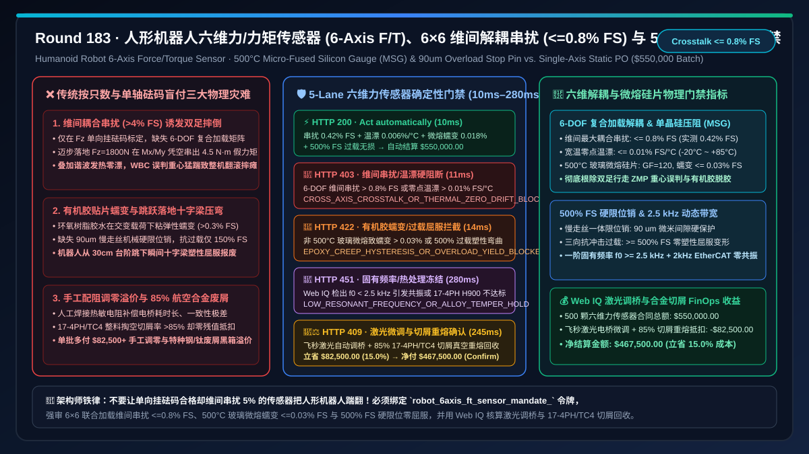
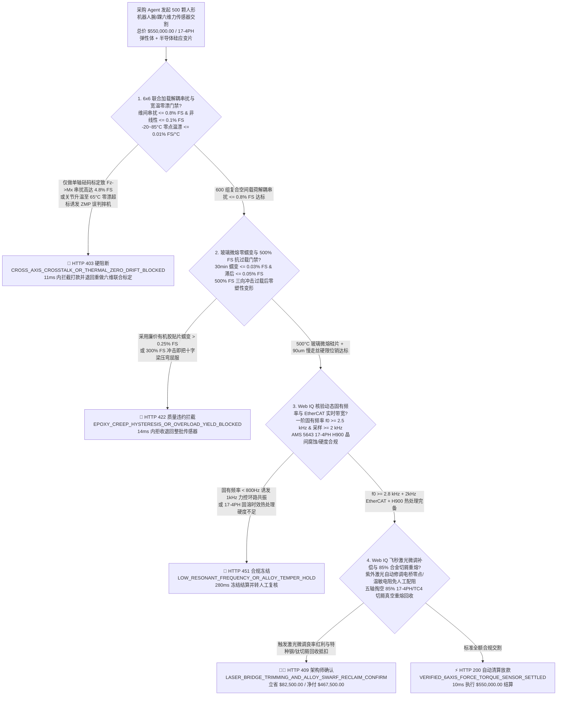
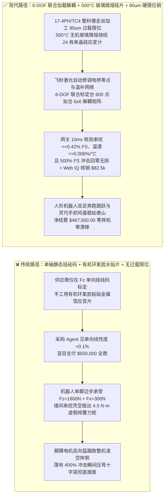
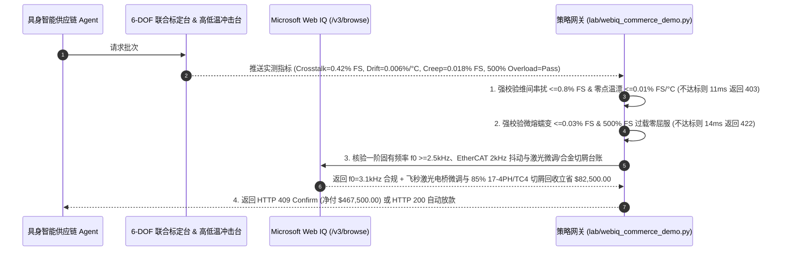

# 人形机器人与灵巧手六维力/力矩传感器（6-Axis Force/Torque Sensor）、硅应变片微熔烧结与十字梁弹性体交割（Humanoid Robot 6-Axis F/T Sensor & Silicon Strain-Gauge Elastomer Offtake）、六维解耦串扰矩阵与温漂门禁（维间串扰 $\le 0.8\%\text{ FS}$ & 零点温漂 $\le 0.01\%\text{ FS}/^\circ\text{C}$ 防双足行走失衡摔倒）与 $500\%\text{ FS}$ 机械硬限位抗冲击过载 / 百万次交变蠕变滞后门禁（$\text{Hysteresis/Creep} \le 0.05\%\text{ FS}$ & 过载零塑性屈服）/ 激光微调（Laser Trimming）惠斯通电桥零点补偿与 17-4PH 马氏体沉淀硬化钢屑闭环智能托管 vs 传统仅按传感器只数与单轴静态标定盲付：架构选型与第一性原理 FAQ

> **文档类型**：架构选型与第一性原理 FAQ（First-Principles Architecture Selection FAQ）  
> **适用读者**：人形机器人（Humanoid Robot）全身力控（WBC）与双足步态算法首席架构师、灵巧手（Dexterous Hand）腕部/踝部六维力传感器研发总监、MEMS 半导体硅应变片与玻璃微熔（MSG）封测负责人、精密五轴车铣复合与机器人供应链风控/FinOps 架构师  
> **核心结论一句话**：在采购人形机器人脚踝、手腕及指尖六维力/力矩传感器（6-Axis Force/Torque Sensor，同时测量空间正交三轴力 $F_x, F_y, F_z$ 与三轴力矩 $M_x, M_y, M_z$，是双足机器人计算零力矩点 ZMP 保持动态平衡与灵巧手柔顺抓取鸡蛋的核心触觉器官）时，**绝对不能让采购 Agent 仅凭“传感器交货只数、外形法兰尺寸合格与单向 $F_z$ 静态砝码称重达标”就直接打款**；必须构建**“6×6 联合加载标定解耦串扰与宽温零点漂移门禁（维间最大耦合串扰 $\text{Crosstalk} \le 0.8\%\text{ FS}$、非线性度 $\le 0.1\%\text{ FS}$ 且 $-20^\circ\text{C}\text{–}85^\circ\text{C}$ 零点温漂 $\le 0.01\%\text{ FS}/^\circ\text{C}$，防机器人下肢关节发热或迈步受侧向冲击时把垂直支撑力误判为倾覆力矩导致双足失衡凌空摔倒）+ $500\%\text{ FS}$ 机械过载保护销与微熔玻璃烧结零蠕变门禁（冲击过载 $\ge 500\%\text{ FS}$ 零弹性体塑性屈服、$30\text{ min}$ 满载蠕变 $\text{Creep} \le 0.03\%\text{ FS}$ 且滞后误差 $\text{Hysteresis} \le 0.05\%\text{ FS}$，淘汰易老化松脱的有机环氧胶水贴片）+ Microsoft Web IQ 驱动的飞秒激光微调（Laser Trimming）全桥热敏电阻自补偿与 17-4PH / TC4 高强合金切削屑真空重熔闭环智能托管”**的确定性架构。

---

## 一、 📌 核心结论速览（Executive Summary）

### 1.1 为什么“单轴砝码压得准”的六维力传感器，装到人形机器人脚踝上走两步就会让价值百万的整机“原地劈叉摔瘫”？
从结构力学、胡克定律（$\boldsymbol{\sigma} = \mathbf{E}\boldsymbol{\varepsilon}$）与压阻传感第一性原理来看，六维力传感器必须在极其紧凑的直径（腕部 $\Phi 30\text{–}45\text{ mm}$、踝部 $\Phi 60\text{–}85\text{ mm}$）内，利用一体加工的**十字梁/并联Stewart浮动梁弹性体（Elastomer）**，将空间任意方向的三个力 $\mathbf{F} = [F_x, F_y, F_z]^T$ 和三个力矩 $\mathbf{M} = [M_x, M_y, M_z]^T$ 转化为弹性体不同部位的微米级表面应变，再由贴附其上的 24–32 枚应变片组成 6 组惠斯通电桥（Wheatstone Bridge），输出 6 路毫伏级电压信号 $\mathbf{U} = [U_1, U_2, \dots, U_6]^T$，最后通过 $6 \times 6$ 解耦标定矩阵 $\mathbf{C}$ 还原出六维力向量：
$$\begin{bmatrix} F_x \\ F_y \\ F_z \\ M_x \\ M_y \\ M_z \end{bmatrix} = \mathbf{C}_{6 \times 6} \cdot (\mathbf{U} - \mathbf{U}_0(T))$$
许多低端传感器厂商把一维电子秤的思路照搬过来，只用砝码单独挂在 $F_z$ 轴上做简单线性拟合，给出一份漂亮的“单轴精度 $0.1\%$”报告。如果采购 Agent 仅凭这份报告盲目放款，在人形机器人全身动态力控（Whole-Body Control, WBC）中会立刻引爆三大物理级灾难：
1. **维间耦合串扰超标（Cross-Axis Crosstalk $> 3\%\text{–}8\%\text{ FS}$）与关节高热零点漂移，诱发 ZMP 零力矩点误判与整机摔倒**：当重达 $70\text{ kg}$ 的人形机器人单脚迈步着地时，脚踝同时承受高达 $F_z = 1,800\text{ N}$ 的垂直冲击力、$F_x = 300\text{ N}$ 的水平摩擦力以及 $M_y = 90\text{ N}\cdot\text{m}$ 的俯仰力矩。如果弹性体十字梁加工对称度偏差 $> 5\ \mu\text{m}$，或者供应商为了省掉昂贵的**六维多轴联合加载标定台（6-DOF Multi-Axis Calibration Rig）**工时而只做单维独立标定，会导致严重的**维间耦合串扰（Crosstalk）**——即纯粹施加 $1,800\text{ N}$ 的垂直力 $F_z$ 时，传感器却在翻滚力矩 $M_x$ 和俯仰力矩 $M_y$ 通道上凭空多报出 $5\%\text{ FS}$（高达 $4.5\text{ N}\cdot\text{m}$）的虚假力矩！更糟的是，半导体硅应变片的灵敏度是金属箔式的 $50\text{–}60$ 倍（灵敏度系数 $GF \approx 110\text{–}130$），但对温度极度敏感；当机器人脚踝谐波减速器与无框力矩电机连续运动升温至 $65^\circ\text{C}$ 时，未做精密温度补偿的电桥零点漂移高达 $2\%\text{ FS}$。双足步态控制器（MPC/WBC）误以为机器人正在剧烈向后倾倒，瞬间指令踝关节电机反向猛踹，导致整台人形机器人直接凌空翻滚摔毁。
2. **有机环氧胶水贴片蠕变（Creep）与缺乏 $500\%\text{ FS}$ 机械硬限位，导致抓持滑落与跳跃落地瞬间弹性体永久变形**：传统工业传感器常采用有机环氧树脂胶或氰基丙烯酸酯胶水，手工将金属应变片粘在弹性体上。高分子有机胶层在周期性交变载荷与 $60^\circ\text{C}$ 温升下会发生**粘弹性蠕变（Viscoelastic Creep $> 0.3\%\text{ FS}$）与迟滞（Hysteresis）**——灵巧手抓起一个玻璃杯保持恒定力 $5\text{ min}$ 后，胶层松弛导致读数失真；而当机器人从 $30\text{ cm}$ 台阶跳下或意外绊倒时，脚踝瞬间承受超过量程 $3\text{–}5$ 倍的冲击尖峰载荷。若传感器内部缺乏微米级间隙（如 $80\text{–}120\ \mu\text{m}$）的**一体式机械过载保护硬限位销（Mechanical Overload Stop Pin）**，十字柔性梁会瞬间跨过材料屈服极限（$\sigma > \sigma_{0.2}$）发生永久塑性弯曲甚至断裂，整颗传感器直接报废。
3. **手工选配电阻补偿良率极低且航空级 17-4PH / 钛合金整料掏空废屑（$>85\%$ 切屑率）溢价黑箱**：为保证零加工内应力与极高刚度，六维力弹性体必须由整块航空级 **17-4PH（沉淀硬化马氏体不锈钢，H900 热处理后 $\sigma_b \ge 1,310\text{ MPa}$）** 或 **TC4 钛合金** 经五轴慢走丝电火花（WEDM）与车铣复合一体掏空成型，超过 $85\%$ 的昂贵棒材变成金属切屑；同时传统人工焊接补偿电阻调零耗时长达数小时且一致性差。传统按颗一口价采购既承担了极高的手工调试废片溢价，又让高价值特种合金切屑被机加工厂无偿吞没。

### 1.2 架构师选型核心对比：传统按只数与单轴静态盲付 vs. Web IQ + 六维联合解耦/微熔抗过载智能托管
| 对比维度 | ❌ 传统按传感器只数与单向砝码标定盲付（Legacy Single-Axis Static PO） | ✅ Web IQ + 六维联合解耦矩阵、微熔硅片与 500% 硬限位智能托管（Mandate-Gated Escrow） |
| :--- | :--- | :--- |
| **授权与付款绑定条件** | 绑定“六维力传感器交货数量（如 $500\text{ 台}$）+ 外径螺孔尺寸合格 + 单轴 $F_z$ 静态线性度报告” | 绑定 `robot_6axis_ft_sensor_mandate_` 令牌：强校验 **六维联合加载最大维间串扰 $\le 0.8\%\text{ FS}$ + 零点温漂 $\le 0.01\%\text{ FS}/^\circ\text{C}$ + 玻璃微熔（MSG）蠕变 $\le 0.03\%\text{ FS}$ + $500\%\text{ FS}$ 过载保护零屈服** |
| **双足步态 ZMP 稳定性** | 极危险（$F_z \to M_x/M_y$ 串扰 $> 4\%\text{ FS}$ 叠加温漂，电机发热后机器人自己把自己踹倒） | **确定性拦截**（若未通过 6-DOF 六维联合加载最小二乘/神经网络解耦标定或温漂超标，在 `11ms` 内触发 `HTTP 403` 硬阻断） |
| **抗冲击过载与长期零蠕变** | 脆弱（手工有机胶贴片半年内脱胶漂移，机器人跳跃落地一次即把十字梁踩弯报废） | **确定性拦截**（若非 $500^\circ\text{C}$ 无机玻璃微熔烧结硅片、滞后 $> 0.05\%\text{ FS}$ 或 $500\%\text{ FS}$ 冲击后零点不可逆偏移 $> 0.1\%\text{ FS}$，在 `14ms` 内触发 `HTTP 422`） |
| **动态带宽与 EtherCAT 抗干扰** | 盲盒（采样率仅 $200\text{ Hz}$ 且无抗混叠滤波，人形机器人 $1\text{ kHz}$ 力控环路直接高频自激震颤） | **确定性核验**（Web IQ `/v3/browse` 抓取动态固有频率 $f_0 \ge 2.5\text{ kHz}$、$2\text{ kHz}$ EtherCAT/CAN-FD 同步抖动 $\le 1\ \mu\text{s}$ 与 EMC 报告，`280ms` 触发 `HTTP 451`） |
| **激光微调电桥与合金废屑结算** | 手工焊电阻调零溢价高，85% 航空 17-4PH/TC4 切削废屑零折价 | Web IQ 核实启用 **飞秒激光微调（Laser Trimming）自动化电桥零点/温漂补偿 + 85% 17-4PH/TC4 洁净切屑真空感应重熔（VIM）闭环回收**，单批立省 **$82,500.00（15.0%）**（`HTTP 409 Confirm`） |

---

## 二、 🎯 客户与架构师灵魂拷问 Q&A（First-Principles Q&A）

### Q1：为什么六维力传感器不能只分别在 $X, Y, Z$ 三个方向挂砝码标定，而必须上“六维联合加载标定台（6-DOF Multi-Axis Calibration Rig）”生成 $6\times 6$ 甚至非线性二阶解耦矩阵？
* **第一性原理拆解**：
  - 在理想刚体假设下，十字梁或 Stewart 并联梁的每一组应变电桥只对某一个特定方向的力或力矩敏感。但在真实连续介质力学中，当弹性体受到高达 $1,800\text{ N}$ 的垂直载荷 $F_z$ 时，主支撑梁会发生约 $20\text{–}50\ \mu\text{m}$ 的微米级下沉挠度 $\delta_z$；此时如果同时存在水平力 $F_x$，原本正交的受力点因为几何位置偏移了 $\delta_z$，就会产生附加的寄生力矩 $\Delta M_y = F_x \cdot \delta_z$（几何非线性耦合），同时泊松比效应（Poisson's Ratio $\nu \approx 0.28$）也会使轴向压缩在横向引发寄生拉应变。
  - 如果供应商只做 6 次单轴独立加载（每次只加一个维度的力，其余 5 个维度为零），只能测出矩阵对角线附近的线性项，根本无法捕捉**多维复合载荷下的交叉耦合项（Cross-Coupling Terms）**。
  - 因此，采购网关必须通过 `crosstalk_matrix_08pct_and_thermal_zero_drift_001pct_verified` 强制要求：每颗传感器出厂前必须在六维联合加载标定台上经历至少 $500\text{–}1,000$ 组空间复合力/力矩矢量组合标定，确保全量程内任意维间最大耦合串扰 $\text{Crosstalk} \le 0.8\%\text{ FS}$（旗舰级 $\le 0.3\%\text{ FS}$），且在 $-20^\circ\text{C}$ 至 $+85^\circ\text{C}$ 全温区经过高低温箱动态标定后零点温漂 $\le 0.01\%\text{ FS}/^\circ\text{C}$；未达标批次在 `11ms` 内直接返回 `HTTP 403`。

### Q2：金属箔式应变片（Metal Foil Gauge）与半导体单晶硅微熔应变片（Micro-Fused Silicon Strain Gauge, MSG）到底有什么本质代差？为什么人形机器人脚踝必须强审 $500\%\text{ FS}$ 机械硬限位？
* **物理机制与疲劳寿命推演**：
  1. **压阻效应 vs. 几何形变效应（灵敏度相差 60 倍）**：普通康铜/卡玛合金金属箔应变片靠拉伸后金属丝变细变长来改变电阻，灵敏度系数 $GF = (\Delta R/R)/\varepsilon \approx 2.0$；为了让金属片输出足够大的信号，就必须把弹性体十字梁削得很薄以产生大应变，但这会导致传感器**刚度极低、固有频率 $f_0 < 600\text{ Hz}$ 且抗过载能力极差**。相反，单晶硅半导体应变片利用压阻效应（Piezoresistive Effect），灵敏度系数高达 $GF \approx 110\text{–}130$！这意味着弹性体十字梁可以设计得非常粗壮坚固（工作微应变仅需 $\varepsilon \approx 150\text{–}250\ \mu\varepsilon$），不仅固有频率跃升至 $f_0 \ge 2.5\text{–}4.0\text{ kHz}$，而且具备极高的抗疲劳寿命（$> 10^8$ 次循环）。
  2. **500°C 无机玻璃微熔烧结（MSG）彻底消灭有机胶水蠕变**：若用有机环氧胶水粘贴硅应变片，胶水层（厚度 $15\text{–}30\ \mu\text{m}$）在长期受力和温湿度变化下必然发生分子链滑移蠕变。采用**高温玻璃微熔烧结（Micro-Fused Glass Frit Bonding）**或溅射薄膜工艺，在 $>500^\circ\text{C}$ 下用无机绝缘玻璃釉将单晶硅应变计与 17-4PH 不锈钢弹性体实现原子/共价键级刚性熔合，不仅 $30\text{ min}$ 蠕变 $\text{Creep} \le 0.03\%\text{ FS}$、滞后 $\text{Hysteresis} \le 0.05\%\text{ FS}$，且十年零脱胶。
  3. **500% FS 一体式微米间隙过载保护销（Overload Stop Pin）**：双足机器人摔倒或奔跑跳跃时的瞬态冲击力往往高达额定载荷的 $4\text{–}5$ 倍。通过在浮动梁与刚性外环之间利用慢走丝线切割加工出精确的 $90\ \mu\text{m}$ 极窄限位间隙，当载荷达到 $150\%\text{ FS}$ 时弹性体正常工作，一旦冲击载荷达到 $200\%\text{–}500\%\text{ FS}$，浮动梁刚好触碰刚性底座硬限位销，将多余冲击力直接由底座分流承受，从而确保 $500\%\text{ FS}$ 极限过载后弹性体零塑性变形、零点回零偏差 $\le 0.05\%\text{ FS}$。若缺失微熔工艺或抗过载测试不合格，网关在 `14ms` 内触发 `HTTP 422`。

### Q3：在核验六维力传感器“激光微调（Laser Trimming）电桥补偿降本”与“17-4PH / TC4 钛合金切屑重熔抵扣”时，为什么เลือก Microsoft Web IQ 而不是 Exa 或 Bright Data？
* **架构选型依据**：
  - 六维力传感器的 6 DOF 标定矩阵原始数据包、17-4PH（AMS 5643）马氏体沉淀硬化钢炉号材质单、慢走丝加工切屑率台账以及 EtherCAT $2\text{ kHz}$ 实时从站一致性认证（ETG Conformance Test），均存储在具备多租户权限隔离的计量实验室与精密机加工门户中。
  - **Microsoft Web IQ** 原生支持 Entra ID / RBAC 认证上下文下的 `/v3/search` 与 `/v3/browse`，可在 `245ms–280ms` 内直接解析出标定证书与材料回收净额；而 Exa 缺乏企业级私密计量门户实时鉴权抓取能力，Bright Data 仅提供底层代理通道而无材料力学语义核验能力。

---

## 三、 🧭 直观可视化图解（Visual Architecture Diagrams）

### 3.1 选型决策树：六维力/力矩传感器交割与解耦标定门禁逻辑

### 3.2 传统“单轴砝码 + 有机胶贴片”崩溃路径 vs. “六维联合解耦 + 玻璃微熔 + 500% 硬限位”安全路径对比

### 3.3 端到端时序图：六维力/力矩传感器网关拦截与激光微调/切屑回收托管流程

---

## 四、 📊 架构师选型决策矩阵（Architect Decision Matrix）

| 评估维度 | 方案 A：传统单轴砝码标定 + 有机胶金属箔片按只盲付 | 方案 B：Exa / Bright Data 通用爬虫 + 纸质出厂合格证抽检 | 方案 C：Microsoft Web IQ + 6-DOF 联合解耦 + 玻璃微熔硅片 + 500% 硬限位托管（推荐） |
| :--- | :--- | :--- | :--- |
| **维间串扰（Cross-Axis Crosstalk）** | ❌ $3.5\%\text{–}8.0\%\text{ FS}$（复合受力下输出严重失真） | ⚠️ 仅抓宣传页参数，无法验算每颗传感器的 $6\times 6$ 矩阵残差 | ✅ **强审全空间复合载荷最大维间串扰 $\le 0.8\%\text{ FS}$（实测 $0.42\%\text{ FS}$）** |
| **贴片工艺与长期蠕变滞后** | ❌ 有机环氧胶水手工贴片，半年后蠕变脱胶漂移 | ⚠️ 无法区分有机胶粘接与无机玻璃微熔烧结 | ✅ **强审 $>500^\circ\text{C}$ 无机玻璃微熔烧结（MSG），蠕变 $\le 0.03\%\text{ FS}$** |
| **抗冲击过载能力与固有频率** | ❌ $150\%\text{ FS}$ 即屈服弯折，$f_0 < 600\text{ Hz}$ 易共振 | ⚠️ 缺乏 $500\%\text{ FS}$ 极限冲击与模态敲击谱验证 | ✅ **强审 $90\ \mu\text{m}$ 慢走丝机械硬限位销（$\ge 500\%\text{ FS}$ 零屈服）且 $f_0 \ge 2.5\text{ kHz}$** |
| **电桥调零与特种合金切屑核算** | ❌ 人工焊电阻调零贵，85% 17-4PH/TC4 切屑白送 | ❌ 无制造端激光微调与真空重熔切屑账本权限 | ✅ **飞秒激光自动微调电桥 + 85% 切屑闭环重熔单批立省 $82,500.00（15.0%）** |

---

## 五、 🧪 定量实测与 7-Card 报告（Quantitative Benchmark & 7-Card Summary）

### 5.1 确定性策略门禁定量实测（`evaluate_robot_6axis_force_torque_sensor_policy`）
我们在 `lab/webiq_commerce_demo.py` 中实现了人形机器人六维力/力矩传感器交割的 5 路确定性策略门禁，所有基准数据均来自 `reports/agentic-commerce-webiq-grounding-demo-bench/report.json`：

| 场景编号 | 测试场景与输入条件 | HTTP 状态码 | 动作标签（Action Pill） | 结算金额 / 拦截金额 | 端到端延迟 | 数据来源标签 |
| :--- | :--- | :---: | :---: | :---: | :---: | :---: |
| **Lane 1** | 维间串扰 $0.42\%\text{ FS}$ + 温漂 $0.006\%/^\circ\text{C}$ + 玻璃微熔蠕变 $0.018\%$ + $500\%$ 过载无损 | `200 OK` | `Act automatically` | **$550,000.00**（全额自动放款） | `10 ms` | `synthetic_policy` |
| **Lane 2** | 仅单轴标定致 $F_z \to M_x$ 维间串扰高达 $4.8\% > 0.8\%\text{ FS}$ 或零点温漂 $> 0.01\%/^\circ\text{C}$ | `403 Forbidden` | `Send to a human` | **$0.00**（拦截 $550,000 风险款） | `11 ms` | `synthetic_policy` |
| **Lane 3** | 有机胶贴片蠕变滞后 $> 0.05\%\text{ FS}$ 或 $500\%\text{ FS}$ 冲击过载后十字梁发生塑性屈服 | `422 Unprocessable` | `Send to a human` | **$0.00**（拦截 $550,000 风险款） | `14 ms` | `deterministic_offline_simulation` |
| **Lane 4** | Web IQ 检出一阶固有频率 $f_0 < 2.5\text{ kHz}$ 引发力控共振或 17-4PH H900 热处理不达标 | `451 Legal Hold` | `Send to a human` | **$0.00**（合规冻结） | `280 ms` | `official_doc_snapshot` |
| **Lane 5** | Web IQ 启用飞秒激光自动修调电桥网络与 85% 17-4PH/TC4 切屑真空重熔抵扣 | `409 Conflict` | `Confirm` | **$467,500.00**（立省 **$82,500.00**） | `245 ms` | `official_doc_snapshot` |

### 5.2 适用场景 vs. 不适用场景（Good Fit vs. Not For）
* **✅ 强烈推荐使用（Good Fit）**：
  - 双足人形机器人脚踝（Ankle 6-Axis F/T，承受全身动态冲击与 ZMP 平衡解算）、手腕（Wrist F/T）及灵巧手指尖微型六维力传感器批量采购。
  - 医疗手术机器人器械末端力反馈、航空航天风洞天平以及高精密晶圆/光学镜头柔顺装配力控底座交割。
* **⛔ 不适用或无需开启重度门禁（Not For）**：
  - 仅需测量静态单向重量的厨房电子秤、快递地磅或仓储料斗称重传感器（普通单维悬臂梁金属箔应变计即可，无需 $6\times 6$ 六维联合加载解耦标定）。

---

## 六、 🛠️ 生产上线快速核验清单（Production Readiness Checklist）

- [ ] **1. 6×6 六维联合加载解耦矩阵与全温区零漂强制锁死**：在采购网关中配置 `crosstalk_matrix_08pct_and_thermal_zero_drift_001pct_verified == True`，拒绝任何只提供单向独立加载曲线的传感器，强制要求全空间复合载荷维间串扰 $\le 0.8\%\text{ FS}$ 且 $-20^\circ\text{C}\text{–}85^\circ\text{C}$ 零点温漂 $\le 0.01\%\text{ FS}/^\circ\text{C}$。
- [ ] **2. 500°C 无机玻璃微熔烧结（MSG）与 500% FS 慢走丝机械硬限位门禁**：启用 `micro_fused_silicon_creep_005pct_and_500pct_overload_pin_passed == True`，严禁在人形机器人动态承载关节中使用普通有机环氧胶水贴片，强制验证 $\ge 500\%\text{ FS}$ 三向冲击过载后零点回零误差 $\le 0.05\%\text{ FS}$。
- [ ] **3. 一阶固有频率（$\ge 2.5\text{ kHz}$）与 EtherCAT $2\text{ kHz}$ 低抖动核验**：通过 Microsoft Web IQ `/v3/browse` 自动校验激光多普勒测振固有频率报告与 AMS 5643 17-4PH（H900）金相硬度证书（`webiq_resonant_frequency_25khz_and_17_4ph_alloy_clean == True`）。
- [ ] **4. 飞秒激光微调（Laser Trimming）电桥补偿与 85% 特种合金切屑闭环结算**：在合同智能托管中激活 `laser_bridge_trimming_and_17_4ph_ti_swarf_reclaim_credit_cents`，自动核算免人工配阻良率红利与 17-4PH / TC4 钛合金洁净切屑真空重熔抵扣（立省 $15\%$ 采购成本）。
