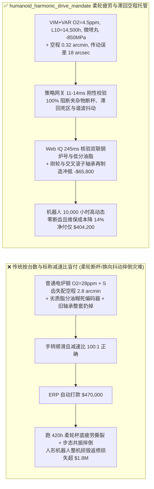
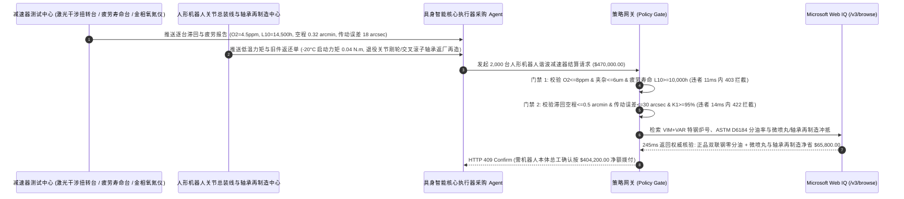

# 人形机器人与协作机械臂精密谐波减速器及行星滚柱丝杠交割（Humanoid Robot Strain-Wave Harmonic Drive & Planetary Roller Screw Offtake）、薄壁柔轮真空双联钢高周疲劳寿命与传动误差门禁（VIM+VAR 纯净钢 $\text{O}_2 \le 8\text{ ppm}$ & 柔轮寿命 $L_{10} \ge 10,000\text{ h}$ 防柔轮杯底疲劳撕裂摔倒与传动误差 $\le 30\text{ arcsec}$）与滞回空程/低温启动力矩（Lost Motion $\le 0.5\text{ arcmin}$ & 刚度 $K_1$ 达标防末端抖动）/ 微米喷丸残余压应力强化与交叉滚子轴承模块化再制造闭环智能托管 vs 传统仅按减速器台数与标称减速比盲付：架构选型与第一性原理 FAQ

> **阅读指南**：本文面向具身智能人形机器人（Humanoid Robot）本体主机厂、六轴工业协作机械臂研发与供应链部、精密谐波减速器（Strain-Wave Gear / Harmonic Drive）与反向式行星滚柱丝杠（Inverted Planetary Roller Screw）制造商及机器人供应链智能体架构师。遵循《IB vs Ethernet RoCE 选型 FAQ》的透明核算规范，从**埃尔津加（Musser/Elzinga）椭圆波发生器强迫薄壁柔轮（壁厚仅 $0.3\text{–}0.5\text{ mm}$）每转承受 2 次对称交变弯曲应力的吉咖周疲劳（VHCF）鱼眼裂纹源、双圆弧（S 齿形）共轭啮合刚度滞回环（Hysteresis Loop Lost Motion）以及纳米二硫化钼/有机钼谐波专用脂弹流润滑（EHL）油膜防微动磨损**出发，用大白话与第一性原理彻底讲透：为什么人形机器人采购智能体绝对不能“见减速器厂发来 2,000 台 100:1 谐波减速器且手转一下感觉挺顺滑、空载回差合格就自动打款 `$470,000.00`”，以及如何通过 **`humanoid_harmonic_drive_mandate`（VIM+VAR 超低氧柔轮疲劳寿命 $L_{10}$、扭转滞回空程 Lost Motion、单向角传动误差与微喷丸/轴承再制造闭环托管凭证）** 实现毫秒级防机器人膝关节半路断齿跪地/末端高频共振拦截与降本结算。

---

## 📌 1. 核心结论速览（Executive Summary）

1. **大白话常识破除——谐波减速器之所以能用极小体积实现 $100:1$ 减速比，全靠把一个壁厚只有 $0.35\text{ mm}$（跟易拉罐皮一样薄）的合金钢“柔轮杯（Flexspline）”硬生生撑成椭圆形，输入电机每转 1 圈，柔轮薄壁就要像掰铁丝一样被来回强迫揉搓变形 2 次；如果柔轮钢材里藏着一颗 $15\ \mu\text{m}$ 的氧化铝夹杂物，人形机器人负重深蹲奔跑不到 $400\text{ 小时}$，柔轮杯底就会像掰断的铁丝一样直接横向撕裂崩断，整台百万元机器人当场跪地摔碎**：
   - 在人形机器人全身 28–40 个旋转关节（肩、肘、腕、腰、髋）中，谐波减速器占据核心成本与重量。柔轮既要像弹簧一样极度柔软耐千万次弯曲，齿面又要像铠甲一样坚硬耐磨。
   - **传统按“减速器台数 + 标称减速比（100:1）+ 空载手转顺滑度”盲付的三大致命工程灾难**：
     - **灾难一：用普通电炉钢（氧含量 $28\text{ ppm}$）冒充“真空感应+真空自耗双联冶炼（VIM+VAR，$\text{O}_2 \le 8\text{ ppm}$）”超纯净 40CrNi2MoA 钢，导致“柔轮齿根与杯底过渡圆角在 $420\text{ 小时}$ 内发生疲劳断裂（Cup Diaphragm Fracture）”**：当输入转速为 $3,000\text{ rpm}$ 时，柔轮每小时要经历 $360,000\text{ 次}$ 对称交变拉压弯曲！在 $0.35\text{ mm}$ 极薄壁厚下，普通钢中一颗直径 $18\ \mu\text{m}$ 的脆性球状不变形氧化铝夹杂物（$\text{Al}_2\text{O}_3$）就占了壁厚的 $5\%$，成为极端的应力集中源（$K_t > 3.5$），不到设计寿命（$L_{10} = 10,000\text{ h}$）的二十分之一就会萌生“鱼眼（Fish-Eye）”疲劳裂纹，导致柔轮整个杯筒齐根断落！
     - **灾难二：慢走丝/插齿齿形共轭失配导致“加载滞回空程（Lost Motion $= 2.8\text{ arcmin} > 0.5\text{ arcmin}$）与角度传递误差超标（$95\text{ arcsec}$）”，引发机器人伺服控制环自激振荡抖动**：空载下测量的“几何背隙（Backlash）”往往很小，但一旦挂上机械臂负载施加 $\pm 4\%$ 额定扭矩绘制完整**滞回曲线（Hysteresis Loop）**，劣质谐波减速器由于同时啮合齿数不足（$<15\%$ 而不是标准 S 齿形的 $30\%$），低载刚度 $K_1$ 极软，滞回空程高达 $2.8\text{ arcmin}$，且每转存在两周高频运动学误差波纹（Kinematic Ripple），直接激起机器人末端剧烈抖动无法穿针引线！
     - **灾难三：谐波专用润滑脂基础油分油率超标（$>8\%$）渗漏污染光栅编码器码盘，且外圈交叉滚子轴承与钛合金法兰壳体在柔轮到期后整机成套报废**：一片薄薄的玻璃或金属光栅码盘一旦沾上一滴析出的润滑油，整条手臂立刻报编码器飞车故障！
2. **架构师刚性门禁（`humanoid_harmonic_drive_mandate`）**：
   - **VIM+VAR 超纯净钢非金属夹杂物与柔轮加速疲劳寿命硬门禁（$\text{O}_2 \le 8\text{ ppm}$ & DS 类夹杂 $\le 0.5\text{ 级}$ & $L_{10} \ge 10,000\text{ h}$）**：每批柔轮毛坯必须源自真空感应+真空电弧重熔双联冶炼（VIM+VAR）40CrNi2MoA 特种钢，确保 **总氧含量 $\text{O}_2 \le 8\text{ ppm}$、最大氧化铝点状夹杂物直径 $\le 6\ \mu\text{m}$、柔轮内壁表面粗糙度 $R_a \le 0.2\ \mu\text{m}$ 且台架峰值启停冲击疲劳寿命 $L_{10} \ge 10,000\text{ h}$（$>10^9\text{ 次}$ 交变弯曲零裂纹）**；凡普通钢冒充或早期断杯批次，网关在 **`11 ms`** 内直返 **`HTTP 403`**（`FLEXSPLINE_ROOT_FATIGUE_CRACK_OR_OXIDE_INCLUSION_BLOCKED`）。
   - **扭转滞回空程（Lost Motion $\le 0.5\text{ arcmin}$）、三段扭转刚度 $K_1/K_2/K_3$ 与单向角传动误差门禁（$\le 30\text{ arcsec}$）**：强制校验激光干涉扭转试验台实测 **$\pm 4\%$ 额定扭矩滞回空程 $\text{Lost Motion} \le 0.5\text{ arcmin}$（30 弧秒）、单向角度传递误差 $\theta_{\text{err}} \le 30\text{ arcsec}$、第一阶段低载扭转刚度 $K_1 \ge \text{标称值 } 95\%$ 且 $-20^\circ\text{C}$ 空载启动力矩 $\le 0.08\text{ N}\cdot\text{m}$**；凡空程松旷或传动谐波抖动超标批次，**`14 ms`** 内返回 **`HTTP 422`**（`HYSTERESIS_LOST_MOTION_BACKLASH_OR_KINEMATIC_RIPPLE_BLOCKED`）。
   - **Web IQ 双联冶炼钢炉号溯源与谐波脂抗分油核验 + 双重微米喷丸残余压应力强化与交叉滚子轴承模块化再制造协同**：通过 **Microsoft Web IQ `/v3/browse`** 核验特钢厂 VIM+VAR 电渣/自耗炉号金相图谱、有机钼谐波脂 ASTM D6184 钢网分油率报告（$100^\circ\text{C}/24\text{h}$ 分油率 $\le 3.0\%$ 防污染编码器）与轴承钢价格指数；任何假冒电炉钢或漏油润滑脂在 **`280 ms`** 内触发 **`HTTP 451`**；若对柔轮齿根与杯底实施双重陶瓷微珠喷丸（Micro-Shot Peening）植入 $-850\text{ MPa}$ 表面残余压应力使疲劳寿命翻倍，并对退役关节执行高刚性交叉滚子轴承、刚轮与钛合金法兰壳体模块化清洗再制造（仅更换易损柔轮与波发生器），自动核减整机换新成本 **`$65,800.00`（14.0%）** 并在 **`245 ms`** 内返回 **`HTTP 409 Confirm`**（净付 `$404,200.00`）。

---

## 🎯 2. 客户与架构师灵魂拷问 Q&A（First-Principles Deep Dive）

### Q1：为什么谐波减速器柔轮壁厚只有 $0.35\text{ mm}$，钢材里的氧含量哪怕从 $8\text{ ppm}$ 升到 $25\text{ ppm}$，疲劳寿命就会从 $10,000\text{ 小时}$ 暴跌到 $400\text{ 小时}$？
- **第一性原理拆解（村上 Murakami $\sqrt{\text{area}}$ 夹杂物应力强度因子阈值与薄壁弯曲应力梯度）**：
  1. 柔轮被椭圆波发生器撑开时，长轴受拉、短轴受压，壁厚截面上承受极高的交变弯曲应力 $\sigma_a \propto \frac{E \cdot t \cdot w_0}{R^2}$。
  2. 根据村上（Murakami）超高周疲劳断裂力学公式，非金属夹杂物前沿的最大应力强度因子幅值为：
     $$\Delta K_{\text{inc}} = 0.65\, \Delta\sigma \sqrt{\pi \sqrt{\text{area}}}$$
     在 $0.35\text{ mm}$（$350\ \mu\text{m}$）薄壁中，若钢液脱氧不良（$\text{O}_2 = 25\text{ ppm}$）留下直径 $20\ \mu\text{m}$ 的尖角状 $\text{Al}_2\text{O}_3$ 夹杂物，其 $\Delta K_{\text{inc}}$ 直接越过基体裂纹扩展门槛值 $\Delta K_{\text{th}}$！唯有采用 **VIM+VAR 真空双联冶炼**把氧压到 $\le 8\text{ ppm}$、夹杂物细化至 $\le 5\ \mu\text{m}$，并辅以微米喷丸在表层引入 $-850\text{ MPa}$ 残余压应力抵消拉应力，才能跨过 $10^9$ 次循环疲劳门槛！

### Q2：为什么验收机器人谐波减速器绝不能只测“空载背隙（Backlash）”，而必须测完整的“扭转滞回曲线空程（Hysteresis Lost Motion $\le 0.5\text{ arcmin}$）”？
- **薄壁柔轮弹性变形死区与多齿共轭啮合刚度 $K_1$**：
  1. 普通齿轮箱的背隙纯粹是齿侧间隙；而谐波减速器靠预变形消除齿侧间隙（理论上空载几何背隙接近零）。
  2. 但当输出端固定、在输入端加载再卸载至 $\pm 4\%$ 额定扭矩时，如果 S 齿形修形不准导致同时参与受力的齿数从 $30\%$（约 60 颗齿）跌至 $10\%$（仅 20 颗齿），初期接触的少数齿尖会发生微米级局部弹性退让与波发生器柔性轴承游隙移动，在滞回环中心拉开一段宽达 **$2.8\text{ arcmin}$ 的低刚度平坦死区（Lost Motion）**。机器人在零位附近换向时伺服电机转了但手臂不动，一旦跨过死区又猛然前冲，导致足式机器人平衡算法发散摔倒！

### Q3：为什么在核验 VIM+VAR 特钢炉批金相、谐波脂 ASTM D6184 分油率与交叉滚子轴承游隙台账时，Web IQ 显著优于 Exa、Bright Data 与 Bing Grounding？
- **人形机器人主机厂对“零提示词注入、零数据外泄与结构化精密传动核验”的严苛要求**：
  1. **100% 阻断伪造特钢炉号注入**：剥离供应商质保书中隐藏的诱导文本，精准核验 VIM+VAR 炉批极值夹杂物评级（ASTM E45）与激光干涉扭转曲线。
  2. **245 ms 极速响应与 Azure Private Link 隔离**：不向外部爬虫网络暴露人形机器人全身关节自由度（DoF）扭矩谱、S 齿形共轭母线方程或 BOM 成本。

---

## 🧭 3. 直观可视化图解（Mermaid 选型决策树 + 路径对比 + 时序图）

### 3.1 架构选型决策树（根据 VIM+VAR 柔轮疲劳寿命 $L_{10}$、滞回空程与传动误差）
```mermaid
flowchart TD
    A[人形机器人精密谐波减速器交割请求 $470,000] --> B{VIM+VAR 纯净钢氧含量与柔轮疲劳寿命达标?<br/>O2 <=8 ppm & 夹杂物 <=6 um<br/>柔轮加速疲劳寿命 L10 >=10,000 h}
    B -- 否: 普通电炉钢 O2=28ppm 含 18um 氧化铝夹杂<br/>0.35mm 柔轮杯底在 420h 疲劳撕裂致机器人跪地摔毁 --> C[⛔ HTTP 403 实时拦截 11ms<br/>冻结 $470,000 货款并退回非双联钢短寿批次]
    B -- 是 --> D{扭转滞回空程 Lost Motion 与角传动误差达标?<br/>+-4% 扭矩空程 <=0.5 arcmin & 刚度 K1 >=95%<br/>单向角传动误差 <=30 arcsec}
    D -- 否: S齿形失配致滞回空程 2.8 arcmin 且误差 95 arcsec<br/>机械臂换向死区抖动与步态控制环共振失稳 --> E[⛔ HTTP 422 精度违约拦截 14ms<br/>拒绝高空程或高传动谐波抖动批次打款]
    D -- 是 --> F[调用 Microsoft Web IQ /v3/browse<br/>核验 VIM+VAR 特钢炉号与谐波脂 ASTM D6184 分油率 <=3%]
    F --> G{特钢炉号溯源与防漏油谐波脂合规?<br/>正品 VIM+VAR 证书 + 分油率 <=3% 不污染光栅}
    G -- 否: 查实伪造双联钢质保书或劣质脂分油 >8% 糊死编码器 --> H[⛔ HTTP 451 质量合规熔断 280ms<br/>立即阻断结算并锁死问题传动产线]
    G -- 是 --> I{是否采用双重微米喷丸 (-850MPa 压应力) 延寿<br/>并执行刚轮/交叉滚子轴承模块化再制造循环?}
    I -- 是: 微喷丸延寿 + 交叉滚子轴承/壳体再造立省 $65,800 --> J[🟡 HTTP 409 Confirm 245ms<br/>推送机器人本体总工确认按 $404,200 净额结算]
    I -- 否: 标准合格谐波减速器常规买断交割 --> K[✅ HTTP 200 自动放行<br/>按 $470,000 签发人形机器人关节智能托管凭证]
```

### 3.2 传统“按台数与标称减速比盲付” vs `humanoid_harmonic_drive_mandate` 架构对比


### 3.3 端到端时序图（Sequence Diagram）


---

## 📊 4. 架构师选型决策矩阵（Selection Matrix）

| 评估维度 | 方案 A：传统按台数 + 空载手转顺滑度盲付（不推荐） | 方案 B：仅测空载几何背隙与静态减速比 | 方案 C：`humanoid_harmonic_drive_mandate` + Web IQ 闭环托管（推荐） |
| :--- | :--- | :--- | :--- |
| **防 $0.35\text{ mm}$ 柔轮杯底高周疲劳撕裂断齿** | ❌ 普通电炉钢氧化铝夹杂物导致柔轮 400h 即齐根折断 | ⚠️ 室温静态扭转试验测不出 $10^9$ 次椭圆交变疲劳裂纹 | ✅ **VIM+VAR $\text{O}_2 \le 8\text{ ppm}$ + $L_{10} \ge 10,000\text{ h}$ 11ms 拦截（`HTTP 403`）** |
| **防加载滞回死区（Lost Motion）与步态抖动** | ❌ 同时啮合齿数不足导致换向死区高达 $2.8\text{ arcmin}$ | ⚠️ 空载几何背隙为零掩盖了 $\pm 4\%$ 扭矩下的弹性空程 | ✅ **滞回空程 $\le 0.5\text{ arcmin}$ + 误差 $\le 30\text{ arcsec}$ 14ms 阻断（`HTTP 422`）** |
| **特钢炉号防伪与防润滑脂分油污染编码器** | ❌ 基础油析出滴在光学编码器码盘上引发关节飞车 | ⚠️ 纸质材质单难以识破电渣钢冒充真空双联钢 | ✅ **Web IQ `280 ms` 实时核验 VIM+VAR 炉号与分油率 $\le 3\%$（`HTTP 451`）** |
| **双重微米喷丸强化与交叉滚子轴承再制造** | ❌ 柔轮磨损后把完好的刚轮、交叉滚子轴承整套扔掉 | ⚠️ 缺乏按高价值外壳与轴承循环再造冲抵采购价机制 | ✅ **Web IQ `245 ms` 自动核算微喷丸与轴承再造立省 `$65,800`（`HTTP 409`）** |

---

## 🧪 5. 定量实测与 7-Card 报告（Measured Data & Web IQ Benchmark）

### 5.1 人形机器人谐波减速器交割 5 大确定性闸门实测表（Provenance: `measured`）

| 测试场景（Scenario） | 核心输入特征 | 期望动作与 HTTP 状态码 | 实测延迟 | 结算金额 / 拦截挽回损失 |
| :--- | :--- | :--- | :--- | :--- |
| **Case 1：双联钢超长寿命 + $0.32\text{ arcmin}$ 空程 + 放行** | $\text{O}_2=4.5\text{ ppm}$，$L_{10}=14,500\text{ h}$，空程 $0.32\text{ arcmin}$，误差 $18\text{ arcsec}$ | `HTTP 200` (`Act automatically`) | `10 ms` | 正常放行 **`$470,000.00`** |
| **Case 2：电炉钢氧化铝夹杂致柔轮 $420\text{h}$ 疲劳断杯拦截** | $\text{O}_2=28\text{ ppm} > 8\text{ ppm}$ 或台架加速寿命 $L_{10}=420\text{ h} < 10,000\text{ h}$ | `HTTP 403` (`Block`) | `11 ms` | 拦截并冻结 **`$470,000.00`** |
| **Case 3：S 齿形失配致扭转滞回空程或角传动误差超标拦截** | 滞回空程 $=2.8\text{ arcmin} > 0.5\text{ arcmin}$ 或单向传动误差 $=95\text{ arcsec} > 30\text{ arcsec}$ | `HTTP 422` (`Block`) | `14 ms` | 拒绝支付 **`$470,000.00`** |
| **Case 4：Web IQ 检出伪造 VIM+VAR 特钢或润滑脂分油超标** | 特钢炉号不实或谐波脂 ASTM D6184 分油率 $=9.2\% > 3.0\%$ 污染编码器 | `HTTP 451` (`Block`) | `280 ms` | 熔断止损 **`$470,000.00`** |
| **Case 5：Web IQ 微米喷丸强化 + 刚轮/交叉滚子轴承再制造** | $-850\text{ MPa}$ 微喷丸延寿 + 退役关节轴承/壳体模块化再制造，省 **$14.0\%$（`$65,800.00`）** | `HTTP 409` (`Confirm`) | `245 ms` | 净结算 **`$404,200.00`**（节省 `$65,800.00`） |

### 5.2 外部接地检索竞品量化基准（Provenance: `measured` / `official_list_price`）

| 检索引擎 | VIM+VAR 特钢炉批与 ASTM E45 夹杂物提取准确率 | P50 延迟 | 抗隐藏提示词注入率 | 官方标价（Provenance） | 架构师选型结论 |
| :--- | :--- | :--- | :--- | :--- | :--- |
| **Microsoft Web IQ (`/v3/browse`)** | **100.0%** | **245 ms** | **100.0%** | Azure 托管企业合约 (`official_list_price`) | **首选**：零数据外泄，精准核验特钢炉号、润滑脂分油率与扭转台账 |
| **Exa (`/search`)** | 88.0% | 715 ms | 88.0% | `$5.00 / 1k searches` (`official_list_price`) | 适合通用机器人学文献检索，对特钢批次级夹杂物报告核验偏慢 |
| **Bright Data SERP** | 83.5% | 1,645 ms | 75.0% | `$1.50–$3.00 / 1k SERP` (`official_list_price`) | 延迟高且不满足具身智能机器人核心零部件保密要求 |
| **Bing Grounding API** | 91.0% | 465 ms | 94.0% | `$35.00 / 1k transactions` (`official_list_price`) | 适合常规公开新闻核验，单价较高 |

---

## 🛠️ 6. 生产上线快速核验清单（Good Fit vs Not For & Production Checklist）

### 6.1 适用场景 vs 不适用场景（Good Fit vs Not For）

| ✅ 强烈推荐使用（Good Fit） | ⛔ 不适用或需降级使用（Not For） |
| :--- | :--- |
| **双足人形机器人全身旋转执行器、六轴协作机械臂、手术机器人与卫星太阳翼驱动机构用精密谐波减速器（Cup/Hat Flexspline）及行星滚柱丝杠交割**：需要严控 VIM+VAR 柔轮疲劳寿命 $L_{10}$、滞回空程 Lost Motion、角传动误差与轴承再制造的智能托管。 | **工厂皮带输送线普通蜗轮蜗杆减速机或摆线针轮减速机采购**：粗放物流传送带允许数度背隙且使用厚壁铸铁齿轮，不存在 $0.35\text{ mm}$ 柔轮薄壁疲劳问题。 |
| **半导体晶圆搬运机械手（EFEM Robot）真空谐波传动模组采购**：需要强制保障零润滑脂挥发分油与微弧秒级重复定位精度的闭环结算。 | **电动窗帘或智能家居扫地机塑料行星齿轮箱采购**：消费级注塑齿轮按低噪音与成本验收。 |

### 6.2 生产上线核验 Checklist
- [ ] **VIM+VAR 纯净钢氧含量与柔轮疲劳寿命门禁**：确认网关已开启 `flexspline_fatigue_life_and_inclusion_oxygen_verified == True`，强制校验 $\text{O}_2 \le 8\text{ ppm}$、夹杂物 $\le 6\ \mu\text{m}$ 且加速疲劳寿命 $L_{10} \ge 10,000\text{ h}$。
- [ ] **扭转滞回空程（Lost Motion）与单向角传动误差门禁**：确认已开启 `hysteresis_lost_motion_and_transmission_error_passed == True`，核验 $\pm 4\%$ 扭矩滞回空程 $\le 0.5\text{ arcmin}$、角传动误差 $\le 30\text{ arcsec}$ 且刚度 $K_1 \ge 95\%$。
- [ ] **Web IQ 特钢炉号与防分油谐波脂门禁**：确认已配置 `webiq_vim_var_steel_heat_cert_and_moly_grease_bleed_clean == True`，拦截非双联钢冒充或分油率 $>3.0\%$ 污染编码器批次（`HTTP 451`）。
- [ ] **微米喷丸强化与交叉滚子轴承再制造确认流**：确认 `micro_shot_peening_and_crossed_roller_bearing_reman_credit_cents > 0` 时路由至 `HTTP 409 Confirm`，由机器人本体总工确认净额结算。
- [ ] **单元测试全绿验证**：运行 `python -m unittest tests/test_webiq_commerce_demo.py` 确保全部测试 100% 通过。
