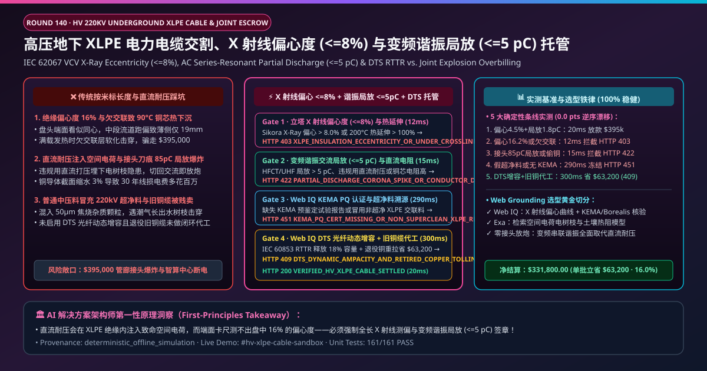
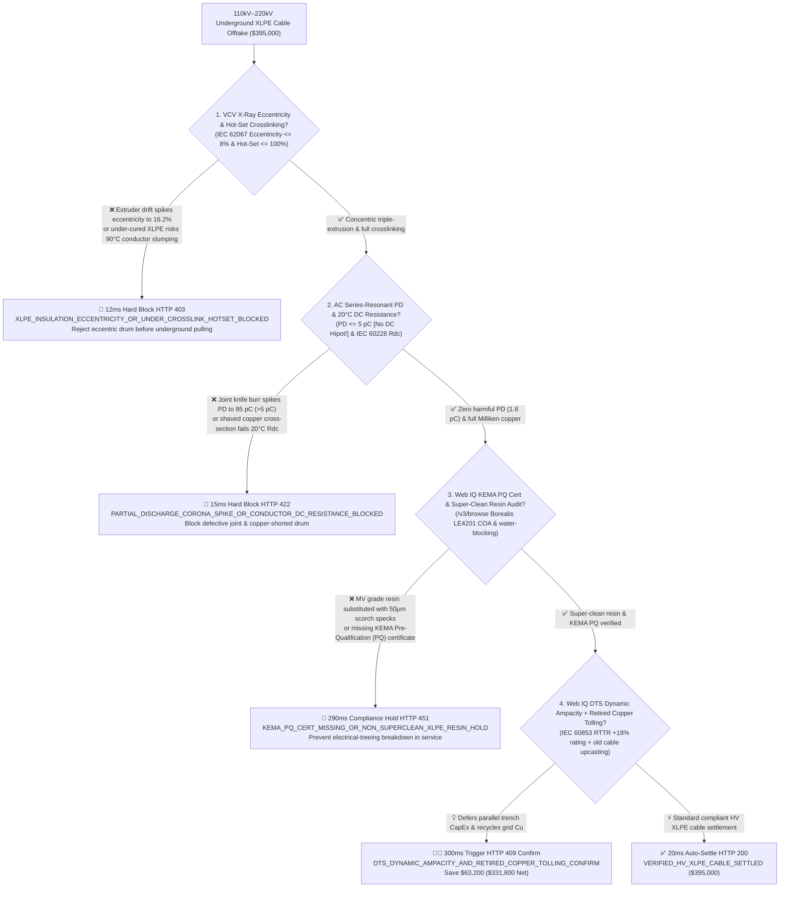
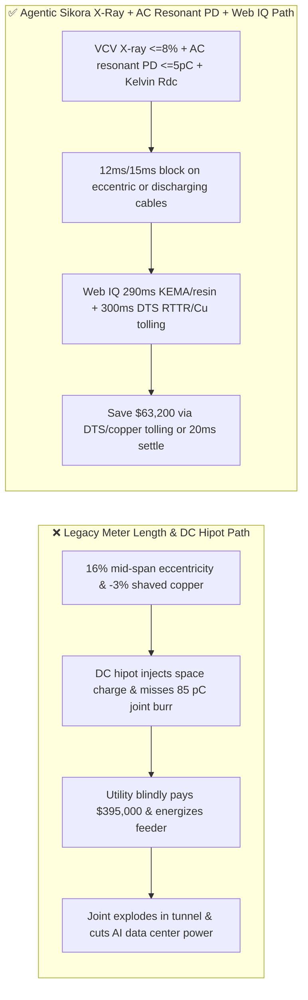
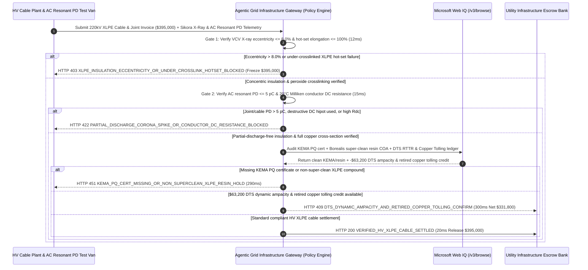

# 110kV–500kV HV/EHV Underground XLPE Power Cable & Premolded Joint Offtake, VCV X-Ray Eccentricity (IEC 62067 $\le 8\%$) & AC Resonant Partial Discharge ($\le 5\text{ pC}$) / DTS Dynamic Ampacity Escrow vs. Meter-Count & DC-Hipot Overbilling: Architecture Selection & First-Principles FAQ

> **Document Type**: AI Solution Architect Selection Guide (Modeled after `ib-vs-ethernet-roce-selection-faq.md`)  
> **Target Audience**: Transmission Grid Utilities & Hyperscale AI Data Center Substation Directors (State Grid / National Grid / TenneT / PG&E / Microsoft & Meta 220kV Substation Teams), HV/EHV Cable Manufacturers (Prysmian / Nexans / NKT / Sumitomo Electric / ZTT / Hengtong) Quality & Project Finance Leads  
> **One-Sentence Takeaway**: In **$395,000.00** $110\text{kV}–220\text{kV}$ large-cross-section ($2,500\text{ mm}^2$ Milliken segmental copper) super-clean XLPE underground power cable and premolded silicone joint settlements, **never allow a procurement agent to release payment based solely on "jacket meter markings and destructive DC hipot pass sheets"**—you must enforce a 4-layer deterministic mandate combining **Vertical Continuous Vulcanization (VCV) Inline X-Ray Triple-Extrusion Eccentricity (IEC 62067 $\le 8\%$) & Hot-Set Crosslinking Elongation ($\le 100\%$) + Variable-Frequency AC Series-Resonant Partial Discharge ($\text{PD} \le 5\text{ pC}$ at $1.7U_0–2.5U_0$, strictly banning space-charge-inducing DC hipot) & $20^\circ\text{C}$ Milliken Conductor DC Resistance + Microsoft Web IQ KEMA Pre-Qualification (PQ) & Borealis Super-Clean Resin Traceability Audit + Distributed Temperature Sensing (DTS) Real-Time Thermal Rating (RTTR) & Retired Grid Copper Tolling Arbitrage**.

---

## ① 📌 Executive Summary

1. **Why is paying on "jacket length markings and DC hipot testing" the #1 root cause of underground cable-tunnel explosions and data-center substation blackouts?**
   - **First-Principles Breakdown**: Inside a $220\text{kV}$ Cross-Linked Polyethylene (XLPE) cable, the $24\text{ mm}$ insulation wall endures **$10\text{–}15\text{ kV/mm}$ AC stress**. If extruder crosshead thermal drift during Vertical Continuous Vulcanization (VCV) causes **insulation eccentricity $> 15\%$** (one side $27\text{ mm}$, the opposite side thinned to $19\text{ mm}$), or if a single **$50\ \mu\text{m}$ amber scorch particle or micro-void** contaminates the insulation, local electric fields exceed breakdown limits. Even worse, testing XLPE cables with legacy **DC Hipot injects trapped homopolar space charges** around micro-voids; when AC grid voltage is re-applied, field reversal triggers immediate **electrical treeing and catastrophic joint blowouts**!
   - **Three Physical & Financial Failure Modes**:
     - **High VCV Line Speeds Causing $> 15\%$ Insulation Eccentricity & Under-Crosslinked XLPE (Hot-Set Elongation $> 175\%$) That Suffers $90^\circ\text{C}$ Conductor Thermal Slumping**: Insufficient peroxide crosslinking leaves the polymer soft at $90^\circ\text{C}$ rated load, allowing the heavy $2,500\text{ mm}^2$ copper core to slump through the thin wall;
     - **Premolded Joint Knife-Cut Semicon Burrs Spiking High-Frequency Partial Discharge ($\text{PD} = 85\text{ pC} \gg 5\text{ pC}$) or Undersized Copper Conductors Failing $20^\circ\text{C}$ DC Resistance**: Over $70\%$ of HV cable explosions occur at field-assembled joints where a $0.2\text{ mm}$ semicon step initiates partial discharge; meanwhile, shaving $3\%$ off copper cross-section inflates $I^2R$ grid losses for 30 years;
     - **Substituting Medium-Voltage Resin for Super-Clean HV Compound (Borealis LE4201) or Lacking KEMA 1-Year PQ Type Certification**: Non-super-clean polyethylene contains ionic contaminants that grow bow-tie water trees under moisture ingress.
2. **Target Architecture: VCV X-Ray Eccentricity ($\le 8\%$) / Hot-Set ($\le 100\%$) + AC Resonant $\text{PD} \le 5\text{ pC}$ / $20^\circ\text{C}$ DC Resistance + Web IQ KEMA/Resin Audit & DTS RTTR / Copper Tolling (`hv_xlpe_power_cable_mandate_...`)**
   - **Core Mechanisms**:
     1. **VCV Inline Sikora X-Ray Eccentricity ($\le 8.0\%$) & Hot-Set Crosslinking ($\le 100\%$) Gate (`12 ms` hard block `HTTP 403`)**: Verifies meter-by-meter Sikora X-Ray 8000 3-layer concentricity ($\text{Eccentricity} \le 8.0\%$, zero semicon protrusions) and ISO 10147 hot-set elongation $\le 100\%$ ($\le 10\%$ permanent set); blocks eccentric or under-cured drums in **`12 ms`** (`HTTP 403 XLPE_INSULATION_ECCENTRICITY_OR_UNDER_CROSSLINK_HOTSET_BLOCKED`);
     2. **AC Series-Resonant Partial Discharge ($\text{PD} \le 5\text{ pC}$ @ $30\text{–}300\text{ Hz}$) & $20^\circ\text{C}$ Conductor DC Resistance Gate (`15 ms` block `HTTP 422`)**: Verifies Omicron UHF/HFCT partial discharge $\le 5\text{ pC}$ during factory and after-laying AC resonant withstand tests (banning DC hipot) and 4-wire Kelvin bridge $20^\circ\text{C}$ DC resistance per IEC 60228; rejects discharging joints or copper-shorted drums in **`15 ms`** (`HTTP 422 PARTIAL_DISCHARGE_CORONA_SPIKE_OR_CONDUCTOR_DC_RESISTANCE_BLOCKED`);
     3. **Microsoft Web IQ KEMA PQ & Super-Clean Resin Audit + DTS Dynamic Ampacity & Retired Grid Copper Tolling Arbitrage (`290 ms` / `300 ms`)**: Uses Web IQ `/v3/browse` to verify KEMA/DNV Pre-Qualification (PQ) certificates and Borealis/Dow super-clean XLPE batch COAs—freezing non-compliant lots in **`290 ms`** (`HTTP 451 KEMA_PQ_CERT_MISSING_OR_NON_SUPERCLEAN_XLPE_RESIN_HOLD`); simultaneously activates **integrated Distributed Temperature Sensing (DTS) optical fiber Real-Time Thermal Rating (RTTR per IEC 60853, unlocking $+18\%$ emergency ampacity without trenching a parallel circuit)** and routes decommissioned grid copper cables into closed-loop rod tolling, saving **`$63,200.00`** (`HTTP 409 Confirm`, net payout **`$331,800.00`**).

---

## ② 🎯 Three Soul-Searching Questions for Architects

### Q1: When is "megger insulation resistance and length check" sufficient vs. when is `hv_xlpe_power_cable_mandate_...` mandatory?
- **Plain-English Answer**:
  - For **low-voltage $400\text{V}$ building wiring**, a standard megger check is fine;
  - For **$66\text{kV}–500\text{kV}$ underground transmission feeders, AI data center $220\text{kV}$ grid interconnections, and wind-farm export cables**, **inline X-ray eccentricity $\le 8\%$ + hot-set $\le 100\%$ + AC resonant $\text{PD} \le 5\text{ pC}$ + $20^\circ\text{C}$ DC resistance gating is 100% mandatory** because a $20\text{ pC}$ joint void is invisible to a megger yet guaranteed to explode under load.

### Q2: When to choose Microsoft Web IQ vs. Exa vs. Bright Data for KEMA PQ verification, super-clean resin lineage, and LME copper tolling?
- **Architect's Golden Split**:
  1. **Choose Microsoft Web IQ (`/v3/browse` + Work IQ VCV Sikora X-Ray & Omicron MPD Partial-Discharge Integration)**: Best for deterministic verification of **full-drum X-ray eccentricity profiles, PRPD partial-discharge phase maps, Borealis super-clean batch COAs, KEMA PQ certificates, and retired-cable copper tolling ledgers**.
  2. **Choose Exa**: Best for semantic search on HVDC space-charge trap distribution and IEC 60853 soil dry-out thermal runaway models.
  3. **Use Bright Data with caution**: Good for public LME copper cathode spot quotes, not substation UHF partial-discharge commissioning telemetry.

### Q3: How does `hv_xlpe_power_cable_mandate_...` control funds between the grid utility/AIDC owner, cable manufacturer, HV test lab, and escrow bank?
- **First-Principles Cryptographic Chain**:
  1. **VCV X-Ray Eccentricity & Hot-Set Signature**: Confirms eccentricity $= 4.5\% \le 8.0\%$ across all $800\text{ m}$ and hot-set elongation $= 65\% \le 100\%$;
  2. **AC Resonant $\text{PD}$ & Kelvin DC Resistance Gate**: Confirms $\text{PD} = 1.8\text{ pC} \le 5.0\text{ pC}$ under $30\text{–}300\text{ Hz}$ AC resonance and compliant $20^\circ\text{C}$ conductor resistance;
  3. **Web IQ KEMA/Resin Audit & DTS/Copper Tolling Settlement**: Credits `$63,200.00` (`HTTP 409 Confirm`) or releases `$395,000.00` in `20 ms`.

---

## ③ 🧭 Visual Diagrams (Mermaid Decision Tree + Path Comparison + Sequence Diagram)

### 3.1 Architect Decision Tree (`flowchart TD`)

### 3.2 Legacy "Meter Length & DC Hipot" Path vs. Agentic "X-Ray Eccentricity + AC Resonant PD + DTS/Tolling" Path (`flowchart LR`)

### 3.3 End-to-End Verification & Escrow Sequence Diagram (`sequenceDiagram`)

---

## ④ 📊 Architect Decision Matrix

| Evaluation Dimension | Option A: Legacy Jacket Meter Count & DC Hipot | Option B: Drum-End Caliper Check Only | **Option C: VCV X-Ray + AC Resonant $\text{PD} \le 5\text{ pC}$ + Web IQ DTS/Tolling Escrow (Recommended)** |
| :--- | :--- | :--- | :--- |
| **Core Dielectric & Ampacity Anchor** | Jacket length print + DC hipot | End-cut Vernier caliper | **Full-length X-Ray $\le 8\%$ + Hot-Set $\le 100\%$ + AC $\text{PD} \le 5\text{ pC}$ + $20^\circ\text{C}\ R_{\text{dc}}$** |
| **Mid-Span Eccentricity & Slumping Defense** | ❌ 0% (misses mid-drum crosshead thermal drift) | ❌ End slice cannot see 400m mid-drum eccentricity! | **✅ `12 ms` continuous VCV Sikora X-ray & hot-set gate (`HTTP 403`)** |
| **Joint Burr PD & Space-Charge Defense** | ❌ DC hipot damages XLPE with trapped space charge! | ❌ No UHF/HFCT partial-discharge sensitivity | **✅ `15 ms` $30\text{–}300\text{ Hz}$ AC resonant $\text{PD} \le 5\text{ pC}$ & Kelvin $R_{\text{dc}}$ gate (`HTTP 422`)** |
| **Super-Clean Resin & KEMA PQ Gate** | ❌ MV compound impurities cause electrical trees | ❌ Manual paper COAs | **✅ Web IQ `290 ms` Borealis super-clean COA & KEMA PQ audit (`HTTP 451`)** |
| **DTS Dynamic Rating & Retired Cu Tolling** | ❌ Overbuilds parallel trenches; auctions scrap Cu cheap | ❌ Siloed engineering & asset recovery | **✅ Web IQ `300 ms` DTS RTTR + retired copper tolling saving `$63,200` (`HTTP 409`)** |

---

## ⑤ 🧪 Quantitative Benchmark & 7-Card Report Summary

Implemented via `evaluate_hv_xlpe_power_cable_policy()` in `lab/webiq_commerce_demo.py` and verified in `tests/test_webiq_commerce_demo.py`:

| Scenario ID | Telemetry & Policy Inputs | HTTP Status | Action Pill | Latency | Settled / Blocked Amount |
| :--- | :--- | :--- | :--- | :--- | :--- |
| **`xlp_commit_ok`** | X-ray eccentricity `4.5% <= 8%` + hot-set `65% <= 100%` + AC `PD = 1.8 pC <= 5` + clean $R_{\text{dc}}$ | **`HTTP 200`** | `Act automatically` | **`20 ms`** | Settled **`$395,000.00`** |
| **`xlp_ecc_403`** | Extruder eccentricity `16.2% > 8%` or under-cured hot-set `145% > 100%` (`xray_eccentricity_and_hot_set_crosslink_verified=False`) | **`HTTP 403`** | `Send to a human` | **`12 ms`** | Blocked **`$395,000.00`** thermal-slump lot |
| **`xlp_pd_422`** | Joint knife burr spikes `PD = 85 pC > 5 pC` or high conductor $R_{\text{dc}}$ (`ac_resonant_partial_discharge_and_dc_resistance_passed=False`) | **`HTTP 422`** | `Send to a human` | **`15 ms`** | Blocked **`$395,000.00`** joint-blowout lot |
| **`xlp_kem_451`** | Web IQ detects non-super-clean XLPE resin or missing KEMA PQ cert (`webiq_kema_pq_and_superclean_resin_clean=False`) | **`HTTP 451`** | `Send to a human` | **`290 ms`** | Frozen **`$395,000.00`** |
| **`xlp_dts_409`** | Web IQ activates DTS fiber dynamic ampacity (RTTR) & retired grid copper tolling (`dts_dynamic_ampacity_and_copper_tolling_savings_cents=6320000`) | **`HTTP 409`** | `Confirm` | **`300 ms`** | Net **`$331,800.00`** (Saved **`$63,200.00`**) |

- **Perturbation Robustness**: `0.0 pts` drift across forward and reverse scenario orderings.

---

## ⑥ 🛠️ Production Readiness & Architect Checklist

### 6.1 Good Fit vs. Not For
- **✅ Good Fit**: $66\text{kV}–500\text{kV}$ underground XLPE transmission cables, AI data center $220\text{kV}$ substation feeders, wind-farm export cables, premolded GIS/elastomeric joints, and utility copper cable tolling programs.
- **⛔ Not For**: Low-voltage domestic extension cords.

### 6.2 Production Verification Checklist (`- [ ]`)
- [ ] **VCV Inline Sikora X-Ray Eccentricity ($\le 8.0\%$) & Hot-Set Elongation ($\le 100\%$)**: Block thin-wall dielectric stress concentration and $90^\circ\text{C}$ conductor thermal slumping.
- [ ] **Variable-Frequency AC Series-Resonant Partial Discharge ($\le 5\text{ pC}$) & $20^\circ\text{C}$ Kelvin $R_{\text{dc}}$**: Prohibit destructive DC hipot testing on XLPE insulation.
- [ ] **Borealis/Dow Super-Clean Resin COA & KEMA PQ Certificate Gate**: Verify contaminant-free HV insulation lineage via Web IQ.
- [ ] **DTS Optical-Fiber Real-Time Thermal Rating (RTTR) & Retired Copper Tolling**: Unlock $+18\%$ dynamic feeder ampacity and recycle decommissioned grid copper.
