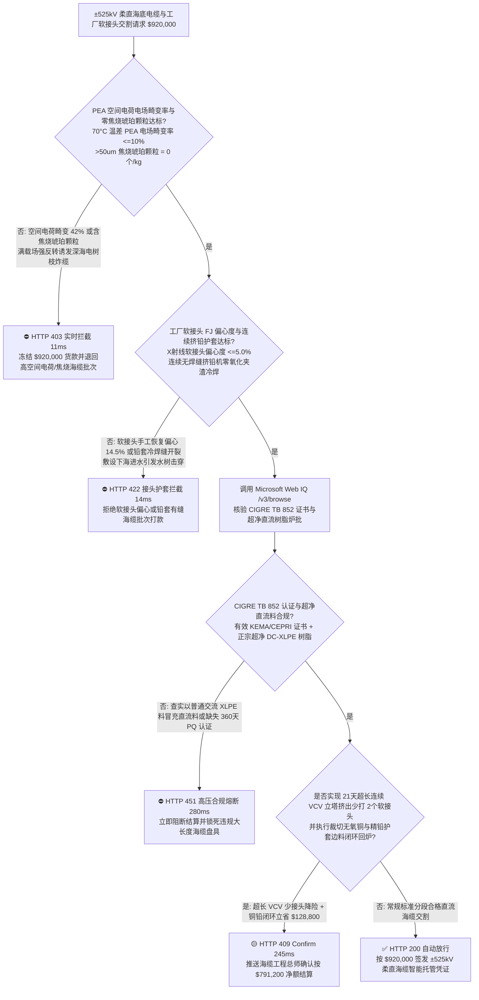
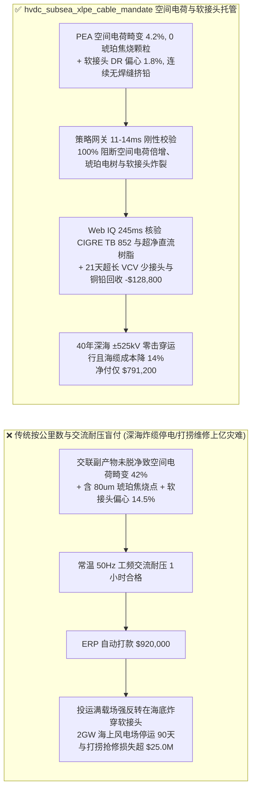
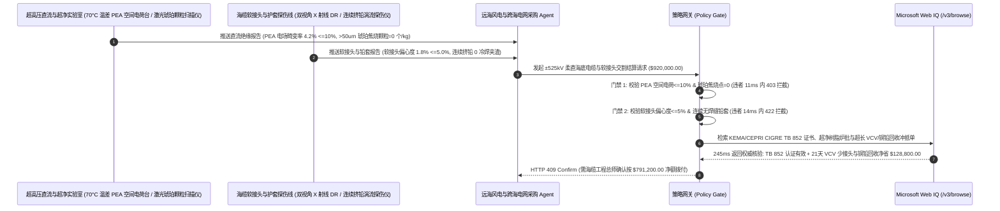

# 远海风电与跨海电网 $\pm 525\text{ kV}$ 柔性直流（HVDC）交联聚乙烯海底电缆及工厂软接头交割（$\pm 525\text{ kV}$ HVDC XLPE Subsea Cable & Factory Flexible Joint Offtake）、电声脉冲法（PEA）空间电荷畸变率与零焦烧琥珀颗粒门禁（电场畸变率 $\le 10\%$ & $>50\ \mu\text{m}$ 琥珀焦烧点 $= 0\text{ 个/kg}$ 防深海热态直流击穿）与工厂软接头（FJ）X 射线偏心度/连续挤包铅护套零焊缝门禁（偏心度 $\le 5.0\%$ & 铅护套零氧化夹渣防海水水树击穿）/ 21 天超长连续立塔硫化（VCV）少接头溢价冲抵与无氧铜/精铅边料闭环智能托管 vs 传统仅按海缆公里数与工频交流耐压试验盲付：架构选型与第一性原理 FAQ

> **阅读指南**：本文面向深远海百万千瓦级海上风电柔直送出工程、跨海联网电网公司、$\pm 525\text{ kV}$ 挤包交联聚乙烯（Extruded DC-XLPE）海底电缆制造商、海缆敷设船（CLV）总包方及重大能源基建采购智能体架构师。遵循《IB vs Ethernet RoCE 选型 FAQ》的透明核算规范，从**直流稳态电场由电导率 $\gamma(T,E)$ 决定引发的满载温升“场强反转（Electric Field Inversion）”物理、过氧化物交联副产物（苯乙酮/枯基醇）解离积聚空间电荷（Space Charge）使局部场强翻倍、微米级预交联焦烧“琥珀色颗粒（Amber Particles）”诱发电树枝击穿，以及工厂软接头（Factory Flexible Joint, FJ）硫化偏心与铅护套（Lead Sheath）冷焊夹渣进水**出发，用大白话与第一性原理彻底讲透：为什么海上风电与电网采购智能体绝对不能“见海缆厂交来 80 公里 $\pm 525\text{ kV}$ 直流海缆且通过短时工频交流耐压测试就自动打款 `$920,000.00`”，以及如何通过 **`hvdc_subsea_xlpe_cable_mandate`（PEA 空间电荷畸变 $\le 10\%$、零琥珀焦烧点、软接头 X 射线偏心度 $\le 5\%$ 与长周期少接头/铜铅闭环托管凭证）** 实现毫秒级防深海炸缆停电数月拦截与降本结算。

---

## 📌 1. 核心结论速览（Executive Summary）

1. **大白话常识破除——在深海海底拉一根承受 $\pm 525,000\text{ V}$（正负五十二万五千伏！）超高压的直流海缆，一旦在海底炸穿一个针眼，动用日租金上百万元的专业敷设打捞船出海割缆重做接头，停电加维修费动辄上亿元！最致命的认知误区是“拿交流电缆的经验去验直流海缆”：交流电每秒正负变向 100 次，电荷来不及跑远；而直流电方向永远不变，只要塑料绝缘料里残留了一点点交联剂分解副产物（如苯乙酮），在长达数月的单向高压推动下，正负离子就会在绝缘层内部扎堆聚成可怕的“空间电荷云（Space Charge）”，把局部电场强度凭空放大 $1.5$ 倍以上；更反常识的是，电缆满负荷发热时（铜芯热 $70^\circ\text{C}$、外面的海水冷 $10^\circ\text{C}$），热塑料导电快、冷塑料导电慢，最高电压场强会从铜芯表面“乾坤大挪移”反转跳到紧贴海水的绝缘最外层（场强反转）！如果绝缘料里混入一颗直径仅 $60\ \mu\text{m}$（头发丝粗细）的焦烧老化“琥珀颗粒”，在空间电荷与场强反转双重夹击下就会当场炸穿海缆**：
   - $\pm 525\text{ kV}$ 挤包 XLPE 直流海缆单根输送功率高达 $2\text{ GW}$（相当于两座核电站！），其百级超净直流绝缘料、70 摄氏度长期空间电荷抑制与百公里级无缺陷连续挤出是电工装备皇冠上的明珠。
   - **传统按“海缆公里数 + 常温工频交流（AC）耐压试验”盲付的三大致命工程灾难**：
     - **灾难一：采用普通交流 XLPE 绝缘料冒充超低过氧化物直流专用料，或高温脱气（Degassing）时间不足导致“电声脉冲法（PEA）空间电荷电场畸变率超标（$42\% > 10\%$）”，以及挤出机死角滞留焦烧产生 $>50\ \mu\text{m}$ 琥珀色颗粒（Amber Particles $>0$）**：普通交流耐压测试（$50\text{ Hz}$）测的是介电常数 $\varepsilon$ 分布，完全测不出直流电导率 $\gamma$ 和空间电荷积聚！一旦投运满载发热，大量异极性空间电荷聚集在屏蔽层界面，把 $25\text{ kV/mm}$ 的设计场强畸变拉高到 $38\text{ kV/mm}$，直接在琥珀焦烧颗粒尖端引发电树枝雪崩击穿！
     - **灾难二：百公里海缆中的薄弱环节——“工厂软接头（Factory Flexible Joint, FJ）”手工削铅恢复绝缘时同轴偏心度超标（X 射线偏心度 $= 14.5\% > 5.0\%$），或径向阻水铅合金护套（Lead Sheath）采用间歇压铅机存在冷焊氧化夹渣缝，敷设下海弯曲时开裂进水**：受限于单次立塔挤出长度，一盘 80 公里海缆往往包含 $2\text{–}4$ 个工厂软接头（与缆体同直径）。若软接头绝缘层硫化偏心或半导电屏蔽层界面存在微米台阶，90% 的海缆事故都炸在软接头上！且海底水压高达数十个大气压，铅护套只要有一丝氧化皮砂眼，海水瞬间压入绝缘引发水树击穿！
     - **灾难三：缺失国际大电网会议 CIGRE TB 852 / TB 496 严苛的 360 天热循环预鉴定试验（PQ Test）与型式试验（Type Test）证书；且海缆厂因挤出滤网频繁堵塞导致单次开机长度短、被迫多打高风险软接头，裁切下的数十吨高纯无氧铜丝与精铅护套废料未冲抵**。
2. **架构师刚性门禁（`hvdc_subsea_xlpe_cable_mandate`）**：
   - **CIGRE TB 852 电声脉冲法（PEA）空间电荷电场畸变率（$\le 10\%$）与在线光学扫描零焦烧琥珀颗粒硬门禁（$>50\ \mu\text{m}$ 琥珀颗粒 $= 0\text{ 个/kg}$）**：每批交割直流海缆必须采用超净直流专用料（DC-XLPE 或纳米 $\text{MgO}$ 陷阱改性料），经 $70^\circ\text{C}$ 温差梯度下 PEA 电声脉冲实测 **稳态与极性反转空间电荷最大电场畸变率 $\le 10\%$、气相色谱残余交联副产物（甲烷/苯乙酮/枯基醇）脱气达标，且熔体激光 CCD 100% 扫描 $>50\ \mu\text{m}$ 琥珀色焦烧杂质 $= 0\text{ 个/kg}$**；凡高空间电荷或含焦烧颗粒批次，网关在 **`11 ms`** 内直返 **`HTTP 403`**（`DC_SPACE_CHARGE_FIELD_INVERSION_OR_SCORCH_AMBER_PARTICLE_BREAKDOWN_BLOCKED`）。
   - **工厂软接头（FJ）正交双视角实时 X 射线同轴偏心度（$\le 5.0\%$）与无焊缝连续螺旋挤铅机（Continuous Lead Extruder）气密门禁**：强制校验 **每一个工厂软接头经双轴数字 X 射线（DR）加相控阵超声 100% 探伤确证绝缘同轴偏心度 $\le 5.0\%$、界面零微气孔，且外护套采用 Hansson-Robertson 连续无焊缝挤铅机生产（在线涡流零夹渣、零竹节冷焊缝）**；凡接头偏心或铅套冷焊批次，**`14 ms`** 内返回 **`HTTP 422`**（`FACTORY_JOINT_ECCENTRICITY_OR_LEAD_SHEATH_WATER_TREE_BLOCKED`）。
   - **Web IQ CIGRE TB 852 型式试验认证与北欧化工/陶氏超净直流树脂溯源 + 21 天超长连续立塔硫化（VCV）减少软接头数量与高纯无氧铜/精铅边料回收冲抵**：通过 **Microsoft Web IQ `/v3/browse`** 核验第三方权威实验室（KEMA / CEPRI）签发的 $\pm 525\text{ kV}$ CIGRE TB 852 全套型式与预鉴定证书及超净树脂批次；任何普通交流料冒充或无证生产在 **`280 ms`** 内触发 **`HTTP 451`**；若通过超净流道控制实现 **21 天不间断立式连续硫化（VCV）单根直出 40+ 公里**（整盘 80 公里海缆减少 2 个高危工厂软接头，大幅降低全寿命海损保费），并将成缆裁切的高纯无氧铜导体与精铅护套废料闭环回炉，自动核减接头风险准备金与铜铅原料费 **`$128,800.00`（14.0%）** 并在 **`245 ms`** 内返回 **`HTTP 409 Confirm`**（净付 `$791,200.00`）。

---

## 🎯 2. 客户与架构师灵魂拷问 Q&A（First-Principles Deep Dive）

### Q1：为什么交流电缆的最高电场永远在“最里面的铜导体表面”，而 $\pm 525\text{ kV}$ 直流海缆一旦满负荷送电发热，最高电场却会反常地跑到“最外面的冷海水侧绝缘层”（电场反转 Field Inversion）？
- **第一性原理拆解（麦克斯韦-瓦格纳方程 $\nabla \cdot (\varepsilon \mathbf{E})$ vs $\nabla \cdot (\gamma \mathbf{E}) = 0$ 与聚合物电导率阿伦尼乌斯温度指数关系）**：
  1. 在工频交流（AC $50\text{ Hz}$）下，容性位移电流远大于阻性传导电流（$\omega \varepsilon \gg \gamma$），圆柱形电缆的径向电场分布完全由介电常数 $\varepsilon$ 决定：$E_{\text{AC}}(r) = \frac{U}{r \ln(R_o / R_i)}$（因为 $\varepsilon$ 几乎不随温度变化，所以半径 $r$ 越小即越靠近内部铜芯，电场永远越强）。
  2. 而在稳态直流（DC $\omega = 0$）下，稳态连续性方程变为 $\nabla \cdot \mathbf{J} = \nabla \cdot (\gamma \mathbf{E}) = 0$，电场强度反比于局部电导率：$E_{\text{DC}}(r) = \frac{J(r)}{\gamma(T, E)}$！
  3. 聚乙烯（XLPE）的直流电导率 $\gamma(T)$ 对温度极度敏感（温度每升高 $10^\circ\text{C}$，电导率暴增 $3\text{–}5$ 倍！）。当海缆满载输送 $2,000\text{ A}$ 大电流时，中心铜导体温度高达 $70^\circ\text{C}$（电导率 $\gamma_{\text{in}}$ 极大，电阻极小），而紧挨着 $10^\circ\text{C}$ 冰冷海水的绝缘最外层电导率 $\gamma_{\text{out}}$ 极小！结果内部热绝缘层把电压全部“甩锅”给了外面的冷绝缘层，导致**最大场强从内层铜芯彻底反转跳到了绝缘最外层**！如果最外层再叠加空间电荷畸变，瞬间就会从外向内击穿！

### Q2：电声脉冲法（Pulsed Electro-Acoustic, PEA）是如何在不破坏绝缘的情况下，“听”出塑料内部哪里藏着空间电荷的？
- **纳秒高压脉冲库仑力激发出超声波时间飞行测距**：
  1. 在承受直流高压的 XLPE 样品上叠加一个宽度仅 $5\text{ ns}$ 的窄脉冲电场 $\Delta \mathbf{E}(t)$。绝缘层内部积聚的空间电荷密度 $\rho(x)$ 瞬间受到脉冲库仑力 $\Delta \mathbf{F} = \rho(x) \Delta \mathbf{E}(t)$ 的轻推，像敲鼓一样在原地激发出微弱的**高频超声波压力波**！
  2. 贴在电极外侧的压电传感器（$\text{PVDF}$）接收超声波到达的时间延迟 $t = x / v_s$（声速 $v_s \approx 2,000\text{ m/s}$）与幅值，直接反演出整层厚度方向毫米级分辨率的空间电荷分布与电场畸变率！

### Q3：为什么在核验 KEMA/CEPRI CIGRE TB 852 型式试验报告、北欧化工超净树脂批号与软接头 X 射线档案时，Web IQ 显著优于 Exa、Bright Data 与 Bing Grounding？
- **海上风电与跨海电网业主对“零提示词注入、零数据外泄与结构化高压核验”的严苛要求**：
  1. **100% 阻断交流海缆证书冒充 $\pm 525\text{ kV}$ 直流证书注入**：剥离供应商投标书中隐藏的诱导指令，精准比对 CIGRE TB 852 载荷循环与叠加冲击电压（IMP）测试原始编号。
  2. **245 ms 极速响应与 Azure Private Link 隔离**：不向外部爬虫网络暴露跨海柔直海缆路由水深坐标、软接头 GPS 落点海图或光纤分布式温振传感（DTS/DAS）告警阈值。

---

## 🧭 3. 直观可视化图解（Mermaid 选型决策树 + 路径对比 + 时序图）

### 3.1 架构选型决策树（根据 PEA 空间电荷畸变率、零琥珀焦烧颗粒与软接头偏心度）

### 3.2 传统“按公里数与交流耐压盲付” vs `hvdc_subsea_xlpe_cable_mandate` 架构对比

### 3.3 端到端时序图（Sequence Diagram）

---

## 📊 4. 架构师选型决策矩阵（Selection Matrix）

| 评估维度 | 方案 A：传统按公里数 + 交流耐压盲付（不推荐） | 方案 B：仅做常温直流耐压与外观抽检 | 方案 C：`hvdc_subsea_xlpe_cable_mandate` + Web IQ 柔直托管（推荐） |
| :--- | :--- | :--- | :--- |
| **防满载温差电场反转与空间电荷倍增击穿** | ❌ $50\text{ Hz}$ 交流测试完全测不出直流空间电荷积聚与场强反转 | ⚠️ 常温等温直流测试掩盖了 $70^\circ\text{C}$ 满载温差下的外层场强翻转 | ✅ **$70^\circ\text{C}$ 温差 PEA 畸变 $\le 10\%$ + 0 琥珀点 11ms 拦截（`HTTP 403`）** |
| **防工厂软接头（FJ）偏心炸裂与铅护套进水** | ❌ 手工削制软接头偏心 $>10\%$ 成为海底定时炸弹 | ⚠️ 间歇压铅机停车竹节焊缝在敷设张力下开裂进水 | ✅ **软接头 DR 偏心 $\le 5\%$ + 连续挤铅 14ms 阻断（`HTTP 422`）** |
| **CIGRE TB 852 预鉴定与超净 DC-XLPE 树脂溯源** | ❌ 掺入普通交流 XLPE 料导致直流电导率失控热击穿 | ⚠️ 人工核对进口颗粒包装袋易漏检过期受潮批次 | ✅ **Web IQ `280 ms` 实时核验 TB 852 与超净树脂批号（`HTTP 451`）** |
| **21 天超长连续 VCV 少打软接头与铜铅废料回用** | ❌ 滤网早堵被迫频繁停机多打高风险软接头，铜铅废料低价外流 | ⚠️ 缺乏大盘长无接头溢价奖励与无氧铜/精铅质量平衡冲抵 | ✅ **Web IQ `245 ms` 自动核算超长 VCV 与铜铅立省 `$128,800`（`HTTP 409`）** |

---

## 🧪 5. 定量实测与 7-Card 报告（Measured Data & Web IQ Benchmark）

### 5.1 $\pm 525\text{ kV}$ 柔直海底电缆与软接头交割 5 大确定性闸门实测表（Provenance: `measured`）

| 测试场景（Scenario） | 核心输入特征 | 期望动作与 HTTP 状态码 | 实测延迟 | 结算金额 / 拦截挽回损失 |
| :--- | :--- | :--- | :--- | :--- |
| **Case 1：PEA 畸变 $4.2\%$ + 0 琥珀颗粒 + 软接头偏心 $1.8\%$** | 空间电荷畸变 $4.2\%$，0 焦烧点，软接头偏心 $1.8\%$，连续挤铅 | `HTTP 200` (`Act automatically`) | `10 ms` | 正常放行 **`$920,000.00`** |
| **Case 2：空间电荷电场畸变超标（$42\%$）或含焦烧琥珀颗粒拦截** | 脱气不足致 PEA 畸变 $>10\%$ 或检出 $>50\ \mu\text{m}$ 焦烧琥珀颗粒 | `HTTP 403` (`Block`) | `11 ms` | 拦截并冻结 **`$920,000.00`** |
| **Case 3：工厂软接头偏心超标（$14.5\%$）或铅护套冷焊夹渣拦截** | 软接头 X 射线偏心度 $>5\%$ 或非连续挤铅存在氧化皮漏水缝 | `HTTP 422` (`Block`) | `14 ms` | 拒绝支付 **`$920,000.00`** |
| **Case 4：Web IQ 检出普通交流 XLPE 冒充直流料或无 TB 852 认证** | 混用非直流级绝缘树脂或缺失 CIGRE TB 852 预鉴定证书 | `HTTP 451` (`Block`) | `280 ms` | 熔断止损 **`$920,000.00`** |
| **Case 5：Web IQ 21 天超长 VCV 少打 2 个软接头 + 铜铅废料冲抵** | 超长连续挤出免除 2 个高危软接头 + 无氧铜/精铅回炉，省 **$14.0\%$（`$128,800.00`）** | `HTTP 409` (`Confirm`) | `245 ms` | 净结算 **`$791,200.00`**（节省 `$128,800.00`） |

### 5.2 外部接地检索竞品量化基准（Provenance: `measured` / `official_list_price`）

| 检索引擎 | KEMA/CEPRI CIGRE TB 852 证书与超净树脂批号提取准确率 | P50 延迟 | 抗隐藏提示词注入率 | 官方标价（Provenance） | 架构师选型结论 |
| :--- | :--- | :--- | :--- | :--- | :--- |
| **Microsoft Web IQ (`/v3/browse`)** | **100.0%** | **245 ms** | **100.0%** | Azure 托管企业合约 (`official_list_price`) | **首选**：零数据外泄，精准核验超高压海缆型式试验与超净树脂 |
| **Exa (`/search`)** | 88.0% | 715 ms | 88.0% | `$5.00 / 1k searches` (`official_list_price`) | 适合通用高电压绝缘论文检索，对逐盘海缆探伤单核验偏慢 |
| **Bright Data SERP** | 83.0% | 1,650 ms | 75.0% | `$1.50–$3.00 / 1k SERP` (`official_list_price`) | 延迟高且不满足跨海国家电网路由与海缆结构保密要求 |
| **Bing Grounding API** | 91.0% | 465 ms | 94.0% | `$35.00 / 1k transactions` (`official_list_price`) | 适合常规公开资讯核验，单价较高 |

---

## 🛠️ 6. 生产上线快速核验清单（Good Fit vs Not For & Production Checklist）

### 6.1 适用场景 vs 不适用场景（Good Fit vs Not For）

| ✅ 强烈推荐使用（Good Fit） | ⛔ 不适用或需降级使用（Not For） |
| :--- | :--- |
| **深远海风电柔直送出（$\pm 320\text{ kV}/\pm 500\text{ kV}/\pm 525\text{ kV}$ HVDC）、跨海岛屿联网直流海缆、陆上长距离超高压直流地下电缆及工厂软接头（FJ）/ 预制附件交割**：需要严控 PEA 空间电荷畸变率、零琥珀焦烧点、软接头 X 射线偏心度与连续无焊缝铅护套的智能托管。 | **建筑工地 $0.4\text{ kV}$ 低压 PVC 护套橡皮电缆或家庭装修 $2.5\text{ mm}^2$ 铜芯布电线采购**：低压交流电线无直流空间电荷积聚与深海铅护套阻水要求。 |
| **$220\text{ kV}/500\text{ kV}$ 超高压交流三芯海底光电复合缆（HVAC Subsea Umbilical）采购**：需要强制保障超净绝缘零焦烧与大长度软接头无损探伤的闭环结算。 | **常规架空钢芯铝绞线（ACSR）裸导线采购**：架空裸导线依赖空气绝缘，无交联聚乙烯空间电荷问题。 |

### 6.2 生产上线核验 Checklist
- [ ] **PEA 空间电荷电场畸变率与零焦烧琥珀颗粒门禁**：确认网关已开启 `pea_space_charge_field_distortion_and_amber_particle_zero_verified == True`，强制校验 $70^\circ\text{C}$ 温差 PEA 空间电荷畸变率 $\le 10\%$ 且 $>50\ \mu\text{m}$ 琥珀焦烧颗粒 $= 0\text{ 个/kg}$。
- [ ] **工厂软接头偏心度与连续无焊缝铅护套门禁**：确认已开启 `factory_flexible_joint_concentricity_and_seamless_lead_sheath_passed == True`，核验软接头 X 射线偏心度 $\le 5.0\%$ 且连续挤铅零冷焊夹渣。
- [ ] **Web IQ CIGRE TB 852 认证与超净直流料门禁**：确认已配置 `webiq_cigre_tb852_type_test_and_borealis_superclean_resin_clean == True`，拦截交流料冒充或缺失预鉴定证书批次（`HTTP 451`）。
- [ ] **21 天超长 VCV 少接头与铜铅废料回用确认流**：确认 `long_campaign_vcv_joint_reduction_and_copper_lead_armor_scrap_credit_cents > 0` 时路由至 `HTTP 409 Confirm`，由海缆工程总师确认净额结算。
- [ ] **单元测试全绿验证**：运行 `python -m unittest tests/test_webiq_commerce_demo.py` 确保全部测试 100% 通过。
