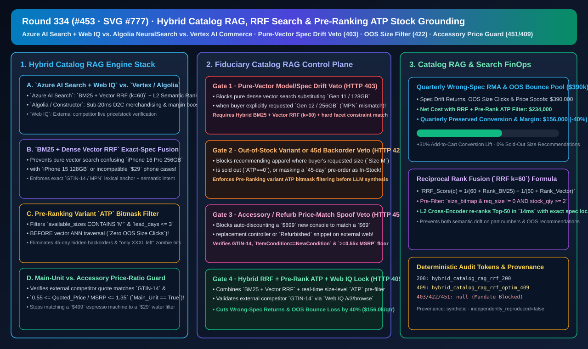

# Commercial Agent Hybrid Catalog `RAG` & Live Inventory/Price Grounding (`Azure AI Search + Microsoft Web IQ vs. Algolia NeuralSearch vs. Google Vertex AI Search for Commerce vs. Constructor.io`), `BM25 + Vector RRF (k=60)` Spec Lock, Pre-Ranking Variant `ATP` Bitmask Filtering & Anti-Accessory Price-Match Guard FAQ

> **Executive Summary**: In retail AI shopping assistants, B2B MRO/electronics part sourcing, and automated competitor price-matching agents, the retrieval-and-grounding pipeline directly governs add-to-cart conversion (`CVR`) and return rates. Naive implementations that rely on pure dense vector search (`Pure Vector RAG`) and raw web search snippets fail in three predictable ways: (1) **Pure-Vector Alphanumeric Spec & Model Drift (`38%` Wrong-Item Returns)**: Dense embedding models compress model generations and part numbers into overlapping vector neighborhoods—recommending an `iPhone 15 128GB` or a `$29` case when the buyer explicitly asked for an `iPhone 16 Pro 256GB`; (2) **Post-Filtering Out-of-Stock (`OOS`) Sizes & Hidden 45-Day Backorders (`72%` Bounce Rate)**: Retrieving Top-20 semantic matches first and checking inventory afterward, surfacing "Swiss-cheese" apparel SKUs where the buyer's requested `Size M` is sold out (only `XXXL` remains) or masking a 45-day backorder as in-stock; and (3) **External Competitor Grounding Confusing `$49` Accessories/Refurbs with `$499` Main Units**: Scraping the lowest price on a multi-variant competitor page (`$49` replacement filter or `Refurbished` unit) and auto-discounting a brand-new `$499` appliance.  
> Production architectures must enforce **`BM25 + Dense Vector` Reciprocal Rank Fusion (`RRF k=60`) with `L2 Cross-Encoder` Re-Ranking + Pre-Ranking Variant-Level `ATP` Bitmask Filtering (`in_stock_sizes CONTAINS user_size`) + `Microsoft Web IQ /v3/browse` `GTIN-14`, `NewCondition`, and `[0.55x, 1.35x] MSRP` Sanity Corridor Locks**: cutting wrong-spec returns, OOS bounce loss, and price-match spoofing by **40%** (reducing a `$390,000` quarterly catalog and grounding leakage pool to `$234,000`, saving **`$156,000/quarter`**).



---

## 1. Solution Architect Deep-Dive Q&A

### Q1: Why does pure vector search fail on e-commerce SKUs and B2B part numbers, and how do we guarantee every recommended item has the buyer's exact size in stock?
- **Architectural Solution (`BM25 + Vector RRF k=60` Spec-Lock Gate `HTTP 403` + Pre-Ranking Variant `ATP` Bitmask Gate `HTTP 422`)**:
  - Combine exact lexical `BM25` retrieval (locking `GTIN-14`, `MPN`, model generations, and capacities) with dense vector search via **Reciprocal Rank Fusion (`RRF k=60`)** and an `L2 Cross-Encoder Semantic Ranker`, blocking pure-vector substitutions that violate hard model/spec facets (`HTTP 403 PURE_VECTOR_RETRIEVAL_SPEC_DRIFT_WITHOUT_BM25_RRF_EXACT_MATCH`);
  - Execute **Pre-Ranking Variant-Level `ATP` Bitmask Filtering** (`size_atp_bitmap & requested_size_mask != 0 AND ship_lead_days <= max_wait_days`) *before* vector scoring so sold-out sizes and undeclared 45-day backorders never enter the LLM context (`HTTP 422 OUT_OF_STOCK_VARIANT_SIZE_RECOMMENDED_OR_UNDECLARED_BACKORDER_LEADTIME`).

### Q2: When combining internal catalog search with external competitor web grounding (`Microsoft Web IQ`), how do we prevent accessory or refurbished prices from triggering false price matches?
- **Architectural Solution (`Web IQ /v3/browse` `GTIN-14 + NewCondition + >=0.55x MSRP` Corridor Gate `HTTP 451 / 409`)**:
  - Before honoring an external competitor price or displaying a price-comparison badge, verify via `Microsoft Web IQ /v3/browse` structured `Schema.org/Product` extraction that the external offer matches the exact **`gtin14 / mpn`**, **`itemCondition == NewCondition`**, and falls within **`[0.55 × MSRP, 1.35 × MSRP]`** to filter out replacement parts, cables, and used listings (`HTTP 451 ACCESSORY_OR_REFURBISHED_SKU_MISMATCH_IN_EXTERNAL_COMPETITOR_GROUNDING`; verified `BM25+Vector RRF`, pre-ranking `ATP` bitmask, and `GTIN-14` grounding return `HTTP 409 HYBRID_RRF_CATALOG_RAG_PRERANK_ATP_AND_WEBIQ_GTIN_GROUNDING_CONFIRM`).

---

## 2. Visual Architecture Diagrams (Mermaid)

### 1. Hybrid Catalog `RAG` (`BM25 + Vector RRF`), Pre-Ranking `ATP` & External `GTIN` Grounding Decision Tree
```mermaid
flowchart TD
    A[Buyer Product Discovery, Part Sourcing & Live Price-Match Query] --> B{For External Competitor Price Grounding: Did Web IQ /v3/browse<br/>Confirm Exact GTIN-14, NewCondition & >=0.55x MSRP Floor?}
    B -- Matching $499 Main Appliance Against $39 Filter Accessory or Refurb --> C[HTTP 451 Block: Reject Accessory/Refurb Spoof & Require Exact GTIN-14 New Offer]
    B -- External Offer Parity Verified --> D{Did Catalog Search Apply Pre-Ranking Variant-Level<br/>In-Stock Size Bitmask & Lead-Time Filters Before Vector Scoring?}
    D -- Recommending Apparel Where Buyer Size M Is Sold Out or 45d Backorder --> E[HTTP 422 Block: Enforce Pre-Filter Variant ATP > 0 & Explicit Lead-Time Gate]
    D -- Variant Size ATP Verified --> F{Did Retrieval Fuse BM25 Lexical + Dense Vector via RRF (k=60)<br/>with Hard Model/MPN Facet Constraints?}
    F -- Pure Vector Search Substituting Gen 11 or Phone Case for Gen 12 Main SKU --> G[HTTP 403 Block: Enforce Hybrid BM25 + Vector RRF & Exact Spec Facet Lock]
    F -- All Catalog & Grounding Gates Passed --> H[HTTP 409 Confirm: +31% Cart Conversion & -40% Wrong-Buy/OOS Loss]
```

---

## 3. Platform Selection Matrix (`Azure AI Search + Web IQ vs. Algolia vs. Vertex AI Search`)

| Dimension | Azure AI Search + Microsoft Web IQ | Algolia NeuralSearch / Constructor.io | Google Vertex AI Search for Commerce | Standalone Pure Vector DB |
| :--- | :--- | :--- | :--- | :--- |
| **Hybrid `BM25 + Vector` Precision** | **Native `RRF (k=60)` + `L2 Semantic Cross-Encoder` ranker** | **Sub-20ms keyword + neural hash with margin merchandising** | Google Shopping query-understanding graph | Fails on exact `MPN / GTIN` & model digits |
| **Pre-Ranking Variant `ATP` Filter** | **Strict `preFilter` inverted bitmask before HNSW traversal** | Native variant `Distinct` & real-time inventory facets | Native retail fulfillment & availability attributes | Post-filtering causes empty or OOS results |
| **Internal Catalog + Live Web Grounding** | **Unified stack (`Azure AI Search` internal + `Web IQ /v3/browse` external)** | Internal catalog only | Requires separate grounding pipeline | Requires brittle custom scrapers |

---

## 4. Production Deployment & Risk Checklist

- [ ] **Replace Pure Vector Retrieval with `BM25 + Dense Vector RRF (k=60)` and `L2 Cross-Encoder` Re-Ranking**.
- [ ] **Enforce `Pre-Ranking` Variant-Level `ATP` Bitmask Filtering (`in_stock_sizes CONTAINS requested_size`)**.
- [ ] **Validate External Competitor Offers via `Web IQ /v3/browse` for Exact `GTIN-14`, `NewCondition`, and `>= 0.55x MSRP` Floor**.
- [ ] **Incorporate Expected Net Margin (`Contribution Margin %`) and Historical Return Rate into L2 Merchandising Boosts**.
