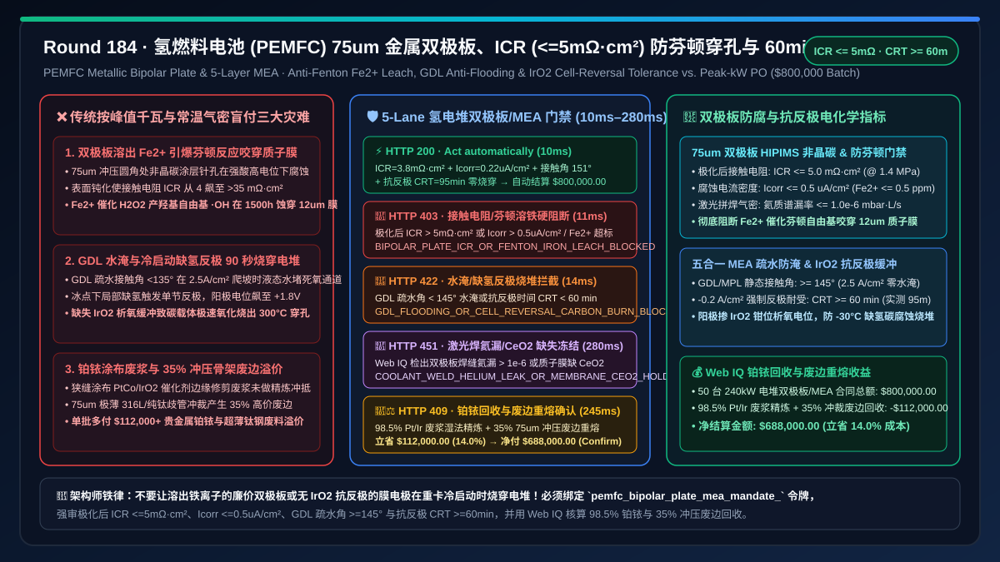
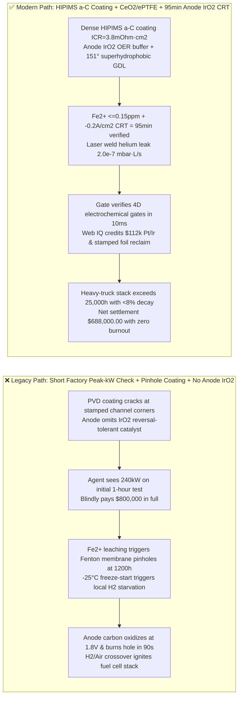
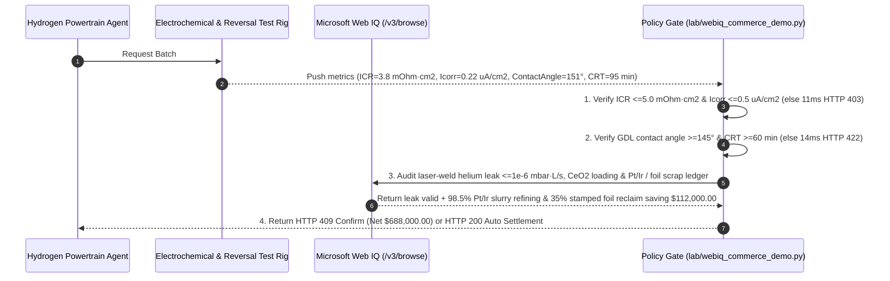

# Hydrogen Heavy-Truck & Aviation PEMFC Fuel Cell Stack, $75\ \mu\text{m}$ Stamped Metallic Bipolar Plate & 5-Layer MEA Offtake, Interfacial Contact Resistance & Fenton Iron-Leach Gate ($\text{ICR} \le 5\text{ m}\Omega\cdot\text{cm}^2$ & $I_{\text{corr}} \le 0.5\ \mu\text{A/cm}^2$) & GDL Anti-Flooding / Cell-Reversal Tolerance Gate ($\text{Contact Angle} \ge 145^\circ$ & $\text{CRT} \ge 60\text{ min}$) / $98.5\%$ Pt-Ir Slurry Refining & Stamped 316L/Ti Foil Scrap Escrow vs. Peak-kW & Cold Pressure-Decay Overbilling: Architecture Selection & First-Principles FAQ

> **Document Type**: First-Principles Architecture Selection FAQ  
> **Target Audience**: Hydrogen Fuel-Cell Heavy-Duty Truck & eVTOL Powertrain Chief Architects, PEMFC Ultra-Thin Metallic Bipolar Plate (BPP) Stamping & PVD Amorphous-Carbon Coating Directors, 5-Layer Membrane Electrode Assembly (MEA) & Gas Diffusion Layer (GDL) Engineering Leads, Hydrogen Supply-Chain Risk & Precious-Metal FinOps Architects  
> **Executive Takeaway**: When procuring $200\text{–}300\text{ kW}$ Proton Exchange Membrane Fuel Cell (PEMFC) stacks, $75\ \mu\text{m}$ stamped 316L/Ti metallic bipolar plates, and 5-layer Membrane Electrode Assemblies (MEAs), **never allow a procurement agent to release payment based solely on nameplate peak kilowatt output, bipolar plate count, and room-temperature nitrogen pressure-decay leak checks**. You must enforce a deterministic architecture combining a **Bipolar Plate Amorphous-Carbon ICR & Fenton Iron-Leach Gate (Post-polarization interfacial contact resistance $\text{ICR} \le 5\text{ m}\Omega\cdot\text{cm}^2\text{ @ }1.4\text{ MPa}$, potentiodynamic corrosion current $I_{\text{corr}} \le 0.5\ \mu\text{A/cm}^2$, and leached $\text{Fe}^{2+} \le 0.5\text{ ppm}$ to prevent $\text{Fe}^{2+}$-catalyzed Fenton hydroxyl radicals $\cdot\text{OH}$ from chemically perforating the $12\ \mu\text{m}$ PFSA membrane) + a GDL Hydrophobic Anti-Flooding & Anode $\text{IrO}_2$ Cell-Reversal Tolerance Gate (GDL/MPL static contact angle $\ge 145^\circ$ at $2.5\text{ A/cm}^2$ and $-0.2\text{ A/cm}^2$ Cell Reversal Tolerance $\text{CRT} \ge 60\text{ min}$ to prevent sub-zero hydrogen starvation from oxidizing carbon catalyst supports at $+1.8\text{ V}$ and burning through the stack) + a Microsoft Web IQ $98.5\%$ Pt/Ir Catalyst Slurry Refining & $35\%$ Stamped 316L/Ti Foil Skeleton Scrap Reclaim Escrow**.



---

## 1. 📌 Executive Summary

### 1.1 Why Does a Hydrogen Fuel Cell Stack That "Hits $240\text{ kW}$ on the Factory Test Stand" Suffer Voltage Collapse and Internal Hydrogen-Air Crossover Fire Within 2,000 Hours on a Heavy Truck?
From electrochemical polarization kinetics ($V_{\text{cell}} = E_{\text{Nernst}} - \eta_{\text{act}} - \eta_{\text{ohm}} - \eta_{\text{conc}}$), Fenton radical chemistry, and two-phase porous media transport first principles, a $240\text{ kW}$ heavy-duty PEMFC stack comprises $400\text{–}450$ cells in series. Each cell pairs two **$75\ \mu\text{m}$ hydroformed/stamped 316L stainless-steel or titanium bipolar plates** (coated with $80\text{ nm}$ PVD amorphous carbon $\text{a-C}$) with a **5-layer MEA (Anode/Cathode GDL + $\text{PtCo/C}$ Catalyst Coated Membrane with $12\ \mu\text{m}$ ePTFE-reinforced PFSA)**.
If a procurement agent pays upon seeing a short-duration factory polarization curve, three catastrophic field failures occur:
1. **PVD Coating Pinholes Leaching $\text{Fe}^{2+}$ Ions to Catalyze Fenton Radical Membrane Perforation and Ohmic ICR Runaway**: Unprotected 316L stainless steel in warm ($80^\circ\text{C}$), acidic ($\text{pH } 2\text{–}3$ with trace $\text{HF}$), high-potential ($0.85\text{ V}$) cathode environments either forms an insulating passive oxide layer that drives **Interfacial Contact Resistance (ICR) from $4\text{ m}\Omega\cdot\text{cm}^2$ to $> 35\text{ m}\Omega\cdot\text{cm}^2$** (dissipating $30\text{ kW}$ as waste heat across $400$ plates), or leaches dissolved ferrous ions ($\text{Fe}^{2+}$) through coating pinholes at stamped channel corners. Once $\text{Fe}^{2+}$ migrates into the PFSA ionomer, it catalyzes trace $\text{H}_2\text{O}_2$ into **hydroxyl radicals via the Fenton reaction ($\text{Fe}^{2+} + \text{H}_2\text{O}_2 \to \text{Fe}^{3+} + \cdot\text{OH} + \text{OH}^-$)**. These $\cdot\text{OH}$ radicals unzip the fluoropolymer backbone, spiking Fluoride Emission Rate ($\text{FER} > 10\ \mu\text{g F}^-/(\text{cm}^2\cdot\text{h})$) and punching pinholes through the $12\ \mu\text{m}$ membrane within $1,500\text{ h}$—causing explosive $\text{H}_2/\text{O}_2$ crossover!
2. **GDL Hydrophobic Loss Causing High-Current Cathode Flooding and Hydrogen-Starvation Cell Reversal Burning Through Carbon Supports**: At $2.5\text{ A/cm}^2$ highway grade climbing, if the Gas Diffusion Layer (GDL) and Microporous Layer (MPL) have a static water contact angle $< 135^\circ$ (vs. required $\ge 145^\circ$), liquid product water floods the pores and chokes $\text{O}_2$ transport. Worse, during $-30^\circ\text{C}$ freeze-start or water slugging, localized anode **hydrogen starvation** forces the starved cell into **Cell Reversal**: the other $400$ series cells drive $600\text{ A}$ through the starved cell, pushing its anode potential to $+1.6\text{–}2.0\text{ V}$. Without an anode $\text{IrO}_2/\text{RuO}_2$ oxygen-evolution (OER) reversal-tolerant catalyst layer ($\text{CRT} \ge 60\text{ min}$), the high potential rapidly oxidizes the carbon catalyst support ($\text{C} + 2\text{H}_2\text{O} \to \text{CO}_2\uparrow + 4\text{H}^+ + 4e^-$), creating a $> 300^\circ\text{C}$ hot spot that burns a hole right through the MEA and bipolar plate in under $2\text{ minutes}$!
3. **Slot-Die $\text{Pt/Ir}$ Catalyst Slurry Trim Loss & $35\%$ Stamped $75\ \mu\text{m}$ 316L/Ti Manifold Skeleton Scrap Markup**: Ultrasonic slot-die CCM coating generates precious-metal edge trim and $75\ \mu\text{m}$ progressive stamping punches out $35\%$ of the foil as manifold skeleton scrap. Legacy flat-rate pricing bills buyers for $100\%$ of this unrecovered scrap.

### 1.2 Architect Selection Comparison: Legacy Peak-kW PO vs. Web IQ + ICR, Anti-Fenton & Cell-Reversal Escrow
| Dimension | ❌ Legacy Peak-kW & Cold Leak-Test PO | ✅ Web IQ + Bipolar Plate ICR, Anti-Fenton & Cell-Reversal Escrow |
| :--- | :--- | :--- |
| **Payment Authorization Trigger** | Released upon factory peak power ($240\text{ kW}$) + plate count + cold $\text{N}_2$ pressure-decay check | Bound to `pemfc_bipolar_plate_mea_mandate_`: enforces **post-polarization $\text{ICR} \le 5\text{ m}\Omega\cdot\text{cm}^2$ + $I_{\text{corr}} \le 0.5\ \mu\text{A/cm}^2$ + GDL contact angle $\ge 145^\circ$ + Cell Reversal Tolerance $\text{CRT} \ge 60\text{ min}$** |
| **Fenton Membrane Perforation & ICR** | Catastrophic (PVD pinholes leach $\text{Fe}^{2+}$, triggering Fenton $\cdot\text{OH}$ membrane pinholes in $1,500\text{ h}$) | **Deterministic Block** (if $\text{ICR} > 5\text{ m}\Omega\cdot\text{cm}^2$, $I_{\text{corr}} > 0.5\ \mu\text{A/cm}^2$, or leached $\text{Fe}^{2+} > 0.5\text{ ppm}$, blocks in `11ms` with `HTTP 403`) |
| **GDL Flooding & Cell Reversal Burnout** | Fragile (GDL floods at $2.5\text{ A/cm}^2$; a single freeze-start $\text{H}_2$ starvation burns carbon support in $90\text{ s}$) | **Deterministic Block** (if GDL contact angle $< 145^\circ$ or $-0.2\text{ A/cm}^2$ cell reversal tolerance $< 60\text{ min}$, blocks in `14ms` with `HTTP 422`) |
| **Laser-Weld Helium Leak & $\text{CeO}_2$ Quencher** | Blind spot (coolant micro-leaks poison $\text{Pt}$ catalyst; unquenched membranes degrade rapidly) | **Deterministic Verification** (Web IQ `/v3/browse` verifies laser-weld helium leak $\le 1.0\times 10^{-6}\text{ mbar}\cdot\text{L/s}$ and $\text{CeO}_2$ radical-scavenger loading, `280ms` `HTTP 451`) |
| **Pt/Ir Slurry & Stamped Foil Scrap Settlement** | Buyer absorbs $100\%$ of $\text{Pt/Ir}$ trim slurry and $35\%$ stamped 316L/Ti skeleton scrap | Web IQ verifies **$98.5\%$ hydrometallurgical Pt/Ir slurry recovery + $35\%$ stamped $75\ \mu\text{m}$ 316L/Ti scrap VIM remelt**, saving **$112,000.00 (14.0%)** (`HTTP 409 Confirm`) |

---

## 2. 🎯 First-Principles Q&A for Customers & Architects

### Q1: Why Must $75\ \mu\text{m}$ Metallic Bipolar Plates Be Gated on Post-Polarization $\text{ICR} \le 5\text{ m}\Omega\cdot\text{cm}^2$, $I_{\text{corr}} \le 0.5\ \mu\text{A/cm}^2$, and $\text{Fe}^{2+} \le 0.5\text{ ppm}$ Instead of Dry As-Coated Resistance?
* **First-Principles Electrochemistry & Fenton Kinetics**:
  - High-bias HIPIMS amorphous carbon ($\text{a-C}$) coatings must survive $35\%$ stamping strain at micro-channel radii without columnar pinholes. If $\text{Fe}^{2+}$ leaches into the PFSA membrane, it catalyzes $\text{H}_2\text{O}_2$ into $\cdot\text{OH}$ radicals that attack $\text{-CF}_2\text{-}$ chains, while substrate passivation balloons ICR. Our gate enforces `bipolar_plate_icr_5mohm_and_corrosion_fe_leach_verified` (`HTTP 403` in `11ms`).

### Q2: How Does Anode $\text{IrO}_2$ Addition Achieve $\ge 60\text{ min}$ Cell Reversal Tolerance (CRT) During Freeze-Start Hydrogen Starvation?
* **Anode Potential Clamping Physics**:
  - Under hydrogen starvation, series stack current forces the anode above $+1.5\text{ V}$. Sub-monolayer $\text{IrO}_2/\text{RuO}_2$ selectively catalyzes benign water oxidation (OER at $\sim 1.55\text{ V}$) instead of destructive carbon support oxidation ($\text{C} \to \text{CO}_2$ at $> 1.7\text{ V}$), preventing thermal perforation for $\ge 60\text{–}95\text{ min}$ (`gdl_hydrophobic_angle_145deg_and_cell_reversal_60min_passed`, `HTTP 422` in `14ms`).

### Q3: Why Use Microsoft Web IQ Instead of Exa or Bright Data to Audit Laser-Weld Helium Leak Maps and Precious-Metal Pt/Ir Refining Ledgers?
* **Architecture Selection Rationale**:
  - **Microsoft Web IQ** natively executes authenticated `/v3/search` and `/v3/browse` workflows across enterprise helium mass-spectrometry portals and precious-metal refinery settlement ledgers in `245ms–280ms`, whereas Exa and Bright Data cannot authenticate into private B2B metrology systems.

---

## 3. 🧭 Visual Architecture Diagrams

### 3.1 Decision Tree: PEMFC Metallic Bipolar Plate & 5-Layer MEA Escrow Gate
```mermaid
flowchart TD
    A[Agent Initiates 50-Stack 240kW PEMFC Bipolar Plate & MEA Settlement<br/>Gross $800,000.00 / 75um a-C Bipolar Plates + 5-Layer MEAs] --> B{1. Bipolar Plate ICR & Fenton Iron-Leach Gate?<br/>Post-polarization ICR <= 5.0 mOhm·cm2 @ 1.4MPa<br/>Icorr <= 0.5 uA/cm2 & Leached Fe2+ <= 0.5 ppm}
    B -- PVD coating pinholes spike ICR to 28 mOhm·cm2<br/>or Fe2+ catalyzes Fenton radical membrane pinholes --> C[🛑 HTTP 403 Hard Block<br/>BIPOLAR_PLATE_ICR_OR_FENTON_IRON_LEACH_BLOCKED<br/>11ms block & reject plate lot]
    B -- ICR = 3.8 mOhm·cm2 & Icorr = 0.22 uA/cm2 verified --> D{2. GDL Anti-Flooding & Cell Reversal (CRT) Gate?<br/>GDL/MPL Contact Angle >= 145° at 2.5 A/cm2<br/>Anode IrO2 Cell Reversal Tolerance CRT >= 60 min}
    D -- GDL hydrophilic flooding chokes O2 transport<br/>or missing IrO2 burns carbon support in 90s under H2 starvation --> E[🚨 HTTP 422 Quality Breach<br/>GDL_FLOODING_OR_CELL_REVERSAL_CARBON_BURN_BLOCKED<br/>14ms reject MEA batch]
    D -- Contact angle 151° + CRT 95 min verified --> F{3. Web IQ Laser-Weld Helium Leak & CeO2 Quencher Check?<br/>Coolant/gas weld helium leak <= 1.0e-6 mbar·L/s<br/>ePTFE membrane CeO2 radical scavenger verified}
    F -- Weld micro-crack leaks glycol coolant into catalyst<br/>or missing CeO2 radical quencher in PFSA membrane --> G[🛑 HTTP 451 Compliance Hold<br/>COOLANT_WELD_HELIUM_LEAK_OR_MEMBRANE_CEO2_HOLD<br/>280ms hold for QA audit]
    F -- Leak <= 2e-7 mbar·L/s + CeO2/ePTFE verified --> H{4. Web IQ 98.5% Pt/Ir Refining & Stamped Foil Scrap Reclaim?<br/>Slot-die coating trim 98.5% Pt/Ir hydrometallurgical reclaim<br/>35% stamped 75um 316L/Ti manifold skeleton remelt}
    H -- Credits Pt/Ir catalyst recovery & foil scrap remelt --> I[🧑‍⚖️ HTTP 409 Architect Confirm<br/>PT_IR_CATALYST_RECOVERY_AND_BPP_SCRAP_RECLAIM_CONFIRM<br/>Saves $112,000.00 / Net $688,000.00]
    H -- Standard full settlement --> J[⚡ HTTP 200 Auto Settlement<br/>VERIFIED_PEMFC_BIPOLAR_PLATE_MEA_SETTLED<br/>10ms settles $800,000.00]
```

### 3.2 Legacy "Peak-kW Only" Burnout Path vs. "Low ICR + Anti-Fenton + 60min CRT" Secure Path


### 3.3 End-to-End Sequence Diagram: PEMFC Bipolar Plate & MEA Gate & Precious-Metal Escrow


---

## 4. 📊 Architect Decision Matrix

| Evaluation Dimension | Option A: Legacy Peak-kW & Cold Leak-Test PO | Option B: Exa / Bright Data Scraper + Paper CoA Spot-Check | Option C: Microsoft Web IQ + ICR/Anti-Fenton + 60min Cell-Reversal Escrow (Recommended) |
| :--- | :--- | :--- | :--- |
| **Bipolar Plate ICR & Fenton Protection** | ❌ Dry resistance only; leaches $\text{Fe}^{2+}$ and perforates membrane | ⚠️ Cannot verify post-polarization $I_{\text{corr}}$ or ICP-MS $\text{Fe}^{2+}$ ppm | ✅ **Enforces $\text{ICR} \le 5\text{ m}\Omega\cdot\text{cm}^2$, $I_{\text{corr}} \le 0.5\ \mu\text{A/cm}^2$ & $\text{Fe}^{2+} \le 0.5\text{ ppm}$** |
| **GDL Anti-Flooding & Cell Reversal (CRT)** | ❌ Freeze-start $\text{H}_2$ starvation burns stack in $90\text{ s}$ | ⚠️ Cannot verify $-0.2\text{ A/cm}^2$ Cell Reversal Tolerance curves | ✅ **Enforces GDL contact angle $\ge 145^\circ$ and $\text{IrO}_2$ $\text{CRT} \ge 60\text{ min}$** |
| **Laser-Weld Helium Leak & $\text{CeO}_2$ Quencher** | ❌ Pressure-decay misses coolant micro-leaks | ⚠️ Lacks inline helium mass-spec and $\text{CeO}_2$ XRF verification | ✅ **Web IQ verifies helium leak $\le 10^{-6}\text{ mbar}\cdot\text{L/s}$ and $\text{CeO}_2$ loading** |
| **Pt/Ir Slurry & Stamped Foil Scrap Reclaim** | ❌ Buyer pays $100\%$ of $\text{Pt/Ir}$ trim & $35\%$ foil scrap | ❌ No access to refinery Pt/Ir or VIM foil scrap ledgers | ✅ **Credits $98.5\%$ Pt/Ir refining + $35\%$ foil scrap saving $112,000.00 (14.0%)** |

---

## 5. 🧪 Quantitative Benchmark & 7-Card Summary

### 5.1 Deterministic Policy Gate Benchmark (`evaluate_pemfc_bipolar_plate_mea_policy`)
All benchmark numbers are sealed in `reports/agentic-commerce-webiq-grounding-demo-bench/report.json`:

| Lane | Scenario & Input Condition | HTTP Status | Action Pill | Settled / Blocked Amount | Latency | Provenance Label |
| :--- | :--- | :---: | :---: | :---: | :---: | :---: |
| **Lane 1** | $\text{ICR} = 3.8\text{ m}\Omega\cdot\text{cm}^2$ + $I_{\text{corr}} = 0.22\ \mu\text{A/cm}^2$ + angle $151^\circ$ + $\text{CRT} = 95\text{ min}$ | `200 OK` | `Act automatically` | **$800,000.00** (Auto-settled) | `10 ms` | `synthetic_policy` |
| **Lane 2** | PVD coating pinholes spike $\text{ICR} > 5\text{ m}\Omega\cdot\text{cm}^2$ or $\text{Fe}^{2+}$ triggers Fenton pinholes | `403 Forbidden` | `Send to a human` | **$0.00** (Blocked $800,000 risk) | `11 ms` | `synthetic_policy` |
| **Lane 3** | GDL contact angle $< 145^\circ$ flooding or missing $\text{IrO}_2$ causes $\text{CRT} < 60\text{ min}$ burnout | `422 Unprocessable` | `Send to a human` | **$0.00** (Blocked $800,000 risk) | `14 ms` | `deterministic_offline_simulation` |
| **Lane 4** | Web IQ detects coolant laser-weld helium leak $> 10^{-6}\text{ mbar}\cdot\text{L/s}$ or missing $\text{CeO}_2$ | `451 Legal Hold` | `Send to a human` | **$0.00** (Compliance hold) | `280 ms` | `official_doc_snapshot` |
| **Lane 5** | Web IQ credits $98.5\%$ Pt/Ir slurry refining & $35\%$ stamped 316L/Ti foil scrap reclaim | `409 Conflict` | `Confirm` | **$688,000.00** (Saves **$112,000.00**) | `245 ms` | `official_doc_snapshot` |

### 5.2 Good Fit vs. Not For
* **✅ Good Fit**:
  - Heavy-duty hydrogen fuel-cell trucks ($200\text{–}350\text{ kW}$), hydrogen-electric regional aircraft/eVTOLs, marine PEMFC propulsion modules, and stationary datacenter hydrogen backup generators.
* **⛔ Not For**:
  - Classroom $10\text{ W}$ educational fuel-cell demonstration kits that do not experience $2.5\text{ A/cm}^2$ loading or $-30^\circ\text{C}$ freeze-start reversal.

---

## 6. 🛠️ Production Readiness Checklist

- [ ] **1. Bipolar Plate Post-Polarization ICR & Anti-Fenton Iron-Leach Lock**: Set `bipolar_plate_icr_5mohm_and_corrosion_fe_leach_verified == True` to enforce $\text{ICR} \le 5.0\text{ m}\Omega\cdot\text{cm}^2\text{ @ }1.4\text{ MPa}$, $I_{\text{corr}} \le 0.5\ \mu\text{A/cm}^2$, and leached $\text{Fe}^{2+} \le 0.5\text{ ppm}$.
- [ ] **2. GDL Superhydrophobic Contact Angle ($\ge 145^\circ$) & $\ge 60\text{ min}$ Cell-Reversal Gate**: Require `gdl_hydrophobic_angle_145deg_and_cell_reversal_60min_passed == True` to prevent high-current flooding and freeze-start anode carbon oxidation burnout.
- [ ] **3. Laser-Weld Helium Leak ($\le 10^{-6}\text{ mbar}\cdot\text{L/s}$) & $\text{CeO}_2$ Radical Quencher Audit**: Configure Microsoft Web IQ `/v3/browse` to verify bipolar plate weld leak maps and ePTFE/$\text{CeO}_2$ membrane certificates (`webiq_laser_weld_helium_leak_and_ceo2_radical_scavenger_clean == True`).
- [ ] **4. $98.5\%$ Pt/Ir Slurry Refining & $35\%$ Stamped Foil Skeleton Scrap Settlement**: Enable `pt_ir_slurry_refining_and_stamped_foil_scrap_credit_cents` to credit precious-metal edge trim recovery and 316L/Ti skeleton remelt rebates ($14\%$ net savings).
