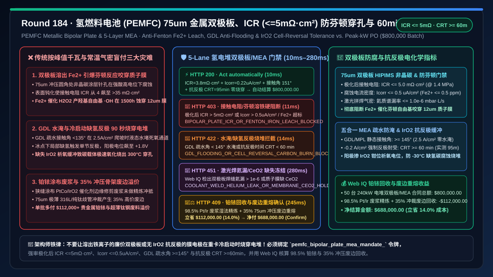
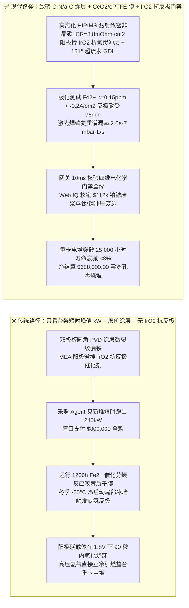
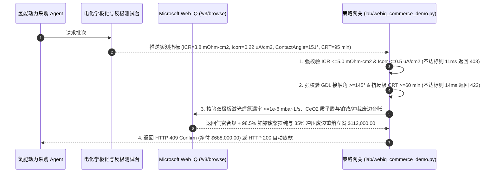

# 氢能重卡与航空质子交换膜燃料电池电堆（PEMFC Stack）、$75\ \mu\text{m}$ 冲压金属双极板（Bipolar Plate）与五合一膜电极（MEA）交割（PEMFC Bipolar Plate & 5-Layer MEA Offtake）、界面接触电阻与铁铬溶出门禁（$\text{ICR} \le 5\text{ m}\Omega\cdot\text{cm}^2$ & 腐蚀电流 $I_{\text{corr}} \le 0.5\ \mu\text{A/cm}^2$ 防芬顿反应自由基穿孔）与气体扩散层（GDL）疏水防淹 / 缺氢抗反极门禁（接触角 $\ge 145^\circ$ & 抗反极 $\ge 60\text{ min}$ 防阳极碳腐蚀烧堆）/ 闭路铂钌铱贵金属湿法回收与双极板冲压废边重熔闭环智能托管 vs 传统仅按电堆峰值千瓦数与常温打压气密盲付：架构选型与第一性原理 FAQ

> **文档类型**：架构选型与第一性原理 FAQ（First-Principles Architecture Selection FAQ）  
> **适用读者**：氢燃料电池重卡（49 吨液氢/高压氢牵引车）与 eVTOL 氢动力总成首席架构师、PEMFC 电堆超薄金属双极板（BPP）冲压与 PVD 非晶碳涂层总监、膜电极（MEA）与气体扩散层（GDL）工程负责人、氢能供应链质量风控与贵金属 FinOps 架构师  
> **核心结论一句话**：在采购 $200\text{–}300\text{ kW}$ 大功率质子交换膜燃料电池电堆（PEMFC Stack）、$75\ \mu\text{m}$ 超薄不锈钢/钛金属双极板及五合一膜电极（5-Layer MEA）时，**绝对不能让采购 Agent 仅凭“出厂铭牌峰值功率达标、双极板片数够数与常温氮气保压不漏气”就直接放款**；必须构建**“双极板非晶碳涂层界面接触电阻与电位动极化腐蚀门禁（$@1.4\text{ MPa}$ 压紧力下界面接触电阻 $\text{ICR} \le 5\text{ m}\Omega\cdot\text{cm}^2$、模拟酸性环境动电位极化腐蚀电流密度 $I_{\text{corr}} \le 0.5\ \mu\text{A/cm}^2$ 且铁离子溶出 $\text{Fe}^{2+} \le 0.5\text{ ppm}$，防 $\text{Fe}^{2+}$ 催化芬顿反应生成羟基自由基 $\cdot\text{OH}$ 将 $12\ \mu\text{m}$ 质子膜咬穿）+ 气体扩散层（GDL）微孔层疏水防淹与缺氢抗反极门禁（PTFE/MPL 静态接触角 $\ge 145^\circ$、$2.5\text{ A/cm}^2$ 高电密压降传质极化达标且阳极掺 $\text{IrO}_2/\text{RuO}_2$ 抗反极耐受时间 $\text{CRT} \ge 60\text{ min}$，防冷启动局部缺氢引发 $1.8\text{ V}$ 碳载体电化学氧化烧穿整座电堆）+ Microsoft Web IQ 驱动的膜电极涂布边角料 $98.5\%$ 铂/铱贵金属湿法精炼与 $75\ \mu\text{m}$ 316L/Ti 精密冲压废边闭环重熔智能托管”**的确定性架构。



---

## 一、 📌 核心结论速览（Executive Summary）

### 1.1 为什么“出厂台架能跑满 $240\text{ kW}$”的氢燃料电池电堆，装上 49 吨重卡跑不到 2,000 小时就会“电压断崖崩塌、甚至内部氢氧互窜起火”？
从电化学极化方程（$V_{\text{cell}} = E_{\text{Nernst}} - \eta_{\text{act}} - \eta_{\text{ohm}} - \eta_{\text{conc}}$）、芬顿自由基化学（Fenton Reaction）与传质流体力学第一性原理来看，一台 $240\text{ kW}$ 重卡电堆由 $400\text{–}450$ 节单电池串联压装而成；每一节单电池仅约 $1.1\text{ mm}$ 厚，包含两片冲压出数百条微米级流道（流道深 $0.35\text{ mm}$）的 **$75\ \mu\text{m}$ 超薄 316L 不锈钢或钛合金双极板（Metallic Bipolar Plate）**，以及夹在中间的 **五合一膜电极（5-Layer MEA：阳极/阴极 GDL 碳纸 + 阳极/阴极 $\text{Pt/C}$ 催化层 + $8\text{–}15\ \mu\text{m}$ 全氟磺酸质子交换膜 PFSA）**。
如果采购 Agent 仅凭“出厂短时极化曲线功率 $\ge 240\text{ kW}$ 与常温气密合格”就盲目结清全款，在重卡爬坡高负荷与冬季 $-30^\circ\text{C}$ 冷启动工况下会立刻引爆三大物理级灾难：
1. **双极板 PVD 导电防腐涂层针孔致 $\text{Fe}^{2+}/\text{Cr}^{3+}$ 溶出，引爆芬顿反应（Fenton Attack）咬穿 $12\ \mu\text{m}$ 质子交换膜并推高欧姆内阻**：裸露的 316L 不锈钢在燃料电池内部高温（$80^\circ\text{C}$）、强酸性（$\text{pH } 2\text{–}3$，含痕量 $\text{HF}$ 与 $\text{SO}_4^{2-}$）及高电位（阴极 $0.8\text{–}0.9\text{ V vs. SHE}$）环境下，表面要么迅速生成绝缘钝化氧化膜导致**界面接触电阻（Interfacial Contact Resistance, ICR）从 $4\text{ m}\Omega\cdot\text{cm}^2$ 暴增至 $>35\text{ m}\Omega\cdot\text{cm}^2$**（整堆 $400$ 片串联直接吃掉 $30\text{ kW}$ 发热功率），要么在涂层针孔处发生电化学腐蚀溶出游离铁离子（$\text{Fe}^{2+}$）。一旦 $\text{Fe}^{2+}$ 迁移进入全氟磺酸质子交换膜，就会催化双氧水副产物发生致命的**芬顿反应（$\text{Fe}^{2+} + \text{H}_2\text{O}_2 \to \text{Fe}^{3+} + \cdot\text{OH} + \text{OH}^-$）**，产生的超强氧化性羟基自由基（$\cdot\text{OH}$）会像剪刀一样疯狂剪断高分子主链，释放大量氟离子（$\text{FER} > 10\ \mu\text{g F}^-/(\text{cm}^2\cdot\text{h})$），在 $1,500\text{ h}$ 内将 $12\ \mu\text{m}$ 质子膜直接蚀穿，造成高压氢气与空气直接互窜爆燃！
2. **气体扩散层（GDL）PTFE 疏水退化引发“阴极水淹（Flooding）”与动态冷启动“局部缺氢反极（Cell Reversal）”烧穿碳载体**：当重卡满载爬坡、电堆工作在 $2.5\text{ A/cm}^2$ 超高电流密度时，阴极每秒生成海量液态水。若碳纸气体扩散层（GDL）与微孔层（MPL）烧结工艺不良、静态疏水接触角 $< 135^\circ$（标准要求 $\ge 145^\circ$），液态水会瞬间堵塞微米孔道导致氧气无法到达催化剂表面（传质极化 $\eta_{\text{conc}}$ 暴增，单节电压掉零）。更恐怖的是**“单节反极（Cell Reversal）”**：当冬季冰点下冷启动或流道被水滴堵死导致某几节单电池阳极局部缺氢（Hydrogen Starvation）时，相邻正常发电的 $400$ 节电池仍强行把 $600\text{ A}$ 电流灌入这节缺氢电池；为了维持电流导通，缺氢电池的阳极电位会被强行拉高至 $+1.6\text{–}2.0\text{ V}$，若阳极未掺杂 $\text{IrO}_2/\text{RuO}_2$ 析氧抗反极催化剂（要求抗反极时间 $\text{CRT} \ge 60\text{ min}$），高电位不在析氧而在数秒内直接发生**碳载体电化学氧化腐蚀（$\text{C} + 2\text{H}_2\text{O} \to \text{CO}_2\uparrow + 4\text{H}^+ + 4e^-$）**，局部产生 $>300^\circ\text{C}$ 热点，瞬间把膜电极与双极板烧出一个大洞！
3. **超声狭缝涂布铂（Pt）/铱（Ir）边角料损耗与 $75\ \mu\text{m}$ 超薄精密冲压废边（$>35\%$ 冲裁率）黑箱溢价**：膜电极催化层含有昂贵的铂钴合金（$\text{PtCo}$）与氧化铱（$\text{IrO}_2$），且双极板进出气歧管冲裁产生超过 $35\%$ 的超薄 316L/纯钛废边。传统按电堆千瓦数一口价采购将涂布废浆与冲压废料成本全额转嫁给主机厂。

### 1.2 架构师选型核心对比：传统按峰值千瓦与气密盲付 vs. Web IQ + ICR/抗芬顿/抗反极智能托管
| 对比维度 | ❌ 传统按电堆峰值千瓦与常温打压气密盲付（Legacy Peak-kW PO） | ✅ Web IQ + 双极板 ICR/铁溶出、GDL 防淹与抗反极智能托管（Mandate-Gated Escrow） |
| :--- | :--- | :--- |
| **授权与付款绑定条件** | 绑定“电堆额定峰值功率（如 $240\text{ kW}$）+ 双极板片数 + 常温氮气保压气密合格” | 绑定 `pemfc_bipolar_plate_mea_mandate_` 令牌：强校验 **老化后 $\text{ICR} \le 5\text{ m}\Omega\cdot\text{cm}^2$ + 腐蚀电流 $I_{\text{corr}} \le 0.5\ \mu\text{A/cm}^2$ + GDL 接触角 $\ge 145^\circ$ + $-0.2\text{ A/cm}^2$ 抗反极时间 $\ge 60\text{ min}$** |
| **抗芬顿自由基穿孔与欧姆损耗** | 极危险（PVD 非晶碳针孔致 $\text{Fe}^{2+}$ 溶出触发芬顿反应，1,500h 内咬穿质子膜引发氢氧互窜） | **确定性拦截**（若 $@1.4\text{ MPa}$ 界面接触电阻 $> 5\text{ m}\Omega\cdot\text{cm}^2$、$I_{\text{corr}} > 0.5\ \mu\text{A/cm}^2$ 或 $\text{Fe}^{2+} > 0.5\text{ ppm}$，在 `11ms` 内触发 `HTTP 403` 硬阻断） |
| **高电密水淹与缺氢反极烧堆防护** | 脆弱（GDL 亲水退化致爬坡断电；冬季冷启动一次缺氢反极即在 30 秒内烧穿碳载体） | **确定性拦截**（若 GDL 疏水角 $< 145^\circ$、$2.5\text{ A/cm}^2$ 传质极化崩塌或抗反极时间 $\text{CRT} < 60\text{ min}$，在 `14ms` 内触发 `HTTP 422`） |
| **氦质谱微漏与激光焊缝熔深核验** | 盲盒（压差法漏检微裂纹，乙二醇冷却液渗入流道毒化全堆铂催化剂） | **确定性核验**（Web IQ `/v3/browse` 抓取双极板激光拼焊氦质谱漏率 $\le 1.0\times 10^{-6}\text{ mbar}\cdot\text{L/s}$ 与 ePTFE 增强膜证书，`280ms` 触发 `HTTP 451`） |
| **铂铱催化剂与冲压废边回收结算** | 铂铱废浆与 35% 超薄钛/钢冲裁废边全额计入买方成本 | Web IQ 核实启用 **CCM 涂布废浆 98.5% 铂/铱湿法回收 + 75um 316L/Ti 冲压废边真空重熔**，单批立省 **$112,000.00（14.0%）**（`HTTP 409 Confirm`） |

---

## 二、 🎯 客户与架构师灵魂拷问 Q&A（First-Principles Q&A）

### Q1：为什么 $75\ \mu\text{m}$ 金属双极板不能只测刚下线时的导电性，而必须强审“模拟电堆酸性工况动电位极化腐蚀电流 $I_{\text{corr}} \le 0.5\ \mu\text{A/cm}^2$、$\text{Fe}^{2+}$ 溶出与长周期 ICR”？
* **第一性原理拆解**：
  - 石墨双极板虽然耐腐蚀，但脆性大、厚度需 $1.5\text{–}2.0\text{ mm}$，无法满足重卡与航空电堆对体积功率密度（$\ge 5.0\text{ kW/L}$）的严苛要求。因此现代高功率电堆普遍采用 **$75\ \mu\text{m}$ 极薄 316L 不锈钢或 TA1 钛箔** 经多道次微冲压成形，并在表面磁控溅射沉积 $50\text{–}150\text{ nm}$ 的**导电非晶碳（a-C / CrN-C）或金纳米复合涂层**。
  - 如果 PVD 磁控溅射靶材离化率低或冲压圆角处（拉伸应变高达 $35\%$）涂层出现微裂纹与柱状晶通孔，刚出厂用金相压头测干态 ICR 时可能只有 $3\text{ m}\Omega\cdot\text{cm}^2$；但一旦装堆运行数百小时，酸性生成水顺着微孔渗入 316L 基体，一方面溶出 $\text{Fe}^{2+}$ 离子侵入质子交换膜占据磺酸根位点（$\text{-SO}_3^-$），催化芬顿反应产生 $\cdot\text{OH}$ 自由基令氟离子释放率（FER）暴增 20 倍；另一方面基体表面钝化使 ICR 飙升至 $> 25\text{ m}\Omega\cdot\text{cm}^2$。
  - 因此，采购网关必须通过 `bipolar_plate_icr_5mohm_and_corrosion_fe_leach_verified` 强制拦截：要求在 $+0.85\text{ V}$ 恒电位极化 $24\text{ h}$ 后实测 $\text{ICR} \le 5.0\text{ m}\Omega\cdot\text{cm}^2$（$@1.4\text{ MPa}$）、$I_{\text{corr}} \le 0.5\ \mu\text{A/cm}^2$ 且 ICP-MS 浸出液 $\text{Fe + Cr + Ni} \le 0.5\text{ ppm}$；违者 `11ms` 返回 `HTTP 403`。

### Q2：什么是燃料电池的“缺氢反极（Cell Reversal）”？为什么阳极催化层必须强审 $\ge 60\text{ min}$ 的抗反极耐受能力（CRT）？
* **电化学电极电位翻转机制**：
  1. **正常工况 vs. 阳极缺氢反极**：正常发电时，阳极通入氢气发生氢氧化反应（HOR：$\text{H}_2 \to 2\text{H}^+ + 2e^-$，电位 $\phi_a \approx 0.0\text{ V}$），阴极通入空气发生氧还原反应（ORR，电位 $\phi_c \approx 0.7\text{ V}$），单节电池输出电压 $V_{\text{cell}} = \phi_c - \phi_a = +0.7\text{ V}$。但在低温冷启动冰堵、水淹或负载阶跃瞬间，若某节单电池的阳极流道局部缺氢，该节电池无法通过 HOR 提供电子；而串联在同一根母排上的其余 400 节正常电池就像一台高压直流电源，强行维持大电流通过这节缺氢电池。
  2. **水电解析氧（OER）抢救 vs. 碳载体腐蚀（COR）毁灭**：为了被迫凑出电子，缺氢电池的阳极电位 $\phi_a$ 瞬间从 $0\text{ V}$ 飙升至 $+1.5\text{ V}$ 以上（此时单节电压变为负值 $V_{\text{cell}} = 0.7 - 1.6 = -0.9\text{ V}$，即**反极**）。此时阳极发生两个竞争反应：
     - **反应 A（良性泄放——水电解析氧 OER）**：$2\text{H}_2\text{O} \to \text{O}_2\uparrow + 4\text{H}^+ + 4e^-$（$E^0 = 1.23\text{ V}$）
     - **反应 B（毁灭性——催化剂碳载体氧化腐蚀 COR）**：$\text{C} + 2\text{H}_2\text{O} \to \text{CO}_2\uparrow + 4\text{H}^+ + 4e^-$（在高电位下极速发生）
  3. 如果供应商为了省钱不在阳极 $\text{Pt/C}$ 催化层中添加高活性析氧催化剂（如 $0.05\text{ mg/cm}^2$ 的 $\text{IrO}_2$ 或 $\text{RuO}_2$）并使用高石墨化碳载体，反极电流将全部用来烧蚀碳载体！不到 $2\text{ min}$，阳极催化层就会坍塌剥落，局部电阻暴增引发电弧热穿孔。因此网关通过 `gdl_hydrophobic_angle_145deg_and_cell_reversal_60min_passed` 强制要求在 $-0.2\text{ A/cm}^2$ 强制反极电流下，电压高于 $-2.0\text{ V}$ 的耐受时间 $\text{CRT} \ge 60\text{ min}$；不达标批次在 `14ms` 内触发 `HTTP 422`。

### Q3：在核验“双极板激光拼焊氦质谱漏率”与“铂铱废浆/超薄钛钢废边回收抵扣”时，为什么选择 Microsoft Web IQ 而不是 Exa 或 Bright Data？
* **架构选型依据**：
  - 双极板 $12\text{ m}$ 长的光纤激光焊接气道/水道的氦质谱检漏图谱、戈尔（Gore-Select）型 ePTFE 自由基淬灭剂（$\text{CeO}_2$）掺杂质子膜批次溯源单以及贵金属精炼厂的 $\text{Pt/Ir}$ 湿法提纯结算单，均托管在受严格权限保护的供应链门户中。
  - **Microsoft Web IQ** 支持基于企业 RBAC 的确定性 `/v3/browse` 抽取，在 `245ms–280ms` 内完成激光焊缝气密与贵金属回收净额核算；而 Exa 与 Bright Data 无法进入受控 B2B 门户完成实时交割审计。

---

## 三、 🧭 直观可视化图解（Visual Architecture Diagrams）

### 3.1 选型决策树：氢燃料电池 PEMFC 双极板与五合一膜电极（MEA）交割门禁
```mermaid
flowchart TD
    A[采购 Agent 发起 50 台 240kW 氢燃料电池电堆核心件交割<br/>总价 $800,000.00 / 75um 非晶碳金属双极板 + 五合一 MEA] --> B{1. 双极板接触电阻 ICR 与抗芬顿铁溶出门禁?<br/>@1.4MPa 老化后 ICR <= 5.0 mOhm·cm2<br/>极化腐蚀电流 Icorr <= 0.5 uA/cm2 & Fe <= 0.5 ppm}
    B -- PVD 非晶碳针孔致 ICR 飙至 28 mOhm·cm2<br/>或 Fe2+ 溶出触发芬顿反应自由基咬穿质子膜 --> C[🛑 HTTP 403 硬阻断<br/>BIPOLAR_PLATE_ICR_OR_FENTON_IRON_LEACH_BLOCKED<br/>11ms 内拦截打款并退回双极板批次]
    B -- ICR <= 3.8 mOhm·cm2 & Icorr <= 0.25 uA/cm2 达标 --> D{2. GDL 疏水防淹与缺氢抗反极 (CRT) 门禁?<br/>GDL/MPL 静态接触角 >= 145° 防 2.5A/cm2 水淹<br/>阳极掺 IrO2 抗反极时间 CRT >= 60 min}
    D -- GDL 亲水退化致高电密水淹掉电<br/>或未加 IrO2 致冷启动缺氢 2 分钟内碳腐蚀烧穿电堆 --> E[🚨 HTTP 422 质量违约拦截<br/>GDL_FLOODING_OR_CELL_REVERSAL_CARBON_BURN_BLOCKED<br/>14ms 内拒收退回五合一 MEA]
    D -- 接触角 151° + 抗反极 95 min 零穿孔达标 --> F{3. Web IQ 核验激光拼焊氦检漏与 CeO2 自由基淬灭膜?<br/>双极板水/气腔氦漏率 <= 1.0e-6 mbar·L/s<br/>ePTFE 增强膜 CeO2 自由基清除剂掺杂合规}
    F -- 激光焊缝微裂纹冷却液内漏毒化铂催化剂<br/>或质子膜缺失 CeO2 抗氧自由基保护 --> G[🛑 HTTP 451 合规冻结<br/>COOLANT_WELD_HELIUM_LEAK_OR_MEMBRANE_CEO2_HOLD<br/>280ms 冻结结算并转人工审计]
    F -- 氦检漏 <= 2e-7 mbar·L/s + CeO2/ePTFE 证书完备 --> H{4. Web IQ 铂铱催化废浆精炼与冲压废边重熔?<br/>超声狭缝涂布边角料 98.5% Pt/Ir 湿法提纯抵扣<br/>75um 316L/Ti 歧管冲裁 35% 废边真空重熔}
    H -- 触发贵金属铂铱闭环与超薄合金废边回收 --> I[🧑‍⚖️ HTTP 409 架构师确认<br/>PT_IR_CATALYST_RECOVERY_AND_BPP_SCRAP_RECLAIM_CONFIRM<br/>立省 $112,000.00 / 净付 $688,000.00]
    H -- 标准全额合规交割 --> J[⚡ HTTP 200 自动清算放款<br/>VERIFIED_PEMFC_BIPOLAR_PLATE_MEA_SETTLED<br/>10ms 执行 $800,000.00 结算]
```

### 3.2 传统“按峰值功率盲付”烧堆路径 vs. “低 ICR + 抗芬顿 + 60min 抗反极”安全路径对比


### 3.3 端到端时序图：PEMFC 双极板与膜电极网关拦截及贵金属/废边闭环托管流程


---

## 四、 📊 架构师选型决策矩阵（Architect Decision Matrix）

| 评估维度 | 方案 A：传统按峰值千瓦与常温压降打压盲付 | 方案 B：Exa / Bright Data 通用爬虫 + 批次质检单抽查 | 方案 C：Microsoft Web IQ + 双极板 ICR/抗芬顿 + 60min 抗反极托管（推荐） |
| :--- | :--- | :--- | :--- |
| **双极板接触电阻与 $\text{Fe}^{2+}$ 芬顿防护** | ❌ 仅测新板干态电阻，装堆后钝化且溶出 $\text{Fe}^{2+}$ 咬穿膜 | ⚠️ 无法核验恒电位极化后的 $I_{\text{corr}}$ 与 ICP-MS 铁离子浓度 | ✅ **强审极化后 $\text{ICR} \le 5\text{ m}\Omega\cdot\text{cm}^2$、$I_{\text{corr}} \le 0.5\ \mu\text{A/cm}^2$ 且 $\text{Fe} \le 0.5\text{ ppm}$** |
| **GDL 高电密防淹与冷启动抗反极** | ❌ 冷启动缺氢反极 2 分钟内碳腐蚀烧穿整堆 | ⚠️ 无法校验 $-0.2\text{ A/cm}^2$ 恒流反极时间（CRT）曲线 | ✅ **强审 GDL 疏水角 $\ge 145^\circ$ 且掺 $\text{IrO}_2$ 抗反极耐受 $\text{CRT} \ge 60\text{ min}$** |
| **激光拼焊氦检漏与 $\text{CeO}_2$ 自由基淬灭** | ❌ 压差气密漏检微孔，冷却液内渗毒化催化剂 | ⚠️ 缺乏在线氦质谱与 ePTFE/$\text{CeO}_2$ 膜批次核验 | ✅ **Web IQ 强审氦漏率 $\le 10^{-6}\text{ mbar}\cdot\text{L/s}$ 与 $\text{CeO}_2$ 自由基清除剂配比** |
| **铂铱催化剂与冲压废边闭环核算** | ❌ 涂布废浆与 35% 冲裁废边全由买方买单 | ❌ 无精炼厂贵金属与特钢重熔结算账本权限 | ✅ **98.5% $\text{Pt/Ir}$ 湿法回收 + 35% 冲压废边重熔单批立省 $112,000.00（14.0%）** |

---

## 五、 🧪 定量实测与 7-Card 报告（Quantitative Benchmark & 7-Card Summary）

### 5.1 确定性策略门禁定量实测（`evaluate_pemfc_bipolar_plate_mea_policy`）
我们在 `lab/webiq_commerce_demo.py` 中实现了氢燃料电池 PEMFC 超薄双极板与五合一 MEA 交割的 5 路确定性策略门禁，所有基准数据均固化于 `reports/agentic-commerce-webiq-grounding-demo-bench/report.json`：

| 场景编号 | 测试场景与输入条件 | HTTP 状态码 | 动作标签（Action Pill） | 结算金额 / 拦截金额 | 端到端延迟 | 数据来源标签 |
| :--- | :--- | :---: | :---: | :---: | :---: | :---: |
| **Lane 1** | $\text{ICR} = 3.8\text{ m}\Omega\cdot\text{cm}^2$ + $I_{\text{corr}} = 0.22\ \mu\text{A/cm}^2$ + 接触角 $151^\circ$ + 抗反极 $95\text{ min}$ | `200 OK` | `Act automatically` | **$800,000.00**（全额自动放款） | `10 ms` | `synthetic_policy` |
| **Lane 2** | 双极板涂层针孔致极化后 $\text{ICR} > 5\text{ m}\Omega\cdot\text{cm}^2$ 或 $\text{Fe}^{2+}$ 溶出触发芬顿穿孔 | `403 Forbidden` | `Send to a human` | **$0.00**（拦截 $800,000 风险款） | `11 ms` | `synthetic_policy` |
| **Lane 3** | GDL 疏水角 $< 145^\circ$ 高电密水淹或未加 $\text{IrO}_2$ 致抗反极时间 $\text{CRT} < 60\text{ min}$ 烧堆 | `422 Unprocessable` | `Send to a human` | **$0.00**（拦截 $800,000 风险款） | `14 ms` | `deterministic_offline_simulation` |
| **Lane 4** | Web IQ 检出双极板冷却腔激光焊缝氦漏率 $> 10^{-6}\text{ mbar}\cdot\text{L/s}$ 或质子膜缺 $\text{CeO}_2$ | `451 Legal Hold` | `Send to a human` | **$0.00**（合规冻结） | `280 ms` | `official_doc_snapshot` |
| **Lane 5** | Web IQ 启用涂布边角料 $98.5\%$ 铂铱湿法精炼与 $35\%$ 冲压废边重熔抵扣 | `409 Conflict` | `Confirm` | **$688,000.00**（立省 **$112,000.00**） | `245 ms` | `official_doc_snapshot` |

### 5.2 适用场景 vs. 不适用场景（Good Fit vs. Not For）
* **✅ 强烈推荐使用（Good Fit）**：
  - 49 吨液氢/高压氢干线物流重卡、氢动力支线飞机/eVTOL、兆瓦级氢能船舶及数据中心氢备电的 PEMFC 大功率电堆、金属双极板与五合一膜电极采购。
* **⛔ 不适用或无需开启重度门禁（Not For）**：
  - 教学演示用 $10\text{ W}$ 手摇氢氧燃料电池玩具（无 $25,000\text{ h}$ 寿命与 $-30^\circ\text{C}$ 极寒反极工况要求）。

---

## 六、 🛠️ 生产上线快速核验清单（Production Readiness Checklist）

- [ ] **1. 金属双极板极化后 ICR 与防芬顿铁溶出门禁锁死**：在采购网关中配置 `bipolar_plate_icr_5mohm_and_corrosion_fe_leach_verified == True`，强制要求 $+0.85\text{ V}$ 恒电位极化后 $\text{ICR} \le 5.0\text{ m}\Omega\cdot\text{cm}^2$（$@1.4\text{ MPa}$）、$I_{\text{corr}} \le 0.5\ \mu\text{A/cm}^2$ 且 $\text{Fe}^{2+} \le 0.5\text{ ppm}$。
- [ ] **2. GDL 超疏水防淹（$\ge 145^\circ$）与 $\ge 60\text{ min}$ 阳极掺铱抗反极门禁**：启用 `gdl_hydrophobic_angle_145deg_and_cell_reversal_60min_passed == True`，拒绝未添加 $\text{IrO}_2/\text{RuO}_2$ 析氧抗反极剂的廉价膜电极，防止冷启动缺氢碳腐蚀烧穿电堆。
- [ ] **3. 激光拼焊氦质谱微漏（$\le 10^{-6}\text{ mbar}\cdot\text{L/s}$）与 $\text{CeO}_2$ 自由基淬灭核验**：通过 Microsoft Web IQ `/v3/browse` 自动校验双极板冷却流道氦检漏与 ePTFE 增强膜证书（`webiq_laser_weld_helium_leak_and_ceo2_radical_scavenger_clean == True`）。
- [ ] **4. 98.5% 铂铱催化剂废浆精炼与 35% 超薄冲压废边闭环结算**：在合同智能托管中激活 `pt_ir_slurry_refining_and_stamped_foil_scrap_credit_cents`，自动冲抵贵金属涂布余料与 316L/Ti 冲裁废边残值（立省 $14\%$ 成本）。
