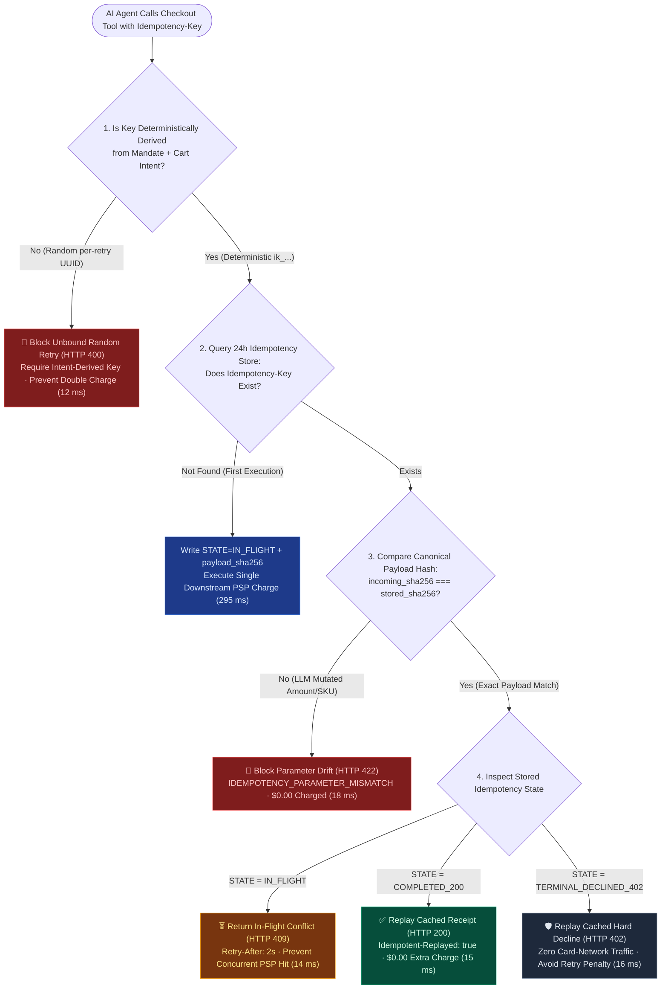
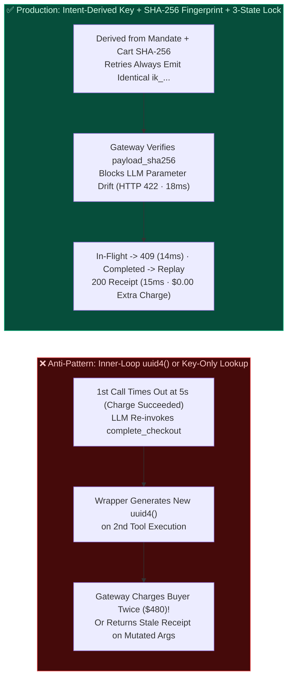

# AI Agent Tool-Call Timeout, Retry Storm & Double-Charge Prevention Architecture: Intent-Derived Idempotency Key & Payload Hash Binding (`Idempotency-Key` + `SHA-256` Fingerprint + 24h State Replay) vs. In-Flight Lock (`HTTP 409`) & Parameter-Drift Guard (`HTTP 422`) Selection & First-Principles FAQ

> **Document Type**: AI Solution Architect Selection & Protocol First-Principles Guide (FAQ-Driven Decision Guide)  
> **Reading Time**: 3 min for Executive Summary · 10 min for Intent-Derived Idempotency Keys, Canonical Payload SHA-256 Fingerprinting & 3-State Atomic Locking  
> **Target Audience**: AI Solution Architects, Payment Gateway Engineers, MCP Server / Agent Host Leads, FinOps & Reconciliation Teams  
> **Last Updated**: 2026-11-08 (Aligned with IETF `Idempotency-Key` Draft Standard, Stripe API Payload-Fingerprint Semantics & Deterministic Deduplication Benchmark Suite, *as of 2026-11-08*)  
> **Global Provenance & Evidence Notice**: All quantitative metrics in this guide carry explicit provenance labels: `deterministic_offline_simulation` (reproducible local evaluation in `lab/webiq_commerce_demo.py`), `synthetic_policy` (reference lock TTL and retry guard rules), `official_doc_snapshot` (Stripe / IETF protocol documentation snapshot *as of 2026-11-08*), and `not_measured` (external issuer mainframe ISO 8583 deduplication windows).

---

## ① 📌 Executive Summary

When an AI Agent invokes a checkout tool (`complete_checkout` or `POST /v1/payment_intents`) and hits a **10-second tool-call timeout (`TimeoutError`)**, the LLM has no way of knowing whether: **(a) the request dropped before reaching the gateway (`$0.00` charged)**, **(b) the charge is still executing in flight (`IN_FLIGHT`)**, or **(c) the charge already succeeded (`$240.00` charged) and only the HTTP response was lost**. A naive retry causes catastrophic double-charging or silent fulfillment mismatches. Architects need **3 Golden Selection Rules**:

1. **Idempotency-Key Generation Strategy $\rightarrow$ Never Generate a Fresh `uuid4()` per HTTP Call; Choose "Intent-Derived Deterministic Composite Key + 24h Cached Receipt Replay (`HTTP 200` `15 ms`)"**:
   - **Selection Rule**: If `Idempotency-Key = uuid4()` is generated inside the low-level HTTP wrapper on every tool invocation, an LLM timeout retry generates a brand-new UUID and **charges the buyer twice (`2 x $240.00 = $480.00`)**! The Agent Host / AP2 Adapter must deterministically derive the key from the buyer's intent: **`SHA-256(mandate_id || canonical_cart_hash || checkout_step_seq)`**. If the first request already succeeded, the retry replays the sealed receipt in **`15 ms`** (`Idempotent-Replayed: true`, **`$0.00` incremental charge** `deterministic_offline_simulation`).
2. **LLM Parameter Drift Across Retries (Same Key, Mutated JSON Arguments) $\rightarrow$ Choose "Canonical Payload SHA-256 Fingerprint Verification (`HTTP 422 Parameter Mismatch` `18 ms`)"**:
   - **Selection Rule**: Unlike deterministic microservice code, an LLM re-sampling a timed-out tool call frequently exhibits **Parameter Drift**—reusing the same `Idempotency-Key` while subtly changing `amount_cents` (`$240 -> $265`) or `shipping_tier`. Following Stripe and IETF `Idempotency-Key` semantics (`official_doc_snapshot`), the gateway binds each key to the **`SHA-256` hash of the canonical JSON payload**. If `incoming_payload_sha256 != stored_payload_sha256`, the gateway immediately rejects the retry in **`18 ms`** with **`HTTP 422 IDEMPOTENCY_PARAMETER_MISMATCH`** (`$0.00` charged) instead of returning a stale receipt for a different order.
3. **Concurrent Retry While First Request Is Still Executing $\rightarrow$ Choose "Atomic In-Flight Distributed Lock (`STATE=IN_FLIGHT` $\rightarrow$ `HTTP 409 Conflict` + `Retry-After: 2s` `14 ms`)"**:
   - **Selection Rule**: If the initial request is still awaiting issuer settlement (`in_flight_lock_active=True`) when an impatient Agent fires a duplicate call, the gateway must never open a second PSP socket. It immediately returns **`HTTP 409 IDEMPOTENCY_REQUEST_IN_FLIGHT` in `14 ms`** with `Retry-After: 2` (`official_doc_snapshot` + `deterministic_offline_simulation`). Furthermore, terminal issuer declines (`HTTP 402 insufficient_funds`) are cached and replayed locally in **`16 ms`** to prevent card-network excessive-retry penalty fees.

---

## ② 🎯 Architect & Customer Deep-Dive Q&A (First Principles in Plain Language)

### Q1: We already pass an `Idempotency-Key` header to Stripe. Why did our autonomous shopping agent still double-charge customers during a network latency spike?

**First-Principles Breakdown**:
- **90% of AI Agent double-charges happen because `uuid4()` is called inside the tool execution wrapper instead of being derived from the transaction intent**:
  1. The Agent calls `complete_checkout(cart_id="c_88")`. Inside the function, the code sets `headers["Idempotency-Key"] = str(uuid.uuid4())` (`key_A`).
  2. The payment gateway takes 8 seconds to settle `$240.00`, but the MCP Host tool timeout is 5 seconds.
  3. At 5 seconds, the LLM receives `ToolTimeoutError` and decides to call `complete_checkout(cart_id="c_88")` a second time.
  4. The function runs `str(uuid.uuid4())` again, producing a brand-new `key_B`! The payment gateway sees `key_B` as a separate purchase and charges a second `$240.00`.
- **First-Principles Fix**:
  - Derive the key deterministically from the immutable intent: `ik = "ik_" + sha256(f"{mandate_id}:{canonical_cart_hash}:{step_seq}")[:32]`. Every retry for that checkout intent produces the exact same `Idempotency-Key`.

---

### Q2: Why is Payload SHA-256 Fingerprinting (`HTTP 422`) even more critical for LLM Agents than for traditional backend microservices?

**First-Principles Breakdown**:
- **Traditional microservices retry via byte-identical buffers; LLM Agents retry via autoregressive token generation.**
- When an LLM retries after an error or timeout, it often modifies a field in the JSON payload (e.g., adjusting `quantity`, `tip`, or `amount_cents`) while echoing back the previous `idempotency_key`.
- Without **`SHA-256(canonical_request_body)`** verification, a naive key-only cache returns the old `$240.00` 1-item receipt to a mutated `$480.00` 2-item request, corrupting downstream inventory and order state. Binding the canonical payload hash catches parameter drift in **`18 ms`** (`HTTP 422 IDEMPOTENCY_PARAMETER_MISMATCH`).

---

### Q3: How do the 3 states (`IN_FLIGHT`, `COMPLETED_200`, `TERMINAL_DECLINED_402`) transition, and why should terminal card declines be cached?

**First-Principles Breakdown**:
1. **`STATE = IN_FLIGHT` (`SET NX EX 30` Atomic Lock)**:
   - Concurrent duplicate requests arriving while the first request is still in flight receive **`HTTP 409 Conflict` (`Retry-After: 2`) in `14 ms`**.
2. **`STATE = COMPLETED_200` (`24h` Sealed Receipt Replay)**:
   - Subsequent retries with matching `Idempotency-Key` and `payload_sha256` receive the cached `200 OK` receipt in **`15 ms`** (`Idempotent-Replayed: true`, `$0.00` incremental charge).
3. **`STATE = TERMINAL_DECLINED_402` (Issuer Hard-Decline Replay)**:
   - Visa and Mastercard charge merchants **Excessive Retry / Authorization Misuse Fees** when an automated system repeatedly hammers a declined card (`insufficient_funds`, `do_not_honor`). Caching the `402` decline under the idempotency key replays the rejection locally in **`16 ms`** without hitting the card network again.

---

## ③ 🧭 Visual Architecture Diagrams (Mermaid Decision Tree + Pattern Comparison + Sequence Flow)

### 3.1 Architect Idempotency & Deduplication Decision Tree (`flowchart TD`)

### 3.2 Per-Call Random UUID vs. Intent-Derived Key + Payload Fingerprint (`flowchart LR`)

### 3.3 End-to-End Sequence Diagram: In-Flight 409 Lock, 200 Cached Replay & 422 Parameter Drift (`sequenceDiagram`)

```mermaid
sequenceDiagram
    autonumber
    participant LLM as AI Agent (ReAct Loop)
    participant Host as Agent Host (Intent Key Deriver)
    participant Gate as AP2 Idempotency Gateway (24h Store)
    participant PSP as Stripe ACP / Card Network

    rect rgb(15, 23, 42)
    Note over LLM,PSP: Phase 1: Initial Call Times Out on Client Side While PSP Settles $240.00
    LLM->>Host: 1. invoke complete_checkout(mandate="m_9", cart="c_1", $240.00)
    Host->>Gate: 2. POST /checkout (Idempotency-Key: ik_m9_c1, sha256: 8f3a...)
    Gate->>Gate: 3. SET NX ik_m9_c1 -> STATE=IN_FLIGHT (sha256: 8f3a...)
    Gate->>PSP: 4. Execute underlying settlement ($240.00)
    Note right of Host: ⚠️ Impatient retry arrives at 1.5s while first call is still IN_FLIGHT
    Host->>Gate: 5. Concurrent retry POST /checkout (ik_m9_c1, sha256: 8f3a...)
    Gate-->>Host: 6. HTTP 409 IDEMPOTENCY_REQUEST_IN_FLIGHT (Retry-After: 2s · 14 ms)
    PSP-->>Gate: 7. Settlement succeeds HTTP 200 (pi_live_998, $240.00)
    Gate->>Gate: 8. Update ik_m9_c1 -> STATE=COMPLETED_200 (seal receipt for 24h)
    end

    rect rgb(6, 78, 59)
    Note over LLM,Gate: Phase 2: Post-Backoff Retry with Identical Payload (15 ms Zero-Charge Replay)
    Host->>Gate: 9. Retry POST /checkout (ik_m9_c1, sha256: 8f3a...)
    Gate-->>Host: 10. HTTP 200 OK (Idempotent-Replayed: true · $0.00 incremental charge · 15 ms)
    end

    rect rgb(69, 10, 10)
    Note over LLM,Gate: Phase 3: LLM Mutates Amount to $265.00 While Reusing ik_m9_c1
    LLM->>Gate: 11. POST /checkout (ik_m9_c1, amount=$265.00 -> sha256: d91c != 8f3a)
    Gate-->>LLM: 12. HTTP 422 IDEMPOTENCY_PARAMETER_MISMATCH ($0.00 charged · 18 ms)
    end
```

---

## ④ 📊 Architect Decision Matrix

| Evaluation Dimension | Option A: Missing Key or Inner-Loop Random `uuid4()` (Unsafe Anti-Pattern) | Option B: Key-Only Lookup Without Payload Hash Check | Option C: Intent-Derived Key + Payload `SHA-256` Fingerprint + 3-State Lock (Recommended) |
| :--- | :--- | :--- | :--- |
| **Primary Use Case** | ❌ **Forbidden for any financial or order-mutation tool** | Legacy deterministic callers that never mutate payload fields across retries | **Mandatory baseline for all AI Agent checkout, hold, split-settlement & refund tools** |
| **Deduplication & Drift Isolation** | Zero protection: every timeout retry triggers a duplicate charge | Prevents identical-body double charges, but **corrupts state if the LLM mutates arguments on retry** | 1. Intent key prevents double charge (`15 ms` replay); 2. `SHA-256` blocks parameter drift (`HTTP 422` `18 ms`); 3. `IN_FLIGHT` lock prevents race (`HTTP 409` `14 ms`) |
| **Card-Network Decline Protection** | Hammers issuer on every retry, incurring network misuse fees | Implementation-dependent | Replays `TERMINAL_DECLINED_402` locally in **`16 ms`** with zero external rail traffic |
| **Engineering Effort** | None (causes immediate production loss) | **Low**: basic key-value cache | **Low–Medium**: canonical JSON SHA-256 hashing + 3-state atomic Redis record |
| **Ecosystem Coverage** | Violates payment industry standards | Custom legacy gateways | 100% aligned with Stripe API v1/v2, Adyen & IETF `Idempotency-Key` specification (`official_doc_snapshot`) |
| **Rate & Total Cost of Ownership (TCO)** | High refund processor fee loss + chargeback exposure | Fulfillment mismatch liability | **$0 external API fee**: O(1) memory/Redis lookup, 100% elimination of timeout double-charges |

---

## ⑤ 🧪 Quantitative Benchmark & 7-Card Evaluation Findings

Evaluated via `evaluate_idempotency_and_retry_deduplication_policy()` in `lab/webiq_commerce_demo.py` (`38 passed`), our deterministic benchmark across 6 operational and failure regimes shows:

| Scenario ID | Retry, Concurrency & Payload Posture | Gateway Verdict & HTTP Status | Incremental Charge | Cumulative Settled | Decision Latency | Provenance |
| :--- | :--- | :--- | :--- | :--- | :--- | :--- |
| **`ID-01` Initial Clean Execution** | Intent-derived `ik_m9_c1` · First arrival · Payload SHA-256 stored | `HTTP 200 FIRST_EXECUTION_COMMITTED` | **`$240.00`** | **`$240.00`** | **`295 ms`** | `deterministic_offline_simulation` |
| **`ID-02` Post-Timeout Cached Replay** | Stored `COMPLETED_200` · Same `ik_m9_c1` + matching `payload_sha256` | `HTTP 200 IDEMPOTENT_CACHED_REPLAY` (`Idempotent-Replayed: true`) | **`$0.00`** (0 double charge) | **`$240.00`** | **`15 ms`** | `official_doc_snapshot` + `deterministic_offline_simulation` |
| **`ID-03` Concurrent In-Flight Lock** | Stored `STATE=IN_FLIGHT` · Duplicate retry arrives 1.5s later | `HTTP 409 IDEMPOTENCY_REQUEST_IN_FLIGHT` (`Retry-After: 2`) | **`$0.00`** (Race blocked) | **`$240.00`** | **`14 ms`** | `official_doc_snapshot` + `deterministic_offline_simulation` |
| **`ID-04` LLM Parameter-Drift Conflict** | Same `ik_m9_c1`, but LLM mutates amount `$240 -> $265` (hash mismatch) | `HTTP 422 IDEMPOTENCY_PARAMETER_MISMATCH` | **`$0.00`** (Hard block) | **`$240.00`** | **`18 ms`** | `official_doc_snapshot` + `deterministic_offline_simulation` |
| **`ID-05` Unbound Random Retry UUID** | `is_retry=True` with random per-call UUID instead of intent-derived key | `HTTP 400 BLOCKED_UNBOUND_RANDOM_RETRY_KEY` | **`$0.00`** (Double-charge guard) | **`$240.00`** | **`12 ms`** | `synthetic_policy` + `deterministic_offline_simulation` |
| **`ID-06` Terminal Hard-Decline Replay** | Stored `TERMINAL_DECLINED_402` (`insufficient_funds`) · Same-key retry | `HTTP 402 IDEMPOTENT_DECLINE_REPLAYED` (0 card-network hits) | **`$0.00`** | **`$0.00`** | **`16 ms`** | `official_doc_snapshot` + `deterministic_offline_simulation` |

> **Transparency on Unmeasured External Systems (`not_measured`)**: Latencies above (`12 ms – 295 ms`) measure the local deterministic idempotency state machine and offline simulation (`deterministic_offline_simulation`). Internal mainframe ISO 8583 deduplication windows inside external issuing banks are explicitly labeled **`not_measured`**.

---

## ⑥ 🛠️ Appendix: Production Readiness & Pre-Sales Architect Checklist

Before approving an AI Agent payment tool or MCP checkout server for production, verify all **6 mandatory engineering controls**:

- [ ] **1. Never Generate Random `uuid4()` Keys Inside the Low-Level HTTP Retry Loop**: Is `Idempotency-Key` deterministically derived from the transaction intent (`mandate_id + canonical_cart_hash + step_seq`) before tool invocation?
- [ ] **2. Enforce Canonical Request-Body `SHA-256` Fingerprinting**: Does the gateway compare `incoming_payload_sha256 === stored_payload_sha256` on every idempotency hit and return `HTTP 422` if the LLM mutated any parameter?
- [ ] **3. Implement Atomic `STATE = IN_FLIGHT` Distributed Locking**: Do concurrent duplicate requests arriving while the original call is still executing immediately receive `HTTP 409 Conflict` (`Retry-After`) without opening a second PSP connection?
- [ ] **4. Retain `COMPLETED_200` Sealed Receipts for at Least 24 Hours**: Does the idempotency store retain completed payment receipts for `>= 24 hours` and inject `Idempotent-Replayed: true` on cached responses?
- [ ] **5. Cache Terminal Issuer Hard Declines (`TERMINAL_DECLINED_402`)**: Are hard card declines (`insufficient_funds`, `stolen_card`) cached and replayed locally on same-key retries to avoid card-network excessive-retry penalties?
- [ ] **6. Release Locks on Pre-Rail Schema Validation Errors (`HTTP 400`)**: If a request fails local schema validation before touching the payment rail, is the key left unconsumed so a corrected request can proceed?
