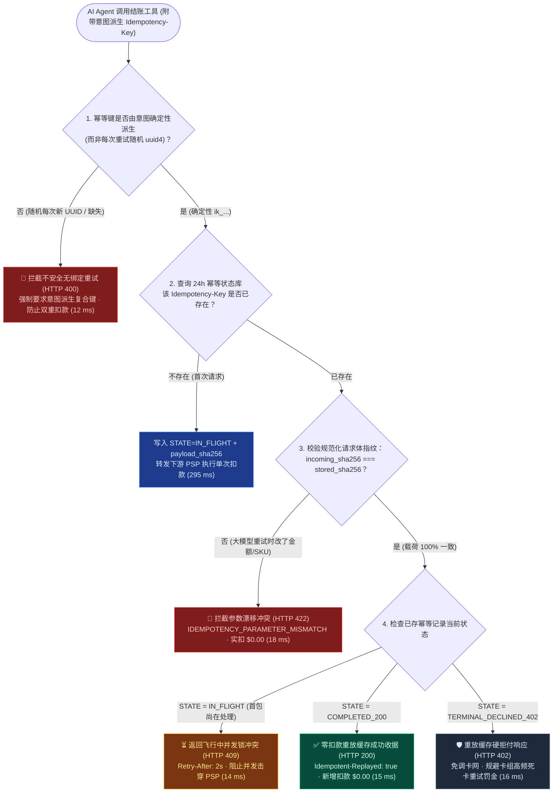
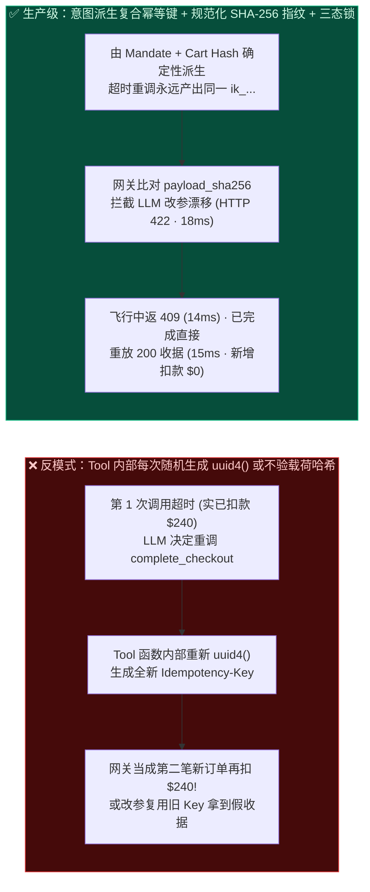

# AI Agent 工具调用超时、重试风暴与防重扣幂等架构：意图派生幂等键与载荷哈希绑定（`Idempotency-Key` + `SHA-256` 参数指纹 + 24h 快照重放）vs 飞行中并发锁（`HTTP 409`）与大模型改参漂移拦截（`HTTP 422`）选型与原理解析 FAQ

> **文档类型**：AI Solution Architect 架构选型与协议原理解析实战指南（FAQ-Driven Decision Guide）  
> **阅读耗时**：3 分钟速览选型结论 · 10 分钟掌握意图派生幂等键、载荷 SHA-256 指纹比对与飞行中分布式锁状态机  
> **适用角色**：AI 解决方案架构师、支付网关研发负责人、MCP Server / Agent Host 架构师、财务对账（FinOps）团队  
> **最后更新**：2026-11-08（基于 IETF `Idempotency-Key` 规范草案、Stripe API 幂等载荷比对语义与确定性防重扣评测套件，*as of 2026-11-08*）  
> **全局数据溯源声明（Provenance & Evidence Notice）**：本文所有定量指标均显式标注来源类型：`deterministic_offline_simulation`（基于 `lab/webiq_commerce_demo.py` 的本地可复现离线仿真）、`synthetic_policy`（架构师参考幂等缓存 TTL 与锁超时策略）、`official_doc_snapshot`（截至 *as of 2026-11-08* 的 Stripe / IETF 官方协议文档快照）及 `not_measured`（外部跨国发卡行底层核心系统幂等去重窗口实测项）。

---

## ① 📌 核心结论速览（Executive Summary）

当 AI Agent 调用结账工具（如 `complete_checkout` 或 `POST /v1/payment_intents`）遇到 **10 秒工具调用超时（Tool-Call Timeout）** 时，大模型根本无法区分“**请求包在半路丢了（还没扣钱）**”、“**银行正在处理中（处于飞行态）**”还是“**其实已经扣款成功，只是回包断了**”。如果此时 Agent 盲目重新发起一次调用，极易造成买家被连扣两次钱（Double Charge）或账实不符。架构师只需记住以下 **3 条黄金选型结论**：

1. **结账工具幂等键生成策略 $\rightarrow$ 严禁每次调用随机生成 `uuid4()`，必须选“由交易意图确定性派生的复合幂等键（Intent-Derived Deterministic Key）+ 24h 状态快照重放（`HTTP 200` `15 ms`）”**：
   - **选型铁律**：如果把 `Idempotency-Key = uuid4()` 写在 HTTP 发送函数的最里层，大模型超时重试一次就会生成一个新 UUID，支付网关会当成两笔独立订单**重复扣款两次（`2 x $240.00 = $480.00`）**！必须由 Agent Host / AP2 适配器根据 **`SHA-256(mandate_id || canonical_cart_hash || checkout_step_seq)`** 确定性派生幂等键。若首包已在服务端扣款成功，重试请求在 **`15 ms`** 内直接从 24 小时幂等缓存重放原收据（`Idempotent-Replayed: true`，新增扣款 **`$0.00`** `deterministic_offline_simulation`）。
2. **大模型重试时擅自微调参数（如顺手改了数量、运费档位或金额） $\rightarrow$ 选“规范化载荷哈希绑定校验（`SHA-256(canonical_payload)` $\rightarrow$ `HTTP 422 Parameter Mismatch`）”**：
   - **选型铁律**：传统确定性代码重试时请求体一字不差；但**大模型在重新生成 Tool Call 时经常发生“参数漂移（Parameter Drift）”**——复用同一个 `Idempotency-Key`，却把 `amount_cents` 从 `24000` 改成了 `25500`。遵循 Stripe / IETF `Idempotency-Key` 规范（`official_doc_snapshot`），网关在首次落库幂等键时必须同步记录规范化 JSON 请求体的 `SHA-256` 指纹。一旦重试请求的载荷指纹与首包不符，立即在 **`18 ms`** 内返回 **`HTTP 422 IDEMPOTENCY_PARAMETER_MISMATCH`**（实扣 `$0.00`），绝不静默返回旧订单的假收据！
3. **首包尚在支付轨道处理中，Agent 已发生超时并立刻发起并发重试 $\rightarrow$ 选“飞行中原子分布式锁（`STATE=IN_FLIGHT` $\rightarrow$ `HTTP 409 Conflict` + `Retry-After: 2s`）”**：
   - **选型铁律**：当首笔请求正卡在发卡行 3DS/清算途中（`in_flight_lock_active=True`），Agent 2 秒后发来相同幂等键的并发重试，网关绝不能再开第二个下游 PSP 连接，也不能干等阻塞连接池，而应在 **`14 ms`** 内立即返回 **`HTTP 409 IDEMPOTENCY_REQUEST_IN_FLIGHT`**（附带 `Retry-After: 2`），引导客户端读取首包最终状态（`official_doc_snapshot` + `deterministic_offline_simulation`）。

---

## ② 🎯 客户与架构师灵魂拷问 Q&A（FAQ-Driven，大白话 + 第一性原理）

### Q1：我们已经给支付接口加了 `Idempotency-Key` 请求头，为什么上线 AI Agent 后还是接到了客户被重复扣款（Double Charge）的投诉？

**大白话第一性原理拆解**：
- **90% 的 AI Agent 重复扣款事故，罪魁祸首都是“把 `uuid4()` 放在了 Tool 执行函数内部”**：
  1. 架构师检查代码时看到请求头里有 `Idempotency-Key: <uuid>`，以为万事大吉。
  2. 但实际运行中：Agent Host 调 `complete_checkout(cart_id="c_88")` $\rightarrow$ 工具函数内部执行 `headers["Idempotency-Key"] = str(uuid.uuid4())`（假设生成了 `key_A`） $\rightarrow$ 满载时网关用了 8 秒扣款成功，但 Agent Host 的工具超时设成了 5 秒。
  3. 第 5 秒时，大模型收到 `ToolTimeoutError: Request timed out`。大模型心想：“*超时了没买成，我再帮用户调一次 `complete_checkout(cart_id="c_88")` 吧！*”
  4. 第二次进工具函数时，代码又执行了一次 `str(uuid.uuid4())`，生成了全新的 `key_B`！支付网关看到 `key_B`，毫不犹豫地又扣了买家 `$240.00`！
- **第一性原理根治方案**：
  - **幂等键的生命周期必须绑定在“买家的业务意图与购物车快照”上，而不是绑定在“单次 HTTP 套接字调用”上**。
  - 计算公式：`idempotency_key = "ik_" + sha256(f"{mandate_id}:{canonical_sku_list_hash}:{checkout_attempt_epoch}")[:32]`。只要是同一份委托书、同一个购物车清单，无论大模型因为超时重调多少次工具，派生出的永远是同一个 `Idempotency-Key`！

---

### Q2：大模型和传统后端代码有什么不同？为什么必须对同一个 `Idempotency-Key` 校验请求体的 `SHA-256` 载荷指纹（Payload Fingerprint）？

**大白话第一性原理拆解**：
- **传统程序重试是“复印机”**：重试时的 JSON Body 与第一次 100% 字节级一致。
- **大模型重试是“重新默写”**：当大模型决定重试一个工具调用时，它是通过自回归采样重新输出一遍 JSON 参数（而且哪怕你要求它带上前一轮的 `idempotency_key` 参数，它也可能在重采样时顺手把 `"shipping": "standard"` 改成了 `"shipping": "express"`，或者把金额改成了新抓到的价格）。
- **如果不做载荷 SHA-256 指纹校验会发生什么？**
  - 网关只看 `Idempotency-Key` 命中缓存，直接把第一次“买 1 件标准快递 `$240`”的成功收据返回给了第二次“买 2 件加急快递 `$500`”的请求！Agent 以为自己成功买了 2 件加急，给用户发了错误通知，导致严重的履约客诉。
- **确定性载荷指纹防御（`HTTP 422`）**：
  - 网关对 JSON Body 做键排序规范化（Canonical JSON）后计算 `payload_sha256`。
  - 当 `Idempotency-Key` 命中但 `incoming_payload_sha256 != stored_payload_sha256` 时，网关在 **`18 ms`** 内严词拒绝并返回 `HTTP 422 IDEMPOTENCY_PARAMETER_MISMATCH`（`official_doc_snapshot` + `deterministic_offline_simulation`），逼迫 Agent 显式走新订单授权流程。

---

### Q3：幂等状态机里的三态（`IN_FLIGHT`、`COMPLETED_200`、`TERMINAL_DECLINED_402`）是怎么流转的？如果发卡行明确拒付（余额不足），重试时该重放缓存还是重新刷卡？

**大白话第一性原理拆解**：
1. **`STATE = IN_FLIGHT`（飞行中并发分布式锁，TTL `30s` `synthetic_policy`）**：
   - 首包到达网关时，用 `SET NX EX 30` 写入状态 `IN_FLIGHT` + `payload_sha256`。
   - 在首包拿到 PSP 结果前，任何携带相同 `Idempotency-Key` 的并发重试都会在 **`14 ms`** 内收到 `HTTP 409 Conflict`（`Retry-After: 2`），不会打穿到下游收单行。
2. **`STATE = COMPLETED_200`（已成交快照，TTL `24h` `official_doc_snapshot`）**：
   - 首包扣款成功（`$240.00`）后，原子更新状态为 `COMPLETED_200` 并封存响应体。此后 24 小时内的任何同键同参重试，均在 **`15 ms`** 内零成本返回同一张收据（`Idempotent-Replayed: true`，新增扣款 `$0.00`）。
3. **`STATE = TERMINAL_DECLINED_402`（终局发卡行拒付快照重放，防卡组恶意重试罚金）**：
   - 如果首包被发卡行以硬拒付码（如 `insufficient_funds` / `stolen_card`）拒绝（`HTTP 402`），网关同样将该 `402` 结果封存到当前幂等键下。当 Agent 盲目重试同一幂等键时，网关在 **`16 ms`** 内直接重放缓存的 `HTTP 402` 响应，**不再向 Visa/Mastercard 网络重复发送注定失败的刷卡报文**（规避卡组对商户高频死卡重试收取的 `Excessive Retry Fee` 罚金！）。

---

## ③ 🧭 直观可视化图解（Mermaid 决策树 + 架构对比图 + 端到端时序图）

### 3.1 架构师防重扣幂等状态机决策树（`flowchart TD`）

### 3.2 每次调用随机 UUID（双重扣款）vs 意图派生幂等键 + 载荷哈希绑定对比（`flowchart LR`）

### 3.3 多方协议交互时序图：超时快照重放、飞行中 409 锁与 LLM 改参 422 拦截（`sequenceDiagram`）

```mermaid
sequenceDiagram
    autonumber
    participant LLM as AI Agent (ReAct Loop)
    participant Host as Agent Host (确定性派生 ik_...)
    participant Gate as AP2 幂等网关 (24h Redis Store)
    participant PSP as Stripe ACP / 卡组清算网

    rect rgb(15, 23, 42)
    Note over LLM,PSP: 阶段 1：首次调用遭遇网络回包超时，但网关后台已完成扣款 ($240.00)
    LLM->>Host: 1. invoke complete_checkout(mandate="m_9", cart="c_1", $240.00)
    Host->>Gate: 2. POST /checkout (Idempotency-Key: ik_m9_c1, sha256: 8f3a...)
    Gate->>Gate: 3. SET NX ik_m9_c1 -> STATE=IN_FLIGHT (sha256: 8f3a...)
    Gate->>PSP: 4. 执行底层扣款 ($240.00)
    Note right of Host: ⚠️ 1.5s 时 Agent Host 并发探测重试（首包尚在 IN_FLIGHT）
    Host->>Gate: 5. 并发重试 POST /checkout (ik_m9_c1, sha256: 8f3a...)
    Gate-->>Host: 6. HTTP 409 IDEMPOTENCY_REQUEST_IN_FLIGHT (Retry-After: 2s · 14 ms)
    PSP-->>Gate: 7. 扣款完成 HTTP 200 (pi_live_998, $240.00)
    Gate->>Gate: 8. 更新 ik_m9_c1 -> STATE=COMPLETED_200 (封存收据 24h)
    end

    rect rgb(6, 78, 59)
    Note over LLM,Gate: 阶段 2：退避结束后同参重试（15 ms 零扣款快照重放）
    Host->>Gate: 9. 退避后重试 POST /checkout (ik_m9_c1, sha256: 8f3a...)
    Gate-->>Host: 10. HTTP 200 OK (Idempotent-Replayed: true · 新增扣款 $0.00 · 15 ms)
    end

    rect rgb(69, 10, 10)
    Note over LLM,Gate: 阶段 3：LLM 幻觉改参重试（复用同一 ik_m9_c1 但把金额改成 $265.00）
    LLM->>Gate: 11. POST /checkout (ik_m9_c1, amount=$265.00 -> sha256: d91c != 8f3a)
    Gate-->>LLM: 12. HTTP 422 IDEMPOTENCY_PARAMETER_MISMATCH (实扣 $0.00 · 18 ms)
    end
```

---

## ④ 📊 架构师选型决策矩阵（Architect Decision Matrix）

| 评估维度 | 方案 A：无幂等键或每次 HTTP 调用内部随机生成 `uuid4()`（高危反模式） | 方案 B：仅校验 `Idempotency-Key` 键名、不校验请求体哈希（半成品幂等） | 方案 C：意图派生复合幂等键 + 载荷 `SHA-256` 指纹 + 三态原子锁（生产级推荐） |
| :--- | :--- | :--- | :--- |
| **核心适用场景** | ❌ **严禁用于任何资金扣款或下单接口**（超时重试必导致重复扣款） | 仅适用于调用方为 100% 静态代码、绝不会在重试间修改参数的传统内部服务 | **所有 AI Agent 结账、预授权、分账与退款 MCP 工具调用的强制基线** |
| **防重扣与防篡改隔离机制** | 无保护：超时重调一次多扣一笔钱 | 防同参重扣，但**无法防御大模型重试时微调数量/金额导致的“张冠李戴假收据”** | 1. 意图派生键防重扣（`15 ms` 重放）；2. `SHA-256` 指纹防 LLM 改参（`HTTP 422` `18 ms`）；3. `IN_FLIGHT` 锁防并发击穿（`HTTP 409` `14 ms`） |
| **死卡拒付防刷保护** | 每次重试都打穿到发卡行，触发卡组高频重试罚金 | 视实现而定 | 封存 `TERMINAL_DECLINED_402` 快照，重试时在 **`16 ms`** 内本地拦截，零外部刷卡损耗 |
| **接入改造成本** | 零成本（上线即资损） | **低**：普通键值缓存 | **低~中**：在 Agent Host 封装意图哈希函数，并在网关 Redis 层存 `{state, payload_sha256, response_snapshot}` |
| **生态覆盖度** | 不符合支付行业合规要求 | 部分老旧自研网关 | 100% 对齐 Stripe API v1/v2、Adyen 与 IETF `Idempotency-Key` 标准草案（`official_doc_snapshot`） |
| **费率与综合 TCO** | 每发生一次超时重扣，商户不仅要退本金，还白白损失不可退的通道手续费与客诉成本 | 存在账实不符履约损失风险 | **$0 外部 API 费**：纯内存/Redis O(1) 哈希校验，100% 根除超时双重扣款与死卡重试罚金 |

---

## ⑤ 🧪 简明定量实测与 Benchmark 核心发现

基于本仓库 `lab/webiq_commerce_demo.py` 的 `evaluate_idempotency_and_retry_deduplication_policy()` 确定性评测套件（`38 passed`），6 类典型首次结算、超时重放、并发冲突与改参漂移场景的实测对比如下：

| 测试场景 ID | 重试 / 并发 / 参数状态 | 网关幂等裁决与 HTTP 响应 | 本次新增扣款 | 累计总扣款 | 决策延迟 | 数据来源（Provenance） |
| :--- | :--- | :--- | :--- | :--- | :--- | :--- |
| **`ID-01` 首次正常结算** | 意图派生键 `ik_m9_c1` · 首次到达 · 载荷哈希记录落库 | `HTTP 200 FIRST_EXECUTION_COMMITTED` | **`$240.00`** | **`$240.00`** | **`295 ms`** | `deterministic_offline_simulation` |
| **`ID-02` 超时后同参安全重放** | 首包已 `COMPLETED_200` · 相同 `ik_m9_c1` + 相同 `payload_sha256` | `HTTP 200 IDEMPOTENT_CACHED_REPLAY` (`Idempotent-Replayed: true`) | **`$0.00`**（0 重扣） | **`$240.00`** | **`15 ms`** | `official_doc_snapshot` + `deterministic_offline_simulation` |
| **`ID-03` 飞行中并发重试锁拦截** | 首包尚处于 `STATE=IN_FLIGHT` · 2s 后并发重调同一 `ik_m9_c1` | `HTTP 409 IDEMPOTENCY_REQUEST_IN_FLIGHT` (`Retry-After: 2`) | **`$0.00`**（防击穿） | **`$240.00`** | **`14 ms`** | `official_doc_snapshot` + `deterministic_offline_simulation` |
| **`ID-04` LLM 改参复用旧键拦截** | 复用 `ik_m9_c1`，但 LLM 将金额从 `$240` 改为 `$265`（哈希失配） | `HTTP 422 IDEMPOTENCY_PARAMETER_MISMATCH` | **`$0.00`**（硬拦截） | **`$240.00`** | **`18 ms`** | `official_doc_snapshot` + `deterministic_offline_simulation` |
| **`ID-05` 每次重试随机新 UUID 拦截** | 重试标记 `is_retry=True` 但未绑定意图确定性键（随机新 UUID） | `HTTP 400 BLOCKED_UNBOUND_RANDOM_RETRY_KEY` | **`$0.00`**（防双扣） | **`$240.00`** | **`12 ms`** | `synthetic_policy` + `deterministic_offline_simulation` |
| **`ID-06` 终局硬拒付缓存重放** | 首包已 `TERMINAL_DECLINED_402` (`insufficient_funds`) · 同键重试 | `HTTP 402 IDEMPOTENT_DECLINE_REPLAYED`（免调卡网） | **`$0.00`** | **`$0.00`** | **`16 ms`** | `official_doc_snapshot` + `deterministic_offline_simulation` |

> **未实测外部项透明声明（`not_measured`）**：上表中的 `12 ms ~ 295 ms` 为本地确定性幂等状态机与离线仿真延迟（`deterministic_offline_simulation`）；外部跨国收单行与发卡行主机内部的底层 ISO 8583 报文去重缓存窗口时长取决于具体银行实现，在本文档中显式标注为 **`not_measured`**。

---

## ⑥ 🛠️ 附录：生产上线快速核验与售前打单清单（Architect Checklist）

在评审 AI Agent 支付工具或 MCP Server 的防重扣幂等设计时，请逐项核对以下 **6 条强制工程红线**：

- [ ] **1. 严禁在 HTTP 发送最内层每次调用随机生成 `uuid4()`**：是否已将 `Idempotency-Key` 的生成逻辑上移至意图层（由 `mandate_id + canonical_cart_hash + step_seq` 确定性派生）？
- [ ] **2. 强制计算并比对规范化请求体 `SHA-256` 指纹**：网关在命中已存 `Idempotency-Key` 时，是否强制验证 `incoming_payload_sha256 === stored_payload_sha256`，并在大模型改参漂移时返回 `HTTP 422`？
- [ ] **3. 实现 `STATE = IN_FLIGHT` 原子并发分布式锁**：当首笔请求尚在下游支付轨道执行中时，并发到达的同键重试是否立即返回 `HTTP 409 Conflict`（附带 `Retry-After`），绝不打开第二个下游扣款连接？
- [ ] **4. 保持至少 24 小时的 `COMPLETED_200` 收据快照窗口**：幂等状态库是否将成功扣款收据保留至少 `24 小时`（对齐 Stripe 标准幂等窗口），并在重放时注入 `Idempotent-Replayed: true` 审计响应头？
- [ ] **5. 封存终局发卡行硬拒付（`TERMINAL_DECLINED_402`）防止死卡轰炸**：当发卡行返回余额不足或冻结等硬拒付码时，是否缓存该 `402` 响应并在同键重试时本地重放，避免触发卡组高频重试罚金？
- [ ] **6. 前置参数校验失败（`400` 未进支付轨道）自动释放锁**：若请求在网关本地 Schema 校验阶段即失败（尚未触达 PSP），是否正确跳过或释放锁，允许修正后发起合法请求？
