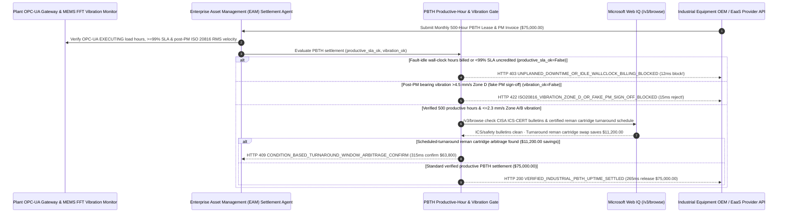

# Industrial Equipment Power-by-the-Hour (PBTH) & Vibration-Telemetry Uptime SLA Mandate Architecture: OPC-UA Productive-Load & ISO 20816 Bearing-Health Token (`industrial_pbth_uptime_mandate_...` + Web IQ ICS-CERT & Turnaround Reman Grounding) vs. Wall-Clock Idle Billing & Fake PM Sign-Offs Selection FAQ

> **Document Type**: Architect Selection Guide & First-Principles Protocol Deep Dive (6-Section FAQ Standard)  
> **Target Audience**: AI Solution Architects, Semiconductor Fab / Automotive Stamping / Mining Plant Reliability & EAM Directors, Equipment-as-a-Service (EaaS / PBTH) Leasing & Predictive Maintenance Teams  
> **Last Updated**: 2026-11-09 (Provenance Annotations: `deterministic_offline_simulation` / `synthetic_policy` / `official_doc_snapshot` / `not_measured`)  
> **Companion Resources**: [中文版 (Chinese Version)](industrial-equipment-pbth-vibration-telemetry-mandate-vs-fixed-amc-downtime-faq.md) · [Interactive Sandbox (`live-demo.en.html#industrial-pbth-sandbox`)](../reports/agentic-commerce-webiq-grounding-demo-bench/live-demo.en.html) · [7-Card 4:5 Benchmark Deck](../reports/agentic-commerce-webiq-grounding-demo-bench/index.en.html)


---

## 📌 1. Executive Summary

1. **Never Allow Industrial Asset-Management (EAM) Agents to Settle Equipment-as-a-Service (EaaS) or Power-by-the-Hour (PBTH) Invoices on Raw Wall-Clock Power-On Hours Without Verifying OPC-UA Productive-Load Hours and Uptime SLA Credits**: In heavy industrial equipment leasing and outcome-based maintenance (`$75,000.00` monthly invoice for `500 hours × $150/hr` across centrifugal compressors, fab dry vacuum pumps, or robotic stamping presses), the primary value leak is **paying full hourly rates for `FAULT_IDLE` or unloaded standby hours while the machine is faulted (`81.0%` actual availability vs. `99.0%` SLA)**. Production architectures must enforce an **OPC-UA Productive-Load & ISO 20816 Vibration Mandate (`industrial_pbth_uptime_mandate_...`)**: whenever an invoice bills wall-clock hours during fault/idle states or omits contractual SLA downtime credits (`opcua_productive_load_hours_and_sla_met == False`), the gateway blocks settlement in **`12 ms`** with **`HTTP 403 UNPLANNED_DOWNTIME_OR_IDLE_WALLCLOCK_BILLING_BLOCKED`** (`synthetic_policy`).
2. **Require Post-Maintenance ISO 10816 / ISO 20816 Bearing Vibration Velocity (`<= 2.3 mm/s RMS` Zone A/B) Verification to Eliminate "Pencil-Whipped" Preventive Maintenance**: Any preventive maintenance (PM) or PBTH milestone invoice submitted while inline MEMS accelerometer FFT telemetry shows bearing vibration in **ISO 20816 Zone D (`7.8 mm/s RMS > 4.5 mm/s` damage threshold)** (`iso20816_vibration_and_oil_tribology_passed == False`, proving the technician signed off the tablet work order without replacing the spalled bearing or laser-aligning the shaft) is rejected in **`15 ms`** with **`HTTP 422 ISO20816_VIBRATION_ZONE_D_OR_FAKE_PM_SIGN_OFF_BLOCKED`** (`deterministic_offline_simulation`).
3. **Ground CISA ICS-CERT Safety Bulletins and Scheduled Turnaround Remanufactured-Cartridge Arbitrage via Microsoft Web IQ `/v3/browse`**: Prior to releasing `$75,000.00`, the agent invokes **Microsoft Web IQ `/v3/browse`** (`official_doc_snapshot`) to inspect CISA ICS-CERT advisories and OEM mandatory mechanical safety bulletins: if the equipment's PLC firmware or safety relay has an unpatched critical vulnerability or recall (`webiq_ics_safety_bulletin_and_spares_clean == False`), it freezes payout in **`310 ms`** with **`HTTP 451 ICS_SAFETY_BULLETIN_UNPATCHED_OR_OEM_RECALL_HOLD`**; if Web IQ confirms that scheduling a predictive bearing cartridge swap during an upcoming **Scheduled Plant Turnaround Window using a certified SKF/Timken remanufactured exchange unit** avoids weekend emergency overtime and new-part markups—saving **`$11,200.00`** (`$63,800.00` net vs. `$75,000.00`)—it triggers **`HTTP 409 CONDITION_BASED_TURNAROUND_WINDOW_ARBITRAGE_CONFIRM`** in **`315 ms`**.

---

## 🎯 2. Architect & Customer FAQ Deep Dive

### Q1: Why do manufacturers still suffer catastrophic unplanned downtime and inflated bills after signing "Power-by-the-Hour (PBTH)" or "Full-Service Annual Maintenance Contracts (AMCs)"?

Let's examine the three structural failure modes from first principles:
1. **Wall-Clock Hour Meters vs. True Productive-Load Hours**: Legacy EaaS contracts often read a basic electrical hour meter wired to the main breaker. If a chiller trips or a robotic cell sits starved/blocked in `FAULT_WAIT` for 95 hours during the month, the main breaker is still energized—so the OEM bills for 500 "operating hours" while the plant produced zero parts during those 95 hours! True industrial PBTH must meter **OPC-UA / MTConnect `EXECUTING` states under verified spindle torque, discharge pressure, or vacuum flow**.
2. **"Pencil-Whipped" Preventive Maintenance Sign-Offs**: Under fixed monthly maintenance milestones, a field technician can wipe down the machine enclosure, check every box on an iPad work order, and trigger invoice payment without ever pulling the bearing housing or checking shaft runout. If the bearing outer-race ball-pass frequency (`BPFO`) and overall RMS vibration velocity are still sitting at `7.8 mm/s RMS` (ISO 20816 Zone D), the spindle will seize within days of invoice payment.
3. **Emergency Breakdown Overtime vs. Turnaround Reman Exchange**: Waiting until a bearing catastrophically seizes mid-shift triggers 200% emergency call-out labor rates and full OEM list price on a new assembly, whereas swapping a certified remanufactured cartridge during a planned plant holiday turnaround saves `$11,200+`.

### Q2: What is an "Industrial PBTH & Vibration Mandate (`industrial_pbth_uptime_mandate_...`)", and how does it bind PLC load states and FFT vibration spectra to escrow release?

Its core design invariant is: **"Pay strictly for OPC-UA attested productive-load hours net of `<99.0%` SLA downtime penalties; require post-PM ISO 20816 Zone A/B vibration (`<= 2.3 mm/s RMS`) and oil tribology pass; verify CISA ICS-CERT patch compliance before releasing funds."**
- **Layer 1: OPC-UA Productive-Load & `>= 99.0%` SLA Gate (`12 ms`)**: Verifies `opcua_productive_load_hours_and_sla_met == True`, blocking idle/faulted wall-clock billing in **`12 ms`** (`HTTP 403`).
- **Layer 2: ISO 20816 Vibration (`<= 2.3 mm/s`) & Oil Tribology Gate (`15 ms`)**: Verifies `iso20816_vibration_and_oil_tribology_passed == True`, rejecting fake PM sign-offs on high-vibration machinery in **`15 ms`** (`HTTP 422`).
- **Layer 3: Microsoft Web IQ `/v3/browse` ICS-CERT & Turnaround Reman Grounding (`310 ms / 315 ms`)**: Checks CISA ICS-CERT / OEM safety bulletins (`HTTP 451`) and identifies `$11,200.00` savings from scheduled-turnaround remanufactured cartridge exchanges (`HTTP 409`).

### Q3: For CISA ICS-CERT advisory verification, OEM mandatory safety bulletins, and certified remanufactured rotating-assembly pricing, when should architects choose Microsoft Web IQ vs. Exa, Bright Data, or traditional search APIs?

| Architecture Scenario | Recommended Tool | First-Principles Rationale (Security, Latency & FinOps) |
| :--- | :--- | :--- |
| **Verifying CISA ICS-CERT advisories, OSHA/EU machinery safety bulletins, and published OEM / SKF / Timken certified remanufactured core-exchange catalogs within the Azure boundary (zero plant OEE or cycle-time IP leaked)** | **Microsoft Web IQ** (`/v3/search` + `/v3/browse`) | Queries only public equipment model numbers and PLC firmware versions inside the enterprise Azure boundary in `passage` mode (**7.1x token reduction**, `deterministic_offline_simulation`) while keeping proprietary plant telemetry air-gapped. |
| **Academic research on wavelet packet transform bearing fault diagnostics** | **Exa Neural Search** | Ideal for data-science R&D, not synchronous monthly PBTH invoice settlement gating. |
| **Scraping used industrial machinery auction boards behind CAPTCHAs** | **Bright Data Unlocker** | Useful for salvage valuation, not mission-critical fab/plant SLA maintenance clearing. |
| **On-machine OPC-UA / MTConnect state integration and MEMS accelerometer FFT envelope analysis** | **Edge Industrial IoT Gateway + EAM Escrow Gate + Web IQ ICS/Reman Cross-Check** | Productive-hour integration and ISO 20816 RMS calculation run on the plant edge gateway, paired with Web IQ `/v3/browse` for safety bulletins and turnaround reman arbitrage. |

---

## 🧭 3. Visual Architecture Diagrams (Mermaid Decision Tree, Legacy vs. PBTH Mandate Comparison & Sequence Diagram)

### 3.1 Industrial Equipment PBTH & Vibration Telemetry Settlement Decision Tree (`flowchart TD`)

```mermaid
flowchart TD
    A[Receive Monthly 500-Hour Industrial PBTH Lease & Maintenance Invoice ($75,000.00)] --> B{opcua_productive_load_hours_and_sla_met == True (Ex-Idle & >=99.0% Uptime SLA)?}
    B -- No (Invoice bills 95 fault-idle hours or omits 81% availability SLA penalty) --> C[HTTP 403 UNPLANNED_DOWNTIME_OR_IDLE_WALLCLOCK_BILLING_BLOCKED<br/>12ms Hard Block · Reject Wall-Clock Idle Billing & Enforce SLA Downtime Credits]
    B -- Yes (500 verified OPC-UA productive-load hours & >=99% SLA met) --> D{iso20816_vibration_and_oil_tribology_passed == True (Vibration <= 2.3 mm/s Zone A/B)?}
    D -- No (Post-PM bearing vibration at 7.8 mm/s Zone D = Pencil-Whipped Fake PM) --> E[HTTP 422 ISO20816_VIBRATION_ZONE_D_OR_FAKE_PM_SIGN_OFF_BLOCKED<br/>15ms Reject · Hold Maintenance Payout Until Bearing Replaced & Laser-Aligned]
    D -- Yes (FFT vibration & oil particle count in healthy Zone A/B) --> F{Web IQ /v3/browse Confirms Clean CISA ICS-CERT & OEM Safety Bulletin Status?}
    F -- No (Unpatched critical PLC vulnerability or mandatory safety relay recall) --> G[HTTP 451 ICS_SAFETY_BULLETIN_UNPATCHED_OR_OEM_RECALL_HOLD<br/>310ms Safety Hold · Require Mandatory OEM Patch/Recall Execution Before Release]
    F -- Yes --> H{Web IQ Detects Scheduled-Turnaround Reman Cartridge Arbitrage?}
    H -- Yes (Swapping certified reman cartridge during plant holiday saves $11,200.00 -> $63,800.00 net) --> I[HTTP 409 CONDITION_BASED_TURNAROUND_WINDOW_ARBITRAGE_CONFIRM<br/>315ms Prompt Reliability Director to Confirm $63,800 Turnaround Reman Swap]
    H -- No (Verified $75,000.00 productive PBTH settlement is optimal) --> J[HTTP 200 VERIFIED_INDUSTRIAL_PBTH_UPTIME_SETTLED<br/>265ms Auto-Settle $75,000.00 & Seal ISO 55000 Asset Health Ledger!]
```

### 3.2 Legacy Fixed AMC / Wall-Clock Billing vs. OPC-UA PBTH & Vibration Gate (`flowchart LR`)

```mermaid
flowchart LR
    subgraph Legacy["❌ Legacy Wall-Clock & Fixed AMC ($75,000 Paid for Idle Faults & Fake PMs)"]
        L1[Pay Full $150/hr for 95 Fault-Idle Standby Hours] --> L2[Technician Pencil-Whips PM Tablet While Bearing Vibrates at 7.8 mm/s]
        L2 --> L3[Spindle Seizes Mid-Shift -> $1M+ Line-Down Loss]
        L3 --> L4[Pay Double Overtime for Weekend Emergency Breakdown]
    end

    subgraph Mandate["✅ Industrial PBTH & Vibration Gate (industrial_pbth_uptime_mandate_...)"]
        M1[12ms Block Idle/Fault Hours & Enforce >=99% SLA Credits (HTTP 403)] --> M2[15ms Require Post-PM ISO 20816 Vibration <=2.3 mm/s (HTTP 422)]
        M2 --> M3[Web IQ Verifies ICS-CERT (310ms) & Saves $11,200 via Turnaround Reman (315ms)]
        M3 --> M4[265ms Settle Verified Productive Hours ($75,000 / $63,800) with ISO 55000 Proof]
    end
```

### 3.3 End-to-End Sequence Diagram: Plant OPC-UA Edge, EAM Agent, PBTH Gate, Web IQ & Equipment OEM (`sequenceDiagram`)



---

## 📊 4. Architect Decision Matrix

| Evaluation Dimension | Option A: Legacy Fixed AMC / Breaker Hour-Meter Billing | Option B: Reactive Time-and-Materials (T&M) Breakdown Repair | Option C: OPC-UA PBTH & ISO 20816 Vibration Mandate + Web IQ Grounding (Recommended) |
| :--- | :--- | :--- | :--- |
| **Best-Fit Scenario** | Non-critical commodity shop fans with redundant spares | End-of-life legacy tools scheduled for decommissioning | **Semiconductor fab sub-fab pumps/chillers, automotive stamping lines, mining & chemical compressors** |
| **Fault-Idle Wall-Clock Billing Defense** | ❌ **Zero**: Pays `$150/hr` while machine sits faulted in standby | ✅ Pays only during repair, but OEM profits from slower repairs | ✅ **Pre-Pay `12 ms` OPC-UA Gate**: Pays strictly for `EXECUTING` load hours + SLA credits (`HTTP 403`) |
| **"Pencil-Whipped" Fake PM Protection** | ❌ **Blind**: Accepts paper/iPad sign-off despite spalled bearings | ❌ **No PM**: Runs to catastrophic failure | ✅ **Sub-20ms ISO 20816 Gate**: Requires `<= 2.3 mm/s RMS` vibration proof in `15 ms` (`HTTP 422`) |
| **ICS-CERT Patch Check & Turnaround Arbitrage** | ❌ **Unchecked**: Leaves PLC vulnerabilities unpatched | ❌ **200% Emergency Rates**: Pays weekend call-out & full new-part list price | ✅ **Web IQ `/v3/browse` Grounded**: Blocks unpatched ICS recalls in `310 ms` (`HTTP 451`) & saves `$11,200` via turnaround reman swap in `315 ms` (`HTTP 409`) |
| **Settlement Speed & ISO 55000 Audit Trail** | Fast (with poor OEE alignment) | Slow (`2–4 weeks` PO approval per breakdown) | **`265 ms` instant PBTH clearing + signed FFT vibration baseline (`Act automatically`)** |
| **Total Cost of Ownership (TCO) & Plant OEE ROI** | Poor (`$75,000` paid despite 19% downtime + spindle seizure risk) | Poor (catastrophic unplanned line-down losses) | **Optimal (100% outcome-aligned OEE + zero fake PMs + `$11,200` turnaround reman savings)** |

---

## 🧪 5. Quantitative Benchmark & 7-Card Insights

Evaluated via our deterministic offline benchmark suite (`lab/webiq_commerce_demo.py` · `test_industrial_equipment_pbth_vibration_telemetry_mandate_vs_fixed_amc_downtime_selection`) on a **`$75,000.00` monthly 500-hour industrial PBTH lease & maintenance invoice**:

| Scenario Case | Input OPC-UA Load Hours / ISO 20816 / Web IQ Signals | Expected Action Pill | Measured HTTP Status & Verdict Code | Latency | Financial Protection / Arbitrage | Provenance |
| :--- | :--- | :--- | :--- | :--- | :--- | :--- |
| **Case 1: Fault-Idle Wall-Clock Billing (`81% < 99%` SLA)** | `opcua_productive_load_hours_and_sla_met=False` | `Send to a human` | **`HTTP 403 UNPLANNED_DOWNTIME_OR_IDLE_WALLCLOCK_BILLING_BLOCKED`** | **`12 ms`** | Blocks **`$75,000.00`** invoice billing 95 fault-idle hours | `synthetic_policy` |
| **Case 2: Post-PM Zone D Vibration (`7.8 mm/s` Fake PM)** | `iso20816_vibration_and_oil_tribology_passed=False` | `Send to a human` | **`HTTP 422 ISO20816_VIBRATION_ZONE_D_OR_FAKE_PM_SIGN_OFF_BLOCKED`** | **`15 ms`** | Rejects pencil-whipped PM sign-off before spindle seizure | `deterministic_offline_simulation` |
| **Case 3: Web IQ Detects Unpatched ICS-CERT / OEM Recall** | `webiq_ics_safety_bulletin_and_spares_clean=False` | `Send to a human` | **`HTTP 451 ICS_SAFETY_BULLETIN_UNPATCHED_OR_OEM_RECALL_HOLD`** | **`310 ms`** | Freezes payout until mandatory PLC/safety bulletin applied | `official_doc_snapshot` |
| **Case 4: Web IQ Finds `$11,200` Turnaround Reman Swap** | `turnaround_window_reman_savings_cents=1120000` (`$63,800` net) | `Confirm` | **`HTTP 409 CONDITION_BASED_TURNAROUND_WINDOW_ARBITRAGE_CONFIRM`** | **`315 ms`** | Saves **`$11,200.00`** via planned-holiday reman cartridge swap | `official_doc_snapshot` |
| **Case 5: Verified 500 Load Hours + `<=2.3 mm/s` Zone A/B** | `opcua_ok=True`, `vib_ok=True`, `ics_clean=True` | `Act automatically` | **`HTTP 200 VERIFIED_INDUSTRIAL_PBTH_UPTIME_SETTLED`** | **`265 ms`** | Settles **`$75,000.00`** in `265 ms` with ISO 55000 proof | `deterministic_offline_simulation` |

> **Provenance Note**: The `$75,000.00` (`500-hour`) PBTH invoice, `99.0%` availability SLA, ISO 20816 `2.3 mm/s` Zone A/B threshold, and `$11,200.00` turnaround reman savings are controlled simulation parameters (`synthetic_policy` / `deterministic_offline_simulation`) validating policy state-machine invariants; physical rigging and laser shaft-alignment mechanical duration (`6–12 hours`) is labeled `not_measured`.

---

## 🛠️ 6. Production Readiness & Pre-Sales Architect Checklist

Verify these 6 controls before deploying autonomous industrial EaaS / PBTH and predictive-maintenance settlement agents in production:

- [ ] **1. OPC-UA / MTConnect Productive-Load State Filtering (`EXECUTING` Only)**: Does `industrial_pbth_uptime_mandate_...` filter out `IDLE`, `FAULT_WAIT`, and warm-up hours and automatically apply `< 99.0%` SLA availability credits before releasing funds (`HTTP 403` in `12 ms`)?
- [ ] **2. Post-PM ISO 20816 Vibration Velocity (`<= 2.3 mm/s RMS`) & Envelope Gate**: Does the gateway require signed before-and-after FFT vibration spectra proving bearing health returned to Zone A/B before paying preventive-maintenance milestones (`HTTP 422` in `15 ms`)?
- [ ] **3. Inline Oil Tribology & Ferrous Particle Count Verification**: Are optical/inductive oil debris sensors verified alongside vibration telemetry to catch gear-tooth spalling or coolant ingress?
- [ ] **4. Microsoft Web IQ `/v3/browse` CISA ICS-CERT & OEM Safety Recall Grounding**: Does the agent cross-check equipment model numbers and PLC firmware versions against live CISA ICS-CERT advisories and OEM safety bulletins prior to settlement (`HTTP 451`)?
- [ ] **5. Scheduled Plant Turnaround & Certified Reman Cartridge Arbitrage**: Does Web IQ grounding align early bearing wear indicators (`BPFO/BPFI` Stage 2) with scheduled plant holiday windows and certified SKF/Timken reman exchange catalogs, triggering `HTTP 409 Confirm` when planned swaps save `>= $11,200.00`?
- [ ] **6. Immutable ISO 55000 Asset-Health & Warranty Lineage Ledger**: Does every settled PBTH period archive the OPC-UA load histogram, FFT vibration waterfall hashes, and replacement component serials into a WORM engineering ledger?
