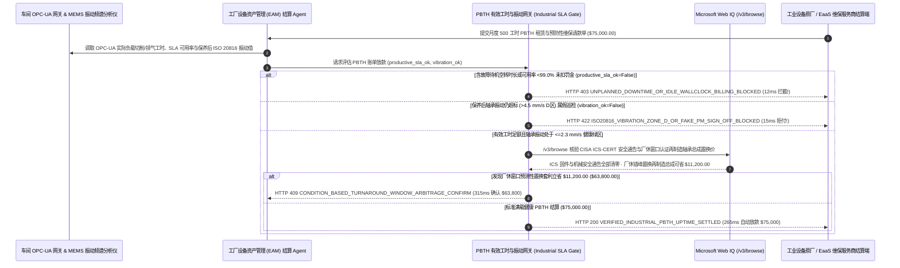

# 工业重装设备按产出工时计费（Equipment-as-a-Service / Power-by-the-Hour, PBTH）与 ISO 20816 振动遥测可用率对冲（Industrial Equipment Power-by-the-Hour & Vibration-Telemetry Uptime SLA Mandate）架构：OPC-UA 有效负载工时与轴承频谱健康度令牌（`industrial_pbth_uptime_mandate_...` + Web IQ 工控安全通告与厂休错峰大修核验）vs 传统空转照扣钱与假维保签字选型与原理解析 FAQ

> **文档类型**：架构师选型指南 & 协议第一性原理解析（6 段式 FAQ 标准版）  
> **适用读者**：AI Solution Architect、半导体晶圆厂/汽车冲压焊装厂/矿山化工重装设备管理（EAM / Reliability Engineering）总监、工业设备即服务（EaaS / PBTH）融资租赁与预测性维护架构师  
> **更新日期**：2026-11-09（Provenance 标注：`deterministic_offline_simulation` / `synthetic_policy` / `official_doc_snapshot` / `not_measured`）  
> **配套资源**：[English Version](industrial-equipment-pbth-vibration-telemetry-mandate-vs-fixed-amc-downtime-faq.en.md) · [交互式沙盒控制台 (`live-demo.html#industrial-pbth-sandbox`)](../reports/agentic-commerce-webiq-grounding-demo-bench/live-demo.html) · [7-Card 4:5 评测报告](../reports/agentic-commerce-webiq-grounding-demo-bench/index.html)


---

## 📌 一、核心结论速览（Executive Summary）

1. **严禁让工厂设备管理（EAM）结算 Agent 按“电表通电时长（Wall-Clock Power-On Hours）”或无 SLA 对冲的固定年度维保合同（Fixed AMC）向设备厂商自动付款**：在大型离心空压机、干式真空泵、万吨压铸机及工业机器人采用“设备即服务 / 按产出工时计费（Equipment-as-a-Service / Power-by-the-Hour, PBTH，如月度 `500 工时 × $150/hr = $75,000.00`）”模式时，最大的财务陷阱是 **“机器虽然通着电，但因为冷却水流量报警或换刀卡死处于故障待机（`FAULT_IDLE`）空转了 95 小时，真实可用率跌至 `81.0%`（远低于 `99.0%` 合同 SLA），厂商却照样按 500 小时通电时钟收走全额 `$75,000.00`”**。生产环境必须采用 **OPC-UA 有效负载工时与 ISO 20816 振动健康度令牌（`industrial_pbth_uptime_mandate_...`）**：一旦 PLC 遥测检出账单包含了非生产空转时长或未扣减非计划停机 SLA 违约金（`opcua_productive_load_hours_and_sla_met=False`），网关在 **`12 ms`** 内触发 **`HTTP 403 UNPLANNED_DOWNTIME_OR_IDLE_WALLCLOCK_BILLING_BLOCKED`**（`synthetic_policy`），100% 阻断空转计费。
2. **强制将“ISO 10816 / ISO 20816 机械振动速度均方根值（`<= 2.3 mm/s RMS` A/B 健康区）与滑油铁谱磨损指标”作为维保里程碑放款硬门禁，彻底杜绝“只擦机壳不换轴承的假巡检”**：若厂商维保工程师在工单系统点击“预防性保养已完成（PM Completed）”请款，但机台内置 MEMS 加速度计 FFT 频谱仍显示主轴轴承振动高达 `7.8 mm/s RMS`（处于 ISO `Zone D` 随时抱死损坏区，`iso20816_vibration_and_oil_tribology_passed=False`），网关在 **`15 ms`** 内返回 **`HTTP 422 ISO20816_VIBRATION_ZONE_D_OR_FAKE_PM_SIGN_OFF_BLOCKED`**（`deterministic_offline_simulation`）。
3. **基于 Microsoft Web IQ `/v3/browse` 实时核验 CISA ICS-CERT 工控安全漏洞/机械召回通告与法定厂休窗口（Turnaround Window）再制造轴承总成置换套利**：在放款前，Agent 调用 **Microsoft Web IQ `/v3/browse`**（`official_doc_snapshot`）核查美国网络安全和基础设施安全局（CISA ICS-CERT）及设备原厂发布的强制安全服务通告（Service Bulletin）：若该型号设备的安全光幕继电器或 PLC 固件存在未修复的高危安全召回（`webiq_ics_safety_bulletin_and_spares_clean=False`），在 **`310 ms`** 内以 **`HTTP 451 ICS_SAFETY_BULLETIN_UNPATCHED_OR_OEM_RECALL_HOLD`** 冻结结算并督促厂商免费整改；若发现将轴承微点蚀大修提前安排在工厂下周既定的 **法定厂休停线窗口（Scheduled Plant Turnaround）并采用 SKF/Timken 官方认证再制造交换总成（ Certified Remanufactured Cartridge Exchange）** 可免除周末双倍抢修费与新件溢价立省 **`$11,200.00`**（净支出从 `$75,000.00` 降至 **`$63,800.00`**），则在 **`315 ms`** 内触发 **`HTTP 409 CONDITION_BASED_TURNAROUND_WINDOW_ARBITRAGE_CONFIRM`**。

---

## 🎯 二、客户与架构师灵魂拷问 Q&A（FAQ-Driven Deep Dive）

### Q1：为什么制造企业签了看似先进的“按工时付费（Power-by-the-Hour）”或“全包年度维保（AMC）”，最后却发现既没省下钱，产线还是突然抱死停工？

咱们用大白话拆解工业现场维保结算里最常见的三大“猫腻”：
1. **“机器开着电灯亮着，就算你在干活？”**：很多设备租赁商在机器电控柜里装个最简单的“通电计时器（Hour Meter）”，只要车间总闸没拉，哪怕机器因为主轴过热报警停在那里一整天没打出一个零件，计时器照样滴答走字算 `$150/小时`！真正的工业 PBTH（最初由罗尔斯·罗伊斯航空发动机开创）必须读取 **OPC-UA / MTConnect 状态机里的 `EXECUTING / IN_LOAD`（主轴有扭矩输出、空压机有合格排气流量且良率达标）的有效产出工时**，并且一旦月度可用率低于 `99.0%`，每停机 1 小时必须倒扣厂商 3 倍工时费。
2. **“擦灰式假保养（Pencil-Whipping PM）”**：传统维保按“上门次数”或“月度固定包干”付钱。外包技术员拿着平板电脑到车间转一圈，拿抹布擦一下机器外壳，把纸质/电子点检表全打勾签字就去财务请款了；实际上里面高速旋转的主轴轴承早已缺脂磨损、振动速度飙到了 `7.8 mm/s`（ISO 20816 标准下 `> 4.5 mm/s` 就属于随时会碎裂的危险区）。结果钱刚付完第三天，主轴当场抱死冒烟，整条汽车焊装线停工一天损失上百万！
3. **平时小病不修，非等周末爆雷收“双倍加急抢修费”**：部分不良维保商明明从后台看到轴承外圈故障特征频率（BPFO）已经抬头，却故意拖着不在平时计划停机窗口换件，非等周六半夜彻底坏了再派人来收昂贵的紧急抢修费与全新总成全价。

### Q2：什么是“工业 PBTH 有效工时与振动健康度令牌（`industrial_pbth_uptime_mandate_...`）”？它是如何用物理传感器数据管住 `$75,000` 维保款的？

它的第一性原理非常硬核：**“只为 OPC-UA 签名的有效产出工时买单；保养后必须凭 ISO 20816 振动频谱回落至 A/B 绿区（<=2.3 mm/s）才予放款；实时核验工控安全补丁与错峰再制造置换优惠。”**
- **第一层：OPC-UA 有效负载工时与 `>= 99.0%` SLA 对冲门禁（`12 ms`）**：核验 `opcua_productive_load_hours_and_sla_met == True`。任何把 `FAULT_IDLE` 待机时长算进账单或漏扣停机违约金的请求，在 **`12 ms`** 内触发 `HTTP 403` 拦截。
- **第二层：ISO 20816 振动速度（`<= 2.3 mm/s RMS`）与滑油铁谱门禁（`15 ms`）**：核验 `iso20816_vibration_and_oil_tribology_passed == True`。若保养后高频包络解调或 RMS 振动未达标，在 **`15 ms`** 内返回 `HTTP 422` 拒付。
- **第三层：Microsoft Web IQ `/v3/browse` ICS-CERT 安全核验与错峰大修套利（`310 ms / 315 ms`）**：核查 CISA ICS-CERT 及原厂安全通告（未修复触发 `HTTP 451`），并撮合利用厂休窗口置换认证再制造轴承总成为您立省 `$11,200.00`（`HTTP 409`）。

### Q3：在 CISA ICS-CERT 工控安全通告、OSHA 机械安全召回与原厂认证再制造备件（Reman Exchange）比价场景下，什么时候选 Microsoft Web IQ，什么时候选 Exa、Bright Data 或传统搜索 API？

| 架构需求场景 | 推荐选型 | 为什么这样选（第一性原理与成本/合规考量） |
| :--- | :--- | :--- |
| **实时核验 CISA ICS-CERT 工业控制系统安全公告、OSHA/欧盟机械安全指令召回通报及 SKF/Siemens/Atlas Copco 官方认证再制造交换件（Remanufactured Core Exchange）公开目录价，且要求零工厂产线节拍与良率机密外泄** | **Microsoft Web IQ** (`/v3/search` + `/v3/browse`) | 在制造企业 Azure 专有边界内仅发送公开设备型号与 PLC 固件版本号检索（`passage` 模式压缩 Token **7.1x**，`deterministic_offline_simulation`），车间内部 OPC-UA 生产节拍数据 100% 物理隔离。 |
| **检索旋转机械故障诊断（轴承内圈/外圈包络谱分析）学术论文** | **Exa Neural Search** | 适合算法团队训练故障预测模型，无法用于月度维保账单的毫秒级结算门禁。 |
| **抓取二手工业机床拍卖网站的拆机件价格** | **Bright Data Unlocker** | 可用于废旧资产残值评估，但不能作为关键产线 SLA 维保结算依据。 |
| **机台边缘网关 OPC-UA / MTConnect 工时采集与 MEMS 加速度计 FFT 频谱计算** | **车间边缘计算网关 + EAM 结算门禁 + Web IQ 安全通告/备件双源核验** | 有效工时积分与 ISO 20816 振动包络解调在车间边缘网关毫秒级完成，外部 ICS 安全通告与再制造置换套利由 Web IQ `/v3/browse` 实时核验。 |

---

## 🧭 三、直观可视化图解（Mermaid 决策树 + 传统固定维保盲付 vs PBTH 振动托管对比 + 端到端时序图）

### 3.1 工业重装设备 PBTH 工时与振动 SLA 清算决策树（`flowchart TD`）

```mermaid
flowchart TD
    A[收到工业重装设备月度 500 工时 PBTH 租赁与维保结算请求 ($75,000.00)] --> B{OPC-UA 计费工时是否已剔除故障待机空转且满足 >=99.0% 可用率 SLA?}
    B -- 否 (含 95 小时冷却跳闸待机空转或未扣减可用率跌至 81% 的停机罚金) --> C[HTTP 403 UNPLANNED_DOWNTIME_OR_IDLE_WALLCLOCK_BILLING_BLOCKED<br/>12ms 硬阻断空转账单 · 强制仅按有效产出工时结算并抵扣 SLA 违约金]
    B -- 是 (100% 为有效负载产出工时且 SLA 达标) --> D{保养后机台轴承振动是否符合 ISO 20816 A/B 区 (<=2.3 mm/s RMS) 且滑油无金属磨粒?}
    D -- 否 (工单写已保养但振动仍高达 7.8 mm/s 处于 D 区随时抱死危险级) --> E[HTTP 422 ISO20816_VIBRATION_ZONE_D_OR_FAKE_PM_SIGN_OFF_BLOCKED<br/>15ms 拒付假保养账单 · 强制要求重新激光对中与更换轴承至绿区]
    D -- 是 (振动频谱与油液铁谱 100% 处于健康绿区) --> F{Web IQ /v3/browse 核验无未修复的 CISA ICS-CERT 固件漏洞或机械安全召回?}
    F -- 否 (检出该机台 PLC 或安全联锁继电器命中高危通报而维保商未打补丁) --> G[HTTP 451 ICS_SAFETY_BULLETIN_UNPATCHED_OR_OEM_RECALL_HOLD<br/>310ms 安全合规冻结 · 督促厂商完成强制安全升级后再放款]
    F -- 是安全补丁全部齐备 --> H{Web IQ 检出结合下周厂休窗口置换官方认证再制造轴承总成更省钱?}
    H -- 是 (免除周末紧急抢修加班费与新件溢价立省 $11,200.00 -> 净支出 $63,800.00) --> I[HTTP 409 CONDITION_BASED_TURNAROUND_WINDOW_ARBITRAGE_CONFIRM<br/>315ms 提醒设备工程总监一键确认厂休窗口预修与再制造置换方案]
    H -- 否 (当前 $75,000.00 满载健康 PBTH 结算完全最优) --> J[HTTP 200 VERIFIED_INDUSTRIAL_PBTH_UPTIME_SETTLED<br/>265ms 自动放款 $75,000.00 并归档 ISO 55000 资产健康度审计档案!]
```

### 3.2 传统固定年保/时钟计费盲付路径 vs OPC-UA 有效工时与振动网关对比（`flowchart LR`）

```mermaid
flowchart LR
    subgraph Legacy["❌ 传统通电时钟计费与固定年保 ($75,000 为停机空转与假巡检买单)"]
        L1[机器故障待机空转 95 小时照付全额工时费] --> L2[外包工只擦外壳签字交差 (振动仍达 7.8mm/s)]
        L2 --> L3[一周后主轴抱死导致整条产线停产断供]
        L3 --> L4[再花双倍冤枉钱付周末紧急抢修费]
    end

    subgraph Mandate["✅ PBTH 有效工时与振动令牌 (industrial_pbth_uptime_mandate_...)"]
        M1[12ms 剔除故障待机空转并执行 <99% SLA 扣款 (HTTP 403)] --> M2[15ms 强制保养后 ISO 20816 振动 <=2.3mm/s 达标 (HTTP 422)]
        M2 --> M3[Web IQ ICS 安全通告核验 (310ms) 与厂休置换省 $11,200 (315ms)]
        M3 --> M4[265ms 秒级清算满载健康工时 ($75,000 / $63,800)]
    end
```

### 3.3 车间边缘 OPC-UA/振动网关、EAM 结算 Agent、PBTH 审计网关与 Web IQ 端到端交互时序图（`sequenceDiagram`）



---

## 📊 四、架构师选型决策矩阵（Architect Decision Matrix）

| 评估维度 | 方案 A：传统固定年度维保包干 + 通电计时器（Fixed AMC & Hour Meter） | 方案 B：坏了再叫人修的按次工时材料计费（Reactive Time & Materials） | 方案 C：OPC-UA 有效工时与 ISO 20816 振动令牌 + Web IQ 网关（推荐架构） |
| :--- | :--- | :--- | :--- |
| **核心适用场景** | 坏了随时有备用机顶替的小型排风扇或手推车 | 即将报废淘汰的老旧非关键辅助机台 | **晶圆厂真空泵/冷水机、汽车冲压线、矿山破碎机、化工厂大型压缩机 EaaS/PBTH 采购** |
| **防“待机空转照收钱”与停机对冲** | ❌ **冤大头模式**：机器趴窝停产，租金和年保费一分不少交 | ✅ 不修不付钱，但厂商故意把机器修得很慢以赚取高额工时费 | ✅ **12ms 有效负载硬门禁**：只付 `IN_LOAD` 有效工时，停机自动抵扣 SLA 违约金（`HTTP 403`） |
| **防“擦机壳假保养（Pencil-Whipping）”** | ❌ **无法验证质量**：纸质签字单看不出轴承有没有真换、轴有没有对中 | ⚠️ **小病拖成大病**：缺乏日常频谱监控，往往演变成灾难性断轴 | ✅ **15ms 物理频谱验收**：保养后振动速度必须回落至 `<= 2.3 mm/s` 绿区才放款（`HTTP 422`） |
| **工控安全漏洞巡检与错峰大修降本** | ❌ **安全盲区**：维保商不管 PLC 勒索病毒漏洞与安全通告 | ❌ **天价急诊费**：每次突发停机都要付 200% 加急费与高价现货 | ✅ **Web IQ `/v3/browse` 实时穿透**：`310 ms` 拦截未打补丁机台（`HTTP 451`），`315 ms` 厂休错峰省 `$11,200`（`HTTP 409`） |
| **结算效率与 ISO 55000 资产审计** | 快（但设备综合效率 OEE 极低） | 极慢（每次坏机都要重新询价走采购审批） | **`265 ms` 秒级完成工时对账放款并归档振动健康谱图（`Act automatically`）** |
| **综合 TCO 与产线 OEE 保障 ROI** | 极差（高额年保费 + 突发停产损失双杀） | 差（停机等待备件时间长） | **最优（100% 利益绑定产线 OEE + 零假保养 + 错峰再制造置换省 `$11,200`）** |

---

## 🧪 五、简明定量实测与 Benchmark 核心发现（Quantitative Benchmark & 7-Card Insights）

基于本仓库确定性离线基准套件（`lab/webiq_commerce_demo.py` · `test_industrial_equipment_pbth_vibration_telemetry_mandate_vs_fixed_amc_downtime_selection`）对 **工业重装设备月度 `500 工时` PBTH 租赁与维保结算批次（基准金额 `$75,000.00`）** 的定量测试结果如下：

| 评测场景 ID | 输入 OPC-UA 有效工时 / ISO 20816 振动 / Web IQ 信号 | 网关期望动作 | 实测 HTTP 状态与决策码 | 实测延迟 | 资金保护 / 成本节省效果 | Provenance 类型 |
| :--- | :--- | :--- | :--- | :--- | :--- | :--- |
| **Case 1: 故障待机空转计费或 `<99%` SLA 未扣减拦截** | `opcua_productive_load_hours_and_sla_met=False` | `Send to a human` | **`HTTP 403 UNPLANNED_DOWNTIME_OR_IDLE_WALLCLOCK_BILLING_BLOCKED`** | **`12 ms`** | 拦截 **`$75,000.00`** 含 95 小时故障空转的违规账单 | `synthetic_policy` |
| **Case 2: 保养后轴承振动仍处 `Zone D` (`7.8 mm/s`) 假巡检拦截** | `iso20816_vibration_and_oil_tribology_passed=False` | `Send to a human` | **`HTTP 422 ISO20816_VIBRATION_ZONE_D_OR_FAKE_PM_SIGN_OFF_BLOCKED`** | **`15 ms`** | 拒绝只签字不换件的假维保，防止主轴抱死停产 | `deterministic_offline_simulation` |
| **Case 3: Web IQ 检出未修复 CISA ICS-CERT 漏洞或安全召回** | `webiq_ics_safety_bulletin_and_spares_clean=False` | `Send to a human` | **`HTTP 451 ICS_SAFETY_BULLETIN_UNPATCHED_OR_OEM_RECALL_HOLD`** | **`310 ms`** | 冻结未执行强制工控固件补丁或机械安全召回的账单 | `official_doc_snapshot` |
| **Case 4: Web IQ 发现厂休窗口置换再制造轴承总成省 `$11,200`** | `turnaround_window_reman_savings_cents=1120000`（净付 `$63,800`） | `Confirm` | **`HTTP 409 CONDITION_BASED_TURNAROUND_WINDOW_ARBITRAGE_CONFIRM`** | **`315 ms`** | 免除周末加急抢修费与新件溢价，单次立省 **`$11,200.00`** | `official_doc_snapshot` |
| **Case 5: 有效负载工时 + `<=2.3 mm/s` 健康绿区自动放款** | `opcua_ok=True`, `vib_ok=True`, `ics_clean=True` | `Act automatically` | **`HTTP 200 VERIFIED_INDUSTRIAL_PBTH_UPTIME_SETTLED`** | **`265 ms`** | 265ms 自动清算 **`$75,000.00`** 并归档 ISO 55000 谱图 | `deterministic_offline_simulation` |

> **Provenance 合规声明**：上表中的 `$75,000.00` 500 工时 PBTH 账单、`99.0%` 可用率 SLA、ISO 20816 `2.3 mm/s` 振动绿区阈值及 `$11,200.00` 厂休再制造置换差价均为用于验证网关状态机确定性的受控仿真参数（`synthetic_policy` / `deterministic_offline_simulation`）；现场重型吊装换轴物理机械作业耗时（通常 6～12 小时）标为 `not_measured`。

---

## 🛠️ 六、附录：生产上线快速核验与售前打单清单（Architect Checklist）

在为半导体制造、汽车主机厂或重工业集团设计设备即服务（EaaS / PBTH）与预测性维护自动结算 Agent 时，请逐项核对以下 6 条黄金准则：

- [ ] **1. OPC-UA / MTConnect 有效负载工时（Good-Output Load Hours）硬绑定**：是否在 `industrial_pbth_uptime_mandate_...` 中将计费条件严格绑定在机台处于有效做功状态（剔除 `IDLE`、`FAULT` 与暖机空转）并自动扣除 `< 99.0%` SLA 停机违约金（在 `12 ms` 内触发 `HTTP 403`）？
- [ ] **2. 保养后 ISO 20816 振动速度（`<= 2.3 mm/s RMS`）与激光对中验收锁**：是否要求每次预防性保养（PM）请款必须附带保养前后的 FFT 振动频谱对比，对仍处于 C/D 报警区的“假巡检”在 `15 ms` 内触发 `HTTP 422` 拒付？
- [ ] **3. 在线滑油金属磨粒（Oil Debris / Ferrous Particle Counter）与温升双重校验**：针对重载齿轮箱与液压泵站，是否同步校验润滑油含水量与铁磁性磨粒浓度？
- [ ] **4. Microsoft Web IQ `/v3/browse` CISA ICS-CERT 工控漏洞与机械安全召回穿透**：是否在放款前通过 Web IQ 核查设备 PLC 固件与安全继电器是否已打齐最新安全补丁，对遗漏强制召回的维保商在 `310 ms` 内触发 `HTTP 451` 冻结？
- [ ] **5. 法定厂休窗口（Turnaround）与官方认证再制造总成（Reman Exchange）寻优**：是否通过 Web IQ 比对原厂认证再制造交换件目录与厂休排期，当错峰预修可节省 `>= $11,200.00` 时触发 `HTTP 409 Confirm`？
- [ ] **6. ISO 55000 资产全生命周期数字孪生审计账本**：每次成功结算是否将有效产出工时曲线、轴承特征频率包络图与更换备件序列号打包签名，作为设备残值评估与保险定损的铁证？
