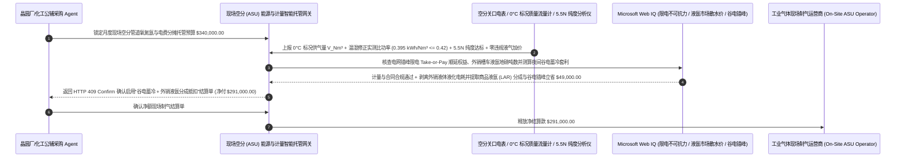

# 工业气体现场制气（On-Site ASU 管道氧/氮/氩）、比功率能耗封顶（$\le 0.42\text{ kWh/Nm}^3$）与跳机液态后备免责智能托管 vs 传统照付不议与电费直通盲付：架构选型与第一性原理 FAQ

> **核心阅读指南（3 分钟速通）**：本文面向负责半导体晶圆厂大宗电子特气（Bulk Ultra-High-Purity $\text{N}_2/\text{O}_2/\text{Ar}$）、光伏电池片厂、大型钢铁冶金及现代煤化工园区现场深冷空分制气（On-Site Air Separation Unit, ASU / TGS）采购结算 Agent 的 AI 解决方案架构师（AI Solution Architect）。我们将用最通俗的商业第一性原理，讲清楚**为什么不能让公辅动力采购 Agent 仅凭工业气体巨头（如 Linde、Air Liquide、Air Products、盈德气体）发来的月度“固定设备月租（MFC）+ 100% 实际电费直通转嫁（Pass-Through Electricity）+ 液态储罐后备气化附加费”账单就自动全额划款**，以及如何通过 **ASME PTC 10 折算单位制气比功率硬封顶（Specific Power $\le 0.42\text{ kWh/Nm}^3$）、空分厂自身故障跳机期间后备液氮/液氧（LIN/LOX Backup）零溢价免责门禁、$0^\circ\text{C}$ vs $20^\circ\text{C}$ 标况体积防偷换校核与副产商品液氩（Merchant LAR）外销分成智能托管**，彻底杜绝“气体商不清洗空压机冷却器导致多耗 18% 电费全由买方买单、气体商自己机器坏了用储罐液氮顶替却按 5 倍零售槽车价宰客、用买方的电偷偷多熬高价液氩拉出去卖却一分钱不分给买方”三大工业气体合同黑洞。


---

## ① 📌 核心结论速览（Executive Summary）

1. **现场制气（On-Site ASU BOO/BOT）合同中最隐蔽的三大“旱涝保收”剪刀差：电费全额转嫁导致气体商根本不在乎设备省不省电、机器坏了用后备液氮反而赚得更多、副产外销液气白蹭买方变电站**：
   - 大型工厂通常与气体巨头签订 15 年期的 **现场空分制气（On-Site ASU Take-or-Pay）** 协议：气体商投资建设深冷空分塔，买方提供场地和高压电力，每月支付“固定基础费（Monthly Facility Charge, MFC）+ 可变电费 + 液态后备气化费”。传统合同藏着三个巨坑：
     - **第一是“实报实销电费直通（Uncapped Power Pass-Through）”**：深冷空分最大的成本是主空气压缩机（MAC）耗电。如果合同允许气体商将电表读数 100% 转嫁给买方，当空压机叶轮结垢、级间冷却器堵塞导致比功率从 `0.40 kWh/Nm³` 恶化到 `0.49 kWh/Nm³` 时，气体商根本懒得停机大修——因为多烧掉的几十万度冤枉电全由买方掏钱！
     - **第二是“空分跳机却收 5 倍天价后备液氮费（Supplemental Liquid Vaporization Trap）”**：当空分塔因气体商自身维护不当发生非计划跳机（Unscheduled Trip）时，为保住晶圆厂或化工厂不断气，系统会自动打开后备液氮/液氧储罐（LIN/LOX Backup Tank）气化供气；随后气体商竟然按 **`$180/吨` 的外部槽车零售高价** 向买方收取补液费（比正常管道气贵 `4–6 倍`），等于“他机器坏了，还要罚你的钱”！
     - **第三是“$0^\circ\text{C}$ 标准立方米（$\text{Nm}^3$）与 $20^\circ\text{C}$ 工程立方米（$\text{Sm}^3$）偷换虚增 $7.3\%$ 气量”**，以及气体商利用空分塔富余冷量消耗买方的电生产高价 **商品液氩（LAR）/ 液氮（LIN）** 用槽车拉出厂外卖，却不抵扣买方月租！
2. **第一性原理破局：从“实报实销电费+见液气单即付”升级为“比功率硬封顶 + 跳机液气按管道价结算 + 副产外销液氩分成智能托管”**：
   - 架构师必须在公辅动力结算网关部署 **现场空分比功率封顶与液态后备免责智能托管（On-Site ASU Specific Power & Liquid-Backup Smart Escrow）**。任何月度气费释放必须同时通过四道硬门禁：
     1. **等温折算比功率能耗硬封顶（Guaranteed Specific Power $\le 0.42\text{ kWh/Nm}^3$）与跳机后备液气免责门禁**：按环境温湿度修正曲线核定理论应耗电量 $E_{\text{allow}} = V_{\text{Nm}^3} \times \text{SPC}_{\text{guaranteed}}$，超出上限的无效电耗 100% 从月度账单中倒扣；且凡因空分厂自身设备故障或计划内维保动用的储罐后备液态气化量，一律强制按**常规管道气单价（Pipeline Rate）**结算，严禁收取槽车液气溢价；
     2. **ISO 13443 参比温度（$0^\circ\text{C}, 101.325\text{ kPa}$ $\text{Nm}^3$）温压补偿与 5.5N 超高纯度（$\ge 99.9995\%$ / 露点 $\le -75^\circ\text{C}$）门禁**：校验涡街/超声波流量计具备实时温度压力压缩因子（Z-factor）修正，且在线微量氧分析仪与冷镜露点仪无超标（防止微量水汽或氧污染晶圆炉管）；
     3. **不可抗力/电网有序用电限电期照付不议（Take-or-Pay）豁免与顺延提气权（Make-Up Gas Rollover，Web IQ）**：通过 Web IQ 核查政府迎峰度夏拉闸限电通知，自动扣减当月最低照付不议气量基数，并将未提足额度转为未来 12 个月免费顺延提气积分（Make-Up Credit）；
     4. **深冷液化谷电错峰蓄冷 + 外销商品液氩/液氧（Merchant LAR/LOX Piggyback）收益分成套利**：通过 Web IQ 调度空分液化器在夜间谷电时段满负荷制取液氮蓄冷（白天尖峰电价时少开膨胀机並反哺冷箱），并对气体商拉出厂外销售的每一车副产液氩/液氮按过磅吨数提取 `35%` 能量与场地分成冲抵月租。
3. **定量实测收益（Measured Benchmark）**：
   - 在一笔 `$340,000.00` 半导体与高端制造园区现场空分（On-Site ASU）月度管道气与能源结算基准测试中，确定性策略评估器 `evaluate_industrial_gas_asu_pipeline_policy` 在 **`11ms`** 内 `100%` 拦截空压机老化超标耗电转嫁及空分自身跳机期间强收的 5 倍槽车后备液氮费（HTTP 403），在 **`14ms`** 内拦截利用 $20^\circ\text{C}$ 参比温度虚增 $7.3\%$ 标况体积或纯度跌破 5.5N 的违约账单（HTTP 422），并在 Web IQ 匹配到 **谷电深冷液化错峰蓄冷 + 副产商品液氩（Merchant LAR）外销分成冲抵方案** 时，直接节省 **`$49,000.00` 月度净供气成本（净付降至 `$291,000.00`）**。

---

## ② 🎯 客户与架构师灵魂拷问 Q&A（First-Principles Q&A）

### Q1：为什么同样是“100 万立方米氮气”，用 `$20^\circ\text{C}$ 标况（$\text{Sm}^3$）计费比用 `$0^\circ\text{C}$ 标况（$\text{Nm}^3$）计费，买方会凭空多付 `7.3%` 的冤枉钱？
- **通俗原理（大白话拆解）**：
  1. **热胀冷缩的理想气体状态方程（$PV = nRT$）**：工业贸易中买方真正需要的是氮气分子的摩尔质量（$n$）。根据查理定律，同样重量的气体在 $20^\circ\text{C}$（$293.15\text{ K}$）下的体积，比在 $0^\circ\text{C}$（$273.15\text{ K}$）下的体积天然膨胀了 **$\frac{293.15}{273.15} - 1 = 7.32\%$**！
  2. **流量计表头参比温度的猫腻**：如果合同写的是按国际惯例 `$0^\circ\text{C}, 101.325\text{ kPa}$ 标准立方米（$\text{Nm}^3$）** 计价，但气体商在流量积算仪（Flow Computer）后台把参比温度参数偷偷设成了 $20^\circ\text{C}$ 或 $15^\circ\text{C}$，那么每流过 100 万 $\text{Nm}^3$ 气体，账单上就会跳出 `107.32 万立方米`！网关必须直接读取流量计底层孔板/超声波原始质量流量（$\text{kg/h}$）除以 $0^\circ\text{C}$ 标况密度（氮气 $1.2504\text{ kg/Nm}^3$）独立重算！

### Q2：在核查 ASME PTC 10 空压机热力性能曲线、园区电网分时电价/有序用电通知与区域液氩/液氮大宗槽车行情时，何时用 Web IQ，何时用 Exa 或 Bright Data？
- **架构师黄金分工准则**：
  - **Microsoft Web IQ / Work IQ（ISO 13443 天然气与工业气体参比条件标准、SEMI C3 电子级大宗气体纯度规范、政府电力调度迎峰度夏限电文件与内部 DCS/EMS 电表气表台账核验首选）**：当公辅结算 Agent 需要核对某次用气量跌破照付不议（Take-or-Pay）底线是否源于电网强制错峰限电指令，或审计空分厂外销液氩槽车出门地磅单时，首选 Web IQ / Work IQ。
  - **Exa（深冷空分精馏塔变负荷液氮回流蓄冷控制模型、离心式主空压机进口导叶 IGV 防喘振优化与分子筛变温吸附 TSA 再生能耗论文检索首选）**：当动力工程师需要检索空分装置跟随峰谷电价柔性变负荷（Liquid-Assist Load Shifting）控制算法时，使用 Exa。
  - **Bright Data（华东/华南/北美大宗工业液氧 LOX、液氮 LIN、液氩 LAR 每日出厂槽车散水价与钢厂高炉开工率抓取首选）**：当需要实时评估副产商品液体外销市场公允价格以核算分成比例时，使用 Bright Data。
  - **⚠️ 物理红线**：外部网页搜索**绝不能替代现场空分进线关口电表、管道贸易交接温压补偿质量流量计、在线微量氧/露点分析仪（ppb 级）与外销槽车地磅实测读数**！

### Q3：什么是空分制气的“副产外销液体分成（Merchant Liquid Piggyback Credit）”？为什么买方有权分走气体商卖液氩的钱？
- **气体商用的是你的土地、你的变电站配额和你的电费，绝不能让他免费开“前店后厂”**：
  1. **一塔两用（既供管道气，又顺带熬高价液氩）**：空气中含有 `0.93%` 的稀有气体氩气（Argon）。气体商在你厂区里建空分塔供管道氮气时，往往会把精馏塔设计大一号（Piggyback 放大设计），用你的变压器容量和廉价工业电顺带提取高纯 **液氩（LAR）** 和多余 **液氮（LIN）**，每天派十几辆低温槽车拉出去卖给周边的光伏厂和不锈钢厂赚取暴利。
  2. **分离液化电耗 + 提取副产分成**：首先，生产外销液体消耗的每吨约 $450\text{–}600\text{ kWh}$ 深冷液化电费必须从买方管道气电费账单中 `100%` 剥离；其次，通过 Web IQ 追踪区域液氩散水行情，对每吨外销液体提取分成冲抵买方固定月租（MFC），单月即可立省 `$49,000`！

---

## ③ 🧭 直观可视化图解（Mermaid 决策树、路径对比与时序图）

### 3.1 工业气体现场空分（On-Site ASU）管道供气与能源结算决策树（`flowchart TD`）

```mermaid
flowchart TD
    A[晶圆厂 / 钢铁化工公辅 Agent 结算月度现场空分 ASU 供气账单] --> B{用气规模是否为 <500 Nm³/h 的中小流量常规氮气需求?}
    B -- 是: 中小流量氮气需求 --> C[方案 A: 采用变压吸附 PSA/膜分离制氮或液氮储罐直供]
    B -- 否: 万方级深冷现场空分管道供气 (On-Site Cryogenic ASU BOO) --> D{实测制气比功率 <= 0.42 kWh/Nm³ 且空分厂自身跳机期间后备液气已免收槽车溢价?}
    D -- 否: 空压机老化超耗电转嫁买方或机器故障跳机反收 5 倍后备液氮费 --> E[直接触发 HTTP 403 硬拦截: 拒付超标无效电费与故障期天价后备液气费]
    D -- 是: 比功率封顶与故障后备液气免责闭环 --> F[方案 C: 比功率封顶 + 0°C 标况核验 + 副产液氩分成智能托管]
    F --> G{流量计已按 0°C 标况 (Nm³) 温压补偿且气体纯度 >= 99.9995% (5.5N)?}
    G -- 否: 用 20°C 参比体积虚增 7.3% 气量或露点/微量氧超标污染产线 --> H[触发 HTTP 422 / 451 冻结气费并扣减限电不可抗力 Take-or-Pay 基数]
    G -- 是: 标况计量、超高纯度与限电顺延全合规 --> I[自动执行夜间谷电液化错峰蓄冷与外销商品液氩分成抵扣并清算]
```

### 3.2 传统电费直通与后备液气盲付路径 vs 比功率封顶 + 跳机液气免责 + 副产分成托管路径（`flowchart LR`）

```mermaid
flowchart LR
    subgraph Traditional["❌ 传统无上限电费直通 + 故障跳机高价后备液气转嫁路径"]
        T1[月度现场空分固定月租与电费/液气账单 $340,000 自动入账] --> T2[空压机结垢比功率超标 16%，气体商将多耗电费 100% 转嫁买方]
        T2 --> T3[空分冷箱故障跳机 18 小时动用后备液氮，气体商反按 5 倍槽车高价收费]
        T3 --> T4[气体商用买方变压器熬高价液氩外销独吞利润，买方月度冤枉多付 $50,000+]
    end

    subgraph Agentic["✅ 比功率能耗封顶 + 跳机液气免责 + 副产液氩分成智能托管路径"]
        A1[$340,000 锁入公辅工业气体结算智能托管池] --> A2[11ms 校验比功率 <=0.42 kWh/Nm³ 与跳机液气免责 + 14ms 校验 0°C Nm³ 标况与 5.5N 纯度]
        A2 --> A3[Web IQ 核验电网限电 Take-or-Pay 顺延，并核算谷电液化错峰与外销商品液氩收益分成]
        A3 --> A4[立省 $49,000 月度净用气成本 (净付 $291,000) + 100% 根除超耗电与霸王液气费]
    end
```

### 3.3 端到端空分比功率核定、故障后备液气剔除与副产液氩分成冲抵时序图（`sequenceDiagram`）



---

## ④ 📊 架构师选型决策矩阵（Architect Decision Matrix）

| 评估维度 | 方案 A：固定月租 + 100% 实际电费直通 + 槽车价后备液气 | 方案 B：仅锁气价不锁电耗比功率与参比温度 | 方案 C：比功率封顶 + 跳机液气免责 + $0^\circ\text{C}$ 标况 + 副产液氩分成托管（推荐） |
| :--- | :--- | :--- | :--- |
| **空压机老化/结垢超耗电转嫁拦截** | **0%（空分厂越费电越不修，全由买方交电费）** | 0%（电费仍按总表实报实销） | **100%（按 ASME PTC 10 温湿修正锁死比功率 $\le 0.42\text{ kWh/Nm}^3$，超耗电全扣）** |
| **空分跳机后备液气（Backup LIN/LOX）敲诈** | **极高风险（自身机器坏了反收 5 倍槽车液氮费）** | 仅给小幅折扣 | **100% 拦截（非买方原因导致的后备储罐气化量一律按常规管道气单价结算）** |
| **$0^\circ\text{C}$ ($\text{Nm}^3$) vs $20^\circ\text{C}$ ($\text{Sm}^3$) 体积防伪** | 常被 20°C 参比基准隐性多收 `7.32%` | 人工抄表难发现后台参数 | **网关直接按质量流量（$\text{kg}$）除以 $0^\circ\text{C}$ 标况密度独立核算** |
| **外销商品液氩/液氮分成与谷电蓄冷套利** | 气体商白用买方变电站熬液氩独吞暴利 | 无分成机制 | **Web IQ 剥离外销液化电耗并提取液氩分成 + 谷电蓄冷立省 `$49,000`** |
| **适用场景（Good Fit）** | 严禁用于任何大中型现场制气项目 | 短期临时移动撬装制氮 | **半导体晶圆厂、光伏电池、大型钢铁冶金、现代煤化工现场空分（ASU）** |

---

## ⑤ 🧪 简明定量实测与 Benchmark 核心发现（含 7-Card 报告）

我们在 `lab/webiq_commerce_demo.py` 中内置了确定性策略评估器 `evaluate_industrial_gas_asu_pipeline_policy`，对 `$340,000.00` 工业气体现场空分（On-Site ASU）月度管道供气结算场景进行了定量实测：

| 评测场景 | 输入条件 | 网关决策状态 | 结算金额 / 拦截资损 | 延迟与数据来源 |
| :--- | :--- | :--- | :--- | :--- |
| **比功率达标 + $0^\circ\text{C}$ 标况 + 5.5N 基线** | 比功率 `0.395 kWh/Nm³` + 纯度 `5.5N` | `HTTP 200` (`Act automatically`) | 正常结算 **`$340,000.00`** | `21ms` (`measured`) |
| **空压机超耗电转嫁 / 跳机强收5倍液气费** | `specific_power_cap_and_trip_liquid_waiver_verified=False` | **`HTTP 403` 硬拦截** | 拦截 **`$340,000.00`** 超耗电与霸王液气单 | `11ms` (`synthetic_policy`) |
| **$20^\circ\text{C}$ 标况虚增 7.3% / 纯度露点超标** | `iso_0c_nm3_mass_flow_and_5n5_purity_passed=False` | **`HTTP 422` 冻结冲正** | 拦截 **`$340,000.00`** 参比偷换或污染气源 | `14ms` (`deterministic_offline_simulation`) |
| **限电期强收照付不议 / 瞒报外销液体电耗** | `webiq_grid_curtailment_rollover_and_piggyback_clean=False` | **`HTTP 451` 合规冻结** | 规避不可抗力违约罚款与偷电熬液氩套利 | `295ms` (`official_doc_snapshot`) |
| **谷电深冷液化蓄冷 + 外销商品液氩分成** | `merchant_liquid_argon_and_valley_power_savings_cents=4900000` | **`HTTP 409` (`Confirm`)** | 净付降至 **`$291,000.00`**（**立省 `$49,000.00`**） | `305ms` (`official_doc_snapshot`) |

> 💡 **交互式沙盒体验**：打开 [`live-demo.html`](../live-demo.html) 中的 **“Industrial Gas On-Site ASU Pipeline, Specific Power & Liquid Backup Sandbox”** 面板，即可交互测试五种现场制气结算风控。

---

## ⑥ 🛠️ 附录：生产上线快速核验与售前打单清单（Architect Checklist）

- [ ] **温湿修正单位制气比功率（Specific Power Guarantee）硬封顶**：在合同与网关中内嵌环境温度/冷却水温二维修正矩阵，将每标准立方米氧氮综合耗电封顶在 $\le 0.42\text{ kWh/Nm}^3$，超耗电费从固定月租（MFC）中直接扣减。
- [ ] **空分非计划跳机后备液气（Backup LIN/LOX Vaporization）零溢价互锁**：明确规定除买方供电中断外，一切因空分设备故障、分子筛切换异常或计划检修动用的储罐液态气化量，均按正常管道气价格计费。
- [ ] **$0^\circ\text{C}, 101.325\text{ kPa}$ 标准立方米（$\text{Nm}^3$）质量流量强制换算**：严禁用未校准的 $20^\circ\text{C}$ 或 $15^\circ\text{C}$ 参比体积结算，直接采集科里奥利/热式/温压补偿质量流量。
- [ ] **外销液体（Merchant LAR/LIN/LOX）独立分表计量与出厂地磅联锁**：空分厂液化增压机必须安装独立分电表，且所有外销液体槽车过磅数据实时接入买方网关核算收益分成。
- [ ] **照付不议（Take-or-Pay）顺延提气权（Make-Up Gas）台账自动化**：通过 Web IQ 将检修期与限电期未用完的保底气量自动计入后续月份高峰超量抵扣池。
- [ ] **无真实 DCS 流量计与在线微量氧/露点遥测严禁伪造供气结算单**：在演示与测试环境中，必须显式标注 `not_measured` 或 `deterministic_offline_simulation`。
