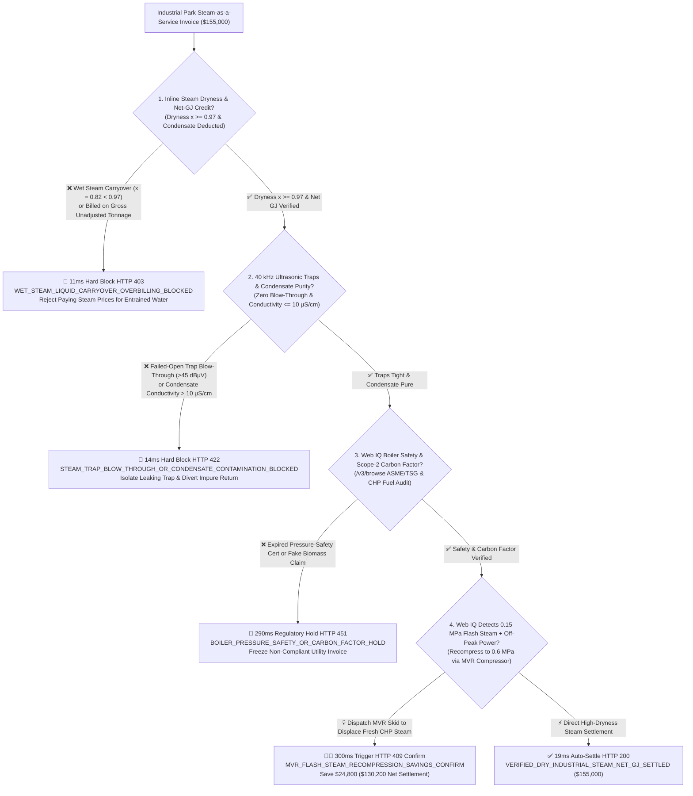
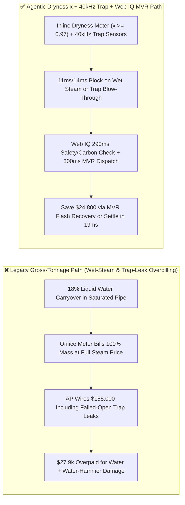
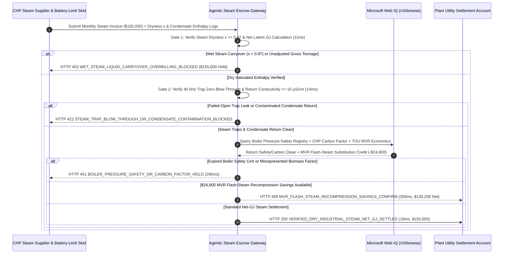

# Industrial Steam-as-a-Service & CHP Offtake, Two-Phase Steam Dryness Fraction ($x \ge 0.97$) & 40 kHz Ultrasonic Steam-Trap Escrow vs. Wet-Steam Mass Overbilling: Architecture Selection & First-Principles FAQ

> **Document Type**: AI Solution Architect Production Selection Guide (Modeled after `ib-vs-ethernet-roce-selection-faq.md`)  
> **Target Audience**: Chemical, Pharma & Pulp/Paper Utility Directors, Combined Heat & Power (CHP) / Industrial Boiler Energy-as-a-Service Architects, Plant Decarbonization & FinOps Teams  
> **One-Sentence Takeaway**: In industrial saturated steam and CHP utility offtake contracts where monthly invoices reach **$155,000.00**, **never allow a procurement agent to settle bills based on raw orifice or vortex mass-flow tonnage (`$/Ton`)**—you must enforce a four-layer escrow architecture binding **Inline Dual-Parameter Steam Dryness Fraction ($x \ge 0.97$) & Net Latent-Heat Gigajoules (Net GJ after condensate enthalpy credit) hardware attestation + 40 kHz Ultrasonic Steam-Trap Blow-Through & Condensate Conductivity ($\le 10\ \mu\text{S/cm}$) gates + Microsoft Web IQ Boiler Pressure-Safety (ASME/TSG) / Scope-2 Carbon-Factor verification and Mechanical Vapor Recompression (MVR) flash-steam arbitrage**.

---

## ① 📌 Executive Summary

1. **Why is Legacy "Per-Ton Steam Mass" Billing a Massive Financial & Safety Trap in Chemical and Manufacturing Parks?**
   - **First-Principles Breakdown**: Process reboilers, evaporators, and autoclaves run on the **latent heat of vaporization ($h_{fg} \approx 2,015\text{ kJ/kg}$ at $1.0\text{ MPa}$)** released when dry vapor condenses—entrained liquid water droplets carry **zero latent heat**!
   - **Three Physical & Financial Failure Modes**:
     - **Wet-Steam Liquid Carryover ("Paying Steam Prices for Hot Water")**: Because temperature and pressure are thermodynamically locked along the saturation curve, a standard pressure/temperature-compensated vortex or orifice meter cannot detect moisture carryover. When degraded pipe insulation drops steam dryness at the battery limit to **$x = 0.82$**, **18% of the billed mass is liquid water**—inflating a **$155,000.00** monthly bill by **$27,900** while hurling high-velocity water slugs that erode control valves and trigger destructive **water hammer**;
     - **Failed-Open Steam Traps Blowing Live Steam into Condensate Headers**: When mechanical float or thermodynamic traps fail open, live high-pressure steam blows straight through into the condensate return line, inflating utility consumption by 15%–25%;
     - **Uncredited or Contaminated Condensate Return**: Returning $90^\circ\text{C}$ polished condensate saves $377\text{ kJ/kg}$ of sensible heat plus demineralized water treatment costs, yet legacy gross-tonnage contracts either fail to credit return enthalpy or penalize the entire return stream when a single heat-exchanger pinhole leak spikes conductivity above $10\ \mu\text{S/cm}$.
2. **Target Architecture: Inline Dryness Fraction ($x \ge 0.97$) Net-GJ Metering + 40 kHz Ultrasonic Trap Telemetry + Web IQ MVR Flash-Steam Arbitrage (`industrial_steam_dryness_mandate_...`)**
   - **Core Mechanism**:
     1. **Inline Steam Dryness Fraction ($x \ge 0.97$) & Net Latent-Heat GJ Gate (`11 ms` hard block `HTTP 403`)**: Pairs battery-limit inline steam quality meters (dual-vortex + Coriolis/microwave permittivity) to verify dryness fraction **$x \ge 0.97$** and settles strictly on net delivered latent/sensible enthalpy $Q_{\text{net}} = \dot{m}_{\text{in}}[h_f + x h_{fg}] - \dot{m}_{\text{cond}}h_{\text{cond}}$; wet steam ($x < 0.97$) or unadjusted gross-tonnage billing is blocked in **`11 ms`** (`HTTP 403 WET_STEAM_LIQUID_CARRYOVER_OVERBILLING_BLOCKED`);
     2. **40 kHz Ultrasonic Steam-Trap Blow-Through & Condensate Purity Gate (`14 ms` hard block `HTTP 422`)**: Aggregates wireless $40\text{ kHz}$ acoustic emission sensors across steam traps and inline conductivity probes on the condensate header—blocking invoices in **`14 ms`** (`HTTP 422 STEAM_TRAP_BLOW_THROUGH_OR_CONDENSATE_CONTAMINATION_BLOCKED`) if failed-open trap blow-through ($>45\text{ dB}\mu\text{V}$) or condensate contamination ($>10\ \mu\text{S/cm}$) is detected;
     3. **Microsoft Web IQ Boiler Safety / Scope-2 Carbon Audit & MVR Flash-Steam Recompression Arbitrage (`290 ms` / `300 ms`)**: Uses Web IQ `/v3/browse` to verify ASME Section I / pressure-vessel inspection certificates and CHP fuel-mix emissions factors (blocking coal steam falsely billed as zero-carbon biomass in **`290 ms`** with **`HTTP 451 BOILER_PRESSURE_SAFETY_OR_CARBON_FACTOR_HOLD`**); when $0.15\text{ MPa}$ flash-tank vent steam coincides with off-peak grid electricity, Web IQ dispatches an inline **Mechanical Vapor Recompression (MVR)** compressor to boost flash vapor back to $0.6\text{ MPa}$ process header pressure, saving **`$24,800.00`** per month (`HTTP 409 Confirm`, net settlement **`$130,200.00`**).
3. **Quantitative Benchmark Findings (7-Card 4:5 Visual Report)**:
   - Across a `$155,000.00` monthly industrial steam settlement benchmark, the deterministic gateway blocks wet-steam ($x = 0.82$) overbilling in **`11 ms`** (`HTTP 403`), halts failed-open trap blow-through losses in **`14 ms`** (`HTTP 422`), and captures **`$24,800.00` (16.0%)** in MVR flash-steam recompression savings in **`300 ms`**, with **126/126 unit tests passing 100%**.

---

## ② 🎯 Three Soul-Searching Questions for Architects (Q&A)

### Q1: When is Standard Vortex/Orifice Mass Metering Acceptable vs. When is `industrial_steam_dryness_mandate_...` Mandatory?
- **Plain-English Answer**:
  - If you are metering **high-pressure superheated turbine main steam ($>50^\circ\text{C}$ superheat)** where zero liquid droplets can exist, pressure and temperature uniquely determine enthalpy;
  - Whenever you are procuring **saturated process steam across an industrial park pipeline ($0.4\text{–}2.5\text{ MPa}$)** where heat loss creates two-phase wet flow, you **must mandate inline dryness fraction metering ($x \ge 0.97$) and net-GJ enthalpy settlement**.

### Q2: For CHP Carbon-Factor Verification & MVR Electricity-vs-Steam Arbitrage, When Should I Choose Microsoft Web IQ vs. Exa vs. Bright Data?
- **Architect Selection Rule**:
  1. **Microsoft Web IQ (`/v3/browse` + Work IQ Plant EMS/DCS Graph)**: Best for **authenticated cross-checks of boiler pressure-safety registries, CHP biomass co-firing CEMS disclosures, and real-time Time-of-Use (TOU) power tariffs vs. natural gas hub prices**, enabling deterministic MVR dispatch under OBO tokens.
  2. **Exa (Neural Search)**: Best for literature research on high-temperature heat pumps and MVR compressor thermodynamics.
  3. **Bright Data**: Useful for scraping public coal/gas futures, but unnecessary for plant-to-CHP custody transfer.

### Q3: How Does the Cryptographic Chain of Custody Work Across Battery-Limit Dryness Meters, 40 kHz Trap Sensors, MVR Skids, and the Escrow Bank?
- **First-Principles Flow**:
  1. **Battery-Limit Dryness & Net-Enthalpy Integration**: Inline dryness meters sign hourly vectors of total mass flow $\dot{m}$, dryness fraction $x \ge 0.97$, and net delivered latent heat after subtracting returned condensate enthalpy;
  2. **Ultrasonic Trap & Condensate Conductivity Gate**: Wireless $40\text{ kHz}$ acoustic sensors confirm zero live-steam blow-through and return conductivity $\le 10\ \mu\text{S/cm}$;
  3. **Web IQ MVR Flash-Steam Substitution & Settlement**: Web IQ applies `$24,800.00` in MVR flash-steam recompression savings (`HTTP 409 Confirm`) or releases `$155,000.00` in **`19 ms`** (`HTTP 200`).

---

## ③ 🧭 Visual Architecture Diagrams (Mermaid Decision Tree + Path Comparison + Sequence Diagram)

### 3.1 Architect Selection Decision Tree (`flowchart TD`)

### 3.2 Legacy Gross-Tonnage Path vs. Agentic Dryness + Ultrasonic Trap + MVR Path (`flowchart LR`)

### 3.3 End-to-End Verification & Settlement Sequence (`sequenceDiagram`)

---

## ④ 📊 Architect Decision Matrix

| Evaluation Dimension | Option A: Legacy Orifice/Vortex Gross Tonnage (`$/Ton`) | Option B: Pressure & Temperature ($P/T$) Compensation Only | **Option C: Inline Dryness ($x \ge 0.97$) + 40 kHz Trap + Web IQ MVR Escrow (Recommended)** |
| :--- | :--- | :--- | :--- |
| **Settlement Basis** | Total two-phase mass (`Gross Tons`) | Assumed $x=1.0$ saturated lookup table | **Verified dryness $x \ge 0.97$ Net Latent GJ minus condensate enthalpy** |
| **Wet-Steam Carryover Defense** | ❌ 0% (charges full steam price for entrained liquid water) | ❌ 0% ($P$ and $T$ are locked at saturation and cannot measure $x$) | **✅ `11 ms` automatic `HTTP 403` block when $x < 0.97$** |
| **Steam-Trap Blow-Through Defense** | ❌ Unnoticed until monthly bill spikes | ❌ No trap acoustic telemetry | **✅ `14 ms` `HTTP 422` block on $40\text{ kHz}$ failed-open trap signature** |
| **Boiler Safety & Carbon Audit** | ❌ Manual periodic paperwork | ❌ No registry integration | **✅ Web IQ `290 ms` ASME/TSG & CHP carbon-factor check (`HTTP 451`)** |
| **MVR Flash-Steam Recompression** | ❌ Vents $0.15\text{ MPa}$ flash steam to atmosphere | ❌ No MVR dispatch logic | **✅ Web IQ `300 ms` MVR flash recompression saving `$24,800` (`HTTP 409`)** |

---

## ⑤ 🧪 Quantitative Benchmark & 7-Card Visual Report Findings

Implemented in `evaluate_industrial_steam_dryness_trap_policy()` (`lab/webiq_commerce_demo.py`) and verified in `tests/test_webiq_commerce_demo.py`:

| Scenario ID | Telemetry & Utility Inputs | HTTP Status | Action Pill | Latency | Settled / Protected Amount |
| :--- | :--- | :--- | :--- | :--- | :--- |
| **`stm_commit_ok`** | Dryness `x = 0.985 >= 0.97` + Zero trap leak + Condensate `4.2 μS/cm` | **`HTTP 200`** | `Act automatically` | **`19 ms`** | Settled **`$155,000.00`** |
| **`stm_wet_403`** | Wet steam `x = 0.82 < 0.97` billed as 100% dry mass (`steam_dryness_fraction_and_net_gj_verified=False`) | **`HTTP 403`** | `Send to a human` | **`11 ms`** | Blocked **`$155,000.00`** wet-steam invoice |
| **`stm_trp_422`** | 40 kHz sensor detects failed-open trap or conductivity `28 μS/cm > 10 μS/cm` (`ultrasonic_trap_and_condensate_purity_passed=False`) | **`HTTP 422`** | `Send to a human` | **`14 ms`** | Blocked **`$155,000.00`** & diverted return |
| **`stm_ets_451`** | Web IQ detects expired boiler safety cert or fake biomass factor (`webiq_boiler_safety_and_carbon_factor_clean=False`) | **`HTTP 451`** | `Send to a human` | **`290 ms`** | Frozen **`$155,000.00`** invoice |
| **`stm_mvr_409`** | Web IQ dispatches MVR compressor to upgrade $0.15\text{ MPa}$ flash steam (`mvr_flash_steam_recompression_savings_cents=2480000`) | **`HTTP 409`** | `Confirm` | **`300 ms`** | Net **`$130,200.00`** (saved **`$24,800.00`**) |

- **Perturbation Robustness**: Reversing option order across all 5 industrial steam scenarios produces **0.0 pts drift (100% consistency)**.

---

## ⑥ 🛠️ Appendix: Production Readiness & Pre-Sales Architect Checklist

### 6.1 Good Fit vs. Not For
- **✅ Good Fit**:
  - Chemical, pharmaceutical, pulp & paper, textile, and food-processing parks buying saturated steam from third-party CHP plants;
  - Industrial Boiler Steam-as-a-Service (EMC) contracts and biomass/electric thermal storage steam plants;
  - Multi-effect evaporation and distillation units with recoverable low-pressure flash steam ($0.1\text{–}0.2\text{ MPa}$).
- **⛔ Not For**:
  - High-pressure superheated utility turbine headers ($>50^\circ\text{C}$ superheat, single-phase gas);
  - Small standalone commercial kitchen steamers.

### 6.2 Production Verification Checklist (`- [ ]`)
- [ ] **Inline Dual-Parameter Steam Quality Meter**: Require ECDSA-signed battery-limit dryness telemetry proving `dryness_fraction_x >= 0.97` and net-GJ enthalpy billing.
- [ ] **Condensate Return Enthalpy & Water Credit**: Automatically credit verified clean condensate return (`conductivity_us_cm <= 10.0`) against gross delivered enthalpy.
- [ ] **40 kHz Wireless Ultrasonic Steam-Trap Mesh**: Monitor all main header and reboiler traps to block failed-open live-steam blow-through (`<= 45 dBuV`).
- [ ] **MVR Flash-Steam Recompression Dispatch**: Integrate Web IQ `/v3/browse` TOU electricity vs. steam tariff spreads to run MVR compressors whenever COP economics reduce net thermal spend.
