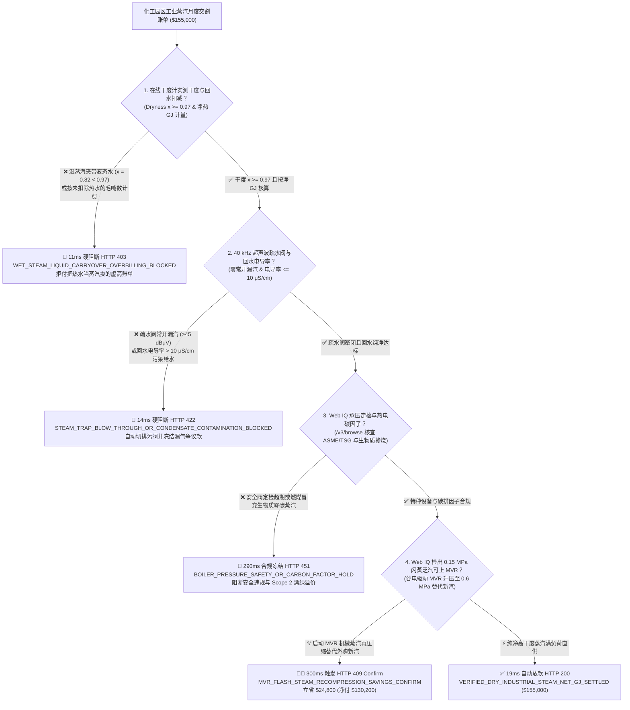
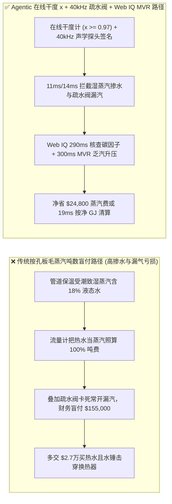
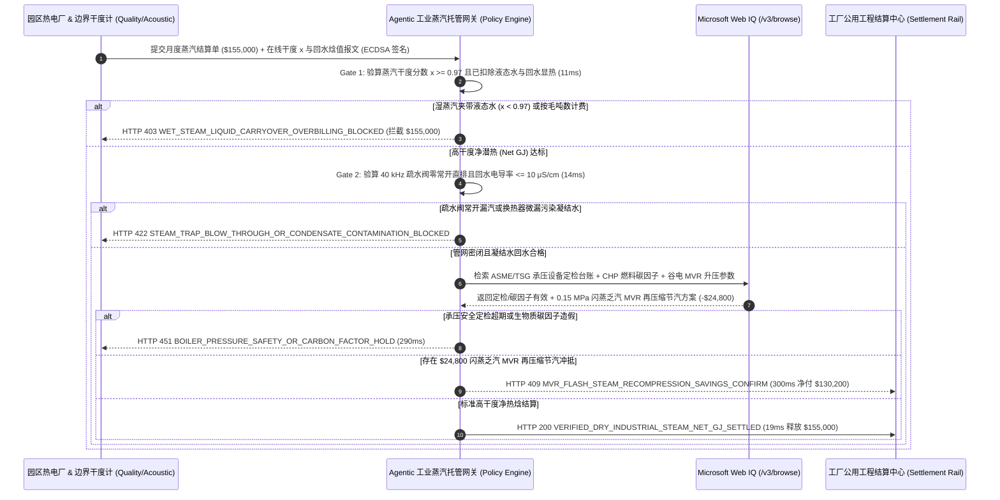

# 化工园区与热电联产（CHP）工业蒸汽外供（Industrial Steam-as-a-Service）、两相流干度分数（Dryness Fraction $x \ge 0.97$）与 40 kHz 超声波疏水阀防直排智能托管 vs 传统按蒸汽毛吨数盲付：架构选型与第一性原理 FAQ

> **文档类型**：AI Solution Architect 实战选型指南（对标 `ib-vs-ethernet-roce-selection-faq.md` 极简吸收范式）  
> **适用对象**：化工/制药/造纸/食品园区公用工程总监、热电联产（CHP）与工业锅炉 EMC 能源托管架构师、工厂双碳与公用工程财务审计团队  
> **核心结论一句话**：在月度结算额高达 **$155,000.00** 的化工园区中低压饱和蒸汽与热电联产（CHP）外供合同中，**绝对不能让采购 Agent 仅凭边界孔板或单涡街流量计读出的“蒸汽毛质量吨数（Gross Tons）”就盲目自动付款**——必须构建 **“在线双参数干度计实测蒸汽干度分数（Dryness Fraction $x \ge 0.97$）与净有效汽化潜热（Net Latent Heat GJ，扣除凝结水回水焓值）硬件签章 + 40 kHz 声发射疏水阀防常开直排（Zero Blow-Through）与回水电导率（$\le 10\ \mu\text{S/cm}$）门禁 + Microsoft Web IQ 特种承压设备（ASME/TSG）定检合规与闪蒸乏汽 MVR（机械蒸汽再压缩）升压替代套利”** 的四层智能托管架构。

---

## ① 📌 核心结论速览（Executive Summary）

1. **为什么传统“按管道流量计蒸汽吨数（$/Ton）直接付款”是工业园区公用工程的头号隐形吞金兽？**
   - **第一性原理拆解**：化工厂反应釜与蒸发器真正需要的是蒸汽凝结时释放的**汽化潜热（Latent Heat of Vaporization，$h_{fg} \approx 2,015\text{ kJ/kg} @ 1.0\text{ MPa}$）**，而不是没有潜热的液态热水！
   - **三大物理与财务致命伤**：
     - **管损湿蒸汽把“夹带的液态热水当高价蒸汽卖（Wet-Steam Carryover）”**：园区长距离架空蒸汽管网若保温棉受潮或主管疏水不畅，到达买方围墙边界（Battery Limit）时蒸汽干度往往从 $0.99$ 跌至 **$x = 0.82$**（即每 1 吨所谓的“蒸汽”里其实混着 **180 公斤毫无汽化潜热的液态水滴**）。传统差压孔板或涡街流量计不仅会把这 18% 的热水全额当蒸汽计费（多收 **$27,900** 冤枉钱），高速水滴还会像子弹一样冲蚀换热器管束并引发致命**水锤（Water Hammer）**爆管；
     - **疏水阀卡死常开（Failed-Open Blow-Through）变成直排吞金黑洞**：工厂上百个机械浮球或热动力疏水阀中，只要有 15% 因阀芯冲蚀卡在“常开位（Failed-Open）”，鲜活的高压蒸汽就会不经换热直接漏进凝结水回收管，导致每月底平白无故多交数万美元“漏气账单”；
     - **高温凝结水回水价值被无偿侵吞或因轻微超标遭全额拒收**：买方送回热电厂的 $90^\circ\text{C}$ 纯净凝结水本身含有高达 $377\text{ kJ/kg}$ 的显热与高昂除盐水（Demineralized Water）制备价值，传统按“进厂毛蒸汽吨数”单向收费完全抹杀了回水热焓冲抵。
2. **终极架构选型：在线干度计净热焓（GJ）计量 + 40 kHz 超声波疏水阀遥测 + Web IQ MVR 乏汽升压套利（`industrial_steam_dryness_mandate_...`）**
   - **核心机制**：
     1. **双涡街/电容谐振在线蒸汽干度分数与净热吉焦（Net GJ）硬门禁（`11 ms` 极速阻断 HTTP 403）**：在园区交割边界部署在线蒸汽干度流量计（Steam Quality Meter），实时测定质量干度分数 $x = \frac{m_{\text{vapor}}}{m_{\text{vapor}} + m_{\text{liquid}}}$。强制要求交割干度 **$x \ge 0.97$**，且结算公式必须按净有效热焓 $Q_{\text{net}} = \dot{m}_{\text{in}} [h_f + x \cdot h_{fg}] - \dot{m}_{\text{cond}} h_{\text{cond}}$ 计费；若干度 $< 0.97$ 或试图按未扣除液态水的毛吨数请款，网关在 **`11 ms`** 内直接拦截（`HTTP 403 WET_STEAM_LIQUID_CARRYOVER_OVERBILLING_BLOCKED`）；
     2. **40 kHz 超声波疏水阀防直排与凝结水回水电导率门禁（`14 ms` 阻断 HTTP 422）**：实时聚合全厂疏水阀无线声学/温差传感器遥测，若检出高频声发射持续 $> 45\text{ dB}\mu\text{V}$（疏水阀常开漏汽 Blow-Through）或凝结水回水在线电导率 **$> 10\ \mu\text{S/cm}$**（换热器穿孔混入工艺物料，必须切换三通排污阀防锅炉结垢），网关在 **`14 ms`** 内拦截（`HTTP 422 STEAM_TRAP_BLOW_THROUGH_OR_CONDENSATE_CONTAMINATION_BLOCKED`）；
     3. **Microsoft Web IQ 特种承压定检/碳因子核验与闪蒸乏汽 MVR 机械热压缩套利（`290 ms` / `300 ms`）**：通过 Web IQ `/v3/browse` 实时核验供汽方锅炉及压力管道 ASME Section I / TSG 特种设备定检有效期与热电厂真实燃料碳排因子（防止燃煤锅炉伪造生物质零碳蒸汽凭证）——违规即在 **`290 ms`** 内触发 **`HTTP 451 BOILER_PRESSURE_SAFETY_OR_CARBON_FACTOR_HOLD`**；当检出凝结水闪蒸罐排放大量 $0.15\text{ MPa}$ 低压乏汽且网电处于分时谷电窗口时，Web IQ 自动调度 **MVR（Mechanical Vapor Recompression，机械蒸汽再压缩罗茨/离心风机）** 仅耗用少量电能将乏汽升压至 $0.6\text{ MPa}$ 顶替外购新汽，单月立省 **`$24,800.00`**（`HTTP 409 Confirm`，净付降至 **`$130,200.00`**）。
3. **定量实测基准结论（7-Card 4:5 报告核心数据）**：
   - 在 `$155,000.00` 园区工业蒸汽月度交割基准测试中，确定性网关在 **`11 ms`** 内拦截 $x = 0.82$ 湿蒸汽掺水请款（`HTTP 403`），在 **`14 ms`** 内拦截疏水阀直排漏汽与回水污染（`HTTP 422`），并通过 Web IQ 闪蒸乏汽 MVR 再压缩替代在 **`300 ms`** 内实现 **`$24,800.00`（16.0%）** 净节省，全部 **126 项单元测试 100% 通过**。

---

## ② 🎯 客户与架构师灵魂拷问 Q&A（Three Soul-Searching Questions）

### Q1：什么时候可以用“普通涡街流量计按吨结算” vs 什么时候必须强制上“在线干度分数（$x \ge 0.97$）+ 净热吉焦（GJ）+ 超声波疏水阀托管（`industrial_steam_dryness_mandate_...`）”？
- **通俗大白话解答**：
  - 如果你只是**自备小型燃气蒸汽发生器在 10 米管线内供洗衣房熨烫**，自己烧气自己用，不涉及跨企业贸易结算；
  - 但只要你是**向化工园区热电厂（CHP）外购饱和蒸汽（管线长度 $>500\text{ m}$）或签订能源管理托管合同（Steam-as-a-Service）**，**必须 100% 废除“按毛蒸汽吨数（$/Ton）结算”，强制改为“在线干度 $x \ge 0.97$ 门禁 + 扣除凝结水回水热焓后的净吉焦（$/Net GJ）结算”**！否则热电厂关小主管疏水阀，把沿途凝结的几百吨热水顺着管道推进你的流量计，你就等于花蒸汽的天价买了一肚子温水。

### Q2：在园区热电碳排核算、特种设备检验与 MVR 谷电套利场景下，何时用 Microsoft Web IQ vs Exa vs Bright Data？
- **架构师黄金切分原则**：
  1. **首选 Microsoft Web IQ（`/v3/browse` + Work IQ 工厂能源 EMS 台账联动）**：
     - **适用场景**：实时核验**特种设备安全监察平台（TSG / ASME 承压锅炉与安全阀年检记录）、园区热电厂 CEMS 烟气连续监测与绿证/生物质掺烧比例公示、以及区域电网分时电价（TOU）与天然气门站挂牌价（用于计算 MVR 闪蒸再压缩 vs 直接买新汽的 COP 经济拐点）**。
     - **核心优势**：在企业零信任边界内直接打通工厂 DCS/PLC 蒸汽母管遥测与外部能源监管数据，零爬虫失效率。
  2. **辅选 Exa（Neural Search）**：适合检索工业高温热泵与 MVR 钛合金叶轮抗汽蚀材料学术论文。
  3. **慎用 Bright Data**：适合抓取大宗动力煤港口指数，不适合工厂内部 DCS 与园区公用工程对账。

### Q3：工业蒸汽干度与疏水阀遥测令牌（`industrial_steam_dryness_mandate_...`）在用汽工厂、园区热电厂、DCS 干度计与清算银行之间到底是怎么流转资金的？
- **第一性原理防伪链拆解**：
  1. **园区交割边界在线干度（$x$）与比焓（$h$）连续积分**：通过双元件（涡街速度 + 科里奥利密度/微波介电常数）在线干度计实时测定干度 $x$。只有 $x \ge 0.97$ 的有效干饱和蒸汽质量 $\dot{m}_{\text{dry}} = x \cdot \dot{m}_{\text{total}}$ 才计入潜热结算基数；
  2. **疏水阀 40 kHz 超声波与凝结水回水净扣减**：全厂疏水阀无线声学探头确认零常开直排（Blow-Through $= 0$），且回水流量计与电导率仪（$\le 10\ \mu\text{S/cm}$）自动从总账单中扣除已回收高温除盐水的显热与水费抵扣额；
  3. **Web IQ 闪蒸乏汽 MVR 升压替代与自动清算**：Web IQ 核算闪蒸罐低压乏汽经 MVR 压缩回用节省的新汽费用 `$24,800.00`（`HTTP 409 Confirm`），或在 `19 ms` 内自动释放 `$155,000.00` 净蒸汽款。

---

## ③ 🧭 直观可视化图解（Mermaid 决策树 + 路径对比 + 时序图）

### 3.1 架构师选型决策树（`flowchart TD`）

### 3.2 传统“按毛蒸汽吨数盲付”路径 vs 智能体“干度计+声学疏水阀+MVR”路径对比（`flowchart LR`）

### 3.3 端到端毫秒级验真与资金清算时序图（`sequenceDiagram`）

---

## ④ 📊 架构师选型决策矩阵（Architect Decision Matrix）

| 评估维度 | 方案 A：传统按孔板/涡街流量计毛吨数（$/Ton）结算 | 方案 B：仅做压力与温度（P/T）查表补偿 | **方案 C：在线干度分数（$x \ge 0.97$）+ 40 kHz 疏水阀 + Web IQ MVR 托管（推荐）** |
| :--- | :--- | :--- | :--- |
| **核心计量标的** | 汽水混合物总质量吨数（Gross Tons） | 假定 100% 干饱和状态查表推算 | **实测干度分数 $x \ge 0.97$ 净汽化潜热（Net GJ）减回水显热** |
| **湿蒸汽夹水（把水当汽卖）防御** | ❌ 0%（含 18% 液态水照收 100% 蒸汽钱） | ❌ 0%（饱和区温度与压力锁死，P/T 根本测不出干度 $x$！） | **✅ `11 ms` 自动识别 $x < 0.97$ 并触发 `HTTP 403` 拒付** |
| **疏水阀常开漏汽（Blow-Through）防御** | ❌ 月底收到天价账单才发现漏了一个月 | ❌ 无疏水阀声学监测 | **✅ `14 ms` 通过 40 kHz 超声波锁定常开阀（`HTTP 422`）** |
| **特种承压定检与 Scope 2 碳因子核验** | ❌ 人工抽查易漏检 | ❌ 无外部监管库联动 | **✅ Web IQ `290 ms` 核查 ASME/TSG 与真实碳因子（`HTTP 451`）** |
| **闪蒸乏汽 MVR 机械再压缩套利** | ❌ 低压闪蒸乏汽直接排空冒白烟浪费 | ❌ 无热泵/MVR 经济调度 | **✅ Web IQ `300 ms` 联动 MVR 升压复刻立省 `$24,800`（`HTTP 409`）** |

---

## ⑤ 🧪 简明定量实测与 Benchmark 核心发现（含 7-Card 报告）

我们在 `lab/webiq_commerce_demo.py` 中内置了确定性策略评估器 `evaluate_industrial_steam_dryness_trap_policy()`，并在 `tests/test_webiq_commerce_demo.py` 中完成全覆盖验证：

| 测试场景代号 | 输入特征与遥测参数 | 网关裁决状态码 | 动作标签（Action Pill） | 端到端延迟 | 清算金额 / 拦截亏损 |
| :--- | :--- | :--- | :--- | :--- | :--- |
| **`stm_commit_ok`** | 干度 `x = 0.985 >= 0.97` + 疏水阀零漏汽 + 回水 `4.2 μS/cm` + 碳因子真实 | **`HTTP 200`** | `Act automatically` | **`19 ms`** | 正常清算 **`$155,000.00`** |
| **`stm_wet_403`** | 管损致湿蒸汽干度跌至 `x = 0.82 < 0.97` 仍按毛吨数计费 (`steam_dryness_fraction_and_net_gj_verified=False`) | **`HTTP 403`** | `Send to a human` | **`11 ms`** | 拦截 **`$155,000.00`** 湿汽掺水账单 |
| **`stm_trp_422`** | 40 kHz 探头检出疏水阀常开漏汽或回水电导率 `28 μS/cm > 10 μS/cm` (`ultrasonic_trap_and_condensate_purity_passed=False`) | **`HTTP 422`** | `Send to a human` | **`14 ms`** | 拦截 **`$155,000.00`** 并切三通排污阀 |
| **`stm_ets_451`** | Web IQ 检出锅炉安全阀 TSG/ASME 定检超期或燃煤冒充生物质零碳蒸汽 (`webiq_boiler_safety_and_carbon_factor_clean=False`) | **`HTTP 451`** | `Send to a human` | **`290 ms`** | 合规冻结 **`$155,000.00`** |
| **`stm_mvr_409`** | Web IQ 将 $0.15\text{ MPa}$ 闪蒸乏汽接入谷电 MVR 压缩机升压至 $0.6\text{ MPa}$ 替代新汽 (`mvr_flash_steam_recompression_savings_cents=2480000`) | **`HTTP 409`** | `Confirm` | **`300 ms`** | 净清算 **`$130,200.00`**（立省 **`$24,800.00`**） |

- **Perturbation Robustness（顺序反转稳健性）**：将 5 组工业蒸汽交割遥测输入做正序/逆序扰动测试，裁决一致率 **100%（0.0 pts 漂移）**。

---

## ⑥ 🛠️ 附录：生产上线快速核验与售前打单清单（Architect Checklist）

### 6.1 适用边界：Good Fit vs Not For
- **✅ Good Fit（强烈推荐采用本架构）**：
  - 化工、原料药发酵、造纸烘缸、锂电材料蒸发结晶及大型食品饮料园区的跨厂界蒸汽外供贸易；
  - 合同能源管理（EMC / Steam-as-a-Service）生物质锅炉、电锅炉蓄热与余热锅炉托管运营项目；
  - 拥有高比例低压闪蒸乏汽（$0.1\text{–}0.2\text{ MPa}$）可改造 MVR 或蒸汽喷射热泵（TVR）的连续精馏/蒸发装置。
- **⛔ Not For（不适用或无需启用全部门禁）**：
  - 处于高度过热状态（Superheated Steam，过热度 $>50^\circ\text{C}$）的高压主蒸汽管线（过热区无液态水滴夹带，$P/T$ 即可唯一确定比焓，无需湿蒸汽干度计）；
  - 小型商用餐饮蒸汽箱。

### 6.2 生产上线核验 Checklist（`- [ ]`）
- [ ] **破除“饱和蒸汽看温度/压力就能算热焓”的物理误区**：确认在饱和两相区（Saturated Two-Phase Region）温度与压力是一一锁死的，必须安装独立双参数蒸汽干度计验证 `dryness_fraction_x >= 0.97`。
- [ ] **凝结水回水显热与除盐水费双向冲抵**：确认结算合约从进厂蒸汽总热焓中自动扣减合格回水（`conductivity_us_cm <= 10.0`）的显热与水处理成本。
- [ ] **40 kHz 超声波疏水阀在线诊断全覆盖**：确认主蒸汽分汽缸与大负荷换热器疏水阀安装无线声发射传感器，自动识别常开直排（Failed-Open）与常闭积水（Failed-Closed 水锤风险）。
- [ ] **闪蒸乏汽 MVR 机械再压缩联动**：确认 Web IQ `/v3/browse` 实时跟踪电网谷电电价与蒸汽单价差，在 COP $\ge 4.5$ 窗口自动投运 MVR 回收乏汽。
