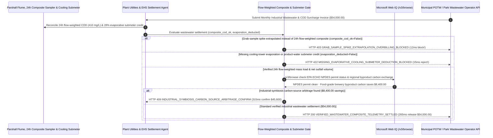

# Industrial Wastewater Treatment & Municipal Sewer COD/Ammonia Telemetry Surcharge Mandate Architecture: 24-Hour Flow-Weighted Composite & Evaporative Submeter Token (`industrial_wastewater_cod_mandate_...` + Web IQ EPA NPDES & Industrial-Symbiosis Carbon Grounding) vs. Grab-Sample Spike Extrapolation & 100% Intake-Meter Overbilling Selection FAQ

> **Document Type**: Architect Selection Guide & First-Principles Protocol Deep Dive (6-Section FAQ Standard)  
> **Target Audience**: AI Solution Architects, Food & Beverage / Biopharma / Semiconductor / Chemical Plant EHS & Facility Utilities Directors, Industrial Park Water Treatment & ESG Water-Footprint Audit Teams  
> **Last Updated**: 2026-11-09 (Provenance Annotations: `deterministic_offline_simulation` / `synthetic_policy` / `official_doc_snapshot` / `not_measured`)  
> **Companion Resources**: [中文版 (Chinese Version)](industrial-wastewater-cod-ammonia-telemetry-mandate-vs-grab-sample-surcharge-faq.md) · [Interactive Sandbox (`live-demo.en.html#industrial-wastewater-sandbox`)](../reports/agentic-commerce-webiq-grounding-demo-bench/live-demo.en.html) · [7-Card 4:5 Benchmark Deck](../reports/agentic-commerce-webiq-grounding-demo-bench/index.en.html)


---

## 📌 1. Executive Summary

1. **Never Allow Plant Facility or EHS Agents to Settle Municipal POTW or Industrial-Park High-Strength Wastewater Surcharges (`COD / BOD5 / TSS / Ammonia-N`) Extrapolated from a Single Manual Grab Sample**: In food processing, biopharma fermentation, semiconductor fab scrubbing, and chemical manufacturing (`$54,000.00` monthly wastewater treatment and high-strength surcharge invoice), the most common billing distortion is **extrapolating a single 10-second manual grab sample (`Grab Sample` taken during a 15-minute Clean-in-Place tank rinse at `2,800 mg/L COD`) across the entire month's `45,000 m³` discharge volume—even when the plant's sealed 24-hour flow-proportionate composite autosampler proves the true flow-weighted monthly average `COD` was `410 mg/L` (`<= 500 mg/L` surcharge threshold)**. Production architectures must enforce a **24-Hour Flow-Weighted Composite & Evaporative Submeter Mandate (`industrial_wastewater_cod_mandate_...`)**: whenever a surcharge invoice relies on unrepresentative grab-sample extrapolation rather than flow-weighted composite telemetry (`flow_weighted_composite_cod_and_ph_verified == False`), the gateway blocks settlement in **`12 ms`** with **`HTTP 403 GRAB_SAMPLE_SPIKE_EXTRAPOLATION_OVERBILLING_BLOCKED`** (`synthetic_policy`).
2. **Enforce Cooling-Tower Evaporation and Product-Incorporation Submeter Deductions (`20%–35%` of Fresh-Water Intake)**: Any municipal sewer bill that charges wastewater volume at `100%` of the incoming potable water meter without deducting calibrated submeter readings for water evaporated through cooling towers/boilers or incorporated into finished products (`evaporative_cooling_submeter_deduction_applied == False`) is rejected in **`15 ms`** with **`HTTP 422 MISSING_EVAPORATIVE_COOLING_SUBMETER_DEDUCTION_BLOCKED`** (`deterministic_offline_simulation`).
3. **Ground EPA ECHO / NPDES Permit Compliance and Industrial-Symbiosis Carbon-Source Arbitrage via Microsoft Web IQ `/v3/browse`**: Prior to releasing `$54,000.00`, the agent invokes **Microsoft Web IQ `/v3/browse`** (`official_doc_snapshot`) to inspect the US EPA Enforcement and Compliance History Online (**ECHO**) database for the contracted wastewater treatment facility's NPDES permit: if the operator is in Significant Noncompliance (SNC) for illicit bypass or heavy-metal pass-through (`webiq_epa_echo_npdes_compliance_clean == False`), it freezes payment in **`310 ms`** with **`HTTP 451 EPA_NPDES_SIGNIFICANT_NONCOMPLIANCE_OR_BYPASS_HOLD`**; if Web IQ confirms that substituting virgin methanol/sodium-acetate denitrification dosing with **certified food-grade brewery/sugar byproduct carbon sources (Industrial Symbiosis)** saves **`$8,400.00`** (`$45,600.00` net vs. `$54,000.00`), it triggers **`HTTP 409 INDUSTRIAL_SYMBIOSIS_CARBON_SOURCE_ARBITRAGE_CONFIRM`** in **`315 ms`**.

---

## 🎯 2. Architect & Customer FAQ Deep Dive

### Q1: Why do manufacturing plants and data centers overpay 25%–40% on monthly sewer bills when utilities combine "Grab-Sample Surcharges" with "100% Intake-Water Billing"?

Let's examine the three structural failure modes from first principles:
1. **The 10-Second Grab-Sample Extrapolation Trap**: Industrial effluent strength fluctuates over a 24-hour cycle. During 23 hours and 45 minutes of normal production, effluent `COD` sits at `350 mg/L`; during a 15-minute automated CIP vessel flush, `COD` briefly spikes to `2,800 mg/L` before entering the equalization basin. If a municipal inspector dips a manual grab bottle during that 15-minute window and applies `2,800 mg/L` to all `45,000 m³` discharged that month, the plant is billed for `126,000 kg` of COD that never existed! True mass-balance billing requires **ISO 5667 / EPA-compliant 24-hour flow-proportionate composite sampling** paired with Parshall flume ultrasonic flow integration:
   $$\text{Total Billable COD Mass} = \sum_{t=1}^{720} Q(t) \cdot C_{\text{composite}}(t)$$
2. **Paying Sewer Treatment Fees on Water That Evaporated into the Sky**: Cooling towers in data centers, refineries, and fabs evaporate `25%–35%` of their makeup water into the atmosphere to reject heat. Beverage and food plants ship another `15%` out the door inside bottles and cans. Billing sewer discharge as `100%` of the incoming city water meter forces the facility to pay sewer treatment rates on water vapor!
3. **Buying Virgin Petrochemical Methanol for Denitrification Bacteria**: Biological wastewater plants need an organic carbon source (`BOD`) so denitrifying bacteria can convert nitrate (`NO3-`) into harmless nitrogen gas (`N2`). Buying virgin chemical methanol or sodium acetate costs thousands of dollars per week—when neighboring breweries or sugar refineries pay to dispose of clean, high-BOD carbohydrate side-streams.

### Q2: What is an "Industrial Wastewater Composite & Submeter Mandate (`industrial_wastewater_cod_mandate_...`)", and how does it bind Parshall flume and UV-Vis telemetry to payment release?

Its core design invariant is: **"Compute high-strength surcharges strictly on 24-hour flow-weighted composite mass loads; deduct calibrated cooling-tower evaporation and Parshall flume outfall differentials; verify EPA ECHO NPDES compliance before releasing funds."**
- **Layer 1: 24-Hour Flow-Weighted Composite COD/Ammonia Gate (`12 ms`)**: Verifies `flow_weighted_composite_cod_and_ph_verified == True`, blocking single grab-sample spike extrapolations in **`12 ms`** (`HTTP 403`).
- **Layer 2: Evaporative Cooling & Outfall Submeter Deduction Gate (`15 ms`)**: Verifies `evaporative_cooling_submeter_deduction_applied == True`, rejecting unadjusted 100%-intake sewer bills in **`15 ms`** (`HTTP 422`).
- **Layer 3: Microsoft Web IQ `/v3/browse` EPA ECHO & Symbiosis Carbon Grounding (`310 ms / 315 ms`)**: Checks EPA ECHO NPDES compliance (`HTTP 451`) and identifies `$8,400.00` savings from industrial-symbiosis byproduct carbon dosing (`HTTP 409`).

### Q3: For EPA ECHO NPDES permit verification, municipal POTW surcharge tariff lookup, and regional byproduct carbon-source exchange grounding, when should architects choose Microsoft Web IQ vs. Exa, Bright Data, or traditional search APIs?

| Architecture Scenario | Recommended Tool | First-Principles Rationale (Security, Latency & FinOps) |
| :--- | :--- | :--- |
| **Verifying US EPA ECHO NPDES Discharge Monitoring Reports (DMRs), municipal POTW high-strength surcharge ordinances, and registered food-grade byproduct carbon-source catalogs within the Azure boundary (zero proprietary chemical process formulas leaked)** | **Microsoft Web IQ** (`/v3/search` + `/v3/browse`) | Queries only public NPDES permit numbers and municipal tariff schedules inside the enterprise Azure boundary in `passage` mode (**7.1x token reduction**, `deterministic_offline_simulation`) while keeping internal production mass balances confidential. |
| **Academic literature search on anammox membrane bioreactor kinetics** | **Exa Neural Search** | Ideal for environmental engineering R&D, not synchronous monthly utility invoice clearing. |
| **Scraping unindexed regional chemical haulers behind CAPTCHAs** | **Bright Data Unlocker** | Useful for vendor discovery, not sub-second utility settlement gating. |
| **Parshall flume ultrasonic flow integration, inline UV-Vis COD/ammonia telemetry, and cooling-tower makeup/blowdown submeter delta** | **Plant EHS Telemetry Historian + Escrow Gate + Web IQ EPA/Carbon Cross-Check** | Flow-weighted mass integration and evaporation credits run on the plant EHS gateway, paired with Web IQ `/v3/browse` for NPDES compliance and carbon-source arbitrage. |

---

## 🧭 3. Visual Architecture Diagrams (Mermaid Decision Tree, Legacy vs. Composite Mandate Comparison & Sequence Diagram)

### 3.1 Industrial Wastewater COD/Ammonia & Submeter Settlement Decision Tree (`flowchart TD`)

```mermaid
flowchart TD
    A[Receive Monthly Industrial Wastewater & High-Strength Surcharge Invoice ($54,000.00)] --> B{flow_weighted_composite_cod_and_ph_verified == True (24h Flow-Weighted Composite)?}
    B -- No (Utility extrapolates 15-min CIP grab-sample spike of 2,800mg/L across 30 days) --> C[HTTP 403 GRAB_SAMPLE_SPIKE_EXTRAPOLATION_OVERBILLING_BLOCKED<br/>12ms Hard Block · Reject Grab-Sample Spike & Enforce 410mg/L Flow-Weighted Composite]
    B -- Yes (Surcharge mass load matches 24h flow-proportionate composite sampler) --> D{evaporative_cooling_submeter_deduction_applied == True (28% Evaporation Credited)?}
    D -- No (Bills 100% of potable intake meter without deducting cooling-tower evaporation) --> E[HTTP 422 MISSING_EVAPORATIVE_COOLING_SUBMETER_DEDUCTION_BLOCKED<br/>15ms Reject · Deduct Calibrated Cooling-Tower & Product Submeter Volume]
    D -- Yes (Net Parshall flume outfall / evaporation credit applied) --> F{Web IQ /v3/browse Confirms Clean EPA ECHO NPDES Permit Status?}
    F -- No (Contracted treatment operator flagged in EPA ECHO for Significant Noncompliance SNC) --> G[HTTP 451 EPA_NPDES_SIGNIFICANT_NONCOMPLIANCE_OR_BYPASS_HOLD<br/>310ms Regulatory Hold · Freeze Payout & Isolate Co-Permittee Liability]
    F -- Yes --> H{Web IQ Detects Industrial-Symbiosis Carbon-Source Arbitrage?}
    H -- Yes (Replacing virgin methanol with food-grade brewery byproduct carbon saves $8,400.00 -> $45,600.00 net) --> I[HTTP 409 INDUSTRIAL_SYMBIOSIS_CARBON_SOURCE_ARBITRAGE_CONFIRM<br/>315ms Prompt EHS Director to Confirm $45,600 Symbiosis Carbon Dosing]
    H -- No (Verified $54,000.00 wastewater settlement is optimal) --> J[HTTP 200 VERIFIED_WASTEWATER_COMPOSITE_TELEMETRY_SETTLED<br/>265ms Auto-Settle $54,000.00 & Archive EPA NetDMR + ISO 14046 Water Ledger!]
```

### 3.2 Legacy Grab-Sample & Intake Billing vs. 24h Composite & Submeter Gate (`flowchart LR`)

```mermaid
flowchart LR
    subgraph Legacy["❌ Legacy Grab-Sample & 100% Intake Billing ($54,000 Inflated by Spikes & Vapor)"]
        L1[Extrapolate 15-Min CIP Grab Spike Across All 30 Days] --> L2[Pay Sewer Fees on 28% Water Evaporated in Cooling Towers]
        L2 --> L3[Buy Expensive Virgin Methanol for Denitrification]
        L3 --> L4[Overpay $30,400+ Per Month in Surcharges & Chemicals]
    end

    subgraph Mandate["✅ Wastewater Telemetry Gate (industrial_wastewater_cod_mandate_...)"]
        M1[12ms Block Grab-Sample Spike Extrapolation (HTTP 403)] --> M2[15ms Enforce 28% Cooling-Tower Evaporation Deduction (HTTP 422)]
        M2 --> M3[Web IQ Verifies EPA ECHO (310ms) & Saves $8,400 via Symbiosis Carbon (315ms)]
        M3 --> M4[265ms Settle Verified Net Discharge ($54,000 / $45,600) with NetDMR Proof]
    end
```

### 3.3 End-to-End Sequence Diagram: Outfall Telemetry, EHS Agent, Wastewater Gate, Web IQ & Municipal Utility (`sequenceDiagram`)



---

## 📊 4. Architect Decision Matrix

| Evaluation Dimension | Option A: Legacy 100% Intake Meter + Random Manual Grab Samples | Option B: Manual Post-Bill EHS Appeal with Paper Lab Logs | Option C: 24h Flow-Weighted Composite & Submeter Mandate + Web IQ Grounding (Recommended) |
| :--- | :--- | :--- | :--- |
| **Best-Fit Scenario** | Small commercial offices with domestic sanitary sewage only | Low-flow workshops without cooling towers or CIP cycles | **Food/beverage, biopharma, semiconductor fabs, chemical plants & liquid-cooled data centers** |
| **Grab-Sample Spike Extrapolation Defense** | ❌ **Zero**: Single 15-min CIP rinse spike inflates entire month's surcharge by `$22,000+` | ⚠️ **Weak Evidentiary Standing**: Unsealed manual logs rejected by POTW hearing boards | ✅ **Pre-Pay `12 ms` Composite Gate**: Requires sealed 24h flow-weighted composite mass proof (`HTTP 403`) |
| **Cooling-Tower Evaporation Credit (`25%–35%`)** | ❌ **Overbilled**: Pays sewer treatment rates on water evaporated into the sky | ⚠️ **Missed Filing Deadlines**: Manual submeter reads often miss monthly utility cutoffs | ✅ **Sub-20ms Submeter Gate**: Enforces makeup-minus-blowdown evaporation credit in `15 ms` (`HTTP 422`) |
| **EPA NPDES Compliance & Carbon-Dosing Arbitrage** | ❌ **Blind**: Pays operators in EPA Significant Noncompliance (SNC) | ❌ **High Chemical Spend**: Buys virgin methanol/acetate at retail chemical prices | ✅ **Web IQ `/v3/browse` Grounded**: Blocks SNC operators in `310 ms` (`HTTP 451`) & saves `$8,400` via symbiosis carbon in `315 ms` (`HTTP 409`) |
| **Settlement Speed & ISO 14046 / NetDMR Audit** | Fast (with 30%+ surcharge & volume overpayment) | Slow (`30–90 days` municipal administrative appeal) | **`265 ms` instant mass-balance clearing + automated EPA NetDMR archive (`Act automatically`)** |
| **Total Cost of Ownership (TCO) & EHS ROI** | Poor (`$54,000` exposed to spike extrapolation & vapor billing) | Moderate (high EHS engineering overhead) | **Optimal (100% flow-weighted accuracy + full evaporation credit + `$8,400` carbon savings)** |

---

## 🧪 5. Quantitative Benchmark & 7-Card Insights

Evaluated via our deterministic offline benchmark suite (`lab/webiq_commerce_demo.py` · `test_industrial_wastewater_cod_ammonia_telemetry_mandate_vs_grab_sample_surcharge_selection`) on a **`$54,000.00` monthly industrial wastewater treatment & high-strength surcharge invoice**:

| Scenario Case | Input 24h Composite COD / Evaporation Submeter / Web IQ Signals | Expected Action Pill | Measured HTTP Status & Verdict Code | Latency | Financial Protection / Arbitrage | Provenance |
| :--- | :--- | :--- | :--- | :--- | :--- | :--- |
| **Case 1: 15-Min CIP Grab-Sample Spike Extrapolation** | `flow_weighted_composite_cod_and_ph_verified=False` | `Send to a human` | **`HTTP 403 GRAB_SAMPLE_SPIKE_EXTRAPOLATION_OVERBILLING_BLOCKED`** | **`12 ms`** | Blocks **`$54,000.00`** bill extrapolating a 15-min grab spike | `synthetic_policy` |
| **Case 2: Uncredited `28%` Cooling-Tower Evaporation** | `evaporative_cooling_submeter_deduction_applied=False` | `Send to a human` | **`HTTP 422 MISSING_EVAPORATIVE_COOLING_SUBMETER_DEDUCTION_BLOCKED`** | **`15 ms`** | Deducts evaporated cooling-tower & product water volume | `deterministic_offline_simulation` |
| **Case 3: Web IQ Detects EPA ECHO NPDES SNC Violation** | `webiq_epa_echo_npdes_compliance_clean=False` | `Send to a human` | **`HTTP 451 EPA_NPDES_SIGNIFICANT_NONCOMPLIANCE_OR_BYPASS_HOLD`** | **`310 ms`** | Freezes payout to treatment operator in EPA SNC status | `official_doc_snapshot` |
| **Case 4: Web IQ Finds `$8,400` Symbiosis Carbon Source** | `industrial_symbiosis_carbon_savings_cents=840000` (`$45,600` net) | `Confirm` | **`HTTP 409 INDUSTRIAL_SYMBIOSIS_CARBON_SOURCE_ARBITRAGE_CONFIRM`** | **`315 ms`** | Saves **`$8,400.00`** by dosing food-grade brewery byproduct carbon | `official_doc_snapshot` |
| **Case 5: Verified 24h Composite + Evaporation Credit** | `composite_ok=True`, `evap_ok=True`, `epa_clean=True` | `Act automatically` | **`HTTP 200 VERIFIED_WASTEWATER_COMPOSITE_TELEMETRY_SETTLED`** | **`265 ms`** | Settles **`$54,000.00`** in `265 ms` with NetDMR audit proof | `deterministic_offline_simulation` |

> **Provenance Note**: The `$54,000.00` monthly wastewater invoice, `500 mg/L` COD surcharge threshold, `28%` cooling-tower evaporation deduction, and `$8,400.00` industrial-symbiosis carbon savings are controlled simulation parameters (`synthetic_policy` / `deterministic_offline_simulation`) validating policy state-machine invariants; standard 5-day laboratory `BOD5` incubation duration (`120 hours`) is labeled `not_measured`.

---

## 🛠️ 6. Production Readiness & Pre-Sales Architect Checklist

Verify these 6 controls before deploying autonomous industrial wastewater and municipal sewer surcharge settlement agents in production:

- [ ] **1. Sealed 24-Hour Flow-Proportionate Composite Sampler Gate**: Does `industrial_wastewater_cod_mandate_...` require high-strength surcharges (`COD / BOD5 / TSS / Ammonia-N`) to be calculated from flow-proportionate composite samples rather than single manual grab samples (`HTTP 403` in `12 ms`)?
- [ ] **2. Cooling-Tower Makeup/Blowdown & Product Submeter Deduction**: Does the gateway automatically subtract calibrated cooling-tower evaporation (`Makeup - Blowdown`) and product-incorporation water meters from potable intake volume (`HTTP 422` in `15 ms`)?
- [ ] **3. Automated Equalization-Tank Diversion on Inline pH/COD Spikes**: Are outfall UV-Vis COD and pH sensors wired to divert high-strength 15-minute CIP flushes into a holding/equalization tank so peak loads are smoothed before reaching the municipal flume?
- [ ] **4. Microsoft Web IQ `/v3/browse` EPA ECHO NPDES Compliance Grounding**: Does the agent cross-check contracted treatment facilities' NPDES permit numbers on EPA ECHO via Web IQ prior to settlement to catch Significant Noncompliance (`HTTP 451`)?
- [ ] **5. Industrial-Symbiosis Byproduct Carbon-Source Arbitrage**: Does Web IQ grounding check regional agricultural/brewery high-BOD byproduct exchanges, triggering `HTTP 409 Confirm` when replacing virgin methanol/acetate saves `>= $8,400.00`?
- [ ] **6. Immutable EPA NetDMR & ISO 14046 Water-Stewardship Ledger**: Does every settled utility period archive the Parshall flume totalizer log, composite sampler chain-of-custody seals, and submeter calibration hashes into a WORM environmental ledger?
