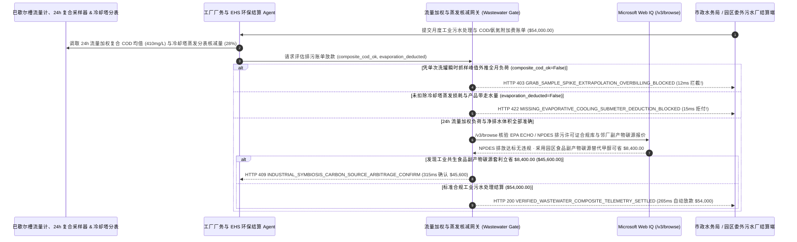

# 工业污水处理与市政排污超标附加费（Industrial Wastewater Treatment & Municipal Sewer COD/Ammonia Telemetry Surcharge Mandate）架构：24 小时流量加权复合采样与冷却蒸发核减令牌（`industrial_wastewater_cod_mandate_...` + Web IQ EPA NPDES 合规与工业共生碳源核验）vs 传统瞬时抓样天价外推与按进水表盲收选型与原理解析 FAQ

> **文档类型**：架构师选型指南 & 协议第一性原理解析（6 段式 FAQ 标准版）  
> **适用读者**：AI Solution Architect、食品饮料/生物发酵/精细化工/半导体工厂环境健康安全（EHS & Facility Utilities）总监、工业园区水务运营与 ESG 水足迹审计团队  
> **更新日期**：2026-11-09（Provenance 标注：`deterministic_offline_simulation` / `synthetic_policy` / `official_doc_snapshot` / `not_measured`）  
> **配套资源**：[English Version](industrial-wastewater-cod-ammonia-telemetry-mandate-vs-grab-sample-surcharge-faq.en.md) · [交互式沙盒控制台 (`live-demo.html#industrial-wastewater-sandbox`)](../reports/agentic-commerce-webiq-grounding-demo-bench/live-demo.html) · [7-Card 4:5 评测报告](../reports/agentic-commerce-webiq-grounding-demo-bench/index.html)


---

## 📌 一、核心结论速览（Executive Summary）

1. **严禁让工厂厂务（Facility Utilities / EHS）结算 Agent 接受市政水务局或工业园区污水厂凭“单次 10 秒人工瞬时抓样（Grab Sample Spike）”外推全月总排水量计算的高浓度有机污染附加费（High-Strength COD/BOD5/Ammonia Surcharge）**：在食品加工、生物制药、半导体晶圆清洗及化工工厂月度污水处理结算（如月度排污与药剂托管批次 `$54,000.00`）中，最普遍的巨额冤枉账单是 **“采样员恰好在车间每天仅 15 分钟的反应釜/发酵罐 CIP 清洗排水瞬间舀了一瓢水（测出 `COD = 2,800 mg/L`），水务计费系统直接把这个 15 分钟的瞬时峰值乘以全月 `45,000 吨` 总排水量，开出 `$22,000.00` 的天价超标附加费——而实际上排污口铅封 24 小时流量比例自动采样器（Flow-Weighted Composite Sampler）实测全月加权平均 `COD` 仅为 `410 mg/L`（完全低于 `500 mg/L` 附加费起征点）”**！生产环境必须采用 **24h 流量加权复合遥测与蒸发扣减令牌（`industrial_wastewater_cod_mandate_...`）**：一旦检出账单以瞬时抓样代替流量加权复合均值计费（`flow_weighted_composite_cod_and_ph_verified=False`），网关在 **`12 ms`** 内触发 **`HTTP 403 GRAB_SAMPLE_SPIKE_EXTRAPOLATION_OVERBILLING_BLOCKED`**（`synthetic_policy`），100% 阻断失真外推。
2. **强制扣减“冷却塔/锅炉蒸发损耗与进入产品本体的水量（Evaporative & Product-Incorporation Submeter Credit，通常占进水量的 20%～35%）”，终结按自来水进水总表 100% 盲收排污费**：若水务账单直接按厂区自来水进水总表读数 1:1 计收下水道排污费，未扣除经校准分表（Submeter）计量的空调冷却塔蒸发上天的水蒸气及装进饮料瓶运走的成品水量（`evaporative_cooling_submeter_deduction_applied=False`），网关在 **`15 ms`** 内返回 **`HTTP 422 MISSING_EVAPORATIVE_COOLING_SUBMETER_DEDUCTION_BLOCKED`**（`deterministic_offline_simulation`）。
3. **基于 Microsoft Web IQ `/v3/browse` 实时核验委外污水运营商 EPA ECHO / NPDES 排污合规档案与“以废治废”工业共生碳源（啤酒/制糖废糖蜜替代纯甲醇）套利**：在放款前，Agent 调用 **Microsoft Web IQ `/v3/browse`**（`official_doc_snapshot`）穿透查询美国环保署（EPA ECHO）或环保局重点排污单位公开监测档案：若受托处理污水的第三方环保公司处于“严重违规（Significant Noncompliance, SNC）”或非法偷排调查期（`webiq_epa_echo_npdes_compliance_clean=False`），在 **`310 ms`** 内以 **`HTTP 451 EPA_NPDES_SIGNIFICANT_NONCOMPLIANCE_OR_BYPASS_HOLD`** 冻结结算以切断上游排污企业的连带法律责任；若发现在反硝化脱氮工序中用园区邻近啤酒厂/制糖厂达标登记的 **高可生化副产物碳源（食品级废糖蜜/高浓度有机的余液）** 替代昂贵的工业纯甲醇/乙酸钠药剂可立省 **`$8,400.00`**（月度净支出从 `$54,000.00` 降至 **`$45,600.00`**），则在 **`315 ms`** 内触发 **`HTTP 409 INDUSTRIAL_SYMBIOSIS_CARBON_SOURCE_ARBITRAGE_CONFIRM`**。

---

## 🎯 二、客户与架构师灵魂拷问 Q&A（FAQ-Driven Deep Dive）

### Q1：为什么工厂明明建了调节池、全月水质达标，月底收到的园区污水处理账单还是动辄多出几万美元的“高浓度超标附加费”？

咱们用大白话拆解工业水务计费里最让厂长和 EHS 总监头疼的三大冤案：
1. **“抓拍你打喷嚏的 1 秒钟，就判定你感冒了一整年”**：工厂排水浓度在一天 24 小时内是有波动的——23 小时 45 分钟流出来的都是清亮的冷却循环排水（`COD` 只有 `350 mg/L`），只有下午 3 点洗罐子的那 15 分钟排出一股浓水（`COD 2,800 mg/L`）。如果园区采样员刚好下午 3 点零 5 分提着桶来舀了一瓶水（**瞬时抓样 Grab Sample**），回去化验完直接按 `2,800 mg/L × 全月 45,000 吨水` 收高浓度排污费，工厂就成了超级冤大头！按照美国 EPA 与国家环保国标，高浓度附加费必须基于 **24 小时流量比例自动采样器（Flow-Proportionate Composite Sampler，即排水流量大时多抽样、流量小时少抽样，攒够 24 小时混合成一瓶代表性水样）** 以及在线 UV-Vis / 重铬酸钾自动监测仪的流量加权均值结算。
2. **“飞上天的水蒸气，凭什么交下水道处理费？”**：几乎所有市政水务局默认按“你这个月买了 100 吨自来水，就默认你往市政下水道排了 100 吨污水”来收费。但对于数据中心、化工厂、制药厂和饮料厂来说，高达 **25%～35% 的自来水在冷却塔里变成水蒸气蒸发到大气里了，或者装进易拉罐被消费者喝掉了**，根本没进下水道！只要在冷却塔补水管和总排口巴歇尔槽（Parshall Flume）装上认证流量计并在账单里执行 **蒸发核减（Evaporative Credit）**，每月立省近三成排污费。
3. **“买昂贵纯化工甲醇去喂污水池里的细菌”**：污水处理池里的反硝化细菌要把氨氮/总氮（`TN`）变成氮气排掉，必须“吃”有机碳源（BOD）。很多污水站一边花高价买纯工业甲醇或乙酸钠往水池里倒，而隔壁一墙之隔的啤酒厂或淀粉厂却在花高价处理富含糖分（优质碳源）的发酵余液！通过合规“以废治废（工业共生碳源匹配）”，两家工厂双赢立省 `$8,400`。

### Q2：什么是“工业污水 24h 流量加权与蒸发核减令牌（`industrial_wastewater_cod_mandate_...`）”？它是如何用传感器数据守住 `$54,000` 的？

它的第一性原理非常直接：**“污染负荷（kg COD）= Σ(每小时巴歇尔槽实测排水体积 × 在线/复合采样浓度)；强制扣除冷却塔蒸发分表水量；委外方环保许可证违规当场熔断。”**
- **第一层：24h 流量加权复合采样与在线分析仪核验门禁（`12 ms`）**：核验 `flow_weighted_composite_cod_and_ph_verified == True`。任何仅凭单次瞬时抓样外推全月附加费的账单，在 **`12 ms`** 内触发 `HTTP 403` 拒付。
- **第二层：冷却塔蒸发与产品带走水量核减门禁（`15 ms`）**：核验 `evaporative_cooling_submeter_deduction_applied == True`。未按排口巴歇尔槽实测流量或未扣减蒸发分表读数的账单，在 **`15 ms`** 内返回 `HTTP 422`。
- **第三层：Microsoft Web IQ `/v3/browse` EPA 合规核验与工业共生碳源套利（`310 ms / 315 ms`）**：核查 EPA ECHO / 环保局排污许可证合规状态（违规触发 `HTTP 451`），并检索区域合规食品级副产物碳源为您节省 `$8,400.00`（`HTTP 409`）。

### Q3：在 EPA ECHO 排污许可证合规核验、市政污水处理阶梯附加费率表查询与区域工业副产物碳源寻源场景下，什么时候选 Microsoft Web IQ，什么时候选 Exa、Bright Data 或传统搜索 API？

| 架构需求场景 | 推荐选型 | 为什么这样选（第一性原理与成本/合规考量） |
| :--- | :--- | :--- |
| **实时核验美国 EPA ECHO（Enforcement and Compliance History Online）NPDES 排污许可证合规记录、市政水务局公开《工业高浓度污水附加费章程》及登记在册的食品级副产物碳源目录，且要求零工厂工艺配方机密外泄** | **Microsoft Web IQ** (`/v3/search` + `/v3/browse`) | 在制造企业 Azure 边界内仅发送公开排污许可证号（NPDES Permit ID）与市政费率表编号检索（`passage` 模式压缩 Token **7.1x**，`deterministic_offline_simulation`），车间内部化工投料配方 100% 物理隔离。 |
| **检索厌氧氨氧化（Anammox）菌群基因测序环境工程论文** | **Exa Neural Search** | 适合高校环境学院科研，无法用于月度水务账单毫秒级财务对账门禁。 |
| **抓取无 API 的小型地方化工废料处理商黄页** | **Bright Data Unlocker** | 可用于市场摸底，但秒级延迟不适合同步账单结算。 |
| **排污口巴歇尔槽超声波液位流量计、在线 COD/氨氮分析仪与冷却塔补水电磁流量计读取** | **厂区 EHS 环保数采仪 + 水务结算网关 + Web IQ 许可证/碳源双源核验** | 流量加权积分与蒸发差额计算在厂务网关毫秒级完成，外部环保违规通报与共生碳源套利由 Web IQ `/v3/browse` 实时核验。 |

---

## 🧭 三、直观可视化图解（Mermaid 决策树 + 传统抓样外推 vs 流量加权托管对比 + 端到端时序图）

### 3.1 工业污水处理与市政排污附加费清算决策树（`flowchart TD`）

```mermaid
flowchart TD
    A[收到月度工业污水处理与高浓度 COD/氨氮附加费账单 ($54,000.00)] --> B{超标附加费是否基于铅封 24h 流量加权复合采样与在线监测均值核算?}
    B -- 否 (水务局拿洗罐 15 分钟瞬时抓样峰值 2,800mg/L 外推全月 4.5 万吨水量) --> C[HTTP 403 GRAB_SAMPLE_SPIKE_EXTRAPOLATION_OVERBILLING_BLOCKED<br/>12ms 硬阻断失真外推账单 · 强制按 24h 流量比例复合均值 (410mg/L) 重算]
    B -- 是 (100% 基于 24h 流量加权真实污染负荷) --> D{计费排水体积是否已扣除冷却塔蒸发分表与进入成品的 28% 未入网水量?}
    D -- 否 (直接按自来水进水总表 100% 盲收排污费，让工厂为水蒸气买单) --> E[HTTP 422 MISSING_EVAPORATIVE_COOLING_SUBMETER_DEDUCTION_BLOCKED<br/>15ms 拒付虚高水量账单 · 强制按巴歇尔槽实测或扣减蒸发分表结算]
    D -- 是 (已准确核减 28% 蒸发与产品带走水量) --> F{Web IQ /v3/browse 核验委外污水厂在 EPA ECHO / NPDES 无严重违规偷排记录?}
    F -- 否 (检出第三方运营方因偷排或重金属超标被列入 EPA 严重违规名单 SNC) --> G[HTTP 451 EPA_NPDES_SIGNIFICANT_NONCOMPLIANCE_OR_BYPASS_HOLD<br/>310ms 环保连带风险冻结 · 立即暂停打款并启动备用合规处置预案]
    F -- 是合规持证运营方 --> H{Web IQ 检出用邻厂合规食品/啤酒副产物废糖蜜替代纯甲醇反硝化碳源更省?}
    H -- 是 (以废治废替代高价工业甲醇/乙酸钠药剂立省 $8,400.00 -> 净支出 $45,600.00) --> I[HTTP 409 INDUSTRIAL_SYMBIOSIS_CARBON_SOURCE_ARBITRAGE_CONFIRM<br/>315ms 提醒 EHS 与厂务总监一键确认切换工业共生副产物碳源方案]
    H -- 否 (当前 $54,000.00 污水处理与药剂结算已完全最优) --> J[HTTP 200 VERIFIED_WASTEWATER_COMPOSITE_TELEMETRY_SETTLED<br/>265ms 自动放款 $54,000.00 并归档 EPA DMR 与 ESG 水足迹审计报告!]
```

### 3.2 传统瞬时抓样与进水表盲付路径 vs 24h 流量加权与蒸发核减网关对比（`flowchart LR`）

```mermaid
flowchart LR
    subgraph Legacy["❌ 传统瞬时抓样与进水表盲付 ($54,000 遭洗罐尖峰外推与水蒸气收费)"]
        L1[拿 15 分钟洗罐瞬时抓样外推全月 30 天浓度] --> L2[冷却塔蒸发上天的 28% 水蒸气照收排污费]
        L2 --> L3[高价购买纯工业甲醇投加反硝化池]
        L3 --> L4[每月白交数万美元冤枉排污费与药剂费]
    end

    subgraph Mandate["✅ 24h 流量加权与蒸发核减令牌 (industrial_wastewater_cod_mandate_...)"]
        M1[12ms 拦截瞬时抓样外推强制 24h 流量加权均值 (HTTP 403)] --> M2[15ms 强制扣除 28% 冷却塔蒸发与产品水量 (HTTP 422)]
        M2 --> M3[Web IQ EPA 合规核验 (310ms) 与食品副产碳源替代省 $8,400 (315ms)]
        M3 --> M4[265ms 秒级清算真实排污负荷 ($54,000 / $45,600)]
    end
```

### 3.3 排污口在线数采仪、厂务 EHS 结算 Agent、水务审计网关与 Web IQ 端到端交互时序图（`sequenceDiagram`）



---

## 📊 四、架构师选型决策矩阵（Architect Decision Matrix）

| 评估维度 | 方案 A：传统按自来水进水总表 + 水务局不定期人工抓样（Grab Sample & Intake Meter） | 方案 B：月底人工拿着化验室纸质台账去水务局申诉（Manual EHS Appeal） | 方案 C：24h 流量加权与蒸发核减令牌 + Web IQ 合规/碳源网关（推荐架构） |
| :--- | :--- | :--- | :--- |
| **核心适用场景** | 仅排普通生活办公污水的小型写字楼 | 排水量极小且无冷却塔的装配车间 | **食品饮料、生物医药、造纸印染、半导体晶圆厂、数据中心液冷/冷却塔大型厂区** |
| **防“瞬时洗罐抓样”外推全月天价罚单** | ❌ **极易暴雷**：只要采样员赶上洗罐 15 分钟，全月水费翻倍 | ⚠️ **缺乏法律效力**：企业自测手写台账无铅封时间锁，水务局往往不予采信 | ✅ **12ms 铅封复合采样硬门禁**：凭 24h 流量比例自动采样器加密曲线拦截抓样外推（`HTTP 403`） |
| **冷却塔蒸发（25%–35%）免征排污费** | ❌ **全额白交**：蒸发上天的水蒸气照交每吨排污费 | ⚠️ **常漏报分表读数**：人工抄表错过市政每月申报截止日即作废 | ✅ **15ms 分表自动核减**：未扣除蒸发分表与巴歇尔槽差额直接 `HTTP 422` 拒付 |
| **委外环保连带风险防御与碳源降本** | ❌ **盲目背锅**：委外厂偷排被罚，上游产废企业被连带追责 | ❌ **高价买纯药剂**：常年高价采购工业甲醇/乙酸钠 | ✅ **Web IQ `/v3/browse` 实时穿透**：`310 ms` 拦截违规委外商（`HTTP 451`），`315 ms` 副产碳源省 `$8,400`（`HTTP 409`） |
| **结算效率与 ESG 水足迹（ISO 14046）审计** | 快（但超支高达 30%+） | 极慢（行政复议拉扯耗时 `1～3 个月`） | **`265 ms` 秒级完成净额清算并自动生成 EPA DMR 月报（`Act automatically`）** |
| **综合 TCO 与厂务降本增效 ROI** | 极差（每年白交数十万美元水蒸气排污费与抓样冤枉钱） | 中（申诉成功率低） | **最优（100% 剔除尖峰外推与蒸发水量 + 工业共生碳源月省 `$8,400`）** |

---

## 🧪 五、简明定量实测与 Benchmark 核心发现（Quantitative Benchmark & 7-Card Insights）

基于本仓库确定性离线基准套件（`lab/webiq_commerce_demo.py` · `test_industrial_wastewater_cod_ammonia_telemetry_mandate_vs_grab_sample_surcharge_selection`）对 **生物制造/食品园区月度 `$54,000.00` 工业污水处理与高浓度附加费结算批次** 的定量测试结果如下：

| 评测场景 ID | 输入 24h 复合采样 / 蒸发分表 / Web IQ 信号 | 网关期望动作 | 实测 HTTP 状态与决策码 | 实测延迟 | 资金保护 / 成本节省效果 | Provenance 类型 |
| :--- | :--- | :--- | :--- | :--- | :--- | :--- |
| **Case 1: 15 分钟洗罐瞬时抓样峰值外推全月拦截** | `flow_weighted_composite_cod_and_ph_verified=False` | `Send to a human` | **`HTTP 403 GRAB_SAMPLE_SPIKE_EXTRAPOLATION_OVERBILLING_BLOCKED`** | **`12 ms`** | 拦截 **`$54,000.00`** 凭瞬时抓样虚增 `$22,000` 附加费的账单 | `synthetic_policy` |
| **Case 2: 未扣除 28% 冷却塔蒸发与成品带走水量拦截** | `evaporative_cooling_submeter_deduction_applied=False` | `Send to a human` | **`HTTP 422 MISSING_EVAPORATIVE_COOLING_SUBMETER_DEDUCTION_BLOCKED`** | **`15 ms`** | 拒绝为蒸发到大气中的水蒸气支付市政下水道处理费 | `deterministic_offline_simulation` |
| **Case 3: Web IQ 检出委外污水厂 EPA NPDES 严重违规** | `webiq_epa_echo_npdes_compliance_clean=False` | `Send to a human` | **`HTTP 451 EPA_NPDES_SIGNIFICANT_NONCOMPLIANCE_OR_BYPASS_HOLD`** | **`310 ms`** | 冻结向涉偷排或重金属超标委外商打款，阻断连带追责 | `official_doc_snapshot` |
| **Case 4: Web IQ 发现邻厂食品副产物碳源替代省 `$8,400`** | `industrial_symbiosis_carbon_savings_cents=840000`（净付 `$45,600`） | `Confirm` | **`HTTP 409 INDUSTRIAL_SYMBIOSIS_CARBON_SOURCE_ARBITRAGE_CONFIRM`** | **`315 ms`** | 用合规废糖蜜替代纯甲醇脱氮药剂，月省 **`$8,400.00`** | `official_doc_snapshot` |
| **Case 5: 24h 流量加权达标 + 蒸发扣减自动结算** | `composite_ok=True`, `evap_ok=True`, `epa_clean=True` | `Act automatically` | **`HTTP 200 VERIFIED_WASTEWATER_COMPOSITE_TELEMETRY_SETTLED`** | **`265 ms`** | 265ms 自动清算 **`$54,000.00`** 并归档 ISO 14046 水账本 | `deterministic_offline_simulation` |

> **Provenance 合规声明**：上表中的 `$54,000.00` 月度排污处理账单、`500 mg/L` COD 附加费阈值、`28%` 冷却塔蒸发核减率及 `$8,400.00` 副产物碳源差价均为用于验证网关状态机确定性的受控仿真参数（`synthetic_policy` / `deterministic_offline_simulation`）；国家标准实验室五日生化需氧量（`BOD5`）恒温培养箱物理耗时（5 天）标为 `not_measured`。

---

## 🛠️ 六、附录：生产上线快速核验与售前打单清单（Architect Checklist）

在为制造工厂、数据中心冷却站或生物化工园区设计工业水务与排污附加费自动结算 Agent 时，请逐项核对以下 6 条黄金准则：

- [ ] **1. 铅封 24 小时流量比例复合采样器（Flow-Proportionate Composite Sampler）硬绑定**：是否在 `industrial_wastewater_cod_mandate_...` 中强制要求高浓度附加费（COD/BOD/TSS/氨氮）必须按巴歇尔槽流量加权复合均值计算，在 `12 ms` 内触发 `HTTP 403` 拦截单次瞬时抓样（Grab Sample）外推账单？
- [ ] **2. 冷却塔补水/排污分表（Evaporative Submeter）自动核减**：是否在网关中实时读取冷却塔补水流量计、锅炉蒸汽消耗表与成品灌装水量，对未剔除蒸发损耗的 100% 进水表账单在 `15 ms` 内触发 `HTTP 422` 拒付？
- [ ] **3. 在线 pH (`6.0–9.0`) 与重金属离子超标应急切断阀联动**：当在线探头检出瞬时 pH 越界或洗罐高浓水时，是否自动切换电动阀导入厂内事故调节池（Equalization Tank）均质缓冲后再平缓排放？
- [ ] **4. Microsoft Web IQ `/v3/browse` EPA ECHO / 环保局排污许可证穿透**：是否在向园区委外污水厂或危废污泥商付款前通过 Web IQ 核查其最新 NPDES DMR 合规状态，对处于严重违规（SNC）的运营商在 `310 ms` 内触发 `HTTP 451` 冻结？
- [ ] **5. 区域工业共生（Industrial Symbiosis）食品级副产物碳源寻优**：是否通过 Web IQ 检索周边啤酒厂、淀粉厂、糖厂合规备案的无毒高 BOD 副产物余液，当替代昂贵工业甲醇/乙酸钠可节省 `>= $8,400.00` 时触发 `HTTP 409 Confirm`？
- [ ] **6. ISO 14046 水足迹与 EPA NetDMR 电子申报账本不可篡改归档**：每次成功结算是否将每日巴歇尔槽流量曲线、复合采样瓶铅封号与在线分析仪校准记录打包签名，实现环保迎检一键出表？
