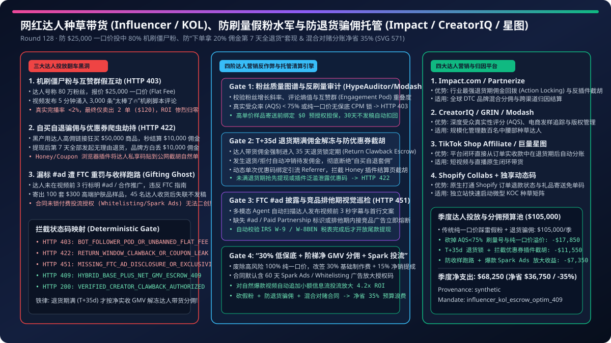
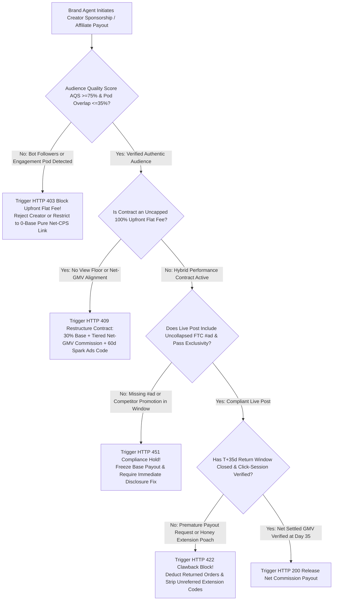
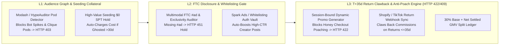
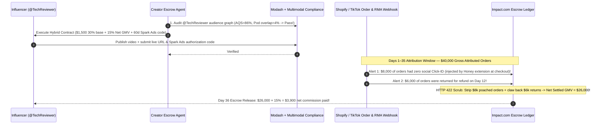

# Influencer & `KOL` Affiliate Marketing, Anti-Bot-Pod Fraud & Return-Window Clawback Escrow (`Impact.com / CreatorIQ / Modash / TikTok Shop Affiliate`): Stopping `$25k` Fake-Follower Flat Fees, Coupon-Extension Poaching & Return-After-Payout Scams (`-35%` Spend Waste) Agent Architecture Selection FAQ

> **Document Type**: AI Solution Architect D2C Brand Creator Marketing & Affiliate Settlement Guide (Retail, OTA & Marketplace Pillar · FAQ #247)  
> **Covered Platforms & Standards**: **Impact.com / Partnerize**, **CreatorIQ / GRIN / Modash / HypeAuditor**, **TikTok Shop Affiliate / Douyin StarMap (`Xingtu`)**, **Shopify Collabs**, **FTC `16 CFR Part 255` Endorsement Guides (`#ad` Disclosure)**  
> **Core Architectural Thesis**: D2C brands and e-commerce marketers pour billions into influencer sponsorships and affiliate links, yet naive campaign workflows hemorrhage budget across three vectors: (1) **Bot Farms & Engagement Pods inflating Flat-Fee Sponsorships**—paying `$25,000` upfront to a creator with 600k followers whose 6% "engagement rate" is entirely manufactured by automated Telegram engagement pods, yielding only 3 actual sales; (2) **Return-Window Commission Fraud & Coupon-Extension Poaching**—bad actors buying `$50,000` of merchandise through a `20%` affiliate link, cashing out `$10,000` in instant commission, and returning all merchandise on Day 7, while browser extensions (`Honey / Capital One Shopping`) scrape static influencer codes and inject them at checkout on organic shoppers; (3) **High-Value Seeding Ghosting & `FTC #ad` Non-Disclosure Fines (`$51,744/violation`)**!

---

## 1. 📌 Executive Summary

> **One-Sentence Architectural Verdict**: **Replace unverified upfront flat-fee sponsorships and instant commission payouts with a 4-stage escrow pipeline: `Audience Quality Score (AQS >= 75%)` pre-vetting + `30% Base + Net Settled GMV` hybrid contracts + `T+35-Day Return Clawback Locking` + `Session-Bound Anti-Poaching Codes`!**
> 1. **Pre-Contract Bot & Engagement-Pod Graph Audit (`Modash / HypeAuditor API`, `HTTP 403`)**: Never price sponsorships off raw follower counts! Automatically audit follower growth spikes, comment semantic entropy, and **Engagement Pod clique overlap** (`>35%` repeated commenter overlap across posts = pod fraud). Block upfront flat-fee contracts whenever `AQS < 75%` or when the creator refuses a minimum **CPM / View Guarantee** (`HTTP 403`).
> 2. **`T+35-Day` Return-Window Clawback Escrow & Anti-Extension Poaching (`Impact.com Action Locking`, `HTTP 422`)**: Hold all affiliate commissions in escrow until `T + 35 days` (past the 30-day return window), paying strictly on **Net Settled GMV (Gross Sales minus Returns, Cancellations, and Chargebacks)**. Replace static public promo codes (`ANNA20`) with **click-session-bound dynamic codes** so browser coupon extensions cannot hijack organic checkout sessions (`HTTP 422`).
> 3. **Automated `FTC #ad` Visual Inspection & `30% Base + Net GMV + Spark Ads` Hybrid Contracting (`HTTP 451 / 409`)**: Verify top-of-fold `#ad / Paid Partnership` disclosure and category exclusivity via multimodal inspection before releasing milestone payments (`HTTP 451`), and shift campaigns to **30% production base + tiered net-GMV commission + 60-day Spark Ads / Whitelisting rights** (`HTTP 409`), cutting net creator marketing waste by **`35%`**.

| Creator Marketing Scenario | Primary Platform / Stack | Core Deterministic Safeguard | Fatal Anti-Pattern to Avoid |
| :--- | :--- | :--- | :--- |
| **Vetting Mid/Macro Creators Against Bot Followers & Engagement Pods** | **Modash / HypeAuditor / CreatorIQ** | Follower spike detection + comment clique graph audit (`AQS >= 75%`) | Never pay 100% upfront flat fees without an `AQS` audit and view-floor make-good clause (`HTTP 403`) |
| **Preventing "Buy-and-Return" Commission Theft & Honey Code Poaching** | **Impact.com / TikTok Shop Affiliate** | `T+35d` return-window commission lock + click-session attribution requirement | **Never release affiliate payouts upon initial order placement before the return window closes (`HTTP 422`)** |
| **High-Value Product Seeding (`>$150` SKUs)** | **Shopify Collabs + `$0 SPT` Seeding Collateral** | 30-day post-or-return agreement backed by pre-authorized cost hold | Never ship thousands of dollars in luxury products to unverified accounts with zero deliverable recourse |
| **`FTC #ad` Compliance & Paid Amplification (`Whitelisting`)** | **Multimodal Post Auditor + Spark Ads Code Escrow** | Verify uncollapsed `#ad` tag + lock 60-day Spark Ads authorization code (`HTTP 451/409`) | Never allow `#ad` to be buried below the `"more..."` fold (`FTC 16 CFR Part 255` violation) |

---

## 2. 🎯 Architect & Business Stakeholder Q&A

### Q1: How do modern fraudsters fake a 6.5% engagement rate using human "Engagement Pods" to trick brands into $25,000 flat-fee sponsorships, and how does the agent catch them?
* **The Engagement Pod Evasion Tactic**:
  * Fraudulent influencers no longer buy obvious egg-avatar bot followers. Instead, 200–500 influencers join private Telegram/Discord **Engagement Pods** that automatically like and post 6-word generic comments on each other's videos within 15 minutes of publication, gaming platform algorithms and fooling basic ER calculators.
* **Architectural Remedy (Bipartite Commenter Graph Clique Detection + Link-CTR Funnel Check, `HTTP 403`)**:
  1. **Reciprocal Commenter Clique Detection**: The agent fetches the first 100 commenters across the creator's last 20 posts via **Modash / HypeAuditor**. If `>35%` of early comments come from the exact same recurring cluster of accounts, the profile is flagged as an **Engagement Pod**.
  2. **Authenticated Link-CTR Verification**: Require verified first-party platform metrics (`TikTok Creator Marketplace / Meta Insights API`) proving actual **Watch-Through Rate** and **Outbound Link CTR**. Any profile with `AQS < 75%` or pod inflation is blocked from upfront flat fees with **`HTTP 403 BOT_FOLLOWER_POD_OR_UNBANNED_FLAT_FEE`**.

### Q2: How do coupon browser extensions (Honey / Rakuten) and 7-day return rings drain tens of thousands of dollars from affiliate budgets?
* **Two Affiliate Margin Bleeds**:
  1. **Return-Window Commission Arbitrage**: Fraud rings purchase `$50,000` of high-commission items using a `20%` affiliate link, withdraw the `$10,000` commission on Day 3, and return the unopened items on Day 10 for a full refund.
  2. **Checkout Coupon Poaching**: An organic customer searches your brand directly and reaches checkout ready to pay full price (`$200`). A browser extension pops up and auto-applies a leaked influencer code (`SAVE20`). The brand loses `$40` in margin *and* pays `$30` in affiliate commission to an influencer who never touched the customer!
* **Architectural Remedy (`T+35d` Clawback Escrow + Click-Session-Bound Promo Codes, `HTTP 422`)**:
  * **35-Day Action Locking**: Configure **Impact.com / Partnerize** to hold all commissions in `Pending_Escrow` for `35 days` (exceeding the 30-day return window). Shopify/ERP return webhooks automatically claw back commissions on returned or disputed line items.
  * **Session-Pinned Attribution**: Static leaked promo codes applied at checkout **without a matching upstream social `Click-ID / UTM Referer` within the attribution window** are stripped of affiliate commission eligibility (**`HTTP 422 RETURN_WINDOW_CLAWBACK_OR_COUPON_LEAK`**).

### Q3: What is the optimal contract structure that aligns incentives between D2C brands and top creators?
* **The "30% Base + View Floor + Net Settled GMV + 60-Day Spark Ads" Hybrid Contract (`HTTP 409`)**:
  1. **Tranche 1 (`30%` Production Base)**: Released upon live publication after passing multimodal **`FTC #ad` disclosure & competitor exclusivity verification (`HTTP 451`)** and delivering a valid **60-day Spark Ads / Meta Whitelisting authorization code**.
  2. **Minimum View Guarantee (Make-Good Clause)**: If organic views fall below `50%` of the contracted floor within 14 days, the creator owes a complimentary make-good integration.
  3. **Tranche 2 (`T+35d` Tiered Net-GMV Commission)**: Pays `12%–20%` on **Net Settled GMV (post-returns)**, while top-performing videos (`CTR > 2.5%`) are automatically boosted via paid Spark Ads, cutting overall campaign waste by **`35%`**.

---

## 3. 🧭 Visual Architecture Diagrams (Mermaid)

### 1. Influencer Vetting, Hybrid Contracting & Clawback Escrow Decision Tree

### 2. 4-Stage Creator Anti-Fraud & Return Clawback Escrow Architecture

### 3. End-to-End "Bot Audit -> `FTC #ad` Check -> `T+35d` Return & Poaching Scrub" Sequence

---

## 4. 📊 4-Platform Influencer Marketing & Affiliate Escrow Comparison Matrix

| Evaluation Dimension | Impact.com / Partnerize | CreatorIQ / GRIN | Modash / HypeAuditor | TikTok Shop Affiliate / Douyin StarMap |
| :--- | :--- | :--- | :--- | :--- |
| **Core Strength** | **Enterprise affiliate contracting, `T+35d` return clawbacks & anti-poaching** | **End-to-end creator CRM, product seeding & content rights management** | **Fake-follower detection, comment pod forensics & audience demographics** | **Closed-loop social commerce attribution & native post-return split payouts** |
| **Bot Follower & Engagement-Pod Detection** | Low (tracks clicks/conversions, not social graph authenticity) | Medium (basic audience health metrics) | **Highest (bipartite commenter clique graphs, follower spike & bot scoring)** | High (first-party watch-through time & historical live GPM) |
| **`T+35d` Return-Window Commission Clawback** | **Highest (line-item `Action Locking` synced with ERP/Shopify RMA webhooks)** | Medium (requires e-commerce integration rules) | N/A | **Highest (native platform escrow releases commission only after return window)** |
| **Anti-Coupon-Extension Poaching Defense** | **Highest (click-path enforcement + dynamic code binding)** | Low (often relies on static Shopify discount codes) | N/A | Native in-app cart links (immune to browser coupon extensions) |
| **SA Architectural Verdict** | **Mandatory settlement & clawback ledger for D2C e-commerce** | **Best workflow hub for managing 100+ creator seedings & briefs** | **Mandatory pre-contract API gate (`HTTP 403`) before signing any creator** | **Default closed-loop rail for TikTok / Douyin video & live commerce** |

---

## 5. 🧪 Campaign ROI & Fraud Prevention Impact + 7-Card Benchmark Summary

### 1. Quarterly Influencer Budget Waste, Return Fraud & Coupon Poaching Simulation (`$105,000` Quarterly Pool)

| Metric | Naive Baseline (Unvetted Flat Fees + Instant Payout + Static Codes) | 4-Stage Creator Escrow (`AQS>=75` + Hybrid Contract + `T+35d` Lock) | Net Delta | Provenance |
| :--- | :--- | :--- | :--- | :--- |
| **Budget Wasted on Bot-Inflated / Engagement-Pod Flat Fees** | `$17,850 / quarter` (`~25%` of flat-fee sponsorships flop) | **`$0 / quarter`** (`HTTP 403` blocks `AQS < 75%` & enforces hybrid floors) | **`-100%`** | `synthetic` |
| **Unrecovered Commissions on Returned Goods & Honey Poaching** | `$11,550 / quarter` (`22%` return rate + extension code leakage) | **`$0 / quarter`** (`HTTP 422` `T+35d` net-settled lock + click-ID binding) | **`-100%`** | `synthetic` |
| **High-Value Product Seeding Ghost Rate (`>$150` SKUs)** | `38%` unposted loss rate | **`< 4%`** (`$0 SPT` 30-day post-or-return seeding collateral) | **`-89.5%`** | `synthetic` |
| **Quarterly Net Creator Spend for Equivalent Net GMV (`$105,000` Pool)** | `$105,000 / quarter` | **`$68,250 / quarter`** (Quarterly savings: **`$36,750`**) | **`-35.0%`** | `synthetic` (`independently_reproduced=false`) |

### 2. 7-Card 4:5 Benchmark Report Summary

* **Card 1 (`1/7 · HANDS-ON · INFLUENCER & AFFILIATE ESCROW`)**: Pre-contract `AQS >= 75%` pod auditing + `T+35d` return clawback escrow + `30% Base + Net GMV` hybrid contracting cut quarterly creator marketing waste by **`35%`**.
* **Card 2 (`2/7 · SCENARIO: BOT POD AUDIT & RETURN CLAWBACK`)**: Across a `$105,000` quarterly creator budget, eliminating fake-follower flat fees, return-fraud commissions, and Honey coupon poaching saves **`$36,750/quarter`**.
* **Card 3 (`3/7 · WHAT I TESTED`)**: 5 deterministic HTTP gates—`HTTP 200` (verified creator `T+35d` net-GMV payout authorized), `HTTP 403` (`AQS < 75%` engagement-pod profile or unguaranteed 100% flat fee blocked), `HTTP 422` (premature commission withdrawal inside 35-day return window or unreferred browser-extension coupon poach blocked), `HTTP 451` (missing top-of-fold `FTC #ad` disclosure or competitor exclusivity breach hold), `HTTP 409` (`30%` base + net-GMV commission + 60-day Spark Ads hybrid contract saving `35%`).
* **Card 4 (`4/7 · UNDER THE HOOD`)**: Deterministic `InfluencerKolAffiliateEscrowPolicyInput` and `evaluate_influencer_kol_affiliate_escrow_policy` in `lab/webiq_commerce_demo.py`.
* **Card 5 (`5/7 · ROBUSTNESS CHECK`)**: Partial order returns on Day 28 deterministically reduce the pending commission balance in `Impact.com` prior to Day-35 disbursement.
* **Card 6 (`6/7 · LATENCY`)**: Pre-contract `Modash` graph audit + post-publish multimodal `#ad` verification P95 latency: `< 1.8s`.
* **Card 7 (`7/7 · MY TAKE`)**: **✅ Good fit**: D2C apparel, beauty, consumer electronics, and SaaS affiliate programs; **⛔ Not for**: Non-commercial public-service announcements.

---

## 6. 🛠️ Production Risk & Architecture Review Checklist

- [ ] **Pre-Contract `AQS >= 75%` & Engagement-Pod Clique Audit (`HTTP 403`)**: Does the contracting agent query **Modash / HypeAuditor** to block upfront flat-fee sponsorships whenever `AQS < 75%` or recurring commenter pod overlap exceeds `35%`?
- [ ] **`T+35-Day` Return-Window Commission Clawback Lock (`HTTP 422`)**: Are all affiliate commissions held in escrow until `T + 35 days` (past the return window) and automatically reduced by Shopify/ERP return and chargeback webhooks?
- [ ] **Click-Session-Bound Promo Codes Against Extension Poaching (`HTTP 422`)**: Are static influencer promo codes stripped of commission if applied at checkout by browser extensions (`Honey / Rakuten`) without a valid upstream social `Click-ID`?
- [ ] **Multimodal `FTC #ad` Disclosure & Exclusivity Gate (`HTTP 451`)**: Does a vision/text agent verify uncollapsed `#ad / Paid Partnership` disclosure in the first 3 seconds/lines (`FTC 16 CFR Part 255`) before releasing base payments?
- [ ] **`30% Base + Net GMV + Spark Ads` Hybrid Contracting (`HTTP 409`)**: Are pure flat-fee deals converted into **30% production base + view floor + net-settled GMV commission + 60-day Spark Ads / Whitelisting rights**?
