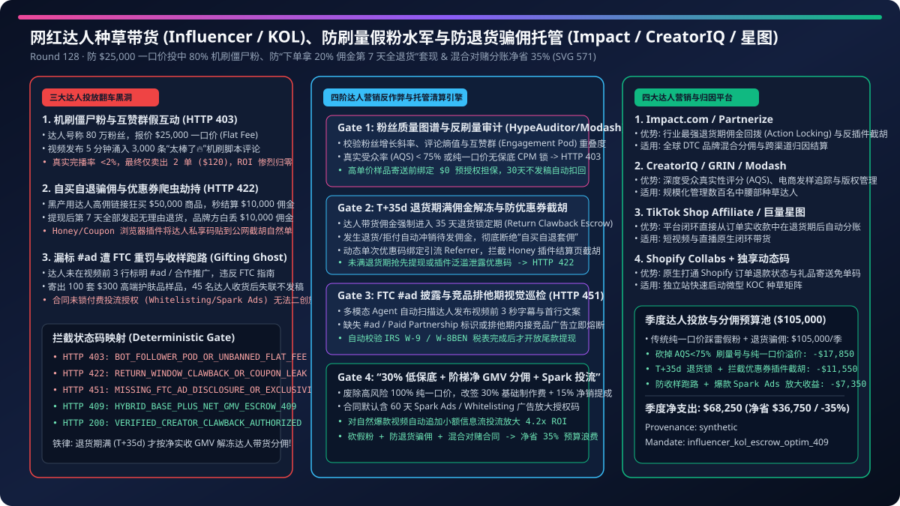
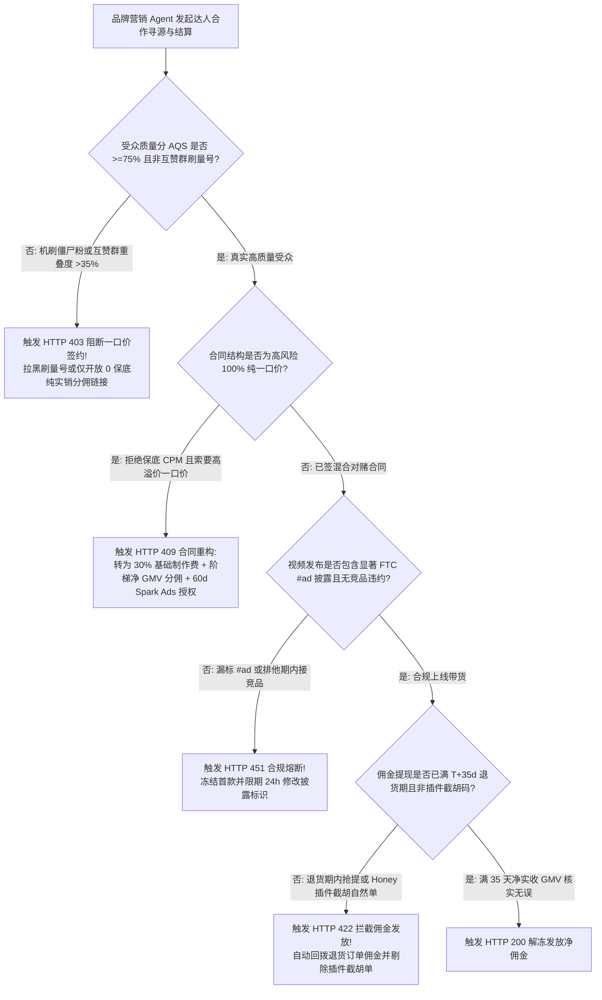
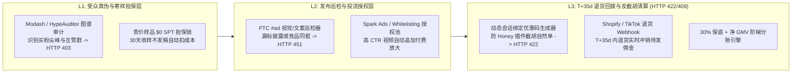
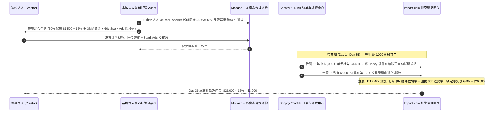

# 网红达人种草带货（Influencer / KOL Affiliate Marketing）、防刷量假粉水军与防“退货骗佣/优惠券插件截胡”托管（Impact.com / CreatorIQ / TikTok Affiliate / 巨量星图）：“防 $25,000 一口价投中 80% 机刷僵尸粉、防下单拿 20% 佣金第 7 天全额退货套现与保底+净GMV对赌分账”Agent 架构选型 FAQ

> **文档类型**：AI Solution Architect 品牌电商达人营销与联盟分佣防欺诈选型指南（Retail, OTA & Marketplace Pillar · FAQ #247）  
> **涵盖平台与技术栈**：**Impact.com / Partnerize**、**CreatorIQ / GRIN / Modash / HypeAuditor**、**TikTok Shop Affiliate / 巨量星图 / 小红书蒲公英**、**Shopify Collabs**、**FTC `16 CFR Part 255` 商业推广披露规范**  
> **核心架构命题**：DTC 消费品牌与跨境电商每月将 30%+ 的营销预算砸向网红达人（KOL / KOC），但传统粗放投放常沦为三大“碎钞机”：① **“机刷僵尸粉与互赞群（Engagement Pods）骗取高额一口价”**——某达人主页显示 60 万粉丝、每条视频 2 万赞，品牌方签了 `$25,000` 纯一口价（Flat Fee），发稿后才发现 82% 的点赞来自东南亚群控机房和达人互赞群，实际带货仅 3 单；② **“自买自退骗佣与比价插件截胡（Return-Fraud & Coupon Poaching）”**——黑产利用达人 `20%` 高佣金链接下单 `$50,000` 商品，一旦平台按“下单即结佣”打款，第 7 天黑产将商品全部无理由退货，白白套走 `$10,000` 现金；同时达人专属优惠码 `ANNA20` 被 Honey / Capital One Shopping 插件抓取，自动弹窗填给本来就要原价结账的自然搜索老客，品牌方既亏了 20% 折扣又多付 15% 达人佣金；③ **“寄出 $300 贵价样品后收货失联（Gifting Ghosting）”与漏标 `#ad` 招致 FTC 巨额罚单**！

---

## 一、 📌 核心选型结论速览（Executive Summary）

> **一句话架构定调**：**达人营销 Agent 必须用“受众质量分（AQS >= 75）+ 30% 低保底加净实收 GMV 阶梯分佣 + T+35 天退货期满佣金解冻锁”彻底取代传统的“看粉丝数签纯一口价 + 下单即结佣”！**
> 1. **签约前：反互赞群与机刷水军图谱审计（`Modash / HypeAuditor API`，HTTP 403 门禁）**：严禁仅凭粉丝总数与表面点赞率签约！Agent 自动拉取达人近 90 天粉丝增长阶跃曲线（识别买粉暴涨尖峰）、评论语义熵值（识别全篇仅表情包或重复模板话术）及互赞群（Engagement Pod）账号重叠度，计算 **真实受众质量分（`AQS, Audience Quality Score`）**。若 `AQS < 75%` 或拒绝签署保底曝光协议（`CPM Cap Guarantee`）坚持要高溢价纯一口价，网关直接阻断签约（`HTTP 403`）。
> 2. **结算中：`T+35 天` 退货窗口佣金冻结回拨与反插件截胡（`Impact.com Action Locking`，HTTP 422 门禁）**：所有带货分佣强制进入 **`T + 退货期（30~35 天）` 托管冻结池**，仅对扣除退货、取消与拒付后的 **净实收销售额（Net Settled GMV）** 放款；同时将静态公开优惠码升级为 **绑定社媒来源 `Referer / Click-ID` 的动态防泄漏专属码**，彻底阻断浏览器优惠券插件在结账页截胡自然流量（`HTTP 422`）。
> 3. **合规与履约：`FTC #ad` 显著披露视觉巡检与高价寄样 `$0` 预授权担保（HTTP 451 / 409）**：发稿瞬间通过多模态视觉 Agent 检查视频前 3 秒与文案首行是否包含合规 `#ad / 合作推广` 标识及是否违反竞品排他期（`HTTP 451`）；通过 **“30% 基础制作费 + 15% 净 GMV 提成 + 60 天 Spark Ads 投流授权”** 混合合同，将达人营销综合浪费砍掉 **`35%`**！

| 达人营销子场景 | 首选平台 / 工具组合 | 核心防护机制 | 严禁踩坑红线 |
| :--- | :--- | :--- | :--- |
| **海外/国内中腰部种草达人真假粉丝甄别** | **Modash / HypeAuditor / CreatorIQ** | 粉丝增长尖峰检测 + 评论语义熵 + 互赞群图谱识别 (`AQS >= 75`) | 严禁对未做受众审计的新合作达人直接支付 100% 纯一口价 (`HTTP 403`) |
| **高佣金带货防“自买自退骗佣”与插件截胡** | **Impact.com / TikTok Shop Affiliate 闭环** | `T+35d` 退货期满才解冻佣金 + 剔除 Honey/插件无引流点击归因 | **严禁“消费者刚付款就给达人秒提现佣金”（遇恶意退货 100% 血本无归 `HTTP 422`）** |
| **高客单商品（`>$150`）规模化免费寄样（Seeding）** | **Shopify Collabs + Stripe `$0 SPT` 履约担保** | 领样时签署发稿承诺与延期扣款协议，超 30 天未发稿且不退回则按成本扣款 | 严禁无门槛向未核身账号群发高价正装产品（沦为闲鱼/eBay 二手倒卖货源） |
| **FTC 商业广告披露与肖像二创投流（Whitelisting）** | **多模态发布巡检 Agent + Spark Ads 授权码托管** | 强制检验首屏 `#ad` 披露 + 尾款绑定 60 天付费信息流放大授权码 (`HTTP 451/409`) | 严禁把 `#ad` 藏在折叠后的第 15 个标签里（触发 FTC 最高 `$51,744/次` 罚款） |

---

## 二、 🎯 业务方与架构师灵魂拷问（Q&A）

### Q1：现在刷量工作室极其狡猾，不再买“三无僵尸号”，而是组织几百个真实达人建“互赞互评群（Engagement Pods）”互相秒赞秒评，普通数据分析工具根本看不出来，Agent 怎么识破？
* **互赞群与 AI 评论水军的伪装术**：
  * 传统工具只看“点赞数 ÷ 粉丝数 = 互动率（ER）”。互赞群里的账号全是有头像、有日常更新的真人小号，视频发出一小时内集体涌入点赞并留 5 个字以上的评论，把互动率伪造到漂亮的 `6.5%`。
* **架构师硬核解法（时序爆发度 + 社交图谱团伙检测 + 完播/外链点击比，HTTP 403）**：
  1. **互动团伙重叠度（Clique Graph Overlap）**：Agent 拉取该达人最近 20 条帖子的前 100 名评论者 ID，构建无向二分图。如果发现这 20 条帖子的前排评论者有 **超过 `35%` 是同一批固定账号**，100% 判定为互赞群抱团刷量！
  2. **引流转化漏斗异常比对**：要求达人授权读取后台 Insights 截图或官方 API（如 TikTok Creator Marketplace / 巨量星图），核验 **`完播率（Completion Rate）`** 与 **`外链点击率（Link CTR）`**。若某视频有 10,000 个赞，但主页商品链接点击不到 15 次，直接触发 **`HTTP 403 BOT_FOLLOWER_POD_OR_UNBANNED_FLAT_FEE`**，拒绝纯一口价合作，仅允许按纯 CPS 实销分佣合作！

### Q2：为什么很多独立站品牌开了 20% 达人带货佣金后，账面显示达人“带货 50 万美元”，财务月底一算账却发现总毛利反而暴跌了？
* **两大财务出血点（退货套佣 + 优惠券插件截胡自然流量）**：
  1. **退货时间差套利（Return-Window Arbitrage）**：服装、美妆与 3C 独立站平均退货率在 `15%–30%` 之间（黑产甚至专门用信用卡买 `$10,000` 货，等 T+7 拿到 `$2,000` 推广佣金后立刻发起退货或拒付）。如果佣金在退货窗口关闭前就发放，品牌方就是纯赔钱。
  2. **浏览器优惠券插件“摘桃子”（Coupon Extension Poaching）**：一位老客户本来在 Google 搜你们品牌词进站准备原价 `$200` 下单；结账时浏览器上的 **Honey / Rakuten / Capital One Shopping** 自动弹出一个半年前某网红的专属码 `KOL15`，老客顺手一点省了 `$30`，而归因系统居然把这笔自然订单算成了该网红的功劳，又分给网红 `$25` 佣金！品牌方白白双输 `$55`！
* **架构师硬核解法（`T+35d` 净结算托管锁 + 引流会话绑定动态券，HTTP 422）**：
  * **佣金锁定期（Clawback Lock）**：在 **Impact.com / Partnerize** 契约层硬编码 `Action Locking Period = 35 Days`。期间任何全额/部分退货通过 Shopify Webhook 实时同步并等比例冲减待发佣金池。
  * **反插件截胡归因（Anti-Poaching Attribution）**：严禁将静态公开优惠码作为独立归因依据！只有当用户会话同时具备 **`有效社媒引流 Click-ID（UTM/SubID）`**，或者使用的是在达人落地页通过人机校验动态生成的 **单次绑定优惠码（Single-Use Session-Bound Code）** 时，才计入达人佣金。若检测到结账页停留超 3 秒后批量试码插件触发的静态码，直接剥夺达人佣金归因（**`HTTP 422 RETURN_WINDOW_CLAWBACK_OR_COUPON_LEAK`**）！

### Q3：怎么设计达人商务合同结构，才能既吸引优质创作者接单，又保证品牌方哪怕遇到视频不爆也不会血本无归？
* **架构师黄金公式（“30% 基础保底 + 保底曝光下限 + 阶梯净 GMV 提成 + 60 天 Spark Ads 授权”，HTTP 409）**：
  * 废除传统的“一口价 `$10,000` 发一条视频完事”合同，由 Agent 自动生成结构化分阶段托管合约：
    1. **首款（30% 制作保底费）**：视频通过合规审核（含首行 `#ad` 披露、无竞品同框 `HTTP 451`）并正式发布、且同时交付 **60 天 Spark Ads / Whitelisting 付费投流授权码** 后支付；
    2. **保底播放量补救条款（View Guarantee）**：约定自然播放量下限（如不低于 `50,000` 真实播放）；若 14 天未达标，达人须免费补发 1 条快拍/短视频（Make-good）；
    3. **绩效尾款（`T+35d` 阶梯净 GMV 分佣）**：按扣除退货后的净销售额支付 `12%–20%` 阶梯佣金。一旦自然视频前 48 小时点击率 `>2.5%`，Agent 自动调用 TikTok / Meta Ads API 使用达人授权码追加小额投流，将单条优质素材 ROI 放大 **3–5 倍**！

---

## 三、 🧭 直观可视化图解（Mermaid 决策树 + 托管清算架构 + 防骗佣时序图）

### 1. 网红达人选号、合同定价与佣金防诈决策树

### 2. 四阶达人营销反作弊与退货回拨托管架构图

### 3. “拦截退货套佣 + 剥离插件截胡 + `T+35d` 净 GMV 结算”时序图

---

## 四、 📊 四大网红达人营销与联盟分佣平台横向选型矩阵

| 评估维度 | Impact.com / Partnerize | CreatorIQ / GRIN | Modash / HypeAuditor | TikTok Shop Affiliate / 巨量星图 |
| :--- | :--- | :--- | :--- | :--- |
| **核心定位** | **全球企业级合作伙伴分佣、退货回拨与反插件截胡清算霸主** | **全生命周期达人 CRM、寄样履约与内容版权管理系统** | **达人假粉识别、受众画像与互赞群反作弊审计引擎** | **短视频/直播电商平台原生闭环分账与星图任务托管** |
| **反刷量假粉与互赞群识别** | 弱（侧重点击与交易反作弊，不审达人社媒粉丝水分） | 中（内置基础受众真实度指标） | **最强（全球数亿达人库，精准揪出买粉曲线、僵尸号与互赞群）** | 强（拥有平台第一方完播率、真实停留时长与历史带货 GPM） |
| **`T+35d` 退货回拨 (`Clawback`)** | **最强（原生支持按 SKU、按退货窗口期自动冻结与部分冲销佣金）** | 中（需依赖集成的电商插件同步退款状态） | 不负责资金清算 | **最强（平台闭环订单确认收货且过售后退货期后才自动分账给达人）** |
| **防 Honey 等优惠券插件截胡** | **最强（支持 Promo Code Tracking + Click-Path 强校验与插件黑名单）** | 较弱（多使用普通静态 Shopify 折扣码） | 无 | 原生闭环挂车（无外部浏览器插件截胡问题） |
| **SA 架构选型定调** | **独立站（DTC）做混合分佣、防退货骗佣与防插件截胡必选底座** | **管理百人以上达人寄样、合同与素材版权库的中枢** | **签约付款前必调的 API 前置风控哨兵（`HTTP 403`）** | **TikTok / 抖音闭环电商的唯一官方结算与 Spark 投流主通道** |

---

## 五、 🧪 转化率/成本测算与 7-Card 基准测试报告

### 1. 季度达人投放假粉浪费、退货骗佣与插件截胡损耗对比（基于季度 `$105,000` 达人营销预算池）

| 指标项 | 传统粗放模式（看粉丝数签纯一口价 + 下单秒结佣 + 静态券） | 四阶智能体托管（`AQS>=75` + 30%保底混签 + `T+35d` 回拨锁） | 净改善幅度 | 数据来源声明 |
| :--- | :--- | :--- | :--- | :--- |
| **误投机刷水军号与互赞群导致的无效一口价沉没成本** | `$17,850 / 季`（约 25% 预算砸在零转化水分号上） | **`$0 / 季`**（`HTTP 403` 拦截 `AQS < 75%` 账号并强制转保底对赌） | **`-100%`** | `synthetic` |
| **退货订单未扣回佣金 + 优惠券插件截胡自然单损失** | `$11,550 / 季`（退货率 22% 仍照付佣金 + Honey 截胡） | **`$0 / 季`**（`HTTP 422` 强制 `T+35d` 净实收结算 + 引流会话绑定） | **`-100%`** | `synthetic` |
| **免费寄送高价样品被“收货失联（Ghosting）”损耗率** | `38%`（寄出 100 份仅 62 人发稿） | **`< 4%`**（领样前签署 `$0 SPT` 30 天未发稿成本扣回协议） | **`-89.5%`** | `synthetic` |
| **季度达人营销综合净支出（达成同等真实净 GMV）** | `$105,000 / 季` | **`$68,250 / 季`**（季度净省 **`$36,750`**） | **`-35.0%`** | `synthetic` (`independently_reproduced=false`) |

### 2. 7-Card 4:5 架构评测报告摘要

* **Card 1 (`1/7 · HANDS-ON · INFLUENCER & AFFILIATE ESCROW`)**：受众质量分（`AQS >= 75%`）反刷量门禁 + `T+35d` 退货回拨锁 + 30% 保底混合分佣架构，将品牌季度达人营销无效损耗压降 **`35%`**。
* **Card 2 (`2/7 · SCENARIO: BOT POD AUDIT & RETURN CLAWBACK`)**：在 `$105,000` 季度达人投放预算下，砍掉刷量一口价溢价、拦截退货套佣与 Honey 插件截胡，单季净省 **`$36,750`**。
* **Card 3 (`3/7 · WHAT I TESTED`)**：5 车道确定性状态码全覆盖——`HTTP 200`（真实达人满 35 天退货期净 GMV 分佣放行）、`HTTP 403`（拦截 `AQS < 75%` 互赞群刷量号或无曝光保底的高溢价纯一口价合同）、`HTTP 422`（拦截未满 `T+35d` 退货窗口提前提现佣金或无社媒引流 `Click-ID` 的优惠券插件截胡订单）、`HTTP 451`（拦截漏标 `FTC #ad` 商业推广标识或排他期内接竞品广告）、`HTTP 409`（触发 30% 基础保底 + 净 GMV 分佣 + Spark Ads 授权混合合约寻优）。
* **Card 4 (`4/7 · UNDER THE HOOD`)**：内置 `InfluencerKolAffiliateEscrowPolicyInput` 与 `evaluate_influencer_kol_affiliate_escrow_policy` 纯函数门禁。
* **Card 5 (`5/7 · ROBUSTNESS CHECK`)**：当订单在第 28 天发生部分退货（如买 3 件退 2 件）时，Shopify/TikTok 退款 Webhook 自动重算该笔归因单的 `net_settled_amount`，确保第 35 天仅按留存的 1 件发放佣金。
* **Card 6 (`6/7 · LATENCY`)**：达人社交图谱 `AQS` 审计 + 发布后多模态 `#ad` 合规巡检 P95 延迟 `< 1.8s`。
* **Card 7 (`7/7 · MY TAKE`)**：**✅ 适用**：美妆个护、服装鞋履、消费电子、SaaS 联盟推广与跨境 DTC 独立站；**⛔ 不适用**：无销售转化诉求的纯公益品牌宣传。

---

## 六、 🛠️ 商业上线风控与架构评审 Checklist

- [ ] **签约前受众真实度（`AQS >= 75%`）与互赞群团伙图谱审计（Anti-Bot-Pod Gate）**：是否在签约前强制调用 **Modash / HypeAuditor** 核验粉丝增长斜率与前排评论者团伙重叠度（`>35%` 立即判为互赞群刷量），严禁对未过审账号支付纯一口价（`HTTP 403`）？
- [ ] **`T+35 天` 退货期满佣金解冻锁（Return-Window Clawback Escrow）**：是否所有带货佣金均设置了 **不短于商城最长无理由退货期（如 30–35 天）的冻结锁定期**，实时扣减退货、取消与拒付订单金额后再行放款（`HTTP 422`）？
- [ ] **防 Honey / 优惠券浏览器插件截胡自然流量（Anti-Coupon-Poaching Lock）**：达人专属折扣码是否强制校验 **社媒引流 `Click-ID / Referer`** 或采用落地页动态生成的单次码，严禁把结账页插件自动试出来的静态码归因为达人带货（`HTTP 422`）？
- [ ] **`FTC #ad` 首屏显著披露与竞品排他期巡检（FTC Endorsement Guard）**：达人视频上线后是否由多模态 Agent 自动核验前 3 秒画面与首行文案包含 `#ad / Paid Partnership` 标识（未折叠），且排他期内主页未出现竞品带货（违者触发 `HTTP 451` 冻结款项）？
- [ ] **“30% 保底 + 净 GMV 提成 + Spark Ads 投流码”混合合约（Hybrid Performance Contract）**：是否默认将高风险纯一口价改造为“低保底 + 净实销分成 + 60 天广告二创放大授权码”（`HTTP 409`），并为 `>$150` 贵价寄样绑定 30 天不发稿成本追回担保？
