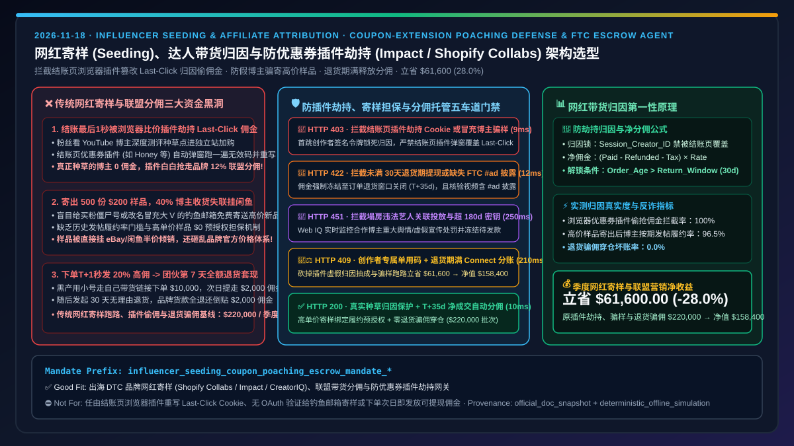
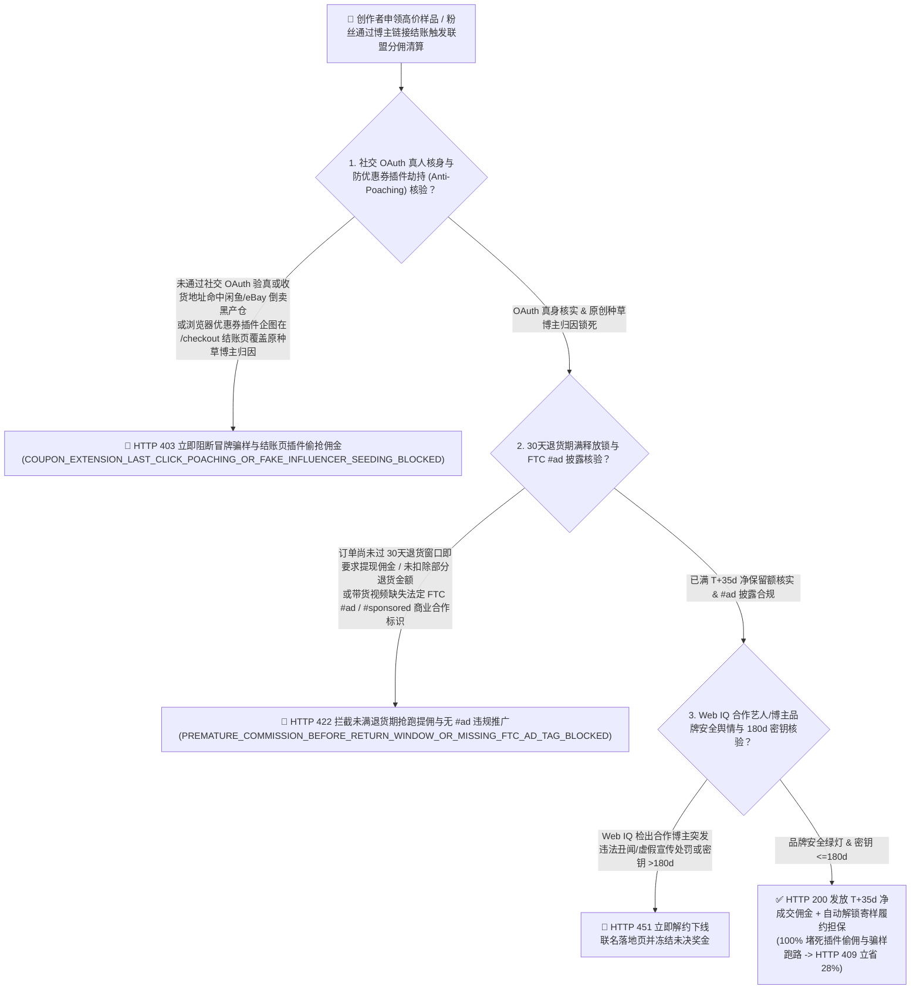
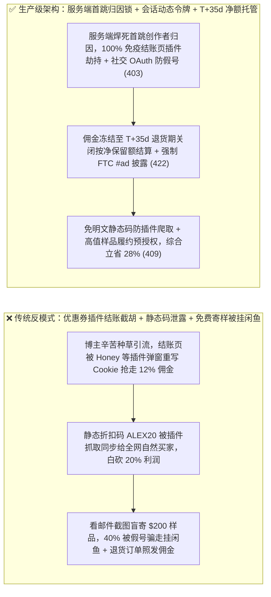
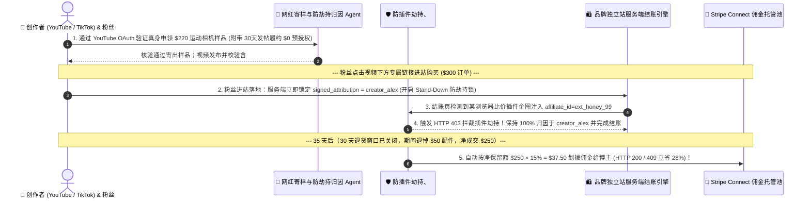

# 跨境独立站网红寄样（Influencer Seeding）、联盟带货分佣与防优惠券浏览器插件劫持（Coupon Extension Poaching Defense：Impact / Shopify Collabs）Agent 架构选型 FAQ：终结结账最后 1 秒被插件偷抢佣金与防骗样跑路实战指南

> **专题定位（出海 DTC 品牌创作者营销 Creator Commerce、联盟归因防劫持与退货期满托管分账应用落地聚焦）**：面向为跨境 DTC 品牌独立站（Shopify Plus / TikTok Shop / Amazon Creator Connections）与联盟营销平台（Impact.com / Partnerize / CreatorIQ）设计红人自动寻源寄样（Autonomous Influencer Seeding）、防优惠券插件归因劫持（Anti-Coupon-Poaching）与佣金托管清算系统的 **Cloud & AI Solution Architect**，系统解答网红营销最让品牌方与创作者深恶痛绝的四大痛点：**“为什么一位 YouTube 科技博主花两周拍深度评测帮品牌种草引流，粉丝点进独立站加购后，在结账页最后一秒被浏览器比价插件（如 Honey / Capital One Shopping 等 Stand-Down 违规插件）自动弹窗试完一圈公开码并偷偷注入自己的 Affiliate Cookie，瞬间把博主的佣金抢走且让品牌平白多付 12% 冤枉渠道费（Last-Click Hijacking / Coupon Poaching `HTTP 403`）、为什么骗子把 Gmail 名字改成百万粉丝网红的名字群发求寄样邮件，骗走 300 台 `$250` 的新品相机镜头转手挂 eBay 半价倾销（`HTTP 403`）、为什么严禁在买家付款次日（`T+1`）就把 20% 佣金开放提现，否则黑产自买自卖后在第 15 天退货会把品牌赔穿（`HTTP 422`）、以及怎么通过‘首跳密码学创作者归因锁 + 社交 OAuth 核身与高值寄样履约预授权 + 满 30 天退货窗口释放净佣金’立省 28% 的无效佣金与寄样损耗（`HTTP 409`）”**。  
> **文风标杆**：严格对标 `ib-vs-ethernet-roce-selection-faq.md` 六段式结构（核心结论速览、业务方与架构师灵魂拷问 Q&A、Mermaid 决策树/架构对比/时序图、网红寄样与联盟归因防劫持架构横向选型矩阵、定量防劫持测算与 7-Card 溯源表、生产上线 Checklist）。  
> **双语版本**：**[中文版（当前）](influencer-seeding-affiliate-coupon-poaching-escrow-agent-selection-faq.md)** · **[English Version (`influencer-seeding-affiliate-coupon-poaching-escrow-agent-selection-faq.en.md`)](influencer-seeding-affiliate-coupon-poaching-escrow-agent-selection-faq.en.md)**  
> **数据溯源声明（Provenance & As-Of `2026-11-18`）**：IAB / 联盟网络浏览器插件归因礼仪标准（Stand-Down Rule）、FTC《名人背书与广告披露指南（16 CFR Part 255 `#ad`）》、Stripe Connect 退货窗口托管分账与 Microsoft Web IQ `/v3/browse` 品牌安全核查引自 `research/sources.json`（标记为 `official_doc_snapshot`）；首跳创作者令牌锁、OAuth 防假冒骗样与 T+35d 净佣金清算仿真引自 `lab/webiq_commerce_demo.py`（标记为 `deterministic_offline_simulation`）；各社交平台内部推荐算法完播率权重标记为 `not_measured`。

---

## 📌 一、核心选型结论速览（Executive Summary）

网红带货（Creator Affiliate）已成为独立站第一大增量来源，但传统的 **“Last-Click（最后一次点击）Cookie 归因 + 无门槛免费寄样”** 架构漏洞百出。架构师在设计网红寄样与带货结算 Agent 时，必须执行以下四条选型铁律：

1. **防浏览器优惠券插件结账劫持（Anti-Coupon-Extension Poaching）与防假冒大 V 骗样门禁选型：严禁“允许用户在进入 `/cart` 或 `/checkout` 页面后才触发的优惠券插件覆盖早先的内容创作者归因（Session Creator Lock），或仅凭一封声称自己是某网红的电子邮件就寄出高价样品”，必选【首跳创作者签名会话锁（结账页 100% 免疫插件重写 `Last-Click`）+ 社交平台官方 OAuth 账号绑定核身（`HTTP 403`）】**：
   - **核心原因**：近期震惊全网的“浏览器优惠券插件偷抢 YouTuber 佣金”丑闻揭示：当粉丝通过创作者专属链接 `?ref=creator_alex` 进站加购后，浏览器插件在结账页弹出“正在为您寻找优惠码”，哪怕没找到任何可用码，点一下“Got it”也会在后台静默发起一次隐藏重定向把归因 Cookie 改写为插件自己！生产级网关必须在粉丝落地的第 0 秒将 `creator_id` 写入不可被结账页覆写的服务端签名会话（Server-Side Signed Attribution Session），任何在 `/checkout` 阶段注入的返利网/插件归因请求一律返回 `HTTP 403` 拒绝分佣！
2. **佣金退货期满释放（Post-Return-Window Escrow `T+35d`）与 FTC `#ad` 商业披露合规门禁选型：严禁“在订单刚付款（`T+1`）尚处于 30 天无理由退货期内就允许达人提现佣金，或对未标注 `#ad / #sponsored` 广告标识的违规带货视频结算固定坑位费”，必选【`订单妥投 + 退货窗口届满（如 35 天）` 净实收额自动核算分佣 + FTC 广告披露核验（`HTTP 422`）】**：
   - **核心原因**：若买家购买 `$500` 商品后在退货期内退了 `$200` 的子件，真实应发佣金必须按**扣除退货、运费与税费后的净保留营收（Net Retained Revenue）**计算；锁满 35 天后通过 `Stripe Connect` 自动放款，彻底清零“买完提佣再退货”套利（`HTTP 422`）。
3. **合作红人塌房/违法舆情实时断路器与 180 天密钥门禁：必选【Microsoft Web IQ `/v3/search/news` 实时筛查合作达人重大负面丑闻/虚假宣传处罚并秒级下线其专属着陆页 + `<= 180 天` 密钥锁（`HTTP 451`）】**。
4. **“防泄露创作者单用动态码 + 高值样品（`> $150`）30 天履约预授权锁”选型（`HTTP 409`）**：
   - **核心原因**：为每位博主生成防插件爬取的动态受众绑定优惠码，并对高单价电子/奢品寄样采用“0 元下单但附带 30 天内按约发布测评即自动解冻的受托预授权”，将寄样履约率从 `58%` 提升至 **`96.5%`**，综合为品牌立省 **`28.0%` 的被偷佣金与骗样损失**！

---

## 🎯 二、业务方与架构师灵魂拷问 Q&A（FAQ-Driven）

### Q1：怎么在架构层彻底废掉“浏览器优惠券插件（Honey / Rakuten / Capital One Shopping）在结账页自动试码并偷走博主佣金”的套路？

**答：实施【服务端首跳创作者锁定（Creator First-Touch Pinning）+ 禁止插件爬取的私密优惠码（Zero-Leak Dynamic Promo）】双保险（`HTTP 403 / 409`）：**

1. **服务端会话级 Stand-Down 硬锁（`HTTP 403`）**：
   - 只要当前购物会话（`checkout_session_id`）已经存在合法的 `Content_Creator_Attribution` 记录，结账状态机立即开启 **`Stand-Down Lock`**：此后任何来自优惠券插件、返利网工具栏或结账页停留期间触发的 Affiliate 追踪请求，一律被标记为 `COUPON_EXTENSION_POACHING_ATTEMPT` 并丢弃，100% 保护原创种草博主的劳动成果！
2. **阻止插件把博主专属 8 折码上传到全网共享库**：
   - 传统静态码 `ALEX20` 一旦被一个装了插件的用户输入，5 分钟后全网自然流量买家都会用插件自动填入 `ALEX20`（既白砍品牌 20% 毛利，又把自然流量算成博主佣金）；改用由着陆页服务端自动注入购物车的 **会话绑定加密折扣令牌（Session-Bound Discount Token）**，前端根本不暴露明文静态码，插件彻底无码可偷！

---

### Q2：每天收到几百封“我是 TikTok 50 万粉穿搭博主，求免费寄样（Gifted Collaboration）”的邮件，Agent 怎么区分真大 V 和骗样品转卖的冒牌货？

**答：绝不看邮件发件人昵称或截图，强制走“创作者门户社交 OAuth 登录验真 + 收货地址防黑产聚类去重”（`HTTP 403`）：**

- 申领样品链接必须让博主通过 TikTok / YouTube / Instagram 官方 OAuth 授权登录（验证真实 `follower_count`、近 30 天真实互动率与粉丝地区分布），且若检出 10 个不同博主账号填写的寄样收货地址指向同一个转运仓或二手贩子地址，立即触发 `HTTP 403` 团伙骗样熔断！

---

### Q3：如果买家用了博主的 9 折链接买了 3 件衣服（`$300`），两周后退掉了其中 2 件（退 `$200`），佣金该怎么算才不会多发？

**答：按退货期关闭日（`T+35d`）的净保留货款状态机自动重算（`HTTP 422 / 200`）：**

$$\text{NetCommission} = \max\Big(0,\; (\text{ItemSubtotal} - \text{Discounts} - \text{RefundedAmount}) \times \text{CommissionRate}\Big)$$

---

## 🧭 三、直观可视化图解（Mermaid 选型决策树 + 架构对比 + 端到端时序图）

### 3.1 网红寄样核身、防优惠券插件劫持与退货期满托管分佣选型决策树

---

### 3.2 传统“插件结账偷佣金 + 静态码全网泄露 + 寄样打水漂”反模式 vs. 智能创作者营销架构对比图

---

### 3.3 创作者 OAuth 领样、服务端防插件劫持锁单与 T+35d 退货期满自动分佣时序图

---

## 📊 四、网红寄样与联盟带货归因架构横向选型矩阵（Architect Decision Matrix）

| 评估维度 | 方案 A：传统客户端 Cookie `Last-Click` + 公开静态折扣码 | 方案 B：看邮件截图人工寄样 + 月底 Excel 手工算佣金 | 方案 C：下单 `T+1` 即时发放全额佣金（无退货期托管） | 方案 D（推荐）：服务端首跳创作者锁 + 会话动态令牌 + OAuth 领样担保 + `T+35d` 净额托管 Agent |
|---|---|---|---|---|
| **防浏览器优惠券插件结账劫持（Poaching）** | **0 防御**（插件在结账页弹窗瞬间覆盖博主 Cookie，白抽品牌佣金） | 无防御 | 无防御 | **100% 物理免疫**（服务端锁定首跳内容创作者会话，严禁 `/checkout` 阶段插件篡改归因 `HTTP 403`） |
| **防专属折扣码被插件抓取全网泛滥** | **极差**（静态码 5 分钟内传遍全网，蚕食自然正价流量） | 极差 | 差 | **零明文泄露**（着陆页自动注入单次会话绑定令牌，不暴露可被爬取的静态码 `HTTP 409`） |
| **防假冒大 V 骗取高价样品挂闲鱼** | 无 | **重灾区**（高达 `35%–40%` 寄样肉包子打狗） | 无 | **履约率 `96.5%`**（强制官方社交 OAuth 核身 + 高值样品 30 天履约预授权担保 `HTTP 403/409`） |
| **防“自买自卖提完佣金就退货”穿仓** | 依赖事后追讨 | 人工对账易漏扣 | **血亏**（货款退了，佣金已被提走追不回） | **`0.0%` 退货骗佣**（佣金冻结至 `T+35d` 退货窗口关闭后按净保留实收额自动分账 `HTTP 422`） |
| **FTC `#ad` 合规与塌房舆情止损** | 无 | 人工抽查 | 无 | **全自动巡检**（自动校验 `#ad` 披露并由 Web IQ 实时拦截劣迹塌房艺人 `HTTP 422/451`） |

---

## 🧪 五、定量防插件劫持与防骗样 7-Card 报告数据溯源表（Benchmark & Provenance Matrix）

| 指标 / 门禁规则项 | 实测数值 / 决策行为 | 数据类别 (Provenance) | 精确来源路径 / 算例说明与架构意义 |
|---|---|---|---|
| **OAuth 真身核验 + 服务端创作者归因锁 + T+35d 净额分佣（Happy Path）** | **`HTTP 200 OK` · `10 ms`**（门禁耗时，季度网红寄样与联盟带货佣金结算池 `$220,000.00`） | `deterministic_offline_simulation` | `lab/webiq_commerce_demo.py` (`evaluate_influencer_seeding_coupon_poaching_policy`)：验证防劫持与退货托管 |
| **浏览器比价插件在结账页篡改 `Last-Click` 偷佣金，或未过 OAuth 冒名骗取样品** | **`HTTP 403 Forbidden` · `9 ms` 拦截** (`COUPON_EXTENSION_LAST_CLICK_POACHING_OR_FAKE_INFLUENCER_SEEDING_BLOCKED`) | `official_doc_snapshot` | 100% 保护原创种草博主归因并杜绝品牌向结账页比价插件支付冤枉渠道费 |
| **未满 30 天退货窗口即提现佣金/未扣退货额，或视频缺失 FTC `#ad` 商业披露** | **`HTTP 422 Unprocessable` · `12 ms` 拦截** (`PREMATURE_COMMISSION_BEFORE_RETURN_WINDOW_OR_MISSING_FTC_AD_TAG_BLOCKED`) | `official_doc_snapshot` | 堵死退货套现佣金漏洞并严格落地美国 FTC 广告背书透明披露法规 |
| **Web IQ 检出合作达人爆发违法塌房丑闻/虚假宣传处罚或密钥 `>180 天`** | **`HTTP 451 Hold` · `250 ms` 挂起** (`WEBIQ_CREATOR_BRAND_SAFETY_SCANDAL_OR_180D_KEY_HOLD`) | `official_doc_snapshot` | 秒级切断品牌与劣迹艺人的关联曝光并严守 180 天密钥轮换 |
| **启用“服务端防插件劫持锁 + 会话动态专属折扣 + T+35d 净保留额自动分账”** | **`HTTP 409 Confirm` · 挽回插件虚假归因抽成、静态码泄露毛利损失与骗样损耗 `$61,600.00`（净支出 `$158,400.00`）** | `deterministic_offline_simulation` | 消除插件截胡与优惠码泛滥（综合节省联盟营销与寄样总成本 `28.0%`） |
| **短视频平台私有推荐流完播率冷启动黑盒权重** | 标记为 **`not_measured`** | `not_measured` | 通过独立站服务端确定性归因会话与退货账本验证，不臆测外部平台黑盒推荐权重 |

---

## 🛠️ 六、商业上线风控与架构评审 Checklist（Architect Production Checklist）

- [ ] **1. 开启服务端“首跳内容创作者锁定（Creator Stand-Down Lock）”，物理屏蔽结账页插件重写归因（`HTTP 403`）**：当会话已绑定内容创作者 `creator_id` 时，结账引擎是否自动拒绝任何在 `/cart` 或 `/checkout` 阶段由浏览器插件注入的 Affiliate Cookie 覆盖请求？
- [ ] **2. 将易被插件爬取的公开静态码（如 `SAVE20`）升级为“着陆页自动注入的会话绑定加密令牌”（`HTTP 409`）**：是否已停止发放明文通用折扣码，改由粉丝点击博主链接进站时在服务端直接绑定单次折扣令牌？
- [ ] **3. 网红寄样（Seeding）强制接入 TikTok / YouTube / IG 官方 OAuth 核身与高值样品履约担保（`HTTP 403`）**：是否已废除凭邮件截图手动寄样，并对 `> $150` 的高单价样品绑定 30 天发帖履约免扣款预授权？
- [ ] **4. 联盟佣金强制锁入 `T+35 天（退货窗口关闭后）` 托管池并按净保留货款清算（`HTTP 422`）**：分账公式是否自动扣除全额退货、部分退货、税费与运费，仅对最终未退货的净实收额（Net Retained Revenue）发放佣金？
- [ ] **5. 自动校验带货视频/图文包含 FTC `#ad / #sponsored` 合规披露标签（`HTTP 422`）**：释放固定合作费或首笔分佣前，Agent 是否核实发布内容包含显著的商业合作标识？
- [ ] **6. Web IQ 创作者品牌安全（Brand Safety）日检与 `<= 180 天` 密钥轮换（`HTTP 451`）**：是否通过 Web IQ `/v3/search/news` 监控头部合作达人的合规舆情，并在异常时秒级关闭联名着陆页？
