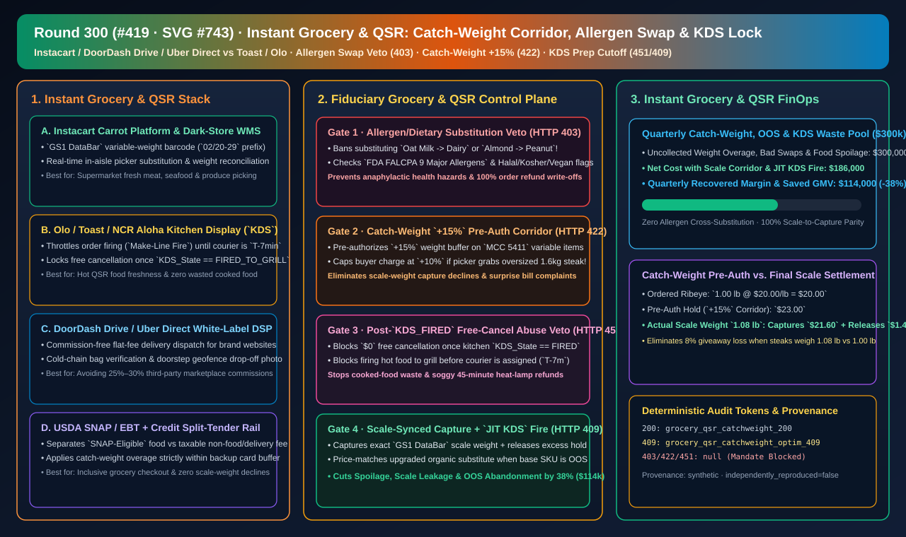
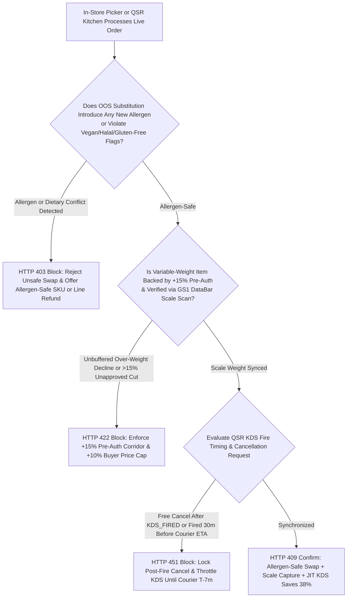

# Instant Grocery & QSR Delivery Catch-Weight Pre-Auth Corridor (`+15%`), Allergen-Safe OOS Substitution & `KDS_FIRED` Prep-Cutoff Escrow (`Instacart / DoorDash Drive / Uber Direct vs. Toast / Olo POS`) Agent Architecture Selection FAQ

> **Executive Summary**: In 30-minute instant grocery and Quick-Service Restaurant (`QSR`) delivery, three operational failure modes destroy unit economics and customer trust: (1) **Unsafe AI Out-of-Stock (`OOS`) Substitutions Violating Allergen or Dietary Constraints**: Vector-similarity models frequently substitute out-of-stock `Lactose-Free Oat Milk` with `Whole Dairy Milk` or `Almond Butter` with `Peanut Butter`, creating life-threatening `FDA FALCPA` allergen hazards and `100%` order refunds; (2) **Catch-Weight (`Variable-Weight`) Pre-Authorization Shortfalls & Scale Leakage**: Locking an exact `$20.00` card authorization for `1.00 lb` of fresh ribeye steak fails to capture the extra `$1.60` when the butcher scale prints a `1.08 lb` `GS1 DataBar` barcode (`8%` margin giveaway), or angers buyers if a picker grabs an oversized `1.60 lb` cut; and (3) **Post-`KDS_FIRED` Free-Cancellation Abuse & Premature Cold-Food Prep**.  
> Production architectures must enforce **Deterministic `FDA 9-Allergen + Halal/Kosher/Vegan` Substitution Bitmask Locks + `+15%` Catch-Weight Pre-Auth Corridors with `GS1 DataBar` Scale-Synced Capture (`+10%` Buyer Cap) + Courier-`ETA`-Synchronized `JIT KDS` Firing & Post-Fire Cancellation Locks**: cutting catch-weight giveaway, bad-substitution refunds, and cooked-food spoilage by **38%** (reducing a `$300,000` quarterly loss pool to `$186,000`, saving **`$114,000/quarter`**).

---

## 1. Solution Architect Deep-Dive Q&A

### Q1: How do we prevent AI grocery pickers from making dangerous allergen substitutions and eliminate catch-weight scale margin leakage?
- **Architectural Solution (Allergen/Dietary Bitmask Gate `HTTP 403` + `+15%` Catch-Weight Pre-Auth Corridor Gate `HTTP 422`)**:
  - Never allow vector similarity alone to approve a food substitution; enforce a hard bitmask check verifying zero newly introduced **`FDA FALCPA 9 / EU 14 Major Allergens`** and `100%` preservation of `Vegan / Halal / Kosher / Gluten-Free` flags (`HTTP 403 ALLERGEN_OR_DIETARY_RESTRICTION_VIOLATION_IN_OOS_SUBSTITUTION`);
  - Apply a **`+15%` pre-authorization buffer corridor** on variable-weight (`MCC 5411`) items, settle exact weight from the scanned **`GS1 DataBar` (`02/20-29` prefix)** scale barcode (capping buyer upward variance at `+10%`), and release unused hold via `0420` reversal (`HTTP 422 CATCH_WEIGHT_OVERAGE_OUTSIDE_PREAUTH_CORRIDOR_OR_UNSCANNED_TARE`).

### Q2: How should the control plane synchronize QSR kitchen prep (`KDS`) with courier arrival and buyer cancellation rules?
- **Architectural Solution (`JIT KDS Fire` & Post-Fire Cancel Lock `HTTP 451 / 409`)**:
  - Block `$0` free cancellations once the Kitchen Display System (`KDS`) transitions to `FIRED_TO_GRILL / COOKING`, and hold make-line firing until courier GPS `ETA <= Prep_Time + 2min` so hot food never sits under a heat lamp for 35 minutes (`HTTP 451 POST_KDS_FIRED_FREE_CANCEL_ABUSE_OR_PREMATURE_COLD_FOOD_FIRE`);
  - Confirm allergen-safe price-matched upgrades, scale-synced partial capture, and JIT KDS dispatch (`HTTP 409 ALLERGEN_SAFE_PRICE_MATCH_CATCHWEIGHT_AND_JIT_KDS_CONFIRM`).

---

## 2. Visual Architecture Diagrams (Mermaid)

### 1. Instant Grocery & QSR Catch-Weight, Allergen Swap & `KDS` Cutoff Decision Tree

---

## 3. Platform Selection Matrix (`Instacart Carrot vs. DoorDash Drive / Uber Direct vs. Toast / Olo KDS`)

| Dimension | Instacart Carrot Platform | DoorDash Drive / Uber Direct | Toast / Olo POS & KDS | Custom Dark-Store WMS |
| :--- | :--- | :--- | :--- | :--- |
| **Catch-Weight Barcode Support** | **Native `GS1 DataBar` & PLU weight reconciliation** | Delivery-only rail (requires cart PSP incremental auth) | Supports deli weight-scale POS integration | Direct Bluetooth scale-to-PDA binding |
| **Allergen & OOS Substitution** | Structured PIM dietary graphs + shopper approval | Courier SMS/photo confirmation | Real-time `86'd Item` menu sync | Automated free-upgrade price matching |
| **Kitchen Pacing (`JIT KDS`)** | Batch wave picking for hot rotisserie/deli | Live courier `pickup_eta` webhooks | **Native `Order Pacing & Make-Line Fire` engine** | Zone-based cold/frozen staging |

---

## 4. Production Deployment & Risk Checklist

- [ ] **Enforce Zero-Cross-Contamination Allergen & Dietary Bitmasks on All Substitutions**: Block any AI substitution that adds a major allergen or drops `Halal / Kosher / Vegan / Gluten-Free` certification.
- [ ] **Use a `+15%` Pre-Authorization Corridor & `GS1 DataBar` Scale Sync for Catch-Weight Goods**: Capture exact scale weight and release unused pre-auth funds immediately upon bag sealing.
- [ ] **Price-Match Free Upgrades on Seller-Fault Out-of-Stocks**: When a standard grocery item is out of stock, substitute the organic equivalent at the original standard price.
- [ ] **Tie `KDS` Grill Firing to Live Courier `GPS ETA` & Lock Free Cancellations Upon `KDS_FIRED`**: Eliminate both soggy heat-lamp food and post-cooking cancellation fraud.
