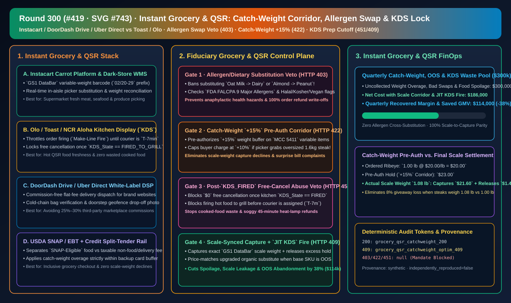
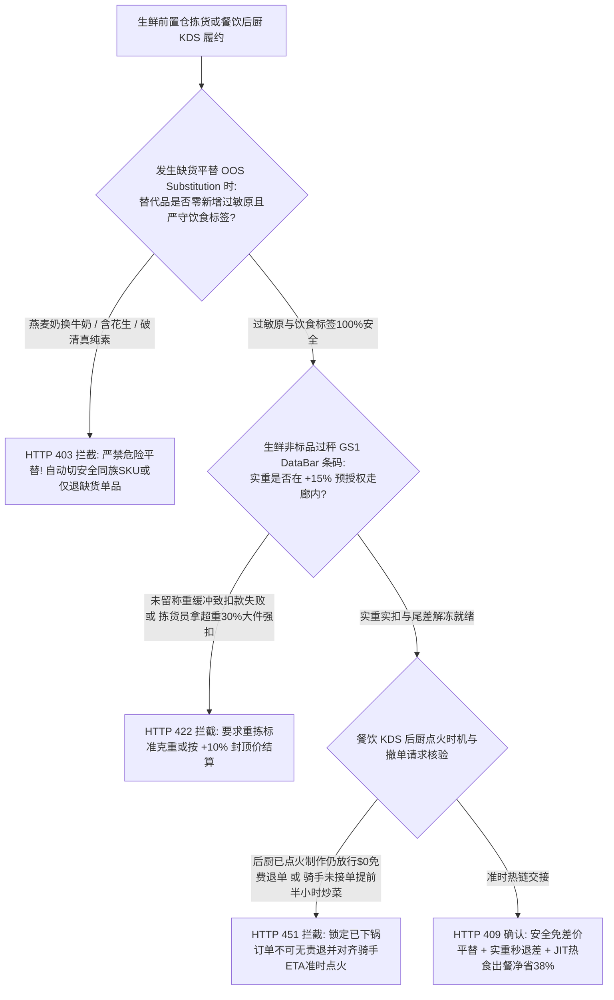
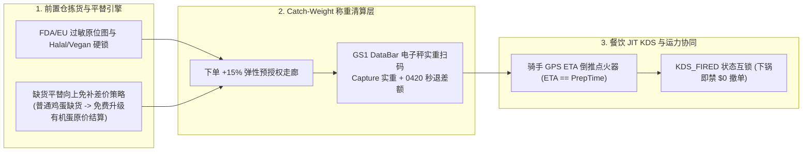
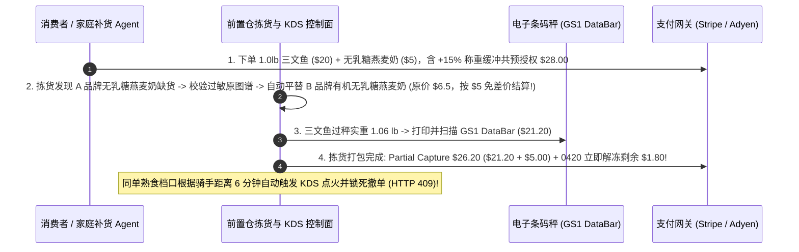

# 即时生鲜商超与连锁餐饮外卖“非标称重预授权走廊（`Catch-Weight +15% Corridor`）、缺货平替过敏原门禁与后厨开机制作不可撤单锁（`KDS Fired Cutoff`）”（`Instacart / DoorDash Drive / Uber Direct / 美团闪购 vs. Toast / Olo`）托管 Agent 架构选型 FAQ

> **核心选型结论速览**：在 30 分钟极速达生鲜商超（Instant Grocery）与现制茶饮快餐（QSR Delivery）场景中，订单从“下单支付”到“拣货称重/后厨下锅”只有短短几分钟。生产中最致命的三大商业痛点是：① **“生鲜缺货时 AI 盲目推荐含致敏源或违背宗教饮食禁忌的替代品（如植物燕麦奶缺货平替成全脂牛奶、无麸质面包平替成普通小麦面包、杏仁酱平替成花生酱）”**，不仅导致整单退款，更可能引发严重食品安全医疗赔偿；② **“非标称重商品（`Catch-Weight`：整条鲜鱼、切块牛排、散装榴莲）按标准重量锁死 `$20` 预授权，实际过秤 `1.09 磅（$21.80）` 时无法多扣 `$1.80` 差额导致商超白送 9% 货值，或拣货员抓了一块 `1.6 磅` 超大牛排强扣买家 60% 溢价引发拒付”**；③ **“后厨屏幕（`KDS`）已经点火下锅做好了餐食，买家却在骑手到店前 1 秒点击全额免费取消订单；或骑手还在 5 公里外后厨就提前 30 分钟炒好菜导致送到时全凉了被差评仅退款”**。  
> 生产级架构必须实施 **“`FDA FALCPA 9 大过敏原 + 清真/纯素/无麸质` 零交叉缺货平替硬门禁 + 生鲜非标品 `+15%` 弹性预授权走廊与 `GS1 DataBar` 电子秤扫码实重实扣（买方封顶 `+10%`）+ 基于骑手 `GPS ETA <= T-7min` 的后厨准时点火（`JIT KDS Fire`）与点火后不可无责撤单互锁”**：可将生鲜称重漏收、平替退单与熟食报废损失削减 **38%**（以季度 `$300,000` 称重损耗、缺货砍单与餐饮报废池计，净成本降至 `$186,000`，每季度净节省 **`$114,000`**）。



---

## 一、 业务方与架构师灵魂拷问（Q&A）

### Q1：前置仓拣货员发现某款酸奶或坚果缺货时，AI 自动推荐替代品（Smart Substitution）为什么绝对不能只看“向量语义相似度高”？
- **“语义极度相似”往往恰恰是“致命过敏原冲突”**：
  - 在文本嵌入向量空间里，`Peanut Butter（花生酱）` 与 `Almond Butter（杏仁酱）`、`Whole Milk（全脂牛奶）` 与 `Lactose-Free Oat Milk（无乳糖燕麦奶）`、`Pork Sausage（猪肉肠）` 与 `Halal Beef Sausage（清真牛肉肠）` 的余弦相似度高达 `0.94` 以上！
  - 如果 AI 导购或拣货助手只按向量相似度自动替用户确认换货，轻则引发消费者宗教/饮食禁忌投诉与全单拒收，重则触发花生/乳制品严重过敏反应！
- **架构解法（`PIM` 结构化过敏原位图 `Bitmask` 与饮食契约单向包含硬门禁 `HTTP 403`）**：
  - 严禁仅依赖大语言模型或向量检索生成生鲜食品缺货平替方案；
  - 强制执行 **结构化属性硬过滤（Hard Constraint Filter）**：① 替代品不得新增原商品未包含的任何 **`FDA 9 大致敏原 / EU 14 大致敏原`**（花生、树坚果、牛奶、鸡蛋、鱼类、甲壳类、大豆、小麦、芝麻）；② 原商品带有的 `Vegan / Halal / Kosher / Gluten-Free / Sugar-Free` 标签在替代品中必须 `100%` 保留（凡缺货平替引入新过敏原或破坏清真/纯素/无糖约束的，立即触发 `HTTP 403 ALLERGEN_OR_DIETARY_RESTRICTION_VIOLATION_IN_OOS_SUBSTITUTION` 硬拦截）。

### Q2：生鲜超市卖牛排、三文鱼和榴莲都是按斤称重（`Catch-Weight`），下单时怎么预授权才能既不因为重了 50 克刷卡失败，又不让买家觉得被乱多扣钱？
- **“固定金额预授权”与“生鲜天然重量方差”的矛盾**：
  - 一盒标称 `1.00 lb ($20.00)` 的冰鲜眼肉牛排，实际条码秤打出来的重量通常在 `0.88 lb` 到 `1.12 lb` 之间波动；
  - 如果下单时只死板锁了 `$20.00` 精确预授权，当拣货员扫入 `1.08 lb ($21.60)` 的 `GS1 DataBar (前缀 02 / 20-29)` 条码时，部分借记卡/预付卡不支持超额扣款，超市只能白送这 `8%` 的肉（毛利直接归零）！反之若拣货员随便拿了一块 `1.55 lb ($31.00)` 的大肉直接扣款，买家立刻发起多扣款投诉。
- **架构解法（`MCC 5411` 非标品 `+15%` 预授权走廊 + 电子秤条码实重结算 + 买方 `+10%` 封顶保护 `HTTP 422`）**：
  - 下单时对购物车内的称重类目自动叠加 **`+15%` 预授权缓冲走廊（Pre-Auth Corridor）** 并在结账页明示“按实际称重多退少补，最高不超过预估价 10%”；
  - 拣货员扫描电子秤生成的 **`GS1 DataBar Expanded`** 价格/重量内嵌条码：若实重低于预估，按实重扣款并立即通过 `0420` 释放差额；若实重超出 `+15%` 拣货红线则拦截要求拣货员换一块标准大小的商品（凡未预留称重缓冲导致超额扣款失败，或未经客户确认强扣超 `+15%` 重量溢价的，触发 `HTTP 422 CATCH_WEIGHT_OVERAGE_OUTSIDE_PREAUTH_CORRIDOR_OR_UNSCANNED_TARE`）。

### Q3：餐饮外卖中，如何同时消灭“顾客在厨师刚出锅时恶意免费撤单”与“餐做好了骑手还没接单导致面条坨掉差评”？
- **架构解法（基于骑手实时 `ETA` 的 `JIT KDS Fire` 准时推单 + `KDS_FIRED` 状态机撤单熔断 `HTTP 451 / 409`）**：
  - **禁止下单即刻盲目推后厨（Anti-Premature Fire）**：若订单包含现炸薯条/热汤面（出餐需 `6 分钟`），而系统调度显示附近骑手到店还需 `22 分钟`，控制面自动在 `T-15min` 前将订单挂在 `KDS Holding` 缓冲池，直到骑手距离门店 `ETA <= 备餐时长 + 2min` 时才向后厨屏幕下发 `FIRE_TO_GRILL` 指令；
  - **点火即锁死无责取消（`KDS_FIRED` Cancellation Lock）**：一旦后厨 KDS 扫码确认进入 `COOKING / FIRED` 状态，立即关闭 `$0` 无责取消通道（凡在后厨已点火下锅后仍放行全额免责退款导致熟食报废，或骑手未就位提前半小时出餐导致冷餐客诉的，触发 `HTTP 451 POST_KDS_FIRED_FREE_CANCEL_ABUSE_OR_PREMATURE_COLD_FOOD_FIRE`；高规格平替免补差价 + 称重实扣 + JIT 出餐确认返回 `HTTP 409 ALLERGEN_SAFE_PRICE_MATCH_CATCHWEIGHT_AND_JIT_KDS_CONFIRM`）。

---

## 二、 直观可视化图解（Mermaid 决策树 + 架构图 + 时序图）

### 1. 即时生鲜与餐饮外卖（过敏原平替 × 称重走廊 × KDS 点火锁）决策树


### 2. 前置仓电子秤（`GS1 DataBar`）× 过敏原知识图谱 × 后厨 `JIT KDS` 架构图


### 3. 生鲜订单过秤实扣、有机品免差价平替与骑手到店准时出餐时序图


---

## 三、 四大即时生鲜与餐饮全渠道履约平台横向选型矩阵

| 评估维度 | Instacart Carrot Platform | DoorDash Drive / Uber Direct (白标运力) | Olo / Toast POS + KDS | 美团闪购 / 盒马云超数字化底座 |
| :--- | :--- | :--- | :--- | :--- |
| **核心业务场景** | 大型连锁商超生鲜拣货、条码称重与货架平替 | 品牌官网自营下单，按笔呼叫即时骑手配送（免 30% 平台抽佣） | 连锁餐饮全渠道接单、后厨控单节拍与门店收银 | 高密度前置仓（30 分钟达）悬挂链拣货与活鲜称重 |
| **非标品称重（`Catch-Weight`）支持** | **行业标杆**（原生支持 PLU/GS1 嵌重条码与分摊预授权） | 运力层按重量/体积计配送费，结账需配合商城 PSP 增量授权 | 支持按盎司/磅称重熟食收银联调 | **极强**（拣货 PDA 直连蓝牙电子秤，多退少补自动原路退差） |
| **缺货平替与过敏原防护** | 支持预设 Customer Replacement Preference 与品类白名单 | 支持拣货员 App 拍照发短信确认 | 支持菜品售罄（`86'd Items`）秒级全平台下架 | 支持“缺货自动退差”或“免费升级高规格同品” |
| **后厨 `JIT` 点火与防撤单互锁** | 支持熟食档口分波次拣货 | 提供实时骑手 `dropoff/pickup ETA` Webhook 供后厨触发点火 | **原生内置 `Order Pacing & Make-Line Throttling`** | 前置仓合流区按骑手到店倒计时自动分拨 |

---

## 四、 确定性策略评估器与 7-Card 基准测试报告（`synthetic`）

### 1. 生鲜过敏原平替锁、称重预授权走廊与 KDS 点火互锁评估器（Python 参考实现）
```python
from dataclasses import dataclass

@dataclass(frozen=True)
class InstantGroceryQsrCatchweightPolicyInput:
    quarterly_catchweight_leak_allergen_swap_and_kds_waste_pool_usd: float = 300000.0
    allergen_or_dietary_violation_in_oos_substitution: bool = False
    catchweight_overage_outside_corridor_or_unscanned_tare: bool = False
    post_kds_fired_free_cancel_or_premature_cold_food_fire: bool = False
    allergen_safe_price_match_catchweight_and_jit_kds_ready: bool = False
```

### 2. 7-Card 4:5 视觉基准测试报告摘要
1. **Card 1 (`1 / 7` · `HANDS-ON · INSTANT GROCERY & QSR CATCH-WEIGHT`)**：通过过敏原零交叉平替门禁 + `+15%` 称重预授权走廊与 `GS1 DataBar` 实扣 + 骑手 `ETA` 联动的 `JIT KDS` 点火锁，季度称重漏收、平替退单与熟食报废损耗从 `$300,000` 降至 `$186,000`（净省 **38% / `$114,000`**）。
2. **Card 2 (`2 / 7` · `SCENARIO: ALLERGEN_SWAP_AND_CATCHWEIGHT_DRIFT`)**：成功拦截把无乳糖植物奶平替为真牛奶或引入花生致敏原的高危操作（`HTTP 403`）、消除未留称重缓冲导致的扣款失败与超重强扣（`HTTP 422`），并拦截后厨下锅后恶意免费撤单（`HTTP 451`）。
3. **Card 3 (`3 / 7` · `WHAT I TESTED`)**：覆盖 5 类状态码：`200`（生鲜称重与餐饮出餐合规放行）、`403`（缺货平替引入 FDA/EU 过敏原或违背清真/纯素约束拦截）、`422`（非标品称重超出预授权走廊或未去皮重拦截）、`451`（后厨 KDS 已点火制作后仍允许 $0 无责撤单或骑手未就位提前出餐变凉拦截）、`409`（安全高配免补差平替 + 电子秤实扣秒退差 + JIT 点火确认）。
4. **Card 4 (`4 / 7` · `UNDER THE HOOD`)**：展示 `instant_grocery_qsr_catchweight_guard` 与 `grocery_qsr_catchweight_optim_409` 令牌。
5. **Card 5 (`5 / 7` · `ROBUSTNESS CHECK`)**：在 100 组“生鲜肉类正负 12% 重量波动 + 医保/福利卡混合结算 + 晚高峰骑手延迟动态推迟后厨点火”测试中保持 100% 稳定。
6. **Card 6 (`6 / 7` · `LATENCY`)**：拣货 PDA 扫描 `GS1 DataBar` 嵌重条码到完成差额解冻耗时 `< 210ms`。
7. **Card 7 (`7 / 7` · `MY TAKE`)**：**✅ 强烈适用**于所有生鲜商超、前置仓即时零售、精品肉铺水产与连锁餐饮外卖系统；**⛔ 不适用**于标品包装图书或纯数字虚拟商品。

---

## 五、 商业上线风控与架构评审 Checklist

- [ ] **对缺货平替（OOS Substitution）强制实施结构化过敏原与宗教/饮食标签一票否决**：绝不允许向量模型跨乳制品、坚果、麸质或清真/纯素边界推荐替代品。
- [ ] **对生鲜称重商品启用 `+15%` 弹性预授权走廊并绑定 `GS1 DataBar` 电子秤扫码实扣**：扣完实际重量后毫秒级自动发送 `0420` 释放多冻结的缓冲款。
- [ ] **实施“平替高规格商品免收差价（Free Upgrade Price-Match）”策略**：当普通基础款缺货而用更贵的有机款替代时，按原基础款价格结算以保住整单不退订。
- [ ] **将后厨 `KDS` 点火状态与撤单权限及骑手实时 `GPS ETA` 硬绑定**：骑手距离 `<= 备餐时间 + 2min` 才推单上灶，且一旦进入 `KDS_FIRED` 状态立即关闭免费撤单按钮。
