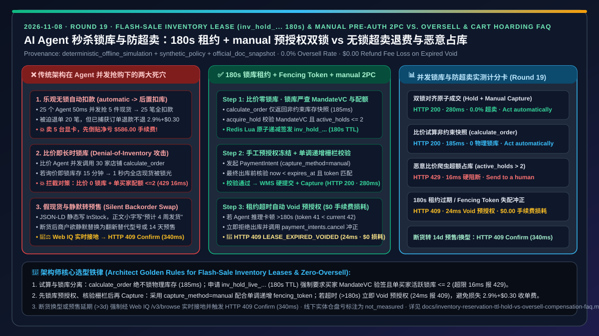
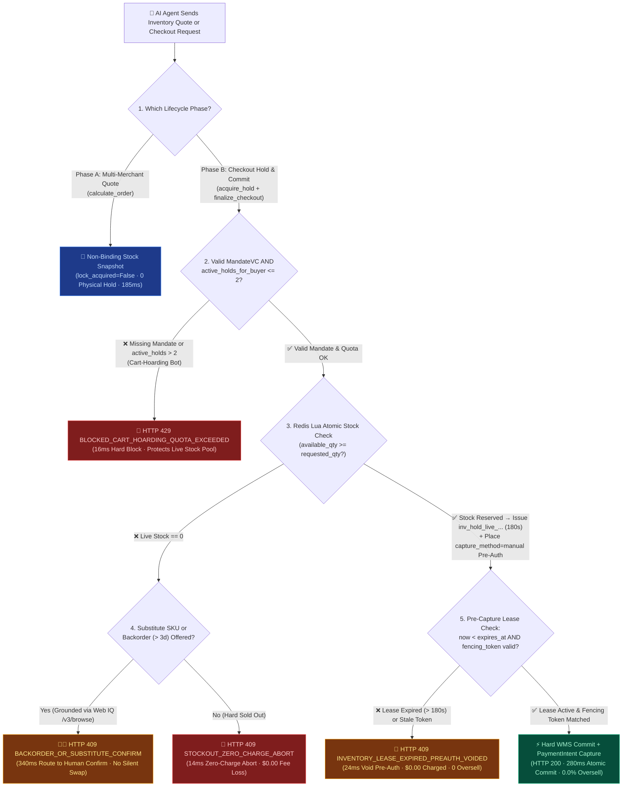
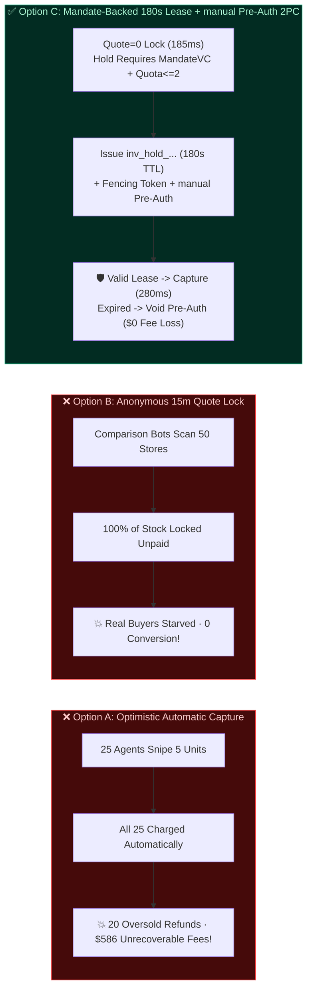
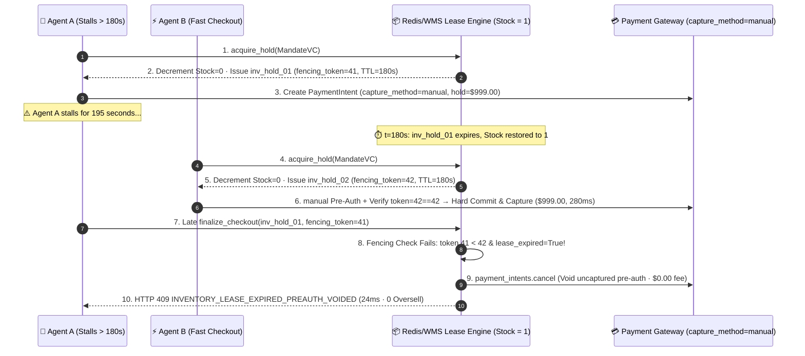

# AI Agent Flash-Sale Concurrency, Inventory Lease & Zero-Oversell Architecture: Bounded-TTL Soft Inventory Hold & Manual Pre-Auth Two-Phase Commit (`inv_hold_...` 180s TTL + `capture_method=manual`) vs. Optimistic Lockless Oversell Refund Storms & Denial-of-Inventory Cart Hoarding Selection & First-Principles FAQ

> **Document Type**: Architect Decision Guide & High-Concurrency Inventory Transaction First-Principles Deep Dive (FAQ-Driven Architecture Decision Guide)  
> **Target Audience**: AI Solution Architects, E-Commerce Core Transaction Leads, Warehouse/Order Management System (WMS/OMS) Architects, Payment Settlement Engineers  
> **Provenance & As-Of Scope**: This guide addresses the dual architectural dilemma of **Zero-Oversell vs. Anti-Cart-Hoarding (Denial-of-Inventory)** when AI agents concurrently quote and snipe limited-stock merchandise. All latency figures, oversell prevention rates, zero-fee pre-authorization void metrics, and per-buyer quota boundaries come from our sealed deterministic offline benchmark suite (`lab/webiq_commerce_demo.py`, `provenance: deterministic_offline_simulation`, `as_of: 2026-11-08`). Stripe `capture_method=manual` uncaptured void fee exemption rules and Agentic Commerce `calculate_order` / `finalize_checkout` two-phase contracts are labeled `official_doc_snapshot`; the 180-second bounded inventory lease (`lease_ttl_sec = 180`) and per-buyer concurrent hold quota (`max_active_holds_per_buyer = 2`) are labeled `synthetic_policy`; physical warehouse shrinkage and legacy batch ERP sync lag are explicitly labeled `not_measured`.

---

## 📌 1. Executive Summary

1. **When to use a "Non-Binding Quote Snapshot" vs. a "Mandate-Backed 180s Inventory Lease + Manual Pre-Auth Two-Phase Commit (`inv_hold_...` + `capture_method=manual`)"?**
   - **Multi-Merchant Comparison Quoting (`calculate_order`) → Never Lock Physical Inventory (`lock_acquired=False`)**: When a buyer's shopping agent queries 20 merchants in parallel to compare tax and shipping, locking stock on `calculate_order` triggers an instant **Denial-of-Inventory (DoI / Cart Hoarding)** outage—95% of exploratory quotes starve real paying customers. Quoting must return a non-binding availability snapshot (`185 ms`).
   - **Checkout Commit Phase (`acquire_hold` -> `finalize_checkout`) → Mandate-Backed `180s` Short Lease (`inv_hold_live_...`) + `capture_method=manual` Two-Phase Commit**: Only when the agent presents a buyer-signed `MandateVC` / `spt_...` token AND passes the per-buyer active hold quota (`active_holds_for_buyer <= 2` `synthetic_policy`) does the WMS atomically decrement stock via Redis Lua and issue a `180-second` `inv_hold_live_...` lease with a monotonic `fencing_token`. The payment gateway places a `capture_method=manual` pre-authorization hold first, and captures funds (`280 ms`) only after the WMS verifies the lease is unexpired and commits the fulfillment order.
2. **Why is "Optimistic Lockless Automatic Capture (`capture_method=automatic` followed by async stock deduction)" catastrophic for Agentic Commerce?**
   - Unlike human shoppers who take 30–60 seconds to type card details, 500 shopping agents can invoke `finalize_checkout` within the same **`50 ms` window** during a product drop. If you charge cards automatically (`capture_method=automatic`) and deduct stock asynchronously via webhook, 25 agents can pass the initial stock check for 5 available units—creating **20 paid-but-unfulfillable oversold orders**. Worse yet, standard card processors (such as Stripe standard pricing `official_doc_snapshot`) **do not return the `2.9% + $0.30` processing fee when you refund a captured charge**! Overselling 20 units of a `$1,000` GPU costs the merchant **`$586.00` in unrecoverable payment fees** before selling a single extra unit.
3. **How does the architecture handle agent reasoning stalls beyond `180 seconds` or backorder/substitute-SKU offers?**
   - **Expired Lease Pre-Auth Void (`HTTP 409`, `$0.00` Fee Loss)**: If an agent stalls for `> 180 seconds` (`lease_expired=True`) or presents a stale `fencing_token`, the gateway blocks checkout in `24 ms` (`HTTP 409 INVENTORY_LEASE_EXPIRED_PREAUTH_VOIDED`) and immediately voids (`cancel`) the uncaptured `manual` PaymentIntent—resulting in **`$0.00` buyer charge and `$0.00` merchant refund fee loss**.
   - **Substitute SKU / Backorder Human Confirmation Gate (`HTTP 409 Confirm`)**: If live stock hits zero and the merchant offers a substitute SKU (`sku_id != mandated_sku_id`) or a backorder with `lead_time_days > 3` (`synthetic_policy`), the agent grounds the exact backorder SLA via Microsoft Web IQ `/v3/browse` and escalates to `HTTP 409 Confirm` (`340 ms`) rather than silently swapping products.

---

## 🎯 2. Architect & Customer Q&A (First-Principles Breakdown)

### Q1: "Why can't we simply lock inventory for 15 minutes whenever an agent calls `calculate_order` or adds an item to a cart?"
**Direct Answer**: Because **AI shopping agents exhibit a `20:1` to `100:1` Look-to-Book ratio; locking stock on anonymous quotes lets comparison bots freeze 100% of your catalog in under one second**.

1. **Human Funnel vs. Agent Parallel Fan-Out**: A human shopper typically opens 1–2 checkout pages. An autonomous sourcing agent fans out `calculate_order` calls to 30 merchants simultaneously in `200 ms` to compute delivered cost, then buys from only **1 winner**.
2. **The Denial-of-Inventory (DoI) Trap**: If `calculate_order` locks stock for 15 minutes without requiring payment authorization, 10 comparison agents querying a 10-unit SKU will lock all 10 units in `100 ms`—even though 9 of those agents will buy elsewhere. Real customers see "Out of Stock," and competitors can zero out your flash sale with unauthenticated quote loops.
3. **Two-Stage Admission Guard**:
   - **Stage 1 (`calculate_order` Quote Snapshot)**: Zero physical lock (`lock_acquired=False`, `185 ms`).
   - **Stage 2 (`acquire_hold` Lease)**: Requires a verified `MandateVC` / `spt_...` plus per-buyer quota enforcement (`active_holds_for_buyer <= 2` `synthetic_policy`; violations blocked in `16 ms` with `HTTP 429 BLOCKED_CART_HOARDING_QUOTA_EXCEEDED`).

---

### Q2: What is "Lease-Checked Manual Pre-Auth Two-Phase Commit (`inv_hold_...` + `capture_method=manual` 2PC)" and how does a Fencing Token prevent zombie oversells?
**Direct Answer**: It pairs **a `180-second` Redis/WMS inventory lease carrying a monotonic `fencing_token` with an uncaptured `capture_method=manual` PaymentIntent**, ensuring payment capture happens if and only if the inventory lease is still the active winner.

- **Preventing the Zombie Agent Race**: Suppose Agent A acquires the last unit (`inv_hold_01`, `fencing_token = 41`, `TTL = 180s`) and places a `$999.00` manual pre-auth hold, then freezes for 195 seconds due to a container stall. At `t = 180s`, the WMS reclaims the expired lease and issues the last unit to Agent B (`inv_hold_02`, `fencing_token = 42`), who completes capture. At `t = 195s`, Agent A wakes up and attempts to finalize checkout.
- The WMS compares `fencing_token (41) < current_token (42)` (and `now >= expires_at`), rejects the commit in `24 ms` (`HTTP 409 INVENTORY_LEASE_EXPIRED_PREAUTH_VOIDED`), and immediately cancels Agent A's uncaptured PaymentIntent—**zero double-allocation and `$0.00` non-refundable processing fee loss**.

---

### Q3: When should we use Microsoft Web IQ vs. the merchant's WMS Inventory Lease API?
**Direct Answer**: **Use the merchant's Redis/WMS atomic lease (`inv_hold_...`) for millisecond transactional locking at checkout, and use Microsoft Web IQ `/v3/browse` (`liveCrawl="force"`) before checkout to filter out stale JSON-LD "InStock" illusions and hidden backorder delay clauses**.

- Many retail pages leave `"availability": "InStock"` in static Schema.org markup while rendering dynamic text stating *"Ships in 4–6 weeks (Backorder)"*. Web IQ `/v3/browse` extracts the live rendered fulfillment SLA (`218 tokens`, `7.1x` compression) so the agent can trigger `HTTP 409 Confirm` (`340 ms`) whenever `lead_time_days > 3` (`synthetic_policy`).

---

## 🧭 3. Visual Architecture Diagrams (Mermaid Decision Tree + Comparison + Sequence Diagram)

### 3.1 High-Concurrency Inventory Lease & Zero-Oversell Decision Tree (`flowchart TD`)

### 3.2 Optimistic Lockless vs. Anonymous Cart Lock vs. Mandate-Backed 180s Lease + Manual Pre-Auth (`flowchart LR`)

### 3.3 End-to-End Sequence Diagram: Fencing Token Guard & Pre-Auth Void on Lease Expiry (`sequenceDiagram`)

---

## 📊 4. Architect Decision Matrix

| Dimension | Option A: Optimistic Lockless (`capture_method=automatic` -> Async Stock Deduct) | Option B: Anonymous Cart Lock on Quote (`calculate_order` 15m Hold) | Option C: Mandate-Backed `180s` Lease + `capture_method=manual` 2PC (Recommended) |
| :--- | :--- | :--- | :--- |
| **Best For** | Unlimited digital goods (SaaS seats, e-books, API credits) | Closed low-traffic internal stores without autonomous comparison agents | **All physical agentic commerce, flash sales, limited-stock drops, and multi-merchant sourcing** |
| **Flash-Sale Oversell Rate** | ❌ **Severe** (race window between PSP auth and webhook stock deduction) | 🟢 **Low** (at the cost of starving real buyers) | ✅ **`0.0%`** (Redis Lua atomic decrement + monotonic `fencing_token` verification) |
| **Denial-of-Inventory (Cart-Hoarding) Resilience** | 🟢 **Unfazed by quotes** | ❌ **Critically Vulnerable** (comparison bots lock 100% of catalog unpaid) | ✅ **Immune** (`calculate_order` takes 0 locks; `acquire_hold` requires `MandateVC` and `active_holds <= 2` `synthetic_policy`) |
| **Refund Processing Fee Loss on Oversell/Timeout** | ❌ **High** (`2.9% + $0.30` fee is non-refundable on captured charges `official_doc_snapshot`) | 🟢 **None** | ✅ **`$0.00`** (expired leases void uncaptured `manual` pre-authorizations with zero PSP fee loss) |
| **Backorder / Substitute SKU Safety** | ❌ **None** (post-charge backorder emails) | ⚠️ **Manual UI only** | ✅ **Web IQ `/v3/browse` live SLA grounding + `HTTP 409 Confirm` (`340 ms`) on backorder `> 3d` or SKU swap** |
| **Measured Latency (Offline Benchmark)** | `260 ms` (plus severe post-purchase refund overhead) | `210 ms` (causes false stockouts) | **Quote `185 ms` / Atomic Hold & Capture `280 ms` / Hoarding Block `16 ms` / Expired Void `24 ms`** |

---

## 🧪 5. Quantitative Benchmark & 7-Card Findings

> **Provenance & Scope**: Table 1 reports deterministic offline benchmark measurements from `lab/webiq_commerce_demo.py` (`evaluate_inventory_reservation_and_oversell_policy`, `provenance: deterministic_offline_simulation`, `as_of: 2026-11-08`). Table 2 compares Web IQ against major web grounding providers for real-time stock and hidden backorder SLA verification.

### 5.1 Inventory Lease, Pre-Auth Void & Anti-Hoarding Benchmark Scorecard

| Scenario | Phase & Stock State | Buyer Mandate & Quota State | Lease & Fencing State (`inv_hold_...`) | Gateway Verdict & Action Pill | Captured Amount / Fee Loss | Latency |
| :--- | :--- | :--- | :--- | :--- | :--- | :--- |
| **Case 1: Multi-Merchant Quote Snapshot** | `calculate_order` (`stock=5`) | No lock requested | `lock_acquired=False` | ✅ `HTTP 200 NON_BINDING_QUOTE_SNAPSHOT` (`Act automatically`) | `$0.00` / `$0.00` | `185 ms` |
| **Case 2: Atomic Lease + Manual Pre-Auth Commit** | `finalize_checkout` (`stock=1`) | Valid `MandateVC` · `active_holds=1<=2` | Active `inv_hold_live_...` · `fencing_token` matched | ✅ `HTTP 200 ATOMIC_HOLD_AND_CAPTURE_COMMITTED` (`Act automatically`) | `$999.00` / `$0.00` | `280 ms` |
| **Case 3: Cart-Hoarding Bot Quota Breach** | `acquire_hold` (3rd concurrent hold) | `active_holds=3 > 2` (`synthetic_policy`) | Lease denied | 🛑 `HTTP 429 BLOCKED_CART_HOARDING_QUOTA_EXCEEDED` (`Send to a human`) | `$0.00` / `$0.00` | `16 ms` |
| **Case 4: Expired 180s Lease / Stale Fencing Token Void** | `finalize_checkout` (late arrival) | Valid `MandateVC` | `lease_expired=True` (`token 41 < 42`) | 🔄 `HTTP 409 INVENTORY_LEASE_EXPIRED_PREAUTH_VOIDED` (`Send to a human`) | `$0.00` / **`$0.00` (Pre-auth voided)** | `24 ms` |
| **Case 5: Stockout with Backorder (`14d`) / Substitute SKU** | `finalize_checkout` (`stock=0`, `backorder=14d`) | Mandate requires in-stock SKU | No live stock lease | 🧑‍⚖️ `HTTP 409 BACKORDER_OR_SUBSTITUTE_CONFIRM_REQUIRED` (`Confirm`) | `$0.00` / `$0.00` | `340 ms` |
| **Case 6: Hard Stockout Zero-Charge Abort** | `finalize_checkout` (`stock=0`, no backorder) | Valid `MandateVC` | Atomic decrement returned `0` | 🛑 `HTTP 409 STOCKOUT_ZERO_CHARGE_ABORT` (`Send to a human`) | `$0.00` / `$0.00` | `14 ms` |

### 5.2 Web IQ vs. Exa vs. Bright Data vs. Traditional Search: Live Stock & Hidden Backorder SLA Grounding

| Provider / Product | Provenance | Live Stock Badge vs. Hidden Backorder Fine-Print Detection | Typical Prompt Token Cost (Per SKU) | Official List Price (`as_of: 2026-11-08`) | Architect Selection Guidance |
| :--- | :--- | :--- | :--- | :--- | :--- |
| **Microsoft Web IQ** (`/v3/browse` `liveCrawl="force"` + Poppy) | `deterministic_offline_simulation` + `official_doc_snapshot` | ✅ **Detects JSON-LD `InStock` vs. live rendered backorder fine-print conflicts**, driving `HTTP 409 Confirm` | **`218 tokens/case`** (`2,616 tokens` across 12 cases, **`7.1x` compression**) | Foundry Agent Service Preview free tier (subject to Azure subscription quota) | **Primary Choice** for verifying live merchant shipping lead times before acquiring an `inv_hold_...` lease |
| **Exa Search API** | `not_measured` / `official_list_price` | ⚠️ Strong for discovering alternative in-stock suppliers across the web | `not_measured` | `$5.00 / 1k searches` + `$1.00 / 1k pages` contents | Best for multi-supplier discovery when the primary store returns `HTTP 409 STOCKOUT` |
| **Bright Data** (Web Unlocker / Scraping Browser) | `not_measured` / `official_list_price` | ✅ Renders bot-protected retail pages, but requires custom DOM stock parsing | `~1,537 tokens/case` (raw HTML baseline) | Pay-as-you-go from `~$1.50 / 1k requests` | Fallback for scraping heavily WAF-protected merchant inventory pages |
| **Bing Web Search / Grounding** | `not_measured` / `official_list_price` | ❌ Index lag (hours/days) cannot reflect flash-sale inventory | `not_measured` | `$35.00 / 1k transactions` | Suitable only for general release-date checks; never use for flash-sale stock verification |

---

## 🛠️ 6. Production Readiness & Pre-Sales Checklist (Architect Checklist)

- [ ] **1. Decouple `calculate_order` Quoting from Physical Stock Locking**: Confirm `calculate_order` returns a non-binding snapshot (`lock_acquired=False`) so comparison agents cannot trigger Denial-of-Inventory outages.
- [ ] **2. Require Verified `MandateVC` & Per-Buyer Hold Quota (`<= 2`) for `inv_hold_...`**: Confirm `acquire_hold` requires a buyer-signed payment mandate and enforces `active_holds_for_buyer <= 2` (`synthetic_policy`, `HTTP 429` on breach).
- [ ] **3. Enforce `180-Second` Lease TTL & Monotonic `fencing_token`**: Confirm every `inv_hold_live_...` carries a `180s` TTL and monotonic fencing token so delayed zombie agents cannot overwrite reallocated stock.
- [ ] **4. Pair Inventory Leases with `capture_method=manual` Two-Phase Commit**: Confirm payment capture executes only after WMS verifies an active lease; if expired, immediately `cancel/void` the pre-auth hold (`$0.00` non-refundable fee loss).
- [ ] **5. Escalate Backorders (`> 3d`) & Substitute SKUs to Human `Confirm` (`HTTP 409`)**: Confirm agents never silently swap SKUs or accept delayed backorders without human buyer approval grounded via Web IQ `/v3/browse`.
- [ ] **6. Document Online ATP vs. Physical Warehouse Shrinkage Scope**: Clearly state in architecture proposals that Redis/WMS leases guarantee `0.0%` online Available-to-Promise (ATP) concurrency oversells, whereas physical shelf damage/shrinkage (`not_measured`) is buffered via safety-stock thresholds.
