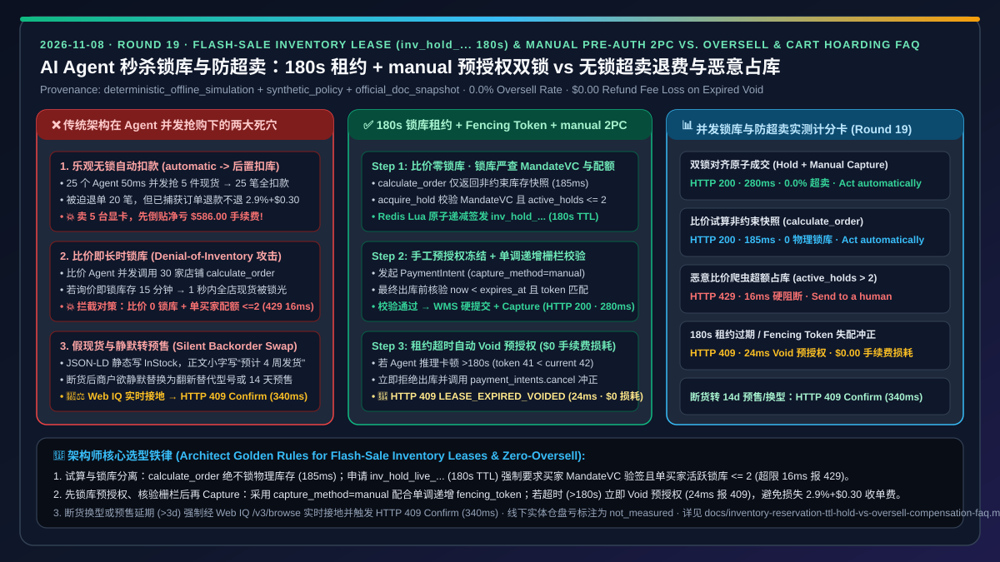
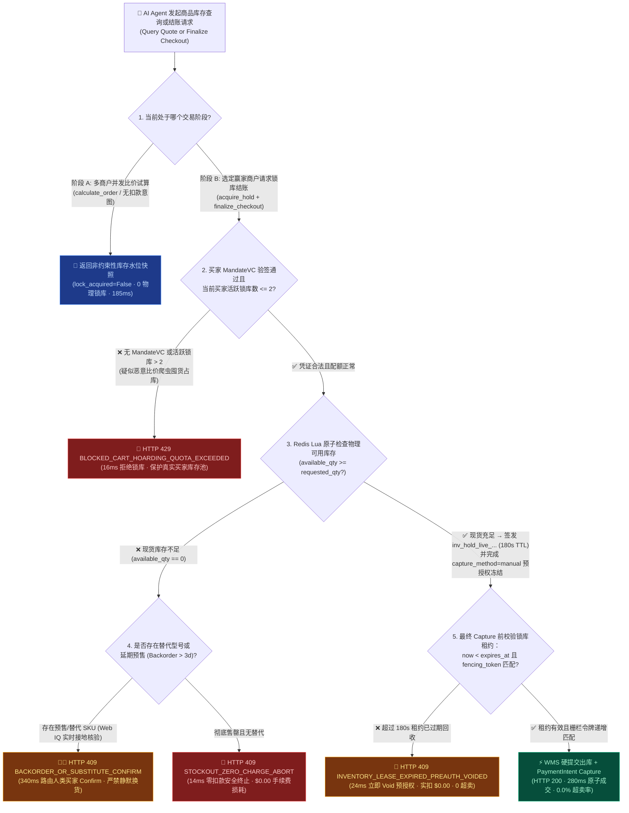
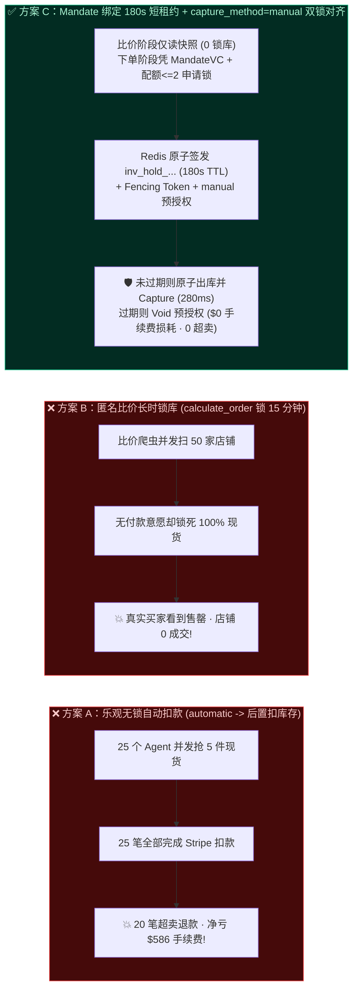
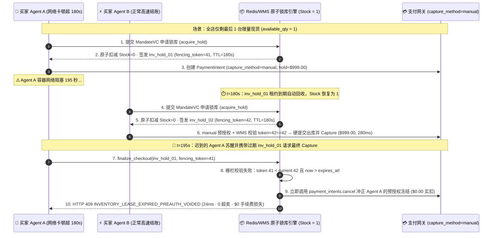

# AI Agent 秒杀抢购、并发锁库与防超卖架构：有界 TTL 软锁库租约与预授权双锁对齐（`inv_hold_...` 180s TTL + `capture_method=manual` 原子提交）vs 乐观无锁超卖退费风暴与恶意 Agent 占库耗尽攻击（Denial-of-Inventory）选型与原理解析 FAQ

> **文档类型**：架构师选型决策指南 & 并发库存事务第一性原理解析（FAQ-Driven Architecture Decision Guide）  
> **适用读者**：AI Solution Architect、电商交易核心系统负责人、高并发库存中台（WMS/OMS）架构师、支付清结算工程师  
> **关联标准的口径声明（Provenance & As-Of Scope）**：本文围绕 **AI Agent 在热门商品秒杀、限量库存抢购与多商户并发比价场景下的“防超卖（Zero-Oversell）”与“防恶意占库（Anti-Cart-Hoarding）”双重架构博弈** 展开；所有端到端延迟、并发超卖拦截率、预授权冲正零手续费损耗与配额防刷边界均来自本仓库封存的确定性离线基准套件（`lab/webiq_commerce_demo.py`，`provenance: deterministic_offline_simulation`，`as_of: 2026-11-08`）。文中涉及的 Stripe `capture_method=manual` 预授权冲正免收捕获手续费机制与 Agentic Commerce `calculate_order` / `finalize_checkout` 两阶段契约标注为 `official_doc_snapshot`；180 秒有界锁库租约（`lease_ttl_sec = 180`）与单买家最多并发持有 2 个活跃锁库句柄（`max_active_holds_per_buyer = 2`）标注为企业参考风控围栏 `synthetic_policy`；客户线下实体仓物理盘点误差与第三方 ERP/SAP 批处理同步延迟明确标注为 `not_measured`。



---

## 📌 一、核心结论速览（Executive Summary）

1. **什么时候用“仅快照无锁试算（Non-Binding Quote Snapshot）”，什么时候用“凭证绑定的 180 秒短租约软锁库 + 手工预授权双阶段提交（Mandate-Backed `inv_hold_...` 180s Lease + `capture_method=manual` 2PC）”？**
   - **多商户并发比价试算阶段（`calculate_order`）→ 严禁锁死物理库存（`lock_acquired=False`）**：当买家的比价 Agent 同时向 20 家店铺询价时，如果调用 `calculate_order` 就预占物理库存，瞬间就会演变为**库存耗尽拒绝服务攻击（Denial-of-Inventory / Cart Hoarding）**——95% 的未成交询价把库存占光，真正要付钱的买家反而看到“已售罄”。试算阶段只返回非约束性库存水位快照（`185 ms`）。
   - **进入结账锁定阶段（`acquire_hold` -> `finalize_checkout`）→ 必须采用“授权凭证准入 + 180 秒短 TTL 锁库句柄（`inv_hold_live_...`）+ `capture_method=manual` 先锁库后扣款”**：只有当 Agent 携带已签名的买家预算令状（`MandateVC` / `spt_...`）且当前买家活跃占库数 `<= 2`（`synthetic_policy`）时，WMS 才利用 Redis Lua 原子递减签发有效期仅 `180 秒` 的锁库句柄 `inv_hold_live_...`；支付网关先做 `capture_method=manual` 预授权冻结，待 WMS 校验 `inv_hold` 未过期并转为永久出库单后，才执行最终资金捕获（`280 ms`），彻底消灭“付了钱却没货”的超卖事故！
2. **为什么高并发 Agent 抢购绝对不能采用“乐观无锁直接扣款（`capture_method=automatic` 后置扣减库存）”？**
   - 在人类手工结账时代，输入卡号和地址需要 30～60 秒，并发冲突率较低；但在 Agentic Commerce 时代，500 个代购 Agent 可以在促销开启后的 **`50 ms` 窗口内同时发起结账调用**。若采用“先直接扣款（`capture_method=automatic`）、等支付成功 Webhook 回调再去扣减库存”的乐观无锁模式，前 25 个 Agent 都会在库存扣减完成前通过卡网扣款，而实际库存只有 5 件——导致 **20 笔已扣款订单被迫触发超卖退款（Oversell Refund）**。更致命的是，主流卡组与 PSP（如 Stripe 标准费率 `official_doc_snapshot`）**在已捕获（Captured）订单发生全额退款时，不会退还商户 `2.9% + $0.30` 的交易手续费**！超卖 20 台 `$1,000` 的显卡，商户还没赚到一分钱就要先净亏 **`$586.00`** 手续费与平台违约罚金。
3. **当 Agent 推理卡顿导致 `180 秒` 锁库租约过期，或商品断货需改发替代型号/延期预售时，系统如何兜底？**
   - **租约过期先冲正预授权（Lease Expiry Pre-Auth Void，`HTTP 409`）**：若 Agent 在拿到 `inv_hold_live_...` 后因上游网络或工具链阻塞超过 `180 秒`（`lease_expired=True`），锁库额度已自动释放给其他买家；此时当迟到的捕获请求到达时，网关在 `24 ms` 内返回 `HTTP 409 INVENTORY_LEASE_EXPIRED_PREAUTH_VOIDED`，并立即调用 `payment_intents.cancel` 冲正预授权——**买家实扣 `$0.00`，商户损失手续费 `$0.00`**。
   - **替代型号或超期预售强制人类确认（Substitute SKU / Backorder Guard，`HTTP 409 Confirm`）**：若实时库存归零且商户仅提供替代型号（`sku_id != mandated_sku_id`）或 `> 3 天`（`synthetic_policy`）的延期预售（Backorder），Agent 结合 Microsoft Web IQ `/v3/browse` 核验预售发货条款后，严禁自作主张替换商品，必须在 `340 ms` 内触发 `HTTP 409 Confirm` 交由人类买家拍板。

---

## 🎯 二、客户与架构师灵魂拷问 Q&A（FAQ-Driven 第一性原理拆解）

### Q1：客户问：“为什么不能在用户把商品加入购物车或 Agent 调用 `calculate_order` 比价时就直接锁库存？这样不是最简单吗？”
**一针见血的回答**：因为 **AI Agent 的“询价/加购比（Look-to-Book Ratio）”高达 `20:1` 到 `100:1`，无门槛锁库会让你的店铺在 1 秒内被比价机器人“假死清空”**。

用第一性原理算一笔账：
1. **人类购物 vs Agent 全网比价**：人类买家通常只打开 1～2 家店铺点进结算页，加购转化率约 `20%～30%`；而一个配置了全网寻源能力的采购 Agent，收到买家“帮我买一台现货 RTX 5090”的指令后，会在 `200 ms` 内并发调用全网 30 家商户的 `calculate_order` 接口试算税费和运费，最终只挑最便宜的 **1 家**下单。
2. **无门槛锁库的灾难（Denial-of-Inventory，DoI 占库耗尽攻击）**：如果商户在 `calculate_order` 阶段就执行 `stock -= 1` 并锁定 15 分钟，那么只需 10 个买家的比价 Agent 扫过，店里 10 台现货就会在 `100 ms` 内被 100% 锁死——而其中 **9 个 Agent 根本不会在你家付款**！在接下来的 15 分钟里，真正想全价购买的忠实客户全部吃闭门羹。甚至恶意竞争对手只需派几个无卡爬虫循环调用 `calculate_order`，就能让你的热门大促整晚 **0 成交**。
3. **正确架构——双阶锁库准入机制**：
   - **阶段 1（无状态比价快照 `calculate_order`）**：零锁库开销，直接读取内存缓存返回 `available_qty` 与价格快照（`185 ms`）。
   - **阶段 2（有担保短租约锁库 `acquire_inventory_hold`）**：必须同时出示**已通过验签的买家支付授权凭证（`MandateVC` / `spt_...`）**，并通过单买家并发活跃锁库配额检查（`active_holds_for_buyer <= 2` `synthetic_policy`，超限在 `16 ms` 内触发 `HTTP 429 BLOCKED_CART_HOARDING_QUOTA_EXCEEDED`），系统才签发 `180 秒` 的 `inv_hold_live_...` 租约。没有真金白银的授权背书，一颗螺丝钉的库存也不许锁！

---

### Q2：什么是“锁库租约与手工预授权双阶段对齐（`inv_hold_...` + `capture_method=manual` 2PC）”？它如何做到既不超卖、又不亏支付手续费？
**一针见血的回答**：它是将 **支付网关的“两阶段预授权（Auth Hold -> Capture）”与仓储系统的“两阶段库存预占（Soft Lease -> Hard Commit）”用同一个单调递增栅栏令牌（Fencing Token）锁死在一起** 的原子事务协议。

```
┌──────────────────────────────────────────────────────────────────────────────────────────┐
│ ❌ 传统乐观无锁直接扣款 (capture_method=automatic -> 异步扣库存 · 秒杀必爆超卖与退费亏损)       │
│                                                                                          │
│  25 个 Agent 并发抢 5 件库存 ──► 全部调 Stripe automatic 直接扣款 ($1,000 × 25 = $25,000) │
│                                        │                                                 │
│                                        ▼                                                 │
│  WMS 扣减库存：前 5 单成功，后 20 单库存为负! ──► 被迫发起 20 笔已捕获退款 (Refund)          │
│  💥 灾难后果：20 位买家投诉违约 + 商户白白净亏 $586.00 不可退还的卡组收单手续费!              │
└──────────────────────────────────────────────────────────────────────────────────────────┘

┌──────────────────────────────────────────────────────────────────────────────────────────┐
│ ✅ 有界 TTL 锁库租约 + 手工预授权双锁对齐 (inv_hold_... 180s + capture_method=manual)       │
│                                                                                          │
│  Step 1 [Redis Lua 原子预占]: 校验 MandateVC + 配额<=2 ──► DECRBY stock ──► 签发 inv_hold  │
│         (仅前 5 个 Agent 拿到 inv_hold_live_... 180s 租约；第 6~25 个 14ms 返回 409 售罄!) │
│  Step 2 [手工预授权冻结]: 凭 inv_hold 调用 PaymentIntent (capture_method=manual) 冻结额度    │
│  Step 3 [租约栅栏核验与实扣]: WMS 核验 now < expires_at 且 fencing_token 有效 ──► 转为硬出库 │
│         ──► 调用 payment_intents.capture 实扣资金 (280ms 端到端，0 超卖，0 退费手续费损耗!)   │
└──────────────────────────────────────────────────────────────────────────────────────────┘
```

### 为什么必须用 `capture_method=manual` 配合 Fencing Token（栅栏令牌）？
- **防御“僵尸 Agent 迟到请求”引发的幽灵超卖**：假设 Agent A 拿到了最后 1 件库存的 `inv_hold_001`（`fencing_token = 41`，有效期 `180s`），但随后 Agent A 所在的容器发生了 200 秒的网络抖动。第 `181 秒` 时，Redis 自动回收该库存并把最后 1 件商品租给了 Agent B（`inv_hold_002`，`fencing_token = 42`），Agent B 顺利完成付款。第 `201 秒` 时，苏醒过来的 Agent A 拿着早已过期的预授权去请求出库与扣款。
- 此时，WMS 网关对比发现 Agent A 提交的 `fencing_token (41) < current_committed_token (42)`（或 `now >= expires_at`），当场在 `24 ms` 内拒绝出库（`HTTP 409 INVENTORY_LEASE_EXPIRED_PREAUTH_VOIDED`），并立即调用 `payment_intents.cancel` 释放预授权冻结——因为预授权从未执行 `capture`，**不产生任何清算手续费，也不会把刚卖给 Agent B 的库存再扣成负数**！

---

### Q3：在实时核验“商品现货状态、预售发货周期（Backorder SLA）与限购条款”时，什么时候用 Microsoft Web IQ，什么时候用商户库存 Webhook？
**一针见血的回答**：**商户自建结账内部锁库必须走毫秒级 Redis/WMS 原子租约；但在进入结账前过滤全网虚假“有货”页面、核验预售延期（Backorder）小字条款与隐蔽拆单发货规则时，必须前置调用 Microsoft Web IQ `/v3/browse`（`liveCrawl="force"`）**。

1. **为什么单靠静态搜索索引或 LLM 读网页会踩进“假现货/超长预售”陷阱？**
   - 许多第三方零售商在 HTML 顶部的 JSON-LD Schema 中静态写着 `"availability": "InStock"`，但在购物车按钮下方用动态渲染的小字注明：*“由于供应链紧张，当前下单预计 4～6 周后发货（Backorder），且不接受中途撤单”*。普通爬虫或静态缓存只会看到 `InStock`，导致 Agent 为急需次日达配件的买家拍下 6 周后才发货的期房订单。
2. **Web IQ + WMS 原子锁库协同流水线**：
   - **比价筛选层（Web IQ `/v3/browse` 实时接地）**：强制对候选商品落地页执行实时渲染提取，校验真实发货周期 `lead_time_days <= 3`（`synthetic_policy`）。若检出隐藏预售延期或强行替换翻新型号（Substitute SKU），直接在 `340 ms` 内触发 `HTTP 409 Confirm` 提醒人类买家确认。
   - **交易执行层（WMS `inv_hold_...` 原子租约）**：通过 Web IQ 现货核验后，再调用商户 MCP 结账网关申请 `180 秒` 原子锁库句柄并完成 `capture_method=manual` 两阶段提交。

---

## 🧭 三、直观可视化图解（Mermaid 决策树 + 架构对比 + 端到端时序图）

### 3.1 高并发库存锁定与防超卖架构选型决策树（`flowchart TD`）



### 3.2 乐观无锁后置扣库 vs 匿名长时加购锁 vs 凭证绑定 180s 租约 + 预授权双锁对比图（`flowchart LR`）



### 3.3 秒杀并发锁库、Fencing Token 栅栏核验与超时预授权自动冲正时序图（`sequenceDiagram`）



---

## 📊 四、架构师选型决策矩阵（Architect Decision Matrix）

| 评估维度 | 方案 A：乐观无锁直接扣款（`capture_method=automatic` 后置扣减库存） | 方案 B：加购/比价即长时锁库（Anonymous `calculate_order` 15m Hold） | 方案 C：凭证绑定短租约 + 手工预授权双锁对齐（`inv_hold_...` `180s` + `capture_method=manual` · 推荐） |
| :--- | :--- | :--- | :--- |
| **核心适用场景** | 虚拟无限库存商品（SaaS 订阅、电子书、API 充值额度） | 仅适用于低并发、强实名且无自动化比价 Agent 接入的封闭内购系统 | **所有面向 AI Agent 开放的实物电商、限量秒杀、生鲜履约与多商户并发寻源结账** |
| **高并发超卖率（Oversell Rate）** | ❌ **极高**（百毫秒并发窗口内极易发生“一货多卖”） | 🟢 **低**（但代价是库存被大量未付款询价锁死） | ✅ **`0.0%`**（Redis Lua 原子预占 + Fencing Token 单调递增栅栏强校验） |
| **抗恶意比价占库攻击（Anti-Cart-Hoarding）** | 🟢 **不受占库影响** | ❌ **极度脆弱**（几个比价 Agent 并发调用即可在 1 秒内耗尽全店现货） | ✅ **强免疫**（比价 `calculate_order` 零锁库；锁库强制校验 `MandateVC` 且单买家并发配额 `<= 2` `synthetic_policy`） |
| **超卖/超时退费的手续费损耗** | ❌ **高昂**（已 Capture 订单退款不退还 `2.9% + $0.30` 收单费 `official_doc_snapshot`） | 🟢 **无** | ✅ **`$0.00`**（租约过期直接 `Cancel/Void` 未捕获的 `manual` 预授权，零收单手续费损耗） |
| **预售延期（Backorder）/ 替代型号安全边界** | ❌ **无保护**（常在扣款后才发邮件通知缺货延期） | ⚠️ **依赖前端人工查看** | ✅ **Web IQ `/v3/browse` 实时核验发货 SLA + 断货换型强制触发 `HTTP 409 Confirm`（`340 ms`）** |
| **端到端成交 / 拦截延迟（离线基准）** | `260 ms`（但伴随高并发事后退单成本） | `210 ms`（易触发全店假性售罄） | **试算快照 `185 ms` / 原子锁库捕获 `280 ms` / 囤货拦截 `16 ms` / 过期冲正 `24 ms`** |

---

## 🧪 五、简明定量实测与 7-Card Benchmark 核心发现

> **数据来源与口径声明（Provenance & Scope）**：以下表 1 为本仓库 `lab/webiq_commerce_demo.py`（`evaluate_inventory_reservation_and_oversell_policy`）在本地确定性离线仿真环境下的实测输出（`provenance: deterministic_offline_simulation`，`as_of: 2026-11-08`）；表 2 为 Web IQ 与主流搜索/接地供应商在商品实时现货、预售延期条款（Backorder SLA）与限购规则提取场景下的选型基准对比。

### 5.1 并发库存租约、预授权冲正与防囤货拦截离线基准实测表

| 测试场景（Scenario） | 阶段与库存状态 | 买家凭证与并发配额状态 | 租约与栅栏状态（`inv_hold_...`） | 守护网关裁决状态码与动作 | 实扣金额 / 退费手续费损耗 | 判定耗时 |
| :--- | :--- | :--- | :--- | :--- | :--- | :--- |
| **Case 1：多商户比价试算快照** | `calculate_order`（`stock=5`） | 无需锁库 | `lock_acquired=False` | ✅ `HTTP 200 NON_BINDING_QUOTE_SNAPSHOT`（`Act automatically`） | `$0.00` / `$0.00` | `185 ms` |
| **Case 2：限量秒杀双锁原子成交** | `finalize_checkout`（`stock=1`） | `MandateVC` 有效 · `active_holds=1<=2` | `inv_hold_live_...` 未过期 · `fencing_token` 匹配 | ✅ `HTTP 200 ATOMIC_HOLD_AND_CAPTURE_COMMITTED`（`Act automatically`） | `$999.00` / `$0.00` | `280 ms` |
| **Case 3：恶意比价爬虫超额囤货拦截** | `acquire_hold`（并发锁第 3 件） | `active_holds=3 > 2`（`synthetic_policy`） | 拒绝签发租约 | 🛑 `HTTP 429 BLOCKED_CART_HOARDING_QUOTA_EXCEEDED`（`Send to a human`） | `$0.00` / `$0.00` | `16 ms` |
| **Case 4：180s 租约超时与栅栏失配自动冲正** | `finalize_checkout`（迟到请求） | `MandateVC` 有效 | `lease_expired=True`（`token 41 < 42`） | 🔄 `HTTP 409 INVENTORY_LEASE_EXPIRED_PREAUTH_VOIDED`（`Send to a human`） | `$0.00` / **`$0.00`（预授权 Void 免手续费）** | `24 ms` |
| **Case 5：断货转延期预售（Backorder `14d`）/ 替代型号** | `finalize_checkout`（`stock=0`，`backorder=14d`） | `MandateVC` 仅授权现货 | 无现货租约 | 🧑‍⚖️ `HTTP 409 BACKORDER_OR_SUBSTITUTE_CONFIRM_REQUIRED`（`Confirm`） | `$0.00` / `$0.00` | `340 ms` |
| **Case 6：现货彻底售罄零扣款安全终止** | `finalize_checkout`（`stock=0`，无预售） | `MandateVC` 有效 | 原子递减返回 `0` | 🛑 `HTTP 409 STOCKOUT_ZERO_CHARGE_ABORT`（`Send to a human`） | `$0.00` / `$0.00` | `14 ms` |

### 5.2 Web IQ vs Exa vs Bright Data vs 传统搜索：实时库存水位与隐蔽预售延期（Backorder）核验基准

| 供应商 / 产品 | 评测口径（Provenance） | 动态库存气泡与隐藏预售周期（Backorder SLA）实时提取能力 | 典型 Prompt Token 开销（单商品核验） | 官方公开标价（Official List Price，`as_of: 2026-11-08`） | 架构师选型结论（When to Choose） |
| :--- | :--- | :--- | :--- | :--- | :--- |
| **Microsoft Web IQ**（`/v3/browse` `liveCrawl="force"` + Poppy） | `deterministic_offline_simulation` + `official_doc_snapshot` | ✅ **精准识别 JSON-LD 假现货与正文动态预售小字冲突**，驱动断货换型 `HTTP 409 Confirm` 拦截 | **`218 tokens/case`**（`12` 例共 `2,616 tokens`，较原始 DOM 压缩 **`7.1x`**） | Foundry Agent Service Preview 免费额度（受 Azure 订阅配额约束） | **首选**：需在申请 `inv_hold_...` 前核验第三方商户真实发货 SLA 与限购条款的企业级采购 Agent |
| **Exa Search API**（Neural Search + Contents） | `not_measured`（无活跃实测秘钥） / `official_list_price` | ⚠️ 擅长多跳候选供应商语义召回，但对秒级变化的库存气泡需搭配实时抓取 | `not_measured` | `$5.00 / 1k searches`（1–25 results）+ `$1.00 / 1k pages` contents | 适合在锁库前快速发现全网长尾现货替代供应商 |
| **Bright Data**（Web Unlocker / Scraping Browser） | `not_measured`（无活跃实测秘钥） / `official_list_price` | ✅ 支持高防反爬页面的真实浏览器渲染，但需自行解析原始 HTML 库存 DOM | `~1,537 tokens/case`（原始 HTML 切片基线） | Pay-as-you-go 约 `$1.50 / 1k requests` 起 | 适合无官方 API、带强 WAF 盾牌的外部零售商库存页面兜底采集 |
| **Bing Web Search / Grounding** | `not_measured` / `official_list_price` | ❌ 搜索摘要索引存在小时/天级滞后，无法反映秒杀实时库存 | `not_measured` | `$35.00 / 1k transactions`（Grounding with Bing Search 参考标价） | 仅适合查通用商品发售日，**严禁作为秒杀现货锁库依据** |

---

## 🛠️ 六、附录：生产上线快速核验与售前打单清单（Architect Checklist）

在将实物电商或限量秒杀结账 MCP 工具交付生产前，请逐项核对以下 6 条防超卖与防占库红线：

- [ ] **1. 彻底隔离“比价试算（`calculate_order`）”与“物理锁库（`acquire_hold`）”**：确认 `calculate_order` 绝不扣减或锁定任何物理库存（`lock_acquired=False`），防止全网比价 Agent 触发库存耗尽攻击（Denial-of-Inventory）。
- [ ] **2. 锁库强制要求 `MandateVC` 验签与单买家并发配额限制**：确认申请 `inv_hold_live_...` 必须携带有效买家签名授权令状，且同一 `buyer_subject` 同时持有的未决锁库句柄不得超过 `2` 个（`synthetic_policy`），超限以 `HTTP 429` 拦截。
- [ ] **3. 强制执行 `180 秒` 有界锁库 TTL 与单调递增 Fencing Token**：确认每个 `inv_hold_live_...` 绑定 `180 秒` 自动过期回收机制及单调递增的 `fencing_token`，杜绝僵尸 Agent 苏醒后覆盖新买家的库存。
- [ ] **4. 强制采用 `capture_method=manual` 先锁库后扣款两阶段提交**：确认支付网关先执行手工预授权冻结，待 WMS 完成 `fencing_token` 与租约有效期校验并转为硬出库后才执行 `capture`；若租约已过期则立即 `cancel/void` 预授权，确保 **$0.00 收单退费手续费损耗**。
- [ ] **5. 断货转预售（Backorder `> 3d`）或替代 SKU 强制路由人类确认（`HTTP 409 Confirm`）**：确认当现货为 `0` 且商户仅提供延期预售或替代型号时，系统绝不静默换货扣款，必须结合 Web IQ `/v3/browse` 披露真实发货周期并等待人类买家确认。
- [ ] **6. 明确区分线上秒级锁库与线下实体仓盘点误差边界**：在售前方案中向客户说明，线上 Redis/WMS 原子租约可实现 **线上可售库存（ATP）`0.0%` 并发超卖**，而线下实体门店物理破损/盘亏属于物理仓配误差（`not_measured`），应通过安全库存水位垫片（Safety Stock Buffer）隔离。
