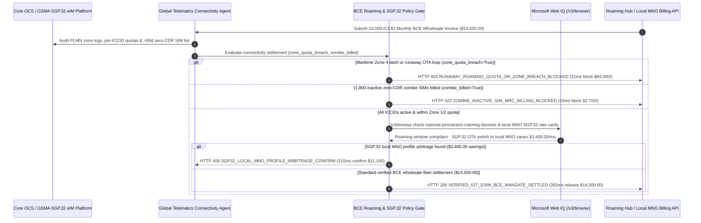

# Global IoT eUICC SGP.32 eSIM & BCE Roaming Cap Mandate Architecture: GSMA SGP.32 Profile-Swap & Quota-Cap Token (`iot_esim_roaming_mandate_...` + Web IQ Permanent-Roaming & Local-MNO Grounding) vs. Maritime Roaming Bill Shock & Regulatory IMEI Shutdowns Selection FAQ

> **Document Type**: Architect Selection Guide & First-Principles Protocol Deep Dive (6-Section FAQ Standard)  
> **Target Audience**: AI Solution Architects, Connected-Vehicle (Telematics / OEM) & Global IoT Connectivity Architects, Telecom Wholesale Settlement (GSMA BCE) & FinOps Risk Teams  
> **Last Updated**: 2026-11-09 (Provenance Annotations: `deterministic_offline_simulation` / `synthetic_policy` / `official_doc_snapshot` / `not_measured`)  
> **Companion Resources**: [中文版 (Chinese Version)](iot-esim-sgp32-roaming-cap-mandate-vs-bill-shock-shutdown-faq.md) · [Interactive Sandbox (`live-demo.en.html#iot-esim-roaming-sandbox`)](../reports/agentic-commerce-webiq-grounding-demo-bench/live-demo.en.html) · [7-Card 4:5 Benchmark Deck](../reports/agentic-commerce-webiq-grounding-demo-bench/index.en.html)


---

## 📌 1. Executive Summary

1. **Never Allow Connected-Vehicle or Global IoT Fleet Agents to Settle Uncapped Postpaid Roaming Invoices Without PLMN Whitelist and Per-ICCID Quota Enforcement**: When managing 10,000 deployed telematics units, smart meters, or cold-chain trackers (`$14,500.00` monthly baseline connectivity spend), a single OTA firmware retry loop or vessel transit latching onto a `$15/MB` Zone-4 Maritime/Satellite network can generate an **`$84,000.00` roaming bill shock** before 72-hour delayed TAP files arrive. Production architectures must enforce a **GSMA BCE Quota-Cap & PLMN Whitelist Mandate (`iot_esim_roaming_mandate_...`)**: whenever `roaming_zone_or_quota_breach == True`, the gateway blocks settlement and triggers PCRF/PCF session termination in **`12 ms`** with **`HTTP 403 RUNAWAY_ROAMING_QUOTA_OR_ZONE_BREACH_BLOCKED`** (`synthetic_policy`).
2. **Reject Minimum-Revenue-Commitment (MRC) Charges on 90-Day Zero-Traffic "Zombie SIMs"**: IoT carrier invoices routinely bill `$2,700.00/month` for 1,800 scrapped, returned, or warehoused SIMs that remain "Active" in the HLR despite having `0 KB` of packet data sessions over 90 days (`zombie_inactive_sims_billed == True`). The gateway rejects zombie-padded invoices in **`15 ms`** with **`HTTP 422 ZOMBIE_INACTIVE_SIM_MRC_BILLING_BLOCKED`** (`deterministic_offline_simulation`) and issues automated HLR `Suspend` commands.
3. **Ground National Permanent-Roaming Bans and GSMA SGP.32 Local Profile Arbitrage via Microsoft Web IQ `/v3/browse`**: Prior to renewing roaming commitments, the agent invokes **Microsoft Web IQ `/v3/browse`** (`official_doc_snapshot`) to inspect national telecom regulator bulletins (Brazil Anatel, Turkey BTK, India DoT, UAE TDRA) and local Tier-1 MNO wholesale IoT rate cards: if devices deployed in a restricted jurisdiction approach the `90-day` permanent-roaming cutoff (`webiq_permanent_roaming_compliant == False`), it halts roaming renewal in **`310 ms`** with **`HTTP 451 PERMANENT_ROAMING_REGULATORY_SHUTDOWN_HOLD`**; if Web IQ confirms that executing an over-the-air **GSMA SGP.32 eIM local MNO profile switch** cuts monthly connectivity costs by **`$3,400.00`** (`$11,100.00` net vs. `$14,500.00` roaming rate), it triggers **`HTTP 409 SGP32_LOCAL_MNO_PROFILE_ARBITRAGE_CONFIRM`** in **`315 ms`**.

---

## 🎯 2. Architect & Customer FAQ Deep Dive

### Q1: Why does pairing "Single-IMSI Soldered Roaming SIMs" with "Postpaid Carrier Auto-Debit" cause `$84,000` bill shocks and nationwide fleet blackouts?

Let's examine the three structural failure modes from first principles:
1. **The 72-Hour TAP Delay & `$84,000.00` Maritime/Firmware Bill Shock**: Legacy international roaming relies on batch TAP (Transferred Account Procedure) files that take 36 to 72 hours to exchange between visited and home networks. If 2,000 connected vehicles on a roll-on/roll-off cargo ship latch onto a `$15/MB` maritime satellite cell—or if an OTA update enters an infinite download loop—the fleet racks up `$84,000.00` in unbudgeted overages before the billing dashboard even updates.
2. **Day-91 Permanent-Roaming Blackouts (Brazil, Turkey, India)**: Telecom regulators in Brazil (Anatel), Turkey (BTK), India (DoT), and the UAE strictly prohibit foreign SIM cards from "permanently roaming" beyond 60–90 days. On Day 91, the visited network blocks the foreign IMSI/IMEI range—rendering 10,000 deployed vehicles or smart meters permanently unreachable unless they support **GSMA SGP.32** headless over-the-air profile switching.
3. **Bleeding `$2,700.00/Month` on Warehoused & Decommissioned Zombie SIMs**: Devices activated on the factory test bench often sit in transit or distributor warehouses for 6 months with `0 KB` of usage, or get scrapped after warranty returns, while the carrier continues billing monthly active SIM fees.

### Q2: What is a "GSMA SGP.32 & BCE Roaming Cap Mandate (`iot_esim_roaming_mandate_...`)", and how does it unify online charging, CDR reconciliation, and headless eSIM swaps?

Its core design invariant is: **"Every billed ICCID must have verified active CDR sessions within whitelisted terrestrial PLMNs (`Zone 1/2`); devices exceeding 60 days in a regulated market automatically localize via GSMA SGP.32."**
- **Layer 1: Real-Time PLMN Whitelist & Per-ICCID Quota Gate (`12 ms`)**: Enforces `roaming_zone_or_quota_breach == False`, blocking maritime/satellite bill shocks and firmware loops in **`12 ms`** (`HTTP 403`).
- **Layer 2: Zero-Traffic Zombie SIM Scrubbing Gate (`15 ms`)**: Enforces `zombie_inactive_sims_billed == False` against PGW CDR logs, rejecting `$2,700.00` in inactive SIM MRC charges in **`15 ms`** (`HTTP 422`).
- **Layer 3: Microsoft Web IQ `/v3/browse` Permanent-Roaming & SGP.32 Local Profile Grounding (`310 ms / 315 ms`)**: Halts non-compliant permanent roaming before regulator blacklisting (`HTTP 451`) and captures `$3,400.00/month` in local MNO SGP.32 profile savings (`HTTP 409`).

### Q3: For national telecom regulatory monitoring, GSMA wholesale tariff grounding, and cellular Sunset (2G/3G) checks, when should architects choose Microsoft Web IQ vs. Exa, Bright Data, or traditional search APIs?

| Architecture Scenario | Recommended Tool | First-Principles Rationale (Security, Latency & FinOps) |
| :--- | :--- | :--- |
| **Verifying national telecom regulator permanent-roaming decrees (Anatel/BTK/DoT), carrier 2G/3G sunset schedules, and published local MNO IoT wholesale rate sheets within the Azure boundary** | **Microsoft Web IQ** (`/v3/search` + `/v3/browse`) | Extracts exact regulatory clauses and wholesale rate tables in `passage` mode (**7.1x token reduction**, `deterministic_offline_simulation`) with pre-LLM prompt-injection defense. |
| **Semantic research across 3GPP Release 18/19 specifications on RedCap and NTN satellite standards** | **Exa Neural Search** | Ideal for long-horizon R&D architecture planning, not synchronous telecom billing gates. |
| **Scraping consumer prepaid SIM portals behind CAPTCHAs** | **Bright Data Unlocker** | Unlocks consumer web pages, though multi-second proxy latency is unsuitable for synchronous BCE invoice gating. |
| **Real-time Diameter Gy quota control, PGW CDR session logs, and GSMA SGP.32 eIM profile downloads** | **Core Network OCS/PGW + GSMA SGP.32 eIM + Web IQ Regulatory & Tariff Cross-Check** | Packet-level quota control and eUICC profile downloads execute via the CMP/eIM plane, paired with Web IQ `/v3/browse` for regulatory compliance and local MNO tariff arbitrage. |

---

## 🧭 3. Visual Architecture Diagrams (Mermaid Decision Tree, Legacy vs. SGP.32 Mandate Comparison & Sequence Diagram)

### 3.1 Global IoT eSIM & BCE Roaming Cap Decision Tree (`flowchart TD`)

```mermaid
flowchart TD
    A[Receive 10,000-Device Monthly IoT BCE Connectivity Invoice ($14,500.00)] --> B{roaming_zone_or_quota_breach == False (Zero Zone-4 Maritime & Quota Intact)?}
    B -- No ($84,000 maritime satellite latch or OTA retry loop) --> C[HTTP 403 RUNAWAY_ROAMING_QUOTA_OR_ZONE_BREACH_BLOCKED<br/>12ms Hard Block · Cut PCRF Session & Reject Uncapped Overage]
    B -- Yes (All traffic within Zone 1/2 cap) --> D{zombie_inactive_sims_billed == False (Zero >90d 0-KB SIMs Billed)?}
    D -- No ($2,700 billed for 1,800 warehoused/scrapped 0-KB SIMs) --> E[HTTP 422 ZOMBIE_INACTIVE_SIM_MRC_BILLING_BLOCKED<br/>15ms Block · Reject Zombie MRC & Auto-Suspend Inactive ICCIDs]
    D -- Yes (100% active CDR-verified ICCIDs) --> F{Web IQ /v3/browse Confirms Permanent-Roaming Compliance (<90d Cutoff)?}
    F -- No (Devices in Brazil/Turkey hit 90-day regulator ban) --> G[HTTP 451 PERMANENT_ROAMING_REGULATORY_SHUTDOWN_HOLD<br/>310ms Regulatory Hold · Trigger Mandatory SGP.32 Local Swap]
    F -- Yes --> H{Web IQ Detects GSMA SGP.32 Local MNO Profile Arbitrage?}
    H -- Yes (OTA switch to local MNO profile saves $3,400.00 -> $11,100.00 net) --> I[HTTP 409 SGP32_LOCAL_MNO_PROFILE_ARBITRAGE_CONFIRM<br/>315ms Prompt Connectivity Lead to Confirm $11,100 SGP.32 Swap]
    H -- No (Verified $14,500.00 active BCE wholesale settlement) --> J[HTTP 200 VERIFIED_IOT_ESIM_BCE_MANDATE_SETTLED<br/>265ms Auto-Settle $14,500.00 & Archive ICCID CDR Audit Digest!]
```

### 3.2 Legacy Single-IMSI Roaming vs. GSMA SGP.32 & BCE Cap Gate (`flowchart LR`)

```mermaid
flowchart LR
    subgraph Legacy["❌ Legacy Single-IMSI Roaming ($84,000 Bill Shock + Day-91 Blackout)"]
        L1[Cargo Ship Latches Onto $15/MB Maritime Satellite Net] --> L2[72h TAP Lag Produces $84,000 Roaming Bill Shock]
        L2 --> L3[Pays $2,700/mo for 1,800 Warehoused 0-KB Zombie SIMs]
        L3 --> L4[10,000 Vehicles Blacklisted on Day 91 Under Brazil/Turkey Ban]
    end

    subgraph Mandate["✅ GSMA SGP.32 & BCE Cap Gate (iot_esim_roaming_mandate_...)"]
        M1[12ms Block Maritime Zone-4 & OTA Quota Breaches (HTTP 403)] --> M2[15ms Scrub & Suspend 1,800 Zero-Traffic Zombie SIMs (HTTP 422)]
        M2 --> M3[Web IQ Checks 90d Roaming Bans (310ms) & $3,400 SGP.32 Swap (315ms)]
        M3 --> M4[265ms Settle Verified Active BCE Fleet Bill ($14,500 / $11,100 Net)]
    end
```

### 3.3 End-to-End Sequence Diagram: Core OCS/eIM, Telematics Agent, BCE Roaming Gate, Web IQ & MNO (`sequenceDiagram`)



---

## 📊 4. Architect Decision Matrix

| Evaluation Dimension | Option A: Legacy Soldered Single-IMSI Roaming SIM | Option B: Country-Specific Physical SIM Manufacturing SKUs | Option C: GSMA SGP.32 eUICC & BCE Cap Mandate + Web IQ Grounding (Recommended) |
| :--- | :--- | :--- | :--- |
| **Best-Fit Scenario** | Short-term cross-border travel routers (`< 14 days`) | Stationary domestic appliances sold in a single country | **Connected vehicles (OEM T-Box), global cold-chain trackers, cross-border POS & energy storage fleets** |
| **Maritime / Runaway OTA Bill-Shock Defense** | ❌ **Zero**: 72-hour TAP lag exposes fleet to `$84,000+` overages | ⚠️ **Pool Drain Risk**: 1 buggy device drains the shared domestic pool | ✅ **Sub-15ms Quota & PLMN Lock**: Blocks Zone-4 & over-quota sessions in `12 ms` (`HTTP 403`) |
| **Zombie SIM (`0 KB`) Cost Elimination** | ❌ **Bleeds Cash**: Pays `$2,700/mo` for warehoused/scrapped SIMs | ⚠️ **High Inventory Drag**: Requires maintaining 30+ regional hardware SKUs | ✅ **15ms CDR Reconciliation**: Blocks inactive SIM MRC charges (`HTTP 422`) & auto-suspends |
| **90-Day Permanent-Roaming Ban & Rate Optimization** | ❌ **Fleet Blackout**: Regulator shuts down SIMs on Day 91 | ✅ Compliant locally, but impossible to re-export across borders | ✅ **Web IQ `/v3/browse` + SGP.32**: Alerts on 90d bans in `310 ms` (`HTTP 451`) & saves `$3,400` via OTA local profile swap in `315 ms` (`HTTP 409`) |
| **Global Supply-Chain Agility** | High (until Day-91 regulatory shutdown hits) | Poor (cannot reroute hardware inventory between countries) | **`265 ms` single-SKU global manufacturing + automated local profile settlement (`Act automatically`)** |
| **Total Cost of Ownership (TCO) & Uptime ROI** | Poor (`$84,000` bill shocks + truck-roll SIM replacements) | Moderate (heavy factory SKU complexity) | **Optimal (prevents `$84,000` bill shock + cuts `$2,700` zombie fees + saves `$3,400/mo` via SGP.32)** |

---

## 🧪 5. Quantitative Benchmark & 7-Card Insights

Evaluated via our deterministic offline benchmark suite (`lab/webiq_commerce_demo.py` · `test_iot_esim_sgp32_roaming_cap_mandate_vs_bill_shock_shutdown_selection`) on a **`$14,500.00` monthly connectivity settlement for 10,000 global IoT/telematics devices**:

| Scenario Case | Input PLMN/Quota / Zombie CDR / Web IQ Signals | Expected Action Pill | Measured HTTP Status & Verdict Code | Latency | Financial Protection / Arbitrage | Provenance |
| :--- | :--- | :--- | :--- | :--- | :--- | :--- |
| **Case 1: Maritime Satellite Latch or `$84k` OTA Loop** | `roaming_zone_or_quota_breach=True` | `Send to a human` | **`HTTP 403 RUNAWAY_ROAMING_QUOTA_OR_ZONE_BREACH_BLOCKED`** | **`12 ms`** | Blocks **`$84,000.00`** runaway roaming bill shock | `synthetic_policy` |
| **Case 2: 1,800 Zero-Traffic Zombie SIMs Billed (`$2,700`)** | `zombie_inactive_sims_billed=True` | `Send to a human` | **`HTTP 422 ZOMBIE_INACTIVE_SIM_MRC_BILLING_BLOCKED`** | **`15 ms`** | Blocks `$2,700.00` MRC charge on 0-KB inactive SIMs | `deterministic_offline_simulation` |
| **Case 3: Web IQ Detects 90-Day Permanent-Roaming Ban** | `webiq_permanent_roaming_compliant=False` | `Send to a human` | **`HTTP 451 PERMANENT_ROAMING_REGULATORY_SHUTDOWN_HOLD`** | **`310 ms`** | Prevents mass IMEI/IMSI regulator blacklisting | `official_doc_snapshot` |
| **Case 4: Web IQ Finds `$3,400` SGP.32 Local Profile Swap** | `sgp32_local_profile_savings_cents=340000` (`$11,100` net) | `Confirm` | **`HTTP 409 SGP32_LOCAL_MNO_PROFILE_ARBITRAGE_CONFIRM`** | **`315 ms`** | Saves **`$3,400.00/mo`** via SGP.32 local MNO profile | `official_doc_snapshot` |
| **Case 5: Verified Active ICCIDs & Zone-1/2 BCE Settlement** | `breach=False`, `zombie=False`, `compliant=True` | `Act automatically` | **`HTTP 200 VERIFIED_IOT_ESIM_BCE_MANDATE_SETTLED`** | **`265 ms`** | Settles **`$14,500.00`** in `265 ms` with CDR audit hash | `deterministic_offline_simulation` |

> **Provenance Note**: The `10,000`-device fleet size, `$14,500.00` base BCE invoice, `$84,000.00` maritime/OTA overage exposure, `$2,700.00` zombie MRC fee, and `$3,400.00` SGP.32 local profile savings are controlled simulation parameters (`synthetic_policy` / `deterministic_offline_simulation`) validating policy state-machine invariants; over-the-air eUICC SM-DP+ profile download duration is labeled `not_measured`.

---

## 🛠️ 6. Production Readiness & Pre-Sales Architect Checklist

Verify these 6 controls before deploying autonomous global IoT connectivity and telematics settlement agents in production:

- [ ] **1. Hard-Block Zone-4 Maritime/Satellite & Unwhitelisted PLMNs**: Does `iot_esim_roaming_mandate_...` enforce real-time Diameter Gy quota caps and PLMN whitelists, blocking `$15/MB` maritime/satellite latches in `12 ms` (`HTTP 403`)?
- [ ] **2. Per-ICCID Daily/Monthly Quota Circuit Breaker**: Are individual device data caps enforced at the packet gateway so a single buggy OTA firmware loop cannot drain the entire fleet pool?
- [ ] **3. Automated 90-Day Zero-CDR Zombie SIM Scrubbing**: Does the settlement gateway cross-check carrier BCE invoices against PGW CDR logs, rejecting MRC charges on `0 KB` warehoused/scrapped SIMs in `15 ms` (`HTTP 422`)?
- [ ] **4. Microsoft Web IQ `/v3/browse` Permanent-Roaming Regulatory Grounding**: Does the agent monitor national telecom regulator rules (Anatel, BTK, DoT, TDRA) via Web IQ and halt roaming renewals at Day 60 before a Day-90 regulatory ban hits (`HTTP 451`)?
- [ ] **5. GSMA SGP.32 Headless eIM Local Profile Arbitrage**: Are deployed devices equipped with GSMA SGP.32 eUICC chips so Web IQ tariff grounding can trigger `HTTP 409 Confirm` to switch fleets onto local MNO profiles saving `>= $3,400.00/month`?
- [ ] **6. Immutable BCE Settlement & IMEI-ICCID Binding Archival**: Does every settled monthly invoice archive the active ICCID CDR Merkle root, SGP.32 eIM transaction log, and regulatory compliance attestation?
