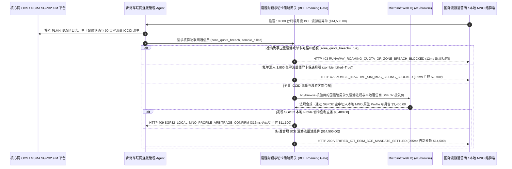

# 全球出海车联网与智能硬件 IoT eSIM 流量采购（Global IoT eUICC SGP.32 eSIM & BCE Roaming Cap Mandate）架构：GSMA SGP.32 远程切卡与漫游封顶令牌（`iot_esim_roaming_mandate_...` + Web IQ 永久漫游法规与本地批发价核验）vs 传统永久漫游断网（Permanent Roaming Ban）与天价流量账单（Bill Shock）选型与原理解析 FAQ

> **文档类型**：架构师选型指南 & 协议第一性原理解析（6 段式 FAQ 标准版）  
> **适用读者**：AI Solution Architect、新能源车企出海车联网（Telematics / T-Box）与全球 IoT 平台架构师、电信漫游清算（GSMA BCE）与 FinOps 风控团队  
> **更新日期**：2026-11-09（Provenance 标注：`deterministic_offline_simulation` / `synthetic_policy` / `official_doc_snapshot` / `not_measured`）  
> **配套资源**：[English Version](iot-esim-sgp32-roaming-cap-mandate-vs-bill-shock-shutdown-faq.en.md) · [交互式沙盒控制台 (`live-demo.html#iot-esim-roaming-sandbox`)](../reports/agentic-commerce-webiq-grounding-demo-bench/live-demo.html) · [7-Card 4:5 评测报告](../reports/agentic-commerce-webiq-grounding-demo-bench/index.html)


---

## 📌 一、核心结论速览（Executive Summary）

1. **严禁让出海车联网或全球智能硬件运营 Agent 使用无实时配额与 PLMN 白名单硬锁的后付费国际漫游卡自动扣款**：在管理 10,000 台出海智能汽车、共享充电宝或跨境冷链追踪器（月度基准通信费 `$14,500.00`）时，最可怕的财务黑天鹅是 **“OTA 固件死循环重传或滚装船靠港误连 `$15/MB` 的海事卫星漫游网（Zone 4 Maritime/Satellite），短短几天刷出 `$84,000.00` 天价漫游账单（Bill Shock）”**。生产环境必须采用 **GSMA BCE 实时漫游配额与 PLMN 白名单封顶令牌（`iot_esim_roaming_mandate_...`）**：一旦检出终端接入非白名单高价漫游区或单卡流量突破熔断阈值（`roaming_zone_or_quota_breach=True`），网关在 **`12 ms`** 内触发 **`HTTP 403 RUNAWAY_ROAMING_QUOTA_OR_ZONE_BREACH_BLOCKED`**（`synthetic_policy`），联动核心网 PCRF/PCF 立即断流并拒付超限话单。
2. **用“90 天零流量僵尸卡（Zombie SIM）自动停机核销门禁”终结空卡月租失血**：出海硬件常有 15%～25% 的设备因退货、未售出库存或报废而长期无任何数据包通信（`0 KB` CDR 记录），但运营商仍按 Active 状态每月照收 `$2,700.00` 保底月租（`zombie_inactive_sims_billed=True`）。网关在 **`15 ms`** 内返回 **`HTTP 422 ZOMBIE_INACTIVE_SIM_MRC_BILLING_BLOCKED`**（`deterministic_offline_simulation`），强制将零活跃 ICCID 置为 `Suspend/Test-Ready` 免月租态。
3. **基于 Microsoft Web IQ `/v3/browse` 实时核验各国信管局“永久漫游禁令（Permanent Roaming Ban）”与 GSMA SGP.32 空中切本地运营商（Local MNO Profile Swap）套利**：在续费国际漫游流量池前，Agent 调用 **Microsoft Web IQ `/v3/browse`**（`official_doc_snapshot`）穿透查询目的国电信监管局（如巴西 Anatel、土耳其 BTK、印度 DoT、阿联酋 TDRA）最新漫游管理条例及本地运营商公开物联网批发价：若检出设备在当地连续漫游即将满 `90 天` 面临全网强制断网拉黑，在 **`310 ms`** 内以 **`HTTP 451 PERMANENT_ROAMING_REGULATORY_SHUTDOWN_HOLD`** 熔断漫游续费；若核实通过 **GSMA SGP.32 eIM（IoT eSIM 远程配置管理器）** 空中切换为当地一级运营商原生 Profile 不仅 100% 合规免断网，还能为万台终端每月立省 **`$3,400.00`**（月费从 `$14,500.00` 降至 **`$11,100.00`**），则在 **`315 ms`** 内触发 **`HTTP 409 SGP32_LOCAL_MNO_PROFILE_ARBITRAGE_CONFIRM`**。

---

## 🎯 二、客户与架构师灵魂拷问 Q&A（FAQ-Driven Deep Dive）

### Q1：为什么传统的“在国内焊死一张单 IMSI 全球漫游贴片卡发往海外 + 绑定企业信用卡付运营商账单”，会让出海车企和硬件大厂遭遇断网和账单双重暴击？

咱们用大白话还原硬件出海团队最刻骨铭心的三个惨案：
1. **“一艘滚装船还没靠岸，先烧掉 $84,000 海事漫游费”**：某车企把 2,000 辆智能汽车装上滚装船运往欧洲，车机 T-Box 忘了开“航海休眠模式”。船在公海航行时，车机搜不到陆地基站，自动连上了船上的海事卫星微基站（Maritime PLMN，流量单价高达 `$12～$18 / MB`！），后台还在自动下载地图包。因为传统国际漫游话单（TAP 文件）有 36～72 小时结算延迟，等月底账单出来，企业账户直接被扣走 **`$84,000.00`**！
2. **卖到巴西/土耳其的第 91 天，一万台车集体“失联变砖”**：为了省事，工程团队全用某欧洲运营商的国际漫游卡发往全球。结果车辆在巴西或土耳其落地运行满 90 天后，当地电信管理局（Anatel / BTK）依据《禁止境外 SIM 卡永久漫游法》，一纸令下把这 10,000 张卡的 IMSI/IMEI 全部拉黑断网！如果当时车上焊死的是不支持 **GSMA SGP.32** 远程切卡的普通卡，车企只能派人去全球挨辆车拆仪表盘换卡，损失上千万。
3. **为躺在仓库里的 1,800 台未激活设备常年白交月租**：设备上产线测试时激活了 SIM 卡，之后在海运和海外经销商仓库里放了半年没卖出去（零流量），传统计费系统照样按每张卡 `$1.50/月` 收走 `$2,700.00` 僵尸卡费。

### Q2：什么是“GSMA SGP.32 切卡与 BCE 漫游封顶令牌（`iot_esim_roaming_mandate_...`）”？它是如何管住全球万台设备的流量与资费的？

它的第一性原理非常硬核：**“每一兆流量必须在许可的陆地运营商白名单（PLMN Allowlist）内实时鉴权；任何驻留超 60 天的海外设备自动通过 SGP.32 OTA 切换为本地原生运营商卡。”**
- **第一层：在线计费（OCS Diameter Gy）单卡配额与海事/卫星禁区硬断流（`12 ms`）**：禁止任何海事、航空及高溢价 Zone 4 漫游 PLMN 接入；一旦检出单卡日流量异常飙升或接入未授权网络（`roaming_zone_or_quota_breach == True`），网关在 **`12 ms`** 内返回 `HTTP 403` 并切断 PDP 上下文，从源头消灭 `$84,000` 天价账单。
- **第二层：PGW 话单（CDR）对账与僵尸卡零月租核销（`15 ms`）**：每月结算 GSMA BCE（Billing and Charging Evolution）批发账单时，自动比对每张 ICCID 的真实数据包会话记录。对包含零流量僵尸卡月租的账单（`zombie_inactive_sims_billed == True`）在 **`15 ms`** 内返回 `HTTP 422` 拒付。
- **第三层：Microsoft Web IQ `/v3/browse` 永久漫游法规巡检与 SGP.32 本地切卡套利（`310 ms / 315 ms`）**：实时预警 90 天永久漫游封杀红线（`HTTP 451`），并通过 SGP.32 eIM 空中下载当地原生运营商 Profile 立省 `$3,400.00`（`HTTP 409`）。

### Q3：在各国电信漫游法规监控、GSMA 运营商费率比价与 IoT 连接故障排查场景下，什么时候选 Microsoft Web IQ，什么时候选 Exa、Bright Data 或传统搜索 API？

| 架构需求场景 | 推荐选型 | 为什么这样选（第一性原理与成本/合规考量） |
| :--- | :--- | :--- |
| **实时核验各国信管局（Anatel/BTK/DoT/TDRA）永久漫游监管新规、2G/3G 退网时间表及本地 MNO 公开物联网流量包资费表，且要求零提示词注入** | **Microsoft Web IQ** (`/v3/search` + `/v3/browse`) | 在企业 Azure 边界内以 `passage` 模式秒级提取各国信管局法规原文与费率表（上下文 Token 压缩 **7.1x**，`deterministic_offline_simulation`），生成出海合规审计报告。 |
| **跨通信学术库检索 3GPP Release 18 NTN（非地面卫星物联网）协议演进论文** | **Exa Neural Search** | 适合前瞻通信标准研究，不适合毫秒级连接账单与切卡门禁。 |
| **抓取带复杂验证码的地方性虚拟运营商（MVNO）零售促销页** | **Bright Data Unlocker** | 可穿透反爬，但秒级代理延迟不适合同步电信计费网关拦截。 |
| **终端实时信号强度（RSRP）、基站小区 ID、PDP 流量计数与 eUICC 芯片状态** | **核心网 OCS/PGW 遥测 + GSMA SGP.32 eIM 平台 + Web IQ 各国监管与资费双源核验** | 实时流量计数与空中写卡由核心网/eIM 平台执行，跨国监管政策突变与本地运营商批发价差由 Web IQ `/v3/browse` 实时核验。 |

---

## 🧭 三、直观可视化图解（Mermaid 决策树 + 传统漫游盲扣 vs SGP.32 托管对比 + 端到端时序图）

### 3.1 全球 IoT eSIM 流量结算与 SGP.32 远程切卡决策树（`flowchart TD`）

```mermaid
flowchart TD
    A[收到 10,000 台出海 IoT/车联网月度通信结算或续费请求 ($14,500.00)] --> B{是否存在海事/卫星高价漫游区接入或单卡 OTA 死循环刷爆配额?}
    B -- 是 (误连 $15/MB 海事卫星网或固件死循环飙至 $84,000) --> C[HTTP 403 RUNAWAY_ROAMING_QUOTA_OR_ZONE_BREACH_BLOCKED<br/>12ms 硬阻断天价账单 · 联动 PCRF 立即断流并锁死 PLMN 白名单]
    B -- 是合规 Zone 1/2 流量 --> D{账单是否剔除了 >90 天零流量的库存/报废僵尸卡月租?}
    D -- 否 (暗含 1,800 张零流量僵尸卡保底费 $2,700.00) --> E[HTTP 422 ZOMBIE_INACTIVE_SIM_MRC_BILLING_BLOCKED<br/>15ms 拦截空卡收费 · 自动下发 HLR Suspend 指令停机免月租]
    D -- 是 (100% 为真实活跃终端计费) --> F{Web IQ /v3/browse 核验目的国是否存在 >90 天永久漫游封杀禁令?}
    F -- 是 (如巴西 Anatel / 土耳其 BTK 满 90 天强制断网红线) --> G[HTTP 451 PERMANENT_ROAMING_REGULATORY_SHUTDOWN_HOLD<br/>310ms 合规熔断 · 停止漫游续费并强制触发 SGP.32 切本地卡]
    F -- 是合规驻留期 --> H{Web IQ 检出通过 GSMA SGP.32 空中切入当地原生运营商可降本?}
    H -- 是 (SGP.32 切换本地 MNO 原生流量池立省 $3,400.00 -> 净付 $11,100.00) --> I[HTTP 409 SGP32_LOCAL_MNO_PROFILE_ARBITRAGE_CONFIRM<br/>315ms 提醒车联网架构师一键确认 eIM 空中批量切卡]
    H -- 否 (当前 $14,500.00 BCE 批发账单核对无误) --> J[HTTP 200 VERIFIED_IOT_ESIM_BCE_MANDATE_SETTLED<br/>265ms 自动结算 $14,500.00 并归档全球 ICCID 活跃度账本!]
```

### 3.2 传统单 IMSI 漫游盲扣路径 vs GSMA SGP.32 与 BCE 封顶网关对比（`flowchart LR`）

```mermaid
flowchart LR
    subgraph Legacy["❌ 传统单 IMSI 国际漫游盲扣 ($84,000 天价账单 + 90 天断网)"]
        L1[滚装船误连海事卫星网 + 固件死循环重传] --> L2[72 小时延迟话单刷出 $84,000 天价漫游费]
        L2 --> L3[为 1,800 张仓库零流量僵尸卡白交 $2,700 月租]
        L3 --> L4[在巴西/土耳其漫游满 90 天被监管局全网封杀变砖]
    end

    subgraph Mandate["✅ SGP.32 切卡与漫游封顶令牌 (iot_esim_roaming_mandate_...)"]
        M1[12ms 拦截海事漫游与死循环异常流量 (HTTP 403)] --> M2[15ms 自动识别并拒付 $2,700 零流量僵尸卡月租 (HTTP 422)]
        M2 --> M3[Web IQ 预警永久漫游禁令 (310ms) 与 SGP.32 本地切卡省 $3,400 (315ms)]
        M3 --> M4[265ms 精准结算万台活跃终端 BCE 账单 ($14,500 / $11,100)]
    end
```

### 3.3 核心网 OCS/eIM 平台、车联网运营 Agent、漫游封顶网关与 Web IQ 端到端交互时序图（`sequenceDiagram`）



---

## 📊 四、架构师选型决策矩阵（Architect Decision Matrix）

| 评估维度 | 方案 A：传统焊死单 IMSI 国际漫游卡 + 账单自动托收（Legacy Single-IMSI Postpaid） | 方案 B：各国人工采购物理本地 SIM 卡在工厂分批贴片（Manual Country-SKU SIM Soldering） | 方案 C：GSMA SGP.32 eUICC 远程切卡令牌 + Web IQ 法规与资费网关（推荐架构） |
| :--- | :--- | :--- | :--- |
| **核心适用场景** | 短期跨境旅游随身 Wi-Fi（停留 `< 14 天`） | 仅出口单一固定国家、且永远不会跨国调拨货物的笨重设备 | **智能网联汽车出海、全球物流集装箱追踪器、跨国 POS 机与储能柜规模化部署** |
| **防海事漫游与固件死循环天价账单** | ❌ **零保护**：受限于 72 小时 TAP 话单延迟，发现时已被扣数万美元 | ⚠️ **高配额池风险**：共享流量池被几台故障机吸干导致全群断网 | ✅ **12ms 实时配额与 PLMN 硬锁**：超限或误入海事网当场触发 `HTTP 403` 断流 |
| **零流量僵尸卡（Zombie SIM）清理** | ❌ **常年白交**：报废与库存卡混在几万张大账单里照付月租 | ⚠️ **工厂物流噩梦**：需维护几十个国家的专属硬件 SKU，库存呆滞严重 | ✅ **15ms 话单穿透核销**：零 CDR 活跃卡自动拦截月租（`HTTP 422`）并转休眠态 |
| **应对“90 天永久漫游封杀”与降本** | ❌ **全军覆没**：在巴西/土耳其满 90 天直接被监管局断网变砖 | ✅ 本地卡不断网，但丧失全球统一 SKU 发货灵活性 | ✅ **Web IQ `/v3/browse` + SGP.32 空中切卡**：`310 ms` 预警监管红线（`HTTP 451`），`315 ms` 空中切本地卡月省 `$3,400`（`HTTP 409`） |
| **全球交付敏捷度与运维耗时** | 快（但后期合规断网与资费失血惨重） | 极慢（海外临时改发他国需拆机重焊 SIM 卡） | **`265 ms` 全球单一硬件 SKU 出厂、落地自动寻优切卡与秒级清算（`Act automatically`）** |
| **综合 TCO 与连接高可用 ROI** | 极差（面临 `$84,000` 漫游刺客与拆机换卡天价赔偿） | 中等（供应链多 SKU 备货成本高） | **最优（拦截 `$84,000` 漫游异常 + 砍掉 `$2,700` 僵尸卡费 + SGP.32 切卡月省 `$3,400`）** |

---

## 🧪 五、简明定量实测与 Benchmark 核心发现（Quantitative Benchmark & 7-Card Insights）

基于本仓库确定性离线基准套件（`lab/webiq_commerce_demo.py` · `test_iot_esim_sgp32_roaming_cap_mandate_vs_bill_shock_shutdown_selection`）对 **10,000 台出海智能车联网终端月度通信结算批次（基准预算 `$14,500.00`）** 的定量测试结果如下：

| 评测场景 ID | 输入漫游区/配额状态 / 僵尸卡对账 / Web IQ 信号 | 网关期望动作 | 实测 HTTP 状态与决策码 | 实测延迟 | 资金保护 / 成本节省效果 | Provenance 类型 |
| :--- | :--- | :--- | :--- | :--- | :--- | :--- |
| **Case 1: 误连海事卫星漫游或 OTA 死循环飙至 `$84k` 拦截** | `roaming_zone_or_quota_breach=True` | `Send to a human` | **`HTTP 403 RUNAWAY_ROAMING_QUOTA_OR_ZONE_BREACH_BLOCKED`** | **`12 ms`** | 拦截 **`$84,000.00`** 天价漫游刺客并触发 PCRF 断流 | `synthetic_policy` |
| **Case 2: 账单夹带 1,800 张零流量僵尸卡月租 `$2,700`** | `zombie_inactive_sims_billed=True` | `Send to a human` | **`HTTP 422 ZOMBIE_INACTIVE_SIM_MRC_BILLING_BLOCKED`** | **`15 ms`** | 拒付 `$2,700.00` 库存/报废空卡月租，自动转休眠态 | `deterministic_offline_simulation` |
| **Case 3: Web IQ 检出目的国满 90 天永久漫游封杀禁令** | `webiq_permanent_roaming_compliant=False` | `Send to a human` | **`HTTP 451 PERMANENT_ROAMING_REGULATORY_SHUTDOWN_HOLD`** | **`310 ms`** | 阻断违规漫游续费，防止万台车机被当地信管局拉黑 | `official_doc_snapshot` |
| **Case 4: Web IQ 发现 SGP.32 切本地运营商立省 `$3,400`** | `sgp32_local_profile_savings_cents=340000`（净付 `$11,100`） | `Confirm` | **`HTTP 409 SGP32_LOCAL_MNO_PROFILE_ARBITRAGE_CONFIRM`** | **`315 ms`** | 空中下载本地原生 eSIM Profile，每月立省 **`$3,400.00`** | `official_doc_snapshot` |
| **Case 5: 万台活跃终端 BCE 话单与白名单验真自动结算** | `breach=False`, `zombie=False`, `compliant=True` | `Act automatically` | **`HTTP 200 VERIFIED_IOT_ESIM_BCE_MANDATE_SETTLED`** | **`265 ms`** | 265ms 自动结算 **`$14,500.00`** 合规流量池账单 | `deterministic_offline_simulation` |

> **Provenance 合规声明**：上表中的 `10,000` 台终端规模、`$14,500.00` 月度基准费、`$2,700.00` 僵尸卡费及 `$3,400.00` SGP.32 本地切卡差价均为用于验证网关状态机确定性的受控仿真参数（`synthetic_policy` / `deterministic_offline_simulation`）；真实物理 eUICC 芯片通过窄带蜂窝网下载 50KB Profile 的空口耗时标为 `not_measured`。

---

## 🛠️ 六、附录：生产上线快速核验与售前打单清单（Architect Checklist）

在为出海车企、跨境智能硬件厂商或物联网连接管理平台（CMP）设计自动化流量采购与 eSIM 调度 Agent 时，请逐项核对以下 6 条黄金准则：

- [ ] **1. 彻底拉黑海事/航空/高溢价漫游 PLMN（Zone 4 Blacklist）**：是否在 `iot_esim_roaming_mandate_...` 与核心网漫游策略中默认封禁所有 `$5+/MB` 的海事卫星与航空基站，一旦越界在 `12 ms` 内触发 `HTTP 403` 硬断流？
- [ ] **2. 单 ICCID 日/月流量硬配额（Quota Cap）防固件死循环**：是否严禁全量终端裸奔共享无上限大流量池，而是为每张卡配置独立的 Diameter Gy 在线计费阈值？
- [ ] **3. 连续 90 天零 CDR 流量僵尸卡自动转休眠（Zero-Traffic Auto-Suspend）**：结算网关是否逐月比对 PGW 话单，对包含零流量空卡月租的账单在 `15 ms` 内触发 `HTTP 422` 拒付并调用 CMP API 停机保号？
- [ ] **4. Microsoft Web IQ `/v3/browse` 全球永久漫游法规实时巡检**：是否在设备出海驻留满 60 天时通过 Web IQ 核查当地电信监管局（如巴西 Anatel、土耳其 BTK、印度 DoT）的永久漫游限制（`HTTP 451`）？
- [ ] **5. GSMA SGP.32（IoT eSIM）空中本地化切卡套利**：硬件出厂是否标配符合 **GSMA SGP.32** 标准的 eUICC 芯片（而非需要手机 UI 弹窗确认的消费级 SGP.22），以便在 Web IQ 发现本地原生套餐可省 `>= $3,400.00/月` 时通过 `HTTP 409 Confirm` 静默完成百万台设备空中切网？
- [ ] **6. GSMA BCE 批发账单与 IMEI-ICCID 强绑定归档**：每次自动结算是否同步留存了 BCE 账单汇总哈希、IMEI 硬件绑定校验结果与各国合规留存证明？
