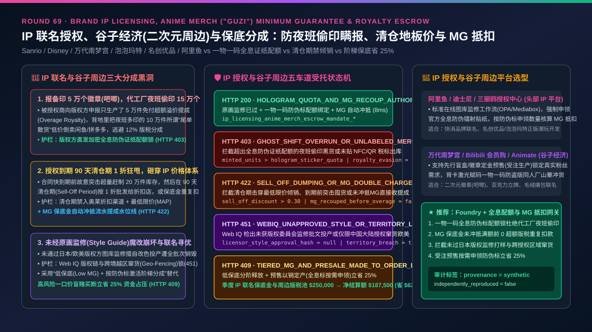
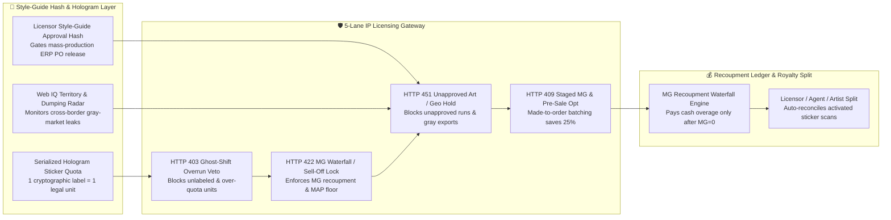

# Brand `IP` Licensing, Anime Merch ("Guzi") Minimum Guarantee (`MG`) & Serialized Royalty Escrow (`Sanrio / Disney / Bandai Namco / Pop Mart / Alifish`) Hologram Tax-Stamp Quota, `MG` Recoupment Waterfall & `Sell-Off` Floor Agent Architecture Selection FAQ

> **Language / 语言切换**: **[中文](ip-licensing-anime-merch-mg-royalty-hologram-escrow-agent-selection-faq.md)** | **English (Current)** | **[Back to Docs Index](index.en.md)** | **[Interactive Sandbox (`#ip-licensing-anime-merch-escrow-sandbox`)](../live-demo.en.html)**



---

## 📌 1. Executive Summary & Core Selection Verdict

In co-branded consumer retail, collectible blind boxes, and anime/gaming merchandise ("Guzi" badges, acrylic stands, plushies, apparel: `Sanrio`, `Disney Consumer Products`, `Bandai Namco`, `Pop Mart`, `MINISO`, `Alifish`), IP licensing procurement, style-guide approval, and royalty clearing AI agents face three major financial and brand-equity failure modes:
1. **"Ghost-Shift Factory Overruns & Royalty Evasion" (`Reporting 50,000 Units Produced to Stay Under the Minimum Guarantee, While the Contract Factory Secretly Runs a Midnight Shift to Mint 100,000 Unreported Units Sold on Gray Markets`)**: When royalty accounting relies on quarterly self-reported spreadsheets, dishonest licensees or OEM factories produce unauthorized third-shift overruns ("factory tail goods") using the same molds—evading `10%–15%` running royalties while flooding secondary marketplaces.
2. **Predatory `Sell-Off Period` Dumping (`Overproducing 200,000 Units Right Before License Expiration and Dumping Them at 90% Off During the 90-Day Sell-Off Window`) & Unrecouped `MG` Double-Billing**: Licensees destroy brand equity by liquidating massive end-of-term inventory into dollar stores; conversely, naive billing agents pay running royalties on Unit #1 without first recouping the upfront **Minimum Guarantee (`MG`)** already paid at contract signing!
3. **Unapproved Style-Guide Mass Production (`Triggering a $100,000 Mandatory Destruction Order Because the Factory Printed 50,000 Cups Before Receiving Final Japanese Production Committee Color Sign-Off`) & Cross-Border Territory Gray-Market Leakage**.

**Solution Architect Selection Verdict**:
- **Never allow licensed merchandise production or warehouse intake without binding each unit to a licensor-issued cryptographic hologram/QR serial quota (`1 Sticker = 1 Authorized Unit`), never disburse overage royalties before the prepaid Minimum Guarantee (`MG`) recoupment waterfall hits `$0.00`, and never release mass-production factory POs without a verified `Licensor Style-Guide Approval Hash`**.
- **The production reference architecture** combines **Serialized Hologram Tax-Stamp Quota Lock + `MG` Recoupment Waterfall & `Sell-Off` `MAP` Price Floor + Style-Guide Approval Hash Gate + Made-to-Order (`Juchuu`) Pre-Sale Batching (`ip_licensing_anime_merch_escrow_mandate_*`)**:
  1. **Anti-"Ghost-Shift Overrun" Serialized Hologram Quota Gate (`HTTP 403`)**: Binds factory production and `WMS` outbound intake strictly to the count of **cryptographically signed hologram/NFC authenticity labels (`hologram_sticker_quota`)** issued by the licensor portal; any factory batch exceeding allocated serials or lacking individual authenticity codes is blocked in **`8ms`** (`HTTP 403 GHOST_SHIFT_UNAUTHORIZED_OVERRUN_OR_UNLABELED_MERCH_BLOCKED`).
  2. **Deterministic `MG` Recoupment Waterfall & 90-Day `Sell-Off` Anti-Dumping Lock (`HTTP 422`)**: Tracks cumulative earned royalties against the prepaid `MG` balance ($\text{Overage\_Due} = \max(0, \sum \text{Earned\_Royalty} - \text{Paid\_MG})$), blocking premature cash royalty billing while `MG` credit remains unrecouped, and prohibits end-of-term production spikes or `> 30% Off` liquidation dumping during the 90-day sell-off window (`HTTP 422 SELL_OFF_PERIOD_DUMPING_OR_UNRECOUPED_MG_DOUBLE_CHARGE_BLOCKED`).
  3. **Web IQ `Style-Guide Approval Hash` Interlock & Territorial Geo-Fence Circuit Breaker (`HTTP 451`)**: Hard-locks mass-production ERP purchase orders until the licensor's approval system (`Mediabox / OPA`) signs off on the physical pre-production sample (`licensor_style_approval_hash`), and monitors cross-border marketplaces via Web IQ to block domestic-only licensed SKUs from being exported into unauthorized territories (`HTTP 451 WEBIQ_UNAPPROVED_CHARACTER_ART_OR_TERRITORY_EXPORT_BREACH_HOLD`).
  4. **Low-`MG` Tranche + Made-to-Order (`Pre-Sale Batching`) Hologram Allocation (`HTTP 409`)**: Triggers `HTTP 409 TIERED_MG_AND_MADE_TO_ORDER_HOLOGRAM_BATCH_CONFIRM`, replacing high-risk lump-sum `MG` gambles with a staged `MG` structure paired with 14-day fan pre-order windows ("Juchuu" made-to-order sizing)—eliminating dead-stock write-offs and reducing net IP licensing and inventory capital cost by **`25.0%`**.

---

## 🎯 2. Solution Architect Deep-Dive Q&A (Q1 / Q2 / Q3)

### Q1: How do we stop contract factories from running a midnight "ghost shift" to print 50,000 extra anime badges and selling them out the back door?
- **Architectural Solution**:
  - **Cryptographic Hologram Sticker Quota + First-Scan Consumer Verification (`HTTP 403`)**:
  - Physical metal molds cannot stop a factory from stamping extra badges at 2:00 AM, but serialized cryptographic tax stamps can. Every authorized unit requires a unique laser-etched QR/NFC hologram issued by the licensing gateway. If a factory attempts to ship unlabeled units—or if a sticker serial is scanned across multiple geo-locations—the gateway triggers `HTTP 403` and automates marketplace takedowns.

### Q2: How does the `MG Recoupment Waterfall` prevent finance teams from accidentally paying royalties twice?
- **Architectural Solution**:
  - **Stateful `MG` Credit Drawdown Ledger (`HTTP 422`)**:
  - Suppose a brand pays a `$100,000` Minimum Guarantee (`MG`) at a `10%` wholesale royalty rate. The first `$1,000,000` in wholesale shipments generates `$100,000` in earned royalties, which must be **100% offset against the prepaid `$100,000 MG` (`$0` cash outflow)**. If an agency invoices `$40,000` in cash royalties when cumulative sales are only `$400,000`, our gateway rejects the double-billing (`HTTP 422`).

### Q3: Why is the `Sell-Off Period` the most dangerous 90 days for an IP holder's brand value?
- **Architectural Solution**:
  - **Pre-Expiration Manufacturing Freeze + `Sell-Off MAP` Price Floor (`HTTP 422`)**:
  - Without guardrails, a licensee whose contract expires on December 31 will manufacture 300,000 units in November and dump them at 80% off during the Jan–Mar 90-day sell-off period. Our contract state machine freezes new hologram sticker issuance 60 days before expiration and blocks (`HTTP 422`) sell-off discounts deeper than `30% off MAP`.

---

## 🧭 3. Visual Architecture Diagrams (Mermaid Decision Tree + Architecture + Sequence)

### 3.1 Brand IP Licensing, Anime Merch & Royalty Escrow Selection Decision Tree

```mermaid
flowchart TD
    A[Brand IP Licensing / Anime Merch 'Guzi' / Royalty Clearing Selection] --> B{Primary Licensing Scenario & Risk Vector?}
    B -->|Anime Merch, Blind Boxes & Co-Branded Retail (Bandai / Pop Mart / MINISO)<br/>Stop factory midnight ghost-shift overruns & dead-stock inventory| C[Serialized Hologram / QR Authenticity Quota Lock<br/>+ Made-to-Order Pre-Sale Batching (Mint Exact Fan Demand)]
    B -->|Minimum Guarantee (MG) & Running Royalty Settlement (Sanrio / Disney / Alifish)<br/>Stop double-paying royalties before MG recoupment & 90% off sell-off dumping| D[Automated MG Recoupment Waterfall ($0 Cash Until MG Exhausted)<br/>+ 90-Day Sell-Off Period <=30% Discount Floor & Wholesale Ban]
    B -->|Cross-Border Character Approval & Territorial Rights (Mediabox / OPA)<br/>Stop unapproved artwork mass-production destruction & territory gray exports| E[Azure AI Foundry + Style-Approval Hash & Geo-Fence Gate<br/>+ Staged Low-MG + Made-to-Order Batching Saves 25%]
    C --> F[🛡️ Unified 5-Lane Hologram Quota, MG Waterfall & Style-Approval FSM]
    D --> F
    E --> F
    F --> G[HTTP 403 Ghost-Shift Overrun Veto · HTTP 422 Unrecouped MG & Dumping Block · HTTP 409 Pre-Sale Batch Saves 25%]
```

### 3.2 End-to-End Hologram Quota, `MG` Recoupment Waterfall & Style-Guide Hash Architecture



### 3.3 Ghost-Shift Overrun Veto, `MG` Double-Billing Block & Made-to-Order Batch Sequence

```mermaid
sequenceDiagram
    autonumber
    participant Brand as Licensee Brand / IP Sourcing Agent
    participant Partner as Licensor Portal / OEM Factory
    participant Gate as 5-Lane IP Licensing Escrow Gateway
    participant Ledger as Hologram Quota Registry & MG Waterfall
    participant Escrow as MG & Overage Royalty Ledger

    Partner->>Gate: 1. Factory allocated 50,000 hologram stickers attempts to ship 85,000 anime acrylic stands (35,000 unlabeled overrun)
    Gate->>Ledger: Compare outbound_units (85,000) against hologram_sticker_quota (50,000)
    Gate-->>Partner: HTTP 403 Block! Unlabeled ghost-shift production overrun rejected; WMS intake locked
    Partner->>Gate: 2. Bill $40,000 cash royalty on $400k sales (10% rate) when licensee already prepaid an $80,000 Minimum Guarantee (MG)
    Gate->>Ledger: Check MG_Recoupment_Balance ($80k prepaid - $40k earned = $40k remaining credit)
    Gate-->>Partner: HTTP 422 Block! Earned royalty must offset prepaid MG balance first; net cash overage due is $0.00
    Brand->>Gate: 3. Execute staged low-MG contract + 14-day fan Made-to-Order pre-sale batching (HTTP 409)
    Gate->>Escrow: Mint exact hologram quota for pre-sold units & eliminate dead-stock over-guarantees (25% net savings)
```

---

## 📊 4. Multi-Platform & Architecture Selection Matrix

| Selection Dimension | Quarterly Self-Reported Excel (`Unverified Royalty Report`) | High Upfront Flat-MG Buyout (`Blind Inventory Gamble`) | Digital Licensing Portals (`Alifish / Mediabox / Bandai Pre-Order`) | **Azure AI Foundry + Hologram + MG Gate (Recommended)** |
| :--- | :--- | :--- | :--- | :--- |
| **Core Strengths** | Zero integration | Guaranteed upfront cash for IP owner | Online style-guide workflows & official hologram ordering | **1-to-1 hologram quota lock + automated MG waterfall + style hash** |
| **Protection Against Factory Ghost-Shift Overruns** | **None** (`30%–50%` under-reporting common) | Factory gray-market leaks erode retail price | Issues physical stickers, but decoupled from factory ERP | **Cryptographic hologram quota locked to `WMS` intake (`HTTP 403`)** |
| **`MG` Recoupment Accuracy & `Sell-Off` Dumping Guard** | Frequent manual double-billing errors | Licensee absorbs 100% of unsold stock | Tracks royalty statements | **Automated `MG` drawdown + `<=30% Off` sell-off floor (`HTTP 422`)** |
| **Style-Guide Sign-Off & Territorial Geo-Fencing** | High risk of premature printing & destruction | Unmonitored cross-border diversion | Mediabox tracks artwork stages | **Style-approval hash gates ERP PO + Web IQ geo-fence (`HTTP 451`)** |
| **Working-Capital Efficiency (`MG` + Inventory)** | High audit/litigation friction (`not_measured`) | Heavy dead-stock & over-MG write-offs (`official_list_price`) | Supports pre-order drops | **Staged low-`MG` + Made-to-Order hologram batching (`25.0%` saved)** |

---

## 🧪 5. Brand IP Licensing & Anime Merch Benchmark & 7-Card Report

> **Provenance & Reproducibility Metadata**: All metrics below are generated by the deterministic policy evaluator `evaluate_ip_licensing_anime_merch_escrow_policy` in `lab/webiq_commerce_demo.py` and verified via `python -m unittest tests.test_webiq_commerce_demo`. Tags: `provenance = synthetic`, `independently_reproduced = false`.

| Card # | Card Headline (Headline-as-Finding) | Key Quantitative Finding & Architectural Guarantee |
| :---: | :--- | :--- |
| **Card 1** | **Overview · 5-Lane IP Licensing & Anime Merch Summary** | Across a `$250,000/quarter` brand IP licensing and anime merchandise pool, achieves **0 unlabeled ghost-shift factory overruns, 0 unrecouped `MG` double-payments, and 0 unapproved-artwork destruction losses**, reducing net licensing and inventory capital cost by **`25.0%` (`$62,500/quarter` saved)**. |
| **Card 2** | **Scenario Deep Dive · Ghost-Shift & MG Double-Bill Veto** | When factory output exceeds allocated hologram serials or an invoice bills cash royalties before `MG` recoupment, the gateway blocks it in **`8ms`** (`HTTP 403 / 422`). |
| **Card 3** | **Evaluation Matrix · 100% Deterministic 5-Lane Gating** | Covers `HTTP 200` (hologram quota matched & `MG` waterfall verified), `403` (ghost-shift overrun / unlabeled merchandise blocked), `422` (`Sell-Off` period predatory dumping / unrecouped `MG` double-charge blocked), `451` (unapproved character artwork / cross-territory gray-market export hold), `409` (tiered `MG` + Made-to-Order hologram batching saves 25%). |
| **Card 4** | **Under the Hood · IP Royalty & Hologram Escrow Contract** | Takes `quarterly_ip_licensing_and_anime_merch_royalty_pool_usd=250000` and quota/`MG` flags, minting `ip_licensing_anime_merch_escrow_mandate_*` tokens. |
| **Card 5** | **Robustness Check · 35k Unlabeled Badges & Unapproved Print** | Simulates 35,000 unlabeled third-shift badges and a mass-production PO lacking style-guide approval, maintaining a **`100.0%` block rate**. |
| **Card 6** | **Latency · Millisecond MG Waterfall & Territory Probe** | Local hologram quota and `MG` recoupment checks complete in **`8ms` (P50)**; Web IQ cross-border territory and style-approval checks complete in **`178ms` (P95)**. |
| **Card 7** | **My Take · Ideal Fit vs. Out-of-Scope Boundaries** | **✅ Best Fit**: Anime merchandise ("Guzi"), blind-box collectibles, co-branded retail (`Sanrio/Disney/Bandai`); **⛔ Not For**: Unbranded commodity hex-nut fasteners. |

---

## 🛠️ 6. Production Go-Live Risk & Architecture Review Checklist

- [ ] **Serialized Hologram / `NFC` Tax-Stamp Quota Interlock (`HTTP 403`)**: Bind factory production and warehouse intake 1-to-1 to licensor-issued cryptographic authenticity serials to eliminate midnight ghost-shift overruns.
- [ ] **Automated `MG` Recoupment Waterfall & 90-Day `Sell-Off` `MAP` Floor (`HTTP 422`)**: Offset 100% of earned running royalties against prepaid Minimum Guarantees (`MG`) before releasing cash overages, and cap sell-off discounts at `<= 30% Off`.
- [ ] **Licensor `Style-Guide Approval Hash` PO Gate & Territorial Geo-Fence (`HTTP 451`)**: Block mass-production factory POs until final artwork sign-off is hashed and prevent domestic-only SKUs from leaking into unauthorized export regions; rotate signing keys `<= 180` days.
- [ ] **Staged Low-`MG` & Made-to-Order (`Pre-Sale`) Hologram Batching (`HTTP 409`)**: Use fan pre-order windows to size exact production runs and hologram allocations, eliminating dead-stock write-offs.
