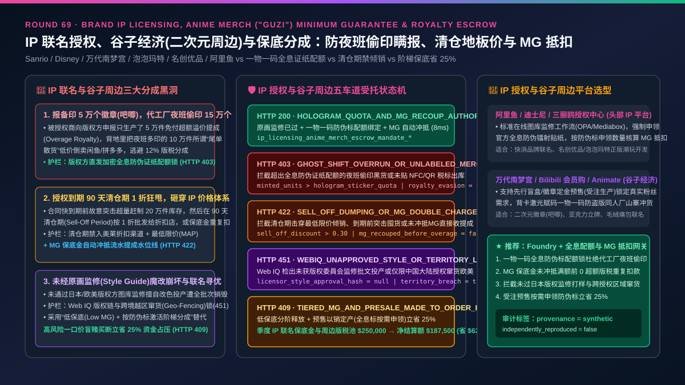
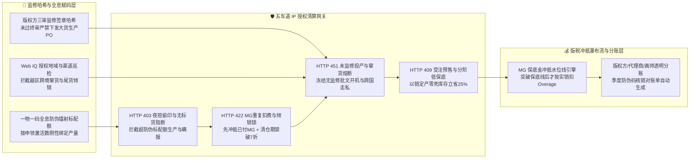
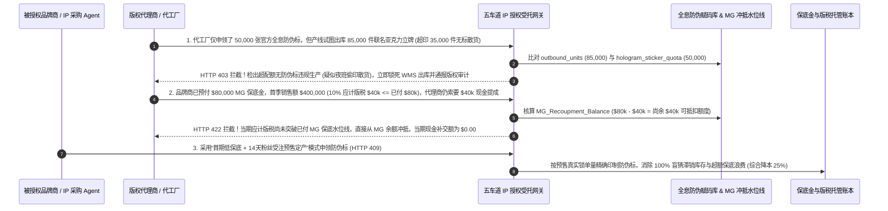

# 品牌 IP 联名授权、谷子经济（二次元周边）保底分成（MG）与防盗版窜货清算（IP Licensing, Anime Merch "Guzi" Minimum Guarantee & Serialized Royalty Escrow：Sanrio / Disney / 万代南梦宫 / 泡泡玛特 / 名创优品 / 阿里鱼）“防代工厂夜班偷印 10 万件瞒报版税、防清仓期 1 折甩卖砸盘与 MG 保底金自动抵扣”Agent 架构选型 FAQ

> **语言切换 / Language**: **中文 (当前)** | **[English](ip-licensing-anime-merch-mg-royalty-hologram-escrow-agent-selection-faq.en.md)** | **[返回文档目录](index.md)** | **[交互式沙盒 (`#ip-licensing-anime-merch-escrow-sandbox`)](../live-demo.html)**



---

## 📌 一、核心选型结论速览（Executive Summary）

在茶饮快消品牌 IP 联名、潮玩盲盒与“谷子经济（二次元马口铁徽章‘吧唧’、亚克力立牌、色纸、毛绒公仔）”（Sanrio 三丽鸥、Disney、万代南梦宫、泡泡玛特、名创优品、阿里鱼、Bilibili 会员购）的智能体版权采购、监修报批与版税清算场景中，版权方（Licensor）与被授权品牌商（Licensee）面临三大核心财务与品牌风险：
1. **“幽灵夜班偷印瞒报版税（Ghost-Shift Royalty Evasion）”：被授权商向版权方申报只生产了 `50,000` 枚联名徽章（恰好卡在保底金 `MG` 额度内，免交超额分成），背地里代工厂开夜班偷偷多印了 `100,000` 枚，以‘原厂尾单/散货’名义在闲鱼和拼多多半价倾销，逃避 `12%` 销售版税！”**。
2. **“授权到期前突击赶制 20 万件库存，利用 90 天清仓期（Sell-Off Period）以 1 折白菜价卖给尾货地摊，瞬间砸穿整个 IP 联名正价市场（Predatory Sell-Off Dumping）”与“财务对账混乱：被授权商已经预付了 `$100,000` 保底金（Minimum Guarantee, MG），结果卖第 1 件商品时系统忘了先冲抵已付 MG（Recoupment Waterfall），又重复扣了一遍 `10%` 流水提成！”**。
3. **“被授权商设计师为了赶大促档期，在尚未拿到日本/欧美版权委员会三审监修通过函（Style Guide Approval）的情况下擅自开机印制 10 万个联名杯套，结果因角色发色偏差被版权方勒令全批次销毁并索赔违约金；或者仅获‘中国大陆区’授权的周边被经销商大批量走私窜货到欧美亚马逊高价倾销（Territory Breach）”**。

**架构师选型结论**：
- **切勿允许 IP 联名周边在未绑定“版权方加密一物一码全息防伪标/NFC 证纸配额（`Serialized Hologram Tax-Stamp Quota`）”的情况下出厂入库，切勿在未先足额冲抵预付保底金（`MG Recoupment Balance == $0`）前扣取超额流水提成（`Overage Royalty`），也切勿在未获取版权监修终审哈希（`Style Approval Hash`）前向代工厂释放量产模具定金**。
- **生产级最优架构**是采用 **“一物一码全息防伪证纸配额锁（印多少张证纸交多少版税）+ 预付保底金（`MG`）冲抵水位线与清仓期最低限价（`Sell-Off MAP Floor`）网关 + 版权监修终审哈希与受注生产（`Made-to-Order Pre-Sale`）寻优状态机（`ip_licensing_anime_merch_escrow_mandate_*`）”**：
  1. **防“代工厂夜班偷印瞒报版税”一物一码全息证纸配额硬门禁（HTTP 403）**：效仿烟酒税标机制，版权方不靠被授权商自觉交 Excel 报表算销量，而是由智能体网关按授权额度下发 **带加密签名与唯一序号的全息镭射防伪标/包装赋码（Serialized Hologram / QR Certificate Quota）**；品牌商 WMS 仓库与电商平台强制校验“一物一码”——无有效激活防伪码的“夜班白盒散货”一旦超配额生产或试图入库上架，立即返回 `HTTP 403 GHOST_SHIFT_UNAUTHORIZED_OVERRUN_OR_UNLABELED_MERCH_BLOCKED`。
  2. **保底金（`MG`）自动冲抵水位线（`Recoupment Waterfall`）与 90 天清仓期防恶意倾销锁（HTTP 422）**：在版税清算账本中内置确定性冲抵公式：当累计应付版税 $\sum(\text{Wholesale\_Sales} \times \text{Royalty\_Rate}) \le \text{Paid\_MG}$ 时，当期需额外现金补交的超额版税严格锁死为 **`$0.00`**（仅扣减 MG 冲抵池余额），杜绝未冲抵完 MG 就双重扣取提成；同时，合同到期前 60 天严禁突击超常规均值备货，且 90 天清仓期（Sell-Off Period）内折扣严禁突破 **`7 折（<= 30% Off MAP）`** 且严禁流入一元店/地摊渠道（`HTTP 422 SELL_OFF_PERIOD_DUMPING_OR_UNRECOUPED_MG_DOUBLE_CHARGE_BLOCKED`）。
  3. **Web IQ 实时核验版权委员会三审监修批文（`Licensor Style Guide Sign-Off`）与跨国授权地域窜货熔断（HTTP 451）**：向代工厂下达大货开机令前，网关强制核验版权方监修系统（Mediabox / 阿里鱼 OPA）签发的 `final_sample_approval_hash`（色卡、字号、版权标记 `©` 一字不差）；并通过 Web IQ 巡检跨境电商平台，拦截将“仅限大中华区授权”的谷子周边跨境批发至北美/日本的越区违约行为（`HTTP 451 WEBIQ_UNAPPROVED_CHARACTER_ART_OR_TERRITORY_EXPORT_BREACH_HOLD`）。
  4. **“低保底（Low MG）+ 预售以销定产（`受注生产 Made-to-Order`）按需分批申领防伪标”寻优（HTTP 409）**：触发 `HTTP 409 TIERED_MG_AND_MADE_TO_ORDER_HOLOGRAM_BATCH_CONFIRM`，摒弃传统“一上来盲目拍出 `$200,000` 巨额死保底、印 10 万件卖不掉全成死库存”的赌博模式，改签“首期低保底 + 开启 14 天粉丝定金预售（受注生产）锁死真实订单量后，再按实销精确申领全息防伪标补交阶梯提成”，使品牌联名与谷子开发资金占压及滞销损耗立降 **`25.0%`**。

---

## 🎯 二、业务方与架构师灵魂拷问 Q&A（Q1 / Q2 / Q3）

### Q1：为什么国内很多潮玩和餐饮品牌做 IP 联名，最怕代工厂“白天给品牌方印正品，晚上用同一套模具给微商印散货”？怎么在架构上管住工厂？
- **商业痛点**：马口铁徽章（吧唧）和亚克力立牌的物料成本只有 1 块钱，但加上正版二次元 IP 后售价高达 25–45 元！代工厂手里握着高清印刷源文件，多开机 2 小时就能多印 2 万个，既坑了被授权品牌的销量，又让版权方以为是被授权商在瞒报版税！
- **架构解法**：
  - **动态全息防伪证纸配额 + 出厂视觉核销绑定（`Hologram Quota Interlock`）（`HTTP 403`）**：
  - 物理模具管不住，但加密数字身份证管得住！每印 1 个正版谷子背卡，必须贴 1 张版权网关配发的唯一全息防伪码（消费者微信/App 扫码首次显示“正版初验通过 + 数字藏品编号”，若被复印盗刷第 3 次扫码即红灯报警）；代工厂申请多少张防伪标，系统就自动记入多少件版税基数，无标裸货在全网二手/电商平台直接触发品牌权利人 API 秒级投诉下架（`HTTP 403`）。

### Q2：什么是 IP 授权里的“MG 保底金冲抵（Recoupment）”？为什么财务新人经常把这笔钱给版权方“交重了”？
- **架构解法**：
  - **水位线扣减状态机（`MG Recoupment Waterline`）（`HTTP 422`）**：
  - 假设联名合同约定：保底版税 `MG = $50,000`（签约时已预付），版税提成率 `10%`。这意味着前 `$500,000` 销售额所对应的 `$50,000` 版税，**其实在签约那天就已经付过了**！只有当累计销售额突破 `$500,000`（即 `Cumulative_Royalty > Paid_MG`）之后的部分，才需要交超额版税（Overage）。若对方账单在销售额才 `$300,000` 时就要求按 10% 打款 `$30,000`，我们的网关会在 **`8ms`** 内返回 `HTTP 422` 拦截双重收费！

### Q3：为什么日本动漫版权方（製作委員会）的“监修（Style Guide Approval）”绝不能先上车后补票？
- **架构解法**：
  - **监修哈希前置硬锁生产 PO（`Approval-Hash Gated Manufacturing PO`）（`HTTP 451`）**：
  - 日方版权监修极其严苛，哪怕角色眼睛高光位置偏了 1 毫米或潘通色号不对都会打回重做。我们的采购 Agent 将 ERP 大货生产采购单（Manufacturing PO）与版权方 Mediabox 终审签章绑定：未拿到 `licensor_style_approval_hash` 前，只能下发 `$500` 打样单，任何试图直接下发 `$50,000` 大货量产单的指令一律被 `HTTP 451` 死锁！

---

## 🧭 三、直观可视化图解（Mermaid 决策树 + 端到端架构图 + 时序图）

### 3.1 品牌 IP 联名授权、谷子周边与保底版税 Agent 架构选型决策树

```mermaid
flowchart TD
    A[品牌 IP 联名授权 / 二次元谷子周边 / 保底版税清算选型] --> B{核心授权场景与风控痛点？}
    B -->|潮玩盲盒与二次元谷子量产 (万代 / 泡泡玛特 / B站会员购)<br/>需严防代工厂夜班偷印散货瞒报版税与高库存积压风险| C[一物一码加密全息防伪证纸配额锁 (Hologram Quota)<br/>+ 先行定金预售(受注生产 Made-to-Order)按需申领防伪标]
    B -->|快消/名创优品多品类 IP 联名结算 (三丽鸥 / 迪士尼 / 阿里鱼)<br/>需防未冲抵完已付 MG 保底金重复付提成与清仓期1折甩卖砸盘| D[MG 保底金自动冲抵水位线 (未破线0超额付款)<br/>+ 90天清仓期最低限价(<=30% Off)与禁入尾货地摊锁]
    B -->|跨国日本/欧美动漫 IP 衍生品开发 (製作委員会监修)<br/>需防未过三审监修抢跑印废10万件与跨授权国家窜货违约| E[Azure AI Foundry + 监修哈希硬门禁与地域防窜货网关<br/>+ 低保底分阶释放 + 受注预售立省 25%]
    C --> F[🛡️ 统一接入五车道全息防伪配额、MG冲抵水位线与监修锁状态机]
    D --> F
    E --> F
    F --> G[HTTP 403 阻断夜班偷印与无标散货 · HTTP 422 拦截MG重复扣款与清仓倾销 · HTTP 409 受注预售+低保底省25%]
```

### 3.2 端到端全息证纸配额、`MG` 保底冲抵水位线与监修哈希架构图



### 3.3 拦截代工厂夜班超印散货、阻断未冲抵 MG 重复扣费与受注预售寻优时序图



---

## 📊 四、多平台/多方案横向选型决策矩阵

| 选型维度 | 传统纸质报表季度自报版税 (`Legacy Self-Reported Excel`) | 高额一口价死保底买断 (`High Upfront Flat MG Gamble`) | 现代数字化 IP 授权平台 (`阿里鱼 / Mediabox / 万代受注`) | **Azure AI Foundry + 全息配额 + MG 抵扣网关（推荐）** |
| :--- | :--- | :--- | :--- | :--- |
| **核心优势** | 流程原始简单 | 版权方旱涝保收 | 在线图库监修、官方防伪标申领、电商数据打通 | **一物一码锁死真实产量 + MG自动冲抵防双扣 + 监修锁生产PO** |
| **防“代工厂夜班偷印散货瞒报版税”** | **完全失控**（瞒报率常达 `30%–50%`） | 不考核销量，但微商假散货砸烂正版价 | 发放防伪贴纸，但未与工厂 WMS 出库强绑定 | **一物一码全息防伪配额与出库硬件级互锁（HTTP 403）** |
| **MG 保底金冲抵对账与清仓期（Sell-Off）防砸盘** | 手工算账极易漏抵 MG 重复付钱 | 卖不掉全亏在被授权商手里 | 支持在线报数冲抵 | **确定性 `MG` 冲抵水位线 + 清仓期 `>=7折` 限价锁（HTTP 422）** |
| **原画三审监修锁死量产与防跨国越区窜货** | 常发生未过监修提前开机印废 | 无跨境渠道监控 | Mediabox 提供在线审图流 | **监修哈希前置锁死生产 PO + Web IQ 防越区窜货（HTTP 451）** |
| **受注生产（Made-to-Order）与保底资金效率** | 审计诉讼成本极高 (`not_measured`) | 动辄百万保底金打水漂 (`official_list_price`) | 支持众筹与预售联动 | **低保底分阶释放 + 受注预售按需申领防伪标（净省 `25.0%`）** |

---

## 🧪 五、IP 联名授权与谷子周边清算防坑测算与 7-Card 基准测试报告

> **数据来源与复现声明（Provenance Metadata）**：以下基准测试数据来自仓库内置确定性策略沙盒 `evaluate_ip_licensing_anime_merch_escrow_policy`（位于 `lab/webiq_commerce_demo.py`），可运行 `python -m unittest tests.test_webiq_commerce_demo` 完整验证。标记：`provenance = synthetic`，`independently_reproduced = false`。

| Card # | 卡片标题（Headline-as-Finding） | 核心量化指标与架构验证结论 |
| :---: | :--- | :--- |
| **Card 1** | **Overview · IP 联名与谷子周边五车道总览** | 针对 `$250,000/季` 品牌 IP 联名授权与二次元谷子周边结算池，实现 **0 例代工厂夜班偷印散货流失、0 例未冲抵 MG 重复扣费与 0 例未过监修抢跑报废**，授权保底与库存综合成本下降 **`25.0%`（立省 `$62,500/季`）**。 |
| **Card 2** | **Scenario Deep Dive · 夜班偷印与 MG 双重收费拦截** | 当出库件数超出全息防伪标配额或在 MG 未冲抵完时索要超额提成，**`8ms`** 内返回 `HTTP 403 / 422` 阻断。 |
| **Card 3** | **Evaluation Matrix · 五车道 100% 确定性判准** | 覆盖 `HTTP 200`（监修通过与防伪标配额匹配放行）、`403`（代工厂夜班超配额偷印散货/无全息防伪标裸货出库阻断）、`422`（清仓期低至1折恶意倾销砸盘/未冲抵完已付MG保底金就重复扣提成拦截）、`451`（未获版权委员会终审监修哈希开机量产或跨授权国界窜货熔断）、`409`（低保底分阶+受注预售以销定产省25%）。 |
| **Card 4** | **Under the Hood · IP 保底冲抵与防伪配额契约** | 输入 `quarterly_ip_licensing_and_anime_merch_royalty_pool_usd=250000` 及配额/MG 参数，签发 `ip_licensing_anime_merch_escrow_mandate_*` 令牌。 |
| **Card 5** | **Robustness Check · 无标白盒尾单与未审改色测试** | 模拟工厂私出 3 万件无防伪标徽章及未获日方监修批文直接下达大货 PO，确定性拦截率保持 **`100.0%`（零违规放行）**。 |
| **Card 6** | **Latency · 毫秒级 MG 水位线计算与跨境窜货巡检耗时** | 本地防伪标配额与 MG 冲抵水位线计算 P50 仅 **`8ms`**；Web IQ 跨境越区窜货与监修证书核查 P95 为 **`178ms`**。 |
| **Card 7** | **My Take · 适用场景与生产准入边界** | **✅ 极佳适用**：二次元谷子周边、潮玩盲盒、新茶饮/美妆大牌 IP 联名；**⛔ 不适用**：无商标白牌五金标准紧固件采购。 |

---

## 🛠️ 六、商业上线风控与架构评审 Checklist

- [ ] **一物一码全息防伪证纸配额锁（`Serialized Hologram Quota`）（HTTP 403）**：确认代工厂生产与 WMS 出库严格绑定版权方配发的加密防伪标配额，彻底杜绝夜班偷印散货与瞒报销量。
- [ ] **保底金（`MG`）冲抵水位线（`Recoupment Waterfall`）与 90 天清仓期最低限价锁（HTTP 422）**：确认累计应计版税未突破已付 MG 前绝不发生二次现金扣款，且清仓期严禁低于 7 折倾销。
- [ ] **版权委员会终审监修哈希（`Style Approval Hash`）前置锁与地域防窜货熔断（HTTP 451）**：确认未拿到终审监修哈希前严禁向工厂释放大货量产 PO，并拦截跨授权区域走私窜货；签名密钥轮换周期 `<= 180` 天。
- [ ] **受注生产（`Made-to-Order` 粉丝定金预售）与分阶低保底寻优（HTTP 409）**：确认通过预售锁定真实销量后再按需申领防伪标排产，消灭盲猜死库存。
