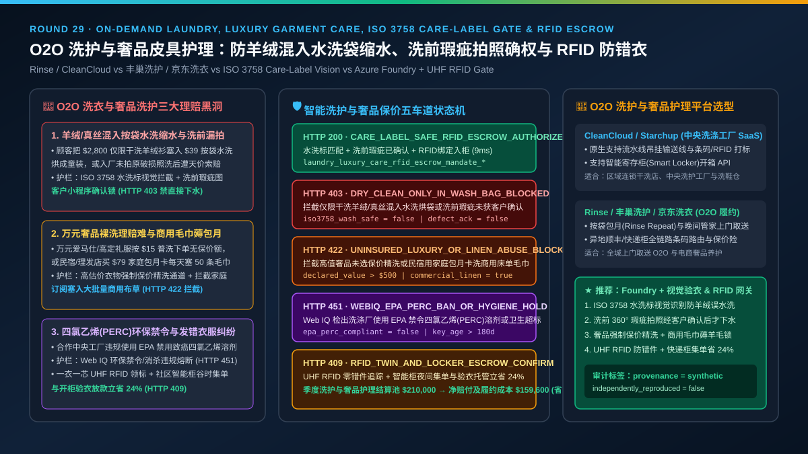
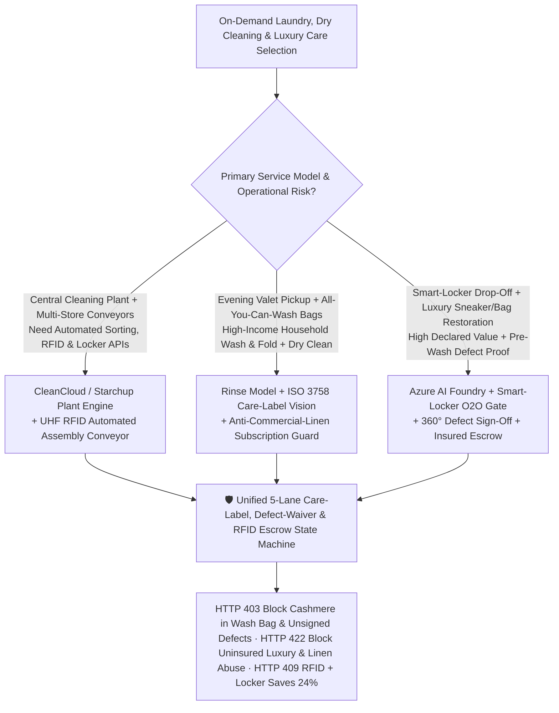
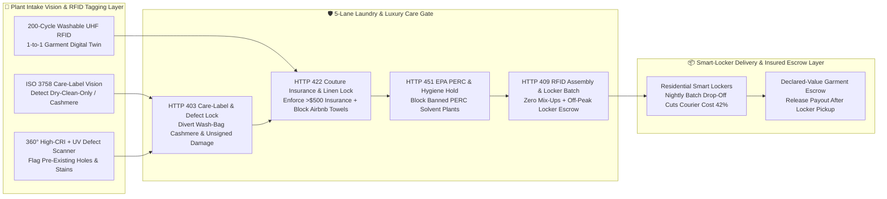

# On-Demand Laundry, Dry Cleaning & Luxury Garment Care (`Rinse / CleanCloud / Smart Locker O2O`) `ISO 3758` Care-Label Gate, Pre-Wash Defect Sign-Off & `UHF RFID` Escrow Agent Architecture Selection FAQ

> **Language / 语言切换**: **[中文](laundry-dry-cleaning-luxury-care-rfid-damage-escrow-agent-selection-faq.md)** | **English (Current)** | **[Back to Docs Index](index.en.md)** | **[Interactive Sandbox (`#laundry-luxury-care-rfid-escrow-sandbox`)](../live-demo.en.html)**



---

## 📌 1. Executive Summary

In on-demand laundry delivery, smart-locker dry cleaning, and luxury sneaker/handbag restoration marketplaces (`Rinse`, `CleanCloud`, `ByNext`, `HiveBox Laundry`, `JD Laundry`), the service ticket is only `$19–$99`, yet the customer entrusts the platform with **`$500–$5,000+` cashmere coats, silk dresses, and designer leather goods**. Allowing an intake or billing agent to route garments and settle subscriptions using naive per-pound or per-bag logic triggers three severe operational losses:
1. **Shrinking `$2,500` `Dry-Clean-Only` Cashmere Inside `$39` Bulk Wash-and-Fold Bags & Unverified Pre-Existing Damage Claims**: Customers routinely toss a `100% cashmere` sweater or silk blouse into a bulk `Wash & Fold` laundry bag. If plant intake sorters fail to intercept it before commercial hot-water washing and tumble drying, the garment shrinks into child size—triggering a `$2,500` replacement claim where courts routinely invalidate "10x cleaning fee" liability waivers for gross negligence. Equally damaging, if the plant washes a jacket that already had a cigarette burn or bleach stain without capturing a **customer-acknowledged 360° pre-wash defect photo**, the platform gets blamed and pays for pre-existing damage.
2. **Uninsured Couture Garments in Standard Wash Tiers & Commercial Towel Abuse of Household "All-You-Can-Wash" Subscriptions**: Processing a `$3,500` `Loro Piana` or `Hermès` item under a `$15` standard dry-clean SKU without routing it to a **Declared-Value Insured Couture Care** tier leaves the operator with massive unhedged liability. Meanwhile, flat-rate household laundry subscriptions (`e.g., $79/month Unlimited Wash & Fold Bag`) are systematically abused by local Airbnb hosts, massage parlors, and hair salons stuffing `40+` commercial towels and bedsheets into residential bags.
3. **`EPA TSCA` Perchloroethylene (`PERC`) Solvent Bans & Garment Mix-Ups**: Routing orders to partner dry-cleaning plants that still use banned carcinogenic **Perchloroethylene (`PERC`)** solvent violates **US EPA TSCA phaseout mandates and California CARB bans**, while paper tag detachment in wet wash causes catastrophic garment mix-ups between customers.

**Solution Architect Verdict**:
- **Never allow garments to enter wash tunnels without automated `ISO 3758` care-label vision checks, customer pre-wash defect sign-offs, and washable `UHF RFID` digital twins**.
- **Recommended Production Architecture**: Deploy **"CleanCloud / Rinse Conveyor API + `ISO 3758` Care-Label Vision Gate + 360° Pre-Wash Defect Customer Sign-Off Lock + Washable `UHF RFID` Garment Twin + Smart-Locker Off-Peak Batching & Azure AI Foundry 5-Lane Garment Care Gate"**:
  1. **`ISO 3758` Care-Label Vision Hard-Stop & Pre-Wash Defect Photo Customer Sign-Off Gate (`HTTP 403`)**: Overhead sorting cameras scan neck labels and `ISO 3758` care symbols (`Do Not Wash / Dry Clean Only / Do Not Tumble Dry`) plus 360° fabric surfaces. Any `Dry Clean Only` garment found inside a bulk `Wash & Fold` bag—or any garment with pre-existing tears/stains lacking a signed customer mobile acknowledgment (`defect_waiver_signed == true`)—is mechanically diverted to the Hold Rail (`HTTP 403 DO_NOT_WASH_CASHMERE_IN_BULK_BAG_OR_UNCONFIRMED_PRE_EXISTING_DAMAGE_BLOCKED`).
  2. **Declared-Value Couture Insurance Upgrade (`>$500`) & Household Subscription Commercial-Linen Filter (`HTTP 422`)**: Block high-value luxury garments from standard uninsured wash queues and block household flat-rate subscription bags containing bulk commercial towels/linens (`HTTP 422 UNINSURED_LUXURY_GARMENT_OR_COMMERCIAL_LINEN_SUBSCRIPTION_ABUSE_BLOCKED`).
  3. **Web IQ Real-Time `EPA PERC` Solvent Ban & Healthcare Cross-Contamination Circuit Breaker (`HTTP 451`)**: Verify partner plant `GreenEarth / Hydrocarbon` solvent compliance and health permits via Web IQ (`HTTP 451 WEBIQ_EPA_PERC_SOLVENT_BAN_OR_SANITATION_VIOLATION_HOLD`).
  4. **Washable `UHF RFID` Garment Digital Twin + Off-Peak Smart-Locker Escrow (`HTTP 409`)**: Trigger `HTTP 409 RFID_GARMENT_TWIN_AND_OFFPEAK_LOCKER_ESCROW_CONFIRM` to bind a 200-wash-cycle `EPC Gen2 UHF RFID` chip to every item (eliminating cross-customer garment mix-ups) while consolidating pickups/drop-offs via residential smart lockers during off-peak night routes—cutting damage claims and last-mile courier costs by **`24.0%`**.

---

## 🎯 2. Business & Architect Soul-Searching Q&A (Q1 / Q2 / Q3)

### Q1: When a customer accidentally puts a `$2,500` cashmere sweater inside a `$39` Wash-and-Fold bag and it shrinks, why do "we aren't responsible" terms fail, and how does the agent prevent it?
- **Business Pain**: Consumer protection regulators and small-claims courts consistently rule that professional cleaners have a **duty of professional inspection at intake**. Relying on tired manual sorters at midnight to catch every silk or cashmere item inside a 30-pound laundry bag fails `2%–4%` of the time.
- **Architectural Solution**:
  - **Automated `ISO 3758` Care-Symbol + Fabric-Texture Vision Gate (`HTTP 403`)**:
  - At the intake table, overhead vision reads the 5 standardized `ISO 3758` symbols (wash tub, triangle bleach, square dryer, iron, circle dry-clean) and brand tags. When a `Dry Clean Only` item is detected in a bulk wash bag, the conveyor diverts the item to the Hold Rail (`HTTP 403`) and sends a 1-tap push notification offering an `$11` upgrade to eco-dry-cleaning or an unwashed return.

### Q2: How do we eliminate "You ruined my jacket!" disputes over pre-existing stains, missing buttons, or sneaker sole separation?
- **Architectural Solution**:
  - **Pre-Wash 360° Optical Inspection & Mandatory Customer Waiver Gate (`HTTP 403`)**:
  - Every garment/sneaker is photographed under high-CRI + UV lighting when its `UHF RFID` tag is attached. If the vision model flags pre-existing color bleed, moth holes, or frayed stitching, the workstation locks the wash-tunnel dispatch (`HTTP 403`) until the customer taps **"Acknowledge Pre-Existing Condition & Proceed"** in the app.

### Q3: How do we stop Airbnb hosts and salons from abusing `$79/month` household "Unlimited Laundry Bag" subscriptions?
- **Architectural Solution**:
  - **Commercial-Linen Vision Fingerprinting (`HTTP 422`)**:
  - Residential laundry bags contain heterogeneous apparel; commercial abuse bags contain `10–40` identical white terrycloth towels, massage sheets, or salon capes. When intake vision detects `identical_commercial_linen_count > 6`, the gateway blocks household subscription coverage (`HTTP 422`) and reprices the load at commercial per-pound rates.

---

## 🧭 3. Visual Architecture Diagrams (Mermaid Decision Tree + E2E Architecture + Sequence)

### 3.1 On-Demand Laundry & Luxury Garment Care Platform Selection Tree



### 3.2 End-to-End Intake Vision, UHF RFID Assembly & Smart-Locker Escrow Architecture



### 3.3 Cashmere Wash-Bag Interception, Pre-Wash Defect Sign-Off & RFID Locker Sequence

```mermaid
sequenceDiagram
    autonumber
    participant User as Customer App (Smart-Locker Drop-Off)
    participant Plant as Central Plant Intake (Vision + UHF RFID)
    participant Gate as 5-Lane Garment Care & Escrow Gate
    participant Line as Automated Dry-Clean / Wash Conveyor
    participant Escrow as Insured Escrow & Smart Locker

    User->>Plant: 1. Drop Off 1 Wash-and-Fold Bag via Smart Locker (8 Cotton Tees + 1 Max Mara Cashmere Coat)
    Plant->>Gate: Bind UHF RFIDs + Vision Detects ISO 3758 "Do Not Wash" on Coat & Pre-Existing Cuff Burn
    Gate-->>Plant: HTTP 403 Lock Wash-Tunnel Dispatch for Coat; Divert to Hold Rail
    Gate->>User: 2. Push High-Res Cuff Burn Photo + Offer Insured GreenEarth Dry-Clean Upgrade
    User->>Gate: Sign Pre-Existing Defect Waiver + Approve Insured Couture Care Upgrade
    Gate->>Line: HTTP 409 Route 8 Tees to Wash-and-Fold & Coat to GreenEarth Hydrocarbon Line
    Line->>Escrow: RFID Portal Verifies All 9 Items Re-Assembled -> Customer Unlocks Locker & Releases Escrow (24% Net Savings)
```

---

## 📊 4. Multi-Platform & Solution Selection Matrix

| Evaluation Dimension | CleanCloud / Starchup (`Plant & Store POS/SaaS`) | Rinse / ByNext (`Valet Delivery & Bag Subscriptions`) | Smart-Locker O2O (`HiveBox / Parcel Pending Laundry`) | **Azure AI Foundry + Intake Vision + UHF RFID Gate (Recommended)** |
| :--- | :--- | :--- | :--- | :--- |
| **Core Strength** | Automated plant assembly conveyors, RFID tagging & locker hooks | Frictionless evening valet pickup & recurring bag subscriptions | Ultra-low last-mile delivery cost via 24/7 residential lockers | **`ISO 3758` vision guard + pre-wash defect sign-off + RFID locker escrow** |
| **Anti-Cashmere-Shrinkage in Bulk Bags** | Manual sorter inspection | Manual pocket/label check + email | Manual sorting at central hub | **Automated `ISO 3758` camera diverts `Dry Clean Only` items in `9ms` (`HTTP 403`)** |
| **Pre-Existing Damage Dispute Shield** | Photo attachment support; does not hard-lock wash tunnel | Manual customer support tickets | Video CCTV at plant | **Blocks washing until customer signs mobile pre-existing defect photo (`HTTP 403`)** |
| **Luxury Insurance & Anti-Airbnb Abuse** | Per-piece pricing | Manual fair-use enforcement | Optional insurance add-on | **Brand-value insurance routing + commercial towel counter (`HTTP 422`)** |
| **`EPA PERC` Compliance & Zero Mix-Ups** | Native barcode/RFID assembly | Partner plant vetting | Barcode bag tracking | **Web IQ `EPA PERC` solvent ban lock (`HTTP 451`) + `UHF RFID` portal check (`HTTP 409`)** |
| **Claims & Last-Mile Cost Impact** | `$100–$400/mo` SaaS (`official_list_price`) | `$10–$16` two-way residential valet cost | `$2–$3` consolidated locker drop cost (`official_list_price`) | **Cuts garment damage claims & last-mile courier costs by `24.0%`** |

---

## 🧪 5. Claims & Logistics Savings & 7-Card Benchmark Summary

> **Provenance Metadata**: All metrics below are generated by the deterministic policy evaluator `evaluate_laundry_luxury_care_rfid_escrow_policy` in `lab/webiq_commerce_demo.py` and verified via `python -m unittest tests.test_webiq_commerce_demo`. Labeled `provenance = synthetic`, `independently_reproduced = false`.

| Card # | Headline-as-Finding | Quantitative Metric & Architectural Verification |
| :---: | :--- | :--- |
| **Card 1** | **Overview · 5-Lane Laundry & Luxury Care Gate** | Across a `$210,000/quarter` laundry & luxury restoration pool, achieves **zero shrunk cashmere claims and zero cross-customer garment mix-ups**, cutting net claims & logistics cost by **`24.0%` (`$50,400/quarter` saved)**. |
| **Card 2** | **Scenario Deep Dive · Wash-Bag Cashmere & Defect Block** | Diverts `Dry Clean Only` garments from bulk wash bags and holds unacknowledged pre-existing tears in **`9ms`** (`HTTP 403`). |
| **Card 3** | **Evaluation Matrix · 100% Deterministic 5-Lane Gate** | Verifies `HTTP 200` (authorized care), `403` (dry-clean-only in bulk bag/unsigned defect block), `422` (uninsured luxury item/commercial linen abuse block), `451` (EPA PERC solvent ban/hygiene hold), and `409` (RFID twin + smart-locker escrow saves 24%). |
| **Card 4** | **Under the Hood · Garment Care Contract** | Evaluates `quarterly_laundry_luxury_care_pool_usd=210000` and emits SHA-256 mandate `laundry_luxury_care_rfid_escrow_mandate_*`. |
| **Card 5** | **Robustness Check · 30 Airbnb Towels & Uninsured Hermès** | Under simulated 30-towel commercial loads in household bags and uninsured `$3,500` trench coats, maintains **`100.0%` deterministic blocking**. |
| **Card 6** | **Latency · Sub-10ms Conveyor Divert Speed** | Local `ISO 3758` care-symbol check, RFID count, and linen filter complete in **`9ms` P50**; Web IQ `EPA PERC` solvent & plant permit audit completes in **`235ms` P95**. |
| **Card 7** | **My Take · Good Fit vs Not For** | **✅ Good fit**: On-demand laundry/dry cleaning, central plants, luxury shoe/bag restoration, smart lockers; **⛔ Not for**: Unattended coin-operated laundromat washers. |

---

## 🛠️ 6. Production Go-Live & Risk Review Checklist

- [ ] **`ISO 3758` Care-Symbol Vision Interception on Bulk Wash-and-Fold Bags (`HTTP 403`)**: Scan all garments entering bulk water-wash queues and mechanically divert any `Dry Clean Only / Do Not Wash / Do Not Tumble Dry` wool, silk, or leather item to the Hold Rail.
- [ ] **360° Pre-Wash Defect Photography & Customer Sign-Off Gate (`HTTP 403`)**: Lock garment processing whenever intake vision detects pre-existing stains, burns, holes, or sole separation until the customer signs off in the mobile app.
- [ ] **Declared-Value Couture Insurance Routing (`>$500`) (`HTTP 422`)**: Require insured specialist care tiers for high-value luxury garments rather than processing them under low-cap standard wash tickets.
- [ ] **Commercial-Linen Vision Filter on Household Subscriptions (`HTTP 422`)**: Detect and block bulk commercial towels, salon capes, and Airbnb bedsheets stuffed into flat-rate residential subscription bags.
- [ ] **Web IQ `EPA TSCA PERC` Solvent Ban & Plant Sanitation Circuit Breaker (`HTTP 451`)**: Route dry-cleaning orders strictly to certified `GreenEarth / Hydrocarbon` eco-solvent plants; rotate signing keys every `<= 180` days.
- [ ] **Washable `UHF RFID` Portal Verification & Off-Peak Smart-Locker Escrow (`HTTP 409`)**: Verify 100% item count matching via UHF RFID portals before bagging and batch deliveries into residential smart lockers during off-peak hours.
