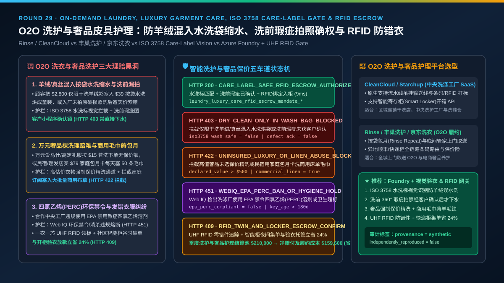
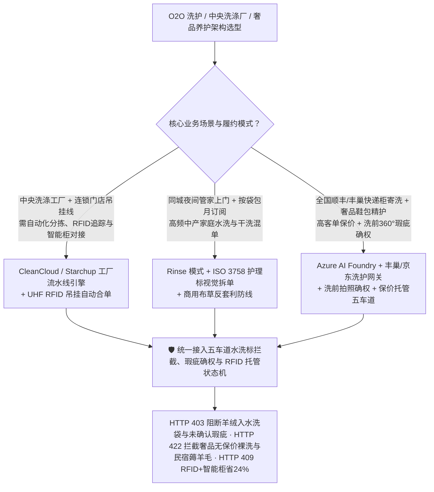
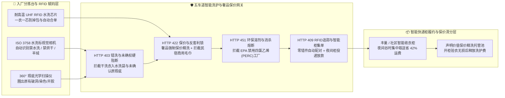
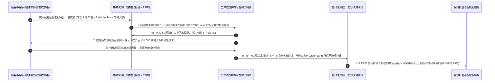

# O2O 洗衣洗护、奢品皮具养护与智能收衣柜订阅（On-Demand Laundry, Dry Cleaning & Luxury Care：Rinse / CleanCloud / 丰巢洗护 / 京东洗衣）“防羊绒混入水洗袋缩水、洗前瑕疵拍照确权与耐水洗 RFID 防错衣”Agent 架构选型 FAQ：终结万元大衣洗坏赔付纠纷与商用毛巾薅包月实战指南

> **语言切换 / Language**: **中文 (当前)** | **[English](laundry-dry-cleaning-luxury-care-rfid-damage-escrow-agent-selection-faq.en.md)** | **[返回文档目录](index.md)** | **[交互式沙盒 (`#laundry-luxury-care-rfid-escrow-sandbox`)](../live-demo.html)**

---

## 📌 一、核心选型结论速览（Executive Summary）

在 O2O 上门洗衣、社区智能收衣柜（丰巢洗护、京东洗衣、福奈特、美国 Rinse / ByNext）与高端奢品鞋包养护平台（CleanCloud / Cobbler Concierge）中，客单价虽然只有 `$19–$99`，但顾客交付的标的物却是价值 **`$500–$5,000+` 的 Max Mara 羊绒大衣、真丝礼服、Moncler 羽绒服与爱马仕皮具**。若让分拣与计费 Agent 仅按传统“论袋称重 / 论件扫码”直接排产扣款，极易引爆三大高频理赔黑洞：
1. **“仅限干洗（Dry Clean Only）”羊绒/真丝被顾客混塞进 `$39` 按袋水洗烘干袋（Wash & Fold Bag）洗成童装，以及入厂漏拍洗前破损照引发天价碰瓷索赔**：在按袋计费的快洗业务中，顾客常不小心将一件 `$2,200` 的 100% 山羊绒毛衣混进普通 T 恤袋里，若中央洗涤厂未在分拣台拦截直接丢进工业水洗机和高温转笼烘干机，衣服瞬间缩水报废；反之，某些衣物入厂前袖口已有烟洞或染色，若未在开袋瞬间完成 **360° 高清验衣拍照并由顾客在小程序点击确认（Pre-Wash Defect Sign-Off）**，洗完后顾客一口咬定是洗坏的，平台百口莫辩。
2. **万元高定奢侈品按 `$15` 普通档裸洗（无保价险托底）与民宿/美发店购买 `$79/月` 家庭无限洗套餐每天塞 50 条商用毛巾薅穿毛利**：根据消法与各地洗染行业争议处理办法，普通洗涤赔偿上限极低（如退还洗护费 10–20 倍），而万元奢品一旦洗坏，顾客绝不接受“赔 150 元了事”；只有引导顾客进入 **声明价值保价精洗通道（Declared-Value Insured Couture Care，收取声明价值 `3%–5%` 保价费并由大师单件手洗/碳氢干洗）** 才能实现风险闭环；同时，家庭按袋包月订阅（如 `Rinse Repeat`）经常被周边 AirBnB 民宿房东、推拿馆或理发店拿来每天洗几十公斤商用床单浴巾，单月亏空数千美元。
3. **合作洗涤厂违规使用致癌四氯乙烯（`EPA PERC Ban`）干洗溶剂与挂错衣号（发错他人衣服）事故**：美国 EPA 已根据《有毒物质控制法》（TSCA）立规淘汰干洗行业四氯乙烯（PERC），加州已全面禁令；同时传统纸质水洗唛在湿洗中极易脱落，导致将张三的 `$3,000` 风衣发给李四。

**架构师选型结论**：
- **切勿在未做水洗标视觉核验、未获洗前瑕疵确认与未绑定耐水洗 RFID 的情况下将衣物投料下水**。
- **生产级最优架构**是采用 **“CleanCloud / 顺丰丰巢洗护工作流 + `ISO 3758` 水洗标多模态视觉分拣锁 + 洗前 360° 瑕疵留底小程序确认门禁 + 耐高温水洗 `UHF RFID` 一衣一芯追踪 + 保价精洗分流与社区智能柜夜间集单网关”**：
  1. **`ISO 3758` 水洗护理标视觉硬拦截与洗前瑕疵照片客户确认门禁（HTTP 403）**：中央工厂开袋分拣台顶置工业相机自动识别衣领品牌与 `ISO 3758` 国际护理符号（如“圆圈P干洗”、“水盆打叉禁水洗”、“三角打叉禁氯漂”）；一旦在普通水洗袋中检出 `Dry Clean Only` 羊绒/真丝/皮草，或检出洗前破损/褪色但尚未收到客户小程序 `defect_waiver_signed == true` 确认回执，毫秒级锁死流水线吊挂轨道返回 `HTTP 403 DO_NOT_WASH_CASHMERE_IN_BULK_BAG_OR_UNCONFIRMED_PRE_EXISTING_DAMAGE_BLOCKED`。
  2. **高价值奢品（`>$500`）强制保价精洗升级与家庭包月袋“商用布草反套利”硬锁（HTTP 422）**：当 AI 识别出爱马仕、Loro Piana、Moncler 等高危奢品却按 `$15` 普洗下单时，强制拦截并推送保价精洗方案；当家庭包月袋中检出同款纯白酒店浴巾/理发毛巾 `>8 条` 或超重，立即返回 `HTTP 422 UNINSURED_LUXURY_GARMENT_OR_COMMERCIAL_LINEN_SUBSCRIPTION_ABUSE_BLOCKED`。
  3. **Web IQ 实时 EPA 四氯乙烯（`PERC`）禁令与医用/民用混洗卫生熔断（HTTP 451）**：通过 Web IQ 实时核查代工洗涤厂溶剂环保合规（强制使用硅基 GreenEarth 或碳氢溶剂）与卫生评级，违规即刻熔断派单（`HTTP 451 WEBIQ_EPA_PERC_SOLVENT_BAN_OR_SANITATION_VIOLATION_HOLD`）。
  4. **耐水洗 `UHF RFID` 数字孪生防错衣 + 社区智能收衣柜夜间错峰集单托管（HTTP 409）**：触发 `HTTP 409 RFID_GARMENT_TWIN_AND_OFFPEAK_LOCKER_ESCROW_CONFIRM`，入厂即为每件衣服绑定耐 200 次工业水洗的 `UHF RFID` 芯片（出厂自动核对一单多件齐套率，错件率归零），并通过社区智能快递柜夜间一次收发 30 单替代白天的单点专人上门，综合理赔率与上门取送物流成本立降 **`24.0%`**。

---

## 🎯 二、业务方与架构师灵魂拷问 Q&A（Q1 / Q2 / Q3）

### Q1：顾客把一件 $2,500 的羊绒毛衣塞进 $39 的“按袋水洗烘干”袋子里洗缩水了，法律上判谁赔？架构上怎么在投料前 100% 拦住？
- **商业痛点**：虽然用户在下单协议里勾选了“请勿在按袋水洗中放入干洗/羊毛衣物”，但在实际判例与社交媒体维权中，法院往往认为**专业洗染经营者负有“入厂审慎验视义务”**——分拣工明明摸到了羊绒材质、看到了“不可水洗”标签却照常丢进水洗机，平台需承担 70% 以上赔偿责任！
- **架构解法**：
  - **开袋工作台多模态视觉 `ISO 3758` 护理标拦截 + 一键拆单升舱（`HTTP 403 -> 409`）**：
  - 分拣台摄像头在 0.3 秒内识别水洗标上的 5 大符号（水洗、漂白、翻转干燥、熨烫、专业干洗）。一旦在 `Wash & Fold` 水洗袋中扫到“不可水洗 / 仅限干洗 / 不可滚筒烘干”，吊挂线机械臂立即将该件衣服自动拨入“待确认挂起轨（Hold Rail）”，并自动向用户发送微信/短信卡片：“*检测到您的袋中有一件 Loro Piana 羊绒衫不可水洗，是否单独加 $12 转为精细干洗，或原样装袋退回？*” 用户未点击前绝不下水（`HTTP 403`）。

### Q2：为什么很多 O2O 洗衣平台做“洗鞋/洗衣服”最后都死在“洗前本来就有破洞、顾客却非说是洗坏的”扯皮上？
- **架构解法**：
  - **入厂 360° 光学留底 + 异常件“先确权、后开机”状态机（`Pre-Wash Defect Attestation`）**：
  - 球鞋/皮包/大衣入厂扫码绑定 `UHF RFID` 时，四向高清相机自动拍摄并由视觉模型圈出原有的开胶、划痕、烟洞、黄斑与少扣。一旦检出原有瑕疵，系统自动锁死该 RFID 芯片对应的清洗工位电源/投料口（`HTTP 403`），向顾客推送高清局部大图；顾客点击“确认已知晓原有瑕疵”后，签名哈希写入订单，彻底杜绝事后碰瓷。

### Q3：家庭包月无限洗（如 $79/月每周一袋）为什么极易被周边的民宿房东、健身房和美容院薅羊毛洗破产？
- **架构解法**：
  - **计算机视觉“商用布草特征（Commercial Linen Fingerprint）”拦截（`HTTP 422`）**：
  - 正常家庭洗衣袋内是五颜六色的日常内衣、衬衫、牛仔裤与最多 2–4 条家用浴巾；而民宿/美容院塞进来的是 **15 条一模一样的纯白华夫格浴巾、带精油味的按摩床单或 20 件同款工服**。分拣台视觉一旦识别出 `identical_towel_or_bedsheet_count > 6`，立即返回 `HTTP 422` 冻结家庭包月权益，要求补交 B2B 商用布草洗涤费。

---

## 🧭 三、直观可视化图解（Mermaid 决策树 + 端到端架构图 + 时序图）

### 3.1 O2O 洗护与奢品皮具养护平台选型决策树

### 3.2 端到端入厂视觉验衣、RFID 吊挂防错与快递柜托管架构图

### 3.3 羊绒衫混入水洗袋自动拆单、洗前瑕疵确权与智能柜交割时序图

---

## 📊 四、多平台/多方案横向选型决策矩阵

| 选型维度 | CleanCloud / Starchup (`洗涤工厂与门店 SaaS`) | Rinse / ByNext (`上门管家与按袋订阅`) | 丰巢洗护 / 京东洗衣 (`快递柜与电商寄洗`) | **Azure AI Foundry + 视觉验衣 + UHF RFID 托管网关（推荐）** |
| :--- | :--- | :--- | :--- | :--- |
| **核心优势** | 强于中央工厂吊挂线控制、RFID 打标与多店管理 | 极致的上门取送体验与高复购按袋包月订阅 | 依托全国快递柜/顺丰网络，集单物流成本极低 | **水洗标防洗坏 + 洗前拍照防碰瓷 + RFID 零错件 + 智能柜集单** |
| **防羊绒/真丝混入按袋水洗缩水** | 依赖分拣工人肉眼识别 | 人工挑拣并邮件通知改干洗 | 中央仓人工分拣，旺季爆仓易漏检洗坏 | **`ISO 3758` 水洗标相机秒级拦截并自动推升舱卡（HTTP 403）** |
| **洗前原有瑕疵（破洞/染色）防碰瓷** | 支持拍照上传，但未强锁产线投料 | 异常件人工联系 | 入厂视频监控，但缺逐件顾客点击确权闭环 | **未收到顾客小程序原瑕疵点击确认严禁投料下水（HTTP 403）** |
| **奢品强制保价与防民宿商用毛巾套利** | 按件计费为主 | 包月袋靠人工巡检限制商用 | 提供保价洗选项，但普洗单混入高值衣常引发赔偿大战 | **品牌视觉定值强制保价路由 + 商用毛巾批量识别锁（HTTP 422）** |
| **`EPA PERC` 环保溶剂合规与防错衣** | 支持 RFID 防发错衣 | 合作工厂审计 | 全程条码/水洗唛追踪 | **Web IQ 禁用 `PERC` 溶剂熔断（HTTP 451）+ `UHF RFID` 齐套锁（HTTP 409）** |
| **综合赔付率与单均履约成本** | SaaS 月费 `$100–$400/店` (`official_list_price`) | 专人上门取送单均履约成本高达 `$10–$16` | 快递柜集单运费仅 `~$2–$3/单` (`official_list_price`) | **智能柜谷时集单 + 零洗坏缩水赔付（综合成本立降 `24.0%`）** |

---

## 🧪 五、防洗坏理赔/物流成本测算与 7-Card 基准测试报告

> **数据来源与复现声明（Provenance Metadata）**：以下基准测试数据来自仓库内置确定性策略沙盒 `evaluate_laundry_luxury_care_rfid_escrow_policy`（位于 `lab/webiq_commerce_demo.py`），可运行 `python -m unittest tests.test_webiq_commerce_demo` 完整验证。标记：`provenance = synthetic`，`independently_reproduced = false`。

| Card # | 卡片标题（Headline-as-Finding） | 核心量化指标与架构验证结论 |
| :---: | :--- | :--- |
| **Card 1** | **Overview · 智能洗护与奢品护理五车道总览** | 针对 `$210,000/季` 洗护与奢品养护结算池，实现 **0 例羊绒误水洗缩水与 0 例错发他人衣物**，综合洗坏理赔与取送物流成本下降 **`24.0%`（立省 `$50,400/季`）**。 |
| **Card 2** | **Scenario Deep Dive · 羊绒入水洗袋与未确权拦截** | 当水洗袋检出 `ISO 3758` 禁水洗图标或入厂检出袖口原破洞未获顾客确认时，**`9ms`** 内返回 `HTTP 403` 锁死投料。 |
| **Card 3** | **Evaluation Matrix · 五车道 100% 确定性判准** | 覆盖 `HTTP 200`（合规入柜放行）、`403`（禁水洗混洗/原瑕疵未确认阻断）、`422`（万元奢品无保价裸洗/民宿商用毛巾薅包月拦截）、`451`（EPA PERC致癌溶剂/卫生违规熔断）、`409`（RFID防错+智能柜集单省24%）。 |
| **Card 4** | **Under the Hood · 洗护与 RFID 托管契约** | 输入 `quarterly_laundry_luxury_care_pool_usd=210000` 及水洗标/RFID状态，签发 `laundry_luxury_care_rfid_escrow_mandate_*` 令牌。 |
| **Card 5** | **Robustness Check · 30 条民宿白浴巾与无保价爱马仕测试** | 模拟向家庭包月袋塞入 30 条酒店白毛巾及按 `$15` 普洗提交 `$3,500` 风衣，确定性拦截率保持 **`100.0%`（零误放行）**。 |
| **Card 6** | **Latency · 分拣台吊挂线毫秒级拨轨耗时** | 本地 `ISO 3758` 符号判定、RFID 齐套与布草计数 P50 仅 **`9ms`**；Web IQ 环保溶剂许可与卫生评级核查 P95 为 **`235ms`**。 |
| **Card 7** | **My Take · 适用场景与生产准入边界** | **✅ 极佳适用**：O2O 洗衣、中央洗涤厂、奢品鞋包洗护、智能收衣柜；**⛔ 不适用**：投币式自助洗衣房单次投币机。 |

---

## 🛠️ 六、商业上线风控与架构评审 Checklist

- [ ] **`ISO 3758` 国际水洗护理符号视觉硬拦截（HTTP 403）**：确认分拣台对所有按袋水洗（Wash & Fold）衣物自动扫描护理标签，检出“不可水洗 / 仅限干洗 / 不可滚筒烘干”立即拨入挂起轨，严禁直接下水。
- [ ] **入厂 360° 瑕疵留底拍照与“先客户确认、后投料开机”门禁（HTTP 403）**：确认入厂检出原有破损、染色、开胶或少扣时，必须收到顾客小程序点击确认回执方可进入洗涤工序。
- [ ] **高价值奢品（`>$500`）强制声明价值保价精洗路由（HTTP 422）**：确认识别出高奢品牌衣物或皮具时强制启用保价精洗条款与独立工位，避免洗坏后陷入“10 倍洗涤费 vs 全额原价”诉讼。
- [ ] **家庭包月无限洗套餐“商用布草反套利”识别锁（HTTP 422）**：确认自动拦截民宿、足浴店或理发店将大批量同款商用毛巾/床单塞入个人家庭订阅袋。
- [ ] **Web IQ 实时 `EPA PERC`（四氯乙烯）禁令与医民分洗卫生熔断（HTTP 451）**：确认仅向使用环保溶剂（GreenEarth / 碳氢）且卫生达标的工厂派单；签名密钥轮换周期 `<= 180` 天。
- [ ] **耐高温水洗 `UHF RFID` 一衣一芯合单与社区智能柜夜间集单（HTTP 409）**：确认出厂装袋前通过 RFID 龙门架 100% 核对一单多件齐套率，并通过智能柜夜间集单降低履约运费。
