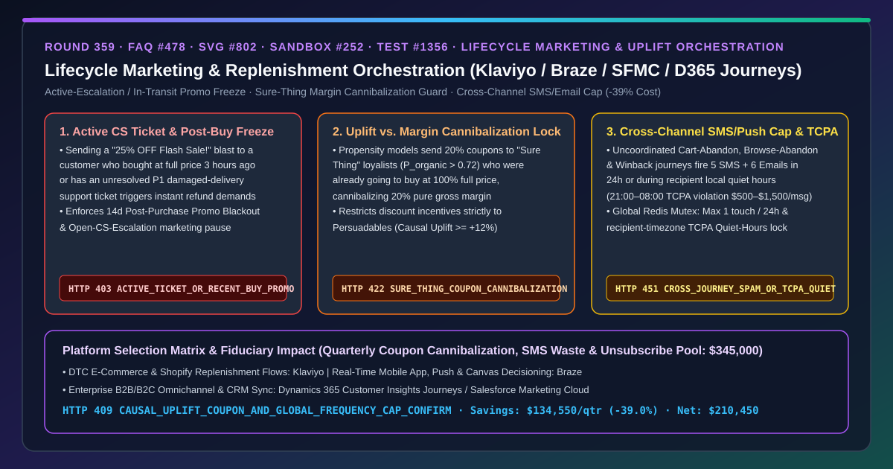
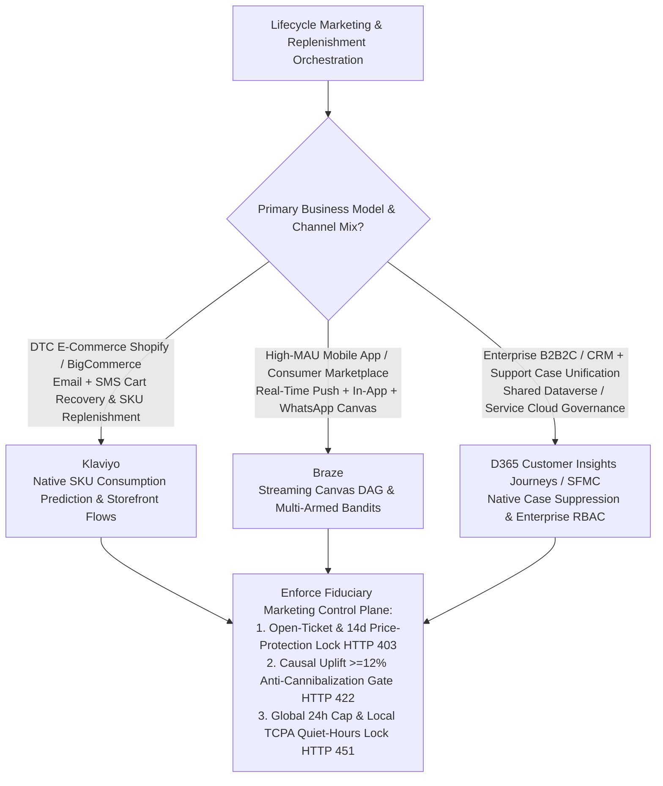
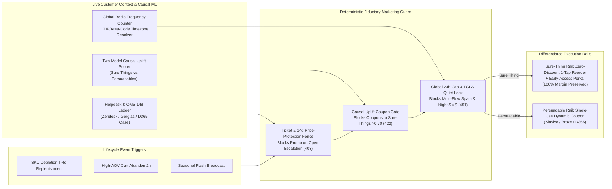
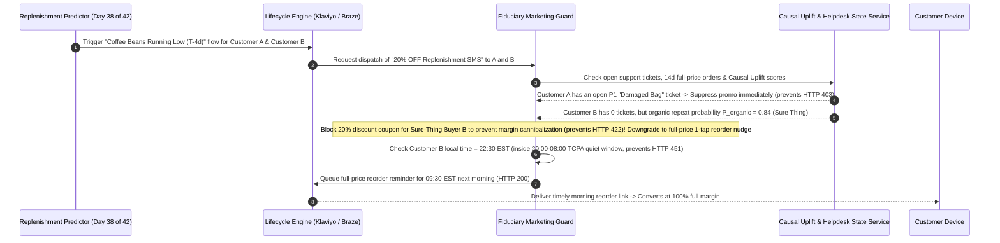

# Retail & SaaS Lifecycle Marketing, Replenishment & Causal Uplift Orchestration (`Klaviyo / Braze / Salesforce Marketing Cloud / D365 Customer Insights Journeys`) Architecture & Selection FAQ: Open-Ticket & 14-Day Price-Protection Suppression, Anti-Cannibalization Uplift Gating & `TCPA` Quiet-Hours Mutex (`-39%` Margin & SMS Loss)

> **Document Type**: Enterprise AI Solution Architect Selection FAQ (`#478` · Round 359)  
> **Target Audience**: VP of Growth / CRM, Lifecycle Marketing Architects, Omnichannel Retention Directors, and Cloud & AI Solution Architects  
> **Platforms Covered**: `Klaviyo` vs. `Braze` vs. `Microsoft Dynamics 365 Customer Insights - Journeys` vs. `Salesforce Marketing Cloud (SFMC)`  
> **Architecture Diagram**: [`assets/svg/802-lifecycle-marketing-klaviyo-braze-sfmc-uplift-suppression-2026-11-25.svg`](../assets/svg/802-lifecycle-marketing-klaviyo-braze-sfmc-uplift-suppression-2026-11-25.svg)

🌐 **Language / 语言切换**: **[中文 (`lifecycle-marketing-replenishment-klaviyo-braze-sfmc-d365-frequency-cap-uplift-selection-faq.md`)](lifecycle-marketing-replenishment-klaviyo-braze-sfmc-d365-frequency-cap-uplift-selection-faq.md)** | **English (Current)**

---

## 📌 1. Executive Summary

In DTC retail, consumable replenishment (coffee, skincare, pet food, supplements), and subscription SaaS, **AI Lifecycle Marketing & Replenishment Agents** drive repeat purchase velocity and Customer Lifetime Value (`LTV`).  
However, letting uncoordinated marketing flows (Cart Abandonment, Browse Abandonment, Replenishment Reminders, Flash-Sale Broadcasts) fire autonomously without **support-ticket/post-purchase suppression, Causal Uplift coupon gating, and cross-journey `TCPA` frequency locks** causes three severe margin leaks:
1. **Blasting `"25% OFF!"` Promotions to Customers Who Bought at Full Price 3 Hours Ago or Have an Open P1 Support Escalation (`Post-Purchase & Open-Ticket Collision`)**: Messaging a customer with a discount on the exact SKU they just bought at full price within the 14-day price-protection window immediately triggers a price-adjustment refund claim—while sending promotional hype to a customer with an unresolved damaged-shipment ticket triggers rage-churn.
2. **Confusing Conversion Propensity with Causal Uplift—Giving `20%` Coupons to "Sure Thing" Loyalists (`Margin Cannibalization`)**: Standard propensity models score loyal repeat buyers at `P_buy = 0.85` and hand them a `20%` coupon to claim "attributed revenue"—giving away `20%` pure gross margin on orders that would have converted organically at `100%` full price.
3. **Uncoordinated Multi-Journey SMS Spam & Local Timezone `TCPA` Quiet-Hours Violations (`$500–$1,500/SMS Statutory Liability`)**: A shopper who triggers Browse Abandon, Cart Abandon, and VIP Broadcast flows simultaneously receives 5 SMS messages in 24 hours—or receives a marketing text at 11:30 PM local time, violating US federal `TCPA` and state (`FTSA / OTSA`) quiet-hours laws (`20:00–08:00` local time).

| Decision Dimension | Recommended Primary Choice | Architectural Boundary & Production Rule |
|---|---|---|
| **DTC Storefronts (`Shopify / BigCommerce`) & SKU Replenishment Flows** | **Klaviyo** | Native SKU-level consumption-interval prediction and rapid cart/browse recovery flows with deep Shopify line-item sync. |
| **High-Frequency Mobile Apps, Streaming Canvas State Machines & Bandits** | **Braze** | Best for multi-million MAU mobile apps, QSR/travel, and real-time multi-channel (`Push / In-App / WhatsApp / Email`) journey experimentation. |
| **Enterprise CRM + Support Case Unified B2B/B2C Journeys** | **Dynamics 365 Customer Insights - Journeys / Salesforce Marketing Cloud** | Shares the exact same underlying Dataverse / CRM data model as support cases and sales opportunities for zero-lag escalation suppression. |
| **Three Mandatory Fiduciary Guardrails** | **100% Deterministic Gating** | ① **Open-Ticket & `14d` Full-Price Buyer Promo Suppression (`HTTP 403`)**: Blocks promotional discounts to customers with open P1/P2 CS tickets or full-price purchases of the same SKU within `<= 14 days`; ② **Causal Uplift (`>= +12%`) Coupon Lock (`HTTP 422`)**: Blocks discount coupons for high-organic-propensity `"Sure Things"` (`P_organic > 0.70`), reserving discounts strictly for `"Persuadables"`; ③ **Global `24h` Frequency Mutex & Local `TCPA` Quiet-Hours Lock (`HTTP 451`)**: Enforces `<= 1 marketing touch / 24h` and blocks SMS during `20:00–08:00` recipient local time. |

---

## 🎯 2. Architect & Business Stakeholder Q&A (Q1–Q3)

### Q1: Why does our lifecycle marketing dashboard claim "15x ROAS on AI coupon flows" while finance reports a 600 bps drop in net gross margin?
- **The Propensity vs. Causal Uplift Fallacy**:
  - Customers fall into four causal treatment quadrants:
    1. **Sure Things (`P_organic > 0.70`)**: Buy at `80%` probability without a coupon and `83%` with a `20%` coupon (`Causal Uplift = +3%`, **net margin impact = `-17%` pure cannibalization**);
    2. **Persuadables (`Causal Uplift >= +12%`)**: Buy at `14%` without a coupon and `41%` with a `15%` coupon (**true incremental profit positive**);
    3. **Lost Causes**: Do not convert regardless of discount;
    4. **Sleeping Dogs**: Unsubscribe when nudged.
- **Architectural Solution**: Enforce a **Two-Model Causal Uplift Profit Gate (`HTTP 422` Guard)**:
  - Evaluate expected incremental gross profit:
    $$\Delta \text{Gross\_Profit} = P_{\text{treated}} \cdot (\text{Margin} - \text{Coupon}) - P_{\text{organic}} \cdot \text{Margin} > 0$$
  - Block discount code minting whenever `P_organic > 0.70` or `Causal_Uplift < 0.12` (`HTTP 422 SURE_THING_ORGANIC_BUYER_COUPON_MARGIN_CANNIBALIZATION`), routing `"Sure Things"` to zero-discount replenishment reminders or loyalty experiential perks.

### Q2: How do we stop marketing flows from texting a `"25% OFF"` coupon to a shopper who just paid full price yesterday or is currently fighting a lost-package support ticket?
- **The Data Silo Gap**: Marketing automation tools often trigger off web events without checking live OMS price-protection windows or helpdesk (`Zendesk / Gorgias / D365 Case`) sentiment state.
- **Architectural Solution**: Deploy a **Real-Time OMS & Helpdesk Pre-Send Suppression Gate (`HTTP 403` Guard)**:
  - Query live customer state prior to dispatch: if `open_high_severity_ticket_count > 0` or `days_since_full_price_sku_purchase <= 14`, suppress markdown promotions on that SKU (`HTTP 403 ACTIVE_CS_TICKET_OR_RECENT_FULL_PRICE_BUYER_PROMO_COLLISION`) and substitute educational onboarding or cross-category complementary content.

### Q3: When 15 automated lifecycle journeys run concurrently, how do we prevent a user from getting hit with 4 texts in one day or receiving an SMS at 11 PM local time (`TCPA` violation)?
- **Statutory Exposure**: Under the US Telephone Consumer Protection Act (`TCPA`) and state mini-TCPA statutes (`Florida FTSA`, `Oklahoma OTSA`), sending marketing SMS messages outside `08:00–20:00` in the **recipient's local timezone** (or exceeding daily caps) carries statutory damages of **`$500–$1,500 per text message`**.
- **Architectural Solution**: Enforce a **Global Redis Cross-Journey Frequency Mutex & Recipient-Timezone `TCPA` Gate (`HTTP 451` Guard)**:
  - All journeys must acquire a global per-customer Redis token (`max 1 marketing touch per 24h`, `max 2 SMS per 7 days`) ranked by priority (`Replenishment > Cart Abandon > Browse Abandon > Broadcast`).
  - Resolve the recipient's local timezone from `Shipping_ZIP + Phone_Area_Code` and block/defer any promotional dispatch between `20:00` and `08:00` local time (`HTTP 451 CROSS_JOURNEY_FREQUENCY_OVERFLOW_OR_TCPA_QUIET_HOURS_BREACH`).

---

## 🧭 3. Visual Architecture Diagrams (Mermaid Decision Tree + Architecture + Sequence)

### 3.1 Lifecycle Marketing & Replenishment Platform Selection Tree

### 3.2 End-to-End Causal Uplift Gating & Cross-Journey Suppression Architecture

### 3.3 Replenishment Prediction, Uplift Routing & `TCPA` Quiet-Hours Sequence

---

## 📊 4. Platform Comparison Matrix (`Klaviyo` vs. `Braze` vs. `D365 Customer Insights Journeys` vs. `Salesforce Marketing Cloud`)

| Evaluation Dimension | Klaviyo | Braze | Dynamics 365 Customer Insights - Journeys | Salesforce Marketing Cloud (SFMC) |
|---|---|---|---|---|
| **Primary Sweet Spot** | DTC e-commerce (`Shopify / BigCommerce`) email, SMS & SKU replenishment | Mobile-first streaming consumer apps, Push/In-App & real-time Canvas DAGs | Unified B2B/B2C journeys natively sharing Dataverse CRM & Service Cases | Global multi-brand enterprise omnichannel marketing |
| **SKU Replenishment Cycle Prediction** | ⭐⭐⭐⭐⭐ (Built-in SKU repeat-interval prediction) | ⭐⭐⭐⭐ (Via custom event properties & Connected Content) | ⭐⭐⭐⭐ (Via Customer Insights predictive models) | ⭐⭐⭐⭐ (Via Einstein Engagement & custom data extensions) |
| **Global Cross-Journey Frequency Cap & Quiet Hours** | ⭐⭐⭐⭐ (Smart Sending windows & quiet hours) | ⭐⭐⭐⭐⭐ (Granular global rate limits, canvas prioritization & local timezone) | ⭐⭐⭐⭐⭐ (Enterprise frequency caps & real-time Dataverse triggers) | ⭐⭐⭐⭐ (Einstein frequency splitting; heavier cross-journey setup) |
| **Live Support Ticket / RMA Suppression** | ⭐⭐⭐⭐ (Native Gorgias, Zendesk & Loop Returns connectors) | ⭐⭐⭐⭐ (Real-time webhooks & Currents streaming) | ⭐⭐⭐⭐⭐ (Zero-latency shared Dataverse `Incident` table) | ⭐⭐⭐⭐⭐ (Native Service Cloud synchronization) |
| **Indicative Pricing (`official_list_price`)** | Profile + SMS volume tiers (`~$150–$3,000+/mo`) | Annual enterprise contract (`~$60,000–$200,000+/yr`) | Tenant base + interacted people packs (`~$1,500+/mo` base) | Enterprise annual contract (`~$50,000–$250,000+/yr`) |

---

## 🧪 5. Deterministic Margin & Compliance Evaluation (`7-Card Benchmark Summary`)

> **Provenance**: Figures below are generated by `evaluate_lifecycle_marketing_replenishment_uplift_policy` in `lab/webiq_commerce_demo.py` (`provenance: "synthetic"`, `independently_reproduced: False`), modeling a DTC & subscription brand with a **`$345,000.00` quarterly `Sure-Thing` coupon margin cannibalization, post-purchase price-adjustment refund, and redundant SMS/TCPA exposure pool**.

| Scenario Case ID | Scenario Description | HTTP Status | Deterministic Decision | Quarterly Net Cost | Quarterly Savings |
|---|---|---|---|---|---|
| `CASE-LTV-200` | Unsegmented rule-based broadcast baseline without causal uplift gating | `HTTP 200` | `VERIFIED_LIFECYCLE_MARKETING_UPLIFT_AUTHORIZED` | `$345,000.00` | `$0.00` |
| `CASE-LTV-403` | Discount promo sent to a buyer with an open P1 support ticket or `<14d` full-price purchase | `HTTP 403` | `ACTIVE_CS_TICKET_OR_RECENT_FULL_PRICE_BUYER_PROMO_COLLISION` | `$345,000.00` | `$0.00` (Blocks price-match refund) |
| `CASE-LTV-422` | `20%` discount coupon issued to a `"Sure Thing"` buyer (`P_organic > 0.70`) who buys at full price | `HTTP 422` | `SURE_THING_ORGANIC_BUYER_COUPON_MARGIN_CANNIBALIZATION` | `$345,000.00` | `$0.00` (Blocks margin give-away) |
| `CASE-LTV-451` | Multiple journeys fire `>1` touch in `24h` or dispatch SMS during `20:00–08:00` local `TCPA` quiet hours | `HTTP 451` | `CROSS_JOURNEY_FREQUENCY_OVERFLOW_OR_TCPA_QUIET_HOURS_BREACH` | `$345,000.00` | `$0.00` (Blocks TCPA statutory fines) |
| `CASE-LTV-409` | **Open-Ticket/14d Suppression + Causal Uplift Coupon Gate + Global `24h` / `TCPA` Mutex** | `HTTP 409` | `CAUSAL_UPLIFT_COUPON_AND_GLOBAL_FREQUENCY_CAP_CONFIRM` | **`$210,450.00`** | **`$134,550.00` (`-39.0%`)** |

---

## 🛠️ 6. Production Go-Live & Architecture Review Checklist

- [ ] **Open-Ticket & `14-Day` Price-Protection Blackout (`HTTP 403` Prevention)**: Suppress all promotional discount messages for customers with open P1/P2 support escalations or full-price purchases of the promoted SKU within the trailing `14 days`.
- [ ] **Causal Uplift (`>= +12%`) Coupon Gating (`HTTP 422` Prevention)**: Replace naive conversion propensity scoring with a two-model Causal Uplift gate so `"Sure Thing"` organic buyers (`P_organic > 0.70`) receive full-price convenience nudges rather than margin-destroying discount codes.
- [ ] **Global Redis Frequency Cap & Local `TCPA` Quiet Hours (`HTTP 451` Prevention)**: Enforce a hard cross-journey cap of `<= 1 marketing message / 24h` and `<= 2 SMS / 7d`, and block promotional SMS between `20:00` and `08:00` in the recipient's resolved local timezone.
- [ ] **Persistent `5%–10%` Global Holdout Measurement**: Maintain a randomized, un-incentivized control holdout cohort to audit true net incremental gross margin every quarter.
