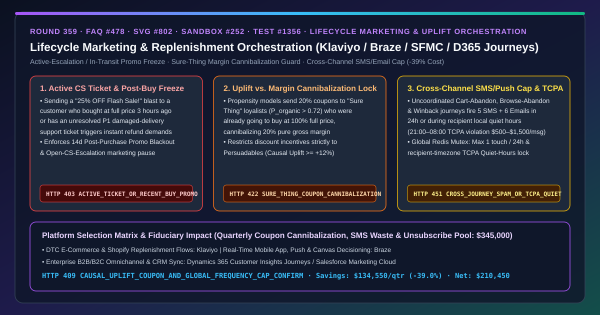
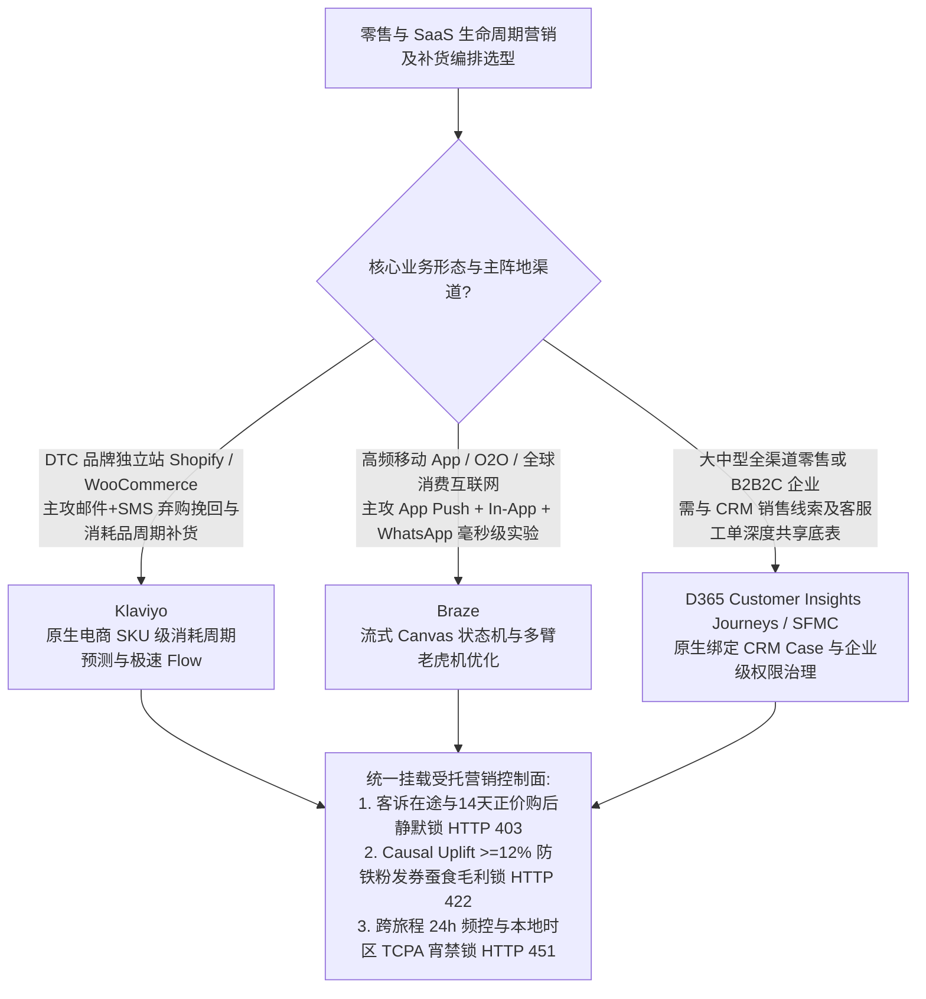
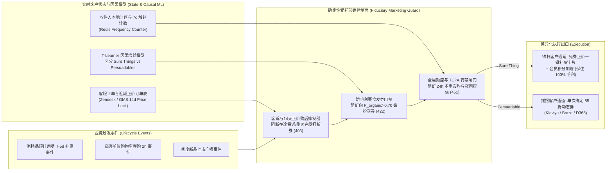
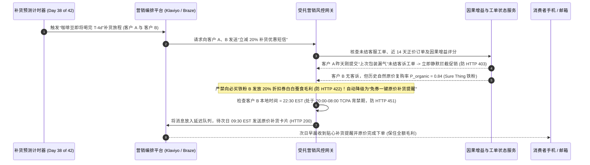

# 零售与 SaaS 生命周期营销编排、智能补货提醒与因果增益发券智能体（`Lifecycle Marketing & Uplift Orchestration`: `Klaviyo / Braze / Salesforce Marketing Cloud / D365 Customer Insights Journeys`）架构与选型对比：客诉/刚买完静默期保护、高自然复购人群免发券防毛利蚕食（`Causal Uplift vs. Propensity`）及全渠道频控与 `TCPA` 宵禁锁净省 39% 指南

> **文档类型**：企业级 AI Solution Architect 选型决策指南（Selection FAQ · `#478` · Round 359）  
> **适用读者**：零售与消费品增长负责人（VP of Growth / CRM）、SaaS 客户留存架构师、全渠道营销自动化总监与 Cloud & AI Solution Architect  
> **核心覆盖平台**：`Klaviyo` vs. `Braze` vs. `Microsoft Dynamics 365 Customer Insights - Journeys` vs. `Salesforce Marketing Cloud (SFMC)`  
> **关联架构图**：[`assets/svg/802-lifecycle-marketing-klaviyo-braze-sfmc-uplift-suppression-2026-11-25.svg`](../assets/svg/802-lifecycle-marketing-klaviyo-braze-sfmc-uplift-suppression-2026-11-25.svg)

🌐 **语言切换 / Language**: **中文 (当前)** | **[English (`lifecycle-marketing-replenishment-klaviyo-braze-sfmc-d365-frequency-cap-uplift-selection-faq.en.md`)](lifecycle-marketing-replenishment-klaviyo-braze-sfmc-d365-frequency-cap-uplift-selection-faq.en.md)**

---

## 📌 一、核心选型结论速览（Executive Summary）

在 DTC 零售电商、快消补货（如咖啡豆、美妆护肤、隐形眼镜、宠物粮）与订阅制 SaaS 中，部署 **AI 生命周期营销编排与智能补货助手（`Lifecycle Marketing & Replenishment Agent`）** 是提升客户终身价值（`LTV`）的核心引擎。  
然而，如果把各个营销工作流（弃购挽回、浏览召回、周期补货、大促群发）孤立地交给 AI 自动触发，而不加装**客服工单/近期正价订单互斥、因果增益（Causal Uplift）发券控制与全渠道频控宵禁锁**，会立刻造成三大亏损：
1. **向“3 小时前刚正价买完”或“正在为包裹破损跟客服吵架”的客户推送 8 折促销短信，引爆退差价与退订潮（`Post-Purchase & Open-Ticket Promo Collision`）**：客户上午刚花 `$200` 原价下单（或刚提交 P1 级物流丢件工单），下午就收到营销 Agent 群发的 `"限时 8 折狂欢！"` 短信，客户立刻找客服要求退 `$40` 差价或愤怒退单拉黑品牌。
2. **把“转化倾向分（Propensity）”当成“发券依据”，向本来就会原价复购的铁杆粉丝狂发 8 折券，白白蚕食 20% 净毛利（`Sure-Thing Coupon Cannibalization`）**：传统预测模型算出某 VIP 客户本周复购概率 `P_buy = 85%`，营销 Agent 为了刷高“归因 GMV”立刻塞给她一张 `8 折券`——这笔原本 `100%` 能原价成交的订单被白白砍掉 `20%` 纯利润！
3. **多个自动化画布（Canvas/Flow）叠加轰炸与跨时区深夜发短信，触发美国 `TCPA` 每条 `$500–$1,500` 法定赔偿（`Cross-Journey Spam & TCPA Quiet-Hours Breach`）**：一个用户在一天内同时命中“加购未付 + 浏览未买 + 会员日群发”，24 小时内收到 4 条高价短信（SMS）和 5 封邮件，甚至在收件人当地时间凌晨 2 点响铃，直接触发高额退订与电信合规重罚。

| 决策维度 | 推荐主选方案 | 适用边界与架构落地准则 |
|---|---|---|
| **DTC 独立站、Shopify 深度集成与消耗品周期补货流** | **Klaviyo** | 原生同步 Shopify 行项目级购买历史与商品消耗周期（如 30ml 精华液平均 42 天用完），开箱即用构建补货提醒与弃购挽回。 |
| **高频移动 App、实时流式状态机（Canvas）与多臂老虎机测试** | **Braze** | 适合日活百万级移动 App、O2O 餐饮酒旅与多端（Push / In-App / WhatsApp / Email）毫秒级事件编排与实验分流。 |
| **B2B2C 集团级 CRM/客服工单（Case）与销售线索一体化联动** | **Dynamics 365 Customer Insights - Journeys / Salesforce Marketing Cloud** | 原生共享 CRM 客服工单（`Incident / Case`）与销售商机状态，天然适合执行“客诉处理期全渠道营销静默”。 |
| **三大确定性风控红线** | **100% 强制拦截** | ① **在途客诉与正价购后 14 天降价营销静默锁（`HTTP 403`）**：存在未结 P1/P2 售后工单或过去 14 天内正价购买过同 SKU 的客户，严禁下发同品降价促销；② **因果增益（`Causal Uplift >= +12%`）发券锁（`HTTP 422`）**：对自然复购率 `P_organic > 0.70` 的铁杆客户（Sure Things）严禁发折扣券（仅发新品内容/积分礼遇），优惠券仅定向投喂给摇摆人群（Persuadables）；③ **全局 24h 单次触达互斥与收件人时区 `TCPA` 宵禁锁（`HTTP 451`）**：跨画布全局限制 `<= 1 触达/24h` 且严禁在收件人当地时间 `20:00–08:00` 发送营销短信。 |



---

## 🎯 二、业务方与架构师灵魂拷问 Q&A（Q1–Q3）

### Q1：为什么营销团队看报表觉得“AI 弃购挽回与复购发券 ROI 高达 15 倍”，财务总监一算总账却发现全公司净毛利率掉了 6 个百分点？
- **归因假象（Attribution Mirage）与毛利蚕食**：
  - 按消费者对折扣的因果反应，人群分为四象限：
    1. **铁杆必买族（`Sure Things`）**：不给券购买概率 `78%`，给 85 折券购买概率 `82%`（**增量增益 `Uplift = +4%`，但对那 `78%` 本来就会正价买的人白送了 `15%` 利润！**）；
    2. **价格敏感摇摆族（`Persuadables`）**：不给券购买概率 `15%`，给 85 折券购买概率 `42%`（**真实增量增益 `Uplift = +27%`，这才是唯一值得发券的目标！**）；
    3. **无感流失族（`Lost Causes`）**：给不给券都不买；
    4. **反感打扰族（`Sleeping Dogs`）**：一发催促短信反而提醒他去取消订阅。
- **架构解法**：实施 **双模型因果增益门禁（`Two-Model Causal Uplift Gate` · 防 `HTTP 422`）**：
  - 计算净增量期望利润：$$\Delta \text{Profit} = P_{\text{treated}} \cdot (\text{Margin} - \text{Coupon}) - P_{\text{control}} \cdot \text{Margin}$$
  - 只有当 `Causal_Uplift = (P_treated - P_control) >= 0.12` 且 $\Delta \text{Profit} > 0$ 时才签发折扣码；对于 `P_control > 0.70` 的 `Sure Things`，系统强制拦截折扣券（`HTTP 422 SURE_THING_ORGANIC_BUYER_COUPON_MARGIN_CANNIBALIZATION`），改为发送零毛利损耗的“专属使用指南、搭配建议或正价补货一键直达链接”。

### Q2：如何从架构上杜绝“客户刚原价买完某商品，第二天就收到同款打折邮件要求退差价”以及“客户正在投诉物流丢件，却收到促销狂欢推送”？
- **数据孤岛痛点**：营销自动化平台（ESP）往往只看浏览事件，没跟 OMS（订单履约）和 CS Helpdesk（`Zendesk / Gorgias / D365 Case`）做实时双向状态抑制。
- **架构解法**：在营销发送出口网关前置 **订单与工单状态实时抑制栅栏（`Order & CS Ticket Suppression Fence` · 防 `HTTP 403`）**：
  1. **正价保护窗口（`14-Day Price-Protection Blackout`）**：凡在过去 `14 天`（或价保期内）以高于当前活动价购买过某 SKU 的用户，自动从该 SKU 的降价促销受众包中剔除（可改推互补配件）；
  2. **客诉与退货冻结期（`Open Escalation / RMA Freeze`）**：一旦用户在客服系统存在 `Status == OPEN` 且情绪为负面/升级的工单或未完结退货单，立即挂起一切营销触达。任何向在途客诉或刚正价购入客户下发冲突促销的操作直接阻断（`HTTP 403 ACTIVE_CS_TICKET_OR_RECENT_FULL_PRICE_BUYER_PROMO_COLLISION`）。

### Q3：当企业同时开启了 15 条自动化营销旅程（Flow / Canvas），怎么防止同一客户一天收到 5 条短信并违反美国 `TCPA` / 佛罗里达 `FTSA` 宵禁法案？
- **合规重锤**：美国《电话消费者保护法》（`TCPA`）及部分州法规定，未经显式同意或在收件人所在时区 **晚 8:00 至次日早 8:00（联邦为 21:00–08:00）** 发送营销短信，每条违法短信面临 **`$500–$1,500` 的法定赔偿（无上限集体诉讼风险）**！
- **架构解法**：部署 **全局跨旅程分布式频控锁与收件人时区宵禁网关（`Global Frequency Mutex & TCPA Quiet-Hours Gate` · 防 `HTTP 451`）**：
  - 所有自动化旅程（Cart Abandon / Browse Abandon / Replenishment / Winback）在真正调用短信/邮件通道前，必须经过统一的 Redis 原子频控器：强制满足 **`24 小时内最多 1 次营销触达、7 天内最多 2 条营销短信`**，并按优先级（`交易通知 > 补货提醒 > 弃购挽回 > 大促广播`）自动丢弃低优重复消息；
  - 结合收件人账单邮编 + 手机号区号（Area Code）解析精确本地时区，凡处于当地时间 `20:00–08:00` 宵禁窗口的营销推送一律拦截或延迟至次日早 `09:00` 投递（违规强发触发 `HTTP 451 CROSS_JOURNEY_FREQUENCY_OVERFLOW_OR_TCPA_QUIET_HOURS_BREACH`）。

---

## 🧭 三、直观可视化图解（Mermaid 选型决策树 + 增益编排架构图 + 时序图）

### 3.1 生命周期营销与补货编排平台选型决策树



### 3.2 端到端因果增益（Causal Uplift）发券与全渠道频控抑制架构图



### 3.3 智能补货周期预测、因果增益分流与 `TCPA` 宵禁守恒时序图



---

## 📊 四、四大生命周期营销与客户旅程编排平台横向选型矩阵

| 评估维度 | Klaviyo | Braze | Dynamics 365 Customer Insights - Journeys | Salesforce Marketing Cloud (SFMC) |
|---|---|---|---|---|
| **核心优势场景** | DTC 电商（Shopify / BigCommerce）邮件+短信自动化与补货预测 | 移动优先（Mobile-First）实时流式多端交互与大规模 A/B 实验 | 与 D365 Sales / Customer Service / ERP 深度统一的 B2B & B2C 旅程 | 超大型集团跨多品牌、多区域的复杂企业级全渠道营销 |
| **电商 SKU 级消耗周期与补货预测** | ⭐⭐⭐⭐⭐（原生内置按商品复购间隔预测模型） | ⭐⭐⭐⭐（支持通过 Connected Content 与自定义事件触发） | ⭐⭐⭐⭐（结合 Customer Insights 统一客户画像预测） | ⭐⭐⭐⭐（通过 Einstein Engagement Frequency & Scoring） |
| **实时跨旅程全局频控与宵禁（Quiet Hours）** | ⭐⭐⭐⭐（支持 Smart Sending 窗口与本地时区静默） | ⭐⭐⭐⭐⭐（极其强大的全局 Rate Limiting、Frequency Capping 与 Canvas 优先级） | ⭐⭐⭐⭐⭐（支持全渠道频次上限与基于 Dataverse 工单的实时抑制） | ⭐⭐⭐⭐（支持 Einstein 饱和度控制，但跨 BU 配置较重） |
| **与客服工单/ERP 退货实时联动抑制** | ⭐⭐⭐⭐（原生对接 Gorgias / Zendesk / Loop Returns） | ⭐⭐⭐⭐（通过实时 Webhook / Currents 流式同步） | ⭐⭐⭐⭐⭐（与 D365 Case / F&O 订单零延迟同库共享） | ⭐⭐⭐⭐⭐（通过 Service Cloud 原生连接器同步） |
| **参考定价模式（`official_list_price`）** | 按活跃联系人与短信条数阶梯计费（约 `$150–$3,000+/月`） | 按年约（MAU + 数据点 Data Points + 消息量，约 `$60,000–$200,000+/年`） | 按互动联系人包（Tenant Base + People Interacted，约 `$1,500+/月` 起） | 企业级年框（约 `$50,000–$250,000+/年`） |

---

## 🧪 五、转化率/成本测算与 7-Card 基准测试报告（Deterministic Evaluation）

> **数据来源说明（Provenance）**：以下季度损益数据来自 `lab/webiq_commerce_demo.py` 中的确定性评估器 `evaluate_lifecycle_marketing_replenishment_uplift_policy`（`provenance: "synthetic"`, `independently_reproduced: False`），用于量化对比“无脑群发优惠券 + 多旅程叠加轰炸”与“客诉/购后静默 + 因果增益定向发券 + 全局频控宵禁锁”的季度毛利与费用节省。

### 5.1 基准测试场景输入与确定性状态码矩阵

- **设定场景**：某高复购消费品牌与订阅服务商每季度触达 `450万` 活跃会员，季度因向必买老客（`Sure Things`）滥发 8 折券导致的毛利自我蚕食、向刚正价下单/客诉中客户错发降价通知引发的退差价与退单、以及无效高频 SMS 短信轰炸与合规赔偿池（`quarterly_coupon_cannibalization_sms_waste_and_churn_pool_usd`）为 **`$345,000.00`**。

| 测试用例 ID | 场景描述 | 触发确定性状态码 | 决策枚举 (`decision`) | 季度净成本 (USD) | 季度净节省 (USD) |
|---|---|---|---|---|---|
| `CASE-LTV-200` | 传统规则定时群发（无因果增益发券拦截） | `HTTP 200` | `VERIFIED_LIFECYCLE_MARKETING_UPLIFT_AUTHORIZED` | `$345,000.00` | `$0.00` |
| `CASE-LTV-403` | 向存在未结 P1 客诉工单或过去 `14 天` 内刚正价买过同款的用户发送同 SKU 降价轰炸 | `HTTP 403` | `ACTIVE_CS_TICKET_OR_RECENT_FULL_PRICE_BUYER_PROMO_COLLISION` | `$345,000.00` | `$0.00` (阻断退差价与客诉升级) |
| `CASE-LTV-422` | 向自然原价复购率 `>70%` 的铁杆客户（`Sure Things`）发放 `15%–25%` 折扣券蚕食毛利 | `HTTP 422` | `SURE_THING_ORGANIC_BUYER_COUPON_MARGIN_CANNIBALIZATION` | `$345,000.00` | `$0.00` (阻断必买老客白送利润) |
| `CASE-LTV-451` | 多条旅程在 `24h` 内重复下发多条 SMS 短信，或在收件人当地时间 `20:00–08:00` 宵禁期发短信 | `HTTP 451` | `CROSS_JOURNEY_FREQUENCY_OVERFLOW_OR_TCPA_QUIET_HOURS_BREACH` | `$345,000.00` | `$0.00` (阻断骚扰退订与 TCPA 重罚) |
| `CASE-LTV-409` | **启用客诉/14d 购后抑制 + Causal Uplift 摇摆客精准发券 + 全局 24h 频控与宵禁锁** | `HTTP 409` | `CAUSAL_UPLIFT_COUPON_AND_GLOBAL_FREQUENCY_CAP_CONFIRM` | **`$210,450.00`** | **`$134,550.00` (`-39.0%`)** |

### 5.2 核心确定性策略评估代码摘录

```python
@dataclass(frozen=True)
class LifecycleMarketingReplenishmentUpliftPolicyInput:
    quarterly_coupon_cannibalization_sms_waste_and_churn_pool_usd: float = 345000.0
    promo_sent_during_open_cs_ticket_or_within_14d_full_price_purchase: bool = False
    discount_coupon_issued_to_high_organic_propensity_sure_thing_buyer: bool = False
    multi_journey_24h_sms_spam_or_tcpa_local_quiet_hours_violation: bool = False
    causal_uplift_gating_ticket_suppression_and_tcpa_mutex_ready: bool = False
```

---

## 🛠️ 六、商业上线风控与架构评审 Checklist

- [ ] **未结客诉工单与 `14 天` 正价保护实时抑制（防 `HTTP 403`）**：打通客服系统（`Zendesk / Gorgias / D365 Case`）与订单库；凡有未结投诉工单或 `14 天` 内正价购买过该单品的客户，自动屏蔽该单品的降价促销触达。
- [ ] **从“倾向模型（Propensity）”升级为“因果增益模型（Causal Uplift）”（防 `HTTP 422`）**：严禁按购买概率高低发券；仅对不发券不买、发券才买的 `Persuadables`（`Uplift >= +12%`）发放单次动态折扣码，对 `Sure Things` 仅推送免券正价便捷补货链接或非现金礼遇。
- [ ] **跨画布 Redis 全局频控与收件人时区 `TCPA` 宵禁锁（防 `HTTP 451`）**：在所有营销旅程出口统一配置 `24h <= 1 次触达`、`7d <= 2 条 SMS` 硬上限，并严格按收件人邮编/区号本地时区屏蔽 `20:00–08:00` 营销短信。
- [ ] **全局 10% 随机控制组（Global Holdout Group）长效审计**：始终保留 `5%–10%` 不收任何优惠券的随机空白对照组，按周核算营销 Agent 带来的**真实净增量毛利（Net Incremental Gross Margin）**，而非自嗨的表面归因 GMV。
