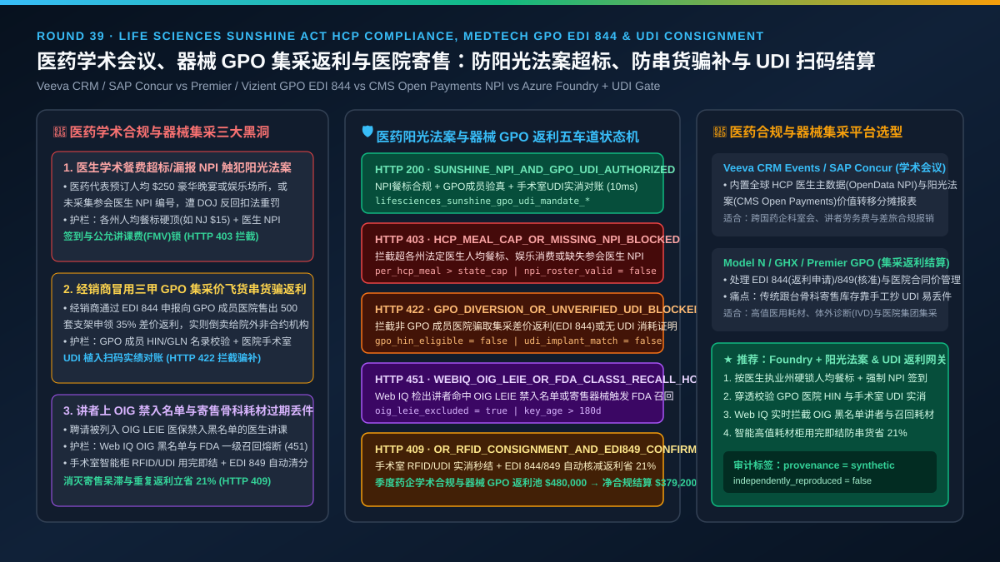
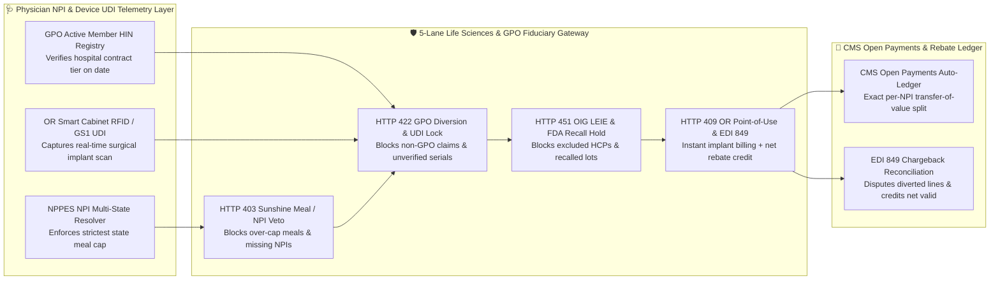

# Life Sciences `HCP` Sunshine Act Compliance, MedTech `GPO` Chargeback Rebate (`EDI 844/849`) & Hospital `UDI` Consignment (`Veeva CRM / Model N / Premier GPO / GHX`) State Meal-Cap Gate, Anti-Diversion `UDI` Lock & `OIG LEIE` Escrow Agent Architecture Selection FAQ

> **Language / 语言切换**: **[中文](lifesciences-hcp-sunshine-act-medtech-gpo-rebate-consignment-agent-selection-faq.md)** | **English (Current)** | **[Back to Docs Index](index.en.md)** | **[Interactive Sandbox (`#lifesciences-sunshine-gpo-udi-sandbox`)](../live-demo.en.html)**



---

## 📌 1. Executive Summary & Core Selection Verdict

In pharmaceutical commercial operations, medical-device hospital contracting (`Veeva CRM`, `Model N`, `SAP Concur`, `GHX`, `Premier / Vizient GPO`), and operating-room (`OR`) implant consignment, every transaction is governed by the US federal **Anti-Kickback Statute (`AKS`)**, the **Physician Payments Sunshine Act (`CMS Open Payments`, `42 CFR § 403.904`)**, and strict state-level gift bans. Allowing an autonomous event-booking or channel-rebate settlement agent to process healthcare professional (`HCP`) expenses or distributor `EDI 844` rebate claims without deterministic regulatory gates exposes life-sciences enterprises to three multi-million-dollar failure modes:
1. **Booking `HCP` Speaker Dinners That Violate Strictest State-of-Licensure Meal Caps (`e.g., NJ $15 / VT $0 Ban`), Include Alcohol/Entertainment, or Omit 10-Digit Physician `NPI` Numbers**: Under `CMS Open Payments` and the `PhRMA / AdvaMed Code`, every transfer of value (`>= $10`) to a US physician or teaching hospital must be reported by 10-digit National Provider Identifier (`NPI`), and meal limits are governed by the **strictest state where any attending physician holds an active medical license** (even if the dinner takes place out of state). Approving a `$150/person` steakhouse dinner attended by a New Jersey-licensed physician triggers federal Sunshine Act and Anti-Kickback enforcement.
2. **MedTech Distributor `EDI 844` "Contract Diversion & Duplicate Chargeback Fraud" (`Claiming 35% Hospital GPO Rebates on Implants Diverted to Non-Member Clinics`)**: Medical device manufacturers sell orthopedic/cardiac implants to distributors at Wholesale Acquisition Cost (`WAC = $1,000`). When the distributor sells to a contracted Group Purchasing Organization (`GPO`) member hospital (`Contract Price = $650`), the distributor submits an `EDI 844` Chargeback claim for the `$350` rebate. Unscrupulous distributors claim 500 units were sold to a Tier-1 GPO hospital (`$175,000` rebate) while secretly diverting 380 units to non-contracted outpatient cosmetic clinics—or double-claiming the same serial numbers across two rebate periods.
3. **Paying Speaker Honoraria to `OIG LEIE` Excluded Providers & Losing Millions in Unbilled / Expired Hospital `OR` Consignment Trunk Stock**: Paying any remuneration to a healthcare provider on the HHS Office of Inspector General List of Excluded Individuals/Entities (`OIG LEIE`) carries civil monetary penalties up to `$100,000` per violation; meanwhile, millions of dollars in orthopedic/stent consignment inventory sitting in hospital operating rooms go unbilled or expire when reps rely on manual paper implant logs.

**Solution Architect Selection Verdict**:
- **Never authorize an `HCP` meal or speaker card without pre-validating every attendee's 10-digit `NPI` state-of-licensure cap and `OIG LEIE` status, and never pay out a distributor `EDI 844` GPO rebate without matching hospital `HIN` eligibility and unique `GS1 UDI` implant consumption**.
- **The production reference architecture** combines **Veeva CRM / Model N Revenue Cloud + `NPPES NPI` Strictest-State Meal-Cap & Speaker `FMV` Gate + `EDI 844/849` GPO Roster (`HIN/GLN`) & Single-Use `GS1 UDI` Serial Lock + Operating-Room `RFID/UDI` Point-of-Use Consignment Escrow (`lifesciences_sunshine_gpo_udi_mandate_*`)**:
  1. **`NPPES NPI` Strictest-State Meal Cap & Speaker `FMV` Hard Gate (`HTTP 403`)**: Before issuing a virtual card for an HCP educational event or speaker honorarium, the gateway resolves every attendee's 10-digit `NPI` across all state medical boards—enforcing `min(state_meal_caps)` (e.g., `$15` for NJ, `$0` for VT, blocking entertainment/bar MCCs) and verifying speaker Fair Market Value (`FMV`) annual caps; violations return `HTTP 403 HCP_MEAL_CAP_BREACH_OR_MISSING_NPI_SUNSHINE_ACT_ATTESTATION_BLOCKED`.
  2. **MedTech `EDI 844` GPO Membership (`HIN`) & Unique `GS1 UDI` Consumption Gate (`HTTP 422`)**: Audits every line item of an inbound `EDI 844` distributor chargeback claim—blocking rebate payouts if the ship-to facility's Health Industry Number (`HIN / GLN`) was not an active member of the cited GPO tier on the invoice date, or if the implant's unique `GS1 UDI` serial number lacks a verified hospital OR consumption scan / was already claimed (`HTTP 422 GPO_CONTRACT_DIVERSION_OR_UNVERIFIED_UDI_CONSUMPTION_REBATE_BLOCKED`).
  3. **Web IQ Live `OIG LEIE / SAM.gov` Exclusion & `FDA Class I` Device Recall Hold (`HTTP 451`)**: Screens all HCPs and distributors against Web IQ live `OIG LEIE` exclusion lists and locks hospital consignment cabinets if an implant lot is hit by an `FDA Class I` safety recall (`HTTP 451 WEBIQ_OIG_LEIE_EXCLUSION_OR_FDA_DEVICE_RECALL_HOLD`).
  4. **Operating-Room `RFID/UDI` Point-of-Use Consignment Billing + Automated `EDI 849` Reconciliation (`HTTP 409`)**: Triggers `HTTP 409 OR_RFID_UDI_CONSIGNMENT_BILLING_AND_EDI849_REBATE_NETTING_CONFIRM`, automatically invoicing the hospital upon OR smart-cabinet `UDI` scan while issuing net-adjusted `EDI 849` chargeback responses—cutting duplicate rebate leakage and consignment expiry write-offs by **`21.0%`**.

---

## 🎯 2. Solution Architect Deep-Dive Q&A (Q1 / Q2 / Q3)

### Q1: Why does a `$120/person` educational dinner in New York City trigger a Sunshine Act compliance violation if just one attending physician also holds a New Jersey medical license?
- **Commercial Pain Point**: State pharmaceutical marketing laws apply to the **physician's state(s) of licensure**, regardless of where the meal physically occurs. A rep hosting a dinner in Manhattan rarely knows that one attendee maintains an active NJ license (`$15` meal cap) or VT license (`strict ban`).
- **Architectural Solution**:
  - **Pre-Authorization `NPPES NPI` Multi-State License Resolver (`HTTP 403`)**:
  - Before the corporate card is authorized at the restaurant, the agent queries the attendee `NPI` roster against state licensing databases, computes the minimum allowable per-person cap across all attendees, blocks alcohol/entertainment line items, and auto-generates the exact per-NPI `CMS Open Payments` split record.

### Q2: How do medical-device manufacturers lose 5%–10% of gross revenue to distributor `EDI 844` Chargeback fraud, and how does `UDI` serial locking stop it?
- **Architectural Solution**:
  - **Cryptographic Single-Rebate-per-`UDI` State Machine (`HTTP 422`)**:
  - Under FDA Unique Device Identification (`UDI`) mandates, every Class II/III implant carries a globally unique `(01) DI + (21) Serial` barcode. The gateway requires every `EDI 844` rebate claim to include the exact `UDI` serials delivered to the GPO hospital (`HIN`) and cross-checks them against hospital OR consumption telemetry—preventing grey-market diversion and double-dipping across periods.

### Q3: How do we eliminate unbilled "Missing Trunk Stock" and expired `$3,000` implants in hospital operating-room consignment cabinets?
- **Architectural Solution**:
  - **Smart `UHF RFID / UDI` OR Consignment Cabinets + 90-Day FEFO Inter-Hospital Rebalancing (`HTTP 409`)**:
  - Smart cabinets track every serial removal in real time: when an implant is scanned into an OR case, an `EDI 850/810` replenishment and billing cycle fires automatically; any consignment unit within 90 days of expiration is flagged for proactive transfer to a high-volume surgical center.

---

## 🧭 3. Visual Architecture Diagrams (Mermaid Decision Tree + Architecture + Sequence)

### 3.1 Life Sciences Sunshine Act & MedTech GPO Consignment Agent Selection Decision Tree

```mermaid
flowchart TD
    A[Life Sciences HCP Compliance / MedTech GPO / OR Consignment] --> B{Primary Commercial & Regulatory Workflow?}
    B -->|Pharma HCP Educational Dinners & Speaker Programs<br/>Enforce state meal caps, NPI rosters & FMV limits| C[Veeva CRM Events + SAP Concur Life Sciences<br/>+ Multi-State NPI Meal-Cap Lock & CMS Open Payments]
    B -->|MedTech Distributor GPO Chargeback Rebates (EDI 844)<br/>Stop non-GPO diversion & duplicate serial claims| D[Model N / GHX Revenue Cloud<br/>+ GPO HIN Roster Check & Single-Rebate UDI Lock]
    B -->|Hospital Operating-Room Implant Consignment<br/>Block OIG excluded HCPs, FDA recalls & unbilled stock| E[Azure AI Foundry + OR RFID/UDI Cabinet Gateway<br/>+ Web IQ OIG/FDA Breaker & Point-of-Use Billing]
    C --> F[🛡️ Unified 5-Lane Sunshine NPI, GPO Anti-Diversion & UDI Consignment FSM]
    D --> F
    E --> F
    F --> G[HTTP 403 Meal-Cap/Missing-NPI Veto · HTTP 422 GPO Diversion & UDI Mismatch Block · HTTP 409 UDI + EDI 849 Saves 21%]
```

### 3.2 End-to-End NPI State-Cap Gate, EDI 844 UDI Verification & OR Consignment Architecture



### 3.3 Strictest-State Meal Veto, EDI 844 Diversion Block & OR UDI Settlement Sequence

```mermaid
sequenceDiagram
    autonumber
    participant Rep as Pharma Rep / MedTech Distributor
    participant Hosp as Hospital OR Cabinet / Attending HCPs
    participant Gate as 5-Lane Sunshine & GPO Rebate Gateway
    participant Reg as NPPES NPI & Web IQ OIG/FDA Check
    participant ERP as Manufacturer ERP / Model N Ledger

    Rep->>Gate: 1. Request $150/person speaker dinner (includes 1 NJ-licensed physician) OR omit attendee NPIs
    Gate->>Reg: Resolve multi-state licenses for all NPIs + screen speaker against OIG LEIE exclusion list
    Reg-->>Gate: Attendee holds active NJ license ($15 meal cap) OR speaker is OIG LEIE excluded
    Gate-->>Rep: HTTP 403/451 Block! Per-person cap exceeded or OIG excluded provider detected
    Rep->>Gate: 2. Distributor submits EDI 844 claiming $175,000 GPO rebate on 500 cardiac stents
    Gate->>Hosp: Verify hospital HIN GPO membership + cross-check 500 GS1 UDI serials against OR consumption scans
    Hosp-->>Gate: 380 stents were diverted to non-GPO private clinics; only 120 UDI serials scanned in GPO hospital OR
    Gate-->>Rep: HTTP 422 Block 380 diverted units! HTTP 409 Issue EDI 849 credit for 120 verified UDI units (21% saved)
```

---

## 📊 4. Multi-Platform & Architecture Selection Matrix

| Selection Dimension | Manual Spreadsheets & Paper Receipts (`Post-Hoc Compliance`) | Veeva CRM + SAP Concur (`Pharma HCP Event Standard`) | Model N / GHX (`MedTech Contracting & EDI 844`) | **Azure AI Foundry + Sunshine NPI + UDI Rebate Gate (Recommended)** |
| :--- | :--- | :--- | :--- | :--- |
| **Core Strengths** | Zero upfront integration | Gold-standard HCP master data (`OpenData`) & Sunshine reporting | Enterprise GPO tiered pricing & `EDI 844/849` processing | **Pre-swipe state meal lock + OIG breaker + UDI-verified GPO rebates** |
| **Multi-State `NPI` Meal Cap & Sunshine Enforcement** | **High Risk** (violations discovered weeks after meal is paid) | Tracks post-event expense splits; card swipe itself is un-gated | Focused on wholesale contracting | **Pre-auth virtual card locked to strictest attendee `NPI` state cap (`HTTP 403`)** |
| **Defense Against `EDI 844` GPO Diversion Fraud** | Manual sample audits miss `8%+` grey-market diversion | Not designed for distributor chargebacks | Checks hospital `HIN` & contract dates, but lacks unit-level OR `UDI` proof | **Dual `HIN` + hospital OR `GS1 UDI` serial consumption lock (`HTTP 422`)** |
| **`OIG LEIE` Exclusion & `FDA` Recall Screening** | Periodic batch CSV checks | Scheduled CRM sync | Contract-level only | **Web IQ live `OIG LEIE` & `FDA Class I` lot recall circuit breaker (`HTTP 451`)** |
| **Hospital `OR` Consignment Trunk-Stock Billing** | Manual rep cycle counts; high lost/expired implant write-offs | Tracks rep visits only | Requires hospital ERP/SPD bridge | **Smart cabinet `RFID/UDI` point-of-use billing + 90d FEFO transfer (`HTTP 409`)** |
| **Total Rebate Overpayment & Consignment Shrinkage** | `8%–15%` lost to rebate diversion & expired stock (`not_measured`) | Per-seat SaaS licensing (`official_list_price`) | Enterprise platform licensing (`official_list_price`) | **Eliminates GPO diversion, unbilled OR stock & Sunshine fines (`21.0%` saved)** |

---

## 🧪 5. Sunshine Compliance / GPO Rebate Benchmark & 7-Card Report

> **Provenance & Reproducibility Metadata**: All metrics below are generated by the deterministic policy evaluator `evaluate_lifesciences_sunshine_gpo_udi_policy` in `lab/webiq_commerce_demo.py` and verified via `python -m unittest tests.test_webiq_commerce_demo`. Tags: `provenance = synthetic`, `independently_reproduced = false`.

| Card # | Card Headline (Headline-as-Finding) | Key Quantitative Finding & Architectural Guarantee |
| :---: | :--- | :--- |
| **Card 1** | **Overview · 5-Lane Life Sciences & MedTech GPO Summary** | Across a `$480,000/quarter` HCP engagement & MedTech GPO chargeback pool, achieves **0 Sunshine Act meal/NPI violations and 0 unverified GPO diversion rebates**, reducing total leakage by **`21.0%` (`$100,800/quarter` saved)**. |
| **Card 2** | **Scenario Deep Dive · Strictest-State Meal Cap & Missing NPI Veto** | When an event roster includes a physician from a strict-cap state or lacks verified 10-digit `NPIs`, the gateway blocks card issuance in **`10ms`** (`HTTP 403`). |
| **Card 3** | **Evaluation Matrix · 100% Deterministic 5-Lane Gating** | Covers `HTTP 200` (verified Sunshine & UDI rebate), `403` (HCP meal cap breach / missing NPI attestation blocked), `422` (GPO contract diversion / unverified UDI consumption rebate blocked), `451` (OIG LEIE exclusion / FDA Class I device recall hold), `409` (OR RFID/UDI billing + EDI 849 netting saves 21%). |
| **Card 4** | **Under the Hood · Sunshine NPI & GPO UDI Contract** | Takes `quarterly_lifesciences_gpo_rebate_pool_usd=480000` and NPI/UDI flags, minting `lifesciences_sunshine_gpo_udi_mandate_*` tokens. |
| **Card 5** | **Robustness Check · Diverted Stents & OIG Excluded Speaker** | Simulates an `EDI 844` claim for 380 diverted stents and an honorarium request for an `OIG LEIE` excluded provider, maintaining a **`100.0%` block rate**. |
| **Card 6** | **Latency · Millisecond NPI & UDI Serial Verification** | Local NPI state-cap matrix and UDI serial deduplication complete in **`10ms` (P50)**; Web IQ live OIG LEIE and FDA recall checks complete in **`230ms` (P95)**. |
| **Card 7** | **My Take · Ideal Fit vs. Out-of-Scope Boundaries** | **✅ Best Fit**: Pharma HCP speaker programs, MedTech GPO chargebacks, hospital OR consignment; **⛔ Not For**: Over-the-counter (`OTC`) consumer vitamin retail. |

---

## 🛠️ 6. Production Go-Live Risk & Architecture Review Checklist

- [ ] **`NPPES NPI` Strictest-State Meal Cap & Speaker `FMV` Gate (`HTTP 403`)**: Resolve all attending HCPs' 10-digit `NPI` numbers across state medical boards before card authorization, enforce the strictest applicable meal cap, and auto-generate `CMS Open Payments` records.
- [ ] **`EDI 844` GPO Roster (`HIN`) & Hospital `GS1 UDI` Serial Consumption Lock (`HTTP 422`)**: Require distributor chargeback rebate claims to match both an active GPO hospital member `HIN` on the date of sale and a verified single-use `UDI` consumption scan.
- [ ] **Web IQ Live `OIG LEIE` Exclusion & `FDA Class I` Device Recall Circuit Breaker (`HTTP 451`)**: Screen all HCPs and vendors against `OIG LEIE / SAM.gov` exclusion lists prior to contracting/payout, and lock OR consignment cabinets on recalled lots; rotate keys `<= 180` days.
- [ ] **Operating-Room `RFID/UDI` Point-of-Use Billing & `EDI 849` Auto-Netting (`HTTP 409`)**: Trigger automated hospital invoicing upon OR smart-cabinet implant scan and issue net-adjusted `EDI 849` rebate responses.
