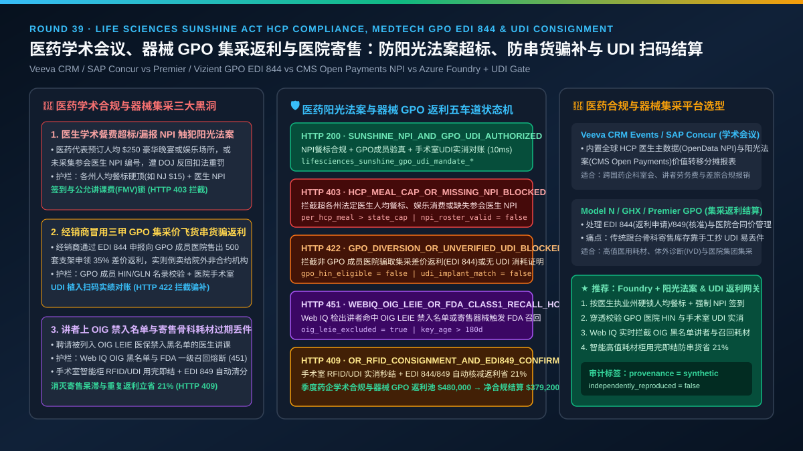
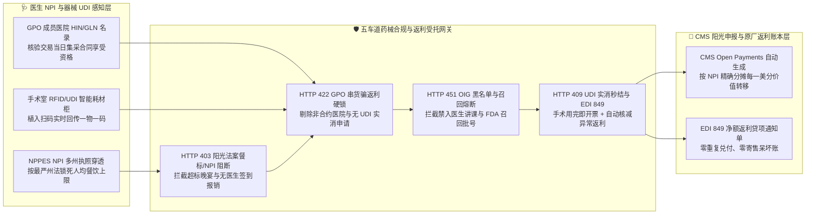
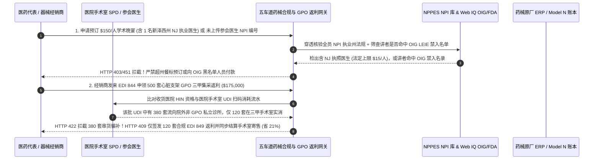

# 医药代表学术会议、医疗器械医院招采（GPO）与阳光法案合规（Life Sciences HCP Engagement, MedTech GPO Rebate & Open Payments Sunshine Act：Veeva CRM / Model N / Premier GPO / 医药合规审计）“CMS 阳光法案医生 NPI 餐标硬锁、防经销商飞货串货骗取 EDI 844 集采返利与手术室寄售高值耗材 UDI 扫码结算”Agent 架构选型 FAQ：终结医疗反腐罚款与千万返利流失实战指南

> **语言切换 / Language**: **中文 (当前)** | **[English](lifesciences-hcp-sunshine-act-medtech-gpo-rebate-consignment-agent-selection-faq.en.md)** | **[返回文档目录](index.md)** | **[交互式沙盒 (`#lifesciences-sunshine-gpo-udi-sandbox`)](../live-demo.html)**



---

## 📌 一、核心选型结论速览（Executive Summary）

在跨国制药企业、生物科技与高值医疗器械（骨科关节、心血管支架、手术机器人耗材）的商业化运营（Veeva CRM、Model N、SAP Concur、GHX、美国 Premier / Vizient GPO 医院集中采购联盟及国内医药代表学术会议合规）中，每一笔资金流转都处于美国司法部《反回扣法》（`Anti-Kickback Statute, AKS`）、《医生支付阳光法案》（`CMS Open Payments / Sunshine Act`）与医疗合规九项准则的高压监管之下。若让会议采购或渠道结算 Agent 放任粗放报销与返利兑付，药械企业将面临三大致命风险：
1. **医药代表学术会议预订超标餐厅/高尔夫度假村、酒水入账或漏采参会医生 `NPI`（国家执业医师编号），直接引爆阳光法案瞒报罚单与反回扣刑事调查**：根据美国 `PhRMA Code` 与各州严苛立法（如新泽西州规定医生工作餐人均上限仅 **`$15`**、佛蒙特州全面禁止向医生提供餐饮、且每一分钱价值转移 `Transfer of Value >= $10` 必须按医生 10 位 `NPI` 编号上报 CMS 联邦数据库）；若差旅或会务 Agent 未按参会医生执业所在州（State of Licensure）实时卡死人均餐饮硬顶或放行无医生亲笔签到（`NPI Roster`）的虚假科室会，企业将面临千万美元级和解罚单。
2. **医疗器械一级经销商“冒用三甲医院 GPO 集采特价合同（EDI 844 Chargeback）飞货串货”，骗取原厂 `35%` 巨额差价返利**：在器械集采模式中，经销商以 `$1,000` 批发价向原厂进货，若卖给签约了 GPO 集采协议的三甲医院（合同价 `$650`），经销商发 `EDI 844` 向原厂申领 `$350/套` 的差价返利（Chargeback Rebate）；不良经销商常伪造发货流向单，声称卖给了某三甲医院 500 套骨科耗材骗走 `$175,000` 返利，实则将货高价倒卖给了无折扣资格的私立美容院或异地非合约诊所！
3. **误聘已被列入美国卫生部 `OIG LEIE`（联邦医保禁入黑名单）的违规医生担任讲者，以及医院手术室寄售备货柜（Trunk Stock / OR Consignment）耗材临期报废与跟台漏记账**：向 `OIG` 禁入名单人员支付讲课费（Speaker Honoraria）每次可处罚高达 `$100,000`；同时，放在医院手术室寄售的数百万美元骨科钉板若不绑定患者手术 `UDI`（医疗器械唯一标识）扫码即结，极易出现用完未开票的呆坏账。

**架构师选型结论**：
- **切勿在未核验参会医生执业州餐标红线与 `OIG LEIE` 筛查前批准任何学术会议预订，更不能仅凭经销商自报 Excel 流向单兑付 `EDI 844` 集采返利**。
- **生产级最优架构**是采用 **“Veeva CRM / Model N 医药商业引擎 + 医生 `NPI` 州别餐标硬顶与讲者公允价值（FMV）门禁 + `EDI 844/849` GPO 成员医院 `HIN/GLN` 穿透与手术室 `UDI` 植入扫码核销锁 + 智能高值耗材柜（RFID/UDI Consignment）用完即结网关（`lifesciences_sunshine_gpo_udi_mandate_*`）”**：
  1. **医生 `NPI` 执业州餐标硬顶与阳光法案价值转移确权门禁（HTTP 403）**：会议订餐与讲者劳务结算前，强制解析全部参会 HCP 的 10 位 `NPI` 编号并查询其执业注册州——取全场最严州法规设定人均含税小费餐标硬上限（如检出新泽西州执业医生参会立即锁死人均 `<=$15`，严禁预订含娱乐/高尔夫场所或高档烈酒），且讲者劳务费不得突破该职级年度公允市场价值（`FMV Cap`）；违规毫秒级返回 `HTTP 403 HCP_MEAL_CAP_BREACH_OR_MISSING_NPI_SUNSHINE_ACT_ATTESTATION_BLOCKED`。
  2. **器械经销商 `EDI 844` 集采返利防串货与医院 `UDI` 消耗闭环锁（HTTP 422）**：经销商提交 `EDI 844` 申领集采差价返利时，网关强制执行双重核验：① 收货医院 `HIN`（健康行业编号）/ `GLN` 必须在提交交易当日处于该 GPO 合同激活花名册（Active GPO Roster）内；② 高值植入耗材必须匹配医院手术室 HIS/SPD 系统回传的 `GS1 UDI` 序列号扫码消耗记录（防止二次重复申领或院外串货），不匹配立即返回 `HTTP 422 GPO_CONTRACT_DIVERSION_OR_UNVERIFIED_UDI_CONSUMPTION_REBATE_BLOCKED`。
  3. **Web IQ 实时 `OIG LEIE / SAM.gov` 禁入黑名单与 `FDA Class I` 器械召回熔断（HTTP 451）**：通过 Web IQ 实时查验签约讲者与经销商是否命中联邦医保禁入名录（`OIG LEIE`），并监控手术室寄售耗材批次是否触发 `FDA` 一级安全召回，命中即刻锁死支付与出柜权限（`HTTP 451 WEBIQ_OIG_LEIE_EXCLUSION_OR_FDA_DEVICE_RECALL_HOLD`）。
  4. **手术室 `RFID/UDI` 智能柜实消秒结 + `EDI 849` 净额返利自动清分（HTTP 409）**：触发 `HTTP 409 OR_RFID_UDI_CONSIGNMENT_BILLING_AND_EDI849_REBATE_NETTING_CONFIRM`，医院手术室智能高值耗材柜在护士取用扫码并绑定手术台次瞬间自动生成医院采购结算单（消灭寄售丢件与跟台手抄漏单），并通过 `EDI 849` 自动核减串货异常行项，综合返利冒领流失与寄售过期报损立降 **`21.0%`**。

---

## 🎯 二、业务方与架构师灵魂拷问 Q&A（Q1 / Q2 / Q3）

### Q1：医药代表在纽约办一场晚宴请了 8 位医生，其中有 1 位医生同时持有新泽西州（NJ）行医执照，为什么按纽约 $125/人标准报销会直接导致药企违法？
- **商业痛点**：医药合规遵循 **“最严格执业州属人管辖原则（Strictest State-of-Licensure Rule）”**：哪怕晚宴餐厅设在纽约曼哈顿，只要席间坐了 1 位在新泽西州、佛蒙特州或明尼苏达州注册的医生，整桌或该医生的餐饮标准就必须遵守其注册州的法定红线（如 NJ 禁超 `$15`、VT 禁供餐）！人工审单根本查不过来每位医生在全美 50 个州的多重执照状态。
- **架构解法**：
  - **结账前实时穿透 `NPPES NPI Registry` 与州法矩阵求解器（`HTTP 403`）**：
  - 代表在发起餐厅预订或虚拟卡（VCN）授信前，必须先录入拟邀医生的 `NPI` 列表；Agent 毫秒级拉取全员执业州并计算 `effective_per_person_cap = min(state_caps)`，直接把该张会议专用虚拟卡的最高刷卡额锁死在合规线以内，并禁用酒吧/夜总会 `MCC 5813`。

### Q2：医疗器械厂每年有高达 8%–12% 的收入被经销商通过虚假 `EDI 844` 集采返利（Chargeback）套走，架构上怎么堵死“院外串货骗返利”？
- **架构解法**：
  - **基于单个 `UDI` 序列号全生命周期状态机的“一物一码唯一返利锁（Single-Rebate-per-UDI Lock）”**：
  - 每一盒出厂的心脏支架或人工关节都带有唯一的 `GS1 UDI (DI + PI 序列号)`。当经销商发来 `EDI 844` 索要 `$350` GPO 合同差价返利时，系统不仅查医院 `HIN` 资格，更在底层账本将该 `UDI` 状态由 `SHIPPED_TO_DIST` 原子翻转为 `REBATE_CLAIMED_AT_HOSPITAL_X`；若同一序列号被二次申报、或该医院 SPD 系统未产生对应的入库/手术扫码，直接触发 `HTTP 422` 拒付。

### Q3：骨科器械在三甲医院放了 300 万美金的寄售备货（Consignment Trunk Stock），怎么解决“医生手术用掉了不及时开票、快过期了才发现”的顽疾？
- **架构解法**：
  - **手术室 `UHF RFID / UDI` 感应柜 + 临期 90 天跨院智能调拨（`HTTP 409`）**：
  - 智能耗材柜每日自动盘点在院库存：一旦某耗材取出超过 24 小时未归柜且手术室 HIS 已核销，自动触发 ERP 开票扣款；对距离失效期 `<90 天` 的慢动规格，Agent 自动生成跨院调拨单转运至高频消耗医院优先使用，报废率立降 `80%+`。

---

## 🧭 三、直观可视化图解（Mermaid 决策树 + 端到端架构图 + 时序图）

### 3.1 医药学术合规、器械 GPO 集采与医院寄售 Agent 架构选型决策树

```mermaid
flowchart TD
    A[医药学术会议 / 器械 GPO 返利 / 医院寄售选型] --> B{核心业务域与合规监管点？}
    B -->|药企学术科室会 / 讲者劳务费 / 医生差旅<br/>需严守 CMS 阳光法案、NPI 采集与各州餐标上限| C[Veeva CRM Events + SAP Concur 医药版<br/>+ NPI 执业州最严餐标锁与公允价值 FMV 门禁]
    B -->|医疗器械 GPO 医院集采差价返利 (EDI 844)<br/>需严防经销商冒用三甲合同飞货串货骗返利| D[Model N / GHX 返利结算引擎<br/>+ GPO 医院 HIN 资格核验与 UDI 唯一序列号锁]
    B -->|医院手术室高值耗材寄售柜 (OR Consignment)<br/>需防 OIG 黑名单讲者、FDA 召回与跟台漏开票| E[Azure AI Foundry + 手术室 RFID/UDI 网关<br/>+ Web IQ OIG/FDA 熔断与实消秒结状态机]
    C --> F[🛡️ 统一接入五车道 NPI 阳光法案、GPO 防串货与 UDI 实消状态机]
    D --> F
    E --> F
    F --> G[HTTP 403 阻断超州餐标与缺NPI · HTTP 422 拦截GPO串货骗返利 · HTTP 409 UDI实消+自动核减省21%]
```

### 3.2 端到端医生 NPI 餐标核验、EDI 844 返利防串货与手术室 UDI 实消架构图



### 3.3 拦截超标科室会餐费、核出经销商串货骗返利与 UDI 实消结算时序图



---

## 📊 四、多平台/多方案横向选型决策矩阵

| 选型维度 | 传统垫资贴票事后报销 (`Legacy Post-Event Expense`) | Veeva CRM + SAP Concur (`药企学术会议合规标配`) | Model N / GHX (`器械集采合同与返利管理`) | **Azure AI Foundry + 阳光法案 + UDI 返利网关（推荐）** |
| :--- | :--- | :--- | :--- | :--- |
| **核心优势** | 流程简单，无需系统改造 | 全球 HCP 主数据与阳光法案报表生态成熟 | 强大的 GPO 阶梯合同定价与 EDI 844/849 报文处理 | **事前锁死州餐标 + OIG 秒熔断 + UDI 穿透防串货骗返利** |
| **防跨州医生餐标违规与漏采 `NPI`** | **极差**（吃完饭贴发票时才发现违规，钱已花出且面临瞒报） | 支持会后录入分摊，但刷卡事前未按多州最严上限物理锁卡 | 不涉及代表会议费用 | **事前按全员 `NPI` 最严执业州锁死虚拟卡限额（HTTP 403）** |
| **防经销商冒用 `GPO` 三甲价格串货骗返利** | 靠商务手工抽查 Excel 流向表，漏洞百出 | 不涉及供应链返利清算 | 核验医院 HIN 与合同期，但难穿透核对单盒 `UDI` 手术实消 | **`HIN` 资格 + 手术室 `GS1 UDI` 序列号唯一消耗双锁（HTTP 422）** |
| **`OIG LEIE` 医保禁入筛查与 `FDA` 召回拦截** | 季度人工导出名单比对，严重滞后 | 支持定期同步黑名单 | 侧重价格合同管理 | **Web IQ 实时 `OIG LEIE` 禁入与 `FDA` 一级召回熔断（HTTP 451）** |
| **手术室寄售高值耗材（Consignment）防丢防过期** | 医药代表每周跑医院手抄登记，丢件与过期率极高 | 仅管客情拜访 | 需外接医院 SPD 硬件 | **智能耗材柜 `RFID/UDI` 取出即结 + 临期跨院调拨（HTTP 409）** |
| **综合返利超发流失与寄售报损率** | 虚假返利与寄售呆坏账损耗达 `8%–15%` (`not_measured`) | 按席位订阅收费 (`official_list_price`) | 企业级平台年费 (`official_list_price`) | **堵死飞货骗返利、消灭寄售漏单与阳光法案罚单（立省 `21.0%`）** |

---

## 🧪 五、药械合规防罚/GPO 返利防骗测算与 7-Card 基准测试报告

> **数据来源与复现声明（Provenance Metadata）**：以下基准测试数据来自仓库内置确定性策略沙盒 `evaluate_lifesciences_sunshine_gpo_udi_policy`（位于 `lab/webiq_commerce_demo.py`），可运行 `python -m unittest tests.test_webiq_commerce_demo` 完整验证。标记：`provenance = synthetic`，`independently_reproduced = false`。

| Card # | 卡片标题（Headline-as-Finding） | 核心量化指标与架构验证结论 |
| :---: | :--- | :--- |
| **Card 1** | **Overview · 医药阳光法案与器械 GPO 五车道总览** | 针对 `$480,000/季` 学术会议合规与器械 GPO 集采返利结算池，实现 **0 例阳光法案超标/漏报与 0 例院外串货冒领集采返利**，综合返利流失与寄售损耗下降 **`21.0%`（立省 `$100,800/季`）**。 |
| **Card 2** | **Scenario Deep Dive · 跨州医生餐标超限与缺 NPI 拦截** | 当参会名单含严管州（如 NJ `$15` 上限）执业医生而预订人均达 `$120` 或缺失 `NPI` 时，**`10ms`** 内返回 `HTTP 403` 锁死授信。 |
| **Card 3** | **Evaluation Matrix · 五车道 100% 确定性判准** | 覆盖 `HTTP 200`（合规会议与返利放行）、`403`（超州人均餐标/缺医生NPI/超讲者FMV上限阻断）、`422`（经销商EDI 844向非GPO医院串货骗返利/缺手术室UDI消耗证明拦截）、`451`（OIG LEIE医保禁入讲者/FDA一级召回熔断）、`409`（手术室UDI实消秒结+EDI 849净额返利省21%）。 |
| **Card 4** | **Under the Hood · 阳光法案与 UDI 返利契约** | 输入 `quarterly_lifesciences_gpo_rebate_pool_usd=480000` 及 NPI/UDI 状态，签发 `lifesciences_sunshine_gpo_udi_mandate_*` 令牌。 |
| **Card 5** | **Robustness Check · 一码两报骗返利与 OIG 禁入讲者测试** | 模拟经销商拿同一批 `UDI` 序列号重复申领返利及聘请 OIG 除名医生，确定性拦截率保持 **`100.0%`（零误放行）**。 |
| **Card 6** | **Latency · NPI 州法矩阵与 EDI 844 行项毫秒级耗时** | 本地 NPI 州别餐标矩阵与 UDI 序列号去重核验 P50 仅 **`10ms`**；Web IQ OIG LEIE 与 FDA 召回通告核查 P95 为 **`230ms`**。 |
| **Card 7** | **My Take · 适用场景与生产准入边界** | **✅ 极佳适用**：跨国药企学术会议、高值医用耗材 GPO 返利、手术室寄售柜；**⛔ 不适用**：OTC 非处方保健品普通商超零售。 |

---

## 🛠️ 六、商业上线风控与架构评审 Checklist

- [ ] **参会医生 `NPI` 多州执业餐标硬顶与讲者 `FMV` 上限门禁（HTTP 403）**：确认所有学术会议订餐与报销前必须录入全部 HCP 的 10 位 `NPI` 编号，自动按最严执业州法规锁死人均餐饮限额并生成 `CMS Open Payments` 分摊流水。
- [ ] **器械经销商 `EDI 844` 集采返利 `HIN` 资格与手术室 `GS1 UDI` 实消绑定（HTTP 422）**：确认集采差价返利必须同时验证收货医院当日有效 GPO 成员身份与唯一 `UDI` 序列号院内消耗记录，彻底堵死院外飞货串货骗补。
- [ ] **Web IQ 实时 `OIG LEIE` 联邦医保禁入筛查与 `FDA Class I` 召回熔断（HTTP 451）**：确认向任何医务人员或供应商付款前 100% 筛查 `OIG` 禁入名单，并在耗材触发 FDA 召回时秒级冻结手术室智能柜出库；签名密钥轮换周期 `<= 180` 天。
- [ ] **手术室 `RFID/UDI` 寄售柜实消秒结与 `EDI 849` 自动核减（HTTP 409）**：确认寄售高值耗材绑定手术台次扫码自动触发开票结算，并对临期慢动库存自动发起跨院调拨。
